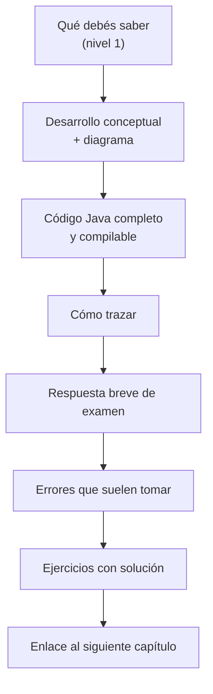

# Método de estudio y de escritura

> [!info] De dónde sale
> Este libro adopta el método de preparación que compartió un compañero que ya rindió el EFIP (`EFIP_I_Materiales_y_Experiencia`). Su guía del Módulo 2 demostró ser la más eficaz: reduce el contenido a lo que se explica y se aplica, y entrena la respuesta oral, no solo la lectura.

## 1. Los tres niveles de cada tema

El compañero clasifica todo el contenido en tres niveles. El libro respeta esa jerarquía:

| Nivel | Qué significa | Cómo se evalúa |
|---|---|---|
| **1 — Imprescindible** | Si no lo sabés, no aprobás | Definición + ejemplo en 30 segundos |
| **2 — Debés poder explicarlo** | Se pregunta en el oral | Explicación de 60-90 segundos con tus palabras |
| **3 — Reconocer y aplicar** | Aparece en casos y código | Resolver un ejercicio o trazar un fragmento |

Cada capítulo abre con un callout **“Al terminar tenés que poder”** que marca el nivel.

## 2. La regla para responder en el EFIP

> [!important] Los cinco pasos
> 1. **Definí** el concepto.
> 2. **Explicá cómo funciona.**
> 3. **Nombrá operaciones o componentes.**
> 4. **Aplicalo al caso.**
> 5. **Justificá por qué esa elección es adecuada.**
>
> Una definición aislada suele ser insuficiente.

Ejemplo aplicado a “¿qué estructura usarías para las alertas?”:

1. Definición: una cola es una estructura FIFO.
2. Funcionamiento: se inserta por el final y se extrae por el frente.
3. Operaciones: `enqueue`, `dequeue`, `front`.
4. Aplicación: las alertas se atienden por orden de llegada.
5. Justificación: FIFO garantiza que no se saltea ninguna alerta antigua.

## 3. Cómo trazar código (sin compu)

El compañero insiste: **no resuelvas mentalmente**. Armá una tabla.

| Iteración | Variable de control | Condición | Variable acumulada |
|---|---|---|---|
| 1 | `i = 1` | `1 <= 5` → sí | `activados = 0` |
| 2 | `i = 2` | sí | `activados = 1` |
| … | … | … | … |

Reglas:

- Una fila por iteración, no una por línea de código.
- Anotá el valor **antes** y **después** de cada cambio.
- Si hay un `break`, marcá la iteración de salida.
- Si hay referencias (objetos), dibujá la flecha, no el objeto entero.

Este libro incluye un bloque **“Cómo trazar”** en cada capítulo con código.

## 4. Dispositivos que vas a encontrar

| Dispositivo | Para qué sirve |
|---|---|
| **Qué debés saber** | Resumen de nivel 1 en 5-8 bullets, antes de desarrollar |
| **Respuesta breve de examen** | La frase que tenés que poder decir de memoria |
| **Cómo trazar** | Tabla de seguimiento de un fragmento de código |
| **Errores que suelen tomar** | Trampas reales, incluidas las del material de terceros |
| **Caso integrador** | El mismo caso (municipio con semáforos y cámaras) atravesando todo el libro |
| **Checklist** | Autoevaluación al cierre de cada parte |
| **Correcciones** | Cuando una fuente compartida tiene un error, se señala y se corrige |

## 5. Las cuatro vueltas de repaso

1. **Primera:** leer los cuadros “Qué debés saber” y mirar los diagramas.
2. **Segunda:** explicar cada concepto sin mirar, con un ejemplo propio.
3. **Tercera:** trazar los códigos y simular pilas, colas, listas y ordenamientos.
4. **Cuarta:** resolver el caso integrador y repasar las diferencias que se confunden.

## 6. Correcciones al material compartido

El compañero detectó y corrigió errores en los solucionarios que circulan. Este libro los repite para que no los memorices:

| Error frecuente en apuntes | Corrección |
|---|---|
| “Pila = FIFO, cola = LIFO” | **Pila = LIFO**, **cola = FIFO** |
| `getTipo()` de una cámara devuelve `"Sensor"` | Debe devolver el tipo real: `"Camara"` |
| “Java tiene el modificador `restricted`” | No existe: los niveles son `public`, `protected`, por defecto y `private` |
| “`==` compara contenido de `String`” | `==` compara **referencias**; el contenido se compara con `equals` |
| “El tipo de retorno alcanza para sobrecargar” | La firma depende de nombre + parámetros; el retorno no distingue |

## 7. Cómo se escribe cada capítulo

> [!tip] Uso con Obsidian
> Los enlaces entre notas conectan capítulos; el grafo de Obsidian te muestra el recorrido. Los callouts `[!example]-` están plegados: resolvé primero y después abrí.

#metodo #efip
