<div style="text-align:center; margin-top:30mm;">

# Biblioteca EFIP I

## Los cuatro módulos en un solo volumen

**Programación · Base de Datos · Análisis y Diseño · Comunicaciones**

Licenciatura en Informática · Universidad Siglo 21

</div>

<div style="page-break-after: always;"></div>

## Contenido general

1. Libro 1 — Programación y Algoritmos
2. Libro 2 — Base de Datos
3. Libro 3 — Análisis y Diseño
4. Libro 4 — Comunicaciones

<div style="page-break-after: always;"></div>


<div style="text-align:center; margin-top:30mm;">

<div style="font-size:26pt; letter-spacing:3pt; color:#6b7785;">LIBRO 1</div>

<div style="font-size:34pt; font-weight:700; line-height:1.15; margin-top:4mm;">Programación y Algoritmos</div>

<div style="font-size:13pt; color:#44515e; margin-top:6mm;">Java, POO, estructuras y ordenación</div>

Biblioteca EFIP I · Licenciatura en Informática · Universidad Siglo 21

</div>

<div style="page-break-after: always;"></div>

## Contenido


- 1. Paradigmas y arquitectura de Java
- 2. Tipos, memoria y operadores
- 3. Control de flujo y estructura del programa
- 4. Paradigma orientado a objetos y UML
- 5. Clase, objeto, atributo y método
- 6. Constructores, sobrecarga, this y super
- 7. Encapsulamiento y control de acceso
- 8. Herencia
- 9. Clases abstractas
- 10. Interfaces
- 11. Polimorfismo y miembros estáticos
- 12. Arreglos y ArrayList
- 13. String y comparación de objetos
- 14. Excepciones
- 15. Archivos
- 16. Pilas y colas
- 17. Listas enlazadas
- 18. Listas dobles, circulares y ordenadas
- 19. Ordenación por inserción y Shellsort
- 20. Mergesort y Quicksort
- A. Código listo para papel
- B. Banco de preguntas de oral
- C. Errores frecuentes
- D. Complejidades y mapa del programa

<div style="page-break-after: always;"></div>

## Presentación del libro

> [!info] Qué es este libro
> Manual para el **Módulo 2 del EFIP I** (Licenciatura en Informática, Siglo 21). Cubre los sub-ejes **3.1 a 3.4** (Java y POO) y **4.1 a 4.3** (estructuras y ordenación), en **20 capítulos** y **4 anexos**.
> **Canon:** las 16 lecturas de POO (`poo-y-taller-alg-1`), condensadas para examen. Los temas del programa que el canon no trae como lectura propia están integrados en el capítulo donde se necesitan, sin repetir teoría.

### Biblioteca

| Libro | Contenido | Estado |
|---|---|---|
| **Libro 1** (este) | Programación y algoritmos (3.1–3.4, 4.1–4.3) | ✅ Completo |
| **Libro 2** | Base de Datos (5.1–5.4) | ✅ Completo |
| **Libro 3** | Análisis y Diseño (1.1, 1.2, 2.1) | ✅ Completo |
| **Libro 4** | Comunicaciones (6.1–6.4) | ✅ Completo |

### Cómo leerlo

> [!tip] Antes de empezar
> Leé el método de estudio: tres niveles y respuesta en cinco pasos.

1. Cada capítulo declara qué sub-eje cubre.
2. El código es Java completo y compilable, pero **sin `main` repetido**: cada snippet muestra solo lo que ilustra.
3. Los diagramas Mermaid muestran jerarquías, memoria y estructuras.
4. Al final de cada capítulo: errores típicos y ejercicios con solución.
5. El repaso final está en los **anexos**: A (código en papel), B (oral), C (errores), D (complejidades y mapa).

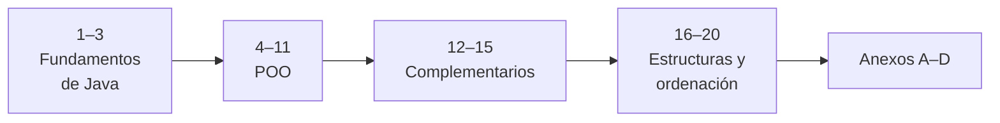

### Qué priorizar

> [!important] Orden de estudio (según la guía de la compañera)
> | Nivel | Temas |
> |---|---|
> | **1 — Imprescindible** | Clase, objeto, atributo y método · encapsulamiento, herencia y polimorfismo |
> | **2 — Explicar** | Sobrecarga vs. sobrescritura · arreglo vs. `ArrayList` · pila LIFO y cola FIFO · nodo y enlaces · complejidades de ordenación |
> | **3 — Reconocer y aplicar** | JVM/bytecode/JDK/JRE · constructores, `this`, `super`, `static` · abstracta vs. interfaz · `==` vs. `equals` · listas · ordenación · trazar código · elegir estructura |

### Mapa del libro

#### Parte 1 — Fundamentos y Java (3.1)

- 1. Paradigmas y arquitectura de Java
- 2. Tipos, memoria y operadores
- 3. Control de flujo y estructura del programa

#### Parte 2 — Programación orientada a objetos (3.2–3.3)

- 4. Paradigma orientado a objetos y UML
- 5. Clase, objeto, atributo y método
- 6. Constructores, sobrecarga, `this` y `super`
- 7. Encapsulamiento y control de acceso
- 8. Herencia
- 9. Clases abstractas
- 10. Interfaces
- 11. Polimorfismo y miembros estáticos

#### Parte 3 — Complementarios de Java (3.4)

- 12. Arreglos y ArrayList
- 13. String y comparación de objetos
- 14. Excepciones
- 15. Archivos

#### Parte 4 — Estructuras y ordenación (4.1–4.3)

- 16. Pilas y colas
- 17. Listas enlazadas
- 18. Listas dobles, circulares y ordenadas
- 19. Ordenación por inserción y Shellsort
- 20. Mergesort y Quicksort

#### Anexos

- A. Código listo para papel
- B. Banco de preguntas de oral
- C. Errores frecuentes
- D. Complejidades y mapa del programa

### Canon y cobertura

| Lectura oficial | Capítulo(s) |
|---|---|
| M0L1 Algoritmos y pensamiento lógico | 1 · 3 |
| M0L2 Paradigmas | 1 · 4 |
| M0L3 Conceptos de POO | 4 · 5 |
| M0L4 Lenguajes y Java | 1 |
| M1L1 Lenguajes | 1 |
| M1L2 ¿Qué es Java? | 1 |
| M1L3 Sintaxis | 3 |
| M1L4 Variables y constantes | 2 |
| M2L1 Dos paradigmas | 1 · 4 |
| M2L2 Pilas | 16 |
| M2L3 Abstracción y polimorfismo | 11 |
| M2L4 Ventajas de la POO | 4 |
| M3L1 Polimorfismo en Java | 11 |
| M3L2 Encapsulamiento | 7 |
| M3L3 Clases abstractas | 9 |
| M3L4 Ejemplos de POO | 8 · 10 |
| M4L1 Arreglos | 12 |
| M4L2 Strings | 13 |
| M4L3 Excepciones | 14 |
| M4L4 Archivos | 15 |

### El caso que atraviesa el libro

> [!example] Caso integrador
> Un sistema de **señalización urbana** modela semáforos, cámaras y alertas.
>
> - Los dispositivos comparten una superclase y se tratan igual (4, 8–11).
> - Las alertas se guardan en arreglos y listas, y se ordenan por prioridad (12–20).
> - Los archivos y las excepciones sostienen la operación (14–15).

### Regla de oro del módulo

> [!important] El error más caro: escribir antes de modelar
> Si arrancás con `main` y variables sueltas, terminás con un programa estructurado disfrazado de POO. El orden es: **modelar objetos → asignar responsabilidades → escribir métodos → probar**.

<div style="page-break-after: always;"></div>

# 1. Paradigmas y arquitectura de Java

> [!info] Al terminar este capítulo tenés que poder
> - Explicar qué es programar y qué es un algoritmo.
> - Diferenciar imperativo, estructurado y orientado a objetos.
> - Describir el recorrido `.java` → `.class` → JVM.
> - Distinguir JDK, JRE y JVM.

> [!abstract] Qué debés saber (nivel 1)
> - **Programar** es resolver un problema y expresar la solución para que la máquina la ejecute.
> - **Algoritmo:** pasos finitos, definidos y eficaces, con entrada y salida.
> - **Paradigma:** forma de organizar la solución, no solo sintaxis.
> - Java **compila a bytecode** y la JVM lo ejecuta (modelo híbrido, con JIT).
> - **JDK** = JRE + herramientas; **JRE** = JVM + bibliotecas; **JVM** ejecuta bytecode.

## 1.1 Programa y algoritmo

**Programa:** expresión de un algoritmo en un lenguaje formal, con datos y control.

| Propiedad del algoritmo | Qué exige |
|---|---|
| **Finito** | Termina |
| **Definido** | Cada paso es inequívoco |
| **Entrada / salida** | Recibe datos y produce un resultado |
| **Eficaz** | Cada paso es realizable |

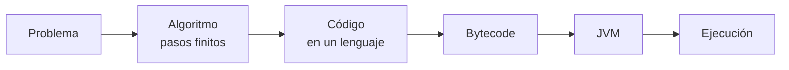

> [!important] La distinción que se pregunta
> El algoritmo es independiente del lenguaje; el programa es su expresión en uno concreto. El mismo algoritmo puede escribirse en Java o en pseudocódigo.

### Niveles de lenguaje

| Nivel | Qué usa | Cómo se traduce |
|---|---|---|
| **Máquina** | Binario, propio de cada CPU | Se ejecuta tal cual |
| **Ensamblador** | Mnemónicos (`MOV`, `ADD`) | Un *ensamblador* lo traduce |
| **Alto nivel** | Variables, `if`, `while`, clases | Compilador o intérprete |

> [!important] Compilar no es interpretar
> El **compilador** traduce antes de ejecutar (`javac` → bytecode); el **intérprete** traduce mientras ejecuta. Java hace las dos: compila a bytecode y la JVM lo interpreta, con JIT.

## 1.2 Paradigmas

| Paradigma | Idea central | Unidad |
|---|---|---|
| **Imperativo** | Instrucciones que cambian estado | Instrucción |
| **Estructurado** | Secuencia, selección e iteración, sin `goto` | Función |
| **Orientado a objetos** | Objetos que integran datos y comportamiento | Clase / objeto |
| **Funcional** | Funciones puras, sin estado mutable | Función |
| **Lógico** | Hechos y reglas; el motor deduce | Predicado |

> [!important] Estructurado vs. POO
> En estructurado los datos y las funciones que los usan están **separados**: `depositar(cuenta, monto)`. En POO el estado y la operación viven juntos: `cuenta.depositar(monto)`. Eso localiza los cambios.

Java es **multiparadigma** (tiene lambdas), pero el EFIP lo evalúa como **lenguaje orientado a objetos**.

## 1.3 Java: características


| Característica | Consecuencia |
|---|---|
| **Portable** | El bytecode corre en cualquier JVM |
| **Tipado estático** | Los tipos se verifican al compilar |
| **Orientado a objetos** | Todo el código vive en clases |
| **Gestionado** | Recolector de basura; no hay `delete` |
| **Multihilo** | Soporte de concurrencia en el lenguaje |

## 1.4 El recorrido de un programa

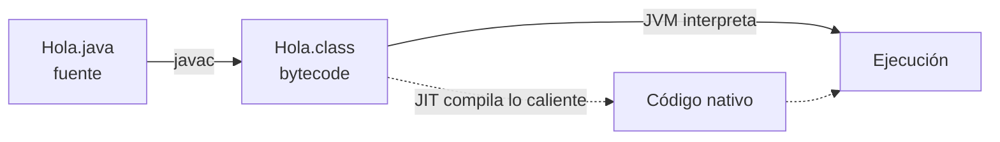

```bash
javac Hola.java     # genera Hola.class
java Hola           # la JVM ejecuta el bytecode
```

| Concepto | Qué es |
|---|---|
| **Bytecode** | Instrucciones de la JVM, no de la máquina física |
| **JVM** | Máquina virtual que ejecuta el bytecode |
| **JIT** | Compilador en tiempo de ejecución que acelera lo repetido |
| **WORA** | "Write once, run anywhere" |

> [!warning] Java no es puramente interpretado
> Compila a bytecode y la JVM lo ejecuta, con JIT. Decir "Java es interpretado" a secas es incompleto.

## 1.5 JDK, JRE y JVM

| Sigla | Contiene | Para qué |
|---|---|---|
| **JVM** | Máquina virtual | Ejecutar bytecode |
| **JRE** | JVM + bibliotecas estándar | Ejecutar aplicaciones |
| **JDK** | JRE + `javac`, `jar`, `javadoc` | Desarrollar |

> [!tip] La regla
> Para **programar** necesitás el JDK; para **ejecutar**, el JRE; la JVM es el motor.

## Errores que suelen tomar

| Error | Corrección |
|---|---|
| "Java es interpretado" | Es híbrido: bytecode + JVM + JIT |
| Confundir JDK con JVM | El JDK incluye la JVM y las herramientas |
| Decir que un algoritmo depende del lenguaje | Es independiente |
| "POO es usar clases" | Es modelar objetos que colaboran |
| Confundir paradigma con sintaxis | El paradigma es la forma de pensar |

## Ejercicios

> [!example] 1. Propiedades
> **Enunciado:** un algoritmo que divide por cero si el número es negativo, ¿qué propiedad incumple?
> **Solución:** eficacia (y definición, si no aclara qué hacer).

> [!example] 2. Recorrido
> **Enunciado:** ¿qué genera `javac` y quién lo ejecuta?
> **Solución:** bytecode `.class`; lo ejecuta la JVM.

> [!example] 3. Siglas
> **Enunciado:** ¿qué necesitás para compilar y qué para ejecutar?
> **Solución:** JDK para compilar; JRE (o JDK) para ejecutar.

> [!example] 4. Paradigma
> **Enunciado:** `depositar(cuenta, monto)` vs. `cuenta.depositar(monto)`.
> **Solución:** estructurado vs. orientado a objetos.

> [!example] 5. a papel
> **Enunciado:** dibujá el recorrido de `Hola.java` hasta la ejecución.
> **Solución:** fuente → `javac` → bytecode → JVM (intérprete + JIT) → ejecución.


<div style="page-break-after: always;"></div>


# 2. Tipos, memoria y operadores

> [!info] Al terminar este capítulo tenés que poder
> - Elegir el tipo correcto para cada dato.
> - Explicar la diferencia entre primitivo y referencia.
> - Predecir el resultado de una expresión con casting y división entera.
> - Evitar las trampas de `=`, `==` y `.equals()`.

> [!abstract] Qué debés saber (nivel 1)
> - Java es de **tipado fuerte y estático**.
> - **8 primitivos**: `byte`, `short`, `int`, `long`, `float`, `double`, `char`, `boolean`.
> - Los objetos se guardan como **referencias**; el objeto vive en el *heap*.
> - `7 / 2` da `3`; `7 / 2.0` da `3.5`.
> - `&&` y `||` **cortocircuitan**.
> - `=` asigna, `==` compara referencias, `.equals()` compara contenido.

## 2.1 Tipos primitivos

| Tipo | Tamaño | Rango / uso |
|---|---|---|
| `byte` | 1 byte | −128 a 127 |
| `short` | 2 | −32.768 a 32.767 |
| `int` | 4 | ±2.147 millones (el más usado) |
| `long` | 8 | Enteros grandes (`10L`) |
| `float` | 4 | Decimal aproximado (`1.5f`); 6–7 dígitos significativos |
| `double` | 8 | Decimal aproximado (por defecto); 15–16 dígitos |
| `char` | 2 | Un carácter Unicode (`'A'`) |
| `boolean` | 1 bit lógico | `true` / `false` |

| Categoría | Tipos | Para qué |
|---|---|---|
| **Enteros** | `byte`, `short`, `int`, `long` | Contadores, IDs |
| **Reales** | `float`, `double` | Medidas |
| **Carácter** | `char` | Una letra |
| **Lógico** | `boolean` | Condiciones |

> [!warning] Dinero no va en `double`
> `0.1 + 0.2` no da exactamente `0.3`. Para importes se usa `BigDecimal`.

## 2.2 Primitivos, referencias y memoria

```java
int a = 10;                 // valor en el stack
String s = "EFIP";          // referencia en el stack → objeto en el heap
```

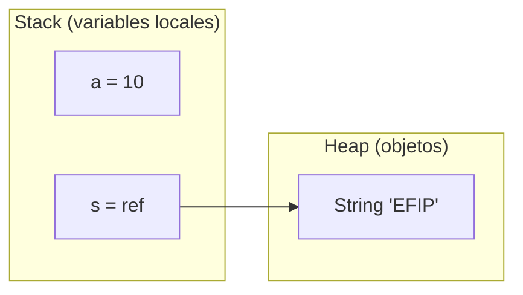

| | Primitivo | Referencia |
|---|---|---|
| Guarda | El valor | La dirección del objeto |
| Dónde | Stack | Referencia en stack, objeto en heap |
| Comparar | `==` | `.equals()` para contenido |
| Nulo | No | Sí (`null`) |

> [!important] `null`
> Una referencia sin objeto no puede recibir mensajes: `NullPointerException`. Es la excepción más común.

## 2.3 Casting y división

| Expresión | Resultado | Por qué |
|---|---|---|
| `7 / 2` | `3` | División entera |
| `7 / 2.0` | `3.5` | Un operando es `double` |
| `(double) 7 / 2` | `3.5` | Casting explícito |
| `(int) 3.9` | `3` | Truncamiento |
| `7 % 2` | `1` | Resto |

```java
int a = 7, b = 2;
double r = (double) a / b;   // 3.5
```

> [!warning] El casting no redondea
> `(int) 3.9` da `3`, no `4`. Para redondear: `Math.round(3.9)`.

## 2.4 Operadores y precedencia

| Grupo | Operadores |
|---|---|
| Aritméticos | `+ - * / %` |
| Incremento | `++ --` |
| Relacionales | `> < >= <= == !=` |
| Lógicos | `&& || !` |
| Ternario | `condición ? valor1 : valor2` |
| Asignación | `= += -= *= /= %=` |

Orden práctico: **paréntesis → unarios → aritméticos → relacionales → lógicos → asignación**.

### Cortocircuito

```java
if (obj != null && obj.activo()) { ... }   // seguro: si es null, no evalúa la segunda
```

| Operador | Si el primero es… | Qué hace |
|---|---|---|
| `&&` | `false` | No evalúa el segundo |
| `\|\|` | `true` | No evalúa el segundo |

> [!important] `&` y `\|` no cortocircuitan
> Con `&` se evalúan ambos lados aunque no haga falta. En condiciones, usá `&&` y `||`.

### `i++` vs. `++i`

| Expresión | Usa el valor… | Efecto |
|---|---|---|
| `i++` | Anterior | Suma después |
| `++i` | Nuevo | Suma antes |

```java
int i = 5;
int a = i++;   // a = 5, i = 6
int b = ++i;   // i = 7, b = 7
```

## 2.5 Igualdad

| Comparación | Qué compara | Ejemplo |
|---|---|---|
| `=` | Asigna | `x = 5;` |
| `==` | Referencias (o valores primitivos) | `s1 == s2` |
| `.equals()` | Contenido | `s1.equals(s2)` |

```java
String a = new String("EFIP");
String b = new String("EFIP");
a == b          // false: objetos distintos
a.equals(b)     // true: mismo contenido
```

> [!warning] El error que más cuesta puntos
> Comparar `String` con `==` funciona a veces (por el *pool* de literales) y falla otras. **Siempre** `.equals()` para contenido.

## Errores que suelen tomar

| Error | Corrección |
|---|---|
| `7 / 2` esperando `3.5` | Es `3`; usá `7 / 2.0` |
| `(int) 3.9` esperando `4` | Trunca: `3` |
| `==` para comparar `String` | `.equals()` |
| Usar `double` para dinero | `BigDecimal` |
| Confundir `i++` con `++i` | Uno usa el valor anterior |
| `&` en una condición | `&&` para cortocircuito |
| Inicializar una local y no usarla | Java exige inicializar antes de leer |

## Ejercicios

> [!example] 1. División
> **Enunciado:** ¿cuánto da `9 / 4` y `9 / 4.0`?
> **Solución:** `2` y `2.25`.

> [!example] 2. Casting
> **Enunciado:** ¿cuánto da `(int) 7.9 + 1`?
> **Solución:** `8` (trunca a 7 y suma 1).

> [!example] 3. Incremento
> **Enunciado:** `int i=3; int x=i++ + ++i;` ¿cuánto vale `x`?
> **Solución:** `3 + 5 = 8`; `i` queda en 5.

> [!example] 4. Igualdad
> **Enunciado:** ¿por qué `"a" == new String("a")` es `false`?
> **Solución:** compara punteros; el literal está en el pool y el `new` crea otro objeto.

> [!example] 5. Cortocircuito
> **Enunciado:** ¿por qué `obj != null && obj.activo()` no lanza excepción?
> **Solución:** si `obj` es `null`, `&&` no evalúa la segunda parte.

> [!example] 6. a papel
> **Enunciado:** escribí una expresión que convierta `gradosC` a `double` y calcule `F = C * 9/5 + 32`.
> **Solución:** `double f = gradosC * 9.0 / 5 + 32;`.


<div style="page-break-after: always;"></div>


# 3. Control de flujo y estructura del programa

> [!info] Al terminar este capítulo tenés que poder
> - Elegir entre `if`, `switch`, `for`, `while` y `do-while`.
> - Explicar el *fall-through* de `switch` y el uso de `break`.
> - Leer datos con `Scanner`.
> - Escribir la anatomía mínima de un programa Java.

> [!abstract] Qué debés saber (nivel 1)
> - Tres estructuras: **secuencia, selección, iteración**.
> - `switch` sin `break` **cae** al siguiente caso.
> - `for` se usa cuando sabés cuántas veces; `while`, cuando no.
> - `do-while` ejecuta **al menos una vez**.
> - Todo programa necesita `public static void main(String[] args)`.

## 3.1 Selección

```java
if (prioridad == 1) {
    System.out.println("Crítica");
} else if (prioridad <= 3) {
    System.out.println("Media");
} else {
    System.out.println("Baja");
}
```

| Estructura | Cuándo |
|---|---|
| `if` | Una o dos alternativas |
| `if / else if` | Varias alternativas con rangos |
| `switch` | Varias alternativas sobre un valor discreto |

```java
switch (prioridad) {
    case 1:
        System.out.println("Crítica");
        break;
    case 2:
    case 3:
        System.out.println("Media");
        break;
    default:
        System.out.println("Baja");
}
```

> [!warning] El *fall-through*
> Sin `break`, la ejecución continúa en el caso siguiente. A veces se usa a propósito (casos 2 y 3 comparten código); si no, es un bug.

> [!tip] `switch` moderno
> Desde Java 14: `case 1 -> "Crítica";` no cae y no necesita `break`. El EFIP suele pedir el clásico.

## 3.2 Iteración

| Bucle | Cuándo | Garantía |
|---|---|---|
| `for` | Cantidad conocida | Puede ejecutarse 0 veces |
| `while` | Condición al inicio | Puede ejecutarse 0 veces |
| `do-while` | Condición al final | **Al menos 1 vez** |

```java
for (int i = 0; i < 5; i++) {
    System.out.println(i);
}

int j = 0;
while (j < 5) {
    System.out.println(j);
    j++;
}

int k = 0;
do {
    System.out.println(k);
    k++;
} while (k < 5);
```

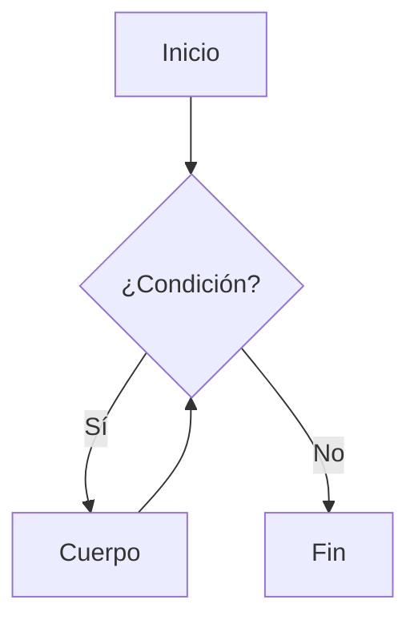

| Sentencia | Efecto |
|---|---|
| `break` | Sale del bucle o `switch` |
| `continue` | Salta a la próxima iteración |
| `return` | Sale del método |

> [!warning] Bucle infinito
> `while (i < 5)` sin `i++` nunca termina. Verificá que la condición pueda volverse falsa.

## 3.3 Entrada por consola

```java
import java.util.Scanner;

Scanner sc = new Scanner(System.in);
System.out.print("Prioridad: ");
int prioridad = sc.nextInt();
sc.nextLine();                 // consume el Enter pendiente
String mensaje = sc.nextLine();
```

| Método | Lee |
|---|---|
| `nextInt()` | Un entero |
| `nextDouble()` | Un decimal |
| `next()` | Una palabra |
| `nextLine()` | Una línea completa |

> [!important] El `nextLine()` después de `nextInt()`
> `nextInt()` deja el Enter en el buffer y el `nextLine()` siguiente lo consume vacío. Por eso se agrega un `nextLine()` de limpieza.

## 3.4 Anatomía de un programa

```java
package municipio.alertas;          // 1. paquete (opcional)

import java.util.Scanner;           // 2. imports

public class RegistroAlerta {       // 3. clase pública = nombre del archivo

    public static void main(String[] args) {   // 4. punto de entrada
        System.out.println("Hola, EFIP");
    }
}
```

| Parte | Regla |
|---|---|
| `package` | Minúscula, dominio invertido |
| `import` | Solo lo que se usa |
| `class` | Una pública por archivo, mismo nombre |
| `main` | `public static void main(String[] args)` exacto |
| Archivo | `RegistroAlerta.java` |

> [!important] `main` es `static`
> La JVM lo llama sin crear un objeto. Por eso no podés usar métodos de instancia directamente dentro de `main`: necesitás un objeto.

## 3.5 Convenciones

| Elemento | Convención | Ejemplo |
|---|---|---|
| Clase | PascalCase | `ControlAlertas` |
| Método / variable | camelCase | `registrarAlerta`, `idDispositivo` |
| Constante | MAYÚSCULAS | `MAX_PRIORIDAD` |
| Paquete | minúsculas | `municipio.alertas` |

## Errores que suelen tomar

| Error | Corrección |
|---|---|
| `switch` sin `break` | Agregalo salvo que el *fall-through* sea intencional |
| `while` sin actualizar la variable | Condición de corte |
| `do-while` con `;` faltante | `} while (cond);` |
| `nextInt()` seguido de `nextLine()` | Consumir el Enter |
| Llamar un método de instancia desde `main` | Crear el objeto |
| Archivo con nombre distinto a la clase pública | No compila |

## Ejercicios

> [!example] 1. Bucle
> **Enunciado:** imprimí los pares del 1 al 10.
> **Solución:** `for (int i = 2; i <= 10; i += 2) System.out.println(i);`.

> [!example] 2. Switch
> **Enunciado:** ¿qué imprime `case 1` sin `break` seguido de `case 2`?
> **Solución:** ambos mensajes, por *fall-through*.

> [!example] 3. Do-while
> **Enunciado:** ¿cuántas veces se ejecuta `do { } while (false);`?
> **Solución:** una.

> [!example] 4. Scanner
> **Enunciado:** leé un entero y luego una línea completa.
> **Solución:** `int n = sc.nextInt(); sc.nextLine(); String s = sc.nextLine();`.

> [!example] 5. a papel
> **Enunciado:** escribí la clase `Pares` con `main` que imprima los pares del 1 al 20.
> **Solución:** clase pública `Pares`, `main`, `for` con `i += 2`.


<div style="page-break-after: always;"></div>


# 4. Paradigma orientado a objetos y UML

> [!info] Al terminar este capítulo tenés que poder
> - Explicar qué es un paradigma y por qué la POO organiza distinto.
> - Definir los cuatro pilares con un ejemplo propio.
> - Identificar clases, atributos y métodos desde un enunciado.
> - Distinguir asociación, agregación, composición y herencia.

> [!abstract] Qué debés saber (nivel 1)
> - La POO agrupa **datos y métodos** en objetos que se comunican por **mensajes**.
> - Cuatro pilares: **abstracción, encapsulamiento, herencia, polimorfismo**.
> - “Es un” → herencia. “Tiene un” → asociación/agregación/composición.
> - Composición: la parte **no existe** sin el todo. Agregación: la parte **sobrevive**.
> - La programación estructurada no desaparece: vive **dentro** de los métodos.

## 4.1 Qué es un paradigma

**Paradigma:** modelo de trabajo compartido que orienta la conceptualización de los problemas y la organización de las soluciones.

| Paradigma | Organiza la solución en… |
|---|---|
| Modular | Módulos |
| Procedimental | Procedimientos y funciones |
| Estructurada | Secuencia, selección, iteración |
| Orientada a eventos | Manejadores de eventos |
| **Orientada a objetos** | **Objetos que integran datos y comportamiento** |

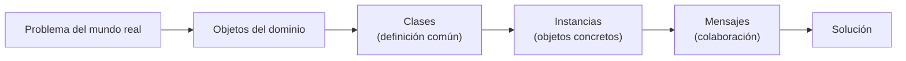

> [!important] La diferencia central
> En el paradigma estructurado, los **datos** y las **funciones** están separados: una función recibe datos y los procesa. En POO, **datos y comportamiento viven juntos** en el objeto, y solo se accede a los datos mediante sus métodos.

## 4.2 Los cuatro pilares

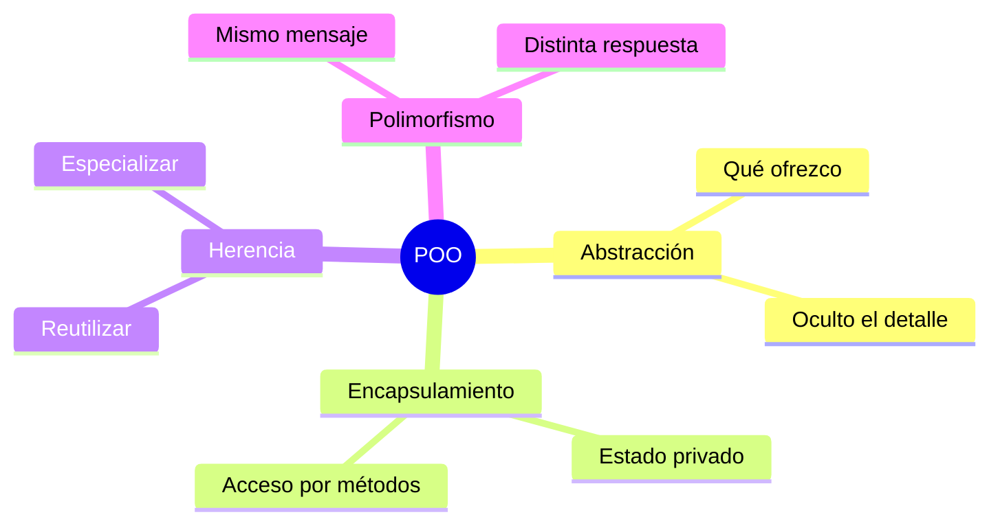

### Abstracción

**Representar lo esencial y omitir los detalles irrelevantes.**

Al modelar un semáforo para el sistema del municipio, no te interesa el color de la pintura ni el fabricante del poste: te interesa su ubicación, su estado y su capacidad de cambiar de color.

> [!quote] Cátedra
> La abstracción representa las características esenciales de un objeto y oculta los detalles de implementación.

### Encapsulamiento

**Agrupar estado y comportamiento y controlar el acceso.**

```java
public class Semaforo {
    private String colorActual;          // estado protegido

    public void cambiarColor(String nuevo) {
        if (esColorValido(nuevo)) {
            colorActual = nuevo;
        }
    }

    public String getColorActual() {
        return colorActual;
    }

    private boolean esColorValido(String color) {
        return color.equals("ROJO") || color.equals("AMARILLO") || color.equals("VERDE");
    }
}
```

Nadie puede escribir `semaforo.colorActual = "VIOLETA"`: el atributo es privado y el único camino es `cambiarColor`, que valida.

> [!warning] Corrección a un apunte de cátedra
> El material de Siglo 21 menciona `restricted` como modificador de acceso. **Ese modificador no existe en Java.** Los niveles reales son `public`, `protected`, sin modificador (package-private) y `private`. Ver 7. Encapsulamiento y control de acceso.

### Herencia

**Crear una subclase especializada a partir de una superclase.** Expresa “es un”.

```java
class Dispositivo {
    protected String ubicacion;

    public String getUbicacion() {
        return ubicacion;
    }
}

class Camara extends Dispositivo {      // una cámara ES UN dispositivo
    private boolean grabando;
}
```

### Polimorfismo

**Usar una referencia común para objetos distintos y ejecutar el método del objeto real.**

```java
Dispositivo d = new Camara("C-01");
d.descripcion();        // se ejecuta la versión de Camara, no la de Dispositivo
```

Se profundiza en 11. Polimorfismo y miembros estáticos.

## 4.3 Ventajas de la POO

| Ventaja | Por qué |
|---|---|
| **Correspondencia con el dominio** | El código refleja las entidades del problema: semáforo, cámara, alerta |
| **Reutilización** | Clases existentes se extienden o se usan en otros sistemas |
| **Modularidad** | Cada clase tiene una responsabilidad acotada |
| **Mantenibilidad** | Un cambio en una clase queda localizado |
| **Ocultamiento de información** | El estado interno no se manipula desde afuera |
| **Trabajo en equipo** | Se reparten clases, no archivos gigantes |

> [!warning] No vendas humo
> “La POO es más rápida” es falso como afirmación general. Es más **mantenible** y **modelable**; el rendimiento depende del diseño y la implementación.

## 4.4 Cómo identificar clases desde un enunciado

Método del compañero, en seis pasos:

1. **Subrayá sustantivos**: candidatos a clases, objetos o atributos.
2. **Subrayá verbos**: candidatos a métodos, eventos o responsabilidades.
3. **Distinguí entidades con identidad** de simples datos descriptivos.
4. **Asigná cada responsabilidad** a la clase que tiene la información necesaria.
5. **Identificá relaciones**: contiene, usa, conoce, es una especialización.
6. **Validá el modelo** recorriendo los casos de uso principales.

> [!example] Aplicado al caso del municipio
> “El municipio administra semáforos y cámaras conectadas. Los dispositivos informan estado y generan alertas.”
>
> | Sustantivo | ¿Clase? | Motivo |
> |---|---|---|
> | Municipio | Sí | Tiene identidad y responsabilidades de coordinación |
> | Semáforo | Sí | Entidad con estado propio |
> | Cámara | Sí | Entidad con estado propio |
> | Alerta | Sí | Entidad con datos y ciclo de vida |
> | Estado | Depende | Atributo si es un texto; clase si tiene comportamiento |
> | Ubicación | Depende | Atributo si es una dirección simple |
>
> Verbos → métodos: `informarEstado()`, `activar()`, `capturar()`, `generarAlerta()`.
>
> **La decisión se justifica por identidad y responsabilidad, no porque aparezca un sustantivo.**

## 4.5 Relaciones entre clases

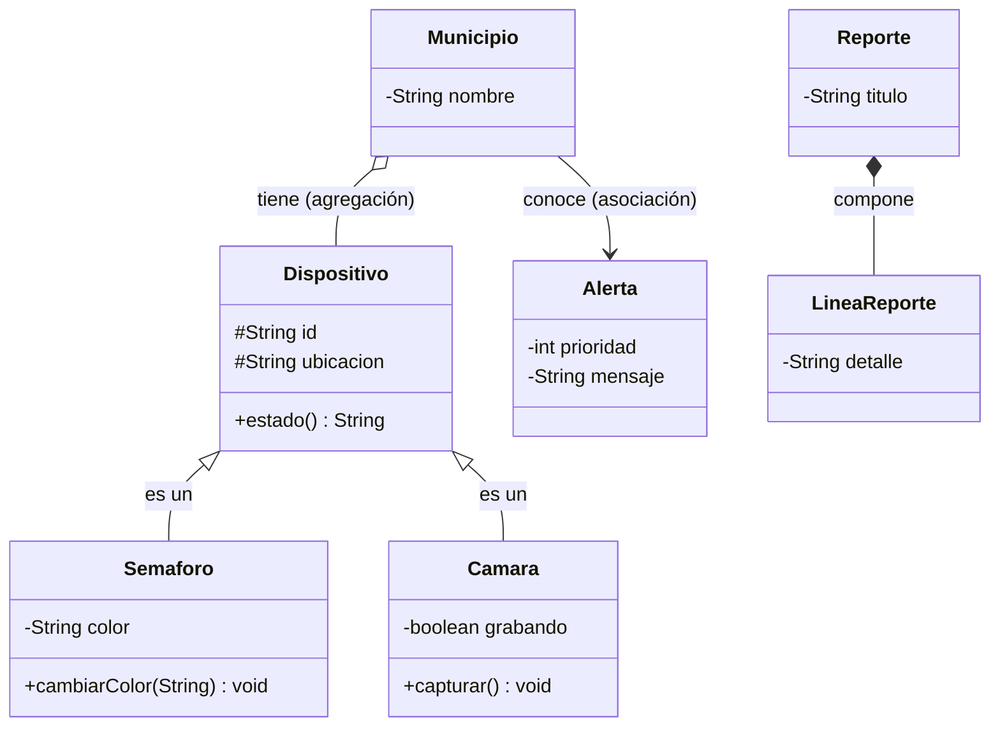

| Relación | Qué significa | Ejemplo | Notación UML |
|---|---|---|---|
| **Asociación** | Una clase conoce o utiliza otra | Operador atiende Alerta | línea simple |
| **Agregación** | Todo-parte **débil**; la parte puede existir sola | Municipio agrupa Dispositivos | rombo hueco |
| **Composición** | La parte **depende** del ciclo de vida del todo | Reporte contiene Líneas | rombo relleno |
| **Herencia** | Especialización (“es un”) | Cámara es un Dispositivo | flecha con triángulo hueco |
| **Dependencia** | Uso puntual (parámetro, variable local) | Servicio usa un Archivo | flecha punteada |

> [!important] La pregunta que resuelve todo
> **¿“Es un” o “tiene un”?**
> - “Cámara **es un** dispositivo” → herencia.
> - “Municipio **tiene** dispositivos” → asociación o agregación.
> - “Reporte **tiene** líneas que no existen sin él” → composición.

## 4.6 Programa completo con varios objetos colaborando

```java
public class Alerta {
    String mensaje;
    int prioridad;
    boolean atendida;

    void atender() {
        atendida = true;
    }

    String estado() {
        return "[" + prioridad + "] " + mensaje + (atendida ? " (atendida)" : " (pendiente)");
    }
}
```

```java
public class Municipio {

    String nombre;

    void reportar(Alerta a, String dispositivo) {
        System.out.println(nombre + " | " + dispositivo + " → " + a.estado());
    }

    public static void main(String[] args) {

        Municipio m = new Municipio();
        m.nombre = "Municipio de La Plata";

        Alerta a1 = new Alerta();
        a1.mensaje = "Cámara desconectada";
        a1.prioridad = 1;

        Alerta a2 = new Alerta();
        a2.mensaje = "Semáforo sin energía";
        a2.prioridad = 2;

        m.reportar(a1, "Cámara C-01");
        m.reportar(a2, "Semáforo S-04");

        a1.atender();

        m.reportar(a1, "Cámara C-01");
    }
}
```

Salida:

```text
Municipio de La Plata | Cámara C-01 → [1] Cámara desconectada (pendiente)
Municipio de La Plata | Semáforo S-04 → [2] Semáforo sin energía (pendiente)
Municipio de La Plata | Cámara C-01 → [1] Cámara desconectada (atendida)
```

Observá: `Municipio` **conoce** `Alerta` (la recibe como parámetro) y las alertas tienen **estado** propio.

## 4.7 Diagrama de clases UML

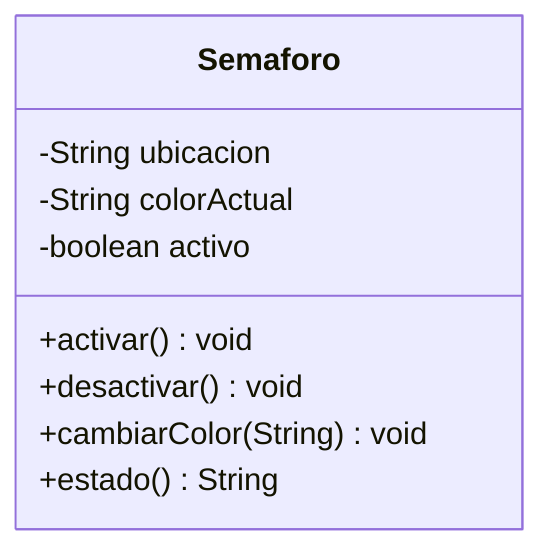

Lectura:

| Símbolo | Significado |
|---|---|
| `-` | `private` |
| `+` | `public` |
| `#` | `protected` |
| `~` | package-private |
| `nombre: Tipo` | Atributo |
| `metodo(params) Tipo` | Método |

> [!tip] En el examen escrito
> Si no te piden visibilidad, igual conviene marcarla: `-` en atributos y `+` en métodos es el mínimo profesional.

## Cómo trazar un modelo (no código)

| Paso | Pregunta | Resultado |
|---|---|---|
| 1 | ¿Qué entidades tienen identidad? | Municipio, Dispositivo, Semaforo, Camara, Alerta |
| 2 | ¿Qué datos guarda cada una? | `id`, `ubicacion`, `color`, `prioridad` |
| 3 | ¿Qué sabe hacer cada una? | `cambiarColor`, `capturar`, `atender` |
| 4 | ¿Cómo se relacionan? | Camara es Dispositivo; Municipio tiene Dispositivos |
| 5 | ¿Qué NO es clase? | `estado` como texto, `ubicacion` simple |

## Errores que suelen tomar

| Error | Corrección |
|---|---|
| Decir que encapsular es “poner `private`” | Encapsular es **ocultar estado y controlar el acceso**; `private` es el mecanismo |
| Confundir abstracción con encapsulamiento | Abstracción elige lo esencial; encapsulamiento protege el acceso |
| Usar herencia para “reutilizar código” sin relación “es un” | Si no hay “es un”, usar composición |
| Llamar composición a cualquier relación todo-parte | Composición = la parte muere con el todo |
| Crear una clase por cada sustantivo | Solo si tiene identidad y responsabilidad |
| Confundir objeto con clase en el oral | “El semáforo de la esquina” es objeto; `Semaforo` es clase |

## Ejercicios

> [!example] 1. Pilares
> **Enunciado:** relacioná cada situación con un pilar: (a) `saldo` privado y `depositar()` público; (b) `Camara extends Dispositivo`; (c) `d.descripcion()` ejecuta la de `Camara`; (d) modelar solo ubicación y estado del semáforo.
> **Solución:** (a) encapsulamiento; (b) herencia; (c) polimorfismo; (d) abstracción.

> [!example] 2. ¿Es un o tiene un?
> **Enunciado:** clasificá: (a) Chofer y Camión; (b) Reporte y LíneaReporte; (c) Municipio y Semáforo; (d) Camara y Dispositivo.
> **Solución:** (a) asociación (el chofer conduce el camión); (b) composición (la línea no existe sin el reporte); (c) agregación (los semáforos existen sin el municipio); (d) herencia.

> [!example] 3. Identificar clases
> **Enunciado:** del texto “el operador registra la alerta y el sistema avisa al supervisor”, extraé clases, atributos y métodos.
> **Solución:** clases `Operador`, `Alerta`, `Supervisor`; atributos `legajo`, `prioridad`, `mensaje`; métodos `registrarAlerta()`, `notificar()`. `Sistema` no es clase si no tiene estado propio: es el conjunto de objetos colaborando.

> [!example] 4. a papel
> **Enunciado:** modelá en 4 clases el dominio “biblioteca”: préstamo, libro, socio, bibliotecario. Indicá una relación de cada tipo (asociación, agregación, composición).
> **Solución:** `Biblioteca o-- Libro` (agregación: el libro existe sin la biblioteca); `Prestamo *-- LineaPrestamo` (composición); `Socio --> Prestamo` (asociación); `Bibliotecario --> Prestamo` (asociación).


<div style="page-break-after: always;"></div>


# 5. Clase, objeto, atributo y método

> [!info] Al terminar este capítulo tenés que poder
> - Distinguir clase de objeto con un ejemplo propio.
> - Identificar atributos (estado) y métodos (comportamiento).
> - Crear objetos con `new` y usar referencias.
> - Dibujar y leer un diagrama de clases UML básico.

> [!abstract] Qué debés saber (nivel 1)
> - **Clase:** molde o plantilla que define atributos y métodos.
> - **Objeto:** instancia concreta de una clase, con identidad, estado y comportamiento.
> - **Atributo:** dato que representa el estado.
> - **Método:** operación o comportamiento.
> - **Instancia:** objeto creado con `new`.
> - **Mensaje:** llamada a un método de un objeto (`objeto.metodo()`).

## 5.1 Clase y objeto

> [!quote] Definiciones de cátedra
> **Clase:** molde, plantilla o template para construir múltiples instancias de objetos similares.
> **Objeto:** entidad que agrupa datos y funcionalidad; ante un mensaje ejecuta el comportamiento asociado.

Pensalo así:

- `Semaforo` es la **clase**: define que todo semáforo tiene ubicación, color y estado.
- El semáforo de Av. Belgrano es un **objeto**: tiene ubicación `"Av. Belgrano"`, color `"VERDE"` y está activo.

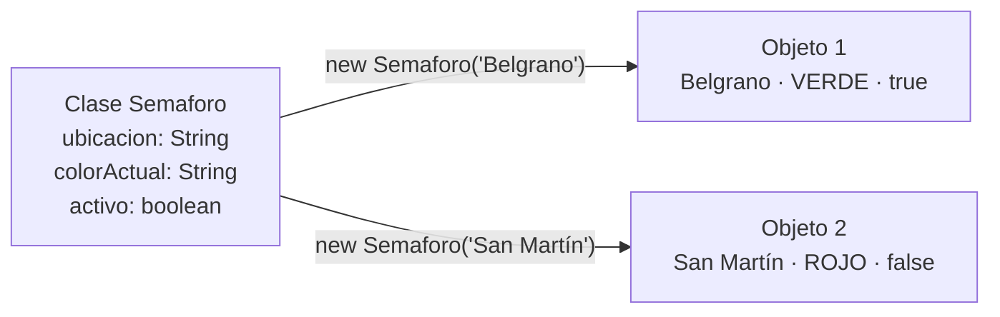

| Concepto | Pregunta que responde | Ejemplo |
|---|---|---|
| Clase | ¿Qué es? ¿Qué tiene y qué sabe hacer? | `Semaforo` |
| Objeto | ¿Cuál, concretamente? | el de Av. Belgrano |
| Atributo | ¿Qué estado guarda? | `colorActual` |
| Método | ¿Qué comportamiento tiene? | `cambiarColor()` |
| Identidad | ¿Cómo lo distingo de otro? | la referencia en memoria |

## 5.2 Declarar una clase

```java
public class Semaforo {

    // Atributos: estado
    String ubicacion;
    String colorActual;
    boolean activo;

    // Métodos: comportamiento
    void activar() {
        activo = true;
    }

    void desactivar() {
        activo = false;
    }

    void cambiarColor(String nuevoColor) {
        if (activo) {
            colorActual = nuevoColor;
        }
    }

    String estado() {
        return ubicacion + " | " + colorActual + " | " + (activo ? "activo" : "apagado");
    }
}
```

> [!warning] Sin `private` todavía
> En este capítulo los atributos son accesibles para simplificar. En 7. Encapsulamiento y control de acceso se encapsulan, que es como se escribe en el examen.

## 5.3 Crear y usar objetos

```java
public class Municipalidad {

    public static void main(String[] args) {

        // 1. Declaración de la referencia
        Semaforo s1;

        // 2. Creación del objeto (reserva memoria y devuelve la referencia)
        s1 = new Semaforo();

        // 3. Estado inicial
        s1.ubicacion = "Av. Belgrano";
        s1.colorActual = "ROJO";

        // 4. Mensajes
        s1.activar();
        s1.cambiarColor("VERDE");

        System.out.println(s1.estado());

        // Segundo objeto: independiente
        Semaforo s2 = new Semaforo();
        s2.ubicacion = "Av. San Martín";
        s2.colorActual = "ROJO";

        System.out.println(s2.estado());

        System.out.println("s1 sigue siendo: " + s1.colorActual);
    }
}
```

Salida:

```text
Av. Belgrano | VERDE | activo
Av. San Martín | ROJO | apagado
s1 sigue siendo: VERDE
```

> [!important] Cada objeto tiene su propio estado
> `s1` y `s2` comparten la **definición** (la clase), no los **valores**. Cambiar `s1.colorActual` no toca `s2`.

## 5.4 Referencias: el error más frecuente

```java
Semaforo a = new Semaforo();
a.ubicacion = "Centro";

Semaforo b = a;              // NO copia el objeto: copia la referencia
b.ubicacion = "Norte";

System.out.println(a.ubicacion);   // Norte
```

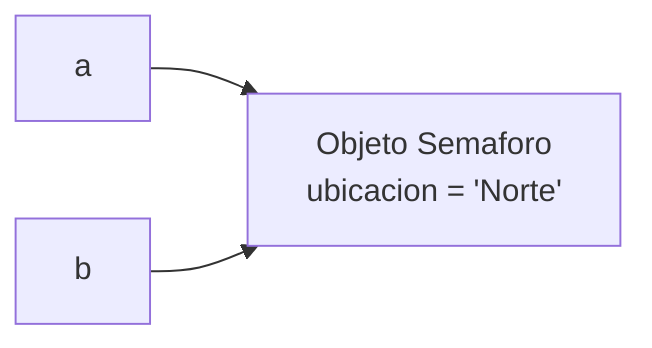

| Operación | Qué hace |
|---|---|
| `Semaforo b = a;` | Dos referencias, **un** objeto |
| `Semaforo b = new Semaforo();` | Dos referencias, **dos** objetos |
| `a == b` | Compara si apuntan al mismo objeto |

> [!warning] `null`
> ```java
> Semaforo x = null;
> x.activar();      // NullPointerException
> ```
> Una referencia sin objeto no puede recibir mensajes. Es la excepción más común en Java.

## 5.5 Métodos: parámetros y retorno

```java
public class Calculadora {

    // Sin parámetros, sin retorno
    void saludar() {
        System.out.println("Hola");
    }

    // Con parámetros, sin retorno
    void imprimirSuma(int a, int b) {
        System.out.println("Suma: " + (a + b));
    }

    // Con parámetros y con retorno
    int sumar(int a, int b) {
        return a + b;
    }

    // Retorno double
    double promedio(int total, int cantidad) {
        return (double) total / cantidad;
    }
}
```

| Firma | Significado |
|---|---|
| `void saludar()` | No recibe datos, no devuelve |
| `void imprimirSuma(int a, int b)` | Recibe dos enteros, no devuelve |
| `int sumar(int a, int b)` | Recibe dos enteros, devuelve un entero |
| `double promedio(int, int)` | Devuelve decimal |

> [!important] `void` vs. `return`
> `void` significa "no devuelve valor". Un método con retorno **debe** ejecutar `return` en todos los caminos posibles; si no, no compila.

## 5.6 Diagrama de clases UML


Lectura:

| Símbolo | Significado |
|---|---|
| `-` | `private` |
| `+` | `public` |
| `#` | `protected` |
| `~` | package-private |
| `nombre: Tipo` | Atributo |
| `metodo(params) Tipo` | Método |

> [!tip] En el examen escrito
> Si no te piden visibilidad, igual conviene marcarla: `-` en atributos y `+` en métodos es el mínimo profesional.

## 5.7 Programa completo

```java
public class CuentaBancaria {

    String titular;
    double saldo;

    void depositar(double monto) {
        if (monto > 0) {
            saldo += monto;
        }
    }

    boolean extraer(double monto) {
        if (monto > 0 && monto <= saldo) {
            saldo -= monto;
            return true;
        }
        return false;
    }

    String resumen() {
        return titular + ": $" + saldo;
    }

    public static void main(String[] args) {

        CuentaBancaria c = new CuentaBancaria();
        c.titular = "Ana";
        c.saldo = 1000;

        c.depositar(500);
        System.out.println(c.resumen());        // Ana: $1500.0

        boolean ok = c.extraer(2000);
        System.out.println("¿Extrajo? " + ok);  // false
        System.out.println(c.resumen());        // Ana: $1500.0

        c.extraer(300);
        System.out.println(c.resumen());        // Ana: $1200.0
    }
}
```

Salida:

```text
Ana: $1500.0
¿Extrajo? false
Ana: $1500.0
Ana: $1200.0
```

## Cómo trazar el estado de un objeto

| Paso | Operación | `saldo` | Resultado |
|---|---|---|---|
| 0 | `saldo = 1000` | 1000.0 | — |
| 1 | `depositar(500)` | 1500.0 | — |
| 2 | `extraer(2000)` | 1500.0 | `false` (no alcanza) |
| 3 | `extraer(300)` | 1200.0 | `true` |

**Regla:** en objetos, la tabla de traza lleva **una columna por atributo** y una fila por mensaje, no por línea interna del método.

## Errores que suelen tomar

| Error | Consecuencia |
|---|---|
| `Semaforo s; s.activar();` | No compila: variable no inicializada |
| `Semaforo s = null; s.activar();` | `NullPointerException` |
| `Semaforo b = a;` creyendo que copia | Dos referencias al mismo objeto |
| Confundir clase con objeto | "El semáforo es la clase" (mal) |
| Método con retorno sin `return` | No compila |
| Llamar a un método no estático desde `main` sin objeto | No compila |

> [!warning] El último es clave
> `main` es `static`. Para llamar a `cambiarColor()` (no estático) necesitás **un objeto**: `s1.cambiarColor("VERDE")`. Se profundiza en 11. Polimorfismo y miembros estáticos.

## Ejercicios

> [!example] 1. Clase y objeto
> **Enunciado:** definí una clase `Sensor` con `ubicacion`, `valor` y un método `leer()` que devuelva el valor. Creá dos sensores y mostrá que son independientes.
> **Solución:**
> ```java
> public class Sensor {
>     String ubicacion;
>     double valor;
>
>     double leer() {
>         return valor;
>     }
>
>     public static void main(String[] args) {
>         Sensor a = new Sensor();
>         a.ubicacion = "Esquina 1";
>         a.valor = 21.5;
>
>         Sensor b = new Sensor();
>         b.ubicacion = "Esquina 2";
>         b.valor = 30.0;
>
>         System.out.println(a.ubicacion + ": " + a.leer());
>         System.out.println(b.ubicacion + ": " + b.leer());
>     }
> }
> ```

> [!example] 2. Estado
> **Enunciado:** ¿qué imprime?
> ```java
> Semaforo a = new Semaforo();
> a.colorActual = "ROJO";
> Semaforo b = a;
> b.colorActual = "VERDE";
> System.out.println(a.colorActual);
> ```
> **Solución:** `VERDE`. `b` y `a` apuntan al mismo objeto.

> [!example] 3. Método con retorno
> **Enunciado:** agregá a `CuentaBancaria` un método `double saldoConInteres(double tasa)` que devuelva el saldo con interés sin modificar el saldo.
> **Solución:**
> ```java
> double saldoConInteres(double tasa) {
>     return saldo * (1 + tasa);
> }
> ```

> [!example] 4. a papel
> **Enunciado:** dibujá el diagrama de clases de `Semaforo` con tres atributos y cuatro métodos, usando `-` y `+`.
> **Solución:** ver el diagrama de la sección 4.7. Debe tener atributos con `-`, métodos con `+`, y tipos en cada miembro.

> [!example] 5. Identificar miembros
> **Enunciado:** del texto "el semáforo de la esquina cambia a verde y registra la hora del cambio", ¿qué es clase, objeto, atributo y método?
> **Solución:** clase `Semaforo`; objeto el de la esquina; atributos `color`, `horaUltimoCambio`, `ubicacion`; métodos `cambiarColor()`, `registrarHora()`.


<div style="page-break-after: always;"></div>


# 6. Constructores, sobrecarga, this y super

> [!info] Al terminar este capítulo tenés que poder
> - Escribir constructores por defecto y parametrizados.
> - Explicar qué hace `new` paso por paso.
> - Decidir cuándo conviene validar en el constructor.
> - Reconocer por qué un objeto puede quedar en estado inválido.
> - Usar sobrecarga, `this` y `super` sin confundirlos.

> [!abstract] Qué debés saber (nivel 1)
> - El constructor **se llama igual que la clase** y **no tiene tipo de retorno** (ni `void`).
> - Se ejecuta una sola vez, al crear el objeto con `new`.
> - Si no escribís ningún constructor, Java genera uno vacío por defecto.
> - Si escribís uno con parámetros, el vacío **desaparece**.
> - Un constructor puede validar y rechazar datos inválidos.

## 6.1 Qué es un constructor

**Constructor:** bloque que inicializa un objeto en el momento de su creación. Garantiza que el objeto nazca en un estado válido.

```java
public class Cuenta {

    private String titular;
    private double saldo;

    // Constructor
    public Cuenta(String titular, double saldoInicial) {
        this.titular = titular;
        this.saldo = saldoInicial;
    }
}
```

| Aspecto | Regla |
|---|---|
| Nombre | Idéntico al de la clase, con mayúscula inicial |
| Retorno | **Ninguno**, ni siquiera `void` |
| Invocación | Solo con `new` |
| Cantidad | Puede haber varios (sobrecarga) |

> [!warning] Error de sintaxis clásico
> ```java
> public void Cuenta(String titular) { }   // NO es constructor: tiene void
> ```
> Eso es un **método** llamado `Cuenta`, no un constructor. El compilador no lo usa al hacer `new`.

## 6.2 Qué hace `new`

```java
Cuenta c = new Cuenta("Ana", 1000);
```

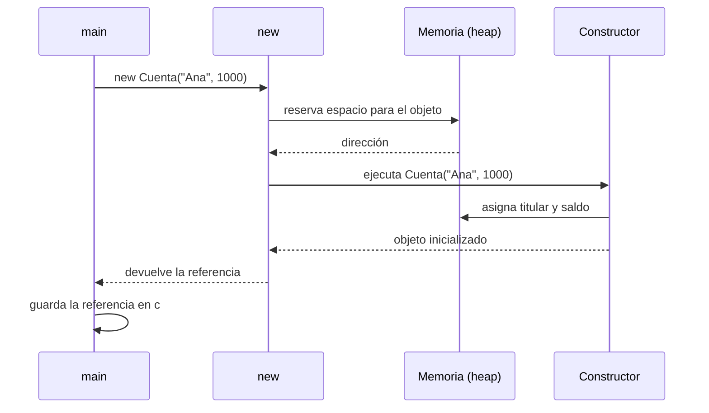

Cuatro pasos:

1. **Reserva** memoria para el objeto.
2. **Inicializa** los atributos con su valor por defecto (`null`, `0`, `false`).
3. **Ejecuta** el constructor.
4. **Devuelve** la referencia, que se guarda en la variable.

> [!important] `new` devuelve una referencia
> `Cuenta c = new Cuenta(...)` no guarda el objeto en `c`: guarda **dónde está**. Por eso dos variables pueden apuntar al mismo objeto (5. Clase, objeto, atributo y método).

## 6.3 Constructor por defecto

Si la clase **no declara ningún constructor**, Java agrega uno sin parámetros que no hace nada especial:

```java
public class Sensor {
    String ubicacion;
    double valor;
}
```

```java
// Uso: el constructor vacío lo genera Java
Sensor s = new Sensor();
s.ubicacion = "Esquina 1";
```

Pero si declarás **un** constructor, el vacío ya no existe:

```java
public class Sensor {
    String ubicacion;

    public Sensor(String ubicacion) {
        this.ubicacion = ubicacion;
    }
}

// Sensor s = new Sensor();          // ERROR: no existe el constructor vacío
Sensor s = new Sensor("Esquina 1");  // OK
```

> [!warning] La trampa del “dejó de compilar”
> Agregás un constructor con parámetros y de golpe fallan todos los `new Sensor()`. No es un bug: el constructor por defecto desapareció. Solución: declarar también el vacío.

```java
public Sensor() {
    this.ubicacion = "sin asignar";
}
```

## 6.4 Constructores sobrecargados

Varios constructores con la misma clase y distintos parámetros.

```java
public class Dispositivo {

    private String id;
    private String ubicacion;
    private boolean activo;

    // 1. Completo
    public Dispositivo(String id, String ubicacion, boolean activo) {
        this.id = id;
        this.ubicacion = ubicacion;
        this.activo = activo;
    }

    // 2. Sin estado: arranca apagado
    public Dispositivo(String id, String ubicacion) {
        this(id, ubicacion, false);          // delega en el constructor 1
    }

    // 3. Mínimo: ubicación por defecto
    public Dispositivo(String id) {
        this(id, "sin asignar");
    }

    public String resumen() {
        return id + " @ " + ubicacion + " [" + (activo ? "ON" : "OFF") + "]";
    }
}
```

```java
public class PruebaConstructores {
    public static void main(String[] args) {
        Dispositivo a = new Dispositivo("D-01", "Centro", true);
        Dispositivo b = new Dispositivo("D-02", "Norte");
        Dispositivo c = new Dispositivo("D-03");

        System.out.println(a.resumen());
        System.out.println(b.resumen());
        System.out.println(c.resumen());
    }
}
```

Salida:

```text
D-01 @ Centro [ON]
D-02 @ Norte [OFF]
D-03 @ sin asignar [OFF]
```

> [!tip] `this(...)` evita duplicar código
> Un constructor llama a otro de la misma clase y le pasa los valores. **Debe ser la primera sentencia.** Se detalla en 6. Constructores, sobrecarga, this y super.

## 6.5 Validar en el constructor

El constructor es el mejor lugar para garantizar los **invariantes**: condiciones que siempre deben cumplirse.

```java
public class CuentaBancaria {

    private final String titular;
    private double saldo;

    public CuentaBancaria(String titular, double saldoInicial) {
        if (titular == null || titular.isBlank()) {
            throw new IllegalArgumentException("Titular obligatorio");
        }
        if (saldoInicial < 0) {
            throw new IllegalArgumentException("Saldo inicial no puede ser negativo");
        }
        this.titular = titular;
        this.saldo = saldoInicial;
    }

    public void depositar(double monto) {
        if (monto <= 0) {
            throw new IllegalArgumentException("Monto inválido");
        }
        saldo += monto;
    }

    public double getSaldo() {
        return saldo;
    }

    public String getTitular() {
        return titular;
    }
}
```

```java
public class Banco {
    public static void main(String[] args) {

        CuentaBancaria c = new CuentaBancaria("Ana", 1000);
        c.depositar(500);
        System.out.println(c.getTitular() + ": $" + c.getSaldo());

        try {
            CuentaBancaria mala = new CuentaBancaria("", -10);
            System.out.println(mala.getTitular());
        } catch (IllegalArgumentException e) {
            System.out.println("Rechazado: " + e.getMessage());
        }
    }
}
```

Salida:

```text
Ana: $1500.0
Rechazado: Titular obligatorio
```

> [!important] Por qué validar acá
> Si el objeto se crea inválido, todos los métodos posteriores arrastran el error. Validar al nacer es más barato que corregir después.

## 6.6 Objeto completo: del enunciado al constructor

**Enunciado:** “De cada semáforo se conoce su identificador, su ubicación y su color actual, que al instalarse es siempre ROJO”.

```java
public class Semaforo {

    private final String id;
    private final String ubicacion;
    private String colorActual;

    public Semaforo(String id, String ubicacion) {
        this.id = id;
        this.ubicacion = ubicacion;
        this.colorActual = "ROJO";       // regla del dominio
    }

    public void cambiarColor(String nuevo) {
        if (nuevo.equals("ROJO") || nuevo.equals("AMARILLO") || nuevo.equals("VERDE")) {
            this.colorActual = nuevo;
        }
    }

    public String estado() {
        return id + " (" + ubicacion + "): " + colorActual;
    }
}
```

```java
public class Instalacion {
    public static void main(String[] args) {
        Semaforo s = new Semaforo("S-01", "Av. Belgrano");
        System.out.println(s.estado());      // S-01 (Av. Belgrano): ROJO
        s.cambiarColor("VERDE");
        System.out.println(s.estado());      // S-01 (Av. Belgrano): VERDE
        s.cambiarColor("VIOLETA");           // ignorado por la validación
        System.out.println(s.estado());      // S-01 (Av. Belgrano): VERDE
    }
}
```

Salida:

```text
S-01 (Av. Belgrano): ROJO
S-01 (Av. Belgrano): VERDE
S-01 (Av. Belgrano): VERDE
```

## 6.7 Firma y sobrecarga

**Signatura o firma:** combinación del nombre del método con la cantidad, el tipo y el orden de sus parámetros.

```java
public class Alerta {

    // Firma: registrar(String)
    public void registrar(String mensaje) {
        System.out.println("Simple: " + mensaje);
    }

    // Firma: registrar(String, int)
    public void registrar(String mensaje, int prioridad) {
        System.out.println("Con prioridad " + prioridad + ": " + mensaje);
    }

    // Firma: registrar(int, String)  → distinto ORDEN, es sobrecarga válida
    public void registrar(int prioridad, String mensaje) {
        System.out.println("[" + prioridad + "] " + mensaje);
    }

    // NO es sobrecarga: solo cambia el retorno → no compila
    // public String registrar(String mensaje) { return mensaje; }
}
```

```java
public class Prueba {
    public static void main(String[] args) {
        Alerta a = new Alerta();
        a.registrar("Cámara caída");
        a.registrar("Semáforo apagado", 1);
        a.registrar(2, "Sensor sin batería");
    }
}
```

Salida:

```text
Simple: Cámara caída
Con prioridad 1: Semáforo apagado
[2] Sensor sin batería
```

> [!important] Sobrecarga vs. sobrescritura
> | | Sobrecarga | Sobrescritura |
> |---|---|---|
> | Dónde | Misma clase | Subclase redefine un método heredado |
> | Firma | **Distinta** | **Igual** |
> | Se resuelve | Al compilar | En ejecución (despacho dinámico) |
> | Se ve en | 6. Constructores, sobrecarga, this y super | 8. Herencia y 11. Polimorfismo y miembros estáticos |

> [!warning] Trampa de examen
> “El tipo de retorno alcanza para sobrecargar” → **falso**. `int f()` y `String f()` no pueden coexistir.

### Conversiones y ambigüedad

```java
void enviar(int x)    { System.out.println("int"); }
void enviar(double x) { System.out.println("double"); }

enviar(5);      // int  → coincidencia exacta
enviar(5.0);    // double
enviar('A');    // int  → char se promueve a int
```

Si dos versiones son **igualmente aplicables**, el compilador da error por ambigüedad. Evitá sobrecargas que solo difieran en tipos que se convierten entre sí.

## 6.8 `this`

Tres usos:

### 1. Desambiguar atributo y parámetro

```java
public class Semaforo {
    private String color;

    public void cambiarColor(String color) {
        this.color = color;        // izquierda: atributo; derecha: parámetro
    }
}
```

Sin `this`, `color = color` asigna el parámetro a sí mismo y el atributo queda sin cambios.

### 2. Llamar a otro constructor de la misma clase

```java
public class Dispositivo {

    private final String id;
    private String ubicacion;
    private boolean activo;

    public Dispositivo(String id, String ubicacion, boolean activo) {
        this.id = id;
        this.ubicacion = ubicacion;
        this.activo = activo;
    }

    public Dispositivo(String id, String ubicacion) {
        this(id, ubicacion, false);     // delega; debe ser la primera línea
    }

    public Dispositivo(String id) {
        this(id, "sin asignar");
    }
}
```

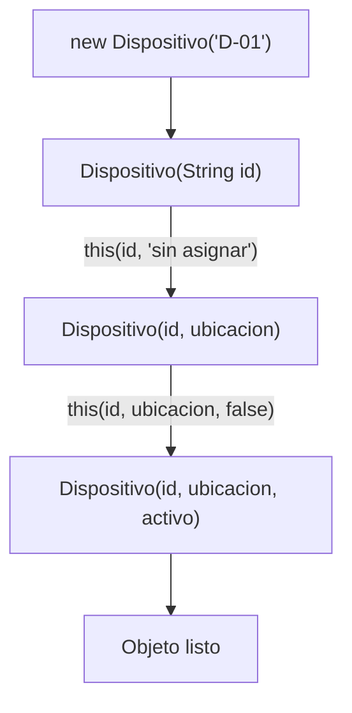

### 3. Devolver el objeto actual (encadenamiento)

```java
public class Consulta {

    private String tabla = "";
    private String condicion = "";

    public Consulta desde(String tabla) {
        this.tabla = tabla;
        return this;
    }

    public Consulta donde(String condicion) {
        this.condicion = condicion;
        return this;
    }

    public String sql() {
        return "SELECT * FROM " + tabla + " WHERE " + condicion;
    }

    public static void main(String[] args) {
        String q = new Consulta()
                .desde("alerta")
                .donde("prioridad = 1")
                .sql();
        System.out.println(q);
    }
}
```

Salida:

```text
SELECT * FROM alerta WHERE prioridad = 1
```

> [!warning] `this` no existe en contexto estático
> En un método `static` no hay objeto actual. `this` produce error de compilación (11. Polimorfismo y miembros estáticos).

## 6.9 `super`

### 1. Llamar al constructor del padre

```java
class Persona {

    protected String nombre;
    protected String dni;

    public Persona(String nombre, String dni) {
        this.nombre = nombre;
        this.dni = dni;
    }
}

class Empleado extends Persona {

    private double sueldo;

    public Empleado(String nombre, String dni, double sueldo) {
        super(nombre, dni);        // primero el padre
        this.sueldo = sueldo;      // después lo propio
    }
}
```

> [!important] Regla de orden
> `super(...)` debe ser **la primera sentencia** del constructor. No podés asignar atributos propios antes.

### 2. Acceder a un método del padre

```java
class Empleado extends Persona {

    private double sueldo;

    public Empleado(String nombre, String dni, double sueldo) {
        super(nombre, dni);
        this.sueldo = sueldo;
    }

    public String descripcion() {
        return "Empleado: " + super.toString();   // reutiliza el del padre
    }
}
```

Si la subclase sobrescribe `descripcion()` y quiere usar la versión del padre, `super.descripcion()`.

### 3. `super` no es un objeto

No se puede hacer `super = new Persona(...)` ni guardar `super` en una variable. Es una referencia especial de acceso.

## 6.10 Orden de ejecución en una jerarquía

```java
class A {
    A() { System.out.println("Constructor A"); }
}

class B extends A {
    B() {
        // Java inserta super() aquí
        System.out.println("Constructor B");
    }
}

class C extends B {
    C() {
        super();
        System.out.println("Constructor C");
    }
}
```

```java
new C();
```

Salida:

```text
Constructor A
Constructor B
Constructor C
```

**Regla:** se construye **de arriba hacia abajo**: primero el padre, después el hijo.

> [!warning] El error de `super()` implícito
> Si el padre **no tiene** constructor sin parámetros y el hijo no llama a `super(...)`, no compila:
> ```java
> class Persona { Persona(String nombre) { } }
> class Empleado extends Persona {
>     Empleado() { }   // ERROR: no hay Persona()
> }
> ```
> Solución: `Empleado(String nombre) { super(nombre); }`.

## Cómo trazar la creación de un objeto

```java
Dispositivo d = new Dispositivo("D-02", "Norte");
```

| Paso | Qué ocurre | `id` | `ubicacion` | `activo` |
|---|---|---|---|---|
| 0 | Reserva de memoria | `null` | `null` | `false` |
| 1 | Entra al constructor `(id, ubicacion)` | `null` | `null` | `false` |
| 2 | `this(id, ubicacion, false)` | `null` | `null` | `false` |
| 3 | Constructor completo asigna | `"D-02"` | `"Norte"` | `false` |
| 4 | Vuelve y termina | `"D-02"` | `"Norte"` | `false` |

**Regla:** si hay `this(...)`, la traza sigue la cadena de constructores, no el orden visual del archivo.

## Errores que suelen tomar

| Error | Consecuencia |
|---|---|
| `public void Cuenta()` | Es un método, no un constructor |
| Constructor con `return` de valor | No compila |
| `Cuenta c = Cuenta("Ana", 100);` | Falta `new` |
| Agregar constructor con parámetros y usar `new Clase()` | El vacío ya no existe |
| No validar en el constructor | Objetos inválidos circulando |
| Asignar `this.id = id` con tipos incompatibles | No compila |
| Olvidar `this` cuando parámetro y atributo se llaman igual | El atributo queda sin asignar |

## Ejercicios

> [!example] 1. ¿Constructor o método?
> **Enunciado:** ¿cuáles son constructores?
> ```java
> public void Persona() {}
> public Persona() {}
> public Persona(String n) {}
> public int Persona() { return 1; }
> ```
> **Solución:** solo el segundo y el tercero. El primero y el cuarto tienen tipo de retorno (`void` e `int`), así que son métodos.

> [!example] 2. Constructor por defecto
> **Enunciado:** la clase `Libro` tiene `Libro(String titulo)`. ¿Compila `new Libro()`? ¿Cómo lo arreglás?
> **Solución:** no compila: el constructor vacío no existe. Se agrega `public Libro() { this.titulo = "sin título"; }`.

> [!example] 3. Validación
> **Enunciado:** escribí el constructor de `Edificio` que reciba `pisos` y rechace valores menores a 1.
> **Solución:**
> ```java
> public class Edificio {
>     private int pisos;
>
>     public Edificio(int pisos) {
>         if (pisos < 1) {
>             throw new IllegalArgumentException("Debe tener al menos 1 piso");
>         }
>         this.pisos = pisos;
>     }
> }
> ```

> [!example] 4. Cadena de constructores
> **Enunciado:** ¿qué imprime?
> ```java
> public class A {
>     public A() { this(1); System.out.println("A()"); }
>     public A(int x) { System.out.println("A(" + x + ")"); }
>     public static void main(String[] a) { new A(); }
> }
> ```
> **Solución:** `A(1)` y luego `A()`. `this(1)` va primero porque debe ser la primera sentencia.

> [!example] 5. a papel
> **Enunciado:** escribí la clase `Turno` con `paciente`, `fecha` y `estado` (inicial `"PENDIENTE"`), un constructor que valide que `paciente` no esté vacío y un método `cancelar()` que solo cancele si está pendiente.
> **Solución:**
> ```java
> public class Turno {
>     private final String paciente;
>     private final String fecha;
>     private String estado;
>
>     public Turno(String paciente, String fecha) {
>         if (paciente == null || paciente.isBlank()) {
>             throw new IllegalArgumentException("Paciente obligatorio");
>         }
>         this.paciente = paciente;
>         this.fecha = fecha;
>         this.estado = "PENDIENTE";
>     }
>
>     public void cancelar() {
>         if (estado.equals("PENDIENTE")) {
>             estado = "CANCELADO";
>         }
>     }
>
>     public String getEstado() { return estado; }
> }
> ```


<div style="page-break-after: always;"></div>


# 7. Encapsulamiento y control de acceso

> [!info] Al terminar este capítulo tenés que poder
> - Explicar qué protege el encapsulamiento y por qué.
> - Aplicar `public`, `protected`, sin modificador y `private`.
> - Escribir getters y setters que no rompan los invariantes.
> - Justificar por qué un atributo no debe ser público.

> [!abstract] Qué debés saber (nivel 1)
> - Encapsular = ocultar el estado y exponer operaciones controladas.
> - `private`: solo la propia clase. `public`: todos. `protected`: paquete + subclases. Sin modificador: solo el paquete.
> - Los getters **devuelven**; los setters **modifican** con validación.
> - No todo atributo necesita setter: si es identidad o inmutable, no se expone.
> - El alcance (scope) no es lo mismo que el control de acceso.

## 7.1 El problema que resuelve

```java
// Sin encapsulamiento
public class Cuenta {
    public double saldo;
}
```

```java
// Uso: cualquier clase puede romper el estado
Cuenta c = new Cuenta();
c.saldo = -5000;
```

Un atributo público permite cualquier valor, en cualquier momento, desde cualquier clase. El objeto no puede defender sus reglas.

```java
// Con encapsulamiento
public class Cuenta {
    private double saldo;

    public void depositar(double monto) {
        if (monto <= 0) throw new IllegalArgumentException("Monto inválido");
        saldo += monto;
    }

    public double getSaldo() {
        return saldo;
    }
}
```

Ahora el saldo **solo** cambia por un camino válido.

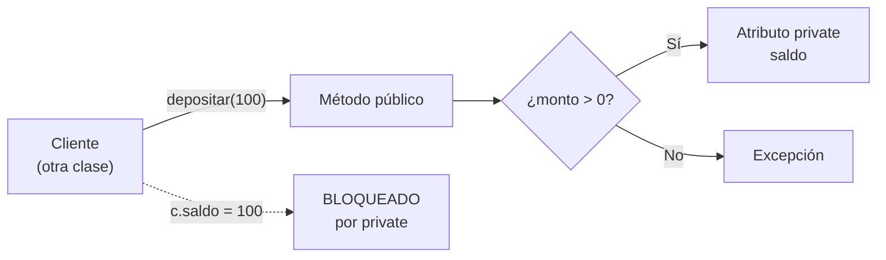

## 7.2 Los cuatro niveles de acceso

| Modificador | Misma clase | Mismo paquete | Subclase (otro paquete) | Cualquier clase |
|---|---|---|---|---|
| `private` | ✅ | ❌ | ❌ | ❌ |
| sin modificador | ✅ | ✅ | ❌ | ❌ |
| `protected` | ✅ | ✅ | ✅ | ❌ |
| `public` | ✅ | ✅ | ✅ | ✅ |

> [!warning] Corrección importante
> El material de Siglo 21 menciona un modificador `restricted`. **No existe en Java.** Los cuatro niveles son los de la tabla. Si te lo preguntan, corregilo con seguridad.

> [!important] `protected` no es “casi público”
> Permite acceso a subclases **y** al mismo paquete. Se usa cuando una clase está pensada para ser heredada. En el examen, si no hay herencia, no lo uses.

## 7.3 Getters y setters

```java
public class Dispositivo {

    private final String id;           // identidad: no cambia
    private String ubicacion;
    private boolean activo;

    public Dispositivo(String id, String ubicacion) {
        this.id = id;
        this.ubicacion = ubicacion;
    }

    // Getter: solo lectura
    public String getId() {
        return id;
    }

    public String getUbicacion() {
        return ubicacion;
    }

    // Setter con validación
    public void setUbicacion(String ubicacion) {
        if (ubicacion == null || ubicacion.isBlank()) {
            throw new IllegalArgumentException("Ubicación obligatoria");
        }
        this.ubicacion = ubicacion;
    }

    public boolean isActivo() {           // boolean: is + nombre
        return activo;
    }

    public void activar() {
        activo = true;
    }

    public void desactivar() {
        activo = false;
    }
}
```

| Convención | Ejemplo |
|---|---|
| Atributo `double saldo` | `getSaldo()` / `setSaldo(double)` |
| Atributo `boolean activo` | `isActivo()` / `setActivo(boolean)` |
| Sin setter | El atributo es inmutable desde afuera |

> [!tip] No generes setters por reflejo
> Un setter para todo convierte el encapsulamiento en decoración: si cualquiera puede cambiar cualquier cosa, no protegiste nada. Preguntate: *¿esta modificación es una operación válida del dominio?* Si no, no la expongas.

## 7.4 Invariantes

**Invariante:** condición que debe cumplirse siempre, antes y después de cada operación pública.

Ejemplos:

- El saldo nunca es negativo (si el dominio lo prohíbe).
- Un turno cancelado no puede volver a pendiente.
- La prioridad de una alerta está entre 1 y 5.
- El stock no puede ser menor que cero.

```java
public class Alerta {

    private final int prioridad;       // 1..5
    private String estado;             // PENDIENTE, ATENDIDA

    public Alerta(int prioridad, String mensaje) {
        if (prioridad < 1 || prioridad > 5) {
            throw new IllegalArgumentException("Prioridad fuera de rango");
        }
        this.prioridad = prioridad;
        this.estado = "PENDIENTE";
    }

    public int getPrioridad() {
        return prioridad;
    }

    public void atender() {
        if (estado.equals("ATENDIDA")) {
            throw new IllegalStateException("Ya estaba atendida");
        }
        estado = "ATENDIDA";
    }

    public String getEstado() {
        return estado;
    }
}
```

> [!important] El invariante se protege en **todos** los caminos
> No alcanza con validar en el constructor: cada método público debe dejar el objeto en un estado válido. Si `atender()` pudiera ejecutarse dos veces, el estado sería inconsistente.

## 7.5 Alcance no es acceso

| Concepto | Pregunta | Ejemplo |
|---|---|---|
| **Alcance (scope)** | ¿Dónde existe este identificador? | Un parámetro existe solo dentro del método |
| **Control de acceso** | ¿Quién puede verlo? | `private` impide verlo desde otra clase |

```java
public class Ejemplo {

    private int contador;                 // atributo de la clase

    public void procesar(int contador) {  // parámetro con el mismo nombre
        int aux = contador;               // parámetro
        this.contador = aux;              // atributo, por this
    }
}
```

- `contador` (parámetro) tiene alcance del método.
- `this.contador` es el atributo del objeto.
- **No se puede** declarar otra variable `contador` dentro del mismo método: ya está en ese alcance.

## 7.6 Diagrama UML con visibilidad

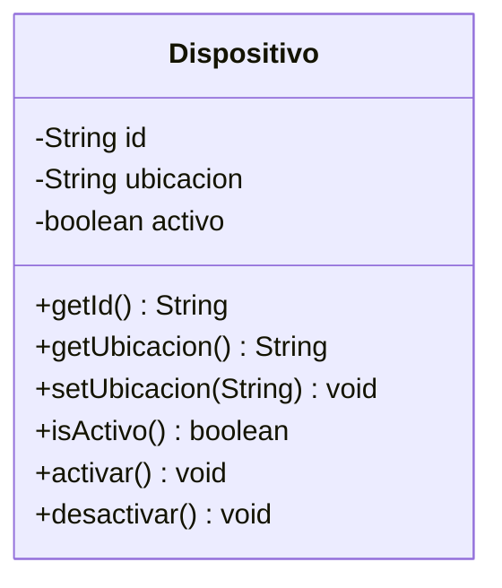

| Símbolo | Visibilidad |
|---|---|
| `-` | `private` |
| `+` | `public` |
| `#` | `protected` |
| `~` | package-private |

> [!tip] Regla de diseño para el escrito
> Atributos `-`, métodos de negocio `+`, métodos auxiliares `-`. Si todos los miembros son `+`, el diagrama está mal.

## 7.7 Programa completo

```java
public class CuentaBancaria {

    private final String cbu;
    private String titular;
    private double saldo;

    public CuentaBancaria(String cbu, String titular, double saldoInicial) {
        if (cbu == null || cbu.length() != 22) {
            throw new IllegalArgumentException("CBU inválido");
        }
        if (saldoInicial < 0) {
            throw new IllegalArgumentException("Saldo inicial inválido");
        }
        this.cbu = cbu;
        this.titular = titular;
        this.saldo = saldoInicial;
    }

    public void depositar(double monto) {
        if (monto <= 0) {
            throw new IllegalArgumentException("El depósito debe ser positivo");
        }
        saldo += monto;
    }

    public void extraer(double monto) {
        if (monto <= 0) {
            throw new IllegalArgumentException("El monto debe ser positivo");
        }
        if (monto > saldo) {
            throw new IllegalStateException("Saldo insuficiente");
        }
        saldo -= monto;
    }

    public double getSaldo() { return saldo; }
    public String getTitular() { return titular; }
    public String getCbu() { return cbu; }

    public void setTitular(String titular) {
        if (titular == null || titular.isBlank()) {
            throw new IllegalArgumentException("Titular obligatorio");
        }
        this.titular = titular;
    }
}
```

```java
public class Banco {

    public static void main(String[] args) {

        CuentaBancaria c = new CuentaBancaria(
                "0000000000000000000001", "Ana", 1000);

        c.depositar(500);
        System.out.println("Saldo: " + c.getSaldo());

        try {
            c.extraer(5000);
        } catch (IllegalStateException e) {
            System.out.println("Error: " + e.getMessage());
        }

        System.out.println("Saldo final: " + c.getSaldo());
    }
}
```

Salida:

```text
Saldo: 1500.0
Error: Saldo insuficiente
Saldo final: 1500.0
```

## Cómo trazar el estado con encapsulamiento

| Paso | Operación | `saldo` | ¿Excepción? |
|---|---|---|---|
| 0 | constructor(1000) | 1000 | no |
| 1 | `depositar(500)` | 1500 | no |
| 2 | `extraer(5000)` | 1500 | sí: saldo insuficiente |
| 3 | `extraer(200)` | 1300 | no |

**Regla:** cuando hay excepción, el estado **no cambia**. Ese es el sentido de validar antes de modificar.

## Errores que suelen tomar

| Error | Consecuencia |
|---|---|
| Atributos `public` | Cualquiera rompe el estado |
| Setter para el `id` | Se pierde la identidad del objeto |
| Getter que devuelve una colección interna | El cliente la modifica desde afuera |
| Validar solo en el setter y no en el constructor | El objeto nace inválido |
| Validar después de modificar | El estado queda corrupto si falla |
| Confundir `protected` con público | Filtra estado a todo el paquete |

> [!warning] El getter que rompe todo
> ```java
> private final List<String> historial = new ArrayList<>();
> public List<String> getHistorial() { return historial; }   // MAL
> ```
> El cliente hace `getHistorial().clear()` y vacía el estado interno. Solución: devolver una copia o una vista no modificable.

## Ejercicios

> [!example] 1. Visibilidad
> **Enunciado:** ¿qué miembros deberían ser `private` y cuáles `public` en `Semaforo` (id, ubicación, color, cambiarColor, estado)?
> **Solución:** `private` para `id`, `ubicacion`, `color`; `public` para `cambiarColor()` y `estado()`; getters públicos para los datos de consulta. `id` sin setter.

> [!example] 2. Setter con validación
> **Enunciado:** escribí `setPrioridad(int)` para una alerta que solo acepta 1 a 5.
> **Solución:**
> ```java
> public void setPrioridad(int prioridad) {
>     if (prioridad < 1 || prioridad > 5) {
>         throw new IllegalArgumentException("Prioridad 1..5");
>     }
>     this.prioridad = prioridad;
> }
> ```

> [!example] 3. Invariante
> **Enunciado:** ¿qué invariante rompe este código?
> ```java
> Cuenta c = new Cuenta("Ana", 100);
> c.setSaldo(-50);
> ```
> **Solución:** rompe “saldo ≥ 0”. El problema es que existe `setSaldo` sin validación. Debe eliminarse y reemplazarse por `depositar` y `extraer`.

> [!example] 4. Alcance vs. acceso
> **Enunciado:** en `public void m(int x) { int x = 2; }`, ¿cuál es el error?
> **Solución:** error de **alcance**: `x` ya está declarada como parámetro en ese bloque. No se puede redeclarar.

> [!example] 5. a papel
> **Enunciado:** escribí la clase `Sensor` encapsulada: `id` inmutable, `valor` privado con getter, y `actualizar(double)` que rechace valores fuera de −50 a 100.
> **Solución:**
> ```java
> public class Sensor {
>     private final String id;
>     private double valor;
>
>     public Sensor(String id) {
>         if (id == null || id.isBlank()) throw new IllegalArgumentException("id");
>         this.id = id;
>     }
>
>     public String getId() { return id; }
>     public double getValor() { return valor; }
>
>     public void actualizar(double nuevo) {
>         if (nuevo < -50 || nuevo > 100) {
>             throw new IllegalArgumentException("Valor fuera de rango");
>         }
>         this.valor = nuevo;
>     }
> }
> ```


<div style="page-break-after: always;"></div>


# 8. Herencia

> [!info] Al terminar este capítulo tenés que poder
> - Modelar una jerarquía “es un” con `extends`.
> - Sobrescribir métodos con `@Override`.
> - Explicar qué se hereda y qué no.
> - Decidir entre herencia y composición.

> [!abstract] Qué debés saber (nivel 1)
> - `class Hija extends Padre` expresa **“es un”**.
> - Se heredan atributos y métodos **accesibles** (`public`, `protected`, package si comparte paquete).
> - Los **constructores no se heredan**; se invocan con `super(...)`.
> - Los `private` no se heredan (existen, pero no son accesibles).
> - Sobrescribir = misma firma en la subclase. `@Override` lo verifica.
> - `final` en clase impide heredar; en método impide sobrescribir.

## 8.1 Qué es heredar

```java
class Dispositivo {

    protected final String id;
    protected String ubicacion;

    public Dispositivo(String id, String ubicacion) {
        this.id = id;
        this.ubicacion = ubicacion;
    }

    public String estado() {
        return id + " en " + ubicacion;
    }
}

class Camara extends Dispositivo {

    private boolean grabando;

    public Camara(String id, String ubicacion) {
        super(id, ubicacion);
    }

    public void iniciarGrabacion() {
        grabando = true;
    }

    public void detenerGrabacion() {
        grabando = false;
    }

    @Override
    public String estado() {
        return super.estado() + " | " + (grabando ? "grabando" : "detenida");
    }
}
```

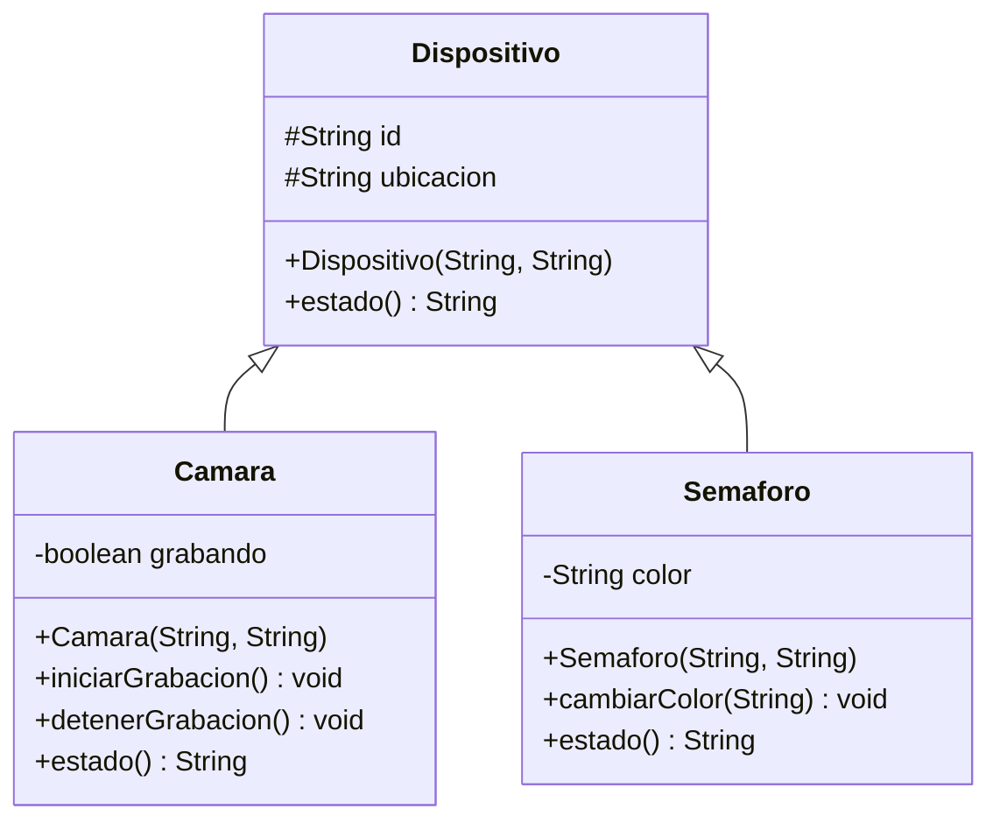

> [!important] Lectura del diagrama
> El triángulo hueco apunta **al padre**. `Camara` y `Semaforo` heredan de `Dispositivo`: ambos **son** dispositivos.

## 8.2 Qué se hereda y qué no

| Miembro del padre | ¿Se hereda? | Detalle |
|---|---|---|
| Atributos `public` | Sí | Accesibles directamente |
| Atributos `protected` | Sí | Accesibles en la subclase |
| Atributos `private` | No accesibles | Existen, pero solo el padre los toca |
| Métodos `public` / `protected` | Sí | Se pueden usar o sobrescribir |
| Métodos `private` | No | No se ven desde la subclase |
| Constructores | **No** | Se invocan con `super(...)` |
| Miembros `static` | Se heredan, pero pertenecen a la clase | Se accede con el nombre de la clase |

```java
class Padre {
    private int secreto = 42;
    protected int visible = 7;

    public int getSecreto() { return secreto; }
}

class Hija extends Padre {
    void probar() {
        System.out.println(visible);       // OK
        // System.out.println(secreto);    // ERROR: private
        System.out.println(getSecreto());  // OK: vía método público
    }
}
```

> [!warning] “No se hereda el private” mal explicado
> El atributo **existe** en el objeto (ocupa memoria) y se inicializa con el constructor del padre. Lo que no hay es **acceso directo** desde la subclase. Se llega por getters o métodos protegidos.

## 8.3 Sobrescritura

```java
class Dispositivo {
    public String estado() {
        return "dispositivo";
    }
}

class Semaforo extends Dispositivo {

    private String color = "ROJO";

    @Override
    public String estado() {          // misma firma
        return "semáforo " + color;
    }
}
```

Reglas:

1. **Misma firma** (nombre + parámetros).
2. El retorno debe ser igual o un subtipo (retorno covariante).
3. No se puede reducir la visibilidad: `public` no puede pasar a `protected`.
4. No se puede sobrescribir un método `final`.
5. `@Override` no es obligatorio, pero **detecta errores de tipeo** en la firma.

> [!warning] El error que `@Override` evita
> ```java
> @Override
> public String Estado() { ... }   // mayúscula: NO sobrescribe
> ```
> Sin la anotación, el compilador lo acepta como método nuevo y el polimorfismo no funciona. Con `@Override`, falla y te avisa.

### `super` en la sobrescritura

```java
@Override
public String estado() {
    return super.estado() + " (actualizado)";
}
```

Sirve para **aprovechar** la implementación del padre y agregar comportamiento.

## 8.4 La raíz: `Object`

Toda clase en Java hereda (implícitamente) de `Object`. Por eso todo objeto tiene:

| Método | Para qué |
|---|---|
| `toString()` | Representación textual; se usa al concatenar |
| `equals(Object)` | Igualdad lógica (por defecto, identidad) |
| `hashCode()` | Código hash coherente con `equals` |
| `getClass()` | Clase real del objeto |

```java
class Punto {
    int x, y;

    Punto(int x, int y) { this.x = x; this.y = y; }

    @Override
    public String toString() {
        return "(" + x + ", " + y + ")";
    }
}

public class Prueba {
    public static void main(String[] args) {
        System.out.println(new Punto(2, 3));   // (2, 3)
    }
}
```

Se profundiza en 13. String y comparación de objetos.

## 8.5 `final`

| Dónde | Efecto |
|---|---|
| `final` en atributo | No se reasigna |
| `final` en método | No se puede sobrescribir |
| `final` en clase | No se puede heredar |

```java
final class Utilidades { }          // nadie puede extenderla

class Base {
    public final void plantilla() { }   // no se puede sobrescribir
}
```

## 8.6 Herencia vs. composición

> [!important] Regla de diseño
> Usá herencia solo si hay una relación **“es un”** real y la subclase **especializa** el comportamiento. Si solo querés reutilizar código, usá **composición** (“tiene un”).

| Criterio | Herencia | Composición |
|---|---|---|
| Relación | “es un” | “tiene un” |
| Acoplamiento | Fuerte (depende del padre) | Débil (depende de una interfaz) |
| Cambio en el padre | Impacta en los hijos | No impacta |
| Cuándo | Jerarquía real del dominio | Reutilizar sin jerarquía |

```java
// MAL: un motor no "es un" auto
class Auto extends Motor { }

// BIEN: un auto "tiene un" motor
class Auto {
    private Motor motor;
}
```

> [!warning] Herencia por conveniencia
> Es el error de diseño más común en el examen. Si no podés decir “A **es un** B” en voz alta, no uses `extends`.

## 8.7 Programa completo

```java
class Dispositivo {

    protected final String id;
    protected String ubicacion;
    protected boolean activo;

    public Dispositivo(String id, String ubicacion) {
        this.id = id;
        this.ubicacion = ubicacion;
    }

    public void activar() { activo = true; }
    public void desactivar() { activo = false; }

    public String estado() {
        return id + " @ " + ubicacion + " [" + (activo ? "ON" : "OFF") + "]";
    }
}

class Semaforo extends Dispositivo {

    private String color;

    public Semaforo(String id, String ubicacion) {
        super(id, ubicacion);
        this.color = "ROJO";
    }

    public void cambiarColor(String nuevo) {
        if (nuevo.equals("ROJO") || nuevo.equals("AMARILLO") || nuevo.equals("VERDE")) {
            this.color = nuevo;
        }
    }

    @Override
    public String estado() {
        return super.estado() + " color=" + color;
    }
}

class Camara extends Dispositivo {

    private boolean grabando;

    public Camara(String id, String ubicacion) {
        super(id, ubicacion);
    }

    public void grabar() { grabando = true; }

    @Override
    public String estado() {
        return super.estado() + " " + (grabando ? "REC" : "sin grabar");
    }
}

public class Municipio {

    public static void main(String[] args) {

        Semaforo s = new Semaforo("S-01", "Belgrano");
        Camara c = new Camara("C-01", "Plaza");

        s.activar();
        s.cambiarColor("VERDE");
        c.activar();
        c.grabar();

        System.out.println(s.estado());
        System.out.println(c.estado());

        Dispositivo d = new Camara("C-02", "Terminal");
        d.activar();
        System.out.println(d.estado());     // se ejecuta el de Camara
    }
}
```

Salida:

```text
S-01 @ Belgrano [ON] color=VERDE
C-01 @ Plaza [ON] REC
C-02 @ Terminal [ON] sin grabar
```

> [!important] Fijate en la última línea
> `d` es de tipo `Dispositivo` pero apunta a una `Camara`. Se ejecuta `estado()` de `Camara`. Eso es **polimorfismo** (11. Polimorfismo y miembros estáticos).

## Cómo trazar una jerarquía

| Paso | Acción | Objeto `c` (Camara) |
|---|---|---|
| 1 | `new Camara("C-01","Plaza")` | reserva memoria |
| 2 | `super(id, ubicacion)` | `id`, `ubicacion` asignados; `activo=false` |
| 3 | vuelve al constructor de Camara | `grabando=false` |
| 4 | `c.activar()` | `activo=true` |
| 5 | `c.grabar()` | `grabando=true` |
| 6 | `c.estado()` | ejecuta la versión de `Camara` |

## Errores que suelen tomar

| Error | Consecuencia |
|---|---|
| Herencia sin “es un” | Modelo incorrecto |
| Esperar que se hereden los constructores | No ocurre: hay que llamar `super(...)` |
| Acceder a un `private` del padre | No compila |
| Sobrescribir cambiando la firma | Es sobrecarga, no sobrescritura |
| Reducir visibilidad al sobrescribir | No compila |
| Olvidar `super(...)` cuando el padre no tiene constructor vacío | No compila |
| Usar `extends` solo para reutilizar | Acoplamiento innecesario |

## Ejercicios

> [!example] 1. Jerarquía
> **Enunciado:** modelá `Vehiculo` con `patente` y `velocidadMaxima`, y las subclases `Auto` (cantidadPuertas) y `Moto` (cilindrada). Escribí los constructores.
> **Solución:**
> ```java
> class Vehiculo {
>     protected String patente;
>     protected int velocidadMaxima;
>
>     Vehiculo(String patente, int velocidadMaxima) {
>         this.patente = patente;
>         this.velocidadMaxima = velocidadMaxima;
>     }
> }
>
> class Auto extends Vehiculo {
>     private int puertas;
>     Auto(String p, int v, int puertas) {
>         super(p, v);
>         this.puertas = puertas;
>     }
> }
>
> class Moto extends Vehiculo {
>     private int cilindrada;
>     Moto(String p, int v, int cilindrada) {
>         super(p, v);
>         this.cilindrada = cilindrada;
>     }
> }
> ```

> [!example] 2. Sobrescritura
> **Enunciado:** ¿qué está mal?
> ```java
> class A { public void f(int x) { } }
> class B extends A {
>     @Override
>     public void f(double x) { }
> }
> ```
> **Solución:** `B.f(double)` **no sobrescribe** `A.f(int)`: es sobrecarga. `@Override` hace que no compile, que es justamente lo útil.

> [!example] 3. `private`
> **Enunciado:** ¿qué imprime?
> ```java
> class A { private int x = 1; public int getX() { return x; } }
> class B extends A { public int getX() { return 2; } }
> new B().getX();
> ```
> **Solución:** `2`. `B` sobrescribe `getX()`; el `x` privado de `A` sigue existiendo pero no se usa.

> [!example] 4. Composición
> **Enunciado:** reescribí `class Auto extends Motor` con composición.
> **Solución:**
> ```java
> class Auto {
>     private final Motor motor;
>     Auto(Motor motor) { this.motor = motor; }
> }
> ```

> [!example] 5. a papel
> **Enunciado:** escribí `Empleado` con `nombre` y `sueldoBase`, y `Gerente extends Empleado` con `bono`. Sobrescribí `sueldoTotal()`.
> **Solución:**
> ```java
> class Empleado {
>     protected String nombre;
>     protected double sueldoBase;
>
>     Empleado(String nombre, double sueldoBase) {
>         this.nombre = nombre;
>         this.sueldoBase = sueldoBase;
>     }
>
>     double sueldoTotal() { return sueldoBase; }
> }
>
> class Gerente extends Empleado {
>     private double bono;
>
>     Gerente(String nombre, double sueldoBase, double bono) {
>         super(nombre, sueldoBase);
>         this.bono = bono;
>     }
>
>     @Override
>     double sueldoTotal() { return super.sueldoTotal() + bono; }
> }
> ```


<div style="page-break-after: always;"></div>


# 9. Clases abstractas

> [!info] Al terminar este capítulo tenés que poder
> - Declarar una clase abstracta y un método abstracto.
> - Explicar por qué no se puede instanciar.
> - Implementar subclases concretas completas.
> - Justificar cuándo conviene una clase abstracta.

> [!abstract] Qué debés saber (nivel 1)
> - `abstract class` declara una clase que **no se instancia**.
> - `abstract` en un método = **sin cuerpo**; la subclase concreta está obligada a implementarlo.
> - Una clase abstracta **puede** tener atributos, constructor y métodos concretos.
> - Se puede declarar una **referencia** del tipo abstracto, pero no hacer `new`.
> - Si una subclase no implementa todos los métodos abstractos, también debe ser abstracta.

## 9.1 El problema

Tenés `Semaforo` y `Camara`, ambos con `id`, `ubicacion` y `estado()`. Querés una base común, pero **no existe un “dispositivo genérico”** que tenga sentido crear.

```java
Dispositivo d = new Dispositivo("D-01", "Centro");   // ¿qué dispositivo es?
```

Ahí aparece la clase abstracta: define el contrato y el estado común, pero **prohíbe** la instancia directa.

## 9.2 Declaración

```java
public abstract class Dispositivo {

    protected final String id;
    protected String ubicacion;

    public Dispositivo(String id, String ubicacion) {
        this.id = id;
        this.ubicacion = ubicacion;
    }

    // Método concreto: se hereda tal cual
    public String identificacion() {
        return id + " @ " + ubicacion;
    }

    // Método abstracto: sin cuerpo, obligatorio para las subclases
    public abstract String tipo();

    public abstract void realizarTarea();
}
```

```java
public class Camara extends Dispositivo {

    public Camara(String id, String ubicacion) {
        super(id, ubicacion);
    }

    @Override
    public String tipo() {
        return "Camara";
    }

    @Override
    public void realizarTarea() {
        System.out.println("Capturando imagen en " + ubicacion);
    }
}
```

```java
public class Semaforo extends Dispositivo {

    private String color = "ROJO";

    public Semaforo(String id, String ubicacion) {
        super(id, ubicacion);
    }

    @Override
    public String tipo() {
        return "Semaforo";
    }

    @Override
    public void realizarTarea() {
        System.out.println("Gestionando tránsito en " + ubicacion + " (" + color + ")");
    }

    public void cambiarColor(String nuevo) {
        color = nuevo;
    }
}
```

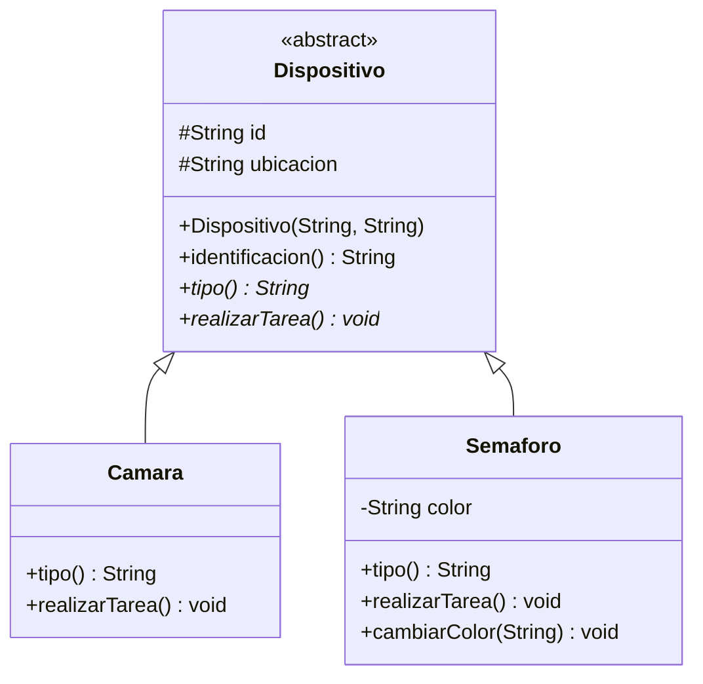

> [!important] En UML
> La clase abstracta se marca con `<<abstract>>` y los métodos abstractos con `*` o con la letra en cursiva. En el escrito, escribí `{abstract}` si no recordás la notación.

## 9.3 Reglas

| Regla | Detalle |
|---|---|
| No se instancia | `new Dispositivo(...)` no compila |
| Sí se referencia | `Dispositivo d = new Camara(...)` es válido |
| Puede tener constructor | Se invoca desde la subclase con `super(...)` |
| Puede tener métodos concretos | Se heredan y se pueden sobrescribir |
| Puede no tener ningún método abstracto | Igual no se instancia |
| `abstract` no se aplica a constructores | Un constructor abstracto no existe |
| `abstract` no se aplica a `static` | No tiene sentido: no hay objeto |
| `final` y `abstract` son incompatibles | `final` prohíbe heredar; `abstract` exige heredar |

## 9.4 Subclase incompleta

```java
abstract class Figura {
    abstract double area();
    abstract double perimetro();
}

// Si no implementa todo, debe seguir siendo abstracta
abstract class FiguraIncompleta extends Figura {
    @Override
    double area() { return 0; }
    // falta perimetro()
}

// Concreta: implementa todo
class Cuadrado extends Figura {
    private final double lado;

    Cuadrado(double lado) { this.lado = lado; }

    @Override double area() { return lado * lado; }
    @Override double perimetro() { return 4 * lado; }
}
```

> [!warning] Error de compilación
> “`Cuadrado` is not abstract and does not override abstract method `perimetro()`”. Es el mensaje típico cuando falta implementar un método abstracto.

## 9.5 Clase abstracta con lógica común

La ventaja real no es “obligar”, es **compartir** el algoritmo y dejar huecos.

```java
public abstract class ProcesadorDispositivo {

    // Método concreto: define el esqueleto
    public final void procesar() {
        conectar();
        String dato = leer();
        guardar(dato);
        desconectar();
    }

    protected void conectar() {
        System.out.println("Conectando...");
    }

    protected abstract String leer();       // cada dispositivo lo implementa

    protected void guardar(String dato) {
        System.out.println("Guardando: " + dato);
    }

    protected void desconectar() {
        System.out.println("Desconectando...");
    }
}
```

```java
public class SensorHumedad extends ProcesadorDispositivo {
    @Override
    protected String leer() {
        return "humedad=62%";
    }
}
```

```java
public class SensorTemperatura extends ProcesadorDispositivo {
    @Override
    protected String leer() {
        return "temp=21.5C";
    }
}
```

```java
public class Planta {
    public static void main(String[] args) {
        new SensorHumedad().procesar();
        new SensorTemperatura().procesar();
    }
}
```

Salida:

```text
Conectando...
Guardando: humedad=62%
Desconectando...
Conectando...
Guardando: temp=21.5C
Desconectando...
```

> [!tip] Patrón “método plantilla”
> El método `procesar()` fija el orden; las subclases solo aportan `leer()`. Es la aplicación más útil de las clases abstractas y se pregunta en el oral.

## 9.6 Cuándo usar clase abstracta

| Situación | ¿Abstracta? |
|---|---|
| Hay estado común (atributos) | Sí |
| Hay código común que conviene reutilizar | Sí |
| Nunca se instancia directamente | Sí |
| Solo se define un contrato, sin estado | Mejor **interfaz** (10. Interfaces) |
| Se necesita herencia múltiple de tipo | Interfaz |

> [!important] La diferencia que se pregunta
> Clase abstracta = **base parcial** con estado y comportamiento. Interfaz = **contrato** de capacidades. Se compara en detalle en 10. Interfaces.

## 9.7 Programa completo

```java
public abstract class FiguraGeometrica {

    protected final String nombre;

    protected FiguraGeometrica(String nombre) {
        this.nombre = nombre;
    }

    public abstract double area();
    public abstract double perimetro();

    public String descripcion() {
        return String.format("%s: área=%.2f, perímetro=%.2f",
                nombre, area(), perimetro());
    }
}
```

```java
public class Circulo extends FiguraGeometrica {

    private final double radio;

    public Circulo(double radio) {
        super("Círculo");
        this.radio = radio;
    }

    @Override
    public double area() { return Math.PI * radio * radio; }

    @Override
    public double perimetro() { return 2 * Math.PI * radio; }
}
```

```java
public class Rectangulo extends FiguraGeometrica {

    private final double base;
    private final double altura;

    public Rectangulo(double base, double altura) {
        super("Rectángulo");
        this.base = base;
        this.altura = altura;
    }

    @Override
    public double area() { return base * altura; }

    @Override
    public double perimetro() { return 2 * (base + altura); }
}
```

```java
public class Figuras {

    public static void main(String[] args) {

        FiguraGeometrica[] figuras = {
            new Circulo(2),
            new Rectangulo(3, 4)
        };

        for (FiguraGeometrica f : figuras) {
            System.out.println(f.descripcion());
        }
    }
}
```

Salida:

```text
Círculo: área=12,57, perímetro=12,57
Rectángulo: área=12,00, perímetro=14,00
```

> [!warning] Formato con coma
> `String.format` usa la configuración regional. Si tu sistema está en español, imprime coma decimal. En el examen no importa el formato; importa el cálculo.

## Cómo trazar

```java
Figura f = new Circulo(2);
f.area();
```

| Paso | Acción | Resultado |
|---|---|---|
| 1 | `new Circulo(2)` | constructor de `Circulo` → `super("Círculo")` → `radio=2` |
| 2 | Asignar a `f` (tipo `Figura`) | referencia válida |
| 3 | `f.area()` | se ejecuta la de `Circulo` → `π·4` |
| 4 | `f.descripcion()` | método concreto de `Figura`, que llama a `area()` y `perimetro()` de `Circulo` |

## Errores que suelen tomar

| Error | Consecuencia |
|---|---|
| `new Dispositivo(...)` | No compila |
| Método abstracto con cuerpo | No compila |
| Subclase concreta sin implementar todo | No compila |
| Marcar `abstract` una clase que se quiere instanciar | No compila |
| `final abstract class` | Combinación inválida |
| Confundir abstracta con interfaz | Error conceptual |

## Ejercicios

> [!example] 1. ¿Compila?
> **Enunciado:** ¿qué pasa con `abstract class A { void f(); }`?
> **Solución:** no compila: un método sin cuerpo debe declararse `abstract`. La clase ya es abstracta, pero falta el modificador en el método.

> [!example] 2. Subclase
> **Enunciado:** `abstract class Animal { abstract void sonido(); }`. Escribí `Perro` y `Gato`.
> **Solución:**
> ```java
> abstract class Animal { abstract void sonido(); }
>
> class Perro extends Animal {
>     @Override void sonido() { System.out.println("Guau"); }
> }
> class Gato extends Animal {
>     @Override void sonido() { System.out.println("Miau"); }
> }
> ```

> [!example] 3. Referencia abstracta
> **Enunciado:** ¿es válido `Animal a = new Perro(); a.sonido();`?
> **Solución:** sí. Se puede declarar la referencia con el tipo abstracto; en ejecución se llama al método del objeto real (`Perro`).

> [!example] 4. Método plantilla
> **Enunciado:** explicá por qué `procesar()` es `final` en el ejemplo.
> **Solución:** para que ninguna subclase cambie el orden del algoritmo. Solo puede variar `leer()`, que es el punto de extensión.

> [!example] 5. a papel
> **Enunciado:** escribí `Empleado` abstracto con `nombre` y `sueldoBase`, método abstracto `calcularSueldo()`, y dos subclases: `Fijo` (sueldo base) y `PorHora` (horas × valor).
> **Solución:**
> ```java
> abstract class Empleado {
>     protected String nombre;
>     protected double sueldoBase;
>
>     Empleado(String nombre, double sueldoBase) {
>         this.nombre = nombre;
>         this.sueldoBase = sueldoBase;
>     }
>
>     abstract double calcularSueldo();
> }
>
> class Fijo extends Empleado {
>     Fijo(String n, double s) { super(n, s); }
>     @Override double calcularSueldo() { return sueldoBase; }
> }
>
> class PorHora extends Empleado {
>     private int horas;
>     PorHora(String n, double valorHora, int horas) {
>         super(n, valorHora);
>         this.horas = horas;
>     }
>     @Override double calcularSueldo() { return sueldoBase * horas; }
> }
> ```


<div style="page-break-after: always;"></div>


# 10. Interfaces

> [!info] Al terminar este capítulo tenés que poder
> - Definir una interfaz como contrato.
> - Implementarla, incluso varias a la vez.
> - Usarla como tipo de referencia.
> - Elegir entre clase abstracta e interfaz y justificarlo.

> [!abstract] Qué debés saber (nivel 1)
> - `interface` define un **contrato**: qué se debe hacer, no cómo.
> - Una clase **implementa** con `implements` (no `extends`).
> - Se pueden implementar **varias** interfaces.
> - Los métodos son públicos y abstractos por defecto (hasta Java 7); hoy puede haber `default` y `static`.
> - Los atributos son `public static final` implícitamente (constantes).
> - No se instancia: `new Activable()` no compila.

## 10.1 Qué es un contrato

> [!quote] Cátedra
> Una interfaz define un contrato que especifica el comportamiento que las clases implementadoras deben cumplir.

Pensá en un enchufe: no importa qué aparato conectes, todos cumplen la misma forma. La interfaz define la forma; cada clase decide qué hace al conectarse.

```java
public interface Activable {

    void activar();
    void desactivar();
    boolean estaActivo();
}
```

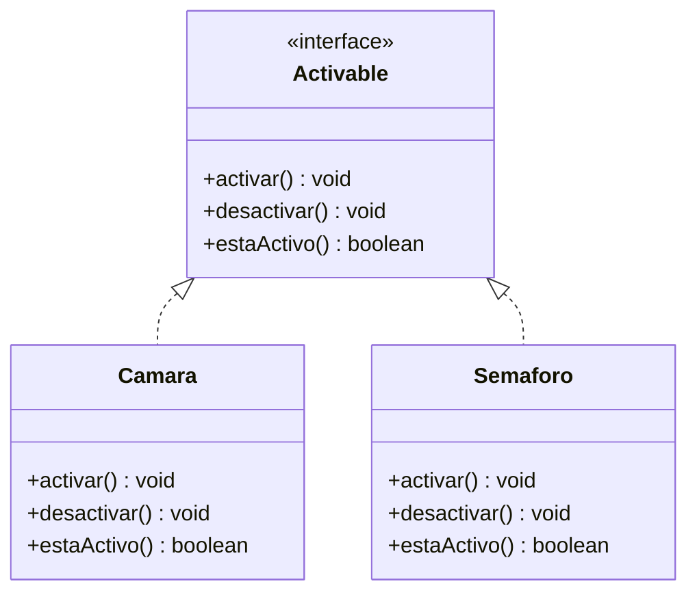

> [!important] Notación UML
> La interfaz se marca `<<interface>>` y la relación es **línea punteada con triángulo hueco** (`<|..`). La herencia de clase es línea continua (`<|--`).

## 10.2 Implementar

```java
public class CamaraSimple implements Activable {

    private boolean activo = false;

    @Override
    public void activar() {
        activo = true;
    }

    @Override
    public void desactivar() {
        activo = false;
    }

    @Override
    public boolean estaActivo() {
        return activo;
    }
}
```

Reglas:

1. La clase **debe** implementar todos los métodos del contrato.
2. Los métodos deben ser `public` (no se puede reducir la visibilidad).
3. `@Override` es recomendable: verifica la firma.

> [!warning] Error clásico
> ```java
> public class CamaraSimple implements Activable {
>     void activar() { }        // sin public: NO compila
> }
> ```
> El método de la interfaz es público; la implementación no puede ser más restrictiva.

## 10.3 Varias interfaces

`Activable` ya está definida arriba; acá se agregan dos contratos más.

```java
public interface Conectable {
    void conectar(String red);
    void desconectar();
}
```

```java
public interface Auditable {
    String auditoria();
}
```

```java
public class CamaraConectada implements Activable, Conectable, Auditable {

    private boolean activo;
    private String red = "sin red";
    private int cambios = 0;

    @Override public void activar()   { activo = true;  cambios++; }
    @Override public void desactivar(){ activo = false; cambios++; }
    @Override public boolean estaActivo() { return activo; }
    @Override public void conectar(String red) { this.red = red; }
    @Override public void desconectar() { this.red = "sin red"; }

    @Override
    public String auditoria() {
        return "activo=" + activo + ", red=" + red + ", cambios=" + cambios;
    }
}
```

```java
public class Prueba {
    public static void main(String[] args) {
        CamaraConectada c = new CamaraConectada();
        c.activar();
        c.conectar("LAN-01");
        System.out.println(c.auditoria());   // activo=true, red=LAN-01, cambios=1
    }
}
```

> [!important] Herencia múltiple de tipo, no de implementación
> Java no permite `extends A, B`, pero sí `implements A, B`. La clase hereda **una** implementación y adopta **varios** contratos. Eso evita el problema del diamante.

## 10.4 La interfaz como tipo

```java
public class Panel {

    public static void main(String[] args) {

        Activable a = new CamaraSimple();   // referencia de interfaz
        a.activar();                        // se ejecuta la de CamaraSimple

        Activable[] dispositivos = {
            new CamaraSimple(),
            new CamaraConectada()
        };

        for (Activable d : dispositivos) {
            d.activar();                // cada uno responde a su manera
        }
    }
}
```

El código cliente **no necesita saber** qué clase concreta es: le alcanza con que cumpla el contrato. Eso es bajo acoplamiento.

> [!warning] Solo ves el contrato
> Con una referencia `Activable`, no podés llamar a métodos propios de `CamaraConectada` (como `conectar("LAN-01")`). Para eso necesitás un cast o cambiar el tipo de la referencia.

## 10.5 Clase abstracta vs. interfaz

| Aspecto | Clase abstracta | Interfaz |
|---|---|---|
| Propósito | Base común con estado y comportamiento parcial | Contrato de capacidades |
| Instanciación | No | No |
| Atributos de instancia | Sí | No (solo constantes) |
| Constructores | Sí | No |
| Métodos | Abstractos y concretos | Abstractos, `default` y `static` |
| Herencia | Una sola clase (`extends`) | Varias interfaces (`implements`) |
| Cuándo | Las subclases comparten estado o código | Varias clases necesitan la misma capacidad |

> [!important] La respuesta de oral
> “Uso clase abstracta cuando las subclases comparten **estado o implementación**; uso interfaz cuando varias clases necesitan cumplir una **capacidad común**, aunque no pertenezcan a la misma jerarquía.”

## 10.6 Programa completo

```java
public interface Activable {
    void activar();
    void desactivar();
    boolean estaActivo();
}
```

```java
public abstract class Dispositivo implements Activable {

    protected final String id;
    protected String ubicacion;
    protected boolean activo;

    protected Dispositivo(String id, String ubicacion) {
        this.id = id;
        this.ubicacion = ubicacion;
    }

    @Override public void activar()   { activo = true; }
    @Override public void desactivar(){ activo = false; }
    @Override public boolean estaActivo() { return activo; }

    public abstract String tipo();

    public String ficha() {
        return tipo() + " " + id + " @ " + ubicacion + " [" + (activo ? "ON" : "OFF") + "]";
    }
}
```

```java
public class Camara extends Dispositivo {

    private boolean grabando;

    public Camara(String id, String ubicacion) {
        super(id, ubicacion);
    }

    @Override public String tipo() { return "Camara"; }

    public void grabar() { grabando = true; }

    @Override
    public String ficha() {
        return super.ficha() + (grabando ? " REC" : "");
    }
}
```

```java
public class Semaforo extends Dispositivo {

    private String color = "ROJO";

    public Semaforo(String id, String ubicacion) {
        super(id, ubicacion);
    }

    @Override public String tipo() { return "Semaforo"; }

    public void cambiarColor(String c) { color = c; }

    @Override
    public String ficha() {
        return super.ficha() + " color=" + color;
    }
}
```

```java
public class CentroControl {

    public static void main(String[] args) {

        Dispositivo[] red = {
            new Camara("C-01", "Plaza"),
            new Semaforo("S-01", "Belgrano")
        };

        for (Dispositivo d : red) {
            d.activar();                 // método de la interfaz, implementado en la abstracta
            System.out.println(d.ficha()); // método sobrescrito en cada subclase
        }

        Activable a = red[0];
        a.desactivar();
        System.out.println("¿Activo? " + a.estaActivo());
    }
}
```

Salida:

```text
Camara C-01 @ Plaza [ON]
Semaforo S-01 @ Belgrano [ON] color=ROJO
¿Activo? false
```

Observá las tres capas: **interfaz** (contrato), **clase abstracta** (estado y comportamiento común) y **clases concretas** (especialización).

## Cómo trazar

| Paso | Acción | `red[0]` (Camara) |
|---|---|---|
| 1 | `new Camara("C-01","Plaza")` | `super(...)` inicializa `id`, `ubicacion`, `activo=false` |
| 2 | `d.activar()` con `d` de tipo `Dispositivo` | ejecuta `Dispositivo.activar()` → `activo=true` |
| 3 | `d.ficha()` | se ejecuta la de `Camara` (sobrescrita) |
| 4 | `a.desactivar()` con `a` de tipo `Activable` | ejecuta la implementación de `Dispositivo` |

## Errores que suelen tomar

| Error | Consecuencia |
|---|---|
| `class X extends Activable` | No compila: es `implements` |
| `new Activable()` | No compila: no se instancia |
| Implementar solo algunos métodos | No compila |
| Método implementado sin `public` | No compila |
| Declarar atributos de instancia en la interfaz | Solo constantes |
| Confundir interfaz con clase abstracta | Error conceptual en el oral |
| Poner lógica de negocio en `default` | Mala práctica, acopla el contrato |

## Ejercicios

> [!example] 1. Contrato
> **Enunciado:** definí `Notificable` con `notificar(String)` y `cantidadNotificaciones()`, e implementalo en `Alerta`.
> **Solución:**
> ```java
> interface Notificable {
>     void notificar(String mensaje);
>     int cantidadNotificaciones();
> }
>
> class Alerta implements Notificable {
>     private int cantidad;
>     @Override public void notificar(String m) { cantidad++; System.out.println(m); }
>     @Override public int cantidadNotificaciones() { return cantidad; }
> }
> ```

> [!example] 2. Varias interfaces
> **Enunciado:** ¿puede una clase implementar `Activable` y `Auditable` a la vez? ¿Y extender `Dispositivo`?
> **Solución:** sí a ambas: `class Camara extends Dispositivo implements Activable, Auditable`.

> [!example] 3. Referencia de interfaz
> **Enunciado:** ¿qué imprime?
> ```java
> Activable a = new Camara();
> a.activar();
> System.out.println(a.estaActivo());
> ```
> **Solución:** `true`. Se ejecuta la implementación de `Camara` (o la heredada de `Dispositivo`, según el caso).

> [!example] 4. Elección
> **Enunciado:** para “todo dispositivo puede activarse” y “todas las figuras comparten color y nombre”, ¿interfaz o abstracta?
> **Solución:** “puede activarse” es una **capacidad** → interfaz. “Comparten estado” (color, nombre) → **clase abstracta**.

> [!example] 5. a papel
> **Enunciado:** escribí la interfaz `ComparablePorPrioridad` con `int prioridad()` y hacé que `Alerta` la implemente. Ordená dos alertas a mano según su prioridad.
> **Solución:**
> ```java
> interface ComparablePorPrioridad {
>     int prioridad();
> }
>
> class AlertaPriorizable implements ComparablePorPrioridad {
>     private final int prioridad;
>     AlertaPriorizable(int p) { this.prioridad = p; }
>     @Override public int prioridad() { return prioridad; }
> }
>
> // A mano: menor número = mayor prioridad → la de 1 va antes que la de 3
> ```


<div style="page-break-after: always;"></div>


# 11. Polimorfismo y miembros estáticos

> [!info] Al terminar este capítulo tenés que poder
> - Explicar qué es abstraer y para qué sirve.
> - Definir polimorfismo y distinguir sus tipos.
> - Diferenciar enlace estático de dinámico.
> - Justificar cómo el polimorfismo permite extender sin modificar.
> - Usar `static` y distinguir instancia de clase.

> [!abstract] Qué debés saber (nivel 1)
> - **Abstracción:** quedarse con lo relevante y ocultar el detalle.
> - **Polimorfismo:** el mismo mensaje produce comportamientos distintos según el objeto.
> - Tipos: **sobrecarga** (estático), **inclusión** (dinámico), **paramétrico** (genéricos).
> - **Enlace dinámico:** el método se elige en ejecución según el objeto real.
> - Ventaja central: agregar un tipo nuevo **sin tocar** el código que lo usa.

> [!quote] Cátedra
> La **abstracción** es la acción de separar lo esencial de lo accidental. En POO se materializa en clases e interfaces: el cliente conoce **qué** hace un objeto, no **cómo** lo hace.

## 11.1 Abstraer

Abstraer es decidir qué mirar y qué ignorar. Un semáforo, para el sistema de tránsito, es un objeto con `estado` y `cambiar()`; no importa su color de pintura ni su número de serie.

| Nivel de abstracción | Qué muestra | Ejemplo |
|---|---|---|
| **Muy bajo** | Detalle de implementación | "arreglo de 3 bytes con 0/1/2" |
| **Medio** | Operaciones | "encender, apagar, estado" |
| **Alto** | Concepto del dominio | "dispositivo de señalización" |

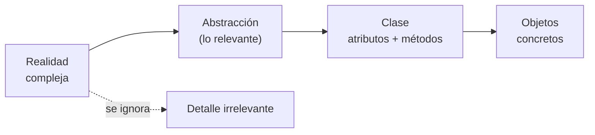

> [!important] Abstraer no es "simplificar porque sí"
> Es elegir el nivel de detalle que el problema necesita. Si el sistema solo enciende y apaga, no modeles la resistencia del LED.

## 11.2 Qué es polimorfismo

**Polimorfismo:** capacidad de que un mismo mensaje (nombre de método) se resuelva de formas distintas según el objeto que lo recibe.

```java
abstract class Dispositivo {
    abstract String estado();
}

class Semaforo extends Dispositivo {
    String estado() { return "verde"; }
}

class Camara extends Dispositivo {
    String estado() { return "grabando"; }
}

// El cliente no cambia
for (Dispositivo d : dispositivos) {
    System.out.println(d.estado());
}
```

| Objeto real | Mensaje | Resultado |
|---|---|---|
| `Semaforo` | `estado()` | `"verde"` |
| `Camara` | `estado()` | `"grabando"` |

> [!important] La frase que se pregunta
> "El mismo mensaje, objetos distintos, comportamientos distintos." Si agregás `Sensor`, el `for` no cambia: eso es **extensibilidad por polimorfismo**.

## 11.3 Tipos de polimorfismo

| Tipo | Cuándo se resuelve | Ejemplo |
|---|---|---|
| **Sobrecarga** (ad hoc) | Compilación | `sumar(int, int)` y `sumar(double, double)` |
| **Inclusión** (subtipo) | Ejecución | `Dispositivo d = new Semaforo(); d.estado()` |
| **Paramétrico** (genéricos) | Compilación | `ArrayList<Alerta>` |
| **Coerción** | Compilación | `int` → `double` |

```java
// Sobrecarga: mismo nombre, distinta firma
int sumar(int a, int b) { return a + b; }
double sumar(double a, double b) { return a + b; }

// Inclusión: mismo mensaje, distinto objeto
Dispositivo d = new Camara();
d.estado();
```

> [!warning] Sobrecarga no es lo mismo que sobrescritura
> **Sobrecarga:** mismo nombre, **distinta firma**, en la misma clase o en una subclase. **Sobrescritura:** misma firma, en una subclase, con `@Override`. La sobrecarga se resuelve al compilar; la sobrescritura, al ejecutar.

## 11.4 Enlace estático y dinámico

| | Estático (temprano) | Dinámico (tardío) |
|---|---|---|
| Cuándo | Compilación | Ejecución |
| Se decide por | Tipo declarado | Tipo real del objeto |
| Aplica a | `static`, `private`, `final`, sobrecarga | Métodos sobrescritos |
| Ejemplo | `Math.abs(-3)` | `d.estado()` |

```mermaid
flowchart TD
    A["d.estado()"] --> B{"¿El método es<br/>static/private/final?"}
    B -- "Sí" --> C["Enlace estático<br/>según el tipo declarado"]
    B -- "No" --> D["Enlace dinámico<br/>según el objeto real"]
    D --> E["Se ejecuta la versión<br/>de la subclase"]
```

> [!important] La tabla de métodos virtuales
> La JVM guarda, por clase, qué implementación corresponde a cada método. Al llamar, busca en la clase del **objeto**, no en la del tipo de la variable. Por eso `Dispositivo d = new Camara()` ejecuta `Camara.estado()`.

## 11.5 Por qué el polimorfismo cambia el diseño

Sin polimorfismo, cada tipo nuevo obliga a tocar el código cliente:

```java
// Mal: crece con cada tipo
if (d instanceof Semaforo) { ... }
else if (d instanceof Camara) { ... }
else if (d instanceof Sensor) { ... }
```

Con polimorfismo, el cliente depende de una **abstracción** y no conoce los tipos concretos:

```java
// Bien: no cambia al agregar tipos
for (Dispositivo d : dispositivos) {
    d.estado();
}
```

| Principio | Efecto |
|---|---|
| Depender de la abstracción | El cliente no conoce las subclases |
| Agregar, no modificar | Se cumple abierto/cerrado |
| Cada clase resuelve lo suyo | Se elimina el `if` por tipo |

> [!important] La relación con los otros pilares
> La abstracción define **qué**; la herencia permite **compartir**; el encapsulamiento **protege** el cómo; el polimorfismo **varía** el cómo sin cambiar el qué. Se necesitan entre sí.

## 11.6 Método: detectar polimorfismo en un diseño

| Paso | Pregunta | Señal |
|---|---|---|
| 1 | ¿Hay una superclase o interfaz común? | Abstracción |
| 2 | ¿El cliente usa esa abstracción? | Buen diseño |
| 3 | ¿Hay `if` por tipo? | Falta polimorfismo |
| 4 | ¿El método se sobrescribe? | Enlace dinámico |
| 5 | ¿Agregar un tipo obliga a tocar el cliente? | Diseño rígido |

## 11.7 Jerarquía completa

```java
abstract class Dispositivo {

    protected final String id;
    protected String ubicacion;

    protected Dispositivo(String id, String ubicacion) {
        this.id = id;
        this.ubicacion = ubicacion;
    }

    public abstract void realizarTarea();

    public String ficha() {
        return id + " @ " + ubicacion;
    }
}

class Semaforo extends Dispositivo {

    private String color = "ROJO";

    Semaforo(String id, String u) { super(id, u); }

    public void cambiarColor(String c) { color = c; }

    @Override
    public void realizarTarea() {
        System.out.println("Semáforo " + id + ": gestionando tránsito (" + color + ")");
    }
}

class Camara extends Dispositivo {

    Camara(String id, String u) { super(id, u); }

    @Override
    public void realizarTarea() {
        System.out.println("Cámara " + id + ": capturando imagen");
    }
}
```

```java
public class CentroControl {

    public static void main(String[] args) {

        Dispositivo[] red = {
            new Semaforo("S-01", "Belgrano"),
            new Camara("C-01", "Plaza"),
            new Semaforo("S-02", "San Martín")
        };

        // Un solo recorrido, tres comportamientos distintos
        for (Dispositivo d : red) {
            d.realizarTarea();
        }
    }
}
```

Salida:

```text
Semáforo S-01: gestionando tránsito (ROJO)
Cámara C-01: capturando imagen
Semáforo S-02: gestionando tránsito (ROJO)
```

> [!important] La ventaja
> El `for` no sabe qué dispositivo es cada uno. Si mañana agregás `Sensor`, **no cambiás el recorrido**: agregás la clase y ya funciona. Eso es bajo acoplamiento.

## 11.8 Upcasting y downcasting

### Upcasting (automático)

De hijo a padre. Siempre es seguro.

```java
Camara c = new Camara("C-01", "Plaza");
Dispositivo d = c;              // upcast implícito
d.realizarTarea();
```

### Downcasting (explícito)

De padre a hijo. Puede fallar si el objeto no es de ese tipo.

```java
Dispositivo d = new Camara("C-01", "Plaza");
Camara c = (Camara) d;          // OK: el objeto es una Camara
c.realizarTarea();

Dispositivo s = new Semaforo("S-01", "Centro");
// Camara mala = (Camara) s;    // ClassCastException en ejecución
```

### `instanceof`

Verifica antes de convertir.

```java
for (Dispositivo d : red) {
    if (d instanceof Semaforo) {
        Semaforo s = (Semaforo) d;
        s.cambiarColor("VERDE");
    }
}
```

Java 16+ permite el patrón:

```java
if (d instanceof Semaforo s) {
    s.cambiarColor("VERDE");
}
```

> [!warning] `instanceof` no reemplaza el polimorfismo
> Si tu código está lleno de `instanceof`, probablemente el método debería estar en la clase padre. Usalo solo para casos genuinos.

## 11.9 Instancia vs. clase

```mermaid
flowchart TD
    subgraph Clase["Clase Dispositivo"]
        S["static int contador<br/>(compartido)"]
        C["static final int MAX = 100"]
        M["static boolean validarId(String)"]
    end
    subgraph Objetos["Instancias"]
        O1["D-01<br/>id: D-01<br/>ubicacion: Centro"]
        O2["D-02<br/>id: D-02<br/>ubicacion: Norte"]
    end
    S -.->|"una sola copia"| O1
    S -.->|"misma copia"| O2
```

| | Atributo de instancia | Atributo de clase (`static`) |
|---|---|---|
| Copias | Una por objeto | **Una** para toda la clase |
| Se accede | `objeto.atributo` | `Clase.atributo` |
| Cambia con el objeto | Sí | No: es compartido |
| Uso típico | Estado propio | Contadores, configuración, constantes |

## 11.10 Atributo estático: contador compartido

```java
public class Dispositivo {

    private static int cantidadCreados = 0;   // compartido

    private final String id;
    private String ubicacion;

    public Dispositivo(String id, String ubicacion) {
        this.id = id;
        this.ubicacion = ubicacion;
        cantidadCreados++;                     // afecta a la clase
    }

    public static int getCantidadCreados() {
        return cantidadCreados;
    }

    public String resumen() {
        return id + " @ " + ubicacion;
    }
}
```

```java
public class Prueba {

    public static void main(String[] args) {

        System.out.println("Antes: " + Dispositivo.getCantidadCreados());  // 0

        Dispositivo a = new Dispositivo("D-01", "Centro");
        Dispositivo b = new Dispositivo("D-02", "Norte");
        Dispositivo c = new Dispositivo("D-03", "Sur");

        System.out.println("Después: " + Dispositivo.getCantidadCreados()); // 3

        System.out.println(a.resumen());
        System.out.println(b.resumen());
        System.out.println(c.resumen());
    }
}
```

Salida:

```text
Antes: 0
Después: 3
D-01 @ Centro
D-02 @ Norte
D-03 @ Sur
```

> [!important] Por qué el contador funciona
> `cantidadCreados` no vive en `a`, `b` ni `c`: vive en la clase. Cada constructor la incrementa y todos ven el mismo valor.

> [!warning] Error clásico
> ```java
> a.cantidadCreados = 100;   // compila, pero es pésimo estilo
> ```
> Se puede acceder a un `static` desde una instancia, pero confunde: parece parte del objeto y no lo es. Siempre `Clase.atributo`.

## 11.11 Métodos estáticos

No dependen del estado de un objeto: reciben todo por parámetros.

```java
public class Validador {

    private Validador() { }        // evita instanciar una clase de utilidades

    public static boolean esIdValido(String id) {
        return id != null && id.matches("[A-Z]-\\d{2}");
    }

    public static boolean estaEnRango(double valor, double min, double max) {
        return valor >= min && valor <= max;
    }

    public static String normalizar(String texto) {
        return texto == null ? "" : texto.trim().toUpperCase();
    }
}
```

```java
public class UsoValidador {
    public static void main(String[] args) {
        System.out.println(Validador.esIdValido("D-01"));     // true
        System.out.println(Validador.esIdValido("d-1"));      // false
        System.out.println(Validador.estaEnRango(25, 0, 100)); // true
        System.out.println(Validador.normalizar("  centro ")); // CENTRO
    }
}
```

Salida:

```text
true
false
true
CENTRO
```

### Por qué no puede usar `this`

```java
public class Ejemplo {

    private int contador;          // de instancia

    public static void mostrar() {
        // System.out.println(contador);   // ERROR: no hay objeto
        // System.out.println(this.contador); // ERROR: no existe this
    }
}
```

Un método estático se ejecuta **sin objeto**. Si no hay objeto, no hay estado de instancia al que acceder.

```mermaid
flowchart LR
    A["Clase.metodoEstatico()"] --> B["No crea objeto"]
    B --> C["No puede leer<br/>atributos de instancia"]
    D["objeto.metodoInstancia()"] --> E["Usa el estado<br/>de ese objeto"]
    E --> F["Sí puede leer<br/>static"]
```

| Puede llamar | Desde método estático | Desde método de instancia |
|---|---|---|
| Método estático | ✅ | ✅ |
| Método de instancia | ❌ | ✅ |
| Atributo estático | ✅ | ✅ |
| Atributo de instancia | ❌ | ✅ |
| `this` | ❌ | ✅ |

## 11.12 Constantes de clase

```java
public class Configuracion {

    public static final int MAX_DISPOSITIVOS = 500;
    public static final double TARIFA_BASE = 12.5;
    public static final String VERSION = "1.0.0";

    private Configuracion() { }
}
```

`static final` = una sola copia, inmutable, accesible por nombre de clase. Es el patrón de las constantes de dominio.

> [!important] `static final` vs. `final`
> - `final` en un atributo de instancia: cada objeto tiene su valor, fijo.
> - `static final`: un único valor para toda la clase.
> - Los nombres de constantes van en `MAYÚSCULAS_CON_GUION`.

## 11.13 `main` es estático

```java
public static void main(String[] args)
```

| Modificador | Por qué |
|---|---|
| `public` | La JVM debe poder llamarlo desde fuera |
| `static` | La JVM lo llama **sin crear un objeto** de la clase |
| `void` | No devuelve nada al sistema operativo |
| `String[] args` | Recibe los argumentos de la línea de comandos |

> [!warning] Consecuencia práctica
> En `main` no podés llamar directamente a un método de instancia:
> ```java
> public class App {
>     void ejecutar() { }
>     public static void main(String[] args) {
>         // ejecutar();          // ERROR
>         new App().ejecutar();   // BIEN
>     }
> }
> ```

## Errores que suelen tomar

| Error | Corrección |
|---|---|
| Confundir polimorfismo con herencia | La herencia es un mecanismo; el polimorfismo, un efecto |
| Decir que la sobrecarga es dinámica | Se resuelve al compilar |
| Creer que el tipo declarado decide el método | Decide el tipo **real** (salvo static/private/final) |
| Usar `instanceof` para todo | Reemplazar por sobrescritura |
| Confundir abstracción con interfaz | La interfaz es una herramienta de abstracción |
| Decir que el polimorfismo "oculta" métodos | Cambia qué implementación se ejecuta |

## Ejercicios

> [!example] 1. Definir
> **Enunciado:** definí polimorfismo en una frase.
> **Solución:** el mismo mensaje produce comportamientos distintos según el objeto que lo recibe.

> [!example] 2. Clasificar
> **Enunciado:** `imprimir(int)` e `imprimir(String)` en la misma clase. ¿Qué tipo?
> **Solución:** sobrecarga (polimorfismo estático).

> [!example] 3. Enlace
> **Enunciado:** `Animal a = new Perro(); a.hablar();` ¿qué se ejecuta?
> **Solución:** `Perro.hablar()`, por enlace dinámico.

> [!example] 4. Diseño
> **Enunciado:** ¿por qué `if (d instanceof ...)` es una señal de mal diseño?
> **Solución:** porque obliga a modificar el cliente por cada tipo nuevo; el polimorfismo lo evita.

> [!example] 5. Abstracción
> **Enunciado:** ¿qué atributos modelarías de un vehículo para un sistema de peajes?
> **Solución:** patente, categoría, saldo; no color, marca ni motor.

> [!example] 6. a papel
> **Enunciado:** dibujá una jerarquía `Dispositivo` con dos subclases y mostrá el enlace dinámico.
> **Solución:** `Dispositivo` abstracto con `estado()`; `Semaforo` y `Camara` lo sobrescriben; el `for` sobre `Dispositivo` ejecuta la versión real.


<div style="page-break-after: always;"></div>


# 12. Arreglos y ArrayList

> [!info] Al terminar este capítulo tenés que poder
> - Declarar, crear e inicializar arreglos.
> - Recorrerlos con `for` y con `for-each`.
> - Explicar por qué `length` no lleva paréntesis.
> - Detectar y evitar el error de índice fuera de rango.
> - Elegir entre arreglo y `ArrayList` con criterio.

> [!abstract] Qué debés saber (nivel 1)
> - Un arreglo tiene **tamaño fijo** desde su creación.
> - Los índices van de **0 a length − 1**.
> - `length` es una **propiedad**, no un método.
> - Los elementos se inicializan solos: `0`, `false` o `null`.
> - Un arreglo es un **objeto**: se pasa por referencia.
> - Acceder fuera de rango lanza `ArrayIndexOutOfBoundsException`.

## 12.1 Declarar y crear

```java
// 1. Declaración
int[] notas;

// 2. Creación (reserva memoria, inicializa en 0)
notas = new int[5];

// 3. Declaración + creación
double[] precios = new double[10];

// 4. Con valores iniciales (el tamaño se deduce)
int[] edades = {18, 25, 30, 42};

// 5. Sintaxis alternativa (equivalente, menos usada)
int edades2[] = new int[3];
```

```mermaid
flowchart LR
    subgraph Arreglo["int[] edades = {18, 25, 30, 42}"]
        I0["[0]<br/>18"]
        I1["[1]<br/>25"]
        I2["[2]<br/>30"]
        I3["[3]<br/>42"]
    end
    I0 --> I1 --> I2 --> I3
```

| Concepto | Valor |
|---|---|
| Nombre | `edades` |
| Tipo | `int[]` |
| Longitud | `edades.length` → 4 |
| Primer índice | 0 |
| Último índice | `length - 1` → 3 |

## 12.2 Acceso y recorrido

```java
public class Arreglos {

    public static void main(String[] args) {

        int[] edades = {18, 25, 30, 42};

        // Acceso directo
        System.out.println("Primero: " + edades[0]);
        System.out.println("Último: " + edades[edades.length - 1]);

        // Recorrido con índice
        for (int i = 0; i < edades.length; i++) {
            System.out.println("edades[" + i + "] = " + edades[i]);
        }

        // Recorrido con for-each (solo lectura del elemento)
        int suma = 0;
        for (int edad : edades) {
            suma += edad;
        }
        System.out.println("Suma: " + suma);
        System.out.printf("Promedio: %.2f%n", (double) suma / edades.length);
    }
}
```

Salida:

```text
Primero: 18
Último: 42
edades[0] = 18
edades[1] = 25
edades[2] = 30
edades[3] = 42
Suma: 115
Promedio: 28.75
```

> [!warning] `length` vs. `length()`
> - Arreglos: `edades.length` (propiedad).
> - `String`: `texto.length()` (método).
> - `ArrayList`: `lista.size()` (método).
> Confundirlos es un error de compilación frecuente.

### Modificar elementos

```java
int[] stock = new int[3];       // {0, 0, 0}
stock[0] = 10;
stock[1] = stock[0] * 2;
stock[2] = stock[0] + stock[1];

for (int s : stock) System.out.print(s + " ");   // 10 20 30
```

### El error de índice

```java
int[] v = new int[3];      // índices válidos: 0, 1, 2
v[3] = 10;                 // ArrayIndexOutOfBoundsException
```

> [!important] Por qué `i <= length` está mal
> ```java
> for (int i = 0; i <= v.length; i++) { ... }   // falla en la última vuelta
> ```
> Cuando `i == length`, el índice ya no existe. Siempre `i < length`.

## 12.3 Valores por defecto

```java
int[] enteros = new int[3];          // 0, 0, 0
double[] decimales = new double[3];  // 0.0, 0.0, 0.0
boolean[] banderas = new boolean[3]; // false, false, false
String[] nombres = new String[3];    // null, null, null
```

> [!warning] `null` en arreglos de objetos
> ```java
> String[] n = new String[3];
> System.out.println(n[0].length());   // NullPointerException
> ```
> El arreglo existe; los elementos todavía no. Hay que asignarlos.

## 12.4 Arreglos de objetos

```java
class Alerta {
    String mensaje;
    int prioridad;

    Alerta(String mensaje, int prioridad) {
        this.mensaje = mensaje;
        this.prioridad = prioridad;
    }

    String resumen() {
        return "[" + prioridad + "] " + mensaje;
    }
}

public class CentroMonitoreo {

    public static void main(String[] args) {

        Alerta[] alertas = new Alerta[3];       // arreglo de referencias

        alertas[0] = new Alerta("Cámara caída", 1);
        alertas[1] = new Alerta("Semáforo apagado", 2);
        alertas[2] = new Alerta("Sensor sin batería", 3);

        for (Alerta a : alertas) {
            System.out.println(a.resumen());
        }

        // Buscar la de mayor prioridad (menor número)
        Alerta urgente = alertas[0];
        for (Alerta a : alertas) {
            if (a.prioridad < urgente.prioridad) {
                urgente = a;
            }
        }
        System.out.println("Más urgente: " + urgente.resumen());
    }
}
```

Salida:

```text
[1] Cámara caída
[2] Semáforo apagado
[3] Sensor sin batería
Más urgente: [1] Cámara caída
```

```mermaid
flowchart LR
    A["alertas (arreglo)"] --> R0["[0] → Alerta 1"]
    A --> R1["[1] → Alerta 2"]
    A --> R2["[2] → Alerta 3"]
    R0 --> O1["'Cámara caída', 1"]
    R1 --> O2["'Semáforo apagado', 2"]
    R2 --> O3["'Sensor sin batería', 3"]
```

> [!important] El arreglo guarda **referencias**
> `new Alerta[3]` crea tres casilleros vacíos (`null`). Recién con `new Alerta(...)` cada casillero apunta a un objeto.

## 12.5 La clase `Arrays`

```java
import java.util.Arrays;

public class Utilidades {

    public static void main(String[] args) {

        int[] v = {5, 2, 9, 1};

        System.out.println(Arrays.toString(v));   // [5, 2, 9, 1]

        Arrays.sort(v);
        System.out.println(Arrays.toString(v));   // [1, 2, 5, 9]

        int[] copia = Arrays.copyOf(v, 6);        // copia con nuevo tamaño
        System.out.println(Arrays.toString(copia)); // [1, 2, 5, 9, 0, 0]

        int[] relleno = new int[3];
        Arrays.fill(relleno, 7);
        System.out.println(Arrays.toString(relleno)); // [7, 7, 7]

        System.out.println(Arrays.binarySearch(v, 5)); // 2 (requiere ordenado)
    }
}
```

> [!warning] Imprimir un arreglo con `println`
> ```java
> System.out.println(v);            // [I@1b6d3586  (no sirve)
> System.out.println(Arrays.toString(v));  // [1, 2, 5, 9]
> ```

## 12.6 Los arreglos se pasan por referencia

```java
public class Referencia {

    static void duplicar(int[] datos) {
        for (int i = 0; i < datos.length; i++) {
            datos[i] *= 2;
        }
    }

    public static void main(String[] args) {
        int[] v = {1, 2, 3};
        duplicar(v);
        System.out.println(java.util.Arrays.toString(v));   // [2, 4, 6]
    }
}
```

El método recibe **la referencia**, así que modifica el arreglo original.

> [!important] Copiar de verdad
> ```java
> int[] copia = v;                    // NO copia: dos referencias al mismo arreglo
> int[] copiaReal = v.clone();        // copia superficial
> int[] otra = Arrays.copyOf(v, v.length);
> ```

## 12.7 El límite del arreglo

```java
int[] v = new int[3];
v[3] = 10;      // no hay lugar
```

Un arreglo no crece. Si necesitás más capacidad, tenés que crear otro y copiar. `ArrayList` resuelve eso.

```java
import java.util.ArrayList;

ArrayList<String> nombres = new ArrayList<>();
nombres.add("Ana");
nombres.add("Luis");
nombres.add("Eva");
nombres.add("Sofía");      // crece solo
```

### Cómo crece por dentro

`ArrayList` guarda un arreglo interno y dos números: `size` (cuántos elementos hay) y la **capacidad** del arreglo. Cuando `size` llega a la capacidad, crea un arreglo más grande y copia todo.

```mermaid
flowchart LR
    subgraph A["capacidad 4 · size 4"]
        A1["Ana"] --- A2["Luis"] --- A3["Eva"] --- A4["Sofía"]
    end
    A -->|"add(Marco)"| B
    subgraph B["capacidad 6 · size 5"]
        B1["Ana"] --- B2["Luis"] --- B3["Eva"] --- B4["Sofía"] --- B5["Marco"] --- B6["libre"]
    end
```

| Dato | Valor |
|---|---|
| Capacidad inicial | 10 (se reserva en el primer `add`) |
| Crecimiento | 1,5× (`oldCap + oldCap/2`) |
| Costo de crecer | `O(n)`: copia todos los elementos |
| `size()` | Cuántos elementos hay, no la capacidad |

> [!important] `size` no es capacidad
> `new ArrayList<>(100)` reserva capacidad para 100, pero `size()` devuelve **0** hasta que agregás elementos. La capacidad es una optimización; el tamaño es el contenido.

## 12.8 Declaración con genéricos

```java
import java.util.ArrayList;

// Forma recomendada (Java 7+)
ArrayList<String> alertas = new ArrayList<>();

// Forma explícita
ArrayList<String> otra = new ArrayList<String>();

// Con capacidad inicial (optimización, no límite)
ArrayList<Integer> numeros = new ArrayList<>(100);
```

| Parte | Significado |
|---|---|
| `ArrayList` | Clase de la biblioteca (`java.util`) |
| `<String>` | **Genérico**: tipo de los elementos |
| `new ArrayList<>()` | Crea la lista vacía |
| `alertas` | Referencia a la lista |

> [!warning] No se puede usar un primitivo como genérico
> ```java
> ArrayList<int> mal;          // NO compila
> ArrayList<Integer> bien;     // correcto
> ```
> Java usa **clases envoltorio**: `Integer`, `Double`, `Boolean`, `Character`, `Long`.

### Boxing y unboxing

```java
ArrayList<Integer> numeros = new ArrayList<>();
numeros.add(10);              // autoboxing: int → Integer
int x = numeros.get(0);       // unboxing: Integer → int
```

> [!important] Consecuencia
> `numeros.get(0) == 10` funciona por unboxing, pero comparar dos `Integer` con `==` compara **referencias** para valores fuera del rango −128..127. Usá `.equals()` o compará como `int`.

## 12.9 Operaciones

| Operación | Método | Costo |
|---|---|---|
| Agregar al final | `add(elemento)` | O(1) amortizado |
| Insertar en posición | `add(i, elemento)` | O(n): desplaza |
| Obtener | `get(i)` | O(1) |
| Reemplazar | `set(i, elemento)` | O(1) |
| Eliminar por índice | `remove(i)` | O(n): desplaza |
| Eliminar por objeto | `remove(elemento)` | O(n): busca |
| Tamaño | `size()` | O(1) |
| ¿Vacía? | `isEmpty()` | O(1) |
| ¿Contiene? | `contains(elemento)` | O(n) |
| Posición | `indexOf(elemento)` | O(n) |
| Limpiar | `clear()` | O(n) |

```java
import java.util.ArrayList;

public class Operaciones {

    public static void main(String[] args) {

        ArrayList<String> alertas = new ArrayList<>();

        alertas.add("Cámara caída");            // [Cámara caída]
        alertas.add("Semáforo apagado");        // [Cámara caída, Semáforo apagado]
        alertas.add(0, "URGENTE");              // inserta al inicio

        System.out.println(alertas);            // [URGENTE, Cámara caída, Semáforo apagado]
        System.out.println("Tamaño: " + alertas.size());
        System.out.println("Primera: " + alertas.get(0));

        alertas.set(0, "CRÍTICO");              // reemplaza
        System.out.println("¿Contiene 'CRÍTICO'? " + alertas.contains("CRÍTICO"));
        System.out.println("Posición: " + alertas.indexOf("Cámara caída"));

        alertas.remove(1);                      // elimina por índice
        System.out.println(alertas);            // [CRÍTICO, Semáforo apagado]

        alertas.remove("Semáforo apagado");     // elimina por objeto
        System.out.println(alertas);            // [CRÍTICO]
        System.out.println("¿Vacía? " + alertas.isEmpty());
    }
}
```

Salida:

```text
[URGENTE, Cámara caída, Semáforo apagado]
Tamaño: 3
Primera: URGENTE
¿Contiene 'CRÍTICO'? true
Posición: 1
[CRÍTICO, Semáforo apagado]
[CRÍTICO]
¿Vacía? false
```

> [!warning] `remove` tiene dos versiones
> - `remove(int indice)` elimina **por posición**.
> - `remove(Object elemento)` elimina **por valor**.
> - Con `ArrayList<Integer>`, `remove(1)` elimina el índice 1; `remove(Integer.valueOf(1))` elimina el valor 1. Es la trampa más famosa de las colecciones.

## 12.10 Recorrido

```java
ArrayList<String> alertas = new ArrayList<>();
alertas.add("A");
alertas.add("B");
alertas.add("C");

// Por índice
for (int i = 0; i < alertas.size(); i++) {
    System.out.println(alertas.get(i));
}

// for-each (recomendado para leer)
for (String a : alertas) {
    System.out.println(a);
}
```

> [!warning] No elimines dentro de un `for-each`
> ```java
> for (String a : alertas) {
>     if (a.equals("B")) alertas.remove(a);   // ConcurrentModificationException
> }
> ```
> Solución: recorrer al revés por índice o usar `removeIf`.
> ```java
> for (int i = alertas.size() - 1; i >= 0; i--) {
>     if (alertas.get(i).equals("B")) alertas.remove(i);
> }
> // o:
> alertas.removeIf(a -> a.equals("B"));
> ```

## 12.11 Arreglo vs. `ArrayList`

| Aspecto | Arreglo | `ArrayList` |
|---|---|---|
| Tamaño | Fijo | Dinámico |
| Tipos | Primitivos u objetos | Solo objetos (genéricos) |
| Longitud | `length` | `size()` |
| Acceso | `v[i]` | `get(i)` |
| Agregar | Manual o nuevo arreglo | `add()` |
| Eliminar | Manual | `remove()` |
| Costo de acceso | O(1) | O(1) |
| Costo de inserción al inicio | O(n) | O(n) |

> [!important] Cuándo cada uno
> - Arreglo: cantidad **conocida** y fija, mejor rendimiento y menos memoria.
> - `ArrayList`: cantidad **variable**, muchas altas y bajas, código más simple.

> [!tip] ¿Y `Vector`?
> `Vector` es la colección histórica y **sincronizada**. `ArrayList` es la habitual cuando no necesitás sincronización. Si el enunciado pide `ArrayList`, respondé con `ArrayList`.

### Conversión

```java
import java.util.ArrayList;
import java.util.Arrays;
import java.util.List;

int[] v = {1, 2, 3};
ArrayList<Integer> lista = new ArrayList<>();
for (int x : v) lista.add(x);

// Lista → arreglo
Integer[] arr = lista.toArray(new Integer[0]);

// Arreglo → lista (tamaño fijo, no admite add)
List<String> fija = Arrays.asList("A", "B");
```

## Cómo trazar un recorrido

```java
int[] v = {4, 1, 7};
int suma = 0;
for (int i = 0; i < v.length; i++) {
    suma += v[i];
}
```

| Iteración | `i` | `v[i]` | `suma` |
|---|---|---|---|
| 1 | 0 | 4 | 4 |
| 2 | 1 | 1 | 5 |
| 3 | 2 | 7 | 12 |
| fin | 3 | condición falsa | **12** |

## Programa completo

```java
import java.util.Arrays;

public class Temperaturas {

    public static void main(String[] args) {

        double[] temps = {21.5, 19.0, 25.3, 30.1, 18.7};

        double max = temps[0];
        double min = temps[0];
        double suma = 0;

        for (double t : temps) {
            if (t > max) max = t;
            if (t < min) min = t;
            suma += t;
        }

        double promedio = suma / temps.length;
        int sobrePromedio = 0;

        for (double t : temps) {
            if (t > promedio) sobrePromedio++;
        }

        System.out.println("Máxima: " + max);
        System.out.println("Mínima: " + min);
        System.out.printf("Promedio: %.2f%n", promedio);
        System.out.println("Sobre el promedio: " + sobrePromedio);

        double[] ordenadas = temps.clone();
        Arrays.sort(ordenadas);
        System.out.println("Ordenadas: " + Arrays.toString(ordenadas));
    }
}
```

Salida:

```text
Máxima: 30.1
Mínima: 18.7
Promedio: 22.92
Sobre el promedio: 2
Ordenadas: [18.7, 19.0, 21.5, 25.3, 30.1]
```

## Errores que suelen tomar

| Error | Consecuencia |
|---|---|
| `v.length()` | No compila: es propiedad |
| `i <= v.length` | `ArrayIndexOutOfBoundsException` |
| `int[] v = new int[-1]` | `NegativeArraySizeException` |
| `v = {1,2,3};` fuera de la declaración | No compila |
| `System.out.println(v)` | Imprime la dirección |
| `int[] b = a;` creyendo que copia | Dos referencias, un arreglo |
| Acceder a un elemento `null` | `NullPointerException` |
| Asignar `double` a `int[]` | No compila |

## Ejercicios

> [!example] 1. Recorrido
> **Enunciado:** sumar los elementos pares de `{3, 8, 5, 10, 7}`.
> **Solución:**
> ```java
> int[] v = {3, 8, 5, 10, 7};
> int suma = 0;
> for (int x : v) {
>     if (x % 2 == 0) suma += x;
> }
> System.out.println(suma);   // 18
> ```

> [!example] 2. Máximo y posición
> **Enunciado:** encontrar el mayor y su índice.
> **Solución:**
> ```java
> int[] v = {4, 9, 2, 9, 7};
> int max = v[0], pos = 0;
> for (int i = 1; i < v.length; i++) {
>     if (v[i] > max) { max = v[i]; pos = i; }
> }
> System.out.println(max + " en " + pos);   // 9 en 1
> ```

> [!example] 3. Invertir
> **Enunciado:** invertir un arreglo en el mismo arreglo.
> **Solución:**
> ```java
> int[] v = {1, 2, 3, 4, 5};
> for (int i = 0; i < v.length / 2; i++) {
>     int aux = v[i];
>     v[i] = v[v.length - 1 - i];
>     v[v.length - 1 - i] = aux;
> }
> // [5, 4, 3, 2, 1]
> ```

> [!example] 4. Contar
> **Enunciado:** contar cuántas veces aparece un valor.
> **Solución:**
> ```java
> int[] v = {1, 2, 1, 3, 1};
> int buscado = 1, contador = 0;
> for (int x : v) if (x == buscado) contador++;
> System.out.println(contador);   // 3
> ```

> [!example] 5. Matriz
> **Enunciado:** sumar la diagonal principal de una matriz 3×3.
> **Solución:**
> ```java
> int[][] m = {{1,2,3},{4,5,6},{7,8,9}};
> int suma = 0;
> for (int i = 0; i < m.length; i++) suma += m[i][i];
> System.out.println(suma);   // 15
> ```

> [!example] 6. a papel
> **Enunciado:** escribir un método `static int[] sinDuplicados(int[] v)` que devuelva un arreglo nuevo sin repetidos, conservando el orden.
> **Solución:**
> ```java
> static int[] sinDuplicados(int[] v) {
>     int[] temp = new int[v.length];
>     int n = 0;
>     for (int x : v) {
>         boolean existe = false;
>         for (int i = 0; i < n; i++) {
>             if (temp[i] == x) { existe = true; break; }
>         }
>         if (!existe) temp[n++] = x;
>     }
>     int[] out = new int[n];
>     for (int i = 0; i < n; i++) out[i] = temp[i];
>     return out;
> }
> ```


<div style="page-break-after: always;"></div>


# 13. String y comparación de objetos

> [!info] Al terminar este capítulo tenés que poder
> - Usar los métodos principales de `String`.
> - Explicar por qué `String` es inmutable.
> - Comparar cadenas con `equals` y ordenar con `compareTo`.
> - Decidir cuándo usar `StringBuilder`.

> [!abstract] Qué debés saber (nivel 1)
> - `String` es una **clase**, no un primitivo.
> - Es **inmutable**: sus métodos devuelven una cadena nueva.
> - `==` compara **referencias**; `equals()` compara **contenido**.
> - `length()` lleva paréntesis (es método).
> - `substring(inicio, fin)` incluye `inicio` y **excluye** `fin`.
> - Para muchas concatenaciones, `StringBuilder`.

## 13.1 Crear cadenas

```java
String a = "Hola";              // literal (va al pool)
String b = new String("Hola");  // objeto nuevo
String c = "Hola";

System.out.println(a == c);      // true  (misma referencia del pool)
System.out.println(a == b);      // false (objeto distinto)
System.out.println(a.equals(b)); // true  (mismo contenido)
```

```mermaid
flowchart LR
    subgraph Pool["Pool de Strings"]
        P["'Hola'"]
    end
    A["a"] --> P
    C["c"] --> P
    B["b"] --> N["Objeto nuevo<br/>'Hola'"]
    P -.->|"mismo contenido"| N
```

> [!important] Regla de oro
> **Nunca compares `String` con `==`.** Usá `equals()`. El `==` solo dice si son el mismo objeto, y eso depende de cómo se creó.

## 13.2 Métodos esenciales

| Método | Qué hace | Ejemplo | Resultado |
|---|---|---|---|
| `length()` | Cantidad de caracteres | `"Hola".length()` | `4` |
| `charAt(i)` | Carácter en posición `i` | `"Hola".charAt(1)` | `'o'` |
| `substring(i, f)` | Subcadena `[i, f)` | `"Hola".substring(1, 3)` | `"ol"` |
| `substring(i)` | Desde `i` hasta el final | `"Hola".substring(2)` | `"la"` |
| `indexOf(s)` | Primera posición | `"Hola".indexOf("l")` | `2` |
| `lastIndexOf(s)` | Última posición | `"ala".lastIndexOf("a")` | `2` |
| `toUpperCase()` | Mayúsculas | `"hola".toUpperCase()` | `"HOLA"` |
| `toLowerCase()` | Minúsculas | `"HOLA".toLowerCase()` | `"hola"` |
| `trim()` | Quita espacios de los extremos | `"  hola  ".trim()` | `"hola"` |
| `replace(a, b)` | Reemplaza | `"a-b".replace("-", "_")` | `"a_b"` |
| `contains(s)` | ¿Contiene? | `"Hola".contains("ol")` | `true` |
| `startsWith(s)` / `endsWith(s)` | Prefijo / sufijo | `"Hola".startsWith("Ho")` | `true` |
| `isEmpty()` | ¿Longitud 0? | `"".isEmpty()` | `true` |
| `isBlank()` | ¿Solo espacios? | `"   ".isBlank()` | `true` |
| `equals(s)` | Igualdad de contenido | `"a".equals("a")` | `true` |
| `equalsIgnoreCase(s)` | Igualdad sin distinguir mayúsculas | `"A".equalsIgnoreCase("a")` | `true` |
| `compareTo(s)` | Orden lexicográfico | `"a".compareTo("b")` | negativo |
| `split(regex)` | Divide | `"a,b,c".split(",")` | `["a","b","c"]` |

```java
public class Cadenas {

    public static void main(String[] args) {

        String texto = "  Municipio de La Plata  ";

        System.out.println("Original: [" + texto + "]");
        System.out.println("Largo: " + texto.length());

        String limpio = texto.trim();
        System.out.println("Limpio: [" + limpio + "]");
        System.out.println("Mayúsculas: " + limpio.toUpperCase());
        System.out.println("¿Contiene 'Plata'? " + limpio.contains("Plata"));
        System.out.println("Posición de 'de': " + limpio.indexOf("de"));
        System.out.println("Primeros 9: " + limpio.substring(0, 9));
        System.out.println("Desde 13: " + limpio.substring(13));

        String[] partes = limpio.split(" ");
        System.out.println("Palabras: " + partes.length);
        for (String p : partes) {
            System.out.println("  - " + p);
        }

        System.out.println("Reemplazo: " + limpio.replace("La Plata", "Berisso"));
    }
}
```

Salida:

```text
Original: [  Municipio de La Plata  ]
Largo: 25
Limpio: [Municipio de La Plata]
Mayúsculas: MUNICIPIO DE LA PLATA
¿Contiene 'Plata'? true
Posición de 'de': 10
Primeros 9: Municipio
Desde 13: La Plata
Palabras: 4
  - Municipio
  - de
  - La
  - Plata
Reemplazo: Municipio de Berisso
```

> [!warning] Índices de `substring`
> `"Hola".substring(1, 3)` devuelve `"ol"`: incluye el 1 y **excluye** el 3. Si pedís `substring(0, length())` obtenés la cadena completa; `substring(0, length()+1)` lanza `StringIndexOutOfBoundsException`.

## 13.3 Inmutabilidad

```java
String s = "Hola";
s.toUpperCase();              // devuelve "HOLA" pero NO cambia s
System.out.println(s);        // Hola

s = s.toUpperCase();          // ahora sí, reasignamos la referencia
System.out.println(s);        // HOLA
```

> [!important] Por qué importa
> Cada operación crea un **nuevo** `String`. En un ciclo de 10.000 concatenaciones se crean 10.000 objetos. Por eso existe `StringBuilder`.

```mermaid
flowchart LR
    S1["s → 'Hola'"] -->|"toUpperCase()"| S2["nuevo 'HOLA'"]
    S1 -.->|"s sigue apuntando"| S1
    S2 -->|"s = ..."| S3["s → 'HOLA'"]
```

## 13.4 Comparación

```java
String a = "Ana";
String b = "Ana";
String c = new String("Ana");

System.out.println(a == b);          // true  (pool)
System.out.println(a == c);          // false (objeto nuevo)
System.out.println(a.equals(c));     // true  (contenido)
System.out.println(a.equalsIgnoreCase("ANA")); // true
```

### `compareTo`

Devuelve:

- **negativo** si `a` va antes que `b`,
- **0** si son iguales,
- **positivo** si `a` va después.

```java
System.out.println("Ana".compareTo("Beto"));   // negativo
System.out.println("Beto".compareTo("Ana"));   // positivo
System.out.println("Ana".compareTo("Ana"));    // 0
```

Sirve para ordenar:

```java
import java.util.ArrayList;
import java.util.Collections;

ArrayList<String> nombres = new ArrayList<>();
nombres.add("Carlos");
nombres.add("Ana");
nombres.add("Beto");

Collections.sort(nombres);
System.out.println(nombres);   // [Ana, Beto, Carlos]
```

## 13.5 `StringBuilder`

Para construir cadenas en un ciclo.

```java
public class Constructor {

    public static void main(String[] args) {

        // MAL: concatena en cada vuelta (crea objetos)
        String mal = "";
        for (int i = 1; i <= 5; i++) {
            mal += i + " ";
        }
        System.out.println(mal);

        // BIEN: un solo objeto mutable
        StringBuilder sb = new StringBuilder();
        for (int i = 1; i <= 5; i++) {
            sb.append(i).append(" ");
        }
        String bien = sb.toString();
        System.out.println(bien);
    }
}
```

Salida:

```text
1 2 3 4 5
1 2 3 4 5
```

| Operación | `String` | `StringBuilder` |
|---|---|---|
| Concatenar | `+` (crea nuevo) | `append()` (muta) |
| Insertar | — | `insert(i, s)` |
| Borrar | — | `delete(i, f)` |
| Invertir | — | `reverse()` |
| Convertir | — | `toString()` |

> [!tip] Regla práctica
> Pocas concatenaciones → `+` está bien. Muchas, o dentro de un ciclo → `StringBuilder`.

## 13.6 Comparar objetos propios

`equals` y `hashCode` definen la **igualdad lógica**.

```java
import java.util.Objects;

class Dispositivo {

    private final String id;
    private final String ubicacion;

    Dispositivo(String id, String ubicacion) {
        this.id = id;
        this.ubicacion = ubicacion;
    }

    @Override
    public boolean equals(Object otro) {
        if (this == otro) return true;
        if (otro == null || getClass() != otro.getClass()) return false;
        Dispositivo d = (Dispositivo) otro;
        return id.equals(d.id);
    }

    @Override
    public int hashCode() {
        return Objects.hash(id);
    }

    @Override
    public String toString() {
        return id + " @ " + ubicacion;
    }
}
```

```java
public class Prueba {
    public static void main(String[] args) {
        Dispositivo a = new Dispositivo("D-01", "Centro");
        Dispositivo b = new Dispositivo("D-01", "Norte");

        System.out.println(a == b);         // false: objetos distintos
        System.out.println(a.equals(b));    // true: mismo id (decisión de dominio)
    }
}
```

> [!important] Contrato `equals` / `hashCode`
> Si dos objetos son iguales según `equals`, **deben** tener el mismo `hashCode`. Si lo rompés, fallan `HashSet` y `HashMap`.
> Si no redefinís `equals`, dos objetos son iguales solo si son el mismo (`==`).

### Ordenar objetos: `Comparable` y `Comparator`

`Comparable` define el **orden natural** dentro de la clase; `Comparator`, un criterio **externo** y alternativo.

```java
import java.util.ArrayList;
import java.util.Collections;
import java.util.Comparator;

class Alerta implements Comparable<Alerta> {

    private final int prioridad;

    Alerta(int prioridad) { this.prioridad = prioridad; }

    public int getPrioridad() { return prioridad; }

    @Override
    public int compareTo(Alerta otra) {
        return Integer.compare(prioridad, otra.prioridad);   // <0, 0, >0
    }
}

ArrayList<Alerta> alertas = new ArrayList<>();
Collections.sort(alertas);                                            // orden natural
alertas.sort(Comparator.comparingInt(Alerta::getPrioridad).reversed()); // otro criterio
```

| Aspecto | `Comparable` | `Comparator` |
|---|---|---|
| Dónde vive | En la clase (`implements`) | Fuera, como objeto aparte |
| Método | `compareTo(otro)` | `compare(a, b)` |
| Cuántos órdenes | Uno: el natural | Tantos como criterios necesites |

> [!warning] No restes para comparar
> `return this.prioridad - otra.prioridad` puede **desbordar** con valores extremos y devolver el signo equivocado. Usá `Integer.compare(a, b)`, que además expresa la intención.

## 13.7 Programa completo

```java
public class Normalizador {

    public static void main(String[] args) {

        String[] entradas = {
            "  Av. Belgrano  ",
            "av. san martín",
            "PLAZA  MORENO",
            ""
        };

        for (String e : entradas) {

            String limpio = e.trim();

            if (limpio.isEmpty()) {
                System.out.println("(vacío) → descartado");
                continue;
            }

            String normalizado = limpio.substring(0, 1).toUpperCase()
                    + limpio.substring(1).toLowerCase();

            String clave = normalizado.replace(" ", "_").replace(".", "");

            System.out.println("[" + limpio + "] → " + normalizado + " | clave: " + clave);
        }
    }
}
```

Salida:

```text
[Av. Belgrano] → Av. belgrano | clave: Av_Belgrano
[av. san martín] → Av. san martín | clave: Av_san_martín
[PLAZA  MORENO] → Plaza  moreno | clave: Plaza__moreno
[(vacío)] → descartado
```

> [!warning] `substring(0,1)` con cadena vacía
> Lanza excepción. Por eso se valida `isEmpty()` antes. Es el tipo de detalle que el tribunal pregunta como “caso borde”.

## Cómo trazar operaciones con `String`

```java
String s = "EFIP";
s = s.substring(1);
s = s + "2026";
```

| Paso | `s` | Objeto creado |
|---|---|---|
| 0 | `"EFIP"` | — |
| 1 | `"FIP"` | nuevo `String` |
| 2 | `"FIP2026"` | nuevo `String` |

## Errores que suelen tomar

| Error | Consecuencia |
|---|---|
| `s == "texto"` | Compara referencias; puede fallar |
| `s.length` | No compila: es método |
| `s[0]` | No compila: es `charAt(0)` |
| `substring(2, 1)` | `StringIndexOutOfBoundsException` |
| Concatenar en un ciclo enorme | Rendimiento pésimo |
| `s.equals(null)` | Devuelve `false` (seguro), pero `null.equals(s)` lanza NPE |
| Redefinir `equals` sin `hashCode` | Colecciones hash se comportan mal |

> [!important] Comparar con la constante primero
> `"VERDE".equals(color)` es seguro aunque `color` sea `null`; `color.equals("VERDE")` lanza `NullPointerException`.

## Ejercicios

> [!example] 1. Métodos
> **Enunciado:** contar las vocales de una cadena.
> **Solución:**
> ```java
> String s = "Murcielago";
> int vocales = 0;
> String banco = "aeiouAEIOU";
> for (int i = 0; i < s.length(); i++) {
>     if (banco.indexOf(s.charAt(i)) >= 0) vocales++;
> }
> System.out.println(vocales);   // 5
> ```

> [!example] 2. Invertir
> **Enunciado:** invertir una cadena con `StringBuilder`.
> **Solución:**
> ```java
> String invertida = new StringBuilder("EFIP").reverse().toString();
> ```

> [!example] 3. Palíndromo
> **Enunciado:** determinar si una palabra es palíndroma (sin distinguir mayúsculas).
> **Solución:**
> ```java
> String s = "Neuquen".toLowerCase();
> String r = new StringBuilder(s).reverse().toString();
> System.out.println(s.equals(r));   // true
> ```

> [!example] 4. Split
> **Enunciado:** de `"Juan,25,La Plata"`, extraer los tres campos.
> **Solución:**
> ```java
> String[] p = "Juan,25,La Plata".split(",");
> System.out.println(p[0] + " | " + p[1] + " | " + p[2]);
> ```

> [!example] 5. Comparación
> **Enunciado:** ¿qué imprime?
> ```java
> String a = "x";
> String b = new String("x");
> System.out.println(a == b);
> System.out.println(a.equals(b));
> ```
> **Solución:** `false` y `true`.

> [!example] 6. a papel
> **Enunciado:** escribir `static String iniciales(String nombreCompleto)` que devuelva las iniciales en mayúscula.
> **Solución:**
> ```java
> static String iniciales(String nombre) {
>     String[] partes = nombre.trim().split("\\s+");
>     StringBuilder sb = new StringBuilder();
>     for (String p : partes) {
>         if (!p.isEmpty()) sb.append(p.charAt(0));
>     }
>     return sb.toString().toUpperCase();
> }
> ```


<div style="page-break-after: always;"></div>


# 14. Excepciones

> [!info] Al terminar este capítulo tenés que poder
> - Explicar qué es una excepción y cómo altera el flujo.
> - Distinguir checked de unchecked.
> - Escribir `try / catch / finally` correctamente.
> - Crear y lanzar una excepción propia.
> - Decidir entre capturar, declarar con `throws` o dejar propagar.

> [!abstract] Qué debés saber (nivel 1)
> - Una excepción **interrumpe el flujo normal** y se propaga hacia arriba.
> - `try` contiene el código riesgoso; `catch` lo maneja; `finally` se ejecuta **siempre**.
> - **Checked**: el compilador obliga a capturarla o declararla (`IOException`).
> - **Unchecked**: `RuntimeException` y sus hijas; no obliga (`NullPointerException`).
> - `throw` lanza; `throws` declara.
> - `Error` no se maneja: es un fallo grave de la JVM.

## 14.1 Jerarquía

```mermaid
classDiagram
    class Throwable
    class Error {
        <<no se maneja>>
    }
    class Exception
    class RuntimeException {
        <<unchecked>>
    }
    class IOException {
        <<checked>>
    }
    class NullPointerException
    class ArithmeticException
    class ArrayIndexOutOfBoundsException
    class NumberFormatException

    Throwable <|-- Error
    Throwable <|-- Exception
    Exception <|-- RuntimeException
    Exception <|-- IOException
    RuntimeException <|-- NullPointerException
    RuntimeException <|-- ArithmeticException
    RuntimeException <|-- ArrayIndexOutOfBoundsException
    RuntimeException <|-- NumberFormatException
```

| Tipo | ¿Obliga a manejarla? | Ejemplo |
|---|---|---|
| `Error` | No (no se debe) | `OutOfMemoryError`, `StackOverflowError` |
| `Exception` (checked) | **Sí** | `IOException`, `FileNotFoundException` |
| `RuntimeException` (unchecked) | No | `NullPointerException`, `ArithmeticException`, `ArrayIndexOutOfBoundsException` |

> [!important] La diferencia que se pregunta
> **Checked**: el compilador te obliga a anticiparte. **Unchecked**: es un error de programación; podés manejarlo, pero no es obligatorio.

## 14.2 `try / catch / finally`

```java
public class Division {

    public static void main(String[] args) {

        int a = 10;
        int b = 0;

        try {
            int resultado = a / b;
            System.out.println("Resultado: " + resultado);   // no se ejecuta
        } catch (ArithmeticException e) {
            System.out.println("Error: " + e.getMessage());
        } finally {
            System.out.println("Fin del cálculo");
        }

        System.out.println("El programa continúa");
    }
}
```

Salida:

```text
Error: / by zero
Fin del cálculo
El programa continúa
```

Flujo:

```mermaid
flowchart TD
    A["try"] --> B{"¿Excepción?"}
    B -- No --> C["resto del try"]
    C --> D["finally"]
    B -- Sí --> E["se salta el resto del try"]
    E --> F{"¿catch compatible?"}
    F -- Sí --> G["catch"]
    F -- No --> H["se propaga al llamador"]
    G --> D
    D --> I["sigue el programa"]
```

> [!important] `finally` se ejecuta siempre
> Haya o no excepción, y aunque el `catch` haga `return`. Es el lugar para liberar recursos (aunque hoy se prefiere try-with-resources).

### Qué pasa cuando nadie la atrapa

```mermaid
flowchart TD
    A["Ocurre la excepción<br/>en el método"] --> B{"¿Hay try/catch<br/>en este método?"}
    B -- "Sí" --> C["Se ejecuta el catch<br/>y el programa sigue"]
    B -- "No" --> D["El método se aborta<br/>y sube al que lo llamó"]
    D --> E{"¿Quedan<br/>métodos en la pila?"}
    E -- "Sí" --> B
    E -- "No" --> F["Excepción no capturada:<br/>el programa termina"]
```

> [!important] La pila se desarma
> Si `main` llama a `a()`, que llama a `b()`, y `b()` lanza una excepción sin `try`, Java aborta `b()`, después `a()` y después `main`. Los `finally` de cada método **sí se ejecutan** en ese camino de salida.

## 14.3 Varios `catch` y orden

```java
try {
    String s = null;
    System.out.println(s.length());
} catch (NullPointerException e) {
    System.out.println("Nulo");
} catch (RuntimeException e) {
    System.out.println("Otra runtime");
} catch (Exception e) {
    System.out.println("Cualquier otra");
}
```

> [!warning] El orden importa
> Se evalúa de arriba hacia abajo y se ejecuta **el primero compatible**. Si ponés `catch (Exception e)` primero, los demás son inalcanzables y **no compila**.

### Multi-catch

```java
try {
    // ...
} catch (NumberFormatException | ArithmeticException e) {
    System.out.println("Error de número: " + e.getMessage());
}
```

## 14.4 `throws`: declarar

```java
import java.io.IOException;

public class Lector {

    // Declara que puede propagar la excepción
    public static String leer(String ruta) throws IOException {
        if (ruta == null) {
            throw new IOException("Ruta nula");
        }
        return "contenido";
    }

    public static void main(String[] args) {
        try {
            System.out.println(leer("datos.txt"));
        } catch (IOException e) {
            System.out.println("No se pudo leer: " + e.getMessage());
        }
    }
}
```

| Palabra | Dónde va | Qué hace |
|---|---|---|
| `throw` | Dentro del método | Lanza una excepción ahora |
| `throws` | En la firma | Declara que puede propagarla |

> [!warning] No confundir
> `throw new IOException(...)` lanza. `public void m() throws IOException` declara. Son cosas distintas y se escriben distinto.

## 14.5 Excepción propia

```java
public class SaldoInsuficienteException extends Exception {

    private final double faltante;

    public SaldoInsuficienteException(double faltante) {
        super("Saldo insuficiente. Faltan: $" + faltante);
        this.faltante = faltante;
    }

    public double getFaltante() {
        return faltante;
    }
}
```

```java
public class Cuenta {

    private double saldo;

    public Cuenta(double saldo) { this.saldo = saldo; }

    public void extraer(double monto) throws SaldoInsuficienteException {
        if (monto > saldo) {
            throw new SaldoInsuficienteException(monto - saldo);
        }
        saldo -= monto;
    }

    public double getSaldo() { return saldo; }
}
```

```java
public class Cajero {

    public static void main(String[] args) {

        Cuenta c = new Cuenta(1000);

        try {
            c.extraer(1500);
        } catch (SaldoInsuficienteException e) {
            System.out.println(e.getMessage());
            System.out.println("Faltan: " + e.getFaltante());
        }

        System.out.println("Saldo: " + c.getSaldo());
    }
}
```

Salida:

```text
Saldo insuficiente. Faltan: $500.0
Faltan: 500.0
Saldo: 1000.0
```

> [!important] El estado no cambia
> La validación ocurre **antes** de modificar el saldo. Si la excepción se lanza, el objeto queda intacto. Es la misma idea de los invariantes (7. Encapsulamiento y control de acceso).

## 14.6 Checked vs. unchecked en la práctica

| Situación | Qué usar |
|---|---|
| Error de programación (null, índice, división) | **Unchecked** (`RuntimeException`) |
| Falla externa recuperable (archivo, red, base) | **Checked** (`Exception`) |
| Regla de negocio violada | **Checked** propia o unchecked, según el diseño |

```java
// Unchecked: el llamador no está obligado
public class EdadInvalidaException extends RuntimeException {
    public EdadInvalidaException(String msg) { super(msg); }
}
```

```java
// Checked: obliga a manejar
public class DatosCorruptosException extends Exception {
    public DatosCorruptosException(String msg) { super(msg); }
}
```

> [!tip] Criterio para el oral
> Si el programa **puede recuperarse** y seguir, checked. Si es un **error de uso** del API, unchecked.

## 14.7 `try-with-resources`

Cierra automáticamente lo que implemente `AutoCloseable` (archivos, streams).

```java
import java.io.BufferedReader;
import java.io.FileReader;
import java.io.IOException;

public class Lectura {

    public static void main(String[] args) {

        try (BufferedReader br = new BufferedReader(new FileReader("datos.txt"))) {

            String linea;
            while ((linea = br.readLine()) != null) {
                System.out.println(linea);
            }

        } catch (IOException e) {
            System.out.println("Error de lectura: " + e.getMessage());
        }
    }
}
```

Equivale a un `try/finally` con `close()`, pero más corto y seguro.

## 14.8 Programa completo

```java
public class Promedio {

    public static double calcular(String[] valores) {
        if (valores == null || valores.length == 0) {
            throw new IllegalArgumentException("Sin datos");
        }

        int suma = 0;
        int validos = 0;

        for (String v : valores) {
            try {
                suma += Integer.parseInt(v);
                validos++;
            } catch (NumberFormatException e) {
                System.out.println("Descartado: '" + v + "' no es un número");
            }
        }

        if (validos == 0) {
            throw new ArithmeticException("Ningún valor válido");
        }

        return (double) suma / validos;
    }

    public static void main(String[] args) {

        String[] datos = {"10", "20", "x", "30", ""};

        try {
            System.out.println("Promedio: " + calcular(datos));
        } catch (IllegalArgumentException | ArithmeticException e) {
            System.out.println("Error: " + e.getMessage());
        } finally {
            System.out.println("Proceso terminado");
        }
    }
}
```

Salida:

```text
Descartado: 'x' no es un número
Descartado: '' no es un número
Promedio: 20.0
Proceso terminado
```

> [!warning] Capturar y seguir vs. capturar y callar
> Descartar un dato inválido e informarlo es aceptable. Capturar y no hacer nada (`catch (Exception e) {}`) oculta el problema: es un error grave de diseño.

## Cómo trazar el flujo

```java
try {
    System.out.println("A");
    int x = 1 / 0;
    System.out.println("B");
} catch (ArithmeticException e) {
    System.out.println("C");
} finally {
    System.out.println("D");
}
System.out.println("E");
```

| Paso | Se ejecuta | Detalle |
|---|---|---|
| 1 | `A` | dentro del try |
| 2 | excepción | se corta el try: **B no se ejecuta** |
| 3 | `C` | catch compatible |
| 4 | `D` | finally |
| 5 | `E` | continúa el programa |

## Errores que suelen tomar

| Error | Consecuencia |
|---|---|
| `catch (Exception)` primero | Los siguientes son inalcanzables: no compila |
| `catch` vacío | Oculta el error |
| Usar excepciones para el flujo normal | Código lento y confuso |
| `throw` con una clase que no hereda de `Throwable` | No compila |
| No cerrar archivos | Fuga de recursos |
| Confundir `throw` con `throws` | Error de sintaxis |
| Declarar `throws` y no manejarlo arriba | Se propaga hasta `main` y corta el programa |

## Ejercicios

> [!example] 1. Clasificar
> **Enunciado:** ¿checked o unchecked? `IOException`, `NullPointerException`, `NumberFormatException`, `FileNotFoundException`.
> **Solución:** `IOException` checked; `NullPointerException` unchecked; `NumberFormatException` unchecked (hereda de `IllegalArgumentException`); `FileNotFoundException` checked (hereda de `IOException`).

> [!example] 2. Predicción
> **Enunciado:** ¿qué imprime?
> ```java
> try {
>     int[] v = new int[2];
>     v[2] = 1;
> } catch (ArrayIndexOutOfBoundsException e) {
>     System.out.println("índice");
> } finally {
>     System.out.println("fin");
> }
> ```
> **Solución:** `índice` y `fin`.

> [!example] 3. Excepción propia
> **Enunciado:** creá `PrioridadInvalidaException` unchecked para valores fuera de 1..5.
> **Solución:**
> ```java
> class PrioridadInvalidaException extends RuntimeException {
>     PrioridadInvalidaException(int p) {
>         super("Prioridad inválida: " + p);
>     }
> }
> ```

> [!example] 4. `finally`
> **Enunciado:** ¿se ejecuta `finally` si el `try` hace `return`?
> **Solución:** sí. `finally` se ejecuta antes de salir del método, incluso con `return`.

> [!example] 5. Parseo
> **Enunciado:** leer un entero y repetir hasta que sea válido.
> **Solución:**
> ```java
> import java.util.Scanner;
>
> Scanner sc = new Scanner(System.in);
> int n = -1;
> while (n < 0) {
>     System.out.print("Número: ");
>     String linea = sc.nextLine();
>     try {
>         n = Integer.parseInt(linea);
>     } catch (NumberFormatException e) {
>         System.out.println("No es un número");
>     }
> }
> ```

> [!example] 6. a papel
> **Enunciado:** escribí un método que reciba dos enteros y lance `IllegalArgumentException` si el divisor es cero. Mostrá cómo se maneja.
> **Solución:**
> ```java
> static int dividir(int a, int b) {
>     if (b == 0) throw new IllegalArgumentException("Divisor cero");
>     return a / b;
> }
>
> try {
>     System.out.println(dividir(10, 0));
> } catch (IllegalArgumentException e) {
>     System.out.println(e.getMessage());
> }
> ```


<div style="page-break-after: always;"></div>


# 15. Archivos

> [!info] Al terminar este capítulo tenés que poder
> - Leer y escribir archivos de texto.
> - Usar `try-with-resources` para cerrar bien.
> - Manejar `IOException` sin romper el programa.
> - Guardar y recuperar objetos en formato CSV.

> [!abstract] Qué debés saber (nivel 1)
> - Todo acceso a disco puede fallar: se maneja con `IOException`.
> - `Files.readString` y `Files.writeString` son la forma más simple (Java 11+).
> - `BufferedReader` / `BufferedWriter` sirven para línea por línea.
> - `try-with-resources` cierra solo; es la forma correcta.
> - Las rutas pueden ser relativas (`datos.txt`) o absolutas (`/home/...`).

## 15.1 El archivo como recurso externo

```mermaid
flowchart LR
    A["Programa Java"] -->|"escribe"| B["Archivo de texto"]
    B -->|"lee"| A
    A -.->|"puede fallar"| C["IOException"]
    C --> D["archivo inexistente<br/>sin permisos<br/>disco lleno"]
```

Cualquier operación de entrada/salida es **checked**: el compilador obliga a manejarla o declararla.

### Bytes o caracteres

| Flujo | Clases | Para qué |
|---|---|---|
| **Bytes** | `FileInputStream` / `FileOutputStream` | Binarios: imágenes, audio, cualquier archivo |
| **Caracteres** | `FileReader` / `FileWriter`, `BufferedReader` / `BufferedWriter` | Texto, respetando la codificación |
| **NIO.2** | `Files` con `Path` | Operaciones comunes: leer/escribir texto, copiar, `readAllBytes` |

> [!important] Cuál elegir
> Texto legible → lector/escritor de caracteres o `Files`. Bytes arbitrarios (o contenido desconocido) → flujo de bytes. En el oral nombrando **apertura, operación, manejo de error y cierre** ya cubrís la respuesta.

## 15.2 Escritura simple

```java
import java.io.IOException;
import java.nio.file.Files;
import java.nio.file.Path;

public class Escritura {

    public static void main(String[] args) {

        Path ruta = Path.of("estado.txt");

        try {
            Files.writeString(ruta, "Semáforo S-01: VERDE\nCámara C-01: ACTIVA\n");
            System.out.println("Archivo escrito");
        } catch (IOException e) {
            System.out.println("No se pudo escribir: " + e.getMessage());
        }
    }
}
```

Contenido de `estado.txt`:

```text
Semáforo S-01: VERDE
Cámara C-01: ACTIVA
```

### Escribir varias líneas

```java
import java.nio.file.Files;
import java.nio.file.Path;
import java.util.List;

List<String> lineas = List.of(
        "S-01,VERDE,activo",
        "C-01,-,activo",
        "S-02,ROJO,inactivo"
);

Files.write(Path.of("dispositivos.csv"), lineas);
```

> [!warning] `writeString` **sobrescribe**
> Si el archivo existía, se reemplaza. Para agregar sin borrar:
> ```java
> Files.writeString(ruta, texto,
>         java.nio.file.StandardOpenOption.CREATE,
>         java.nio.file.StandardOpenOption.APPEND);
> ```

## 15.3 Lectura simple

```java
import java.io.IOException;
import java.nio.file.Files;
import java.nio.file.Path;
import java.util.List;

public class Lectura {

    public static void main(String[] args) {

        Path ruta = Path.of("dispositivos.csv");

        try {
            List<String> lineas = Files.readAllLines(ruta);

            for (String linea : lineas) {
                System.out.println("→ " + linea);
            }

            System.out.println("Total de líneas: " + lineas.size());

        } catch (IOException e) {
            System.out.println("No se pudo leer: " + e.getMessage());
        }
    }
}
```

Salida (si el archivo existe):

```text
→ S-01,VERDE,activo
→ C-01,-,activo
→ S-02,ROJO,inactivo
Total de líneas: 3
```

### Leer todo de una vez

```java
String contenido = Files.readString(Path.of("estado.txt"));
System.out.println(contenido);
```

## 15.4 Lectura línea por línea con `BufferedReader`

Útil para archivos grandes: no carga todo en memoria.

```java
import java.io.BufferedReader;
import java.io.IOException;
import java.nio.file.Files;
import java.nio.file.Path;

public class LectorLineas {

    public static void main(String[] args) {

        Path ruta = Path.of("log.txt");

        try (BufferedReader br = Files.newBufferedReader(ruta)) {

            String linea;
            int numero = 0;

            while ((linea = br.readLine()) != null) {
                numero++;
                System.out.printf("%3d: %s%n", numero, linea);
            }

        } catch (IOException e) {
            System.out.println("Error: " + e.getMessage());
        }
    }
}
```

> [!important] `readLine()` devuelve `null` al final
> No devuelve cadena vacía: devuelve `null`. Por eso la condición es `!= null`. Una línea vacía sí devuelve `""`.

## 15.5 `try-with-resources`

```java
try (BufferedReader br = Files.newBufferedReader(ruta)) {
    // usar br
} catch (IOException e) {
    // manejar
}
// br se cierra automáticamente, incluso si hay excepción
```

| Sin try-with-resources | Con try-with-resources |
|---|---|
| Hay que llamar `close()` en `finally` | Se cierra solo |
| Fácil olvidarse | Imposible olvidarse |
| Más código | Más claro |

## 15.6 Guardar y recuperar objetos (CSV)

```java
import java.io.IOException;
import java.nio.file.Files;
import java.nio.file.Path;
import java.util.ArrayList;
import java.util.List;

class Dispositivo {

    private final String id;
    private final String tipo;
    private boolean activo;

    Dispositivo(String id, String tipo, boolean activo) {
        this.id = id;
        this.tipo = tipo;
        this.activo = activo;
    }

    String aCsv() {
        return id + "," + tipo + "," + activo;
    }

    static Dispositivo desdeCsv(String linea) {
        String[] p = linea.split(",");
        return new Dispositivo(p[0], p[1], Boolean.parseBoolean(p[2]));
    }

    @Override
    public String toString() {
        return id + " (" + tipo + ") " + (activo ? "ON" : "OFF");
    }
}

public class Persistencia {

    static final Path ARCHIVO = Path.of("dispositivos.csv");

    static void guardar(List<Dispositivo> lista) throws IOException {
        List<String> lineas = new ArrayList<>();
        for (Dispositivo d : lista) {
            lineas.add(d.aCsv());
        }
        Files.write(ARCHIVO, lineas);
    }

    static List<Dispositivo> cargar() throws IOException {
        List<Dispositivo> lista = new ArrayList<>();
        if (!Files.exists(ARCHIVO)) {
            return lista;                 // primera ejecución
        }
        for (String linea : Files.readAllLines(ARCHIVO)) {
            if (!linea.isBlank()) {
                lista.add(Dispositivo.desdeCsv(linea));
            }
        }
        return lista;
    }

    public static void main(String[] args) {

        List<Dispositivo> red = new ArrayList<>();
        red.add(new Dispositivo("S-01", "semaforo", true));
        red.add(new Dispositivo("C-01", "camara", false));

        try {
            guardar(red);
            System.out.println("Guardados: " + red.size());

            List<Dispositivo> recuperados = cargar();
            System.out.println("Recuperados:");
            for (Dispositivo d : recuperados) {
                System.out.println("  " + d);
            }

        } catch (IOException e) {
            System.out.println("Error de archivo: " + e.getMessage());
        }
    }
}
```

Salida:

```text
Guardados: 2
Recuperados:
  S-01 (semaforo) ON
  C-01 (camara) OFF
```

> [!tip] Por qué CSV y no serialización
> CSV es texto legible, se abre en Excel y no depende de la versión de la clase. Para el EFIP alcanza y se explica en dos líneas.

## 15.7 Rutas y directorios

```java
import java.nio.file.Files;
import java.nio.file.Path;

Path dir = Path.of("datos");
Path archivo = dir.resolve("alertas.txt");

Files.createDirectories(dir);          // crea si no existe
System.out.println(Files.exists(archivo));
System.out.println(archivo.toAbsolutePath());
System.out.println(Files.size(archivo));   // tamaño en bytes
```

| Método | Para qué |
|---|---|
| `Path.of("...")` | Crear una ruta |
| `resolve("nombre")` | Componer rutas |
| `Files.exists(p)` | ¿Existe? |
| `Files.createDirectories(p)` | Crear carpetas |
| `Files.delete(p)` | Borrar |
| `Files.size(p)` | Tamaño |
| `toAbsolutePath()` | Ruta absoluta |

> [!warning] Ruta relativa
> `Path.of("datos.txt")` es relativa al **directorio de ejecución**, no al archivo `.java`. Si corrés desde otro lugar, el archivo se busca en otro lado. Para probar, usá `toAbsolutePath()` e imprimí.

## 15.8 Programa completo: bitácora

```java
import java.io.IOException;
import java.nio.file.Files;
import java.nio.file.Path;
import java.nio.file.StandardOpenOption;
import java.time.LocalDateTime;

public class Bitacora {

    static final Path LOG = Path.of("bitacora.log");

    static void registrar(String nivel, String mensaje) {
        String linea = LocalDateTime.now() + " [" + nivel + "] " + mensaje + System.lineSeparator();
        try {
            Files.writeString(LOG, linea,
                    StandardOpenOption.CREATE,
                    StandardOpenOption.APPEND);
        } catch (IOException e) {
            System.err.println("No se pudo registrar: " + e.getMessage());
        }
    }

    public static void main(String[] args) {

        registrar("INFO", "Sistema iniciado");
        registrar("WARN", "Cámara C-01 sin respuesta");
        registrar("INFO", "Semáforo S-01 en verde");

        try {
            for (String linea : Files.readAllLines(LOG)) {
                System.out.println(linea);
            }
        } catch (IOException e) {
            System.out.println("No se pudo leer la bitácora");
        }
    }
}
```

Salida (aproximada):

```text
2026-11-18T10:15:02.123 [INFO] Sistema iniciado
2026-11-18T10:15:02.130 [WARN] Cámara C-01 sin respuesta
2026-11-18T10:15:02.134 [INFO] Semáforo S-01 en verde
```

## Cómo trazar un flujo con archivo

| Paso | Operación | Resultado |
|---|---|---|
| 1 | `Files.exists(ruta)` | `false` si es la primera vez |
| 2 | `Files.write(ruta, lineas)` | crea el archivo |
| 3 | `Files.readAllLines(ruta)` | devuelve las líneas |
| 4 | `split(",")` por línea | arreglo de campos |
| 5 | `new Dispositivo(...)` | objeto reconstruido |

## Errores que suelen tomar

| Error | Consecuencia |
|---|---|
| No manejar `IOException` | No compila |
| `readLine()` comparado con `""` | Nunca termina: al final es `null` |
| Olvidar cerrar el `BufferedReader` | Fuga de recursos |
| `writeString` esperando agregar | Sobrescribe |
| Ruta relativa mal asumida | `NoSuchFileException` |
| `split(",")` con campos que contienen comas | Datos corruptos |
| Leer sin verificar existencia | Excepción en la primera ejecución |

## Ejercicios

> [!example] 1. Escribir y leer
> **Enunciado:** guardar tres nombres y volver a leerlos.
> **Solución:**
> ```java
> Path p = Path.of("nombres.txt");
> Files.write(p, List.of("Ana", "Luis", "Eva"));
> for (String n : Files.readAllLines(p)) System.out.println(n);
> ```

> [!example] 2. Contar líneas
> **Enunciado:** contar las líneas de un archivo sin cargarlo completo.
> **Solución:**
> ```java
> int contador = 0;
> try (BufferedReader br = Files.newBufferedReader(p)) {
>     while (br.readLine() != null) contador++;
> }
> ```

> [!example] 3. Agregar
> **Enunciado:** agregar una línea a `bitacora.log` sin borrar lo anterior.
> **Solución:**
> ```java
> Files.writeString(Path.of("bitacora.log"), "nueva línea\n",
>         StandardOpenOption.CREATE, StandardOpenOption.APPEND);
> ```

> [!example] 4. CSV
> **Enunciado:** de `"A,1"` crear un objeto con nombre y prioridad.
> **Solución:**
> ```java
> String[] p = "A,1".split(",");
> Alerta a = new Alerta(p[0], Integer.parseInt(p[1]));
> ```

> [!example] 5. a papel
> **Enunciado:** escribir un método `static int contarPalabras(Path p) throws IOException` que cuente palabras separadas por espacios.
> **Solución:**
> ```java
> static int contarPalabras(Path p) throws IOException {
>     int total = 0;
>     for (String linea : Files.readAllLines(p)) {
>         String limpia = linea.trim();
>         if (!limpia.isEmpty()) {
>             total += limpia.split("\\s+").length;
>         }
>     }
>     return total;
> }
> ```


<div style="page-break-after: always;"></div>


# 16. Pilas y colas

> [!info] Al terminar este capítulo tenés que poder
> - Explicar LIFO y sus operaciones.
> - Implementar una pila con vector y con lista enlazada.
> - Simular `push` y `pop` paso a paso.
> - Elegir una pila para un problema real y justificarlo.
> - Explicar FIFO, cola circular y cola con lista enlazada.

> [!abstract] Qué debés saber (nivel 1)
> - **Pila = LIFO**: el último que entra es el primero que sale.
> - Operaciones: `push` (apilar), `pop` (desapilar), `peek`/`top` (consultar), `isEmpty`, `size`.
> - Solo se accede a la **cima**; no hay acceso al medio.
> - Con vector: índice `tope`, capacidad fija, O(1).
> - Con lista: la cima es el primer nodo, sin capacidad fija, O(1).
> - Aplicaciones: deshacer, paréntesis, llamadas, navegación, recursión.

## 16.1 El principio LIFO

```mermaid
flowchart TB
    subgraph Pila["Pila"]
        direction TB
        C["C ← cima (último en entrar)"]
        B["B"]
        A["A ← base (primero en entrar)"]
    end
    C -->|"pop() sale primero"| S["Salida"]
    A -.->|"sale último"| S
```

`push(A)`, `push(B)`, `push(C)` → `pop()` devuelve `C`, luego `B`, luego `A`.

| Operación | Efecto | Costo |
|---|---|---|
| `push(x)` | Agrega en la cima | O(1) |
| `pop()` | Quita y devuelve la cima | O(1) |
| `peek()` | Devuelve la cima sin quitarla | O(1) |
| `isEmpty()` | ¿Vacía? | O(1) |
| `size()` | Cantidad | O(1) |

> [!warning] La confusión más común
> **Pila = LIFO.** **Cola = FIFO.** Hay apuntes que lo invierten; si te toca corregir, hacelo.

## 16.2 Implementación con vector

```java
public class PilaArray {

    private int[] datos;
    private int tope;          // índice del último elemento (-1 si vacía)

    public PilaArray(int capacidad) {
        if (capacidad <= 0) {
            throw new IllegalArgumentException("Capacidad inválida");
        }
        datos = new int[capacidad];
        tope = -1;
    }

    public void push(int valor) {
        if (tope == datos.length - 1) {
            throw new IllegalStateException("Pila llena");
        }
        datos[++tope] = valor;
    }

    public int pop() {
        if (isEmpty()) {
            throw new IllegalStateException("Pila vacía");
        }
        return datos[tope--];
    }

    public int peek() {
        if (isEmpty()) {
            throw new IllegalStateException("Pila vacía");
        }
        return datos[tope];
    }

    public boolean isEmpty() {
        return tope == -1;
    }

    public int size() {
        return tope + 1;
    }
}
```

```java
public class PruebaPila {

    public static void main(String[] args) {

        PilaArray p = new PilaArray(5);

        p.push(10);
        p.push(20);
        p.push(30);

        System.out.println("Tope: " + p.peek());     // 30
        System.out.println("Tamaño: " + p.size());   // 3

        System.out.println("Sale: " + p.pop());      // 30
        System.out.println("Sale: " + p.pop());      // 20
        System.out.println("Tope: " + p.peek());     // 10
        System.out.println("Tamaño: " + p.size());   // 1
    }
}
```

Salida:

```text
Tope: 30
Tamaño: 3
Sale: 30
Sale: 20
Tope: 10
Tamaño: 1
```

### Traza del vector

Estado de `datos` (capacidad 5):

| Operación | `tope` | `datos` |
|---|---|---|
| inicio | −1 | `[_, _, _, _, _]` |
| `push(10)` | 0 | `[10, _, _, _, _]` |
| `push(20)` | 1 | `[10, 20, _, _, _]` |
| `push(30)` | 2 | `[10, 20, 30, _, _]` |
| `pop()` → 30 | 1 | `[10, 20, _, _, _]` |
| `pop()` → 20 | 0 | `[10, _, _, _, _]` |

> [!important] `tope` es un **índice**, no una cantidad
> Vacía = `-1`. Con un elemento = `0`. `size()` es `tope + 1`. Confundirlo es el error de implementación más común.

## 16.3 Implementación con lista enlazada

```java
public class PilaLista {

    private static class Nodo {
        int dato;
        Nodo siguiente;

        Nodo(int dato, Nodo siguiente) {
            this.dato = dato;
            this.siguiente = siguiente;
        }
    }

    private Nodo cima;
    private int cantidad;

    public void push(int valor) {
        cima = new Nodo(valor, cima);   // el nuevo apunta al anterior
        cantidad++;
    }

    public int pop() {
        if (isEmpty()) {
            throw new IllegalStateException("Pila vacía");
        }
        int valor = cima.dato;
        cima = cima.siguiente;
        cantidad--;
        return valor;
    }

    public int peek() {
        if (isEmpty()) {
            throw new IllegalStateException("Pila vacía");
        }
        return cima.dato;
    }

    public boolean isEmpty() {
        return cima == null;
    }

    public int size() {
        return cantidad;
    }
}
```

```mermaid
flowchart LR
    C["cima"] --> N3["30"] --> N2["20"] --> N1["10"] --> X["null"]
```

`push(30)`:

```java
cima = new Nodo(30, cima);
```

| Antes | Después |
|---|---|
| `cima → 20 → 10 → null` | `cima → 30 → 20 → 10 → null` |

> [!important] El orden de la asignación
> Primero se crea el nodo **apuntando al anterior**, después se mueve `cima`. Si hacés `cima = nuevo` antes de enlazar, perdés el resto de la pila.

## 16.4 Vector vs. lista

| | Con vector | Con lista |
|---|---|---|
| Capacidad | Fija (o redimensionar) | Dinámica |
| Memoria | Menos por elemento | Un objeto por nodo |
| `push`/`pop` | O(1) | O(1) |
| Acceso al medio | No permitido | No permitido (solo cima) |
| Riesgo | Desborde | `null` mal manejado |

## 16.5 Aplicación: paréntesis balanceados

```java
public class Balanceo {

    public static boolean estaBalanceado(String expresion) {

        PilaLista pila = new PilaLista();

        for (int i = 0; i < expresion.length(); i++) {
            char c = expresion.charAt(i);

            if (c == '(' || c == '[' || c == '{') {
                pila.push(c);
            } else if (c == ')' || c == ']' || c == '}') {
                if (pila.isEmpty()) {
                    return false;                 // cierre sin apertura
                }
                char abre = (char) pila.pop();
                if (!coinciden(abre, c)) {
                    return false;                 // tipo incorrecto
                }
            }
        }

        return pila.isEmpty();                    // no debe sobrar ninguna apertura
    }

    private static boolean coinciden(char abre, char cierra) {
        return (abre == '(' && cierra == ')')
            || (abre == '[' && cierra == ']')
            || (abre == '{' && cierra == '}');
    }

    public static void main(String[] args) {
        System.out.println(estaBalanceado("(a[b]{c})"));   // true
        System.out.println(estaBalanceado("(a[b)]"));     // false
        System.out.println(estaBalanceado("((("));        // false
    }
}
```

Salida:

```text
true
false
false
```

> [!tip] Por qué una pila y no una cola
> El último paréntesis abierto es el que debe cerrarse primero: LIFO. Una cola cerraría el primero abierto, que es incorrecto.

## 16.6 La pila de Java

```java
import java.util.ArrayDeque;
import java.util.Deque;

public class PilaJava {
    public static void main(String[] args) {

        Deque<Integer> pila = new ArrayDeque<>();

        pila.push(10);
        pila.push(20);
        pila.push(30);

        System.out.println(pila.peek());   // 30
        System.out.println(pila.pop());    // 30
        System.out.println(pila.size());   // 2
    }
}
```

| Clase | Cuándo |
|---|---|
| `Stack` | Legado; no se recomienda |
| `ArrayDeque` | **Recomendada** para pila y cola |
| `LinkedList` | También sirve, pero más memoria |

> [!warning] Si usás `ArrayDeque` como pila
> `push` agrega al frente y `pop` quita del frente. No mezcles `push` con `removeLast` salvo que sepas lo que hacés.

## 16.7 El principio FIFO

```mermaid
flowchart LR
    E["entra"] --> F["frente → A"]
    F --> G["B"]
    G --> H["C ← final"]
    H -->|"próximo en entrar"| E
    F -->|"sale primero"| S["sale"]
```

`enqueue(A)`, `enqueue(B)`, `enqueue(C)` → `dequeue()` devuelve `A`, luego `B`, luego `C`.

| Operación | Efecto | Costo |
|---|---|---|
| `enqueue(x)` | Agrega al final | O(1) |
| `dequeue()` | Quita y devuelve el frente | O(1) |
| `peek()` | Devuelve el frente sin quitar | O(1) |
| `isEmpty()` | ¿Vacía? | O(1) |
| `size()` | Cantidad | O(1) |

## 16.8 El problema del vector lineal

Si usás un vector y al extraer "corrés" todos los elementos:

```java
// MAL: O(n) por extracción
public int dequeue() {
    int valor = datos[0];
    for (int i = 0; i < cantidad - 1; i++) {
        datos[i] = datos[i + 1];
    }
    cantidad--;
    return valor;
}
```

Funciona, pero cada extracción mueve todo. Con 1.000 elementos y 1.000 extracciones son 1.000.000 de movimientos.

**Solución:** cola circular con dos índices y módulo.

## 16.9 Cola circular con vector

```java
public class ColaCircular {

    private final int[] datos;
    private int frente;      // índice del primero
    private int fin;         // índice donde entrará el próximo
    private int cantidad;

    public ColaCircular(int capacidad) {
        if (capacidad <= 0) throw new IllegalArgumentException("Capacidad inválida");
        datos = new int[capacidad];
        frente = 0;
        fin = 0;
        cantidad = 0;
    }

    public void enqueue(int valor) {
        if (cantidad == datos.length) {
            throw new IllegalStateException("Cola llena");
        }
        datos[fin] = valor;
        fin = (fin + 1) % datos.length;     // vuelve a 0 al llegar al final
        cantidad++;
    }

    public int dequeue() {
        if (isEmpty()) {
            throw new IllegalStateException("Cola vacía");
        }
        int valor = datos[frente];
        frente = (frente + 1) % datos.length;
        cantidad--;
        return valor;
    }

    public int peek() {
        if (isEmpty()) throw new IllegalStateException("Cola vacía");
        return datos[frente];
    }

    public boolean isEmpty() { return cantidad == 0; }
    public int size() { return cantidad; }
}
```

```java
public class PruebaCola {

    public static void main(String[] args) {

        ColaCircular c = new ColaCircular(3);

        c.enqueue(10);
        c.enqueue(20);
        c.enqueue(30);

        System.out.println("Frente: " + c.peek());    // 10
        System.out.println("Sale: " + c.dequeue());   // 10
        System.out.println("Sale: " + c.dequeue());   // 20

        c.enqueue(40);
        c.enqueue(50);

        while (!c.isEmpty()) {
            System.out.print(c.dequeue() + " ");      // 30 40 50
        }
    }
}
```

Salida:

```text
Frente: 10
Sale: 10
Sale: 20
30 40 50
```

### Traza de la cola circular (capacidad 3)

| Operación | `frente` | `fin` | `cantidad` | `datos` |
|---|---|---|---|---|
| inicio | 0 | 0 | 0 | `[_, _, _]` |
| `enqueue(10)` | 0 | 1 | 1 | `[10, _, _]` |
| `enqueue(20)` | 0 | 2 | 2 | `[10, 20, _]` |
| `enqueue(30)` | 0 | 0 | 3 | `[10, 20, 30]` |
| `dequeue()` → 10 | 1 | 0 | 2 | `[_, 20, 30]` |
| `dequeue()` → 20 | 2 | 0 | 1 | `[_, _, 30]` |
| `enqueue(40)` | 2 | 1 | 2 | `[40, _, 30]` |
| `enqueue(50)` | 2 | 2 | 3 | `[40, 50, 30]` |

> [!important] Por qué el módulo
> Cuando `fin` llega al final del arreglo, `(fin + 1) % capacidad` lo devuelve a 0 y reutiliza el espacio que dejó `dequeue`. Sin módulo, la cola se "agota" aunque haya lugar.

> [!warning] Distinguir llena de vacía
> `frente == fin` puede significar **vacía** o **llena**. Por eso se lleva `cantidad`. Sin ese contador, hay que sacrificar una posición.

## 16.10 Cola con lista enlazada

```java
public class ColaLista {

    private static class Nodo {
        int dato;
        Nodo siguiente;

        Nodo(int dato) { this.dato = dato; }
    }

    private Nodo frente;
    private Nodo fin;
    private int cantidad;

    public void enqueue(int valor) {
        Nodo nuevo = new Nodo(valor);
        if (isEmpty()) {
            frente = nuevo;
        } else {
            fin.siguiente = nuevo;
        }
        fin = nuevo;
        cantidad++;
    }

    public int dequeue() {
        if (isEmpty()) {
            throw new IllegalStateException("Cola vacía");
        }
        int valor = frente.dato;
        frente = frente.siguiente;
        if (frente == null) {
            fin = null;                 // se vació
        }
        cantidad--;
        return valor;
    }

    public int peek() {
        if (isEmpty()) throw new IllegalStateException("Cola vacía");
        return frente.dato;
    }

    public boolean isEmpty() { return frente == null; }
    public int size() { return cantidad; }
}
```

```mermaid
flowchart LR
    F["frente"] --> N1["10"] --> N2["20"] --> N3["30"]
    N3 --> X["null"]
    FI["fin"] --> N3
```

> [!important] El caso de la cola vacía
> Al extraer el último elemento, `frente` queda en `null`. Si no ponés `fin = null`, `fin` apunta a un nodo que ya no está en la cola y el próximo `enqueue` corrompe la estructura.

## 16.11 Vector vs. lista

| | Cola circular con vector | Cola con lista |
|---|---|---|
| Capacidad | Fija | Dinámica |
| Memoria | Menos por elemento | Un nodo por elemento |
| `enqueue`/`dequeue` | O(1) | O(1) |
| Complejidad de código | Índices y módulo | Enlaces |
| Riesgo | Cola llena | `null` mal manejado |

## 16.12 Aplicación: atención por orden de llegada

```java
public class Atencion {

    static class Turno {
        String paciente;
        int prioridad;      // menor = más urgente, pero FIFO dentro de igual prioridad

        Turno(String paciente, int prioridad) {
            this.paciente = paciente;
            this.prioridad = prioridad;
        }

        @Override
        public String toString() {
            return paciente + " (prioridad " + prioridad + ")";
        }
    }

    public static void main(String[] args) {

        ColaListaTurnos cola = new ColaListaTurnos();

        cola.enqueue(new Turno("Ana", 2));
        cola.enqueue(new Turno("Luis", 1));
        cola.enqueue(new Turno("Eva", 3));

        while (!cola.isEmpty()) {
            System.out.println("Atendiendo: " + cola.dequeue());
        }
    }

    static class ColaListaTurnos {
        private static class Nodo {
            Turno dato;
            Nodo siguiente;
            Nodo(Turno t) { this.dato = t; }
        }

        private Nodo frente, fin;

        void enqueue(Turno t) {
            Nodo n = new Nodo(t);
            if (frente == null) frente = n;
            else fin.siguiente = n;
            fin = n;
        }

        Turno dequeue() {
            Turno t = frente.dato;
            frente = frente.siguiente;
            if (frente == null) fin = null;
            return t;
        }

        boolean isEmpty() { return frente == null; }
    }
}
```

Salida:

```text
Atendiendo: Ana (prioridad 2)
Atendiendo: Luis (prioridad 1)
Atendiendo: Eva (prioridad 3)
```

> [!important] FIFO puro vs. prioridad
> Esta cola respeta el orden de llegada, no la prioridad. Si el problema pide prioridad, necesitás una **cola de prioridad**, que **no** está en el programa del EFIP. En el oral, aclaralo: “con una cola FIFO se atiende por llegada; si se requiere prioridad, hace falta otra estructura”.

## 16.13 La cola de Java

```java
import java.util.ArrayDeque;
import java.util.Queue;

public class ColaJava {
    public static void main(String[] args) {

        Queue<String> cola = new ArrayDeque<>();

        cola.offer("A");
        cola.offer("B");
        cola.offer("C");

        System.out.println(cola.peek());    // A
        System.out.println(cola.poll());    // A
        System.out.println(cola.size());    // 2
    }
}
```

| Método | Si está vacía |
|---|---|
| `offer` / `add` | `add` lanza excepción; `offer` devuelve `false` |
| `poll` | Devuelve `null` |
| `remove` | Lanza excepción |
| `peek` | Devuelve `null` |
| `element` | Lanza excepción |

> [!tip] Convención
> `offer/poll/peek` son las versiones seguras. `add/remove/element` lanzan excepción.

## Cómo trazar una pila

Secuencia: `push(1)`, `push(2)`, `pop()`, `push(3)`, `peek()`, `pop()`, `pop()`

| Paso | Operación | Resultado | Pila (cima → base) |
|---|---|---|---|
| 1 | `push(1)` | — | 1 |
| 2 | `push(2)` | — | 2, 1 |
| 3 | `pop()` | 2 | 1 |
| 4 | `push(3)` | — | 3, 1 |
| 5 | `peek()` | 3 | 3, 1 |
| 6 | `pop()` | 3 | 1 |
| 7 | `pop()` | 1 | vacía |

## Errores que suelen tomar

| Error | Consecuencia |
|---|---|
| Confundir LIFO con FIFO | Respuesta incorrecta en el oral |
| `tope = 0` para pila vacía | `size()` y `isEmpty()` mal |
| `pop()` sin verificar vacía | Excepción o valor basura |
| `push` en pila llena con vector | `ArrayIndexOutOfBoundsException` |
| Perder la referencia al enlazar | Se pierde el resto de la pila |
| Usar `Stack` por costumbre | Clase legada; mejor `ArrayDeque` |

## Ejercicios

> [!example] 1. Simulación
> **Enunciado:** ¿qué devuelve `pop()` tras `push(5), push(8), push(2), pop()`?
> **Solución:** el primer `pop()` devuelve `2`; la pila queda `5, 8`. Si se hace otro `pop()`, devuelve `8`.

> [!example] 2. Invertir
> **Enunciado:** invertir una cadena usando una pila.
> **Solución:**
> ```java
> Deque<Character> p = new ArrayDeque<>();
> for (char c : texto.toCharArray()) p.push(c);
> StringBuilder sb = new StringBuilder();
> while (!p.isEmpty()) sb.append(p.pop());
> ```

> [!example] 3. Vector
> **Enunciado:** ¿qué valor tiene `tope` después de 3 `push` y 1 `pop`?
> **Solución:** `1`. Empieza en −1; tres push → 2; un pop → 1.

> [!example] 4. Evaluación postfija
> **Enunciado:** evaluar `"3 4 + 2 *"` con una pila.
> **Solución:**
> ```java
> Deque<Integer> p = new ArrayDeque<>();
> for (String t : expresion.split(" ")) {
>     if (t.equals("+")) p.push(p.pop() + p.pop());
>     else if (t.equals("-")) { int b = p.pop(), a = p.pop(); p.push(a - b); }
>     else if (t.equals("*")) p.push(p.pop() * p.pop());
>     else if (t.equals("/")) { int b = p.pop(), a = p.pop(); p.push(a / b); }
>     else p.push(Integer.parseInt(t));
> }
> System.out.println(p.pop());   // 14
> ```

> [!example] 5. a papel
> **Enunciado:** escribir la clase `PilaArray` completa e indicar el estado interno tras `push(7), push(9), pop(), push(4)`.
> **Solución:** código en 16.2. Estado: `tope = 1`, `datos = [7, 4, _, _, _]`, `pop()` devolvió `9`.


<div style="page-break-after: always;"></div>


# 17. Listas enlazadas

> [!info] Al terminar este capítulo tenés que poder
> - Explicar qué es un nodo y cómo se enlazan.
> - Implementar una lista simple con sus operaciones.
> - Insertar y eliminar sin perder la referencia al resto.
> - Escribir un iterador propio.
> - Justificar el costo de cada operación.

> [!abstract] Qué debés saber (nivel 1)
> - Una lista enlazada son **nodos** con un dato y una referencia al siguiente.
> - `primero` apunta al inicio; el último apunta a `null`.
> - Insertar al inicio es O(1); buscar y acceder por índice son O(n).
> - No hay acceso directo por índice: hay que recorrer.
> - Un **iterador** permite recorrer sin exponer los nodos.
> - Ventaja: crece sin reservar capacidad fija y inserta/elimina en extremos en O(1).

## 17.1 El nodo

```java
class Nodo {
    int dato;
    Nodo siguiente;

    Nodo(int dato) {
        this.dato = dato;
        this.siguiente = null;
    }
}
```

```mermaid
flowchart LR
    P["primero"] --> A["[10 | •]"] --> B["[20 | •]"] --> C["[30 | null]"]
```

| Parte | Qué guarda |
|---|---|
| `dato` | El valor |
| `siguiente` | Referencia al próximo nodo (o `null`) |
| `primero` | Referencia al primer nodo de la lista |

> [!important] La lista no es el arreglo de nodos
> No hay un contenedor con posiciones. Solo existe `primero`, y desde ahí se llega a todos encadenando `siguiente`.

## 17.2 Lista simple completa

```java
public class ListaSimple {

    private static class Nodo {
        int dato;
        Nodo siguiente;

        Nodo(int dato) {
            this.dato = dato;
        }
    }

    private Nodo primero;
    private int cantidad;

    // O(1)
    public void agregarAlInicio(int valor) {
        Nodo nuevo = new Nodo(valor);
        nuevo.siguiente = primero;      // 1. enlazar al resto
        primero = nuevo;                // 2. mover la cabeza
        cantidad++;
    }

    // O(n) sin referencia al último
    public void agregarAlFinal(int valor) {
        Nodo nuevo = new Nodo(valor);
        if (primero == null) {
            primero = nuevo;
        } else {
            Nodo actual = primero;
            while (actual.siguiente != null) {
                actual = actual.siguiente;
            }
            actual.siguiente = nuevo;
        }
        cantidad++;
    }

    // O(n)
    public boolean contiene(int valor) {
        Nodo actual = primero;
        while (actual != null) {
            if (actual.dato == valor) return true;
            actual = actual.siguiente;
        }
        return false;
    }

    // O(n)
    public int obtener(int indice) {
        if (indice < 0 || indice >= cantidad) {
            throw new IndexOutOfBoundsException("Índice " + indice);
        }
        Nodo actual = primero;
        for (int i = 0; i < indice; i++) {
            actual = actual.siguiente;
        }
        return actual.dato;
    }

    // O(1)
    public int eliminarPrimero() {
        if (primero == null) {
            throw new IllegalStateException("Lista vacía");
        }
        int valor = primero.dato;
        primero = primero.siguiente;
        cantidad--;
        return valor;
    }

    // O(n)
    public boolean eliminar(int valor) {
        if (primero == null) return false;

        if (primero.dato == valor) {
            primero = primero.siguiente;
            cantidad--;
            return true;
        }

        Nodo anterior = primero;
        Nodo actual = primero.siguiente;

        while (actual != null) {
            if (actual.dato == valor) {
                anterior.siguiente = actual.siguiente;   // "saltear" el nodo
                cantidad--;
                return true;
            }
            anterior = actual;
            actual = actual.siguiente;
        }
        return false;
    }

    public int size() { return cantidad; }
    public boolean isEmpty() { return primero == null; }

    public String mostrar() {
        StringBuilder sb = new StringBuilder("[");
        Nodo actual = primero;
        while (actual != null) {
            sb.append(actual.dato);
            if (actual.siguiente != null) sb.append(", ");
            actual = actual.siguiente;
        }
        return sb.append("]").toString();
    }
}
```

```java
public class PruebaLista {

    public static void main(String[] args) {

        ListaSimple l = new ListaSimple();

        l.agregarAlInicio(20);
        l.agregarAlInicio(10);
        l.agregarAlFinal(30);
        l.agregarAlFinal(40);

        System.out.println(l.mostrar());        // [10, 20, 30, 40]
        System.out.println("Tamaño: " + l.size());
        System.out.println("Índice 2: " + l.obtener(2));
        System.out.println("¿Contiene 30? " + l.contiene(30));

        l.eliminar(20);
        System.out.println(l.mostrar());        // [10, 30, 40]

        l.eliminarPrimero();
        System.out.println(l.mostrar());        // [30, 40]
    }
}
```

Salida:

```text
[10, 20, 30, 40]
Tamaño: 4
Índice 2: 30
¿Contiene 30? true
[10, 30, 40]
[30, 40]
```

> [!warning] El orden de la inserción al inicio
> ```java
> nuevo.siguiente = primero;   // primero enlazar
> primero = nuevo;             // después mover
> ```
> Si lo hacés al revés, perdés la referencia al resto de la lista y la lista "pierde" todos sus nodos.

## 17.3 Costos

| Operación | Costo | Por qué |
|---|---|---|
| Agregar al inicio | O(1) | Solo cambia `primero` |
| Agregar al final | O(n) sin `ultimo` · O(1) con `ultimo` | Hay que llegar al final |
| Buscar | O(n) | Recorrido secuencial |
| Acceder por índice | O(n) | No hay índice directo |
| Eliminar el primero | O(1) | Cambia `primero` |
| Eliminar por valor | O(n) | Hay que encontrarlo |
| Recorrer | O(n) | Una visita por nodo |

| Aspecto | Arreglo / `ArrayList` | Lista enlazada |
|---|---|---|
| Acceso por índice | O(1) | O(n): hay que recorrer |
| Inserción al inicio | O(n): desplaza | O(1) |
| Inserción al final | O(1) amortizado | O(1) con `ultimo`; O(n) sin él |
| Eliminar un nodo ya ubicado | O(n): desplaza | O(1) si tenés el anterior |
| Memoria | Compacta | Un nodo con referencia extra por elemento |
| Localidad de caché | Buena | Mala: los nodos están dispersos |

> [!important] La comparación que se pregunta
> `ArrayList` accede por índice en O(1) y desplaza al insertar en el medio (O(n)). La lista enlazada accede en O(n) pero inserta en un extremo en O(1). **Ninguna es “mejor”: depende de la operación dominante.**

## 17.4 Iterador

Un iterador recorre sin exponer los nodos.

```java
import java.util.Iterator;
import java.util.NoSuchElementException;

public class ListaConIterador implements Iterable<Integer> {

    private static class Nodo {
        int dato;
        Nodo siguiente;
        Nodo(int dato) { this.dato = dato; }
    }

    private Nodo primero;
    private int cantidad;

    public void agregar(int valor) {
        Nodo nuevo = new Nodo(valor);
        if (primero == null) {
            primero = nuevo;
        } else {
            Nodo a = primero;
            while (a.siguiente != null) a = a.siguiente;
            a.siguiente = nuevo;
        }
        cantidad++;
    }

    @Override
    public Iterator<Integer> iterator() {
        return new Iterator<Integer>() {

            private Nodo actual = primero;

            @Override
            public boolean hasNext() {
                return actual != null;
            }

            @Override
            public Integer next() {
                if (!hasNext()) {
                    throw new NoSuchElementException();
                }
                int valor = actual.dato;
                actual = actual.siguiente;
                return valor;
            }
        };
    }

    public static void main(String[] args) {

        ListaConIterador l = new ListaConIterador();
        l.agregar(10);
        l.agregar(20);
        l.agregar(30);

        for (int x : l) {              // usa el iterador
            System.out.println(x);
        }

        Iterator<Integer> it = l.iterator();
        while (it.hasNext()) {
            System.out.print(it.next() + " ");
        }
    }
}
```

Salida:

```text
10
20
30
10 20 30 
```

| Método | Contrato |
|---|---|
| `hasNext()` | `true` si queda al menos un elemento |
| `next()` | Devuelve el actual y avanza |
| `remove()` | Opcional; si no se implementa, lanza `UnsupportedOperationException` |

> [!tip] Por qué el iterador es encapsulamiento puro
> El cliente recorre valores sin tocar `primero` ni `siguiente`. Si mañana cambiás la estructura interna, el `for-each` sigue funcionando.

## 17.5 Programa completo

```java
public class Inventario {

    private static class Nodo {
        String nombre;
        int stock;
        Nodo siguiente;

        Nodo(String nombre, int stock) {
            this.nombre = nombre;
            this.stock = stock;
        }
    }

    private Nodo primero;

    public void agregar(String nombre, int stock) {
        Nodo nuevo = new Nodo(nombre, stock);
        if (primero == null) {
            primero = nuevo;
        } else {
            Nodo a = primero;
            while (a.siguiente != null) a = a.siguiente;
            a.siguiente = nuevo;
        }
    }

    public int totalStock() {
        int total = 0;
        Nodo a = primero;
        while (a != null) {
            total += a.stock;
            a = a.siguiente;
        }
        return total;
    }

    public String buscar(String nombre) {
        Nodo a = primero;
        while (a != null) {
            if (a.nombre.equals(nombre)) {
                return nombre + ": " + a.stock;
            }
            a = a.siguiente;
        }
        return nombre + ": no encontrado";
    }

    public static void main(String[] args) {

        Inventario inv = new Inventario();
        inv.agregar("Semáforo", 12);
        inv.agregar("Cámara", 8);
        inv.agregar("Sensor", 25);

        System.out.println("Total: " + inv.totalStock());
        System.out.println(inv.buscar("Cámara"));
        System.out.println(inv.buscar("Router"));
    }
}
```

Salida:

```text
Total: 45
Cámara: 8
Router: no encontrado
```

## Cómo trazar una lista

`agregarAlInicio(10)`, `agregarAlInicio(20)`, `agregarAlFinal(30)`:

| Paso | Operación | `primero` | Lista |
|---|---|---|---|
| 1 | inicio | `null` | `[]` |
| 2 | `agregarAlInicio(10)` | nodo 10 | `10` |
| 3 | `agregarAlInicio(20)` | nodo 20 | `20 → 10` |
| 4 | `agregarAlFinal(30)` | nodo 20 | `20 → 10 → 30` |

`eliminar(10)`:

| Paso | Acción | Resultado |
|---|---|---|
| 1 | `anterior = 20`, `actual = 10` | coincide |
| 2 | `anterior.siguiente = actual.siguiente` | `20 → 30` |
| 3 | Nodo 10 queda sin referencias | lo libera el GC |

## Errores que suelen tomar

| Error | Consecuencia |
|---|---|
| Mover `primero` antes de enlazar | Se pierde el resto de la lista |
| No actualizar `cantidad` | `size()` incorrecto |
| No verificar `null` al recorrer | `NullPointerException` |
| Perder el `anterior` al eliminar | No se puede "saltear" el nodo |
| Asumir acceso O(1) por índice | Error conceptual y de rendimiento |
| Modificar la lista mientras se itera | Recorrido inconsistente |

## Ejercicios

> [!example] 1. Costos
> **Enunciado:** ¿costo de agregar al final sin referencia a `ultimo`? ¿Y con `ultimo`?
> **Solución:** O(n) sin `ultimo` (hay que recorrer); O(1) con `ultimo` (se enlaza directo).

> [!example] 2. Eliminar el último
> **Enunciado:** escribí `eliminarUltimo()`.
> **Solución:**
> ```java
> public void eliminarUltimo() {
>     if (primero == null) return;
>     if (primero.siguiente == null) { primero = null; cantidad--; return; }
>     Nodo a = primero;
>     while (a.siguiente.siguiente != null) a = a.siguiente;
>     a.siguiente = null;
>     cantidad--;
> }
> ```

> [!example] 3. Contar
> **Enunciado:** contar cuántos nodos tienen dato par.
> **Solución:**
> ```java
> int pares = 0;
> Nodo a = primero;
> while (a != null) { if (a.dato % 2 == 0) pares++; a = a.siguiente; }
> ```

> [!example] 4. Invertir
> **Enunciado:** invertir la lista sin crear otra.
> **Solución:**
> ```java
> Nodo anterior = null, actual = primero, siguiente;
> while (actual != null) {
>     siguiente = actual.siguiente;
>     actual.siguiente = anterior;
>     anterior = actual;
>     actual = siguiente;
> }
> primero = anterior;
> ```

> [!example] 5. a papel
> **Enunciado:** dibujar la lista tras `agregarAlInicio(3)`, `agregarAlInicio(2)`, `agregarAlInicio(1)` e indicar qué devuelve `obtener(1)`.
> **Solución:** `1 → 2 → 3 → null`; `obtener(1)` devuelve `2` (recorre un nodo desde `primero`).


<div style="page-break-after: always;"></div>


# 18. Listas dobles, circulares y ordenadas

> [!info] Al terminar este capítulo tenés que poder
> - Implementar una lista doblemente enlazada.
> - Explicar cuándo conviene y qué hay que mantener sincronizado.
> - Implementar una lista circular y su condición de parada.
> - Insertar en una lista ordenada respetando el criterio.

> [!abstract] Qué debés saber (nivel 1)
> - **Doble**: cada nodo tiene `anterior` y `siguiente`.
> - Permite recorrer en ambos sentidos y eliminar un nodo conocido en O(1).
> - **Circular**: el último apunta al primero; no hay `null`.
> - La condición de parada de la circular **no** puede ser `!= null`.
> - **Ordenada**: se inserta en la posición que mantiene el orden.
> - La búsqueda en una ordenada puede cortarse antes.

## 18.1 Lista doblemente enlazada

```java
public class ListaDoble {

    private static class Nodo {
        int dato;
        Nodo anterior;
        Nodo siguiente;

        Nodo(int dato) { this.dato = dato; }
    }

    private Nodo primero;
    private Nodo ultimo;
    private int cantidad;

    public void agregarAlInicio(int valor) {
        Nodo nuevo = new Nodo(valor);
        if (primero == null) {
            primero = ultimo = nuevo;
        } else {
            nuevo.siguiente = primero;
            primero.anterior = nuevo;
            primero = nuevo;
        }
        cantidad++;
    }

    public void agregarAlFinal(int valor) {
        Nodo nuevo = new Nodo(valor);
        if (ultimo == null) {
            primero = ultimo = nuevo;
        } else {
            nuevo.anterior = ultimo;
            ultimo.siguiente = nuevo;
            ultimo = nuevo;
        }
        cantidad++;
    }

    public boolean eliminar(int valor) {
        Nodo actual = primero;

        while (actual != null) {
            if (actual.dato == valor) {
                if (actual.anterior != null) {
                    actual.anterior.siguiente = actual.siguiente;
                } else {
                    primero = actual.siguiente;      // era el primero
                }
                if (actual.siguiente != null) {
                    actual.siguiente.anterior = actual.anterior;
                } else {
                    ultimo = actual.anterior;        // era el último
                }
                cantidad--;
                return true;
            }
            actual = actual.siguiente;
        }
        return false;
    }

    public String mostrar() {
        StringBuilder sb = new StringBuilder("[");
        Nodo a = primero;
        while (a != null) {
            sb.append(a.dato);
            if (a.siguiente != null) sb.append(" ⇄ ");
            a = a.siguiente;
        }
        return sb.append("]").toString();
    }

    public String mostrarInverso() {
        StringBuilder sb = new StringBuilder("[");
        Nodo a = ultimo;
        while (a != null) {
            sb.append(a.dato);
            if (a.anterior != null) sb.append(" ⇄ ");
            a = a.anterior;
        }
        return sb.append("]").toString();
    }

    public int size() { return cantidad; }
}
```

```java
public class PruebaDoble {
    public static void main(String[] args) {

        ListaDoble l = new ListaDoble();

        l.agregarAlFinal(10);
        l.agregarAlFinal(20);
        l.agregarAlFinal(30);
        l.agregarAlInicio(5);

        System.out.println(l.mostrar());          // [5 ⇄ 10 ⇄ 20 ⇄ 30]
        System.out.println(l.mostrarInverso());   // [30 ⇄ 20 ⇄ 10 ⇄ 5]

        l.eliminar(10);
        System.out.println(l.mostrar());          // [5 ⇄ 20 ⇄ 30]
        System.out.println("Tamaño: " + l.size());
    }
}
```

Salida:

```text
[5 ⇄ 10 ⇄ 20 ⇄ 30]
[30 ⇄ 20 ⇄ 10 ⇄ 5]
[5 ⇄ 20 ⇄ 30]
Tamaño: 3
```

```mermaid
flowchart LR
    N1["5"] <--> N2["20"] <--> N3["30"]
    P["primero"] --> N1
    U["ultimo"] --> N3
```

> [!important] La regla de oro
> Cada vez que cambiás un enlace, actualizá **los dos sentidos**. Si te olvidás de `anterior`, la lista se rompe al recorrer hacia atrás.

### Los cuatro casos de eliminación

| Caso | Qué actualizar |
|---|---|
| Único nodo | `primero = ultimo = null` |
| Primero | `primero = siguiente`; `primero.anterior = null` |
| Último | `ultimo = anterior`; `ultimo.siguiente = null` |
| Del medio | `anterior.siguiente = siguiente`; `siguiente.anterior = anterior` |

> [!tip] La ventaja real
> Si ya tenés el nodo, eliminar cuesta **O(1)** porque no hay que buscarlo ni recorrer desde el inicio. En la simple necesitás el anterior, y eso obliga a O(n).

## 18.2 Lista circular

```java
public class ListaCircular {

    private static class Nodo {
        int dato;
        Nodo siguiente;
        Nodo(int dato) { this.dato = dato; }
    }

    private Nodo ultimo;      // guardamos el último: ultimo.siguiente es el primero
    private int cantidad;

    public void agregar(int valor) {
        Nodo nuevo = new Nodo(valor);
        if (ultimo == null) {
            ultimo = nuevo;
            nuevo.siguiente = nuevo;         // se apunta a sí mismo
        } else {
            nuevo.siguiente = ultimo.siguiente;
            ultimo.siguiente = nuevo;
            ultimo = nuevo;
        }
        cantidad++;
    }

    public String mostrar() {
        if (ultimo == null) return "[]";

        StringBuilder sb = new StringBuilder("[");
        Nodo actual = ultimo.siguiente;      // el primero
        do {
            sb.append(actual.dato);
            actual = actual.siguiente;
            if (actual != ultimo.siguiente) sb.append(", ");
        } while (actual != ultimo.siguiente);

        return sb.append("]").toString();
    }

    public int size() { return cantidad; }
}
```

```java
public class PruebaCircular {
    public static void main(String[] args) {

        ListaCircular c = new ListaCircular();
        c.agregar(10);
        c.agregar(20);
        c.agregar(30);

        System.out.println(c.mostrar());     // [10, 20, 30]
        System.out.println("Tamaño: " + c.size());
    }
}
```

Salida:

```text
[10, 20, 30]
Tamaño: 3
```

```mermaid
flowchart LR
    A["10"] --> B["20"] --> C["30"] -->|"siguiente"| A
    U["ultimo"] --> C
```

> [!warning] La condición de parada
> En una circular **no hay `null`**. Si recorrés con `while (actual != null)`, el ciclo nunca termina. Opciones:
> - `do { ... } while (actual != primero);`
> - guardar `primero` antes de empezar y comparar contra él;
> - recorrer exactamente `cantidad` veces.

> [!important] Cuándo usar circular
> Turnos rotativos, buffers circulares, recorridos que se repiten. **No** sirve para recorridos con fin natural.

## 18.3 Lista ordenada

```java
public class ListaOrdenada {

    private static class Nodo {
        int dato;
        Nodo siguiente;
        Nodo(int dato) { this.dato = dato; }
    }

    private Nodo primero;
    private int cantidad;

    public void insertar(int valor) {
        Nodo nuevo = new Nodo(valor);

        if (primero == null || valor < primero.dato) {
            nuevo.siguiente = primero;
            primero = nuevo;
        } else {
            Nodo actual = primero;
            while (actual.siguiente != null && actual.siguiente.dato < valor) {
                actual = actual.siguiente;
            }
            nuevo.siguiente = actual.siguiente;
            actual.siguiente = nuevo;
        }
        cantidad++;
    }

    public boolean contiene(int valor) {
        Nodo actual = primero;
        while (actual != null && actual.dato <= valor) {
            if (actual.dato == valor) return true;
            actual = actual.siguiente;      // corta antes si se pasó
        }
        return false;
    }

    public String mostrar() {
        StringBuilder sb = new StringBuilder("[");
        Nodo a = primero;
        while (a != null) {
            sb.append(a.dato);
            if (a.siguiente != null) sb.append(", ");
            a = a.siguiente;
        }
        return sb.append("]").toString();
    }
}
```

```java
public class PruebaOrdenada {
    public static void main(String[] args) {
        ListaOrdenada l = new ListaOrdenada();
        l.insertar(30);
        l.insertar(10);
        l.insertar(20);
        l.insertar(5);

        System.out.println(l.mostrar());          // [5, 10, 20, 30]
        System.out.println(l.contiene(20));       // true
        System.out.println(l.contiene(25));       // false
    }
}
```

Salida:

```text
[5, 10, 20, 30]
true
false
```

> [!tip] La ventaja de estar ordenada
> La búsqueda se corta cuando el dato actual supera al buscado. En el peor caso sigue siendo O(n), pero en promedio mejora y permite recorridos ordenados sin ordenar después.

## 18.4 Comparación de variantes

| Variante | Enlaces | Ventaja | Cuidado |
|---|---|---|---|
| Simple | `siguiente` | Menos memoria; simple de implementar | No retrocede |
| Doble | `anterior` + `siguiente` | Recorre en ambos sentidos; elimina nodo conocido O(1) | Mantener ambos enlaces |
| Circular | `siguiente` (último → primero) | Turnos y recorridos cíclicos | Condición de parada |
| Ordenada | `siguiente` + criterio | Búsqueda con corte; recorrido ordenado | Insertar cuesta O(n) |

```mermaid
flowchart TD
    S["Simple<br/>A → B → C → null"]
    D["Doble<br/>null ← A ⇄ B ⇄ C → null"]
    C["Circular<br/>A → B → C ↺"]
    O["Ordenada<br/>1 → 3 → 7 → 9"]
```

## 18.5 Programa completo

```java
public class TurnosRotativos {

    private static class Nodo {
        String nombre;
        Nodo siguiente;
        Nodo(String nombre) { this.nombre = nombre; }
    }

    private Nodo ultimo;
    private int cantidad;

    public void agregar(String nombre) {
        Nodo nuevo = new Nodo(nombre);
        if (ultimo == null) {
            ultimo = nuevo;
            nuevo.siguiente = nuevo;
        } else {
            nuevo.siguiente = ultimo.siguiente;
            ultimo.siguiente = nuevo;
            ultimo = nuevo;
        }
        cantidad++;
    }

    public String siguienteTurno() {
        if (ultimo == null) return "sin turnos";
        ultimo = ultimo.siguiente;          // rota el "último"
        return ultimo.siguiente.nombre;     // devuelve el que sigue
    }

    public static void main(String[] args) {

        TurnosRotativos t = new TurnosRotativos();
        t.agregar("Ana");
        t.agregar("Luis");
        t.agregar("Eva");

        for (int i = 0; i < 5; i++) {
            System.out.println("Turno: " + t.siguienteTurno());
        }
    }
}
```

Salida:

```text
Turno: Luis
Turno: Eva
Turno: Ana
Turno: Luis
Turno: Eva
```

## Cómo trazar una inserción ordenada

Insertar `20` en `[10, 30, 40]`:

| Paso | `actual` | `actual.siguiente.dato < 20` | Acción |
|---|---|---|---|
| 1 | 10 | `30 < 20` → false | corta |
| 2 | — | — | `nuevo.siguiente = 30`; `10.siguiente = 20` |
| 3 | — | — | lista: `[10, 20, 30, 40]` |

## Errores que suelen tomar

| Error | Consecuencia |
|---|---|
| No actualizar `anterior` en la doble | Recorrido inverso roto |
| `while (actual != null)` en circular | Ciclo infinito |
| Perder `ultimo` al insertar en circular | Se rompe el ciclo |
| Insertar en ordenada sin recorrer | Lista desordenada |
| No manejar el caso de lista vacía | `NullPointerException` |
| Eliminar el último sin actualizar `ultimo` | Puntero colgante |

## Ejercicios

> [!example] 1. Doble
> **Enunciado:** ¿qué ventaja concreta tiene la doble sobre la simple?
> **Solución:** recorrer en ambos sentidos y eliminar un nodo conocido en O(1), sin buscar su anterior.

> [!example] 2. Circular
> **Enunciado:** ¿cómo sabés que terminaste de recorrer una circular?
> **Solución:** cuando volvés al nodo inicial. Se guarda `primero` antes del `do-while` y se compara.

> [!example] 3. Ordenada
> **Enunciado:** insertar `15` en `[5, 10, 20]`.
> **Solución:** queda `[5, 10, 15, 20]`. Se corta en `20` porque `20 < 15` es falso.

> [!example] 4. Eliminar
> **Enunciado:** en una doble, eliminar el último nodo. ¿Qué actualizás?
> **Solución:** `ultimo = ultimo.anterior; ultimo.siguiente = null; cantidad--;`

> [!example] 5. a papel
> **Enunciado:** dibujar una lista doble con `[3, 6, 9]`, marcando `primero`, `ultimo`, `anterior` y `siguiente`.
> **Solución:**
> ```
> primero → [3] ⇄ [6] ⇄ [9] ← ultimo
>            anterior=null      siguiente=null
> ```


<div style="page-break-after: always;"></div>


# 19. Ordenación por inserción y Shellsort

> [!info] Al terminar este capítulo tenés que poder
> - Explicar estabilidad, in-place y complejidad.
> - Trazar la ordenación por inserción paso a paso.
> - Implementar Shellsort y explicar el rol del gap.
> - Elegir entre inserción y Shellsort según el caso.

> [!abstract] Qué debés saber (nivel 1)
> - **Inserción**: toma cada elemento y lo inserta en la parte ya ordenada.
> - Es **estable**, **in-place**, O(n) si ya está casi ordenado y O(n²) en promedio y peor caso.
> - **Shellsort**: hace inserciones con saltos (`gap`) que se reducen hasta 1.
> - Es **in-place**, **no estable**, y su costo depende de la secuencia de gaps (hasta O(n²)).
> - Insertar no es intercambiar: se **desplazan** los mayores y se coloca el elemento.

## 19.1 Conceptos previos

| Concepto | Significado |
|---|---|
| **Clave** | Atributo por el que se ordena (prioridad, nombre, fecha) |
| **Estable** | Elementos con la misma clave conservan su orden relativo |
| **In-place** | Usa poca memoria adicional (no crea otra colección del tamaño de n) |
| **Complejidad** | Costo en función de n; distinguir mejor, promedio y peor |
| **Ordenado parcialmente** | Casi ordenado: pocos elementos fuera de lugar |

> [!important] La pregunta “¿cuál es mejor?”
> No existe un algoritmo mejor en todos los casos. Se elige por tamaño, orden inicial, estabilidad, memoria y garantía del peor caso.

## 19.2 Ordenación por inserción

**Idea:** como ordenar cartas en la mano. La zona izquierda ya está ordenada; tomás el siguiente elemento y lo insertás en su lugar, desplazando los mayores.

```mermaid
flowchart LR
    A["[5, 2, 4, 1]"] --> B["[2, 5, 4, 1]"]
    B --> C["[2, 4, 5, 1]"]
    C --> D["[1, 2, 4, 5]"]
```

```java
public class Insercion {

    public static void ordenar(int[] v) {
        for (int i = 1; i < v.length; i++) {

            int actual = v[i];
            int j = i - 1;

            // Desplaza a la derecha los mayores que "actual"
            while (j >= 0 && v[j] > actual) {
                v[j + 1] = v[j];
                j--;
            }

            v[j + 1] = actual;     // inserta en el hueco
        }
    }

    public static void main(String[] args) {

        int[] datos = {5, 2, 4, 1};

        ordenar(datos);

        for (int x : datos) System.out.print(x + " ");   // 1 2 4 5
    }
}
```

Salida:

```text
1 2 4 5
```

### Traza

`[5, 2, 4, 1]`

| `i` | `actual` | Comparaciones | Arreglo |
|---|---|---|---|
| 1 | 2 | `5 > 2` → desplaza | `[2, 5, 4, 1]` |
| 2 | 4 | `5 > 4` → desplaza; `2 > 4` no | `[2, 4, 5, 1]` |
| 3 | 1 | `5 > 1`, `4 > 1`, `2 > 1` → desplaza todo | `[1, 2, 4, 5]` |

### Propiedades

| Aspecto | Valor |
|---|---|
| Mejor caso | O(n) — ya ordenado (solo una comparación por elemento) |
| Promedio | O(n²) |
| Peor caso | O(n²) — ordenado al revés |
| Memoria | O(1) |
| Estable | **Sí** (no salta iguales) |
| In-place | Sí |

> [!tip] Cuándo conviene
> Conjuntos chicos (n < 50) o **casi ordenados**. También es la base de Shellsort y del ordenamiento por inserción que usan algoritmos híbridos.

> [!warning] Error típico
> Usar `if` en vez de `while` para desplazar. Solo moverías un lugar y el elemento no llega a su posición.

## 19.3 Shellsort

**Idea:** inserción sobre elementos separados por una distancia `gap`. Al reducir el gap, el arreglo ya está casi ordenado y la inserción final es barata.

```java
public class Shellsort {

    public static void ordenar(int[] v) {

        int n = v.length;

        for (int gap = n / 2; gap > 0; gap /= 2) {

            for (int i = gap; i < n; i++) {

                int actual = v[i];
                int j = i;

                while (j >= gap && v[j - gap] > actual) {
                    v[j] = v[j - gap];
                    j -= gap;
                }

                v[j] = actual;
            }
        }
    }

    public static void main(String[] args) {

        int[] datos = {9, 4, 7, 2, 8, 1, 6, 3};

        ordenar(datos);

        for (int x : datos) System.out.print(x + " ");
    }
}
```

Salida:

```text
1 2 3 4 6 7 8 9
```

### La secuencia de gaps

Con `n = 8`: `gap = 4, 2, 1`.

| Gap | Comparaciones |
|---|---|
| 4 | (0,4), (1,5), (2,6), (3,7) |
| 2 | (0,2), (2,4), (4,6) y (1,3), (3,5), (5,7) |
| 1 | Inserción final sobre un arreglo casi ordenado |

```mermaid
flowchart TD
    A["gap = n/2 = 4"] --> B["gap = 2"]
    B --> C["gap = 1"]
    C --> D["arreglo ordenado"]
```

> [!important] Por qué funciona
> Con gaps grandes, los elementos muy desubicados se mueven rápido a su zona. Al llegar a `gap = 1`, la inserción hace pocos desplazamientos.

### Propiedades

| Aspecto | Valor |
|---|---|
| Mejor caso | Depende de la secuencia (con gap 1 sola pasada si está ordenado) |
| Promedio | Depende de los gaps; típicamente mejor que O(n²) |
| Peor caso | Hasta O(n²) |
| Memoria | O(1) |
| Estable | **No** (los saltos rompen el orden relativo) |
| In-place | Sí |

> [!warning] No confundas
> Shellsort **no** es “inserción con pasos más grandes”. Es una secuencia de inserciones con gaps decrecientes. El último gap **siempre** es 1, si no el arreglo no queda ordenado.

## 19.4 Comparación

| Algoritmo | Mejor | Promedio | Peor | Memoria | Estable |
|---|---|---|---|---|---|
| Inserción | O(n) | O(n²) | O(n²) | O(1) | Sí |
| Shellsort | Depende | Depende | O(n²) | O(1) | No |

## 19.5 Programa completo

```java
public class Comparador {

    static int comparaciones;

    static void insercion(int[] v) {
        comparaciones = 0;
        for (int i = 1; i < v.length; i++) {
            int actual = v[i];
            int j = i - 1;
            while (j >= 0 && v[j] > actual) {
                comparaciones++;
                v[j + 1] = v[j];
                j--;
            }
            if (j >= 0) comparaciones++;
            v[j + 1] = actual;
        }
    }

    static void shell(int[] v) {
        comparaciones = 0;
        int n = v.length;
        for (int gap = n / 2; gap > 0; gap /= 2) {
            for (int i = gap; i < n; i++) {
                int actual = v[i];
                int j = i;
                while (j >= gap && v[j - gap] > actual) {
                    comparaciones++;
                    v[j] = v[j - gap];
                    j -= gap;
                }
                if (j >= gap) comparaciones++;
                v[j] = actual;
            }
        }
    }

    public static void main(String[] args) {

        int[] ordenado = {1, 2, 3, 4, 5, 6, 7, 8};
        int[] desordenado = {8, 7, 6, 5, 4, 3, 2, 1};

        int[] a = ordenado.clone();
        insercion(a);
        System.out.println("Inserción sobre ordenado: " + comparaciones + " comparaciones");

        int[] b = desordenado.clone();
        insercion(b);
        System.out.println("Inserción sobre inverso: " + comparaciones + " comparaciones");

        int[] c = desordenado.clone();
        shell(c);
        System.out.println("Shellsort sobre inverso: " + comparaciones + " comparaciones");
    }
}
```

Salida (aproximada):

```text
Inserción sobre ordenado: 7 comparaciones
Inserción sobre inverso: 28 comparaciones
Shellsort sobre inverso: 19 comparaciones
```

> [!important] Qué demuestra
> Inserción es O(n) si ya está ordenado y O(n²) al revés. Shellsort reduce las comparaciones en el caso desfavorable, a costa de perder estabilidad.

## Cómo trazar Shellsort

`[9, 4, 7, 2, 8, 1, 6, 3]`, `gap = 4`:

| Comparación | Intercambio | Arreglo |
|---|---|---|
| `9` y `8` | sí | `[8, 4, 7, 2, 9, 1, 6, 3]` |
| `4` y `1` | sí | `[8, 1, 7, 2, 9, 4, 6, 3]` |
| `7` y `6` | sí | `[8, 1, 6, 2, 9, 4, 7, 3]` |
| `2` y `3` | no | igual |

Con `gap = 2` y luego `1` se termina de ordenar.

## Errores que suelen tomar

| Error | Consecuencia |
|---|---|
| `if` en vez de `while` en inserción | Solo desplaza una posición |
| `j >= 0` mal escrito (`j > 0`) | No inserta en la posición 0 |
| Olvidar `v[j + 1] = actual` | Se pierde el elemento |
| Shellsort sin llegar a `gap = 1` | El arreglo no queda ordenado |
| Decir que Shellsort es estable | Falso |
| Confundir `gap` con el índice | El bucle interno usa `j - gap` |

## Ejercicios

> [!example] 1. Trazar
> **Enunciado:** ordenar `[4, 1, 3, 2]` por inserción, mostrando cada paso.
> **Solución:**
> `[4, 1, 3, 2]` → `[1, 4, 3, 2]` → `[1, 3, 4, 2]` → `[1, 2, 3, 4]`.

> [!example] 2. Mejor caso
> **Enunciado:** ¿por qué la inserción es O(n) si ya está ordenado?
> **Solución:** Porque en cada iteración hace **una sola comparación** (`v[i-1] > v[i]` es falso) y no desplaza nada.

> [!example] 3. Gaps
> **Enunciado:** ¿qué gaps usa Shellsort con n = 10?
> **Solución:** 5, 2, 1 (división entera sucesiva por 2).

> [!example] 4. Estabilidad
> **Enunciado:** ordenar por nota `[(Ana,7),(Luis,7),(Eva,6)]`. ¿Inserción o Shellsort conserva el orden de Ana y Luis?
> **Solución:** **Inserción** (estable): queda `Eva, Ana, Luis`. Shellsort puede alterarlo.

> [!example] 5. a papel
> **Enunciado:** escribir el código de inserción y contar las comparaciones para `[3, 1, 2]`.
> **Solución:**
> ```java
> for (int i = 1; i < v.length; i++) {
>     int actual = v[i], j = i - 1;
>     while (j >= 0 && v[j] > actual) { v[j+1] = v[j]; j--; }
>     v[j+1] = actual;
> }
> ```
> Comparaciones: `3>1` (sí), `3>2` (sí), `1>2` (no) → 3.


<div style="page-break-after: always;"></div>


# 20. Mergesort y Quicksort

> [!info] Al terminar este capítulo tenés que poder
> - Explicar divide y vencerás en los dos algoritmos.
> - Trazar una partición de Quicksort.
> - Comparar complejidades, memoria y estabilidad.
> - Justificar cuál elegir según el caso.

> [!abstract] Qué debés saber (nivel 1)
> - **Mergesort**: divide en mitades, ordena y **mezcla**. O(n log n) siempre, O(n) de memoria, **estable**.
> - **Quicksort**: elige **pivote**, particiona, y ordena cada lado. Promedio O(n log n), peor O(n²), **in-place**, **no estable**.
> - Ambos son **divide y vencerás**.
> - Mergesort garantiza el peor caso; Quicksort suele ser más rápido en la práctica.
> - El pivote mal elegido degrada Quicksort a O(n²).

## 20.1 Divide y vencerás

```mermaid
flowchart TD
    A["Problema de tamaño n"] --> B["Dividir en subproblemas"]
    B --> C["Resolver cada subproblema"]
    C --> D["Combinar las soluciones"]
    D --> E["Solución de tamaño n"]
```

| Algoritmo | Cómo divide | Cómo combina |
|---|---|---|
| Mergesort | A la mitad, por posición | **Mezcla** dos mitades ordenadas |
| Quicksort | Por valor, alrededor del pivote | No combina: ordena en el lugar |

## 20.2 Mergesort

```java
public class Mergesort {

    public static void ordenar(int[] v) {
        if (v.length < 2) return;
        mergeSort(v, 0, v.length - 1);
    }

    private static void mergeSort(int[] v, int izq, int der) {
        if (izq >= der) return;

        int medio = (izq + der) / 2;

        mergeSort(v, izq, medio);
        mergeSort(v, medio + 1, der);

        mezclar(v, izq, medio, der);
    }

    private static void mezclar(int[] v, int izq, int medio, int der) {

        int[] aux = new int[der - izq + 1];

        int i = izq;          // recorre la mitad izquierda
        int j = medio + 1;    // recorre la mitad derecha
        int k = 0;            // recorre el auxiliar

        while (i <= medio && j <= der) {
            if (v[i] <= v[j]) {       // <= conserva la estabilidad
                aux[k++] = v[i++];
            } else {
                aux[k++] = v[j++];
            }
        }

        while (i <= medio) aux[k++] = v[i++];
        while (j <= der) aux[k++] = v[j++];

        for (int x = 0; x < aux.length; x++) {
            v[izq + x] = aux[x];
        }
    }

    public static void main(String[] args) {

        int[] datos = {8, 3, 5, 1, 9, 2};

        ordenar(datos);

        for (int x : datos) System.out.print(x + " ");
    }
}
```

Salida:

```text
1 2 3 5 8 9
```

### Cómo funciona

```mermaid
flowchart TD
    A["[8, 3, 5, 1]"] --> B["[8, 3]"]
    A --> C["[5, 1]"]
    B --> D["[8] y [3]"]
    C --> E["[5] y [1]"]
    D --> F["[3, 8]"]
    E --> G["[1, 5]"]
    F --> H["[1, 3, 5, 8]"]
    G --> H
```

| Etapa | Resultado |
|---|---|
| Dividir | `[8, 3, 5, 1]` → `[8, 3]` y `[5, 1]` |
| Dividir otra vez | `[8]`, `[3]`, `[5]`, `[1]` |
| Mezclas parciales | `[3, 8]` y `[1, 5]` |
| Mezcla final | `[1, 3, 5, 8]` |

### Propiedades

| Aspecto | Valor |
|---|---|
| Mejor caso | O(n log n) |
| Promedio | O(n log n) |
| Peor caso | **O(n log n)** (garantizado) |
| Memoria | **O(n)** auxiliar |
| Estable | **Sí** (si se toma primero la izquierda en igualdad) |
| In-place | No |

> [!important] La clave de la estabilidad
> `if (v[i] <= v[j])` toma primero el de la izquierda cuando son iguales. Si usás `<`, el de la derecha pasa antes y se pierde la estabilidad.

### Traza de una mezcla

Mezclar `[3, 8]` y `[1, 5]`:

| Paso | `i` | `j` | Comparación | Auxiliar |
|---|---|---|---|---|
| 1 | 3 | 1 | `3 <= 1`? no → toma 1 | `[1]` |
| 2 | 3 | 5 | `3 <= 5`? sí → toma 3 | `[1, 3]` |
| 3 | 8 | 5 | `8 <= 5`? no → toma 5 | `[1, 3, 5]` |
| 4 | 8 | — | copia el resto | `[1, 3, 5, 8]` |

## 20.3 Quicksort

```java
public class Quicksort {

    public static void ordenar(int[] v) {
        if (v.length < 2) return;
        quickSort(v, 0, v.length - 1);
    }

    private static void quickSort(int[] v, int izq, int der) {
        if (izq >= der) return;

        int pivote = particionar(v, izq, der);

        quickSort(v, izq, pivote - 1);
        quickSort(v, pivote + 1, der);
    }

    private static int particionar(int[] v, int izq, int der) {

        int pivote = v[der];       // último elemento como pivote
        int i = izq - 1;           // límite de los menores

        for (int j = izq; j < der; j++) {
            if (v[j] <= pivote) {
                i++;
                int aux = v[i];
                v[i] = v[j];
                v[j] = aux;
            }
        }

        int aux = v[i + 1];
        v[i + 1] = v[der];
        v[der] = aux;

        return i + 1;              // posición definitiva del pivote
    }

    public static void main(String[] args) {

        int[] datos = {8, 3, 5, 1, 9, 2};

        ordenar(datos);

        for (int x : datos) System.out.print(x + " ");
    }
}
```

Salida:

```text
1 2 3 5 8 9
```

### La partición, paso a paso

`[8, 3, 5, 1, 9, 2]`, pivote = `2`:

| `j` | `v[j]` | `<= 2`? | Acción | Arreglo |
|---|---|---|---|---|
| 0 | 8 | no | — | `[8, 3, 5, 1, 9, 2]` |
| 1 | 3 | no | — | `[8, 3, 5, 1, 9, 2]` |
| 2 | 5 | no | — | `[8, 3, 5, 1, 9, 2]` |
| 3 | 1 | sí | `i=0`, intercambia 8 y 1 | `[1, 3, 5, 8, 9, 2]` |
| 4 | 9 | no | — | `[1, 3, 5, 8, 9, 2]` |
| fin | — | — | pivote a `i+1=1` | `[1, 2, 5, 8, 9, 3]` |

Después se ordena `[1]` (ya está) y `[5, 8, 9, 3]` recursivamente.

```mermaid
flowchart TD
    A["[8,3,5,1,9,2] pivote 2"] --> B["[1] + pivote 2 + [5,8,9,3]"]
    B --> C["ordenar [1]"]
    B --> D["ordenar [5,8,9,3]"]
    D --> E["pivote 3 → [ ] + 3 + [8,9,5]"]
    E --> F["... hasta ordenar"]
```

### Propiedades

| Aspecto | Valor |
|---|---|
| Mejor caso | O(n log n) — pivotes que parten a la mitad |
| Promedio | O(n log n) |
| Peor caso | **O(n²)** — pivote siempre mínimo o máximo (arreglo ya ordenado con pivote en un extremo) |
| Memoria | O(log n) promedio (pila de recursión) |
| Estable | **No** |
| In-place | Sí (respecto del arreglo) |

> [!warning] El peor caso clásico
> Arreglo ya ordenado + pivote en el extremo → cada partición deja un lado vacío. Se hacen `n` niveles en lugar de `log n`. Solución: pivote aleatorio o mediana de tres.

> [!important] Por qué es rápido en la práctica
> Tiene constantes bajas y buena localidad de caché (trabaja sobre el mismo arreglo). Por eso su promedio O(n log n) suele ganarle a Mergesort, que necesita memoria auxiliar.

## 20.4 Comparación final

| Algoritmo | Mejor | Promedio | Peor | Memoria | Estable | In-place |
|---|---|---|---|---|---|---|
| Inserción | O(n) | O(n²) | O(n²) | O(1) | Sí | Sí |
| Shellsort | Depende | Depende | O(n²) | O(1) | No | Sí |
| **Mergesort** | O(n log n) | O(n log n) | **O(n log n)** | O(n) | **Sí** | No |
| **Quicksort** | O(n log n) | O(n log n) | **O(n²)** | O(log n) | No | Sí |

### Guía de elección

| Situación | Elección | Por qué |
|---|---|---|
| Pocos datos o casi ordenados | Inserción | Mejor caso O(n) y simple |
| Memoria limitada, arreglo mediano | Shellsort | In-place y mejor que inserción |
| Estabilidad y tiempo predecible | **Mergesort** | O(n log n) garantizado y estable |
| Buen rendimiento promedio en arreglos | **Quicksort** | Constantes bajas y bajo uso de memoria |
| Datos que no entran en memoria | Mergesort externo | Acceso secuencial |

> [!important] Cómo responder “¿cuál es mejor?”
> “No existe uno mejor en todos los casos. Para pocos datos o casi ordenados, inserción. Si necesito garantía de O(n log n) y estabilidad, Mergesort, a costa de O(n) de memoria. Si busco rendimiento promedio con memoria acotada, Quicksort, asumiendo el riesgo de O(n²) con pivotes malos.”

## 20.5 Programa completo comparativo

```java
import java.util.Arrays;

public class Comparacion {

    public static void main(String[] args) {

        int n = 10_000;
        int[] base = new int[n];

        java.util.Random r = new java.util.Random(42);
        for (int i = 0; i < n; i++) base[i] = r.nextInt(100_000);

        int[] a = base.clone();
        int[] b = base.clone();
        int[] c = base.clone();

        long t1 = System.nanoTime();
        Mergesort.ordenar(a);
        long t2 = System.nanoTime();

        Quicksort.ordenar(b);
        long t3 = System.nanoTime();

        insercion(c);
        long t4 = System.nanoTime();

        System.out.printf("Mergesort: %.2f ms%n", (t2 - t1) / 1e6);
        System.out.printf("Quicksort: %.2f ms%n", (t3 - t2) / 1e6);
        System.out.printf("Inserción: %.2f ms%n", (t4 - t3) / 1e6);

        System.out.println("¿Mismo resultado? "
                + (Arrays.equals(a, b) && Arrays.equals(b, c)));
    }

    static void insercion(int[] v) {
        for (int i = 1; i < v.length; i++) {
            int actual = v[i];
            int j = i - 1;
            while (j >= 0 && v[j] > actual) {
                v[j + 1] = v[j];
                j--;
            }
            v[j + 1] = actual;
        }
    }
}
```

Salida (varía por máquina):

```text
Mergesort: 3.12 ms
Quicksort: 2.05 ms
Inserción: 85.44 ms
¿Mismo resultado? true
```

> [!warning] Medir no es demostrar
> Los tiempos dependen del hardware y de los datos. La comparación conceptual es por complejidad; la medición solo ilustra.
>
> Este ejemplo usa las clases `Mergesort` y `Quicksort` de este capítulo y una copia local de `insercion`, para que compile sin depender del capítulo anterior.

## Errores que suelen tomar

| Error | Consecuencia |
|---|---|
| Mergesort con `<` en vez de `<=` | Pierde estabilidad |
| Mergesort sin arreglo auxiliar | No puede mezclar |
| Quicksort con pivote fijo en arreglo ordenado | O(n²) |
| `particionar` mal el límite `i` | Bucle infinito o resultado incorrecto |
| Olvidar el caso base (`izq >= der`) | Recursión infinita / `StackOverflowError` |
| Decir que Quicksort es estable | Falso |
| Decir que Mergesort es in-place | Falso: usa O(n) |

## Ejercicios

> [!example] 1. Partición
> **Enunciado:** particionar `[5, 1, 4, 2]` con pivote 2 (último). Indicá el arreglo final de la partición.
> **Solución:** menores que 2: `1`. Resultado: `[1, 2, 4, 5]` con el pivote en el índice 1.

> [!example] 2. Complejidad
> **Enunciado:** ¿por qué Mergesort es O(n log n) siempre?
> **Solución:** siempre divide en dos mitades iguales (log n niveles) y en cada nivel mezcla n elementos. No depende del orden inicial.

> [!example] 3. Estabilidad
> **Enunciado:** ordenar por nota `[(Ana,7),(Luis,7),(Eva,6)]` con Mergesort y con Quicksort. ¿Qué pasa con Ana y Luis?
> **Solución:** Mergesort los mantiene en orden (`Eva, Ana, Luis`). Quicksort puede invertirlos, porque no es estable.

> [!example] 4. Peor caso
> **Enunciado:** ¿qué entrada degrada Quicksort a O(n²) con pivote en el último elemento?
> **Solución:** un arreglo ya ordenado (ascendente o descendente): el pivote siempre queda en un extremo y la partición es 0 / n−1.

> [!example] 5. Mergesort manual
> **Enunciado:** ordenar `[4, 1, 3, 2]` mostrando divisiones y mezclas.
> **Solución:**
> `[4,1] [3,2]` → `[4][1] [3][2]` → `[1,4] [2,3]` → `[1,2,3,4]`.

> [!example] 6. a papel
> **Enunciado:** escribir el método `mezclar` de Mergesort y explicar por qué usa un arreglo auxiliar.
> **Solución:** ver 20.2. Usa auxiliar porque no se puede mezclar en el mismo arreglo sin pisar elementos aún no leídos.


<div style="page-break-after: always;"></div>


# A. Código listo para papel

> [!info] Para qué sirve
> Los fragmentos que más se piden escribir a mano. Están completos, compilan y son cortos a propósito. Practicá escribirlos **sin mirar**.

## A.1 Clase con encapsulamiento y validación

```java
public class Cuenta {

    private final String titular;
    private double saldo;

    public Cuenta(String titular, double saldoInicial) {
        if (titular == null || titular.isBlank()) {
            throw new IllegalArgumentException("Titular obligatorio");
        }
        if (saldoInicial < 0) {
            throw new IllegalArgumentException("Saldo inválido");
        }
        this.titular = titular;
        this.saldo = saldoInicial;
    }

    public void depositar(double monto) {
        if (monto <= 0) throw new IllegalArgumentException("Monto inválido");
        saldo += monto;
    }

    public void extraer(double monto) {
        if (monto <= 0) throw new IllegalArgumentException("Monto inválido");
        if (monto > saldo) throw new IllegalStateException("Saldo insuficiente");
        saldo -= monto;
    }

    public double getSaldo() { return saldo; }
    public String getTitular() { return titular; }
}
```

## A.2 Herencia + abstracta + interface

```java
interface Activable {
    void activar();
    void desactivar();
    boolean estaActivo();
}

abstract class Dispositivo implements Activable {

    protected final String id;
    protected boolean activo;

    protected Dispositivo(String id) {
        this.id = id;
    }

    @Override public void activar()    { activo = true; }
    @Override public void desactivar() { activo = false; }
    @Override public boolean estaActivo() { return activo; }

    public abstract String tipo();

    public String ficha() {
        return tipo() + " " + id + (activo ? " [ON]" : " [OFF]");
    }
}

class Semaforo extends Dispositivo {
    private String color = "ROJO";

    Semaforo(String id) { super(id); }

    @Override public String tipo() { return "Semaforo"; }

    public void cambiarColor(String c) { color = c; }

    @Override public String ficha() { return super.ficha() + " " + color; }
}
```

## A.3 Polimorfismo en un recorrido

```java
Dispositivo[] red = {
    new Semaforo("S-01"),
    new Camara("C-01")
};

for (Dispositivo d : red) {
    d.activar();
    System.out.println(d.ficha());
}
```

## A.4 Arreglos: recorrido, máximo, promedio

```java
int[] v = {4, 9, 2, 7};

int max = v[0];
int suma = 0;

for (int x : v) {
    if (x > max) max = x;
    suma += x;
}

double promedio = (double) suma / v.length;
```

## A.5 ArrayList: alta, baja y recorrido

```java
import java.util.ArrayList;

ArrayList<String> lista = new ArrayList<>();

lista.add("A");
lista.add("B");
lista.set(0, "Z");

// eliminar al revés para no saltear
for (int i = lista.size() - 1; i >= 0; i--) {
    if (lista.get(i).equals("B")) lista.remove(i);
}

for (String s : lista) System.out.println(s);
```

## A.6 Pila con vector

```java
public class PilaArray {

    private final int[] datos;
    private int tope = -1;

    public PilaArray(int capacidad) { datos = new int[capacidad]; }

    public void push(int x) {
        if (tope == datos.length - 1) throw new IllegalStateException("Llena");
        datos[++tope] = x;
    }

    public int pop() {
        if (tope == -1) throw new IllegalStateException("Vacía");
        return datos[tope--];
    }

    public int peek() {
        if (tope == -1) throw new IllegalStateException("Vacía");
        return datos[tope];
    }

    public boolean isEmpty() { return tope == -1; }
    public int size() { return tope + 1; }
}
```

## A.7 Pila con lista

```java
public class PilaLista {

    private static class Nodo {
        int dato;
        Nodo siguiente;
        Nodo(int dato, Nodo siguiente) {
            this.dato = dato;
            this.siguiente = siguiente;
        }
    }

    private Nodo cima;

    public void push(int x) { cima = new Nodo(x, cima); }

    public int pop() {
        if (cima == null) throw new IllegalStateException("Vacía");
        int v = cima.dato;
        cima = cima.siguiente;
        return v;
    }

    public int peek() {
        if (cima == null) throw new IllegalStateException("Vacía");
        return cima.dato;
    }

    public boolean isEmpty() { return cima == null; }
}
```

## A.8 Cola circular

```java
public class ColaCircular {

    private final int[] datos;
    private int frente, fin, cantidad;

    public ColaCircular(int capacidad) { datos = new int[capacidad]; }

    public void enqueue(int x) {
        if (cantidad == datos.length) throw new IllegalStateException("Llena");
        datos[fin] = x;
        fin = (fin + 1) % datos.length;
        cantidad++;
    }

    public int dequeue() {
        if (cantidad == 0) throw new IllegalStateException("Vacía");
        int v = datos[frente];
        frente = (frente + 1) % datos.length;
        cantidad--;
        return v;
    }

    public boolean isEmpty() { return cantidad == 0; }
    public int size() { return cantidad; }
}
```

## A.9 Cola con lista

```java
public class ColaLista {

    private static class Nodo {
        int dato;
        Nodo siguiente;
        Nodo(int dato) { this.dato = dato; }
    }

    private Nodo frente, fin;

    public void enqueue(int x) {
        Nodo n = new Nodo(x);
        if (frente == null) frente = n;
        else fin.siguiente = n;
        fin = n;
    }

    public int dequeue() {
        if (frente == null) throw new IllegalStateException("Vacía");
        int v = frente.dato;
        frente = frente.siguiente;
        if (frente == null) fin = null;
        return v;
    }

    public boolean isEmpty() { return frente == null; }
}
```

## A.10 Lista simple: insertar, eliminar, recorrer

```java
public class ListaSimple {

    private static class Nodo {
        int dato;
        Nodo siguiente;
        Nodo(int dato) { this.dato = dato; }
    }

    private Nodo primero;
    private int cantidad;

    public void agregarAlInicio(int x) {
        Nodo n = new Nodo(x);
        n.siguiente = primero;      // enlazar primero
        primero = n;                // mover después
        cantidad++;
    }

    public boolean eliminar(int x) {
        if (primero == null) return false;

        if (primero.dato == x) {
            primero = primero.siguiente;
            cantidad--;
            return true;
        }

        Nodo ant = primero;
        Nodo act = primero.siguiente;

        while (act != null) {
            if (act.dato == x) {
                ant.siguiente = act.siguiente;
                cantidad--;
                return true;
            }
            ant = act;
            act = act.siguiente;
        }
        return false;
    }

    public void mostrar() {
        Nodo a = primero;
        while (a != null) {
            System.out.print(a.dato + " ");
            a = a.siguiente;
        }
        System.out.println();
    }
}
```

## A.11 Inserción y Shellsort

```java
static void insercion(int[] v) {
    for (int i = 1; i < v.length; i++) {
        int actual = v[i];
        int j = i - 1;
        while (j >= 0 && v[j] > actual) {
            v[j + 1] = v[j];
            j--;
        }
        v[j + 1] = actual;
    }
}

static void shell(int[] v) {
    for (int gap = v.length / 2; gap > 0; gap /= 2) {
        for (int i = gap; i < v.length; i++) {
            int actual = v[i];
            int j = i;
            while (j >= gap && v[j - gap] > actual) {
                v[j] = v[j - gap];
                j -= gap;
            }
            v[j] = actual;
        }
    }
}
```

## A.12 Mergesort

```java
static void mergeSort(int[] v, int izq, int der) {
    if (izq >= der) return;

    int medio = (izq + der) / 2;
    mergeSort(v, izq, medio);
    mergeSort(v, medio + 1, der);

    int[] aux = new int[der - izq + 1];
    int i = izq, j = medio + 1, k = 0;

    while (i <= medio && j <= der) {
        aux[k++] = (v[i] <= v[j]) ? v[i++] : v[j++];
    }
    while (i <= medio) aux[k++] = v[i++];
    while (j <= der) aux[k++] = v[j++];

    for (int x = 0; x < aux.length; x++) v[izq + x] = aux[x];
}
```

## A.13 Quicksort

```java
static void quickSort(int[] v, int izq, int der) {
    if (izq >= der) return;

    int pivote = v[der];
    int i = izq - 1;

    for (int j = izq; j < der; j++) {
        if (v[j] <= pivote) {
            i++;
            int aux = v[i]; v[i] = v[j]; v[j] = aux;
        }
    }

    int aux = v[i + 1]; v[i + 1] = v[der]; v[der] = aux;

    quickSort(v, izq, i);
    quickSort(v, i + 2, der);
}
```

> [!warning] Verificá los índices
> Al copiar de memoria, revisá que la recursión use `i` y `i + 2`. Un error de índice acá produce `StackOverflowError` o un arreglo mal ordenado.

## A.14 Leer un archivo

```java
import java.nio.file.Files;
import java.nio.file.Path;
import java.io.IOException;

try {
    for (String linea : Files.readAllLines(Path.of("datos.txt"))) {
        System.out.println(linea);
    }
} catch (IOException e) {
    System.out.println("Error: " + e.getMessage());
}
```

## A.15 Escribir un archivo

```java
import java.nio.file.Files;
import java.nio.file.Path;
import java.util.List;

Files.write(Path.of("salida.txt"), List.of("linea 1", "linea 2"));
```

<div style="page-break-after: always;"></div>


# B. Banco de preguntas de oral

> [!info] Cómo usarlo
> Tapá la respuesta, contestá en voz alta en 30–90 segundos y recién después abrí. Si no podés aplicar el concepto a un ejemplo, no está aprendido.
> Recordá la regla del EFIP: **definir → cómo funciona → operaciones → aplicar al caso → justificar**.

## Sub-eje 3.1 — Java básico

> [!question] 1. ¿Qué es un lenguaje de programación?
> Lenguaje formal con reglas sintácticas y semánticas que permite expresar algoritmos para controlar el comportamiento de un sistema informático.

> [!question] 2. ¿Por qué Java es portable?
> Porque compila a bytecode independiente de la CPU y cada plataforma tiene una JVM que lo ejecuta.

> [!question] 3. JDK, JRE y JVM: diferencias.
> JDK = herramientas + JRE (compila). JRE = bibliotecas + JVM (ejecuta). JVM = ejecuta bytecode.

> [!question] 4. ¿Qué es el bytecode?
> Representación intermedia portable que genera `javac` y almacena en archivos `.class`.

> [!question] 5. ¿Cuál es la diferencia entre error de compilación y excepción?
> El primero impide generar el `.class`; la segunda ocurre en ejecución y puede capturarse.

> [!question] 6. Enumerá los ocho tipos primitivos.
> `byte`, `short`, `int`, `long`, `float`, `double`, `char`, `boolean`.

> [!question] 7. ¿Qué significa tipado fuerte?
> Que toda variable tiene un tipo declarado y el compilador controla la compatibilidad en cada asignación.

> [!question] 8. Variable vs. constante.
> La variable puede reasignarse; la constante se declara `final` y recibe un solo valor.

> [!question] 9. ¿Por qué `7 / 2` da 3?
> Porque ambos operandos son `int` y la división entera trunca. Para 3.5: `(double) 7 / 2`.

> [!question] 10. Precedencia y asociatividad.
> La precedencia define qué se evalúa primero; la asociatividad, cómo se agrupan los de igual precedencia. `=` asocia a derecha.

> [!question] 11. ¿Qué es el cortocircuito?
> `&&` no evalúa el segundo operando si el primero es `false`; `||` no lo evalúa si es `true`.

> [!question] 12. `while` vs. `do-while`.
> `while` puede ejecutarse cero veces; `do-while` al menos una, porque evalúa al final.

> [!question] 13. ¿Cuándo usar `switch` y cuándo `if`?
> `switch` para opciones discretas de una misma expresión; `if` para rangos y condiciones compuestas.

> [!question] 14. ¿Qué pasa si olvidás un `break` en un `switch`?
> Se ejecuta el `case` siguiente (fall-through) hasta encontrar un `break`.

> [!question] 15. ¿Por qué `main` es `static`?
> Porque la JVM lo invoca sin crear un objeto de la clase.

## Sub-eje 3.2 — Paradigma OO

> [!question] 16. Clase vs. objeto.
> La clase es la definición (atributos y métodos); el objeto es una instancia con estado propio.

> [!question] 17. ¿Qué es un mensaje?
> La invocación de un método sobre un objeto (`objeto.metodo()`), que dispara su comportamiento.

> [!question] 18. Los cuatro pilares.
> Abstracción (lo esencial), encapsulamiento (control de acceso), herencia (es un), polimorfismo (mismo mensaje, distinta respuesta).

> [!question] 19. ¿Cómo identificás clases en un enunciado?
> Sustantivos con identidad y responsabilidad; verbos como métodos; se valida recorriendo los casos de uso.

> [!question] 20. Asociación, agregación y composición.
> Asociación: conoce/usa. Agregación: todo-parte débil (la parte vive sin el todo). Composición: la parte muere con el todo.

> [!question] 21. ¿Cómo distinguís herencia de composición?
> “Es un” → herencia. “Tiene un” → composición o agregación.

## Sub-eje 3.3 — POO en Java

> [!question] 22. ¿Qué hace `new`?
> Reserva memoria, inicializa atributos por defecto, ejecuta el constructor y devuelve la referencia.

> [!question] 23. Reglas de un constructor.
> Mismo nombre que la clase, sin tipo de retorno, se invoca con `new`, puede estar sobrecargado.

> [!question] 24. ¿Qué pasa si declaro un constructor con parámetros?
> Desaparece el constructor vacío por defecto; si lo necesito, debo declararlo.

> [!question] 25. Niveles de acceso.
> `private` (clase), sin modificador (paquete), `protected` (paquete + subclases), `public` (todos).

> [!question] 26. ¿Para qué sirve encapsular?
> Para ocultar el estado y obligar a modificarlo por operaciones que preservan los invariantes.

> [!question] 27. Getter y setter: ¿siempre?
> No. El setter solo existe si la modificación es una operación válida del dominio; la identidad suele ser inmutable.

> [!question] 28. Atributo de instancia vs. `static`.
> Uno por objeto vs. uno compartido por toda la clase.

> [!question] 29. ¿Por qué un método estático no puede usar `this`?
> Porque se ejecuta sin objeto y `this` representa al objeto actual.

> [!question] 30. Firma de un método.
> Nombre + cantidad, tipo y orden de parámetros. El tipo de retorno no forma parte de la firma.

> [!question] 31. Sobrecarga vs. sobrescritura.
> Sobrecarga: misma clase, distinta firma, se resuelve al compilar. Sobrescritura: subclase, misma firma, se resuelve en ejecución.

> [!question] 32. `this` y `super`.
> `this` es el objeto actual (y llama a otro constructor de la clase); `super` es la superclase (y llama a su constructor o método).

> [!question] 33. ¿Qué se hereda y qué no?
> Se heredan atributos y métodos accesibles; **no** los constructores ni los `private` (aunque existan).

> [!question] 34. ¿Para qué sirve `@Override`?
> Para que el compilador verifique que realmente se está sobrescribiendo un método heredado.

> [!question] 35. Clase abstracta: reglas.
> No se instancia, puede tener estado, constructor y métodos concretos; los abstractos deben implementarse en la subclase concreta.

> [!question] 36. ¿Cuándo clase abstracta y cuándo interfaz?
> Abstracta si hay estado o implementación compartida; interfaz si es un contrato de capacidad que varias clases pueden cumplir.

> [!question] 37. ¿Puede una clase implementar varias interfaces?
> Sí. Solo puede extender una clase, pero implementar múltiples interfaces.

## Sub-eje 3.4 — Complementarios

> [!question] 38. Arreglo vs. `ArrayList`.
> Arreglo: tamaño fijo, `length`, admite primitivos. `ArrayList`: dinámico, `size()`, solo objetos con genéricos.

> [!question] 39. ¿Qué hace `remove(1)` en un `ArrayList<Integer>`?
> Elimina el elemento en el **índice** 1, no el valor 1.

> [!question] 40. ¿Por qué no se puede eliminar dentro de un `for-each`?
> Porque modifica la estructura mientras se itera y lanza `ConcurrentModificationException`.

> [!question] 41. `==` vs. `equals` en `String`.
> `==` compara referencias; `equals` compara contenido.

> [!question] 42. ¿Qué es la inmutabilidad de `String`?
> Que sus métodos no modifican el objeto: devuelven una cadena nueva.

> [!question] 43. ¿Cuándo usar `StringBuilder`?
> Cuando hay muchas concatenaciones, especialmente dentro de un ciclo.

> [!question] 44. ¿Qué devuelve `substring(1, 3)` de `"Hola"`?
> `"ol"`: incluye el índice 1 y excluye el 3.

> [!question] 45. Polimorfismo: ¿qué método se ejecuta?
> El del objeto real, no el del tipo de la referencia (despacho dinámico).

> [!question] 46. ¿Qué no es polimórfico?
> Los atributos (`field hiding`) y los métodos `static`.

> [!question] 47. Checked vs. unchecked.
> Checked: el compilador obliga a manejarla (`IOException`). Unchecked: `RuntimeException`, no obliga.

> [!question] 48. `throw` vs. `throws`.
> `throw` lanza una excepción; `throws` la declara en la firma.

> [!question] 49. ¿Cuándo se ejecuta `finally`?
> Siempre, haya o no excepción, incluso si hay `return` en el `try`.

> [!question] 50. ¿Cómo leés un archivo de texto?
> `Files.readAllLines(Path)` o `BufferedReader.readLine()` con `try-with-resources`, capturando `IOException`.

## Sub-eje 4.1 — Pilas y colas

> [!question] 51. Pila: principio y operaciones.
> LIFO. `push`, `pop`, `peek`, `isEmpty`, `size`.

> [!question] 52. Cola: principio y operaciones.
> FIFO. `enqueue`/`offer`, `dequeue`/`poll`, `peek`, `isEmpty`, `size`.

> [!question] 53. Pila con vector: ¿cómo se representa el tope?
> Con un índice que empieza en −1; `push` hace `datos[++tope]`, `pop` devuelve `datos[tope--]`.

> [!question] 54. ¿Por qué la cola circular usa módulo?
> Para reutilizar posiciones liberadas: `fin = (fin + 1) % capacidad`.

> [!question] 55. ¿Cómo distinguís cola llena de vacía?
> Con un contador `cantidad`; `frente == fin` es ambiguo sin él.

> [!question] 56. Aplicaciones de pila y cola.
> Pila: deshacer, paréntesis, recursión. Cola: turnos, impresión, mensajes.

## Sub-eje 4.2 — Listas enlazadas

> [!question] 57. ¿Qué es un nodo?
> Una estructura con un dato y una referencia al siguiente (y al anterior, en la doble).

> [!question] 58. Costo de insertar al inicio.
> O(1): se enlaza el nuevo al primero y se mueve la referencia.

> [!question] 59. Costo de acceder por índice.
> O(n): hay que recorrer desde el primero.

> [!question] 60. ¿Qué ventaja tiene la doble?
> Recorrer en ambos sentidos y eliminar un nodo conocido en O(1).

> [!question] 61. ¿Cómo se recorre una circular?
> Guardando la referencia inicial y parando al volver a ella, o recorriendo exactamente `cantidad` nodos.

> [!question] 62. ¿Qué es un iterador?
> Un objeto con `hasNext()` y `next()` que recorre sin exponer los nodos internos.

> [!question] 63. Lista ordenada: ¿qué gana y qué pierde?
> Gana corte temprano en la búsqueda y recorrido ordenado; pierde O(n) en la inserción.

## Sub-eje 4.3 — Ordenación

> [!question] 64. Inserción: idea y complejidad.
> Inserta cada elemento en la parte ordenada; O(n) mejor, O(n²) promedio y peor, estable, in-place.

> [!question] 65. Shellsort: idea.
> Inserciones con gaps decrecientes hasta 1; in-place, no estable, costo según la secuencia de gaps.

> [!question] 66. Mergesort: idea y complejidad.
> Divide en mitades y mezcla; O(n log n) siempre, O(n) de memoria, estable.

> [!question] 67. Quicksort: idea y complejidad.
> Elige pivote y particiona; promedio O(n log n), peor O(n²), in-place, no estable.

> [!question] 68. ¿Cuándo Quicksort es O(n²)?
> Con pivotes que siempre dejan un lado vacío, por ejemplo arreglo ordenado con pivote en un extremo.

> [!question] 69. ¿Qué significa estable?
> Que elementos con igual clave conservan su orden relativo.

> [!question] 70. ¿Qué algoritmo elegir con pocos datos casi ordenados?
> Inserción: mejor caso O(n), simple y estable.

> [!question] 71. ¿Qué algoritmo elegir si necesito garantía de peor caso?
> Mergesort: O(n log n) garantizado, a costa de O(n) de memoria.

> [!question] 72. ¿Por qué Mergesort necesita memoria auxiliar?
> Porque la mezcla requiere comparar y escribir en un arreglo temporal sin pisar elementos aún no leídos.

## Preguntas integradoras

> [!question] 73. ¿Cómo modelás un sistema de semáforos y cámaras?
> `Dispositivo` abstracta con `id` y `tipo()`, `Semaforo` y `Camara` como subclases, `Activable` como interfaz, `ArrayList` para la colección, cola para alertas y pila para deshacer.

> [!question] 74. ¿Qué estructura usarías para las alertas y por qué?
> Una cola, porque deben atenderse por orden de llegada (FIFO) y no se debe saltear ninguna.

> [!question] 75. ¿Qué estructura para deshacer acciones?
> Una pila, porque la última acción debe revertirse primero (LIFO).

> [!question] 76. ¿Cómo justificás una elección de estructura?
> Definiendo la regla de acceso (LIFO/FIFO/índice), el costo de las operaciones dominantes y el requisito del dominio.

<div style="page-break-after: always;"></div>


# C. Errores frecuentes

> [!info] Cómo usarlo
> Antes de un simulacro, leé solo esta lista. Después del simulacro, marcá los que cometiste. Es el registro de errores en formato tabla.

## C.1 Compilación

| Error | Mensaje típico | Causa | Solución |
|---|---|---|---|
| Falta `;` | `';' expected` | Sentencia sin cerrar | Agregar `;` |
| Llave sin cerrar | `reached end of file while parsing` | `{` o `}` desbalanceada | Contar llaves |
| Nombre de archivo | `class X is public, should be declared in a file named X.java` | Clase pública y archivo distintos | Renombrar el archivo |
| Símbolo no encontrado | `cannot find symbol` | `import` faltante o tipeo | Revisar nombre e import |
| Variable no inicializada | `variable x might not have been initialized` | Local sin valor | Inicializar |
| Tipo incompatible | `incompatible types` | Asignar `double` a `int` sin cast | Cast explícito |
| Retorno faltante | `missing return statement` | Método con retorno sin `return` | Agregar `return` en todos los caminos |
| `main` mal declarado | `Main method not found` | Falta `static` o firma distinta | `public static void main(String[] args)` |
| Método no estático desde estático | `non-static method cannot be referenced` | Llamar método de instancia desde `main` | Crear objeto o hacer el método `static` |
| `this` en estático | `non-static variable this cannot be referenced` | Contexto sin objeto | Quitar `this` o hacer el método de instancia |

## C.2 Ejecución

| Excepción | Cuándo | Prevención |
|---|---|---|
| `NullPointerException` | Usar una referencia `null` | Verificar antes de invocar |
| `ArrayIndexOutOfBoundsException` | Índice ≥ `length` o negativo | `i < length` |
| `StringIndexOutOfBoundsException` | `charAt`/`substring` fuera de rango | Validar longitud |
| `ArithmeticException: / by zero` | División entera por 0 | Validar divisor |
| `NumberFormatException` | `parseInt` con texto no numérico | `try/catch` |
| `ClassCastException` | Downcast a tipo incorrecto | `instanceof` antes |
| `IndexOutOfBoundsException` | `get`/`remove` con índice inválido en lista | Validar `0 <= i < size()` |
| `ConcurrentModificationException` | Modificar colección mientras se itera | Recorrer al revés o `removeIf` |
| `StackOverflowError` | Recursión sin caso base | Definir caso base |
| `IllegalStateException` | Operación inválida para el estado (pila vacía) | Validar estado |
| `NoSuchElementException` | `Scanner` o iterador sin elementos | `hasNext()` |
| `IOException` no capturada | Operación de archivo sin `try/catch` | `try-with-resources` + catch |

## C.3 Errores conceptuales

| Error | Corrección |
|---|---|
| “Pila = FIFO, cola = LIFO” | **Pila = LIFO**, **cola = FIFO** |
| “Java es interpretado” | Compila a bytecode; la JVM lo ejecuta (híbrido) |
| “El JRE compila” | Compila el **JDK** |
| “`String` es un tipo primitivo” | Es una **clase** |
| “`==` compara contenido de `String`” | Compara **referencias**; contenido con `equals` |
| “El retorno distingue sobrecargas” | Solo la firma (nombre + parámetros) |
| “Los constructores se heredan” | No se heredan; se invocan con `super(...)` |
| “Los `private` se heredan” | Existen, pero no son accesibles |
| “Una clase abstracta se instancia con `new`” | No se instancia |
| “Una interfaz se extiende con `extends` desde una clase” | Se implementa con `implements` |
| “`static` es polimórfico” | No: se resuelve por el tipo de la referencia |
| “Los atributos son polimórficos” | No: se ocultan, no se sobrescriben |
| “`ArrayList` guarda primitivos” | Guarda objetos (`Integer`, `Double`…) |
| “`remove(1)` elimina el valor 1” | Elimina el **índice** 1 |
| “Mergesort es in-place” | Usa O(n) de memoria |
| “Quicksort es estable” | No es estable |
| “Shellsort siempre es O(n log n)” | Depende de los gaps; peor O(n²) |
| “Todo `catch` debe ir en cualquier orden” | Del más específico al más general |
| “`finally` no se ejecuta con `return`” | Se ejecuta siempre |
| “La lista enlazada accede por índice en O(1)” | Es O(n) |

## C.4 Errores de diseño (los que bajan nota en el oral)

| Error | Por qué está mal | Cómo corregirlo |
|---|---|---|
| Herencia sin “es un” | Acopla innecesariamente | Composición |
| Atributos públicos | Rompen el encapsulamiento | `private` + métodos |
| Setter para todo | El estado queda sin protección | Solo operaciones del dominio |
| Clase “Gestor” que hace todo | Baja cohesión | Repartir responsabilidades |
| `instanceof` en cadena | El polimorfismo no se está usando | Método en la clase padre |
| Duplicar código en subclases | Mantenimiento costoso | Subir a la clase base |
| `catch` vacío | Oculta errores | Registrar o relanzar |
| Nombres `a`, `b`, `x1` | Ilegibilidad | Nombres del dominio |
| Comentar lo obvio | Ruido | Comentar decisiones |

## C.5 Checklist de 60 segundos antes de entregar

- [ ] El archivo se llama igual que la clase pública.
- [ ] Todos los `;` y llaves están.
- [ ] No usé `=` donde iba `==`.
- [ ] Los ciclos tienen condición de corte que se cumple.
- [ ] Los índices van de `0` a `length - 1` / `size() - 1`.
- [ ] Inicialicé las variables locales.
- [ ] No llamé métodos de instancia desde `main` sin objeto.
- [ ] Cerré los archivos o usé `try-with-resources`.
- [ ] Los `catch` van del más específico al más general.
- [ ] Los nombres siguen las convenciones.

<div style="page-break-after: always;"></div>


# D. Complejidades y mapa del programa

> [!info] Cómo usarlo
> Dos usos: la tabla de complejidades para 4.3 y el mapa de lecturas oficiales para verificar cobertura. No memorices la tabla sin entender **qué operación** mide cada fila.

## D.1 Estructuras de datos

| Estructura | Acceso por índice | Búsqueda | Inserción al inicio | Inserción al final | Eliminación al inicio | Memoria |
|---|---|---|---|---|---|---|
| Arreglo | O(1) | O(n) | O(n) | O(n) | O(n) | O(n) |
| `ArrayList` | O(1) | O(n) | O(n) | O(1) amortizado | O(n) | O(n) |
| Lista simple | O(n) | O(n) | O(1) | O(n)* | O(1) | O(n) |
| Lista doble | O(n) | O(n) | O(1) | O(1) | O(1) | O(n) |
| Pila | — | — | — | `push` O(1) | — | O(n) |
| Cola | — | — | — | `enqueue` O(1) | `dequeue` O(1) | O(n) |

\* O(1) si se mantiene una referencia al último nodo.

> [!important] Cómo leerla
> “La lista es más rápida” no significa nada. Hay que decir **para qué operación**. Insertar al inicio: lista O(1) vs. arreglo O(n). Acceder por índice: arreglo O(1) vs. lista O(n).

## D.2 Operaciones sobre listas

| Operación | Lista simple | Lista doble | Lista circular | Lista ordenada |
|---|---|---|---|---|
| Insertar al inicio | O(1) | O(1) | O(1) | O(n) |
| Insertar al final | O(n) | O(1) | O(1) | O(n) |
| Buscar | O(n) | O(n) | O(n) | O(n), con corte |
| Eliminar conocido | O(n) | **O(1)** | O(n) | O(n) |
| Recorrer | O(n) | O(n) | O(n) | O(n) |

## D.3 Ordenación

| Algoritmo | Mejor | Promedio | Peor | Memoria | Estable | In-place |
|---|---|---|---|---|---|---|
| Inserción | O(n) | O(n²) | O(n²) | O(1) | Sí | Sí |
| Shellsort | Depende | Depende | O(n²) | O(1) | No | Sí |
| Mergesort | O(n log n) | O(n log n) | **O(n log n)** | **O(n)** | **Sí** | No |
| Quicksort | O(n log n) | O(n log n) | **O(n²)** | O(log n) | No | Sí |

### Cómo se lee cada columna

| Columna | Significado |
|---|---|
| Mejor | Con datos ya ordenados o condiciones ideales |
| Promedio | Con datos aleatorios |
| Peor | Con datos adversos (ordenados al revés, pivotes malos) |
| Memoria | Espacio adicional además del arreglo |
| Estable | Conserva el orden relativo de claves iguales |
| In-place | No necesita otra estructura del tamaño de n |

## D.4 Búsqueda

| Algoritmo | Requisito | Costo |
|---|---|---|
| Lineal | Ninguno | O(n) |
| Binaria | Datos **ordenados** | O(log n) |

> [!warning] La búsqueda binaria no está en el programa
> Se menciona solo para comparar. Si la usás en un ejercicio, aclaralo y no la presentes como obligatoria.

## D.5 Crecimiento

| n | log n | n log n | n² |
|---:|---:|---:|---:|
| 10 | 3,3 | 33 | 100 |
| 100 | 6,6 | 664 | 10.000 |
| 1.000 | 10 | 10.000 | 1.000.000 |
| 10.000 | 13 | 133.000 | 100.000.000 |

> [!important] Lo que hay que poder decir
> “Para n = 10.000, un algoritmo O(n²) hace cien millones de operaciones; uno O(n log n), alrededor de ciento treinta mil. Por eso la diferencia se nota a partir de conjuntos medianos.”

## D.6 Reglas para justificar

1. Nombrá la **operación** (no “la estructura”).
2. Distinguí **mejor / promedio / peor**.
3. Aclarí **memoria** y **estabilidad** si el problema lo pide.
4. Cerrá con la **decisión**: “elijo X porque el caso tiene Y”.

Ejemplo de respuesta completa:

> “Para 20 elementos casi ordenados elijo **inserción**: su mejor caso es O(n), es estable e in-place. No necesito la garantía de Mergesort y evito su O(n) de memoria auxiliar.”


## D.7 Cobertura del canon

Base: POO — INF382, 16 lecturas (`poo-y-taller-alg-1`), ya condensadas en 20 capítulos.

| Lectura | Título oficial | Capítulo(s) |
|---|---|---|
| M0L1 | Algoritmos y pensamiento lógico | 1 · 3 |
| M0L2 | Paradigmas de programación | 1 |
| M0L3 | Conceptos fundamentales de la POO | 4 · 5 |
| M0L4 | Lenguajes y nociones de Java | 1 |
| M1L1 | Lenguajes de programación | 1 |
| M1L2 | ¿Qué es Java? | 1 |
| M1L3 | Sintaxis | 3 |
| M1L4 | Variables y constantes | 2 |
| M2L1 | Dos paradigmas | 1 · 4 |
| M2L2 | Pilas | 16 |
| M2L3 | Abstracción y polimorfismo | 11 |
| M2L4 | Ventajas de la POO | 4 |
| M3L1 | Polimorfismo en Java | 11 |
| M3L2 | Encapsulamiento | 7 |
| M3L3 | Clases abstractas | 9 |
| M3L4 | Ejemplos de POO | 8 · 10 |
| M4L1 | Arreglos | 12 |
| M4L2 | Strings | 13 |
| M4L3 | Excepciones | 14 |
| M4L4 | Archivos | 15 |

## D.8 Cobertura por sub-eje

| Sub-eje | Capítulos | Estado |
|---|---|---|
| **3.1** Java: lenguajes, sintaxis, tipos, operadores, control | 1 · 2 · 3 | ✅ |
| **3.2** Paradigma OO: conceptos, objeto, clase, atributos, métodos | 4 · 5 · 11 | ✅ |
| **3.3** POO en Java: constructores, acceso, `main`, `static`, sobrecarga, `this`/`super`, abstracta, interface | 6 · 7 · 8 · 9 · 10 · 11 | ✅ |
| **3.4** Arreglos, `ArrayList`, `String`, polimorfismo, comparación, excepciones, archivos | 11 · 12 · 13 · 14 · 15 | ✅ |
| **4.1** Pilas y colas | 16 | ✅ |
| **4.2** Listas enlazadas, dobles, circulares y ordenadas | 17 · 18 | ✅ |
| **4.3** Inserción, Shellsort, Mergesort, Quicksort | 19 · 20 | ✅ |

## D.9 Fuentes

| Bloque | Canon Siglo 21 | Complemento |
|---|---|---|
| 1–3 | Módulos 0 y 1 | UP Lab I; UNLP Programación 1 |
| 4–11 | Módulos 2 y 3 | UNLP OO1; UP Lab I 04–05; Larman (GRASP) |
| 12–15 | Módulo 4 | UP Lab I 06–08; UNLP colecciones |
| 16–20 | INF386 (no incluido en la carpeta canon) | Weiss, Sznajdleder, UNLP AYED, UP EDA |

> [!important] Hueco declarado
> La carpeta canon trae las 16 lecturas de **POO**. Las estructuras del Taller (16–20) se apoyan en la bibliografía de la cátedra y en UNLP/UP, y se declaran como Parte 4.

## D.10 Fuera del programa

| Tema | Motivo |
|---|---|
| Árboles, grafos, hashing | Fuera del EFIP |
| Hilos, sockets, GUI | Fuera del alcance |
| Patrones GoF | Libro 3, anexo opcional |


<div style="page-break-after: always;"></div>

<div style="text-align:center; margin-top:30mm;">

<div style="font-size:26pt; letter-spacing:3pt; color:#6b7785;">LIBRO 2</div>

<div style="font-size:34pt; font-weight:700; line-height:1.15; margin-top:4mm;">Base de Datos</div>

<div style="font-size:13pt; color:#44515e; margin-top:6mm;">Modelo relacional, diseño, SQL y PL/SQL</div>

Biblioteca EFIP I · Licenciatura en Informática · Universidad Siglo 21

</div>

<div style="page-break-after: always;"></div>

## Contenido


- 1. Motores de base de datos relacionales
- 2. Componentes de una aplicación en base de datos
- 3. Componentes del modelo relacional
- 4. Claves e integridad
- 5. Álgebra relacional
- Cierre del Módulo 1 — Motores y modelo relacional
- 6. Análisis y diseño de un modelo de datos
- 7. Normalización: de 1FN a 3FN
- 8. Normalización: casos y formas superiores
- 9. Diagrama entidad-relación
- 10. Del DER a las tablas
- Cierre del Módulo 2 — Análisis y diseño
- 11. El lenguaje SQL
- 12. DML: insertar, actualizar y borrar
- 13. DDL: definir estructuras
- 14. Convenciones de nombres y tipos de datos
- 15. SELECT: proyección, filtro y orden
- 16. JOIN y subconsultas
- 17. Método para resolver consultas
- 18. Agrupamiento y funciones de grupo
- 19. DCL: permisos y roles
- Cierre del Módulo 3 — SQL
- 20. Extensiones procedimentales de SQL
- 21. Programas almacenados: procedimientos y funciones
- 22. Cursores
- 23. Excepciones
- 24. Triggers
- 25. Paquetes
- Cierre del Módulo 4 — Extensión procedimental
- A. SQL listo para papel
- B. Banco de preguntas de oral — Base de Datos
- C. Errores frecuentes — Base de Datos
- D. Mapa del programa y trazabilidad — Base de Datos
- E. Transacciones (anexo opcional)

<div style="page-break-after: always;"></div>

## Presentación del libro

> [!info] Qué es este libro
> Manual para el **Módulo 3 del EFIP I** (Licenciatura en Informática, Siglo 21). Cubre los sub-ejes **5.1** (modelo relacional y álgebra), **5.2** (diseño y normalización), **5.3** (SQL) y **5.4** (extensión procedimental).
> **Canon:** las **16 lecturas oficiales** de INF387 — Base de Datos I (Módulo 1 a Módulo 4, cuatro lecturas por módulo). El libro sigue ese orden. Los complementos de UTN, UP y UNLP están marcados como tales y nunca reemplazan la definición de cátedra.

```mermaid
flowchart LR
    M1["M1<br/>Motores y modelo<br/>relacional"] --> M2["M2<br/>Análisis y diseño<br/>normalización y DER"]
    M2 --> M3["M3<br/>SQL: DML, DDL,<br/>tipos y consultas"]
    M3 --> M4["M4<br/>PL/SQL, cursores,<br/>triggers"]
```

### Cómo leerlo

> [!tip] Antes de empezar
> Leé el método de estudio: tres niveles y respuesta en cinco pasos.

1. Cada capítulo declara a qué **lectura oficial** corresponde (`M1L1`, `M2L3`, etc.).
2. Cada capítulo abre con **lo que tenés que poder hacer**.
3. Los capítulos marcados **complemento** cubren temas que el programa del EFIP pide pero que la cátedra no desarrolla en una lectura propia (SELECT, JOIN, DCL, excepciones, paquetes).
4. Al final: errores típicos y ejercicios con solución plegable.
5. El **método** (pasos, reglas, plantillas) es el de la cátedra; donde aporta, se suma el de UTN.

### Qué priorizar

> [!important] Orden de estudio (según la guía de la compañera)
> | Nivel | Temas |
> |---|---|
> | **1 — Imprescindible** | Modelo relacional · claves y cardinalidades · normalización 1FN–3FN · `SELECT` |
> | **2 — Muy importante** | Álgebra relacional · `JOIN` · funciones de grupo · subconsultas · DDL · DML · transacciones |
> | **3 — Complementario** | DCL · motores relacionales · ingeniería reversa · extensión procedimental |

### Mapa del libro (orden oficial)

#### Módulo 1 — Motores y modelo relacional (5.1)

| Lectura | Capítulo |
|---|---|
| **M1L1** Motores de base de datos relacionales | 1. Motores de base de datos relacionales |
| **M1L2** Componentes del motor MySQL | 2. Componentes de una aplicación en base de datos |
| **M1L3** Componentes del modelo relacional en MySQL | 3. Componentes del modelo relacional · 4. Claves e integridad |
| **M1L4** Álgebra relacional | 5. Álgebra relacional |

Cierre del Módulo 1

#### Módulo 2 — Análisis y diseño (5.2)

| Lectura | Capítulo |
|---|---|
| **M2L1** Análisis y diseño de un modelo de datos | 6. Análisis y diseño de un modelo de datos |
| **M2L2** Normalización de tablas | 7. Normalización: de 1FN a 3FN |
| **M2L3** Normalización más allá de 1NF | 8. Normalización: casos y formas superiores |
| **M2L4** Herramienta gráfica DER | 9. Diagrama entidad-relación · 10. Del DER a las tablas |

Cierre del Módulo 2

#### Módulo 3 — SQL (5.3)

| Lectura | Capítulo |
|---|---|
| **M3L1** El lenguaje SQL | 11. El lenguaje SQL |
| **M3L2** DML: INSERT, UPDATE y DELETE | 12. DML: insertar, actualizar y borrar |
| **M3L3** DDL: CREATE, ALTER y DROP | 13. DDL: definir estructuras |
| **M3L4** Convenciones y tipos de datos | 14. Convenciones de nombres y tipos de datos |
| Complemento (programa 5.3) | 15. SELECT: proyección, filtro y orden · 16. JOIN y subconsultas · 17. Método para resolver consultas · 18. Agrupamiento |
| Complemento (programa 5.3) | 19. DCL: permisos y roles |

Cierre del Módulo 3

#### Módulo 4 — Extensión procedimental (5.4)

| Lectura | Capítulo |
|---|---|
| **M4L1** Extensiones procedimentales de SQL | 20. Extensiones procedimentales de SQL |
| **M4L2** Programas almacenados en MySQL | 21. Programas almacenados: procedimientos y funciones |
| **M4L3** El uso de SQL en SQL/PSM | 22. Cursores |
| Complemento | 23. Excepciones |
| **M4L4** Triggers | 24. Triggers |
| Complemento | 25. Paquetes |

Cierre del Módulo 4

#### Anexos

- A. SQL listo para papel
- B. Banco de preguntas de oral
- C. Errores frecuentes
- D. Mapa del programa y trazabilidad
- E. Transacciones (opcional, fuera del programa S21)

### Qué cambió respecto de la versión anterior

> [!note] Reordenamiento por módulos
> La versión anterior seguía un orden pedagógico propio (motores → modelo → álgebra → diseño → SQL → PL/SQL). Esta versión sigue el **orden oficial de las 16 lecturas** y conserva el contenido, reubicado:
> - **M1L2** era un hueco: ahora es el capítulo 2 (aplicación en base de datos, roles, esquema, diccionario).
> - **M3L4** era un hueco: ahora es el capítulo 14 (convenciones y tipos).
> - La normalización se dividió en **7** (1FN–3FN) y **8** (casos y formas superiores), como las lecturas M2L2 y M2L3.
> - **Triggers** (M4L4) y **paquetes** (complemento) se separaron en dos capítulos.

### El caso que atraviesa el libro

> [!example] Caso integrador
> El municipio necesita registrar **dispositivos**, sus **alertas** y las **reparaciones**.
>
> - Un dispositivo genera muchas alertas (1:N).
> - Una alerta puede derivar en una reparación (1:1).
> - Un técnico atiende muchas reparaciones (1:N).
>
> Cada módulo resuelve una etapa: modelo (M1), diseño y normalización (M2), consultas (M3) y automatización con rutinas y triggers (M4).

### Regla de oro del módulo

> [!important] El error más caro: saltar el modelo
> Si empezás por el `CREATE TABLE`, vas a normalizar tarde y mal. El orden es: **entidades y relaciones → claves → normalización → DDL → DML → consultas → rutinas**.

<div style="page-break-after: always;"></div>

# 1. Motores de base de datos relacionales

> [!info] Al terminar este capítulo tenés que poder
> - Definir base de datos, SGBD y motor relacional sin confundirlos.
> - Explicar el modelo cliente-servidor.
> - Ubicar Oracle, MySQL y SQLite según su ámbito de uso.
> - Reconocer MySQL Workbench y el esquema `sakila`.

> [!abstract] Qué debés saber (nivel 1)
> - **Base de datos:** conjunto de datos estructurados, definidos por un proceso, que evita redundancia y se guarda en almacenamiento masivo.
> - **SGBD:** software que administra la base (definir, almacenar, consultar, controlar).
> - **Motor relacional:** SGBD que organiza los datos en **relaciones** (tablas).
> - **Cliente-servidor:** el cliente pide, el servidor procesa y responde.
> - MySQL es el motor de la cátedra; `sakila` es la base de ejemplo.

## 1.1 Qué es una base de datos

> [!quote] Definición de cátedra
> **Base de datos:** conjunto de datos estructurados y definidos a través de un proceso específico, que busca evitar la redundancia y que se almacena en algún medio de almacenamiento masivo.

Tres ideas que la definición exige:

1. **Estructurados:** no es un montón de archivos sueltos; hay un esquema.
2. **Sin redundancia innecesaria:** el dato se guarda una vez y se referencia.
3. **Persistente:** sobrevive al apagado del sistema.

| Concepto | Qué es | Ejemplo |
|---|---|---|
| Dato | Valor mínimo almacenado | `30` |
| Campo / columna | Atributo con un dominio | `edad` |
| Registro / fila | Conjunto de valores de una entidad | `(1, Ana, 30)` |
| Tabla / relación | Conjunto de filas del mismo tipo | `cliente` |
| Base de datos | Conjunto de tablas relacionadas | `municipio` |
| SGBD | Software que administra todo | MySQL, Oracle |

> [!warning] Confusión clásica
> “MySQL es la base de datos”. **MySQL es el motor (SGBD)**; la base de datos es `municipio`, `sakila`, etc. El examen pregunta la diferencia.

## 1.2 Arquitectura cliente-servidor

```mermaid
flowchart LR
    U["Usuario"] --> C["Cliente<br/>Workbench, app, consola"]
    C -->|"consulta SQL"| S["Servidor MySQL"]
    S --> O["Optimizador<br/>+ metadatos"]
    O --> D[("Archivos de datos")]
    D --> S
    S -->|"conjunto de filas"| C
```

| Componente | Función |
|---|---|
| Cliente | Envía sentencias SQL y muestra resultados |
| Servidor | Interpreta, optimiza, ejecuta y controla el acceso |
| Optimizador | Decide el plan de acceso más eficiente |
| Diccionario de datos | Metadatos: tablas, columnas, tipos, restricciones, permisos |
| Almacenamiento | Archivos donde viven los datos |

> [!important] Por qué importa el optimizador
> SQL es **declarativo**: vos decís *qué* querés, no *cómo* obtenerlo. El optimizador elige índices y orden de join usando los metadatos. Por eso dos consultas equivalentes pueden tener planes distintos.

## 1.3 Motores: Oracle, MySQL y SQLite

| Motor | Ámbito | Características | Uso en la cátedra |
|---|---|---|---|
| **Oracle Database** | Empresarial, gran porte | Instancias, servicios, *tablespaces* (`SYSTEM`, `USERS`), SQL Developer | 5.4 (PL/SQL) |
| **MySQL** | Web y aplicaciones | Licencia dual (Community / Enterprise), Workbench, InnoDB | **5.1 a 5.3** |
| **SQLite** | Pequeñas apps y móviles | Archivo único, sin servidor, sin usuarios | Mención conceptual |

### Oracle (lo mínimo)

- `SYSTEM`: diccionario de datos.
- `USERS`: donde se crean tablas e índices del usuario.
- Se administra con SQL Developer; se crean usuarios y se otorgan permisos.

### MySQL (lo que se usa)

- **Community** (gratuita) y **Enterprise** (paga).
- **MySQL Workbench**: modelado, desarrollo SQL, administración.
- Usuario de práctica: `BD1`, con permisos sobre el esquema `sakila`.

```sql
-- Conectado como BD1
SHOW DATABASES;
USE sakila;
SHOW TABLES;
SELECT COUNT(*) FROM actor;
```

Salida esperada (fragmento):

```text
+--------------------+
| Database           |
+--------------------+
| information_schema |
| mysql              |
| performance_schema |
| sakila             |
| sys                |
+--------------------+
```

```text
+----------------------------+
| Tables_in_sakila           |
+----------------------------+
| actor                      |
| address                    |
| category                   |
| city                       |
| customer                   |
| film                       |
| film_actor                 |
| rental                     |
| ...                        |
+----------------------------+
```

## 1.4 El esquema `sakila`

Es una base de ejemplo de alquiler de películas. Sirve para practicar porque tiene **relaciones 1:N y N:M reales**.

```mermaid
erDiagram
    ACTOR ||--o{ FILM_ACTOR : participa
    FILM ||--o{ FILM_ACTOR : tiene
    FILM ||--o{ INVENTORY : posee
    CUSTOMER ||--o{ RENTAL : alquila
    INVENTORY ||--o{ RENTAL : se_alquila
    STAFF ||--o{ RENTAL : atiende
```

| Tabla | Rol |
|---|---|
| `actor` | Actores |
| `film` | Películas |
| `film_actor` | Tabla puente N:M entre actor y film |
| `customer` | Clientes |
| `inventory` | Copias físicas de cada película |
| `rental` | Alquileres |

> [!tip] Para qué sirve `sakila` en el examen
> Es el ejemplo concreto que la cátedra usa para hablar de claves, relaciones y consultas. Si te preguntan “¿dónde está la tabla puente?”, la respuesta es `film_actor`.

## 1.5 Programa completo: primera conexión

```sql
-- 1. Crear una base propia
CREATE DATABASE IF NOT EXISTS municipio
    CHARACTER SET utf8mb4
    COLLATE utf8mb4_0900_ai_ci;

-- 2. Usarla
USE municipio;

-- 3. Crear una tabla mínima
CREATE TABLE dispositivo (
    id          INT AUTO_INCREMENT PRIMARY KEY,
    codigo      VARCHAR(10) NOT NULL UNIQUE,
    tipo        VARCHAR(20) NOT NULL,
    ubicacion   VARCHAR(100) NOT NULL,
    activo      BOOLEAN NOT NULL DEFAULT TRUE
);

-- 4. Insertar y consultar
INSERT INTO dispositivo (codigo, tipo, ubicacion)
VALUES ('S-01', 'semaforo', 'Av. Belgrano'),
       ('C-01', 'camara', 'Plaza Moreno');

SELECT * FROM dispositivo;
```

Salida:

```text
+----+--------+----------+---------------+--------+
| id | codigo | tipo     | ubicacion     | activo |
+----+--------+----------+---------------+--------+
|  1 | S-01   | semaforo | Av. Belgrano  |      1 |
|  2 | C-01   | camara   | Plaza Moreno  |      1 |
+----+--------+----------+---------------+--------+
```

> [!warning] `BOOLEAN` en MySQL
> Es un alias de `TINYINT(1)`: se muestra `1`/`0`, no `TRUE`/`FALSE`. No es un error; es la implementación.

## Errores que suelen tomar

| Error | Corrección |
|---|---|
| “MySQL es una base de datos” | MySQL es el **motor**; la base es el esquema |
| Confundir SGBD con base | El SGBD es el software; la base, los datos |
| Creer que SQL dice *cómo* | SQL es declarativo: dice *qué* |
| Usar `sakila` como si fuera propia | Es una base de ejemplo, de solo lectura en la cátedra |
| Olvidar `USE` | `ERROR 1046: No database selected` |

## Ejercicios

> [!example] 1. Definiciones
> **Enunciado:** ¿cuál es la diferencia entre base de datos y SGBD?
> **Solución:** la base son los datos estructurados y persistentes; el SGBD es el software que los define, almacena, consulta y controla.

> [!example] 2. Ámbitos
> **Enunciado:** asigná cada motor a su ámbito: Oracle, MySQL, SQLite.
> **Solución:** Oracle → empresarial de gran porte; MySQL → web y aplicaciones; SQLite → apps pequeñas y móviles.

> [!example] 3. Tabla puente
> **Enunciado:** en `sakila`, ¿qué tabla resuelve la relación N:M entre `actor` y `film`?
> **Solución:** `film_actor`, con las claves foráneas `actor_id` y `film_id`.

> [!example] 4. a papel
> **Enunciado:** escribí el DDL mínimo de una tabla `alerta` con id, mensaje, prioridad y fecha.
> **Solución:**
> ```sql
> CREATE TABLE alerta (
>     id        INT AUTO_INCREMENT PRIMARY KEY,
>     mensaje   VARCHAR(200) NOT NULL,
>     prioridad TINYINT NOT NULL,
>     atendida  BOOLEAN NOT NULL DEFAULT FALSE,
>     fecha     DATETIME NOT NULL DEFAULT CURRENT_TIMESTAMP
> );
> ```


<div style="page-break-after: always;"></div>


# 2. Componentes de una aplicación en base de datos

> [!info] Al terminar este capítulo tenés que poder
> - Describir los componentes de una aplicación que usa una base de datos.
> - Explicar la arquitectura cliente-servidor y las capas.
> - Diferenciar los roles de DBA, desarrollador y usuario final.
> - Distinguir servidor, instancia, esquema y catálogo.
> - Usar el diccionario de datos para inspeccionar un esquema.

> [!abstract] Qué debés saber (nivel 1)
> - Una aplicación en BD tiene **presentación**, **lógica** y **datos**.
> - El **servidor** guarda y procesa; el **cliente** pide.
> - **Instancia:** el proceso en ejecución. **Esquema:** el conjunto de objetos de un usuario/base.
> - **Catálogo:** el conjunto de esquemas; en MySQL `information_schema` expone los metadatos.
> - Tres roles: **DBA** (administra), **desarrollador** (crea objetos y consulta), **usuario final** (usa la aplicación).
> - MySQL escucha en el puerto **3306** por defecto.

> [!quote] Cátedra
> La lectura presenta los componentes del motor MySQL y los elementos de una aplicación en base de datos: al instalar el software y ponerlo a disposición somos **administradores**; al conectarnos con el cliente y crear tablas somos **desarrolladores**; al usar una aplicación somos **usuarios finales**.

## 2.1 Las tres capas de una aplicación

```mermaid
flowchart LR
    U["Usuario final"] --> P["Presentación<br/>(navegador, app)"]
    P --> L["Lógica<br/>(servidor de aplicación)"]
    L --> D["Datos<br/>(motor de BD)"]
    D --> A[("Archivos<br/>y discos")]
```

| Capa | Qué hace | Ejemplo |
|---|---|---|
| **Presentación** | Muestra y captura datos | Navegador, app móvil, escritorio |
| **Lógica** | Reglas del negocio, validaciones | Java, PHP, Node |
| **Datos** | Almacena, indexa, garantiza integridad | MySQL, Oracle, SQLite |

> [!important] Dos capas o tres
> En **dos capas** el cliente habla directo con el motor (típico de una herramienta como Workbench). En **tres capas** hay un servidor de aplicación en el medio (típico de un sistema web). El EFIP pide reconocer ambas.

## 2.2 Cliente y servidor

| Concepto | Qué es |
|---|---|
| **Servidor** | Proceso que escucha conexiones, valida usuarios y ejecuta sentencias |
| **Instancia** | El servidor en ejecución, con su memoria y sus procesos |
| **Cliente** | Programa que se conecta, envía SQL y recibe resultados |
| **Conexión** | Sesión autenticada entre cliente y servidor |
| **Puerto** | 3306 en MySQL; 1521 en Oracle; 5432 en PostgreSQL |

```text
Cliente  ---(TCP 3306, usuario/contraseña)--->  Servidor MySQL
   |                                               |
   +--- SQL -------------------------------------->|
   |<-- filas / error -----------------------------+
```

> [!warning] El cliente no "tiene" los datos
> La herramienta gráfica es solo una ventana. Si cerrás el cliente, la base sigue en el servidor. Confundir "mi conexión" con "mi base" es el error que lleva a borrar el esquema equivocado.

## 2.3 Servidor, esquema y catálogo

| Nivel | Qué agrupa | Ejemplo |
|---|---|---|
| **Servidor** | Todas las bases y usuarios | `localhost:3306` |
| **Catálogo** | Conjunto de esquemas | `information_schema` |
| **Esquema** | Tablas, vistas, rutinas de un dominio | `sakila`, `bd1_tp2` |
| **Tabla** | Filas y columnas | `sakila.actor` |

En MySQL, `CREATE DATABASE` y `CREATE SCHEMA` son sinónimos: cada base es un esquema.

> [!tip] La regla de nombres
> Se puede escribir `esquema.tabla` para no depender de la base por defecto: `SELECT * FROM sakila.actor;`. Es la forma de trabajar cuando una consulta toca dos esquemas.

## 2.4 Los tres roles

| Rol | Qué hace | Qué usa |
|---|---|---|
| **DBA** | Instala, crea usuarios, asigna permisos, respalda, ajusta rendimiento | `CREATE USER`, `GRANT`, `BACKUP` |
| **Desarrollador** | Crea tablas, vistas, rutinas; escribe consultas | `CREATE TABLE`, `SELECT`, `INSERT` |
| **Usuario final** | Usa la aplicación; no escribe SQL | Formularios, reportes |

> [!important] El principio de menor privilegio
> Cada rol recibe solo los permisos que necesita. El usuario de la aplicación no debe poder borrar tablas; el DBA no debería usarse para navegar datos.

```sql
-- El DBA crea el usuario de la aplicación
CREATE USER 'app_alertas'@'localhost' IDENTIFIED BY 'clave_segura';
GRANT SELECT, INSERT, UPDATE ON municipio.* TO 'app_alertas'@'localhost';
-- Sin DROP, sin ALTER, sin acceso a otros esquemas
```

## 2.5 Herramientas

| Herramienta | Tipo | Para qué |
|---|---|---|
| **MySQL Workbench** | Gráfica oficial | Modelado, consultas, administración |
| **Cliente `mysql`** | Línea de comandos | Scripts, automatización |
| **phpMyAdmin** | Web | Administración rápida |
| **Navicat / DBeaver** | Gráfica de terceros | Multi-motor |
| **JDBC / drivers** | Biblioteca | Conectar desde Java |

> [!example] Primer contacto con el esquema
> ```sql
> SHOW DATABASES;                     -- qué esquemas hay
> USE sakila;                         -- cuál es el actual
> SHOW TABLES;                        -- qué tablas tiene
> DESCRIBE actor;                     -- columnas, tipos y claves
> SELECT COUNT(*) FROM actor;         -- cuántas filas
> ```
> Ese recorrido —base → tabla → columnas → filas— es el que se hace al llegar a un sistema desconocido.

## 2.6 El diccionario de datos

El motor guarda **metadatos**: datos sobre los datos. En MySQL se consultan en `information_schema`.

```sql
-- Columnas de una tabla
SELECT column_name, data_type, is_nullable, column_key
FROM information_schema.columns
WHERE table_schema = 'sakila' AND table_name = 'actor';

-- Claves foráneas
SELECT constraint_name, table_name, referenced_table_name
FROM information_schema.key_column_usage
WHERE referenced_table_name IS NOT NULL
  AND table_schema = 'sakila';
```

| Vista | Qué muestra |
|---|---|
| `information_schema.tables` | Tablas y vistas |
| `information_schema.columns` | Columnas y tipos |
| `information_schema.key_column_usage` | Claves |
| `information_schema.routines` | Procedimientos y funciones |

> [!important] Para qué sirve en el examen
> Si te dan una base desconocida, el diccionario te dice **qué hay** sin abrir cada tabla. Es la forma técnica de hacer ingeniería reversa.

## 2.7 El esquema `sakila`

La base de ejemplo de MySQL trae un videoclub con 16 tablas: `actor`, `film`, `film_actor`, `customer`, `rental`, `payment`, `store`, `staff`, `inventory`, `category`, `language`, `address`, `city`, `country`, `film_category` y `film_text`.

| Tabla | Rol |
|---|---|
| `film` | Catálogo de películas |
| `actor` | Actores |
| `film_actor` | Relación M:N entre películas y actores |
| `customer` | Clientes |
| `rental` | Alquileres |
| `payment` | Pagos |
| `inventory` | Copias disponibles por tienda |

> [!tip] Por qué se usa Sakila
> Porque tiene relaciones 1:N y M:N reales, claves foráneas y datos suficientes para practicar consultas sin inventar un esquema. Todo el libro usa Sakila cuando necesita un ejemplo con datos.

## 2.8 Método: leer una aplicación en base de datos

| Paso | Pregunta | Dónde se responde |
|---|---|---|
| 1 | ¿Dónde está el motor? | Host, puerto, instancia |
| 2 | ¿Con qué usuario me conecto? | `CREATE USER`, `GRANT` |
| 3 | ¿Qué esquema uso? | `SHOW DATABASES`, `USE` |
| 4 | ¿Qué objetos tiene? | `SHOW TABLES`, diccionario |
| 5 | ¿Cómo se relacionan? | Claves foráneas |
| 6 | ¿Quién hace cada rol? | DBA, desarrollador, aplicación |

## Errores que suelen tomar

| Error | Corrección |
|---|---|
| Confundir base con servidor | El servidor aloja varias bases |
| Confundir esquema con tabla | El esquema agrupa tablas |
| Usar el usuario `root` para la aplicación | Se crea un usuario con permisos mínimos |
| Creer que Workbench "contiene" los datos | Los datos están en el servidor |
| Ignorar el puerto al conectar | 3306 por defecto en MySQL |
| No fijar la base con `USE` | La sentencia falla o usa la base equivocada |

## Ejercicios

> [!example] 1. Capas
> **Enunciado:** una app web con Java y MySQL, ¿cuántas capas tiene?
> **Solución:** tres: navegador (presentación), servidor Java (lógica), MySQL (datos).

> [!example] 2. Roles
> **Enunciado:** ¿quién crea el usuario de la aplicación?
> **Solución:** el DBA, con `CREATE USER` y `GRANT`.

> [!example] 3. Objetos
> **Enunciado:** ¿qué sentencia lista las tablas del esquema actual?
> **Solución:** `SHOW TABLES;`.

> [!example] 4. Metadatos
> **Enunciado:** ¿dónde consultás los tipos de las columnas?
> **Solución:** en `information_schema.columns`.

> [!example] 5. a papel
> **Enunciado:** dibujá una arquitectura de tres capas con sus componentes.
> **Solución:** ver 2.1.


<div style="page-break-after: always;"></div>


# 3. Componentes del modelo relacional

> [!info] Al terminar este capítulo tenés que poder
> - Nombrar y ubicar cada componente de una relación.
> - Calcular grado y cardinalidad.
> - Aplicar el **método de selección de clave primaria** de la cátedra.
> - Enumerar las propiedades de una relación y las reglas de Codd.
> - Distinguir los tres tipos de integridad.

> [!abstract] Qué debés saber (nivel 1)
> - **Relación** = tabla; **tupla** = fila; **atributo** = columna.
> - **Grado** = columnas; **cardinalidad** = filas; **dominio** = valores permitidos.
> - Una relación no tiene tuplas duplicadas ni orden.
> - Clave: **unicidad + minimalidad** (irreducibilidad).
> - Atributo **primo**: pertenece a alguna clave candidata.
> - Tres integridades: **de entidad**, **referencial** y **de dominio/negocio**.

## 3.1 Componentes

```mermaid
flowchart TD
    R["Relación (tabla)"] --> H["Cabecera<br/>(atributos / columnas)"]
    R --> B["Cuerpo<br/>(tuplas / filas)"]
    H --> D["Cada atributo tiene un<br/>DOMINIO"]

    subgraph Tabla["Ejemplo: cliente"]
        direction LR
        C1["id_cliente | nombre | ciudad"]
        C2["1 | Ana | La Plata"]
        C3["2 | Luis | Berisso"]
    end
```

| Concepto | Definición de cátedra | En la práctica |
|---|---|---|
| Relación | Representación bidimensional de filas y columnas | Tabla |
| Tupla | Hecho contenido en una relación; combinación única | Fila |
| Atributo | Propiedad ligada a un dominio | Columna |
| Cabecera | Conjunto de atributos | Nombres de columnas |
| Cuerpo | Conjunto de tuplas | Filas |
| Dato | Intersección de fila y columna | Celda |
| Grado | Número de columnas | 3 en `cliente` |
| Cardinalidad | Número de tuplas | 2 en `cliente` |
| Dominio | Valores posibles del atributo | Texto de 50, entero 1..5 |

> [!important] Grado y cardinalidad
> 📌 **Grado = columnas** (estático, cambia si cambia el esquema). **Cardinalidad = filas** (dinámica, cambia con cada alta o baja).

## 3.2 Propiedades de una relación

| # | Propiedad | Consecuencia |
|---|---|---|
| 1 | **Cada entrada es atómica** | No hay listas ni grupos repetitivos en una celda |
| 2 | **El orden de los atributos no importa** | `(a, b)` y `(b, a)` son la misma relación |
| 3 | **El orden de las tuplas no importa** | No existe “la primera fila” conceptualmente |
| 4 | **No hay tuplas duplicadas** | Una relación es un conjunto |
| 5 | **Cada atributo tiene un dominio** | El DBMS controla los valores |

> [!warning] La tabla no siempre es una relación
> Sin clave primaria ni `UNIQUE`, MySQL **permite** filas duplicadas. En ese momento la tabla deja de cumplir la propiedad 4. La clave no es un adorno: es lo que la hace relación.

## 3.3 Las reglas de Codd

En 1985 Codd publicó 13 reglas (0 a 12) para definir qué es un SGBD verdaderamente relacional. No se memorizan todas; estas son las que se preguntan:

| Regla | Contenido | Idea para el oral |
|---|---|---|
| **0 — Fundación** | Un SGBD relacional debe gestionar datos solo con capacidades relacionales | No vale un sistema “con algo de SQL” |
| **1 — Información** | Toda la información se representa como valores en relaciones | No hay punteros ni estructuras ocultas para el usuario |
| **2 — Acceso garantizado** | Todo dato atómico es accesible por tabla + clave + columna | No hace falta conocer el almacenamiento |
| **3 — Nulos** | Los `NULL` se tratan de forma sistemática | Distintos de 0 y de `''` |
| **4 — Catálogo dinámico** | Los metadatos se guardan como relaciones y se consultan igual | `information_schema` |
| **7 — Operaciones de alto nivel** | Se puede insertar, actualizar y borrar conjuntos completos | `INSERT ... SELECT`, `UPDATE` masivo |
| **8 — Independencia física** | Cambiar el almacenamiento no cambia las aplicaciones | Índices, tablespaces |
| **9 — Independencia lógica** | Cambiar el esquema sin romper lo que preserva información | Vistas |
| **10 — Independencia de integridad** | Las reglas se definen en el catálogo, no en el programa | `CHECK`, `FK` |
| **11 — Independencia de distribución** | La ubicación de los datos no afecta al usuario | Replicación, sharding |
| **12 — No subversión** | No se puede violar una regla relacional con una herramienta de bajo nivel | Sin accesos que salteen las restricciones |

> [!tip] Cómo responder
> “Codd definió trece reglas para certificar que un SGBD es relacional. Las más citadas son la de información (todo se representa en relaciones), la de acceso garantizado, la de nulos sistemáticos, la de catálogo dinámico y las de independencia física y lógica.”

## 3.4 Claves: el método de selección

### Definiciones

| Tipo | Definición | Ejemplo |
|---|---|---|
| **Superclave** | Cualquier conjunto de atributos que identifica de forma única una fila; puede tener atributos de más | `(legajo)`, `(legajo, nombre)`, `(dni, email)` |
| **Candidata** | Atributo o conjunto que cumple **unicidad** y **minimalidad** | `dni`, `legajo`, `email` |
| **Primaria (PK)** | La candidata elegida como identificador principal | `legajo` |
| **Alternativa** | Candidata no elegida | `dni` con `UNIQUE` |
| **Foránea (FK)** | Atributo que es PK en otra tabla | `id_depto` en `empleado` |
| **Compuesta** | Clave de dos o más atributos | `(id_pelicula, id_actor)` |

> [!tip] La cadena: superclave ⊃ candidata ⊃ primaria
> Toda clave candidata **es** una superclave, pero no al revés: `(legajo, nombre)` identifica la fila y sin embargo no es candidata, porque `legajo` solo ya alcanza. La candidata es la superclave **mínima**; la primaria es la candidata que el diseñador elige.

> [!important] Unicidad **y** minimalidad
> `(dni, nombre)` identifica de forma única, pero **no es minimal**: `dni` solo ya alcanza. Una clave candidata no puede tener atributos de más.

### Método de la cátedra (UTN)

Si la entidad tiene **un solo identificador**, ese es la PK. Si tiene **varios**:

1. **Entre un identificador simple y uno compuesto → elegir el simple.**
2. **Entre dos simples → elegir el de menor tamaño físico** (menos bytes).
3. El resto queda como **clave candidata / alternativa** (`UNIQUE`).
4. Se puede usar **autoincremental** como PK subrogada; el usuario solo consulta, no la genera ni modifica.

> [!example] Aplicación
> `Empleado(legajo INT, dni VARCHAR(10), email VARCHAR(100), nombre, apellido)`
>
> - Candidatas: `legajo`, `dni`, `email`.
> - `legajo` es `INT` (4 bytes): la más chica → **PK**.
> - `dni` y `email` quedan `UNIQUE`.

### Criterios complementarios (UNLP/UP)

| Criterio | Por qué |
|---|---|
| Única siempre | No puede repetirse |
| No nula | La PK no admite `NULL` |
| **Estable** | Si cambia, hay que actualizar todas las referencias |
| Simple antes que compuesta | Menos joins y menos errores |
| Sin significado | Un código arbitrario no cambia aunque cambie el negocio |

> [!warning] El error de usar la dirección
> La dirección cambia cuando la persona se muda. Si es PK, hay que actualizar todas las FK que la referencian. Mal candidato. Lo mismo con teléfono o email corporativo.

## 3.5 Reglas de integridad

| Integridad | Regla | Se implementa con |
|---|---|---|
| **De entidad** | La PK no se repite y no es nula | `PRIMARY KEY` |
| **Referencial** | Toda FK existe en la PK referenciada, o es nula si la relación es opcional | `FOREIGN KEY` |
| **De dominio** | El valor pertenece al conjunto permitido | Tipo, `CHECK`, `ENUM`, `NOT NULL` |
| **De negocio** | Reglas propias de la organización | `CHECK`, triggers, aplicación |

```sql
CREATE TABLE alerta (
    id        INT AUTO_INCREMENT PRIMARY KEY,        -- entidad
    prioridad TINYINT NOT NULL,
    atendida  BOOLEAN NOT NULL DEFAULT FALSE,
    id_disp   INT NOT NULL,
    CONSTRAINT ck_prio CHECK (prioridad BETWEEN 1 AND 5),   -- dominio
    CONSTRAINT fk_disp FOREIGN KEY (id_disp)
        REFERENCES dispositivo(id)                          -- referencial
);
```

## 3.6 Diccionario de datos

Es una base de datos que el DBMS mantiene con los **metadatos**: tablas, columnas, tipos, claves, restricciones, índices, usuarios y permisos.

| En MySQL | Qué muestra |
|---|---|
| `SHOW TABLES` | Tablas del esquema |
| `DESCRIBE tabla` | Columnas, tipos, claves |
| `SHOW CREATE TABLE` | DDL completo con restricciones |
| `information_schema.COLUMNS` | Metadatos consultables con SQL |

```sql
SELECT table_name, column_name, data_type, is_nullable
FROM information_schema.columns
WHERE table_schema = 'municipio'
ORDER BY table_name, ordinal_position;
```

> [!important] Para qué sirve en el examen
> Es la prueba de la regla 4 de Codd: **el catálogo se consulta con el mismo lenguaje relacional** que los datos.

## 3.7 Ejemplo completo

```sql
CREATE TABLE departamento (
    id_depto     INT PRIMARY KEY,
    nombre_depto VARCHAR(50) NOT NULL,
    ciudad       VARCHAR(50) NOT NULL
);

CREATE TABLE empleado (
    legajo   INT PRIMARY KEY,
    dni      VARCHAR(10) NOT NULL UNIQUE,
    nombre   VARCHAR(50) NOT NULL,
    apellido VARCHAR(50) NOT NULL,
    sueldo   DECIMAL(10,2) NOT NULL,
    id_depto INT NOT NULL,
    CONSTRAINT ck_sueldo CHECK (sueldo > 0),
    CONSTRAINT fk_depto FOREIGN KEY (id_depto)
        REFERENCES departamento(id_depto)
);
```

| Tabla | Grado | Cardinalidad (ejemplo) |
|---|---|---|
| `departamento` | 3 | 2 |
| `empleado` | 6 | 3 |

## Cómo analizar una tabla en 6 pasos

| Paso | Pregunta | Ejemplo |
|---|---|---|
| 1 | ¿Cuántas columnas? | Grado 6 |
| 2 | ¿Cuántas filas? | Cardinalidad 3 |
| 3 | ¿Cada celda es atómica? | Sí → 1FN |
| 4 | ¿Hay claves candidatas? | `legajo`, `dni` |
| 5 | ¿Cuál es la PK y por qué? | `legajo`: simple y más chica |
| 6 | ¿Qué integridades aplican? | PK, FK, `CHECK` |

## Errores que suelen tomar

| Error | Corrección |
|---|---|
| Invertir grado y cardinalidad | Grado = columnas; cardinalidad = filas |
| Creer que toda tabla es relación | Sin clave puede haber duplicados |
| Elegir una clave compuesta habiendo una simple | La simple |
| Elegir un atributo mutable | Elegir uno estable |
| Confundir candidata con primaria | Todas las primarias son candidatas; no al revés |
| Olvidar `NOT NULL` en la FK obligatoria | La relación queda opcional sin querer |
| Decir que `NULL` es 0 | Es “desconocido” |

## Ejercicios

> [!example] 1. Grado y cardinalidad
> **Enunciado:** `curso(id, nombre, horas, docente)` con 40 filas.
> **Solución:** grado 4; cardinalidad 40.

> [!example] 2. Candidatas
> **Enunciado:** `persona(dni, cuil, email, nombre)`. ¿Qué claves candidatas ves?
> **Solución:** `dni`, `cuil` y `email` si son únicos. Se elige una como PK; las otras quedan `UNIQUE`.

> [!example] 3. Método UTN
> **Enunciado:** `Socio(id_socio INT, nro_socio VARCHAR(20), dni VARCHAR(10))`, los tres únicos. ¿Cuál es la PK?
> **Solución:** `id_socio`, por ser simple y el de menor tamaño físico. `nro_socio` y `dni` quedan alternativas.

> [!example] 4. Propiedades
> **Enunciado:** ¿por qué el modelo formal prohíbe tuplas duplicadas?
> **Solución:** porque una relación es un conjunto y un conjunto no repite elementos. Sin clave, MySQL permite duplicados y la tabla deja de ser relación.

> [!example] 5. Integridad
> **Enunciado:** clasificá: (a) `dni UNIQUE`, (b) `id_depto REFERENCES departamento`, (c) `prioridad BETWEEN 1 AND 5`.
> **Solución:** (a) entidad/unicidad; (b) referencial; (c) dominio.

> [!example] 6. a papel
> **Enunciado:** escribí el DDL de `alerta` con PK, FK y un `CHECK`, e indicá grado y cardinalidad si tiene 5 filas.
> **Solución:** ver 4.2. Grado 4 (`id`, `prioridad`, `id_disp`, `fecha`), cardinalidad 5.


<div style="page-break-after: always;"></div>


# 4. Claves e integridad

> [!info] Al terminar este capítulo tenés que poder
> - Definir PK, FK y restricciones en DDL.
> - Explicar integridad de entidad, referencial y de dominio.
> - Elegir la acción referencial correcta (`CASCADE`, `SET NULL`, etc.).
> - Provocar y reconocer los errores de violación.

> [!abstract] Qué debés saber (nivel 1)
> - **PK**: identifica la fila; única y no nula.
> - **FK**: referencia la PK de otra tabla; puede ser nula si la relación es opcional.
> - **UNIQUE**: único pero admite varios `NULL` (en MySQL).
> - **NOT NULL**, **CHECK**, **DEFAULT**: restricciones de columna.
> - **Integridad referencial**: no puede existir una FK que apunte a una fila inexistente.
> - Acciones: `NO ACTION`, `CASCADE`, `SET NULL`, `SET DEFAULT`.

## 4.1 Los tres tipos de integridad

```mermaid
flowchart TD
    I["Integridad"] --> E["De entidad<br/>PK única y no nula"]
    I --> R["Referencial<br/>FK apunta a algo que existe"]
    I --> D["De dominio<br/>valores válidos del atributo"]
    E --> E1["No hay dos filas con la misma PK"]
    R --> R1["No hay hijos huérfanos"]
    D --> D1["Tipo, rango, CHECK, NOT NULL"]
```

| Integridad | Regla | Se implementa con |
|---|---|---|
| **De entidad** | La PK no se repite ni es nula | `PRIMARY KEY` |
| **Referencial** | Toda FK referencia una fila existente (o es `NULL`) | `FOREIGN KEY` |
| **De dominio** | El valor pertenece al conjunto permitido | Tipo, `CHECK`, `NOT NULL`, `ENUM` |

## 4.2 DDL de las restricciones

```sql
CREATE TABLE dispositivo (
    id        INT AUTO_INCREMENT,
    codigo    VARCHAR(10) NOT NULL,
    tipo      VARCHAR(20) NOT NULL,
    activo    BOOLEAN NOT NULL DEFAULT TRUE,
    prioridad TINYINT NOT NULL DEFAULT 3,

    CONSTRAINT pk_dispositivo PRIMARY KEY (id),
    CONSTRAINT uq_dispositivo_codigo UNIQUE (codigo),
    CONSTRAINT ck_dispositivo_tipo
        CHECK (tipo IN ('semaforo', 'camara', 'sensor')),
    CONSTRAINT ck_dispositivo_prioridad
        CHECK (prioridad BETWEEN 1 AND 5)
);
```

```sql
CREATE TABLE alerta (
    id             INT AUTO_INCREMENT,
    mensaje        VARCHAR(200) NOT NULL,
    prioridad      TINYINT NOT NULL,
    atendida       BOOLEAN NOT NULL DEFAULT FALSE,
    fecha          DATETIME NOT NULL DEFAULT CURRENT_TIMESTAMP,
    id_dispositivo INT NOT NULL,

    CONSTRAINT pk_alerta PRIMARY KEY (id),
    CONSTRAINT fk_alerta_dispositivo
        FOREIGN KEY (id_dispositivo) REFERENCES dispositivo(id)
        ON DELETE CASCADE
        ON UPDATE CASCADE,
    CONSTRAINT ck_alerta_prioridad CHECK (prioridad BETWEEN 1 AND 5)
);
```

> [!warning] El orden de creación importa
> No podés crear `alerta` antes que `dispositivo`: la FK necesita que la tabla referenciada **exista**. Si te equivocás, MySQL da `ERROR 1824: Failed to open the referenced table`.

## 4.3 Clave primaria compuesta

```sql
CREATE TABLE film_actor (
    actor_id SMALLINT UNSIGNED NOT NULL,
    film_id  SMALLINT UNSIGNED NOT NULL,
    CONSTRAINT pk_film_actor PRIMARY KEY (actor_id, film_id),
    CONSTRAINT fk_fa_actor FOREIGN KEY (actor_id)
        REFERENCES actor(actor_id) ON DELETE CASCADE,
    CONSTRAINT fk_fa_film FOREIGN KEY (film_id)
        REFERENCES film(film_id) ON DELETE CASCADE
);
```

| Concepto | Detalle |
|---|---|
| PK compuesta | `(actor_id, film_id)` |
| Cada columna sola | No es única: un actor participa en muchas películas |
| La combinación | Sí es única |
| Uso | Tabla puente de una relación N:M |

> [!important] La PK compuesta y la 2FN
> Cuando la PK es compuesta, aparece el riesgo de **dependencia parcial**: un atributo que depende solo de una parte de la clave. Eso viola 2FN (7. Normalización: de 1FN a 3FN).

## 4.4 Acciones referenciales

| Acción | Qué hace al borrar/actualizar el padre | Cuándo usarla |
|---|---|---|
| `RESTRICT` / `NO ACTION` | **Impide** la operación si hay hijos | Lo más seguro por defecto |
| `CASCADE` | Borra/actualiza los hijos | Dependencia fuerte (detalle de factura) |
| `SET NULL` | Pone la FK en `NULL` | Relación opcional (equipo sin técnico asignado) |
| `SET DEFAULT` | Pone el valor por defecto | Poco frecuente; requiere columna con `DEFAULT` |

```sql
-- Ejemplo: si se borra un dispositivo, sus alertas se borran
ON DELETE CASCADE

-- Ejemplo: si se borra un técnico, la reparación queda sin técnico
ON DELETE SET NULL
```

> [!warning] `CASCADE` no es la opción por defecto
> Si no especificás nada, MySQL usa `RESTRICT`. Un `CASCADE` mal puesto puede borrar media base en cascada. En el examen, justificá la elección.

## 4.5 Violaciones: qué error esperar

```sql
-- 1. PK duplicada
INSERT INTO dispositivo (id, codigo, tipo)
VALUES (1, 'S-01', 'semaforo');
INSERT INTO dispositivo (id, codigo, tipo)
VALUES (1, 'S-02', 'semaforo');
-- ERROR 1062: Duplicate entry '1' for key 'PRIMARY'
```

```sql
-- 2. FK inexistente
INSERT INTO alerta (mensaje, prioridad, id_dispositivo)
VALUES ('Falla', 1, 999);
-- ERROR 1452: Cannot add or update a child row:
-- a foreign key constraint fails
```

```sql
-- 3. CHECK violado
INSERT INTO dispositivo (codigo, tipo)
VALUES ('X-01', 'router');
-- ERROR 3819: Check constraint 'ck_dispositivo_tipo' is violated
```

```sql
-- 4. NOT NULL
INSERT INTO alerta (mensaje, prioridad, id_dispositivo)
VALUES (NULL, 1, 1);
-- ERROR 1048: Column 'mensaje' cannot be null
```

| Error | Restricción violada | Solución |
|---|---|---|
| 1062 | PK o `UNIQUE` | Cambiar el valor duplicado |
| 1452 | FK | Crear el padre o corregir la FK |
| 1451 | FK al borrar el padre | Borrar hijos primero o usar `CASCADE` |
| 3819 | `CHECK` | Corregir el valor |
| 1048 | `NOT NULL` | Enviar un valor |

## 4.6 Programa completo

```sql
CREATE TABLE tecnico (
    id     INT AUTO_INCREMENT PRIMARY KEY,
    nombre VARCHAR(60) NOT NULL
);

CREATE TABLE reparacion (
    id          INT AUTO_INCREMENT PRIMARY KEY,
    fecha       DATE NOT NULL,
    costo       DECIMAL(10,2) NOT NULL DEFAULT 0,
    id_alerta   INT NOT NULL,
    id_tecnico  INT NULL,
    CONSTRAINT fk_rep_alerta FOREIGN KEY (id_alerta)
        REFERENCES alerta(id) ON DELETE CASCADE,
    CONSTRAINT fk_rep_tecnico FOREIGN KEY (id_tecnico)
        REFERENCES tecnico(id) ON DELETE SET NULL,
    CONSTRAINT ck_rep_costo CHECK (costo >= 0)
);
```

```sql
INSERT INTO tecnico (nombre) VALUES ('Luis'), ('Eva');

INSERT INTO reparacion (fecha, costo, id_alerta, id_tecnico)
VALUES ('2026-11-18', 15000, 1, 1),
       ('2026-11-19', 0, 2, NULL);      -- todavía sin técnico

SELECT r.id, r.fecha, r.costo, t.nombre AS tecnico
FROM reparacion r
LEFT JOIN tecnico t ON r.id_tecnico = t.id;
```

Salida:

```text
+----+------------+----------+---------+
| id | fecha      | costo    | tecnico |
+----+------------+----------+---------+
|  1 | 2026-11-18 | 15000.00 | Luis    |
|  2 | 2026-11-19 |     0.00 | NULL    |
+----+------------+----------+---------+
```

> [!tip] `LEFT JOIN` para no perder los huérfanos
> Con `INNER JOIN`, la reparación sin técnico **desaparece**. Con `LEFT JOIN`, se conserva y muestra `NULL`. Es la consulta que se pregunta cuando hay FK opcional.

## Cómo trazar la integridad

| Paso | Pregunta | En el ejemplo |
|---|---|---|
| 1 | ¿Qué tabla es el padre? | `dispositivo`, `alerta`, `tecnico` |
| 2 | ¿Qué tabla es el hijo? | `alerta`, `reparacion` |
| 3 | ¿La relación es obligatoria? | `alerta.id_dispositivo`: sí (`NOT NULL`) |
| 4 | ¿Puede quedar huérfana? | `reparacion.id_tecnico`: sí (`NULL`) |
| 5 | ¿Qué acción elegir? | `CASCADE` para alertas; `SET NULL` para técnico |

## Errores que suelen tomar

| Error | Corrección |
|---|---|
| Crear el hijo antes que el padre | Crear primero el padre |
| FK con tipo distinto al de la PK referenciada | Mismo tipo y signo (`INT UNSIGNED`) |
| Poner `CASCADE` en todo | Elegir según la dependencia real |
| Creer que `UNIQUE` admite un solo `NULL` | MySQL admite varios `NULL` en `UNIQUE` |
| Confundir PK con `UNIQUE` | PK = única + no nula + una por tabla |
| Olvidar `NOT NULL` en la FK obligatoria | La relación quedaría opcional sin querer |

## Ejercicios

> [!example] 1. Restricciones
> **Enunciado:** escribí el DDL de `sensor(id, codigo, rango_min, rango_max)` con PK, código único y `CHECK` de rango.
> **Solución:**
> ```sql
> CREATE TABLE sensor (
>     id        INT AUTO_INCREMENT PRIMARY KEY,
>     codigo    VARCHAR(10) NOT NULL UNIQUE,
>     rango_min DECIMAL(6,2) NOT NULL,
>     rango_max DECIMAL(6,2) NOT NULL,
>     CONSTRAINT ck_rango CHECK (rango_max > rango_min)
> );
> ```

> [!example] 2. FK opcional
> **Enunciado:** ¿qué acción referencial usás si al borrar un técnico la reparación debe conservarse?
> **Solución:** `ON DELETE SET NULL`, y la columna `id_tecnico` debe admitir `NULL`.

> [!example] 3. Error
> **Enunciado:** `ERROR 1452` al insertar una alerta. ¿Qué pasó?
> **Solución:** el `id_dispositivo` no existe en `dispositivo`. Se violó la integridad referencial.

> [!example] 4. PK compuesta
> **Enunciado:** ¿por qué `film_actor` necesita PK compuesta?
> **Solución:** porque ni `actor_id` ni `film_id` son únicos por separado; la combinación sí identifica cada participación.

> [!example] 5. a papel
> **Enunciado:** escribí el DDL de `dispositivo` y `alerta` con `ON DELETE CASCADE`, y explicá qué pasa al borrar el dispositivo 1.
> **Solución:** ver 4.2. Al borrar `dispositivo` 1, se borran **todas** sus alertas y, si hubiera `reparacion` con `CASCADE` sobre `alerta`, también esas reparaciones.


<div style="page-break-after: always;"></div>


# 5. Álgebra relacional

> [!info] Al terminar este capítulo tenés que poder
> - Aplicar las operaciones básicas **y** las adicionales (join natural, división, asignación, agregación).
> - Resolver una consulta con el **método de 7 pasos**.
> - Expresar “todos los que…” con división o doble negación.
> - Traducir cualquier expresión a SQL.

> [!abstract] Qué debés saber (nivel 1)
> - Toda operación devuelve **otra relación** (propiedad de cierre).
> - **σ** filtra filas; **π** elige columnas y **elimina duplicados**; **ρ** renombra.
> - **∪**, **−**, **∩** exigen relaciones **compatibles** (mismo grado y dominios).
> - **×** combina todo con todo: columnas se suman, filas se multiplican.
> - **⋈** es selección sobre producto por igualdad de claves.
> - **÷** responde “todos los que…”.
> - **←** guarda un resultado intermedio.

## 5.1 Qué es y por qué importa

> [!quote] Definición de cátedra
> **Álgebra relacional:** conjunto de operaciones básicas del modelo relacional que permite especificar peticiones fundamentales de recuperación.

Tres razones de su importancia (las enumera la cátedra):

1. Es el **fundamento formal** del modelo relacional.
2. Es la base de la **implementación y optimización** de consultas.
3. Sus conceptos se **incorporaron a SQL**.

> [!important] Nunca devuelve “un dato suelto”
> Toda operación devuelve una **relación**. Si el resultado es un solo valor, la relación es de 1×1. Esa es la diferencia con una función.

## 5.2 Clasificación de operaciones

```mermaid
flowchart TD
    A["Álgebra relacional"] --> B["Básicas"]
    A --> C["Adicionales"]
    B --> B1["Unarias<br/>σ · π · ρ"]
    B --> B2["Binarias de conjuntos<br/>∪ · − · ×"]
    C --> C1["Intersección ∩"]
    C --> C2["Join ⋈<br/>(θ, equi, natural, externo)"]
    C --> C3["División ÷"]
    C --> C4["Asignación ←"]
    C --> C5["Agregación τ"]
```

| Grupo | Operaciones |
|---|---|
| **Básicas unarias** | Selección `σ`, proyección `π`, renombre `ρ` |
| **Básicas binarias** | Unión `∪`, diferencia `−`, producto cartesiano `×` |
| **Adicionales** | Intersección `∩`, join `⋈`, división `÷`, asignación `←`, agregación `τ` |

## 5.3 Base de ejemplo

**EMPLEADO**

| legajo | nombre | apellido | id_depto | sueldo |
|---:|---|---|---:|---:|
| 1001 | Ana | Pérez | 10 | 950000 |
| 1002 | Luis | Gómez | 10 | 870000 |
| 1003 | Eva | Díaz | 20 | 720000 |
| 1004 | Juan | Sosa | 30 | 610000 |

**DEPARTAMENTO**

| id_depto | nombre_depto | ciudad |
|---:|---|---|
| 10 | Sistemas | La Plata |
| 20 | Compras | Berisso |
| 30 | Ventas | Ensenada |
| 40 | Legales | La Plata |

**PROYECTO**

| id_proyecto | nombre | id_depto | presupuesto |
|---:|---|---:|---:|
| 1 | Portal | 10 | 5000000 |
| 2 | Stock | 20 | 2000000 |
| 3 | App | 10 | 3500000 |

**ASIGNACION**

| legajo | id_proyecto | horas |
|---:|---:|---:|
| 1001 | 1 | 120 |
| 1001 | 3 | 80 |
| 1002 | 1 | 60 |
| 1003 | 2 | 200 |

## 5.4 Selección `σ`

$$\sigma_{predicado}(R)$$

Filtra **tuplas**. El predicado compara un atributo con un valor u otro atributo; **no compara tablas**.

```text
σ sueldo > 800000 (EMPLEADO)
```

| legajo | nombre | apellido | id_depto | sueldo |
|---:|---|---|---:|---:|
| 1001 | Ana | Pérez | 10 | 950000 |
| 1002 | Luis | Gómez | 10 | 870000 |

```text
σ (id_depto = 4) OR (sueldo > 60000) (EMPLEADO)
```

| Operador | Significado |
|---|---|
| `=`, `≠`, `<`, `≤`, `>`, `≥` | Comparación |
| `∧` / `AND` | Y |
| `∨` / `OR` | O |
| `¬` / `NOT` | Negación |

> [!tip] Regla de optimización
> Aplicá la selección **lo antes posible**: reduce filas antes de los joins y del producto.

## 5.5 Proyección `π`

$$\pi_{atributos}(R)$$

Elige **columnas** y **elimina duplicados**.

```text
π nombre, apellido (EMPLEADO)
```

```text
π id_depto (EMPLEADO)
```

Resultado: `10`, `20`, `30`. **Tres** filas, no cuatro: el `10` aparece una sola vez.

> [!warning] La diferencia con SQL
> `SELECT id_depto FROM empleado` devuelve **4** filas (con repetidos). El equivalente exacto es `SELECT DISTINCT`. La proyección del álgebra siempre es `DISTINCT`.

## 5.6 Renombre `ρ`

Tres formas válidas:

```text
ρ NuevoNombre (R)
ρ NuevoNombre(A1, A2, …, An) (R)
ρ (A1, A2, …, An) (R)
```

| Uso | Ejemplo |
|---|---|
| Cambiar el nombre de la relación | `ρ Jefes (EMPLEADO)` |
| Cambiar atributos | `ρ (legajo, nom, ap, depto, sueldo) (EMPLEADO)` |
| Evitar ambigüedad en autojuntura | `EMPLEADO e ⋈_{e.id_jefe = j.legajo} ρ j (EMPLEADO)` |

## 5.7 Operaciones de conjuntos

### Unión `∪`

```text
π ciudad (DEPARTAMENTO) ∪ π ciudad (PROVEEDOR)
```

- Exige **compatibilidad**: mismo grado y dominios correspondientes.
- **Elimina duplicados**.

### Diferencia `−`

```text
π ciudad (DEPARTAMENTO) − π ciudad (PROVEEDOR)
```

Devuelve las tuplas de la primera que **no** están en la segunda.

### Intersección `∩`

```text
π ciudad (DEPARTAMENTO) ∩ π ciudad (PROVEEDOR)
```

Se puede expresar solo con diferencia:

$$R \cap S = R - (R - S)$$

> [!important] Compatibilidad de unión
> Mismo **número** de columnas y dominios **correspondientes** en el mismo orden. `(nombre, sueldo)` no es compatible con `(sueldo, nombre)`.

## 5.8 Producto cartesiano `×`

```text
EMPLEADO × DEPARTAMENTO
```

| Regla | Fórmula |
|---|---|
| Columnas del resultado | columnas de R + columnas de S |
| Filas del resultado | filas de R × filas de S |
| Ambigüedad | usar `tabla.columna` |

Con 4 empleados y 4 departamentos → **16 filas**.

> [!warning] El producto solo no sirve
> Combina a Ana con Compras, que no tiene sentido. Para que sirva hay que **filtrar por la igualdad de claves**: eso es el join.

## 5.9 Join `⋈`

### Join theta y equijoin

$$R \bowtie_{\theta} S = \sigma_{\theta}(R \times S)$$

```text
EMPLEADO ⋈ EMPLEADO.id_depto = DEPARTAMENTO.id_depto DEPARTAMENTO
```

Cuando el operador es `=`, es **equijoin**. El atributo común aparece **dos veces** salvo que se proyecte.

### Join natural `⋈`

Iguala **todos los atributos comunes** y los deja **una sola vez** en la cabecera.

```text
EMPLEADO ⋈ DEPARTAMENTO
```

| legajo | nombre | apellido | sueldo | id_depto | nombre_depto | ciudad |
|---:|---|---|---:|---:|---|---|
| 1001 | Ana | Pérez | 950000 | 10 | Sistemas | La Plata |
| 1002 | Luis | Gómez | 870000 | 10 | Sistemas | La Plata |
| 1003 | Eva | Díaz | 720000 | 20 | Compras | Berisso |
| 1004 | Juan | Sosa | 610000 | 30 | Ventas | Ensenada |

> [!important] Natural join vs. producto cartesiano
> Mismas **columnas** (salvo la común que se fusiona), muchas **menos filas**. El producto devuelve 16; el natural, 4.

### Join externo (outer join)

Conserva las tuplas que **no** tienen par, rellenando con `NULL`.

| Tipo | Conserva |
|---|---|
| `⟕` izquierdo | Todas las de la izquierda |
| `⟖` derecho | Todas las de la derecha |
| `⟗` completo | Todas las de ambas |

```text
EMPLEADO ⟕ DEPARTAMENTO
```

Sirve para “empleados **sin** departamento”.

## 5.10 División `÷`

Responde preguntas con **“todos”**.

$$R \div S$$

Devuelve los valores de `R` que se relacionan con **todos** los de `S`. La cabecera de `S` debe estar incluida en la de `R`.

**Consulta:** “legajos que trabajan en **todos** los proyectos del departamento 10”.

```text
DIVIDENDO = π legajo, id_proyecto (ASIGNACION)
DIVISOR   = π id_proyecto ( σ id_depto = 10 (PROYECTO) )
RESULTADO = DIVIDENDO ÷ DIVISOR
```

| legajo |
|---:|
| 1001 |

Porque 1001 trabaja en 1 y 3, que son los dos proyectos del depto 10. 1002 solo en 1; 1003 en 2.

```mermaid
flowchart LR
    A["π legajo,id_proyecto<br/>(ASIGNACION)"] --> D["÷"]
    B["π id_proyecto<br/>(σ depto=10 PROYECTO)"] --> D
    D --> R["legajos que trabajan<br/>en TODOS"]
```

> [!important] Cómo reconocerlo
> Palabras clave: **“todos”**, **“cada uno de”**, **“no existe ninguno que no”**. Si el enunciado se puede reescribir como “no hay un proyecto del depto 10 en el que no trabaje”, es división.

## 5.11 Asignación `←`

Guarda un resultado intermedio y mejora la legibilidad.

```text
SISTEMAS ← σ nombre_depto = 'Sistemas' (DEPARTAMENTO)
EMP_SISTEMAS ← π legajo, nombre (EMPLEADO ⋈ SISTEMAS)
```

| Ventaja | Detalle |
|---|---|
| Legibilidad | Evita expresiones anidadas gigantes |
| Reutilización | Usás el temporal en varias consultas |
| Equivalencia SQL | `WITH nombre AS (...)` |

> [!tip] En el examen
> Si la expresión se vuelve ilegible, usá asignaciones. El tribunal valora el orden.

## 5.12 Agregación y funciones `τ`

Aplica funciones de grupo a conjuntos de tuplas.

```text
τ ciudad; COUNT(legajo), AVG(sueldo) (EMPLEADO ⋈ DEPARTAMENTO)
```

| Función | Resultado |
|---|---|
| `COUNT` | Cantidad |
| `SUM` | Suma |
| `AVG` | Promedio |
| `MIN` / `MAX` | Mínimo / máximo |

| ciudad | COUNT(legajo) | AVG(sueldo) |
|---|---:|---:|
| La Plata | 2 | 910000 |
| Berisso | 1 | 720000 |
| Ensenada | 1 | 610000 |

> [!warning] Sin `GROUP BY` no hay grupos
> Si no indicás atributos de agrupación, la función se aplica a **toda** la relación y devuelve una fila.

## 5.13 Actualizaciones en álgebra

| Operación | Cómo se expresa |
|---|---|
| **Alta** | `R ← R ∪ {tupla}` |
| **Baja** | `R ← R − {tupla}` o `R ← R − σ_cond (R)` |
| **Modificación** | `δ atributo = "nuevo valor" (R)` |

```text
-- Alta de un empleado
EMPLEADO ← EMPLEADO ∪ {(1005, 'Ana', 'Ruiz', 10, 800000)}

-- Baja de los empleados con sueldo menor a 700000
EMPLEADO ← EMPLEADO − σ sueldo < 700000 (EMPLEADO)

-- Modificación de sueldo
δ sueldo = 1000000 ( σ legajo = 1001 (EMPLEADO) )
```

> [!important] Por qué se pregunta
> Demuestra que el álgebra no es solo de consulta: también permite expresar actualizaciones de conjunto.

## 5.14 Método de resolución en 7 pasos

| Paso | Pregunta | Acción |
|---|---|---|
| 1 | ¿Qué columnas quiero **ver**? | Es la proyección final |
| 2 | ¿Qué tablas contienen esos datos? | Listarlas |
| 3 | ¿Cómo se conectan? | Camino de joins por PK-FK |
| 4 | Escribir el **join** (o producto) | Base de la expresión |
| 5 | Aplicar **selecciones** lo antes posible | Filtros |
| 6 | **Proyectar** las columnas finales | `π` |
| 7 | Verificar **cardinalidad** y duplicados | ¿Tiene sentido? |

> [!example] Aplicación
> “Nombre y apellido de los empleados de La Plata.”
>
> 1. Salida: `nombre`, `apellido`.
> 2. Tablas: `EMPLEADO`, `DEPARTAMENTO`.
> 3. Camino: `id_depto`.
> 4. Join: `EMPLEADO ⋈ DEPARTAMENTO`.
> 5. Filtro: `σ ciudad = 'La Plata'`.
> 6. Proyección: `π nombre, apellido`.
> 7. Resultado: 3 filas (Ana, Luis, Juan).
>
> ```text
> π nombre, apellido ( σ ciudad = 'La Plata' ( EMPLEADO ⋈ DEPARTAMENTO ) )
> ```

## 5.15 Traducción a SQL

| Álgebra | SQL |
|---|---|
| `σ cond (R)` | `SELECT * FROM R WHERE cond` |
| `π a, b (R)` | `SELECT DISTINCT a, b FROM R` |
| `R ∪ S` | `UNION` |
| `R − S` | `EXCEPT` / `NOT IN` |
| `R ∩ S` | `INTERSECT` / `IN` |
| `R × S` | `FROM R, S` sin condición |
| `R ⋈ S` | `FROM R JOIN S ON ...` |
| `R ⟕ S` | `LEFT JOIN` |
| `R ÷ S` | Doble `NOT EXISTS` |
| `τ grupo; f(x) (R)` | `GROUP BY` + `HAVING` |
| `WITH x AS (...)` | Asignación `←` |

## Errores que suelen tomar

| Error | Corrección |
|---|---|
| Decir que `π` conserva duplicados | Los elimina |
| Confundir `σ` con `π` | σ = filas; π = columnas |
| Unir relaciones con distinto grado | No compatibles |
| Calcular mal la cardinalidad de `×` | Es el producto |
| Creer que el join es primitivo | Es `σ` sobre `×` |
| Olvidar `ON` y llamarlo join | Es producto cartesiano |
| Usar `÷` con cabecera no incluida | El divisor debe estar contenido |
| Sumar sin agrupar | Devuelve una sola fila |

## Ejercicios

> [!example] 1. Selección
> **Enunciado:** empleados con sueldo mayor a 800.000.
> **Solución:** `σ sueldo > 800000 (EMPLEADO)` → Ana y Luis.

> [!example] 2. Proyección
> **Enunciado:** ¿cuántas filas devuelve `π id_depto (EMPLEADO)`?
> **Solución:** 3 (`10`, `20`, `30`).

> [!example] 3. Producto
> **Enunciado:** 4 empleados y 4 departamentos. ¿Filas y columnas del producto?
> **Solución:** 16 filas y suma de columnas (5 + 3 = 8).

> [!example] 4. Natural join
> **Enunciado:** `EMPLEADO ⋈ DEPARTAMENTO`. ¿Cuántas filas y qué pasa con `id_depto`?
> **Solución:** 4 filas (un empleado por departamento existente) y `id_depto` aparece una sola vez.

> [!example] 5. División
> **Enunciado:** legajos que trabajan en todos los proyectos.
> **Solución:** `π legajo, id_proyecto (ASIGNACION) ÷ π id_proyecto (PROYECTO)` → 1001 (trabaja en 1 y 3; los otros no en todos).

> [!example] 6. Agregación
> **Enunciado:** cantidad de empleados por ciudad.
> **Solución:** `τ ciudad; COUNT(legajo) (EMPLEADO ⋈ DEPARTAMENTO)`.

> [!example] 7. a papel
> **Enunciado:** nombre de los proyectos del departamento de Ana.
> **Solución:**
> ```text
> π PROYECTO.nombre (
>   σ EMPLEADO.nombre = 'Ana' (
>     σ PROYECTO.id_depto = EMPLEADO.id_depto (EMPLEADO × PROYECTO)
>   )
> )
> ```
> O mejor, con asignaciones:
> ```text
> ANA ← σ nombre = 'Ana' (EMPLEADO)
> PROY_ANA ← PROYECTO ⋈ ANA
> π nombre (PROY_ANA)
> ```


<div style="page-break-after: always;"></div>


# Cierre del Módulo 1 — Motores y modelo relacional

> [!info] Qué hacer con este archivo
> Verificación, no contenido nuevo. Si fallás en algo, volvé al capítulo antes de seguir.

## Checklist del Módulo 1

| Puedo… | Capítulo | ✔ |
|---|---|---|
| Diferenciar base de datos, SGBD y motor | Cap. 1 | ☐ |
| Explicar cliente-servidor y el rol del optimizador | Cap. 1 | ☐ |
| Describir las capas de una aplicación en BD | Cap. 2 | ☐ |
| Diferenciar servidor, instancia, esquema y catálogo | Cap. 2 | ☐ |
| Asignar permisos con menor privilegio | Cap. 2 | ☐ |
| Consultar el diccionario de datos | Cap. 2 | ☐ |
| Ubicar Oracle, MySQL y SQLite | Cap. 1 | ☐ |
| Nombrar cada componente de una relación | Cap. 3 | ☐ |
| Calcular grado y cardinalidad | Cap. 3 | ☐ |
| Elegir una clave primaria y justificarla | Cap. 3 | ☐ |
| Aplicar σ, π, ρ, ×, ∪, − | Cap. 5 | ☐ |
| Construir un join desde el producto | Cap. 5 | ☐ |
| Usar join natural, división, asignación y agregación | Cap. 5 | ☐ |
| Expresar “todos” con división | Cap. 5 | ☐ |
| Explicar las reglas de Codd y el diccionario | Cap. 3 | ☐ |
| Escribir PK, FK, `UNIQUE`, `CHECK` | Cap. 4 | ☐ |
| Elegir la acción referencial correcta | Cap. 4 | ☐ |
| Reconocer errores 1062, 1451, 1452, 3819 | Cap. 4 | ☐ |

## Tabla de diferencias

| A | B | Diferencia central |
|---|---|---|
| Base de datos | SGBD | Datos vs. software que los administra |
| Relación | Tabla | Concepto formal vs. implementación (que puede repetir filas) |
| Grado | Cardinalidad | Columnas vs. filas |
| Clave candidata | Clave primaria | Todas las que identifican vs. la elegida |
| PK | `UNIQUE` | No nula y una sola vs. admite `NULL` y varias |
| `σ` | `π` | Filtra filas vs. elige columnas |
| `×` | Join | Todas las combinaciones vs. solo las que cumplen la igualdad |
| `RESTRICT` | `CASCADE` | Impide borrar vs. borra en cascada |

## Ejercicio integrador del Módulo 1

> [!example] Enunciado (25 minutos)
> El municipio tiene dispositivos (semáforos y cámaras) y alertas. Se pide:
> 1. Identificar entidades, atributos y claves.
> 2. Escribir el DDL con PK, FK y dos `CHECK`.
> 3. Expresar en álgebra: “código de los dispositivos que tienen alertas de prioridad 1”.
> 4. Escribir el SQL equivalente.

> [!success] Solución
> **1. Modelo**
>
> | Entidad | Atributos | PK |
> |---|---|---|
> | `dispositivo` | id, codigo, tipo, ubicacion, activo | `id` |
> | `alerta` | id, mensaje, prioridad, fecha, id_dispositivo | `id` |
>
> **2. DDL**
> ```sql
> CREATE TABLE dispositivo (
>     id        INT AUTO_INCREMENT PRIMARY KEY,
>     codigo    VARCHAR(10) NOT NULL UNIQUE,
>     tipo      VARCHAR(20) NOT NULL,
>     ubicacion VARCHAR(100) NOT NULL,
>     activo    BOOLEAN NOT NULL DEFAULT TRUE,
>     CONSTRAINT ck_tipo CHECK (tipo IN ('semaforo','camara'))
> );
>
> CREATE TABLE alerta (
>     id             INT AUTO_INCREMENT PRIMARY KEY,
>     mensaje        VARCHAR(200) NOT NULL,
>     prioridad      TINYINT NOT NULL,
>     atendida       BOOLEAN NOT NULL DEFAULT FALSE,
>     fecha          DATETIME NOT NULL DEFAULT CURRENT_TIMESTAMP,
>     id_dispositivo INT NOT NULL,
>     CONSTRAINT ck_prioridad CHECK (prioridad BETWEEN 1 AND 5),
>     CONSTRAINT fk_alerta_disp FOREIGN KEY (id_dispositivo)
>         REFERENCES dispositivo(id) ON DELETE CASCADE
> );
> ```
> **3. Álgebra**
> ```text
> π codigo ( σ prioridad = 1 ( DISPOSITIVO ⋈ ALERTA ) )
> ```
> **4. SQL**
> ```sql
> SELECT DISTINCT d.codigo
> FROM dispositivo d
> JOIN alerta a ON a.id_dispositivo = d.id
> WHERE a.prioridad = 1;
> ```
>
> **Qué evalúa el tribunal:** que la FK esté en el lado N, que el `CHECK` limite valores, que el join use la clave y que la proyección no repita códigos.

## Oral del Módulo 1 (8 preguntas)

> [!question] 1. ¿Qué es una base de datos?
> Conjunto de datos estructurados y definidos por un proceso, que evita redundancia y se almacena en un medio masivo.

> [!question] 2. ¿Qué diferencia hay entre grado y cardinalidad?
> El grado es la cantidad de columnas; la cardinalidad, la cantidad de filas.

> [!question] 3. ¿Qué es un dominio?
> El conjunto de valores permitidos para un atributo.

> [!question] 4. ¿Qué es una clave candidata?
> Un conjunto de atributos que identifica de forma única cada fila. La primaria es la candidata elegida.

> [!question] 5. ¿Por qué conviene una clave estable?
> Porque si cambia, hay que actualizar todas las referencias; se rompe la integridad y se complica el mantenimiento.

> [!question] 6. ¿Qué diferencia hay entre `σ` y `π`?
> `σ` filtra filas por una condición; `π` elige columnas y elimina duplicados.

> [!question] 7. ¿Qué es el join en álgebra relacional?
> Una selección sobre el producto cartesiano, con la condición de igualdad entre claves.

> [!question] 8. ¿Qué es la integridad referencial?
> La garantía de que toda clave foránea referencia una fila existente (o es nula si la relación es opcional).


<div style="page-break-after: always;"></div>


# 6. Análisis y diseño de un modelo de datos

> [!info] Al terminar este capítulo tenés que poder
> - Pasar de un enunciado a entidades, atributos y relaciones.
> - Decidir si algo es atributo, entidad o relación.
> - Determinar cardinalidad y participación.
> - Justificar los valores nulos.

> [!abstract] Qué debés saber (nivel 1)
> - **Entidad:** clase de objetos distinguibles; se convierte en tabla.
> - **Atributo:** propiedad de la entidad; se convierte en columna.
> - Tipos: simple, compuesto, monovalorado, multivalorado, derivado.
> - **Cardinalidad:** 1:1, 1:M, M:N.
> - **Participación:** total (obligatoria) o parcial (opcional).
> - Un **nulo** puede ser “no aplica”, “desconocido” o “perdido”.

## 6.1 El proceso de diseño

```mermaid
flowchart LR
    A["Relevamiento<br/>entrevistas, documentos"] --> B["Entidades"]
    B --> C["Atributos y dominios"]
    C --> D["Relaciones y cardinalidades"]
    D --> E["DER"]
    E --> F["Tablas + claves"]
    F --> G["Normalización"]
    G --> H["DDL"]
```

| Paso | Pregunta clave | Producto |
|---|---|---|
| 1 | ¿Qué cosas tienen identidad propia? | Entidades |
| 2 | ¿Qué datos las describen? | Atributos y dominios |
| 3 | ¿Cómo se vinculan? | Relaciones y cardinalidades |
| 4 | ¿Qué es obligatorio? | Participación |
| 5 | ¿Cómo se transforma? | Tablas, PK y FK |
| 6 | ¿Hay redundancia? | Formas normales |

## 6.2 Entidades y atributos

### Cómo reconocer una entidad

Un sustantivo es entidad si:

1. Tiene **identidad propia** (se puede distinguir uno de otro).
2. Tiene **atributos** que le pertenecen.
3. **Participa en relaciones**.
4. **Sobrevive** aunque no exista otra cosa.

> [!example] En el caso del municipio
> “El municipio registra semáforos y cámaras instalados en la vía pública, y las alertas que generan.”
>
> | Sustantivo | ¿Entidad? | Motivo |
> |---|---|---|
> | Municipio | No (en este alcance) | Es el contexto, no un dato a registrar |
> | Semáforo | **Sí** | Tiene código, ubicación, estado |
> | Cámara | **Sí** | Ídem |
> | Alerta | **Sí** | Tiene fecha, prioridad y ciclo de vida |
> | Ubicación | Depende | Atributo si es una dirección simple; entidad si tiene barrio, zona, coordenadas y responsable |
> | Estado | Atributo | Texto acotado (`ACTIVO`, `FUERA_DE_SERVICIO`) |

> [!important] La regla que resuelve todo
> **¿Necesito guardar datos de esto?** Si sí, es entidad. **¿Solo lo nombro?** Es atributo.

### Tipos de atributo

| Tipo | Definición | Ejemplo | Cómo se implementa |
|---|---|---|---|
| Simple | Un solo valor atómico | `edad` | Columna |
| Compuesto | Se descompone en partes | `direccion` (calle, número, piso) | Varias columnas o tabla |
| Monovalorado | Un valor por instancia | `fecha_nacimiento` | Columna |
| **Multivalorado** | Varios valores | `telefonos` | **Tabla aparte** |
| Derivado | Se calcula | `edad` a partir de la fecha | No se guarda (o se materializa) |

> [!warning] El error de “teléfono1, teléfono2, teléfono3”
> Es la violación de 1FN más común. Si ponés columnas numeradas, estás escondiendo un grupo repetitivo. Solución: tabla `telefono(id_persona, numero, tipo)`.

### Valores nulos

| Situación | Significado | Ejemplo |
|---|---|---|
| No aplica | El atributo no corresponde a esa instancia | `fecha_baja` en un dispositivo activo |
| Desconocido | Existe pero no se conoce | `dni` de un visitante |
| Perdido | Existía y no se conservó | `fecha_instalacion` de un equipo viejo |

> [!important] Nulo ≠ cero ≠ cadena vacía
> `NULL` significa “no hay valor”. `0` es un valor. `''` es una cadena vacía. Confundirlos produce promedios y conteos incorrectos.

## 6.3 Relaciones y cardinalidad

| Cardinalidad | Significado | Ejemplo | Implementación |
|---|---|---|---|
| **1:1** | Uno con uno | Persona–Pasaporte | FK con `UNIQUE` en uno de los lados |
| **1:N** | Uno con muchos | Departamento–Empleado | FK en el lado **N** |
| **M:N** | Muchos con muchos | Película–Actor | **Tabla puente** |

```mermaid
erDiagram
    DEPARTAMENTO ||--o{ EMPLEADO : tiene
    PELICULA ||--o{ FILM_ACTOR : participa
    ACTOR ||--o{ FILM_ACTOR : actua
```

### Participación

| Participación | Significado | Notación | Ejemplo |
|---|---|---|---|
| **Total** | Obligatoria | `1..*` o línea doble | Toda alerta pertenece a un dispositivo |
| **Parcial** | Opcional | `0..*` o `0..1` | Un técnico puede no tener reparaciones |

> [!important] Leer `mín..máx`
> `0..1` = opcional, como máximo uno.
> `1..1` = obligatorio y exactamente uno.
> `0..*` = opcional, muchos.
> `1..*` = obligatorio, al menos uno.

## 6.4 Aplicar el método al caso

**Enunciado:** “El municipio registra dispositivos (semáforos y cámaras) con código único, ubicación y estado. Cada dispositivo genera alertas con fecha, mensaje y prioridad. Una alerta puede derivar en una reparación, que tiene fecha, técnico y costo. Un técnico puede hacer muchas reparaciones.”

| Paso | Resultado |
|---|---|
| Entidades | `DISPOSITIVO`, `ALERTA`, `REPARACION`, `TECNICO` |
| Atributos | `codigo`, `ubicacion`, `estado`; `fecha`, `mensaje`, `prioridad`; `fecha`, `costo`; `nombre`, `matricula` |
| Relaciones | Dispositivo 1:N Alerta · Alerta 1:1 Reparación · Técnico 1:N Reparación |
| Participación | Alerta→Dispositivo total; Reparación→Técnico parcial |
| Claves | `id` en cada tabla; `codigo` único en dispositivo |

> [!tip] Reparación 1:1 con Alerta
> Si cada alerta puede tener **como máximo una** reparación, la FK va en `reparacion` con `UNIQUE`. Si pudiera tener varias, sería 1:N y la FK va sin `UNIQUE`.

## 6.5 Programa completo

```sql
CREATE TABLE tecnico (
    id        INT AUTO_INCREMENT PRIMARY KEY,
    nombre    VARCHAR(60) NOT NULL,
    matricula VARCHAR(20) NOT NULL UNIQUE
);

CREATE TABLE dispositivo (
    id        INT AUTO_INCREMENT PRIMARY KEY,
    codigo    VARCHAR(10) NOT NULL UNIQUE,
    tipo      VARCHAR(20) NOT NULL,
    ubicacion VARCHAR(100) NOT NULL,
    estado    VARCHAR(20) NOT NULL DEFAULT 'ACTIVO',
    CONSTRAINT ck_disp_tipo CHECK (tipo IN ('semaforo','camara')),
    CONSTRAINT ck_disp_estado CHECK (estado IN ('ACTIVO','FUERA_DE_SERVICIO'))
);

CREATE TABLE alerta (
    id             INT AUTO_INCREMENT PRIMARY KEY,
    fecha          DATETIME NOT NULL DEFAULT CURRENT_TIMESTAMP,
    mensaje        VARCHAR(200) NOT NULL,
    prioridad      TINYINT NOT NULL,
    atendida       BOOLEAN NOT NULL DEFAULT FALSE,
    id_dispositivo INT NOT NULL,
    CONSTRAINT fk_alerta_disp FOREIGN KEY (id_dispositivo)
        REFERENCES dispositivo(id) ON DELETE CASCADE,
    CONSTRAINT ck_alerta_prio CHECK (prioridad BETWEEN 1 AND 5)
);

CREATE TABLE reparacion (
    id         INT AUTO_INCREMENT PRIMARY KEY,
    fecha      DATE NOT NULL,
    costo      DECIMAL(10,2) NOT NULL DEFAULT 0,
    id_alerta  INT NOT NULL UNIQUE,       -- 1:1
    id_tecnico INT NULL,                  -- participación parcial
    CONSTRAINT fk_rep_alerta FOREIGN KEY (id_alerta)
        REFERENCES alerta(id) ON DELETE CASCADE,
    CONSTRAINT fk_rep_tecnico FOREIGN KEY (id_tecnico)
        REFERENCES tecnico(id) ON DELETE SET NULL,
    CONSTRAINT ck_rep_costo CHECK (costo >= 0)
);
```

> [!warning] El `UNIQUE` en `id_alerta`
> Es lo que convierte la relación en 1:1. Sin ese `UNIQUE`, una alerta podría tener varias reparaciones (1:N).

## Cómo trazar un diseño

| Paso | Pregunta | Resultado |
|---|---|---|
| 1 | ¿Qué sustantivos tienen identidad? | Dispositivo, Alerta, Reparación, Técnico |
| 2 | ¿Qué datos guardo de cada uno? | Atributos de la tabla |
| 3 | ¿Qué relación hay? | 1:N y 1:1 |
| 4 | ¿Dónde va la FK? | En el lado N o en el 1:1 opcional |
| 5 | ¿Qué es obligatorio? | `NOT NULL` y participación total |

## Errores que suelen tomar

| Error | Corrección |
|---|---|
| Guardar varios valores en una columna | Tabla aparte (1FN) |
| Poner la FK en el lado 1 de una 1:N | Va en el lado N |
| Olvidar `UNIQUE` en una 1:1 | Se convierte en 1:N |
| Guardar un atributo derivado | Calcularlo o documentar que se materializa |
| Usar `NULL` como si fuera 0 | Son cosas distintas |
| Crear una entidad para cada sustantivo | Solo si tiene identidad y datos propios |

## Ejercicios

> [!example] 1. Entidad o atributo
> **Enunciado:** en un sistema de biblioteca, clasificá: libro, título, autor, editorial, socio, préstamo.
> **Solución:** entidades: libro, autor, editorial, socio, préstamo. Atributos: título (de libro), nombre (de autor/editorial/socio).

> [!example] 2. Cardinalidad
> **Enunciado:** “un socio puede tener muchos préstamos, cada préstamo es de un socio”. ¿Cardinalidad y dónde va la FK?
> **Solución:** 1:N; la FK `id_socio` va en `prestamo`.

> [!example] 3. 1:1
> **Enunciado:** “cada persona tiene un solo pasaporte y cada pasaporte pertenece a una persona”. ¿Cómo lo implementás?
> **Solución:** FK `id_persona` en `pasaporte` con `UNIQUE` (o al revés, con `UNIQUE`).

> [!example] 4. Multivaluado
> **Enunciado:** un cliente tiene varios teléfonos. ¿Cómo lo modelás?
> **Solución:** tabla `telefono(id_cliente, numero, tipo)` con FK a `cliente` y PK compuesta `(id_cliente, numero)`.

> [!example] 5. a papel
> **Enunciado:** modelá “un proyecto tiene muchos empleados y un empleado participa en varios proyectos, con horas asignadas”.
> **Solución:** entidades `empleado` y `proyecto`; tabla puente `participacion(id_empleado, id_proyecto, horas)` con PK compuesta.


<div style="page-break-after: always;"></div>


# 7. Normalización: de 1FN a 3FN

> [!info] Al terminar este capítulo tenés que poder
> - Listar las dependencias funcionales de un enunciado.
> - Identificar claves candidatas y atributos primos.
> - Clasificar cada DF en completa, parcial o transitiva.
> - Llevar una tabla a 3FN con el **método de 7 pasos**.
> - Verificar que no se perdió información.

> [!abstract] Qué debés saber (nivel 1)
> - **DF:** `X → Y` (X determina Y). X es **determinante**; Y, **consecuente**.
> - **Parcial:** parte de la clave determina un atributo no primo.
> - **Transitiva:** un atributo no primo determina otro no primo.
> - **Primo:** pertenece a alguna clave candidata. **No primo:** no pertenece a ninguna.
> - **1FN:** valores atómicos. **2FN:** sin parciales. **3FN:** sin transitivas.
> - Se normaliza **descomponiendo** y vinculando con FK.

> [!important] La diferencia con el libro de conceptos
> Acá no alcanza con definir las formas normales: hay que **aplicar un procedimiento**. La cátedra UTN evalúa el procedimiento completo: listar DF, clasificarlas, descomponer y justificar.

> [!quote] Fuentes del método
> **UTN** aporta el procedimiento (DF, atributos primos, 7 pasos, tips de cátedra). **UNLP** aporta la verificación de que la descomposición no pierde información ni dependencias. **Siglo 21** aporta las definiciones y el vocabulario.

## 7.1 Para qué normalizar

> [!quote] Definición de cátedra
> **Normalización:** técnica de diseño de bases de datos que comienza examinando las relaciones entre los atributos (dependencias funcionales) para identificar el agrupamiento óptimo y evitar redundancia, anomalías y pérdida de integridad.

| Anomalía | Qué pasa | Ejemplo |
|---|---|---|
| **Inserción** | No puedo agregar un dato sin repetir otro | Cargar un empleado obliga a repetir el nombre del departamento |
| **Borrado** | Borrar una fila pierde información no relacionada | Borrar al único empleado de Ventas elimina el departamento |
| **Modificación** | Cambiar un dato obliga a tocar muchas filas | Renombrar un departamento en 40 filas |

```mermaid
flowchart LR
    R["Redundancia"] --> A1["Inserción inconsistente"]
    R --> A2["Modificación inconsistente"]
    R --> A3["Borrado con pérdida"]
    A1 --> N["Normalización"]
    A2 --> N
    A3 --> N
    N --> O["Estructura estable"]
```

## 7.2 Dependencias funcionales

**DF:** `X → Y` significa que dos tuplas con el mismo valor de X tienen el mismo valor de Y.

- **Determinante:** X.
- **Consecuente:** Y.
- Es una propiedad de la **semántica**, no de los datos que hay hoy: la define el diseñador a partir del enunciado.

| Tipo | Definición | Fórmula |
|---|---|---|
| **Completa** | Y depende de X y de **ningún subconjunto** de X | `(A,B) → C` y ni `A → C` ni `B → C` |
| **Parcial** | Existe un atributo que se puede quitar de X y la DF sigue valiendo | `(A,B) → C` y `A → C` |
| **Transitiva** | `A → B` y `B → C`, con B **no primo** | `A → B → C` |

> [!important] El resumen que hay que memorizar
> - **Parcial:** `parte_de_la_clave → no_primo`.
> - **Transitiva:** `no_primo → no_primo`.
> - Si la PK es de **un solo atributo**, no puede haber dependencia parcial. La 2FN se cumple automáticamente.

## 7.3 El método de 7 pasos

| Paso | Qué hacés | Resultado |
|---|---|---|
| **0** | Escribir la **relación universal** con todos los atributos | Punto de partida |
| **1** | Listar **todas** las DF del enunciado (y anotar los supuestos) | Lista de DF |
| **2** | Identificar **claves candidatas** | PK y alternativas |
| **3** | Marcar **atributos primos / no primos** | Base para clasificar |
| **4** | Verificar **1FN** (atomicidad) | Tablas sin grupos repetitivos |
| **5** | Verificar **2FN** (parciales) | Tablas sin dependencias parciales |
| **6** | Verificar **3FN** (transitivas) | Tablas sin dependencias transitivas |
| **7** | Verificar **pérdida de información** | Join inverso posible |

### Paso 0 — relación universal

Todos los atributos del enunciado en una sola tabla, con la PK provisoria.

### Paso 1 — listar las DF

> [!tip] Cómo escribirlas
> Una por línea, con flecha. Anotá los supuestos en una línea aparte, con la palabra **“Contexto:”**, como hace la cátedra. Ejemplo: “Contexto: asumo que un departamento tiene un solo administrador.”

### Paso 2 — claves candidatas

Regla práctica: el **determinante que no aparece a la derecha de ninguna otra DF** es candidato a clave. Si hay dos, hay dos claves candidatas.

### Paso 3 — atributos primos

Un atributo es **primo** si pertenece a **alguna** clave candidata. No alcanza con la PK elegida.

> [!example]
> `EmpleadoEnProyecto(DNI, nroProy, horas, nombreEmp, nombreProy, localizacionProy)`
> Claves candidatas: `(DNI, nroProy)`.
> Primos: `DNI`, `nroProy`. No primos: `horas`, `nombreEmp`, `nombreProy`, `localizacionProy`.

### El mapa de la normalización

```mermaid
flowchart LR
    U["Relación universal<br/>(todo en una tabla)"] --> F1{"¿Valores<br/>atómicos?"}
    F1 -- "No" --> N1["1FN:<br/>separar grupos repetidos"]
    F1 -- "Sí" --> F2
    N1 --> F2{"¿Dependencias parciales<br/>de la clave?"}
    F2 -- "Sí" --> N2["2FN:<br/>separar según la PK completa"]
    F2 -- "No" --> F3
    N2 --> F3{"¿Dependencias<br/>transitivas?"}
    F3 -- "Sí" --> N3["3FN:<br/>sacar atributos no clave"]
    F3 -- "No" --> OK["3FN alcanzada"]
    N3 --> OK
```

> [!tip] Se avanza en orden
> No se puede saltar a 3FN sin pasar por 1FN y 2FN: cada forma normal supone que se cumplen las anteriores. Si al separar por 2FN aparece un grupo repetido, hay que volver a 1FN.

## 7.4 Ejemplo completo: `itemsFactura`

**Enunciado (cátedra UTN):**

```text
itemsFactura (númeroFactura, idProducto, descripciónProducto, fecha,
              idCliente, domicilioCliente, telCliente, nomCliente,
              cantidad, precioUnitario)
```

**DF del enunciado:**

```text
DF1: (númeroFactura, idProducto) → descripciónProducto, fecha, idCliente,
      domicilioCliente, telCliente, nomCliente, cantidad, precioUnitario
DF2: idProducto → descripciónProducto, precioUnitario
DF3: númeroFactura → fecha, idCliente
DF4: idCliente → domicilioCliente, telCliente, nomCliente
```

### Paso 2 — claves candidatas

`(númeroFactura, idProducto)` determina todo. Ni `númeroFactura` solo ni `idProducto` solo determinan toda la fila. → **PK compuesta**.

### Paso 3 — primos

`númeroFactura`, `idProducto`. El resto son **no primos**.

### Paso 4 — 1FN

¿Hay valores repetidos en una celda? **No** (`telCliente` es uno solo). → Cumple 1FN.

### Paso 5 — 2FN: buscar parciales

| DF | ¿Parcial? | Por qué |
|---|---|---|
| DF2 `idProducto → descripción, precio` | **Sí** | `idProducto` es **parte** de la clave |
| DF3 `númeroFactura → fecha, idCliente` | **Sí** | `númeroFactura` es **parte** de la clave |
| DF1 | No | Depende de la clave completa |

**Descomposición:**

```text
Producto(idProducto, descripciónProducto, precioUnitario)
Factura(númeroFactura, fecha, idCliente, domicilioCliente, telCliente, nomCliente)
ItemsFactura(númeroFactura, idProducto, cantidad)
```

### Paso 6 — 3FN: buscar transitivas

En `Factura`, `idCliente` es **no primo** y determina `domicilioCliente`, `telCliente`, `nomCliente`, también no primos.

**DF4 es transitiva.** Se separa:

```text
Cliente(idCliente, domicilioCliente, telCliente, nomCliente)
Factura(númeroFactura, fecha, idCliente)
```

### Resultado final

```text
Cliente(idCliente, domicilioCliente, telCliente, nomCliente)
Factura(númeroFactura, fecha, idCliente)
Producto(idProducto, descripciónProducto, precioUnitario)
ItemsFactura(númeroFactura, idProducto, cantidad)
```

| Tabla | PK | FK |
|---|---|---|
| `Cliente` | `idCliente` | — |
| `Factura` | `númeroFactura` | `idCliente` → `Cliente` |
| `Producto` | `idProducto` | — |
| `ItemsFactura` | `(númeroFactura, idProducto)` | ambas |

### Paso 7 — verificar

- ¿Se puede reconstruir? `ItemsFactura ⋈ Factura ⋈ Cliente` y `ItemsFactura ⋈ Producto`. **Sí**.
- ¿Se perdió alguna DF? Todas quedaron en alguna tabla. **No**.
- ¿Cada tabla tiene PK? Sí.

> [!warning] El precio histórico
> La DF dice que `precioUnitario` depende de `idProducto`, así que va en `Producto`. Pero si necesitás **el precio al que se vendió**, agregá `precioUnitario` también en `ItemsFactura` como **decisión consciente**. En el examen, aclaralo: “lo dejo en Producto por la DF; si el negocio requiere precio histórico, lo replico en la línea”.

## Cómo trazar una normalización

| Paso | Pregunta | Acción |
|---|---|---|
| 1 | ¿Hay listas en una celda? | 1FN |
| 2 | ¿La PK es compuesta? | Revisar parciales |
| 3 | ¿Hay no primo que dependa de otro no primo? | 3FN |
| 4 | ¿Cada tabla tiene PK? | Definirlas |
| 5 | ¿Puedo reconstruir con joins? | Verificar |

## Errores que suelen tomar

| Error | Corrección |
|---|---|
| Creer que 1FN es "tener PK" | Es **atomicidad** |
| Aplicar 2FN con PK simple | No aporta |
| Confundir parcial con transitiva | Parcial = parte de la clave; transitiva = no primo → no primo |
| Olvidar marcar los primos | Sin eso no podés clasificar |
| Empezar por 3FN | Primero 1FN y 2FN |

## Ejercicios

> [!example] 1. 1FN
> **Enunciado:** `alumno(legajo, nombre, materias)` con `'AED, BD, Redes'`.
> **Solución:** viola 1FN. `alumno(legajo, nombre)` + `inscripcion(legajo, materia)`.

> [!example] 2. 2FN
> **Enunciado:** `inscripcion(legajo, id_materia, nombre_materia, nota)`.
> **Solución:** `nombre_materia` depende solo de `id_materia` (parcial): `materia(id_materia, nombre_materia)` + `inscripcion(legajo, id_materia, nota)`.

> [!example] 3. 3FN
> **Enunciado:** `empleado(leg, nombre, id_depto, nombre_depto)`.
> **Solución:** `nombre_depto` depende de `id_depto`, no de `leg` (transitiva): `depto(id_depto, nombre_depto)` + `empleado(leg, nombre, id_depto)`.

> [!example] 4. a papel
> **Enunciado:** explicá la diferencia entre dependencia parcial y transitiva.
> **Solución:** parcial = un atributo depende de **parte** de la PK compuesta; transitiva = un no primo depende de otro no primo.


<div style="page-break-after: always;"></div>


# 8. Normalización: casos y formas superiores

> [!info] Al terminar este capítulo tenés que poder
> - Resolver casos reales de 2FN y 3FN con anomalías de actualización.
> - Explicar por qué cada forma normal elimina un tipo de anomalía.
> - Reconocer cuándo hace falta BCNF.
> - Decidir con criterio si conviene desnormalizar.

> [!abstract] Qué debés saber (nivel 1)
> - Cada forma normal supone la anterior.
> - 2FN elimina dependencias **parciales**; 3FN, **transitivas**.
> - La anomalía se ve como un dato que hay que repetir en varias filas y puede quedar contradictorio.
> - **BCNF** es más estricta que 3FN: todo determinante es clave candidata.
> - Desnormalizar es una **decisión de rendimiento**, no un atajo de diseño.

> [!quote] Cátedra
> "El modelo relacional solo requiere un conjunto de relaciones en primera forma normal. Las restantes formas normales son opcionales. Sin embargo, es recomendable llegar, al menos, a la tercera forma normal. A un modelo de tablas que cumple con la tercera forma normal se lo denomina normalizado."

## 8.1 Tres casos de la cátedra

### Caso 1 — `MailSubscriptores` (1FN sin 2FN)

| ID suscriptor | Dirección de correo | Teléfono | Nombre |
|---|---|---|---|
| 252 | carol@ejemplo.com | 555-1234 | Carol Robertson |
| 252 | carol@ejemplo.com | 555-9876 | Carol Robertson |

La PK es `{ID suscriptor, Dirección de correo}`. `Nombre` depende **solo** de `ID suscriptor`: es una dependencia parcial.

> [!warning] La anomalía
> Si Carol se cambia el apellido, hay que actualizar **dos** filas. Si se actualiza una sola, la pregunta "¿cuál es el nombre del cliente 252?" tiene dos respuestas contradictorias.

**Solución (2FN):** `suscriptor(id, nombre)` + `suscriptor_correo(id, correo)` + `suscriptor_telefono(id, telefono)`.

### Caso 2 — `HabilidadesXEmpleados`

| Empleado | Habilidad | Lugar actual de trabajo |
|---|---|---|
| Ana | Java | Sede Centro |
| Ana | SQL | Sede Centro |
| Luis | Java | Sede Norte |

PK `{Empleado, Habilidad}`. `Lugar actual de trabajo` depende solo de `Empleado`.

**Solución (2FN):** `empleado(empleado, lugar)` + `habilidad_empleado(empleado, habilidad)`.

### Caso 3 — `GanadoresdeTorneos` (2FN sin 3FN)

| Torneo | Año | Ganador | Fecha de nacimiento del ganador |
|---|---|---|---|
| Abierto | 2024 | Ana | 1996-04-12 |
| Abierto | 2025 | Ana | 1996-04-12 |
| Nacional | 2025 | Luis | 1998-09-30 |

PK `{Torneo, Año}`. `Ganador` y `Fecha de nacimiento` dependen de la clave completa, pero `Fecha de nacimiento` depende de `Ganador`, que **no es clave**: dependencia transitiva.

**Solución (3FN):** `torneo(torneo, anio, ganador)` + `jugador(ganador, fecha_nacimiento)`.

> [!important] Cómo se reconoce en el examen
> 1. Marcá la PK.
> 2. Preguntá: "¿este atributo depende de **toda** la clave o de una parte?" → parcial (2FN).
> 3. Preguntá: "¿depende de otro atributo que **no** es clave?" → transitiva (3FN).
> 4. Si el dato se repite en varias filas y puede quedar contradictorio, hay anomalía.

## 8.2 Segundo ejemplo: `CURSADAS`

**Enunciado:**

```text
CURSADAS (MateriaCódigo, MateriaNombre, DeptoCódigo, DeptoNombre,
          AlumLegajo, AlumApellido, AlumNombre, AlumDomicilio, AlumNroDoc,
          Teléfonos, Cuatrimestre, AñoAcadémico, CursadaResultado)
```

**DF:**

```text
MateriaCódigo → MateriaNombre, DeptoCódigo, DeptoNombre
DeptoCódigo  → DeptoNombre
AlumLegajo   → AlumApellido, AlumNombre, AlumDomicilio, AlumNroDoc, Teléfonos
(MateriaCódigo, AlumLegajo, Cuatrimestre, AñoAcadémico) → CursadaResultado
```

### Análisis

| Paso | Resultado |
|---|---|
| 1FN | **No**: `Teléfonos` es multivaluado |
| PK | `(MateriaCódigo, AlumLegajo, Cuatrimestre, AñoAcadémico)` |
| 2FN | Parciales: `MateriaCódigo → ...` y `AlumLegajo → ...` |
| 3FN | Transitiva: `MateriaCódigo → DeptoCódigo → DeptoNombre` |

### Descomposición

```text
Materia(MateriaCódigo, MateriaNombre, DeptoCódigo)
Departamento(DeptoCódigo, DeptoNombre)
Alumno(AlumLegajo, AlumApellido, AlumNombre, AlumDomicilio, AlumNroDoc)
Telefono(AlumLegajo, Teléfono)          -- por 1FN
Cursada(MateriaCódigo, AlumLegajo, Cuatrimestre, AñoAcadémico, CursadaResultado)
```

> [!important] El orden importa
> Primero 1FN (teléfonos), después 2FN (parciales) y por último 3FN (transitivas). Si empezás por 3FN, arrastrás el multivaluado.

## 8.3 Los tips de la cátedra

| Tip | Aplicación |
|---|---|
| “Si la PK tiene un solo atributo, la relación no puede ser incompleta” | No hay 2FN que revisar |
| “Las dependencias parciales son las incompletas” | Parcial = parte de la clave |
| “Cuando una tabla tiene un tipo (tipoLibro), se hace una tabla aparte” | Evita repetir la descripción del tipo |
| “Se hace tabla aparte cuando varios datos dependen de dos ids” | Relación N:M con atributos |
| “En una N:M, las PK de las originales son PK y FK en la tabla intermedia” | Tabla puente |

```mermaid
flowchart TD
    A["Relación universal"] --> B{"¿Valores atómicos?"}
    B -- No --> B1["1FN: separar multivaluados"]
    B -- Sí --> C{"¿PK compuesta?"}
    B1 --> C
    C -- No --> D{"¿No primo depende de otro no primo?"}
    C -- Sí --> E{"¿Parte de la PK determina un no primo?"}
    E -- Sí --> E1["2FN: separar parciales"]
    E -- No --> D
    E1 --> D
    D -- Sí --> D1["3FN: separar transitivas"]
    D -- No --> F["Modelo en 3FN"]
    D1 --> F
```

## 8.4 BCFN (mención)

> [!quote] Regla
> Una relación está en **BCFN** si **todo determinante es una clave candidata**.

Es más fuerte que 3FN. Se viola cuando hay un determinante que no es clave.

**Ejemplo:** `ATENCIONES(codHospital, nombreHospital, dniPaciente, legajoPaciente, dniMedico)`

```text
codHospital → nombreHospital
(legajoPaciente, codHospital) → dniPaciente
(dniPaciente, codHospital) → legajoPaciente
```

`codHospital` es determinante y **no** es clave candidata → viola BCFN. Se separa `Hospital(codHospital, nombreHospital)`.

> [!warning] Alcance del programa
> El EFIP pide **1FN, 2FN y 3FN**. BCFN se menciona para saber que existe y que es más estricta. No la apliques como obligatoria.

## 8.5 ¿Cuándo desnormalizar?

| Situación | Decisión |
|---|---|
| Reporte crítico que se ejecuta miles de veces | Materializar una tabla resumen |
| Columna calculada muy usada | Guardarla, documentando el riesgo |
| Tabla de 3 filas que nunca cambia | No vale la pena separar |
| **Examen** | Normalizar a 3FN y justificar |

> [!important] Regla de oro
> Primero normalizá. Si después necesitás rendimiento, desnormalizá **con una razón medida** y dejá documentado cómo mantenés la consistencia.

## 8.6 Resumen de las formas

| Forma | Elimina | Regla práctica |
|---|---|---|
| 1FN | Grupos repetidos | Un valor atómico por celda |
| 2FN | Dependencias parciales | Todo no primo depende de **toda** la PK |
| 3FN | Dependencias transitivas | Ningún no primo depende de otro no primo |
| BCNF | Determinantes que no son clave | Todo determinante es clave candidata |
| 4FN | Dependencias multivaluadas | Un hecho por tabla |

## Errores que suelen tomar

| Error | Corrección |
|---|---|
| Decir que 2FN "elimina la redundancia" | Elimina **parciales**; la redundancia total se va en 3FN |
| Aplicar 2FN con PK de un solo atributo | No hay parciales posibles |
| Confundir ganador con clave | En `GanadoresdeTorneos`, la clave es `{Torneo, Año}` |
| Separar sin verificar el join | Podés perder información |
| Pasar a BCNF sin necesidad | 3FN suele alcanzar para el EFIP |
| Desnormalizar sin medir | Se justifica con una consulta crítica concreta |

## Ejercicios

> [!example] 1. Diagnóstico
> **Enunciado:** `pedido(id_pedido, id_cliente, nombre_cliente, fecha)` con PK `id_pedido`. ¿Forma normal?
> **Solución:** 2FN (PK simple), pero no 3FN: `nombre_cliente` depende de `id_cliente` (transitiva).

> [!example] 2. Corrección
> **Enunciado:** pasá el caso anterior a 3FN.
> **Solución:** `cliente(id_cliente, nombre_cliente)` + `pedido(id_pedido, id_cliente, fecha)`.

> [!example] 3. Parcial
> **Enunciado:** `detalle(id_pedido, id_producto, nombre_producto, cantidad)`. ¿Qué DF es parcial?
> **Solución:** `id_producto → nombre_producto` depende de parte de la PK.

> [!example] 4. Anomalía
> **Enunciado:** explicá qué anomalía produce el caso 1.
> **Solución:** de actualización: el nombre se repite y puede quedar contradictorio.

> [!example] 5. BCNF
> **Enunciado:** ¿cuándo una tabla en 3FN no está en BCNF?
> **Solución:** cuando hay un determinante que no es clave candidata (por ejemplo, dos atributos que se determinan mutuamente).

> [!example] 6. a papel
> **Enunciado:** normalizá `GanadoresdeTorneos` y justificá cada paso.
> **Solución:** ver 8.1, caso 3.


<div style="page-break-after: always;"></div>


# 9. Diagrama entidad-relación

> [!info] Al terminar este capítulo tenés que poder
> - Dibujar un DER con la notación correcta.
> - Distinguir entidad fuerte, débil y clave parcial.
> - Modelar especialización.
> - Convertir cualquier DER a tablas con PK y FK.

> [!abstract] Qué debés saber (nivel 1)
> - Rectángulo = entidad; elipse = atributo; rombo = relación.
> - Elipse doble = multivalorado; elipse discontinua = derivado.
> - Atributo de la clave se **subraya**.
> - Entidad débil = rectángulo doble; su clave es parcial (subrayado discontinuo).
> - Relación identificadora = rombo doble.
> - Especialización: el hijo **es un** padre.

## 9.1 Notación

| Símbolo | Significado |
|---|---|
| Rectángulo | Entidad |
| Rectángulo doble | Entidad débil |
| Elipse | Atributo |
| Elipse doble | Atributo multivalorado |
| Elipse discontinua | Atributo derivado |
| Subrayado | Atributo que forma la clave |
| Subrayado discontinuo | Clave parcial |
| Rombo | Relación |
| Rombo doble | Relación identificadora |
| Línea doble | Participación total |
| `1`, `N`, `M` | Cardinalidad |

```mermaid
flowchart LR
    E["Entidad"] --- R1["1"]
    E --- R2["N"]
    R1 --- REL["Relación"]
    R2 --- REL
    REL --- E2["Otra entidad"]
```

> [!tip] En el examen escrito
> Si no tenés la notación completa, **rotulá**. Un rectángulo con el nombre y las cardinalidades `1..N` se entiende y se corrige bien.

## 9.2 Entidades débiles

**Entidad débil:** no tiene clave propia. Se identifica por la clave de otra entidad (**identificadora**) más una **clave parcial**.

> [!example] Ejemplo clásico
> `CUOTA` no existe sin `PRESTAMO`. Su número de cuota (`1`, `2`, `3`) solo es único dentro de un préstamo.
>
> - Entidad fuerte: `PRESTAMO(id_prestamo)`.
> - Entidad débil: `CUOTA(nro_cuota)`.
> - Clave primaria final: `(id_prestamo, nro_cuota)`.
> - Relación identificadora: `PRESTAMO —tiene— CUOTA` (rombo doble, participación total de CUOTA).

```mermaid
erDiagram
    PRESTAMO ||--|{ CUOTA : contiene
    PRESTAMO {
        int id_prestamo PK
        date fecha
    }
    CUOTA {
        int id_prestamo PK,FK
        int nro_cuota PK
        decimal monto
    }
```

> [!important] Cómo reconocerla
> Preguntate: *¿este objeto tiene sentido solo, sin el otro?* Si la respuesta es no, es débil. La cuota, el detalle de factura, el ítem de pedido.

## 9.3 Especialización

Cuando varias entidades comparten atributos y se diferencian por algunos propios.

```mermaid
erDiagram
    DISPOSITIVO ||--o| SEMAFORO : es_un
    DISPOSITIVO ||--o| CAMARA : es_un
    DISPOSITIVO {
        int id PK
        string codigo
        string ubicacion
    }
    SEMAFORO {
        string color_actual
    }
    CAMARA {
        boolean graba
    }
```

| Concepto | Regla |
|---|---|
| Superclase | Tiene los atributos comunes |
| Subclase | Agrega atributos propios |
| Participación | Puede ser total (todo dispositivo es de algún tipo) o parcial |
| Exclusividad | Puede ser disjunta (un dispositivo es semáforo **o** cámara) o solapada |

### Cómo se pasa a tablas

| Estrategia | Cuándo | Ventaja | Costo |
|---|---|---|---|
| **Una tabla por clase** | Especialización con atributos propios | Simple, sin `NULL` | Requiere `JOIN` |
| Tabla única con discriminador | Pocas subclases y atributos | Sin `JOIN` | Muchos `NULL` |
| Tabla por subclase con todos los atributos | Consultas por subclase | Rápido | Duplica estructura |

> [!important] Para el EFIP
> La estrategia recomendada es **una tabla por entidad**. `dispositivo` + `semaforo(id_dispositivo PK/FK, color)` + `camara(id_dispositivo PK/FK, graba)`.

## 9.4 Cardinalidad y participación

| Notación | Lectura |
|---|---|
| `1..1` | Exactamente uno |
| `0..1` | Cero o uno |
| `1..*` | Al menos uno |
| `0..*` | Cero o más |

```mermaid
erDiagram
    CLIENTE ||--o{ PEDIDO : realiza
    PEDIDO ||--|{ LINEA : contiene
    PRODUCTO ||--o{ LINEA : aparece
```

| Relación | Cardinalidad | Participación |
|---|---|---|
| Cliente–Pedido | 1:N | Pedido total (todo pedido es de un cliente); cliente parcial (puede no tener pedidos) |
| Pedido–Línea | 1:N (o 1:1 débil) | Línea total |
| Producto–Línea | 1:N | Línea total; producto parcial |

## 9.5 Del DER a las tablas: reglas

```mermaid
flowchart TD
    A["Entidad fuerte"] --> T["Tabla con PK"]
    B["Entidad débil"] --> T2["Tabla con PK compuesta<br/>(identificadora + parcial)"]
    C["Relación 1:N"] --> F["FK en el lado N"]
    D["Relación 1:1"] --> F2["FK con UNIQUE en un lado"]
    E["Relación M:N"] --> T3["Tabla puente<br/>PK compuesta"]
    G["Multivalorado"] --> T4["Tabla aparte<br/>PK compuesta"]
    H["Especialización"] --> T5["Una tabla por clase<br/>FK = PK"]
```

### Ejemplo completo

```mermaid
erDiagram
    DISPOSITIVO ||--o{ ALERTA : genera
    ALERTA ||--o| REPARACION : deriva
    TECNICO ||--o{ REPARACION : realiza
    DISPOSITIVO {
        int id PK
        string codigo UK
        string tipo
        string ubicacion
    }
    ALERTA {
        int id PK
        datetime fecha
        int prioridad
        int id_dispositivo FK
    }
    REPARACION {
        int id PK
        date fecha
        decimal costo
        int id_alerta FK,UK
        int id_tecnico FK
    }
    TECNICO {
        int id PK
        string nombre
        string matricula UK
    }
```

```sql
CREATE TABLE dispositivo (
    id        INT AUTO_INCREMENT PRIMARY KEY,
    codigo    VARCHAR(10) NOT NULL UNIQUE,
    tipo      VARCHAR(20) NOT NULL,
    ubicacion VARCHAR(100) NOT NULL
);

CREATE TABLE alerta (
    id             INT AUTO_INCREMENT PRIMARY KEY,
    fecha          DATETIME NOT NULL DEFAULT CURRENT_TIMESTAMP,
    prioridad      TINYINT NOT NULL,
    atendida       BOOLEAN NOT NULL DEFAULT FALSE,
    id_dispositivo INT NOT NULL,
    FOREIGN KEY (id_dispositivo) REFERENCES dispositivo(id)
);

CREATE TABLE tecnico (
    id        INT AUTO_INCREMENT PRIMARY KEY,
    nombre    VARCHAR(60) NOT NULL,
    matricula VARCHAR(20) NOT NULL UNIQUE
);

CREATE TABLE reparacion (
    id         INT AUTO_INCREMENT PRIMARY KEY,
    fecha      DATE NOT NULL,
    costo      DECIMAL(10,2) NOT NULL DEFAULT 0,
    id_alerta  INT NOT NULL UNIQUE,
    id_tecnico INT NULL,
    FOREIGN KEY (id_alerta) REFERENCES alerta(id),
    FOREIGN KEY (id_tecnico) REFERENCES tecnico(id)
);
```

> [!warning] El `UNIQUE` de `id_alerta`
> Convierte la relación en 1:1. Sin él, sería 1:N (varias reparaciones por alerta).

## Cómo trazar un DER

| Paso | Pregunta | Resultado |
|---|---|---|
| 1 | ¿Entidades fuertes? | Dispositivo, Técnico |
| 2 | ¿Débiles? | Reparación depende de Alerta; ¿Alerta de Dispositivo? No: tiene id propio |
| 3 | ¿Relaciones y cardinalidad? | 1:N, 1:1 |
| 4 | ¿Participación? | Alerta total; reparación con técnico parcial |
| 5 | ¿Tablas y FK? | Según las reglas de 10.1 |

## Errores que suelen tomar

| Error | Corrección |
|---|---|
| Usar rectángulo para una relación | Rombo |
| Subrayar todos los atributos | Solo la clave |
| Poner M:N sin tabla puente | Toda M:N se resuelve con tabla intermedia |
| FK en el lado 1 | Va en el lado N |
| Entidad débil con PK propia | Su PK es compuesta (identificadora + parcial) |
| Especializar por un atributo de tipo | Solo si hay comportamiento/atributos propios |

## Ejercicios

> [!example] 1. Notación
> **Enunciado:** ¿cómo se representa un atributo multivalorado y uno derivado?
> **Solución:** multivalorado con elipse doble; derivado con elipse discontinua.

> [!example] 2. Entidad débil
> **Enunciado:** ¿es débil `detalle_factura`? Justificá.
> **Solución:** sí: no existe sin la factura y su número de línea solo es único dentro de ella. PK `(id_factura, nro_linea)`.

> [!example] 3. 1:1
> **Enunciado:** modelá persona–pasaporte y explicá el `UNIQUE`.
> **Solución:** `pasaporte(id, numero, id_persona UNIQUE)`; el `UNIQUE` impide que una persona tenga dos pasaportes.

> [!example] 4. M:N
> **Enunciado:** películas y actores, con personaje interpretado. ¿Cómo queda?
> **Solución:** `film_actor(id_pelicula, id_actor, personaje)` con PK compuesta `(id_pelicula, id_actor)`.

> [!example] 5. a papel
> **Enunciado:** dibujá el DER del municipio con las cuatro entidades y todas las cardinalidades.
> **Solución:** ver el capítulo 10. Debe incluir `1:N` dispositivo–alerta, `1:1` alerta–reparación y `1:N` técnico–reparación, con la participación parcial de técnico.


<div style="page-break-after: always;"></div>


# 10. Del DER a las tablas

> [!info] Al terminar este capítulo tenés que poder
> - Convertir cualquier DER a tablas sin perder información.
> - Decidir **dónde va la FK** según la participación.
> - Resolver entidades débiles, multivaluados, recursivas y ternarias.
> - Elegir entre las tres estrategias de especialización.

> [!abstract] Qué debés saber (nivel 1)
> - Cada **entidad** se convierte en **tabla**.
> - Cada **atributo simple** se convierte en **columna**.
> - Un **multivaluado** genera **tabla aparte**.
> - Una **relación 1:N** pone la FK en el lado **N**.
> - Una **relación N:M** genera **tabla puente**.
> - Una **entidad débil** hereda la PK de su identificadora.
> - La **cobertura** de una especialización decide qué estrategia usar.

> [!important] Este capítulo es el puente
> El DER (9. Diagrama entidad-relación) es conceptual; el modelo relacional (3. Componentes del modelo relacional) es físico. Acá se hace la traducción con reglas. La cátedra UTN lo evalúa como “pasar el DER a tablas”.

> [!quote] Fuentes del método
> **UTN** aporta la clasificación por participación, las tres opciones de 1:1, la entidad débil, la ternaria y la decisión por cobertura. **UP** aporta el criterio de recursivas (frecuencia de nulos) y la conversión de supertipo/subtipo. **Siglo 21** aporta el vocabulario y los ejemplos del caso.

## 10.1 Regla general

```mermaid
flowchart TD
    A["DER"] --> B["Entidad fuerte<br/>→ tabla"]
    A --> C["Entidad débil<br/>→ tabla con PK compuesta"]
    A --> D["Atributo compuesto<br/>→ columnas simples"]
    A --> E["Atributo multivaluado<br/>→ tabla aparte"]
    A --> F["Relación<br/>→ FK o tabla puente"]
    A --> G["Especialización<br/>→ 3 estrategias"]
```

| Elemento del DER | Se convierte en |
|---|---|
| Entidad fuerte | Tabla con todos sus atributos simples |
| Entidad débil | Tabla con PK = PK identificadora + clave parcial |
| Atributo simple | Columna |
| Atributo compuesto | Varias columnas (una por componente) |
| Atributo multivalorado | Tabla nueva con FK + valor |
| Atributo derivado | No se guarda (se calcula) |
| Relación 1:N | FK en el lado N |
| Relación 1:1 | FK en uno de los lados (con `UNIQUE`) |
| Relación N:M | Tabla puente con PK compuesta |
| Generalización | Una de tres estrategias según cobertura |

## 10.2 Entidades y atributos

### Entidad fuerte

```text
CLIENTE(id_cliente, nombre, apellido, dni)
```

- PK: el identificador de la entidad.
- Atributos simples: columnas.
- `dni` único → `UNIQUE`.

### Atributo compuesto

```text
CLIENTE(id_cliente, nombre, calle, numero, localidad)
```

El atributo `domicilio` desaparece como tal; quedan sus componentes.

> [!warning] No dejes el compuesto y sus partes
> Tener `domicilio` **y** `calle`, `numero`, `localidad` duplica la información. Elegí una: columnas separadas (recomendado) o una sola columna de texto.

### Atributo multivalorado

```text
EMPLEADO(legajo, nombre, apellido)
TELEFONO(legajo, numero, tipo)
```

- PK de `TELEFONO`: `(legajo, numero)`.
- `legajo` es FK a `EMPLEADO`.

> [!important] La regla de la cátedra
> “Por cada atributo multivalorado se crea una tabla; se agrega el atributo multivalorado y la PK de la entidad a la que pertenece, que será FK. La PK se forma con **todos** sus atributos.”

### Entidad débil

```text
PRESTAMO(id_prestamo, fecha, ...)
CUOTA(id_prestamo, nro_cuota, monto, vencimiento)
```

- PK de `CUOTA`: `(id_prestamo, nro_cuota)`.
- `nro_cuota` es la **clave parcial** (discriminante).
- `id_prestamo` es FK y parte de la PK.

```mermaid
erDiagram
    PRESTAMO ||--|{ CUOTA : contiene
    PRESTAMO {
        int id_prestamo PK
        date fecha
    }
    CUOTA {
        int id_prestamo PK,FK
        int nro_cuota PK
        decimal monto
    }
```

## 10.3 Relaciones según la participación

La participación se escribe `mín..máx` en cada extremo. La **máxima** define la cardinalidad; la **mínima** indica obligatoriedad.

### Caso A — 1..1 con 0..1

**Ejemplo:** `Usuario 1..1 — Tiene — Canal_YouTube 0..1`.

**Regla:** la FK va en el lado **0..1** (el que puede no participar).

```text
Usuario(idUsuario, nombre, apellido, email, password)
Canal_YouTube(id, fecha_creacion, descripcion, idUsuario)
idUsuario: FK de Usuario
```

> [!important] Por qué en el lado 0..1
> Si la pusieras en `Usuario`, todos los usuarios que no tienen canal quedarían con `idCanal` nulo. Poniéndola en `Canal`, solo hay nulos donde no hay canal, que es lo natural.

### Caso B — 1..1 con 1..1

**Ejemplo:** `País 1..1 — Gobierna — Presidente 1..1`.

Hay **tres soluciones válidas**:

| Opción | Cómo queda | Cuándo conviene |
|---|---|---|
| **1** | FK en `País` | Si consultás más “el presidente de un país” |
| **2** | FK en `Presidente` | Si consultás más “el país de un presidente” |
| **3** | FK en **ambas** (con `UNIQUE`) | Si las dos consultas son frecuentes; acepta redundancia |

```text
-- Opción 1
Pais(idPais, nombre, habitantes, DNI)
Presidente(DNI, nombre, apellido)
DNI en Pais: FK de Presidente

-- Opción 2
Pais(idPais, nombre, habitantes)
Presidente(DNI, nombre, apellido, idPais)
idPais en Presidente: FK de Pais
```

> [!warning] El `UNIQUE` no es opcional
> Sin `UNIQUE` en la FK, la relación 1:1 se convierte en 1:N. Es el error más caro de este caso.

### Caso C — 0..1 con 0..1

**Ejemplo:** `Alquiler 0..1 — Renueva — Alquiler 0..1` (recursiva).

**Regla:** se crea una **tabla nueva** con las dos claves; la PK es una de ellas.

```text
Alquiler(idAlquiler, fecha_inicio, fecha_fin, importe, fianza)
Renovacion(idAlquiler, id_alquiler_anterior)
PK: idAlquiler
idAlquiler: FK de Alquiler
id_alquiler_anterior: FK de Alquiler
```

### Caso D — 1..1 con 0..N (1:N)

**Ejemplo:** `Usuario 1..1 — Publica — Video 0..N`.

**Regla:** la FK va en el lado **N**, apuntando al lado 1.

```text
Usuario(idUsuario, nombre, apellido, email, password)
Video(idVideo, nombre, descripcion, duracion, idUsuario)
idUsuario en Video: FK de Usuario
```

> [!important] La regla que no falla
> En 1:N, la FK siempre va en el lado **“muchos”**. Si la ponés en el lado 1, necesitarías varios valores en una columna.

### Caso E — 0..N con 0..N (M:N)

**Regla:** tabla nueva con las dos PK como FK y **PK compuesta**. Los atributos de la relación se agregan ahí.

```text
Alumno(nroAlumno, nombre, apellido, DNI)
Examen(idExamen, fecha)
Alumno_rinde_Examen(nroAlumno, idExamen, nota)
PK: (nroAlumno, idExamen)
```

> [!important] Cuándo la PK incluye un atributo de la relación
> Si la relación tiene **fecha** y querés guardar el histórico (por ejemplo, un proveedor suministra la misma pieza en fechas distintas), la fecha entra en la PK: `(idProveedor, idPieza, fecha)`. Alternativa: agregar un `id` autoincremental como PK subrogada.

### Caso F — relación recursiva

| Situación | Solución |
|---|---|
| 1:N y **la mayoría** tiene jefe | FK en la misma tabla: `Empleado(legajo, ..., legajoJefe)` |
| 1:N y **la mayoría no** tiene jefe | Tabla aparte: `Subordinado(legajoSub, legajoJefe)` |
| N:M (por ejemplo, correlativas) | Tabla nueva con dos FK: `Correlativa(codAnterior, codPosterior)` |

> [!tip] Criterio de UP
> La frecuencia de nulos decide: si la columna va a estar vacía casi siempre, conviene tabla aparte.

### Caso G — relación ternaria

**Regla:** tabla nueva con las **tres** PK como FK; la PK es la combinación de las tres.

```text
Proveedor(idProveedor, ...)
Pieza(idPieza, ...)
Proyecto(idProyecto, ...)
Suministra(idProveedor, idPieza, idProyecto, cantidad)
PK: (idProveedor, idPieza, idProyecto)
```

## 10.4 Especialización

Tres estrategias:

| Estrategia | Cómo | Ventaja | Riesgo |
|---|---|---|---|
| **1. Solo el padre** | Una tabla con todos los atributos de los hijos, **nullable** | Sin joins | Muchos `NULL` |
| **2. Solo los hijos** | Se elimina el padre y sus atributos se copian en cada hijo | Sin tabla padre | **No sirve si la cobertura es parcial**: se pierden entidades que no son de ningún hijo |
| **3. Padre + hijos** | Tabla padre + una tabla por hijo con **PK = FK al padre** | Capta la herencia; sin `NULL` | Más joins |

> [!important] La cobertura decide
> - **Total** (todo padre es de algún hijo) → la opción 2 es viable.
> - **Parcial** (hay padres que no son de ningún hijo) → la opción 2 **pierde información**; no se puede.
> - **Superpuesta** (un padre puede ser de varios hijos) → la opción 2 duplica datos; conviene la 3.
>
> La cátedra concluye que la **opción 3** es la que mejor capta la herencia, a costa de más tablas y joins.

```mermaid
erDiagram
    DISPOSITIVO ||--o| SEMAFORO : es_un
    DISPOSITIVO ||--o| CAMARA : es_un
    DISPOSITIVO {
        int id PK
        string codigo
        string ubicacion
    }
    SEMAFORO {
        int id PK,FK
        string color
    }
    CAMARA {
        int id PK,FK
        boolean graba
    }
```

```sql
CREATE TABLE dispositivo (
    id        INT AUTO_INCREMENT PRIMARY KEY,
    codigo    VARCHAR(10) NOT NULL UNIQUE,
    ubicacion VARCHAR(100) NOT NULL
);

CREATE TABLE semaforo (
    id    INT PRIMARY KEY,
    color VARCHAR(10) NOT NULL DEFAULT 'ROJO',
    FOREIGN KEY (id) REFERENCES dispositivo(id) ON DELETE CASCADE
);

CREATE TABLE camara (
    id    INT PRIMARY KEY,
    graba BOOLEAN NOT NULL DEFAULT FALSE,
    FOREIGN KEY (id) REFERENCES dispositivo(id) ON DELETE CASCADE
);
```

## 10.5 Claves e integridad en la conversión

1. **Elegir la PK** con el método de 3. Componentes del modelo relacional: simple antes que compuesta, menor tamaño, estable.
2. **Marcar `UNIQUE`** en las claves alternativas.
3. **Definir la FK** con la acción referencial:
   - `RESTRICT` si la relación es obligatoria y no querés borrados en cascada.
   - `CASCADE` si el hijo no existe sin el padre (detalle, cuota).
   - `SET NULL` si la relación es opcional (técnico de una reparación).

| Situación | Acción |
|---|---|
| Alerta → Dispositivo (obligatoria) | `ON DELETE CASCADE` |
| Reparación → Técnico (opcional) | `ON DELETE SET NULL` |
| Empleado → Departamento (obligatoria, histórica) | `RESTRICT` |

## 10.6 Ejemplo integrado

**DER del municipio:**

```mermaid
erDiagram
    DISPOSITIVO ||--o{ ALERTA : genera
    ALERTA ||--o| REPARACION : deriva
    TECNICO ||--o{ REPARACION : realiza
    DISPOSITIVO ||--o{ MANTENIMIENTO : recibe
```

**Enunciado:** un dispositivo tiene código único, tipo y ubicación. Genera muchas alertas (fecha, mensaje, prioridad). Una alerta puede derivar en **una** reparación (fecha, costo). Un técnico realiza muchas reparaciones. Un dispositivo recibe muchos mantenimientos (fecha, descripción).

| Paso | Elemento | Decisión |
|---|---|---|
| 1 | `DISPOSITIVO` | Tabla; PK `id`; `codigo` `UNIQUE` |
| 2 | `ALERTA` | Tabla; PK `id`; FK `id_dispositivo` (1:N, lado N) |
| 3 | `REPARACION` | Tabla; PK `id`; FK `id_alerta` **`UNIQUE`** (1:1); FK `id_tecnico` (1:N, opcional) |
| 4 | `TECNICO` | Tabla; PK `id`; `matricula` `UNIQUE` |
| 5 | `MANTENIMIENTO` | Tabla; PK `id`; FK `id_dispositivo` (1:N) |

```sql
CREATE TABLE dispositivo (
    id        INT AUTO_INCREMENT PRIMARY KEY,
    codigo    VARCHAR(10) NOT NULL UNIQUE,
    tipo      VARCHAR(20) NOT NULL,
    ubicacion VARCHAR(100) NOT NULL
);

CREATE TABLE alerta (
    id             INT AUTO_INCREMENT PRIMARY KEY,
    fecha          DATETIME NOT NULL DEFAULT CURRENT_TIMESTAMP,
    mensaje        VARCHAR(200) NOT NULL,
    prioridad      TINYINT NOT NULL,
    atendida       BOOLEAN NOT NULL DEFAULT FALSE,
    id_dispositivo INT NOT NULL,
    CONSTRAINT fk_alerta_disp FOREIGN KEY (id_dispositivo)
        REFERENCES dispositivo(id) ON DELETE CASCADE,
    CONSTRAINT ck_prio CHECK (prioridad BETWEEN 1 AND 5)
);

CREATE TABLE tecnico (
    id        INT AUTO_INCREMENT PRIMARY KEY,
    nombre    VARCHAR(60) NOT NULL,
    matricula VARCHAR(20) NOT NULL UNIQUE
);

CREATE TABLE reparacion (
    id         INT AUTO_INCREMENT PRIMARY KEY,
    fecha      DATE NOT NULL,
    costo      DECIMAL(10,2) NOT NULL DEFAULT 0,
    id_alerta  INT NOT NULL UNIQUE,
    id_tecnico INT NULL,
    CONSTRAINT fk_rep_alerta FOREIGN KEY (id_alerta)
        REFERENCES alerta(id) ON DELETE CASCADE,
    CONSTRAINT fk_rep_tecnico FOREIGN KEY (id_tecnico)
        REFERENCES tecnico(id) ON DELETE SET NULL
);

CREATE TABLE mantenimiento (
    id             INT AUTO_INCREMENT PRIMARY KEY,
    fecha          DATE NOT NULL,
    descripcion    VARCHAR(200) NOT NULL,
    id_dispositivo INT NOT NULL,
    FOREIGN KEY (id_dispositivo) REFERENCES dispositivo(id) ON DELETE CASCADE
);
```

> [!tip] El `UNIQUE` que define la relación
> `id_alerta UNIQUE` es lo que hace que una alerta tenga **como máximo una** reparación. Sin él, sería 1:N.

## 10.7 Checklist de conversión

- [ ] ¿Cada entidad tiene su tabla?
- [ ] ¿Cada atributo simple es una columna?
- [ ] ¿Los compuestos se descompusieron?
- [ ] ¿Los multivaluados tienen tabla propia?
- [ ] ¿Las entidades débiles tienen PK compuesta?
- [ ] ¿La FK está en el lado N?
- [ ] ¿Las 1:1 tienen `UNIQUE`?
- [ ] ¿Las N:M tienen tabla puente?
- [ ] ¿Las ternarias tienen las tres FK?
- [ ] ¿La especialización respeta la cobertura?
- [ ] ¿Cada FK tiene acción referencial definida?
- [ ] ¿Se puede reconstruir el DER con joins?

## Errores que suelen tomar

| Error | Consecuencia |
|---|---|
| FK en el lado 1 de una 1:N | Modelo inválido |
| 1:1 sin `UNIQUE` | Se transforma en 1:N |
| Multivaluado en una columna | Viola 1FN |
| Entidad débil con PK simple | No se puede distinguir la cuota 1 del préstamo A de la del B |
| N:M sin tabla puente | No se puede representar |
| Aplicar “solo hijos” con cobertura parcial | Se pierden entidades |
| No definir acción referencial | Comportamiento inesperado al borrar |
| Usar el nombre del atributo compuesto y sus partes | Redundancia |

## Ejercicios

> [!example] 1. 1:N
> **Enunciado:** `Departamento 1 — Empleado N`. ¿Dónde va la FK?
> **Solución:** `id_depto` en `empleado`, FK a `departamento`.

> [!example] 2. 1:1
> **Enunciado:** `Persona 1..1 — Pasaporte 0..1`. ¿Dónde va la FK y qué restricción lleva?
> **Solución:** `id_persona` en `pasaporte`, con `UNIQUE`.

> [!example] 3. N:M con atributos
> **Enunciado:** `Pelicula N — Actor M`, con personaje interpretado.
> **Solución:** `film_actor(id_pelicula, id_actor, personaje)`, PK `(id_pelicula, id_actor)`.

> [!example] 4. Entidad débil
> **Enunciado:** `Factura 1 — Linea N`. ¿PK de `linea`?
> **Solución:** `(id_factura, nro_linea)`.

> [!example] 5. Especialización
> **Enunciado:** `Cuenta` con subclases `Ahorro`, `Corriente`, `Inversion`, cobertura parcial. ¿Qué estrategia usás?
> **Solución:** opción 3 (padre + hijos), porque la cobertura parcial descarta “solo hijos” y la superposición posible descarta la tabla única.

> [!example] 6. a papel
> **Enunciado:** convertí este DER: `Alumno 0..N — Cursa — Materia 0..N` con `nota` y `fecha`.
> **Solución:** `cursada(id_alumno, id_materia, fecha, nota)`, PK `(id_alumno, id_materia, fecha)` si se quiere histórico, o `(id_alumno, id_materia)` si hay una sola cursada por materia.


<div style="page-break-after: always;"></div>


# Cierre del Módulo 2 — Análisis y diseño

> [!info] Qué hacer con este archivo
> Verificación de modelado y normalización. Si algo falla, volvé al capítulo.

## Checklist del Módulo 2

| Puedo… | Capítulo | ✔ |
|---|---|---|
| Pasar de un enunciado a entidades y atributos | Cap. 6 | ☐ |
| Decidir si algo es atributo, entidad o relación | Cap. 6 | ☐ |
| Determinar cardinalidad y participación | Cap. 6 | ☐ |
| Justificar un valor nulo | Cap. 6 | ☐ |
| Dibujar un DER con notación correcta | Cap. 9 | ☐ |
| Modelar una entidad débil con clave parcial | Cap. 9 | ☐ |
| Convertir un DER a tablas con PK y FK | Cap. 10 | ☐ |
| Decidir dónde va la FK según la participación | Cap. 10 | ☐ |
| Resolver multivaluados, débiles y ternarias | Cap. 10 | ☐ |
| Elegir la estrategia de especialización por cobertura | Cap. 10 | ☐ |
| Detectar dependencias parciales y transitivas | Cap. 7 | ☐ |
| Diagnosticar anomalías en casos reales | Cap. 8 | ☐ |
| Decidir cuándo hace falta BCNF | Cap. 8 | ☐ |
| Justificar una desnormalización | Cap. 8 | ☐ |
| Normalizar hasta 3FN paso a paso | Cap. 7 | ☐ |
| Explicar las tres anomalías | Cap. 7 | ☐ |

## Diferencias que no podés confundir

| A | B | Diferencia central |
|---|---|---|
| Entidad | Atributo | Tiene identidad y datos propios vs. describe a otra |
| 1:N | M:N | FK en el lado N vs. tabla puente |
| Participación total | Parcial | Obligatoria vs. opcional |
| Entidad fuerte | Débil | Clave propia vs. clave compuesta con identificadora |
| 1FN | 2FN | Atomicidad vs. dependencia de la clave completa |
| 2FN | 3FN | Dependencia parcial vs. transitiva |
| Multivalorado | Derivado | Varios valores vs. calculable |
| Normalizar | Desnormalizar | Eliminar redundancia vs. aceptarla con justificación |

## Ejercicio integrador del Módulo 2

> [!example] Enunciado (30 minutos)
> Una clínica registra **turnos**. De cada turno se guarda fecha, hora, paciente y médico. Un paciente tiene DNI, nombre, teléfono y obra social. Un médico tiene matrícula, nombre y especialidad. Un paciente puede tener muchos turnos; un médico atiende muchos turnos. Se quiere saber cuántos turnos atendió cada médico por especialidad.
>
> 1. Modelá el DER.
> 2. Pasalo a tablas con PK y FK.
> 3. Verificá 1FN, 2FN y 3FN.
> 4. Escribí la consulta del punto 4.

> [!success] Solución
> **1. DER**
> ```mermaid
> erDiagram
>     PACIENTE ||--o{ TURNO : solicita
>     MEDICO ||--o{ TURNO : atiende
>     OBRA_SOCIAL ||--o{ PACIENTE : cubre
>     PACIENTE { int id PK
>                string dni UK
>                string nombre
>                string telefono
>                int id_obra FK }
>     MEDICO { int id PK
>              string matricula UK
>              string nombre
>              string especialidad }
>     TURNO { int id PK
>             datetime fecha_hora
>             int id_paciente FK
>             int id_medico FK }
>     OBRA_SOCIAL { int id PK
>                   string nombre }
> ```
> **2. Tablas**
> ```sql
> CREATE TABLE obra_social (
>     id     INT AUTO_INCREMENT PRIMARY KEY,
>     nombre VARCHAR(60) NOT NULL UNIQUE
> );
>
> CREATE TABLE paciente (
>     id          INT AUTO_INCREMENT PRIMARY KEY,
>     dni         VARCHAR(10) NOT NULL UNIQUE,
>     nombre      VARCHAR(60) NOT NULL,
>     telefono    VARCHAR(20),
>     id_obra     INT NULL,
>     FOREIGN KEY (id_obra) REFERENCES obra_social(id)
> );
>
> CREATE TABLE medico (
>     id          INT AUTO_INCREMENT PRIMARY KEY,
>     matricula   VARCHAR(20) NOT NULL UNIQUE,
>     nombre      VARCHAR(60) NOT NULL,
>     especialidad VARCHAR(40) NOT NULL
> );
>
> CREATE TABLE turno (
>     id          INT AUTO_INCREMENT PRIMARY KEY,
>     fecha_hora  DATETIME NOT NULL,
>     id_paciente INT NOT NULL,
>     id_medico   INT NOT NULL,
>     FOREIGN KEY (id_paciente) REFERENCES paciente(id),
>     FOREIGN KEY (id_medico) REFERENCES medico(id)
> );
> ```
> **3. Formas normales**
>
> | Tabla | 1FN | 2FN | 3FN | Justificación |
> |---|---|---|---|---|
> | `paciente` | ✅ | ✅ | ✅ | PK simple; `id_obra` es FK, no dependencia transitiva de datos |
> | `medico` | ✅ | ✅ | ✅ | Atributos dependen solo de `id` |
> | `turno` | ✅ | ✅ | ✅ | PK simple; paciente y médico por FK |
>
> **4. Consulta**
> ```sql
> SELECT m.especialidad, m.nombre, COUNT(*) AS turnos
> FROM turno t
> JOIN medico m ON m.id = t.id_medico
> GROUP BY m.especialidad, m.nombre
> ORDER BY m.especialidad, turnos DESC;
> ```
>
> **Qué evalúa el tribunal:** que la relación N:M entre paciente y médico se resuelva con `turno` (entidad asociativa con atributos propios), que no haya datos del médico repetidos en `turno` y que la consulta agrupe por especialidad.

## Oral del Módulo 2 (8 preguntas)

> [!question] 1. ¿Qué es una entidad débil?
> Una entidad sin clave propia, que se identifica por la clave de otra entidad más una clave parcial.

> [!question] 2. ¿Cómo se implementa una relación M:N?
> Con una tabla puente cuya PK es la combinación de las dos FK, más los atributos propios de la relación.

> [!question] 3. ¿Qué es una dependencia funcional?
> Una relación `A → B` donde un valor de A determina un único valor de B.

> [!question] 4. ¿Qué exige la 1FN?
> Que todos los valores sean atómicos: sin grupos repetitivos ni listas en una celda.

> [!question] 5. ¿Cuándo importa la 2FN?
> Solo cuando la clave primaria es compuesta: exige que todo atributo no clave dependa de la clave completa.

> [!question] 6. ¿Qué es una dependencia transitiva?
> `A → B` y `B → C`, con B no clave. Viola 3FN.

> [!question] 7. Nombrá las tres anomalías.
> Inserción, modificación y borrado.

> [!question] 8. ¿Normalizarías siempre hasta 3FN?
> Sí como punto de partida. Si necesito rendimiento, desnormalizo con una razón medida y documento cómo mantengo la consistencia.


<div style="page-break-after: always;"></div>


# 11. El lenguaje SQL

> [!info] Al terminar este capítulo tenés que poder
> - Explicar por qué SQL es declarativo.
> - Clasificar cualquier sentencia en DDL, DML o DCL.
> - Enunciar el orden lógico de evaluación de una consulta.
> - Elegir el tipo de dato adecuado.

> [!abstract] Qué debés saber (nivel 1)
> - SQL comunica al usuario con la base: consulta, modifica y controla.
> - Es **declarativo**: describís el resultado; el motor decide cómo.
> - **DDL** define estructura (`CREATE`, `ALTER`, `DROP`).
> - **DML** manipula datos (`SELECT`, `INSERT`, `UPDATE`, `DELETE`).
> - **DCL** controla acceso (`GRANT`, `REVOKE`).
> - El orden lógico es `FROM → WHERE → GROUP BY → HAVING → SELECT → ORDER BY → LIMIT`.

## 11.1 Qué es SQL

> [!quote] Definición de cátedra
> **SQL:** lenguaje diseñado para la comunicación entre usuarios y bases de datos, que permite consultar, modificar y controlar datos y estructuras.

### Declarativo, no procedimental

```sql
SELECT nombre, sueldo
FROM empleado
WHERE sueldo > 800000;
```

Vos decís **qué** querés. El **optimizador** decide si conviene usar un índice, en qué orden hacer los joins, etc.

> [!important] La consecuencia
> Dos consultas equivalentes pueden tener planes distintos. Y una misma consulta puede cambiar de plan si cambian los datos o las estadísticas. Eso es normal.

| Característica | Significado |
|---|---|
| Declarativo | Se describe el resultado, no el procedimiento |
| Orientado a conjuntos | Opera sobre filas, no sobre registros de a uno |
| Estándar | ANSI/ISO, con dialectos por motor |
| No procedimental original | Sin `if`/`while`; eso llega con las extensiones (5.4) |

## 11.2 Sublenguajes

```mermaid
flowchart TD
    SQL["SQL"] --> DDL["DDL<br/>estructura"]
    SQL --> DML["DML<br/>datos"]
    SQL --> DCL["DCL<br/>acceso"]
    DDL --> D1["CREATE · ALTER · DROP"]
    DML --> D2["SELECT · INSERT · UPDATE · DELETE"]
    DCL --> D3["GRANT · REVOKE"]
```

| Sublenguaje | Para qué | Sentencias |
|---|---|---|
| **DDL** | Definir, modificar y eliminar estructuras | `CREATE`, `ALTER`, `DROP`, `TRUNCATE` |
| **DML** | Administrar los datos | `SELECT`, `INSERT`, `UPDATE`, `DELETE` |
| **DCL** | Controlar acceso | `GRANT`, `REVOKE` |
| TCL | Transacciones (no lo pide el programa) | `COMMIT`, `ROLLBACK` |

> [!warning] Clasificación que se pregunta
> `TRUNCATE` vacía una tabla: se considera **DDL** (opera sobre la estructura), no DML. `DELETE` es DML porque borra filas con condición y se puede revertir.

## 11.3 Orden lógico de una consulta

Se escribe en un orden y se evalúa en otro.

| Orden | Cláusula | Qué hace |
|---:|---|---|
| 1 | `FROM` | Identifica las tablas y arma el conjunto de filas |
| 2 | `WHERE` | Filtra filas **antes** de agrupar |
| 3 | `GROUP BY` | Forma grupos |
| 4 | `HAVING` | Filtra **grupos** |
| 5 | `SELECT` | Elige columnas y calcula expresiones |
| 6 | `ORDER BY` | Ordena el resultado |
| 7 | `LIMIT` | Recorta filas |

```mermaid
flowchart LR
    F["FROM"] --> W["WHERE"] --> G["GROUP BY"] --> H["HAVING"] --> S["SELECT"] --> O["ORDER BY"] --> L["LIMIT"]
```

> [!important] Por qué importa
> `WHERE` no puede usar alias definidos en `SELECT` (todavía no se evaluó). `ORDER BY` sí puede. Y `WHERE` filtra filas; `HAVING`, grupos.

## 11.4 Tipos de datos

| Categoría | Tipos MySQL | Cuándo |
|---|---|---|
| Enteros exactos | `TINYINT`, `SMALLINT`, `INT`, `BIGINT` | IDs, cantidades |
| Decimales exactos | `DECIMAL(p, s)`, `NUMERIC` | **Dinero** |
| Decimales aproximados | `FLOAT`, `DOUBLE` | Medidas científicas |
| Fecha y hora | `DATE`, `TIME`, `DATETIME`, `TIMESTAMP` | Fechas |
| Cadenas | `CHAR(n)`, `VARCHAR(n)`, `TEXT` | Textos |
| Booleanos | `BOOLEAN` (alias de `TINYINT(1)`) | Estados |
| Binarios | `BLOB` | Archivos |
| Enumeración | `ENUM('A','B')` | Conjuntos cerrados |

### `CHAR` vs. `VARCHAR`

| | `CHAR(n)` | `VARCHAR(n)` |
|---|---|---|
| Longitud | Fija | Variable |
| Espacio | Rellena con espacios | Usa lo necesario |
| Uso | Códigos de longitud fija (`'AR'`) | Nombres, direcciones |

> [!warning] Dinero con `DOUBLE`
> `DOUBLE` es aproximado: `0.1 + 0.2` no da exactamente `0.3`. Para importes se usa `DECIMAL(10,2)`. Es una pregunta de oral.

## 11.5 Primeras consultas

```sql
-- Proyección
SELECT nombre, apellido FROM empleado;

-- Filtro
SELECT nombre, sueldo
FROM empleado
WHERE sueldo > 800000;

-- Orden
SELECT nombre, sueldo
FROM empleado
ORDER BY sueldo DESC;

-- Límite
SELECT nombre, sueldo
FROM empleado
ORDER BY sueldo DESC
LIMIT 2;

-- Alias
SELECT nombre AS empleado, sueldo * 12 AS sueldo_anual
FROM empleado;
```

Salida de la última:

```text
+----------+--------------+
| empleado | sueldo_anual |
+----------+--------------+
| Ana      |  11400000.00 |
| Luis     |  10440000.00 |
| Eva      |   8640000.00 |
| Juan     |   7320000.00 |
+----------+--------------+
```

> [!tip] `AS` es opcional
> `SELECT nombre empleado` funciona, pero `AS` mejora la lectura y evita ambigüedad.

## 11.6 Comentarios y buenas formas

```sql
-- Comentario de una línea

/* Comentario
   de bloque */

SELECT 1;   -- toda sentencia termina en ;
```

| Buena práctica | Motivo |
|---|---|
| Palabras clave en MAYÚSCULA | Distinguir del identificador |
| Un ítem por línea en listas largas | Legibilidad |
| Alias en tablas | Evitar ambigüedad en joins |
| Nunca `SELECT *` en producción | Trae columnas de más y rompe si cambia el esquema |

## Cómo leer una consulta

| Paso | Pregunta | Ejemplo |
|---|---|---|
| 1 | ¿De qué tablas? | `FROM empleado` |
| 2 | ¿Qué filas? | `WHERE sueldo > 800000` |
| 3 | ¿Agrupado? | `GROUP BY id_depto` |
| 4 | ¿Qué grupos? | `HAVING COUNT(*) > 2` |
| 5 | ¿Qué columnas? | `SELECT id_depto, AVG(sueldo)` |
| 6 | ¿Orden? | `ORDER BY 2 DESC` |

## Errores que suelen tomar

| Error | Corrección |
|---|---|
| Decir que SQL es procedimental | Es declarativo |
| Confundir DDL con DML | DDL = estructura; DML = datos |
| Usar alias de `SELECT` en `WHERE` | No está permitido |
| Guardar dinero en `DOUBLE` | `DECIMAL` |
| Usar `CHAR` para nombres | `VARCHAR` |
| Creer que `TRUNCATE` es DML | Es DDL |

## Ejercicios

> [!example] 1. Clasificar
> **Enunciado:** clasificá: `CREATE TABLE`, `UPDATE`, `GRANT`, `SELECT`, `DROP`, `DELETE`.
> **Solución:** DDL: `CREATE TABLE`, `DROP`. DML: `UPDATE`, `SELECT`, `DELETE`. DCL: `GRANT`.

> [!example] 2. Orden lógico
> **Enunciado:** ¿por qué `SELECT nombre AS n FROM e WHERE n = 'Ana'` falla?
> **Solución:** porque `WHERE` se evalúa antes que `SELECT`; el alias `n` todavía no existe.

> [!example] 3. Tipos
> **Enunciado:** elegí tipos para precio, fecha de alta, código de provincia y descripción.
> **Solución:** `DECIMAL(10,2)`, `DATE`, `CHAR(2)`, `VARCHAR(200)` o `TEXT`.

> [!example] 4. a papel
> **Enunciado:** escribí una consulta que devuelva nombre y sueldo anual de los empleados con sueldo mayor a 700.000, ordenado de mayor a menor.
> **Solución:**
> ```sql
> SELECT nombre, sueldo * 12 AS sueldo_anual
> FROM empleado
> WHERE sueldo > 700000
> ORDER BY sueldo_anual DESC;
> ```


<div style="page-break-after: always;"></div>


# 12. DML: insertar, actualizar y borrar

> [!info] Al terminar este capítulo tenés que poder
> - Insertar una o varias filas, y desde otra consulta.
> - Actualizar con condición y verificar antes.
> - Borrar sin destruir la tabla.
> - Explicar `COMMIT` y `ROLLBACK`.

> [!abstract] Qué debés saber (nivel 1)
> - `INSERT INTO ... VALUES (...)` agrega filas.
> - `UPDATE ... SET ... WHERE ...` modifica; **sin `WHERE` modifica todas**.
> - `DELETE FROM ... WHERE ...` borra filas.
> - `DELETE` sin `WHERE` vacía la tabla, pero se puede revertir.
> - `COMMIT` confirma; `ROLLBACK` deshace.
> - Antes de `UPDATE`/`DELETE`, corré el mismo `WHERE` con `SELECT`.

## 12.1 Insertar

```sql
-- Una fila, todas las columnas en orden
INSERT INTO departamento (id_depto, nombre, ciudad, presupuesto)
VALUES (10, 'Sistemas', 'La Plata', 5000000);

-- Varias filas
INSERT INTO departamento (id_depto, nombre, ciudad, presupuesto)
VALUES (20, 'Compras', 'Berisso', 2000000),
       (30, 'Ventas',  'Ensenada', 1500000);

-- Columnas omitidas: toman su DEFAULT
INSERT INTO departamento (nombre, ciudad)
VALUES ('Legales', 'La Plata');

-- Desde una consulta
INSERT INTO departamento_audit (id_depto, nombre)
SELECT id_depto, nombre FROM departamento WHERE presupuesto > 1000000;
```

| Variante | Uso |
|---|---|
| `VALUES` | Datos literales |
| `INSERT ... SELECT` | Copiar o transformar datos |
| `DEFAULT` | Usar el valor por defecto |
| `NULL` | Dejar el campo vacío (si lo admite) |

> [!warning] Orden de las columnas
> Si no nombrás las columnas, los valores deben ir **en el orden exacto** del `CREATE TABLE`. Es frágil: si mañana agregan una columna, se rompe. **Siempre nombrá las columnas.**

### `AUTO_INCREMENT`

```sql
INSERT INTO dispositivo (codigo, tipo, ubicacion)
VALUES ('S-01', 'semaforo', 'Av. Belgrano');

SELECT LAST_INSERT_ID();      -- id generado
```

## 12.2 Actualizar

```sql
-- Una columna
UPDATE empleado
SET sueldo = sueldo * 1.10
WHERE id_depto = 10;

-- Varias columnas
UPDATE empleado
SET sueldo = sueldo * 1.05,
    id_depto = 20
WHERE legajo = 1003;

-- Con subconsulta
UPDATE empleado
SET sueldo = sueldo * 1.20
WHERE id_depto IN (
    SELECT id_depto FROM departamento WHERE ciudad = 'La Plata'
);
```

> [!warning] El `UPDATE` sin `WHERE`
> ```sql
> UPDATE empleado SET sueldo = 0;   -- ¡todos los empleados!
> ```
> Antes de ejecutarlo, corré:
> ```sql
> SELECT * FROM empleado WHERE id_depto = 10;
> ```
> Si el `SELECT` trae lo que esperás, cambiá `SELECT *` por `UPDATE ... SET`.

### Modo seguro

```sql
SET SQL_SAFE_UPDATES = 1;   -- impide UPDATE/DELETE sin clave en WHERE
```

> [!tip] Hábito profesional
> Trabajá siempre dentro de una transacción:
> ```sql
> START TRANSACTION;
> UPDATE ...;
> SELECT ...;        -- verificás
> -- si está bien: COMMIT;   si no: ROLLBACK;
> ```

## 12.3 Borrar

```sql
-- Borrar filas que cumplen una condición
DELETE FROM alerta WHERE prioridad = 5;

-- Borrar con límite
DELETE FROM alerta ORDER BY fecha ASC LIMIT 10;

-- Borrar todo (se puede revertir con ROLLBACK)
DELETE FROM alerta;
```

| Sentencia | Efecto | ¿Reversible? |
|---|---|---|
| `DELETE ... WHERE ...` | Borra filas | Sí, con transacción |
| `DELETE FROM t` | Borra todas las filas | Sí, con transacción |
| `TRUNCATE TABLE t` | Vacía y reinicia el contador | No |
| `DROP TABLE t` | Elimina la tabla | No |

## 12.4 Transacciones (lo mínimo)

```sql
START TRANSACTION;

UPDATE cuenta SET saldo = saldo - 1000 WHERE id = 1;
UPDATE cuenta SET saldo = saldo + 1000 WHERE id = 2;

-- Si ambas están bien:
COMMIT;

-- Si algo falló:
-- ROLLBACK;
```

```mermaid
sequenceDiagram
    participant C as Cliente
    participant DB as MySQL
    C->>DB: START TRANSACTION
    C->>DB: UPDATE origen (-1000)
    C->>DB: UPDATE destino (+1000)
    alt todo OK
        C->>DB: COMMIT
        DB-->>C: cambios permanentes
    else error
        C->>DB: ROLLBACK
        DB-->>C: estado anterior
    end
```

> [!important] Por qué importa
> Una transferencia son **dos** operaciones. Si falla la segunda sin transacción, el dinero desaparece. `COMMIT`/`ROLLBACK` garantizan que se apliquen todas o ninguna.

## 12.5 Programa completo

```sql
-- Datos de prueba
INSERT INTO dispositivo (codigo, tipo, ubicacion) VALUES
    ('S-01', 'semaforo', 'Av. Belgrano'),
    ('S-02', 'semaforo', 'Av. San Martín'),
    ('C-01', 'camara',   'Plaza Moreno');

INSERT INTO alerta (mensaje, prioridad, id_dispositivo) VALUES
    ('Lámpara quemada', 2, 1),
    ('Sin energía',     1, 2),
    ('Cámara offline',  1, 3),
    ('Lente sucio',     4, 3);

-- Actualizar: subir prioridad de las alertas de la cámara C-01
UPDATE alerta
SET prioridad = prioridad - 1
WHERE id_dispositivo = (
    SELECT id FROM dispositivo WHERE codigo = 'C-01'
)
AND prioridad > 1;

-- Verificar
SELECT d.codigo, a.mensaje, a.prioridad
FROM alerta a
JOIN dispositivo d ON d.id = a.id_dispositivo
ORDER BY a.prioridad, d.codigo;

-- Borrar las alertas ya resueltas de prioridad 4
DELETE FROM alerta WHERE prioridad = 4;
```

Salida del `SELECT`:

```text
+--------+-----------------+-----------+
| codigo | mensaje         | prioridad |
+--------+-----------------+-----------+
| C-01   | Cámara offline  |         1 |
| S-02   | Sin energía     |         1 |
| S-01   | Lámpara quemada |         2 |
| C-01   | Lente sucio     |         4 |
+--------+-----------------+-----------+
```

> [!warning] `UPDATE` con subconsulta sobre la misma tabla
> MySQL no permite, en algunos casos, subconsultar la tabla que estás actualizando. Solución: usar un `JOIN` en el `UPDATE` o una tabla temporal.
> ```sql
> UPDATE alerta a
> JOIN dispositivo d ON d.id = a.id_dispositivo
> SET a.prioridad = a.prioridad - 1
> WHERE d.codigo = 'C-01' AND a.prioridad > 1;
> ```

## Cómo trazar un DML

| Paso | Acción | Verificación |
|---|---|---|
| 1 | Escribir el `SELECT` con el `WHERE` | ¿Trae las filas correctas? |
| 2 | Convertirlo en `UPDATE`/`DELETE` | Mismo `WHERE` |
| 3 | Ejecutar dentro de transacción | `START TRANSACTION` |
| 4 | Revisar `ROW_COUNT()` | Filas afectadas |
| 5 | `COMMIT` o `ROLLBACK` | Según el resultado |

```sql
START TRANSACTION;
UPDATE empleado SET sueldo = sueldo * 1.1 WHERE id_depto = 10;
SELECT ROW_COUNT() AS afectadas;
-- si es el número esperado:
COMMIT;
```

## Errores que suelen tomar

| Error | Consecuencia |
|---|---|
| `UPDATE` sin `WHERE` | Modifica toda la tabla |
| `DELETE` sin `WHERE` | Vacía la tabla |
| `INSERT` sin nombrar columnas | Se rompe al cambiar el esquema |
| No usar transacción | No hay vuelta atrás |
| `DELETE` con FK sin `CASCADE` | `ERROR 1451` |
| Confundir `TRUNCATE` con `DELETE` | `TRUNCATE` no se revierte |

## Ejercicios

> [!example] 1. Insertar
> **Enunciado:** insertá dos técnicos en una sola sentencia.
> **Solución:**
> ```sql
> INSERT INTO tecnico (nombre, matricula) VALUES
>     ('Luis', 'MAT-001'),
>     ('Eva',  'MAT-002');
> ```

> [!example] 2. Actualizar
> **Enunciado:** subí un 15 % el sueldo de los empleados de Sistemas.
> **Solución:**
> ```sql
> UPDATE empleado
> SET sueldo = sueldo * 1.15
> WHERE id_depto = (SELECT id_depto FROM departamento WHERE nombre = 'Sistemas');
> ```

> [!example] 3. Borrar
> **Enunciado:** borrá las alertas de prioridad 5 anteriores a 2026.
> **Solución:**
> ```sql
> DELETE FROM alerta
> WHERE prioridad = 5 AND fecha < '2026-01-01';
> ```

> [!example] 4. Transacción
> **Enunciado:** escribí una transferencia entre dos cuentas.
> **Solución:**
> ```sql
> START TRANSACTION;
> UPDATE cuenta SET saldo = saldo - 1000 WHERE id = 1;
> UPDATE cuenta SET saldo = saldo + 1000 WHERE id = 2;
> COMMIT;
> ```

> [!example] 5. a papel
> **Enunciado:** escribí el `SELECT` de verificación y el `DELETE` para borrar las reparaciones con costo 0.
> **Solución:**
> ```sql
> SELECT * FROM reparacion WHERE costo = 0;
> DELETE FROM reparacion WHERE costo = 0;
> ```


<div style="page-break-after: always;"></div>


# 13. DDL: definir estructuras

> [!info] Al terminar este capítulo tenés que poder
> - Crear una base y una tabla con todos sus tipos y restricciones.
> - Modificar una tabla existente con `ALTER TABLE`.
> - Diferenciar `DROP`, `TRUNCATE` y `DELETE`.
> - Decidir cuándo crear un índice.

> [!abstract] Qué debés saber (nivel 1)
> - `CREATE DATABASE`, `CREATE TABLE`, `ALTER TABLE`, `DROP TABLE`.
> - `ALTER` permite `ADD`, `MODIFY`, `DROP`, `RENAME`.
> - `DROP` borra la estructura **y** los datos.
> - `TRUNCATE` vacía los datos, deja la estructura.
> - Los índices aceleran búsquedas a costa de espacio y escritura.

## 13.1 Crear la base

```sql
CREATE DATABASE IF NOT EXISTS municipio
    CHARACTER SET utf8mb4
    COLLATE utf8mb4_0900_ai_ci;

USE municipio;
```

| Cláusula | Para qué |
|---|---|
| `IF NOT EXISTS` | Evita el error si ya existe |
| `CHARACTER SET utf8mb4` | Soporta emojis y caracteres completos |
| `COLLATE` | Reglas de comparación y orden |

> [!warning] `utf8` vs. `utf8mb4`
> En MySQL, `utf8` es un alias incompleto (3 bytes) y **no** guarda emojis. Usá `utf8mb4`.

### Qué objetos crea el DDL

```mermaid
flowchart TD
    DDL["DDL"] --> DB["CREATE DATABASE"]
    DDL --> T["CREATE TABLE"]
    DDL --> I["CREATE INDEX"]
    DDL --> V["CREATE VIEW"]
    T --> C["columnas y tipos"]
    T --> K["PRIMARY KEY<br/>FOREIGN KEY"]
    T --> R["NOT NULL · UNIQUE<br/>CHECK · DEFAULT"]
```

> [!important] El orden importa
> Primero la base, después las tablas **sin** claves foráneas (o al menos las referenciadas), y al final las `FOREIGN KEY`. Si creás la tabla hija antes que la padre, la referencia falla.

## 13.2 Crear tablas

```sql
CREATE TABLE departamento (
    id_depto     INT AUTO_INCREMENT,
    nombre       VARCHAR(60) NOT NULL,
    ciudad       VARCHAR(60) NOT NULL,
    presupuesto  DECIMAL(12,2) NOT NULL DEFAULT 0,

    CONSTRAINT pk_departamento PRIMARY KEY (id_depto),
    CONSTRAINT uq_departamento_nombre UNIQUE (nombre),
    CONSTRAINT ck_departamento_presu CHECK (presupuesto >= 0)
) ENGINE=InnoDB;
```

```sql
CREATE TABLE empleado (
    legajo    INT,
    dni       VARCHAR(10) NOT NULL,
    nombre    VARCHAR(60) NOT NULL,
    apellido  VARCHAR(60) NOT NULL,
    sueldo    DECIMAL(10,2) NOT NULL,
    fecha_alta DATE NOT NULL DEFAULT (CURRENT_DATE),
    id_depto  INT NOT NULL,

    CONSTRAINT pk_empleado PRIMARY KEY (legajo),
    CONSTRAINT uq_empleado_dni UNIQUE (dni),
    CONSTRAINT fk_empleado_depto FOREIGN KEY (id_depto)
        REFERENCES departamento(id_depto)
        ON DELETE RESTRICT
        ON UPDATE CASCADE,
    CONSTRAINT ck_empleado_sueldo CHECK (sueldo > 0)
) ENGINE=InnoDB;
```

| Elemento | Función |
|---|---|
| `AUTO_INCREMENT` | Genera el próximo valor |
| `NOT NULL` | Obliga a tener valor |
| `DEFAULT` | Valor si no se especifica |
| `PRIMARY KEY` | Identifica la fila |
| `UNIQUE` | Prohíbe duplicados |
| `FOREIGN KEY` | Integridad referencial |
| `CHECK` | Regla de dominio (MySQL 8.0.16+) |
| `ENGINE=InnoDB` | Motor con transacciones y FK |

> [!important] `CHECK` en MySQL
> Antes de 8.0.16 se **ignoraba** silenciosamente. Si tu versión es vieja, la restricción no se aplica. En el examen, igual se escribe.

## 13.3 Modificar tablas

```sql
-- Agregar columna
ALTER TABLE empleado
    ADD COLUMN email VARCHAR(100) NULL;

-- Modificar tipo
ALTER TABLE empleado
    MODIFY COLUMN email VARCHAR(150) NOT NULL;

-- Renombrar columna
ALTER TABLE empleado
    RENAME COLUMN email TO correo;

-- Eliminar columna
ALTER TABLE empleado
    DROP COLUMN correo;

-- Agregar restricción
ALTER TABLE empleado
    ADD CONSTRAINT uq_empleado_email UNIQUE (correo);

-- Eliminar restricción
ALTER TABLE empleado
    DROP FOREIGN KEY fk_empleado_depto;

-- Renombrar tabla
ALTER TABLE empleado RENAME TO empleados;
```

| Operación | Sintaxis |
|---|---|
| Agregar columna | `ADD COLUMN nombre tipo` |
| Cambiar tipo | `MODIFY COLUMN nombre tipo` |
| Renombrar | `RENAME COLUMN viejo TO nuevo` |
| Borrar columna | `DROP COLUMN nombre` |
| Agregar FK | `ADD CONSTRAINT ... FOREIGN KEY ...` |

> [!warning] `MODIFY` puede truncar datos
> Si pasás de `VARCHAR(150)` a `VARCHAR(50)`, los textos más largos se cortan o la operación falla según el modo SQL. Verificá antes con un `SELECT MAX(LENGTH(columna))`.

## 13.4 `DROP`, `TRUNCATE` y `DELETE`

| Sentencia | Qué borra | ¿Se puede deshacer? | Tipo |
|---|---|---|---|
| `DELETE FROM t WHERE ...` | Filas que cumplen la condición | Sí (con transacción) | DML |
| `TRUNCATE TABLE t` | **Todas** las filas | No (implícito commit) | DDL |
| `DROP TABLE t` | Estructura **y** datos | No | DDL |

```sql
DELETE FROM alerta WHERE prioridad = 5;   -- borra algunas
TRUNCATE TABLE alerta;                    -- vacía la tabla
DROP TABLE alerta;                        -- elimina la tabla
```

> [!warning] El DDL hace `COMMIT` implícito: no se revierte
> `CREATE`, `ALTER`, `DROP` y `TRUNCATE` **confirman la transacción en curso** y no se pueden deshacer con `ROLLBACK`. Por eso un `DROP TABLE` es irreversible aunque lo escribas “dentro de una transacción”: el motor confirma antes (y en Oracle también después) de ejecutarlo. Es la razón por la que el DDL se prueba primero en un entorno de desarrollo.

> [!important] `DELETE` sin `WHERE`
> ```sql
> DELETE FROM alerta;   -- borra TODAS las filas, pero la tabla queda
> ```
> Es el equivalente a `TRUNCATE`, pero registra fila por fila y se puede revertir dentro de una transacción.

## 13.5 Índices

Un índice acelera la búsqueda por una columna, como el índice de un libro.

```sql
CREATE INDEX idx_alerta_fecha ON alerta(fecha);
CREATE INDEX idx_alerta_disp_prio ON alerta(id_dispositivo, prioridad);

DROP INDEX idx_alerta_fecha ON alerta;
```

| Ventaja | Costo |
|---|---|
| `SELECT` con `WHERE`/`JOIN` más rápido | Ocupa espacio |
| `ORDER BY` puede aprovecharse | `INSERT`/`UPDATE` más lentos |

> [!tip] Cuándo indexar
> Columnas usadas en `WHERE`, `JOIN` y `ORDER BY`, con alta selectividad. **No** indexes una columna booleana con dos valores: no discrimina.

## 13.6 Programa completo

```sql
DROP DATABASE IF EXISTS municipio;
CREATE DATABASE municipio CHARACTER SET utf8mb4;
USE municipio;

CREATE TABLE dispositivo (
    id        INT AUTO_INCREMENT PRIMARY KEY,
    codigo    VARCHAR(10) NOT NULL UNIQUE,
    tipo      VARCHAR(20) NOT NULL,
    ubicacion VARCHAR(100) NOT NULL,
    CONSTRAINT ck_tipo CHECK (tipo IN ('semaforo','camara'))
);

CREATE TABLE alerta (
    id             INT AUTO_INCREMENT PRIMARY KEY,
    fecha          DATETIME NOT NULL DEFAULT CURRENT_TIMESTAMP,
    mensaje        VARCHAR(200) NOT NULL,
    prioridad      TINYINT NOT NULL,
    atendida       BOOLEAN NOT NULL DEFAULT FALSE,
    id_dispositivo INT NOT NULL,
    CONSTRAINT ck_prio CHECK (prioridad BETWEEN 1 AND 5),
    CONSTRAINT fk_alerta_disp FOREIGN KEY (id_dispositivo)
        REFERENCES dispositivo(id) ON DELETE CASCADE
);

CREATE INDEX idx_alerta_prio ON alerta(prioridad);

SHOW TABLES;
DESCRIBE alerta;
```

Salida de `DESCRIBE alerta`:

```text
+----------------+--------------+------+-----+-------------------+
| Field          | Type         | Null | Key | Default           |
+----------------+--------------+------+-----+-------------------+
| id             | int          | NO   | PRI | NULL              |
| fecha          | datetime     | NO   |     | CURRENT_TIMESTAMP |
| mensaje        | varchar(200) | NO   |     | NULL              |
| prioridad      | tinyint      | NO   | MUL | NULL              |
| atendida       | tinyint(1)   | NO   |     | 0                 |
| id_dispositivo | int          | NO   | MUL | NULL              |
+----------------+--------------+------+-----+-------------------+
```

> [!tip] Leer `DESCRIBE`
> `PRI` = clave primaria. `MUL` = índice no único (por la FK o el índice). `UNI` = único. Es la forma rápida de auditar una tabla.

## Cómo trazar un DDL

| Paso | Pregunta | Acción |
|---|---|---|
| 1 | ¿Qué entidades? | Una tabla por entidad |
| 2 | ¿Qué tipos? | Elegir por dominio |
| 3 | ¿Qué es obligatorio? | `NOT NULL` |
| 4 | ¿Qué identifica? | `PRIMARY KEY` |
| 5 | ¿Qué referencia? | `FOREIGN KEY` |
| 6 | ¿Qué reglas? | `CHECK`, `UNIQUE` |
| 7 | ¿Qué se consulta? | Índices |

## Errores que suelen tomar

| Error | Corrección |
|---|---|
| Crear la FK antes que la tabla padre | Orden correcto |
| `DROP TABLE` creyendo que solo borra datos | Borra todo |
| `TRUNCATE` esperando poder revertir | No se revierte |
| `VARCHAR` sin longitud | Error de sintaxis |
| `CHECK` en MySQL < 8.0.16 | Se ignora |
| Indexar todo | Escrituras lentas |
| `DELETE` sin `WHERE` | Borra toda la tabla |

## Ejercicios

> [!example] 1. Crear
> **Enunciado:** creá `tecnico(id, nombre, matricula única)`.
> **Solución:**
> ```sql
> CREATE TABLE tecnico (
>     id        INT AUTO_INCREMENT PRIMARY KEY,
>     nombre    VARCHAR(60) NOT NULL,
>     matricula VARCHAR(20) NOT NULL UNIQUE
> );
> ```

> [!example] 2. Alterar
> **Enunciado:** agregá `telefono` a `tecnico` y luego hacelo obligatorio.
> **Solución:**
> ```sql
> ALTER TABLE tecnico ADD COLUMN telefono VARCHAR(20) NULL;
> UPDATE tecnico SET telefono = '000-000' WHERE telefono IS NULL;
> ALTER TABLE tecnico MODIFY COLUMN telefono VARCHAR(20) NOT NULL;
> ```

> [!example] 3. Diferencias
> **Enunciado:** ¿qué usás para borrar solo las alertas de prioridad 5?
> **Solución:** `DELETE FROM alerta WHERE prioridad = 5;`

> [!example] 4. Índice
> **Enunciado:** ¿qué índice crearías para `WHERE id_dispositivo = ? AND prioridad = 1`?
> **Solución:** compuesto `(id_dispositivo, prioridad)`, en ese orden (primero la columna más selectiva o la de igualdad).

> [!example] 5. a papel
> **Enunciado:** escribí el DDL de `reparacion` con FK a `alerta` y a `tecnico`, costo no negativo y `ON DELETE SET NULL` para técnico.
> **Solución:**
> ```sql
> CREATE TABLE reparacion (
>     id         INT AUTO_INCREMENT PRIMARY KEY,
>     fecha      DATE NOT NULL,
>     costo      DECIMAL(10,2) NOT NULL DEFAULT 0,
>     id_alerta  INT NOT NULL,
>     id_tecnico INT NULL,
>     CONSTRAINT ck_costo CHECK (costo >= 0),
>     FOREIGN KEY (id_alerta) REFERENCES alerta(id) ON DELETE CASCADE,
>     FOREIGN KEY (id_tecnico) REFERENCES tecnico(id) ON DELETE SET NULL
> );
> ```


<div style="page-break-after: always;"></div>


# 14. Convenciones de nombres y tipos de datos

> [!info] Al terminar este capítulo tenés que poder
> - Escribir SQL legible con un criterio uniforme.
> - Nombrar tablas, columnas y constraints sin ambigüedad.
> - Elegir el tipo de dato correcto para cada columna.
> - Justificar `DECIMAL` vs. `FLOAT` y `CHAR` vs. `VARCHAR`.
> - Traducir tipos entre Oracle y MySQL.

> [!abstract] Qué debés saber (nivel 1)
> - Palabras reservadas en **mayúscula**; nombres de objetos en **minúscula**.
> - Una cláusula por línea; indentar las continuaciones.
> - Sin espacios en los nombres: se usa `_`. Empiezan con letra.
> - Longitud máxima: **30** caracteres en Oracle, **64** en MySQL.
> - Constraints: prefijo `pk_`, `fk_`, `uq_`, `ck_`, `ix_`.
> - Dinero: **`DECIMAL`**, nunca `FLOAT`/`DOUBLE`.
> - Texto de longitud variable: **`VARCHAR`**; código fijo: `CHAR`.

> [!quote] Cátedra
> "Se puede adoptar el criterio de escribir en mayúscula las palabras reservadas de la sentencia y en minúscula los nombres de tablas, columnas y variables. […] escribir una cláusula por línea."

## 14.1 Convenciones léxicas

| Regla | Ejemplo correcto | Ejemplo a evitar |
|---|---|---|
| Reservadas en mayúscula | `SELECT`, `FROM`, `WHERE` | `select * from` |
| Objetos en minúscula | `alerta`, `id_dispositivo` | `Alerta`, `IDDispositivo` |
| Una cláusula por línea | `FROM alerta` / `WHERE ...` | Todo en una línea |
| Indentar continuaciones | columnas alineadas | sin sangría |
| Punto y coma final | `;` | omitirlo |
| Comentarios con `--` | `-- alertas activas` | comentarios sin marca |

```sql
-- Mal
select a.idDispositivo,a.Mensaje from Alerta a where a.Prioridad>2 order by 1;

-- Bien
SELECT a.id_dispositivo,
       a.mensaje
FROM alerta AS a
WHERE a.prioridad > 2
ORDER BY a.id_dispositivo;
```

> [!important] Por qué importa
> SQL no distingue mayúsculas de minúsculas en las palabras clave, pero un criterio uniforme hace visible un error de sintaxis: si una palabra reservada está en minúscula y el resto no, probablemente falte algo.

## 14.2 Nombres de objetos

| Regla | Detalle |
|---|---|
| Caracteres permitidos | Letras, dígitos, `_`, `$`, `#` |
| Primer carácter | Letra (no número ni signo) |
| Espacios | **No**; se reemplazan por `_` |
| Longitud | Oracle: 30; MySQL: 64 |
| Mayúsculas | Depende del motor y del sistema de archivos |
| Calificación | `esquema.tabla` |
| Sinónimos | Alias público de un objeto (Oracle) |

> [!warning] Nombres con mayúsculas
> En MySQL sobre Linux, el nombre de una tabla **distingue mayúsculas** si el sistema de archivos lo hace. `Alerta` y `alerta` pueden ser dos tablas distintas. Usá siempre minúscula.

### Nombres de constraints

| Prefijo | Tipo | Ejemplo |
|---|---|---|
| `pk_` | Primary key | `pk_alerta` |
| `fk_` | Foreign key | `fk_alerta_dispositivo` |
| `uq_` | Unique | `uq_usuario_email` |
| `ck_` | Check | `ck_alerta_prioridad` |
| `ix_` | Índice | `ix_alerta_fecha` |

> [!tip] La regla de la cátedra
> El nombre del constraint debe decir **qué restringe y sobre qué tabla**: `fk_alerta_dispositivo` se lee solo. Evitá `constraint1`, `fk_temp`, `prueba`.

```sql
CREATE TABLE alerta (
    id_alerta      INT AUTO_INCREMENT,
    id_dispositivo INT NOT NULL,
    mensaje        VARCHAR(200) NOT NULL,
    prioridad      TINYINT NOT NULL,
    atendida       BOOLEAN NOT NULL DEFAULT FALSE,
    fecha          DATETIME NOT NULL DEFAULT CURRENT_TIMESTAMP,
    CONSTRAINT pk_alerta PRIMARY KEY (id_alerta),
    CONSTRAINT fk_alerta_dispositivo FOREIGN KEY (id_dispositivo)
        REFERENCES dispositivo (id_dispositivo),
    CONSTRAINT ck_alerta_prioridad CHECK (prioridad BETWEEN 1 AND 5)
);
```

### El mapa de los tipos

```mermaid
flowchart TD
    T["Tipo de dato"] --> N["Numérico"]
    N --> NE["Entero<br/>INT · BIGINT"]
    N --> ND["Exacto<br/>DECIMAL"]
    N --> NA["Aproximado<br/>FLOAT · DOUBLE"]
    T --> C["Carácter"]
    C --> CF["Fijo<br/>CHAR"]
    C --> CV["Variable<br/>VARCHAR · TEXT"]
    T --> F["Fecha y hora"]
    F --> FD["DATE · DATETIME"]
    F --> FT["TIMESTAMP"]
    T --> O["Otros"]
    O --> OB["BOOLEAN = TINYINT(1)"]
    O --> OE["ENUM · JSON · BLOB"]
```

> [!tip] La primera decisión
> Preguntá "¿es dinero?" y "¿es un código de longitud fija?". Con esas dos respuestas ya elegiste la mitad de las columnas.

## 14.3 Tipos numéricos

| Tipo MySQL | Bytes | Rango | Uso |
|---|---|---|---|
| `TINYINT` | 1 | −128 a 127 | Estados, prioridades |
| `SMALLINT` | 2 | −32.768 a 32.767 | Contadores chicos |
| `MEDIUMINT` | 3 | ±8,3 millones | — |
| `INT` | 4 | ±2.147 mil millones | IDs, cantidades |
| `BIGINT` | 8 | ±9,2×10¹⁸ | IDs globales |
| `DECIMAL(p,s)` | variable | Exacto | **Dinero** |
| `FLOAT` | 4 | Aproximado | Medidas |
| `DOUBLE` | 8 | Aproximado | Ciencia |

| Oracle | MySQL | Nota |
|---|---|---|
| `NUMBER(p,s)` | `DECIMAL(p,s)` | Exacto |
| `NUMBER` | `INT` / `BIGINT` | Según rango |
| `BINARY_FLOAT` | `FLOAT` | Aproximado |

> [!important] Dinero es exacto
> `FLOAT` y `DOUBLE` guardan aproximaciones binarias: `0.1 + 0.2` no da exactamente `0.3`. Para importes se usa `DECIMAL(12,2)`. Es una de las preguntas de oral más frecuentes.

### Entero sin signo

`INT UNSIGNED` duplica el rango positivo y evita negativos. Se usa para IDs y cantidades que nunca son negativas.

## 14.4 Tipos de carácter

| Tipo | Longitud | Espacio | Uso |
|---|---|---|---|
| `CHAR(n)` | Fija | Rellena con espacios | Códigos (`'AR'`, `'M'`) |
| `VARCHAR(n)` | Variable | Usa lo necesario | Nombres, direcciones |
| `TEXT` | Hasta 64 KB | Variable | Descripciones largas |
| `ENUM('A','B')` | Lista cerrada | 1–2 bytes | Estados controlados |

| Oracle | MySQL |
|---|---|
| `CHAR(n)` | `CHAR(n)` |
| `VARCHAR2(n)` | `VARCHAR(n)` |
| `CLOB` | `TEXT` |

> [!warning] `CHAR` rellena con espacios
> `CHAR(10)` con `'AR'` guarda `'AR        '`. Al comparar puede sorprender. Para longitud variable, `VARCHAR`.

> [!tip] `VARCHAR(n)`: ¿cuánto poner?
> El máximo real de la columna, no 255 por costumbre. Un `VARCHAR(200)` para un código de 3 letras desperdicia en índices y confunde.

## 14.5 Fechas y horas

| Tipo | Guarda | Nota |
|---|---|---|
| `DATE` | Año-mes-día | Sin hora |
| `TIME` | Hora | Sin fecha |
| `DATETIME` | Fecha y hora | No depende de zona |
| `TIMESTAMP` | Fecha y hora | Se actualiza y depende de zona |
| `YEAR` | Año | MySQL |

| Oracle | MySQL |
|---|---|
| `DATE` (con hora) | `DATETIME` |
| `TIMESTAMP` | `TIMESTAMP` |

> [!important] `DATETIME` vs. `TIMESTAMP`
> `TIMESTAMP` se convierte a UTC y puede actualizarse solo (`ON UPDATE CURRENT_TIMESTAMP`); `DATETIME` guarda tal cual. Para "cuándo ocurrió" en una auditoría, `DATETIME` es más predecible.

## 14.6 Booleanos y otros

| Necesidad | MySQL | Oracle |
|---|---|---|
| Verdadero/falso | `BOOLEAN` = `TINYINT(1)` | `NUMBER(1)` con `CHECK` |
| Conjunto cerrado | `ENUM` | `VARCHAR` + `CHECK` |
| Documento | `JSON` | `JSON` (21c+) |
| Binario | `BLOB` | `BLOB` |

> [!warning] No hay `BOOLEAN` real en MySQL
> `BOOLEAN` es un alias de `TINYINT(1)`: acepta 0, 1 y también 2. Si necesitás restringirlo, agregá `CHECK (activo IN (0,1))`.

## 14.7 Método: elegir el tipo

| Paso | Pregunta | Decisión |
|---|---|---|
| 1 | ¿Es un importe? | `DECIMAL(p,2)` |
| 2 | ¿Es un identificador? | `INT`/`BIGINT` (o `CHAR` si es código) |
| 3 | ¿Longitud fija? | `CHAR(n)` |
| 4 | ¿Texto libre? | `VARCHAR(n)` o `TEXT` |
| 5 | ¿Fecha con hora? | `DATETIME` |
| 6 | ¿Conjunto cerrado? | `ENUM` o tabla de dominio |
| 7 | ¿Puede ser nulo? | `NOT NULL` salvo que el negocio lo permita |

## Errores que suelen tomar

| Error | Corrección |
|---|---|
| Usar `FLOAT` para dinero | `DECIMAL` |
| Poner `VARCHAR(255)` a todo | Ajustar al dominio real |
| Usar `CHAR` para nombres | `VARCHAR` |
| Confundir `DATETIME` con `TIMESTAMP` | Zona horaria y autoactualización |
| Nombres con espacios o tildes | `_` y sin acentos |
| Constraints sin nombre | Prefijo `pk_`, `fk_`, `ck_` |
| `BOOLEAN` creyendo que es un tipo propio | Es `TINYINT(1)` |
| Nombrar `Alerta` y consultar `alerta` | Un solo criterio: minúscula |

## Ejercicios

> [!example] 1. Tipo
> **Enunciado:** columna `precio` de un producto. ¿Qué tipo?
> **Solución:** `DECIMAL(10,2)`: exacto y con dos decimales.

> [!example] 2. Tipo
> **Enunciado:** código de país de 2 letras. ¿Qué tipo?
> **Solución:** `CHAR(2)`: longitud fija.

> [!example] 3. Nombre
> **Enunciado:** nombrá la FK de `alerta` hacia `dispositivo`.
> **Solución:** `fk_alerta_dispositivo`.

> [!example] 4. Fecha
> **Enunciado:** `creado_en` que se actualiza sola al modificar. ¿Qué tipo?
> **Solución:** `TIMESTAMP DEFAULT CURRENT_TIMESTAMP ON UPDATE CURRENT_TIMESTAMP`.

> [!example] 5. Legibilidad
> **Enunciado:** reescribí en tres líneas: `select id,nombre from cliente where activo=1`.
> **Solución:** `SELECT id, nombre` / `FROM cliente` / `WHERE activo = 1;`.

> [!example] 6. a papel
> **Enunciado:** escribí el `CREATE TABLE` de `dispositivo` con convenciones y tipos justificados.
> **Solución:** `id_dispositivo INT AUTO_INCREMENT`, `nombre VARCHAR(80) NOT NULL`, `tipo ENUM('semaforo','camara') NOT NULL`, `activo TINYINT(1) DEFAULT 1`, `CONSTRAINT pk_dispositivo PRIMARY KEY (id_dispositivo)`.


<div style="page-break-after: always;"></div>


# 15. SELECT: proyección, filtro y orden

> [!info] Al terminar este capítulo tenés que poder
> - Elegir columnas, filtrar filas y ordenar.
> - Usar `BETWEEN`, `IN`, `LIKE` y `IS NULL`.
> - Explicar la lógica de tres valores.
> - Escribir consultas con expresiones y funciones.

> [!abstract] Qué debés saber (nivel 1)
> - `SELECT columnas FROM tabla WHERE condición ORDER BY criterio LIMIT n`.
> - `DISTINCT` elimina duplicados.
> - `LIKE` usa `%` (cualquier cantidad) y `_` (un carácter).
> - `NULL` no se compara con `=`; se usa `IS NULL` / `IS NOT NULL`.
> - `ORDER BY` va al final (después de `SELECT`).
> - Las funciones de fila transforman **una fila**.

## 15.1 Proyección

```sql
-- Todas las columnas (solo para explorar)
SELECT * FROM empleado;

-- Columnas elegidas
SELECT nombre, apellido, sueldo FROM empleado;

-- Alias de columna
SELECT nombre AS empleado, sueldo * 12 AS anual FROM empleado;

-- Sin duplicados
SELECT DISTINCT id_depto FROM empleado;
```

> [!warning] `SELECT *` en producción
> Trae columnas que no necesitás, rompe si cambia el esquema y impide usar índices de cobertura. En el examen se acepta para explorar; en código real, no.

## 15.2 Filtro: `WHERE`

| Operador | Significado | Ejemplo |
|---|---|---|
| `=` `<>` `!=` | Igualdad / desigualdad | `id_depto = 10` |
| `<` `<=` `>` `>=` | Comparación | `sueldo >= 800000` |
| `BETWEEN a AND b` | Rango inclusivo | `sueldo BETWEEN 700000 AND 900000` |
| `IN (...)` | Pertenece a una lista | `id_depto IN (10, 20)` |
| `LIKE` | Patrón de texto | `nombre LIKE 'A%'` |
| `IS NULL` | Es nulo | `id_tecnico IS NULL` |
| `AND` `OR` `NOT` | Lógica | `prioridad = 1 AND activo = 1` |

```sql
SELECT nombre, sueldo
FROM empleado
WHERE sueldo BETWEEN 700000 AND 900000
  AND id_depto IN (10, 20)
  AND nombre LIKE 'A%';
```

### `LIKE`

| Patrón | Significado |
|---|---|
| `'A%'` | Empieza con A |
| `'%a'` | Termina con a |
| `'%an%'` | Contiene “an” |
| `'_na'` | Un carácter + “na” (`Ana`) |

```sql
SELECT nombre FROM empleado WHERE nombre LIKE '%a%';
```

> [!tip] `LIKE` y los índices
> `LIKE 'A%'` puede usar índice; `LIKE '%a'` normalmente **no**, porque no sabe por dónde empezar.

## 15.3 `NULL`: la trampa

```sql
-- MAL: no devuelve nada
SELECT * FROM reparacion WHERE id_tecnico = NULL;

-- BIEN
SELECT * FROM reparacion WHERE id_tecnico IS NULL;
```

> [!important] Lógica de tres valores
> `NULL` significa “desconocido”. Cualquier comparación con `NULL` da **desconocido**, no verdadero.
> | Expresión | Resultado |
> |---|---|
> | `NULL = NULL` | Desconocido |
> | `NULL <> 5` | Desconocido |
> | `NULL IS NULL` | Verdadero |
> | `COALESCE(NULL, 0)` | 0 |

```sql
-- Reemplazar nulos en la salida
SELECT id, COALESCE(id_tecnico, 0) AS tecnico FROM reparacion;
```

## 15.4 Orden

```sql
SELECT nombre, sueldo
FROM empleado
ORDER BY sueldo DESC;

-- Varios criterios
SELECT id_depto, nombre, sueldo
FROM empleado
ORDER BY id_depto ASC, sueldo DESC;

-- Por alias o por posición
SELECT nombre, sueldo * 12 AS anual
FROM empleado
ORDER BY anual DESC;
```

| Cláusula | Efecto |
|---|---|
| `ASC` | Ascendente (por defecto) |
| `DESC` | Descendente |
| `ORDER BY 2` | Ordena por la segunda columna del `SELECT` |
| `NULLS FIRST/LAST` | MySQL no lo soporta directo; se emula con `IS NULL` |

> [!warning] Ordenar con `NULL`
> En MySQL, `NULL` se considera menor que cualquier valor: aparece primero en `ASC` y último en `DESC`.

## 15.5 Límite y paginación

```sql
-- Los 3 mejores sueldos
SELECT nombre, sueldo
FROM empleado
ORDER BY sueldo DESC
LIMIT 3;

-- Página 2 (de 5 en 5)
SELECT nombre, sueldo
FROM empleado
ORDER BY legajo
LIMIT 5 OFFSET 5;
```

> [!important] `LIMIT` sin `ORDER BY` no tiene sentido
> El motor puede devolver cualquier fila. Siempre ordená antes de limitar.

## 15.6 Funciones de fila

| Función | Qué hace | Ejemplo |
|---|---|---|
| `CONCAT(a, b)` | Une textos | `CONCAT(nombre, ' ', apellido)` |
| `UPPER` / `LOWER` | Mayúsculas / minúsculas | `UPPER(nombre)` |
| `LENGTH` | Largo en bytes | `LENGTH(nombre)` |
| `CHAR_LENGTH` | Largo en caracteres | `CHAR_LENGTH(nombre)` |
| `TRIM` | Quita espacios | `TRIM(nombre)` |
| `ROUND(x, d)` | Redondea | `ROUND(sueldo/12, 2)` |
| `CEIL` / `FLOOR` | Techo / piso | `CEIL(3.2)` |
| `ABS` | Valor absoluto | `ABS(-5)` |
| `COALESCE` | Primer valor no nulo | `COALESCE(telefono, 'sin dato')` |
| `IFNULL` | Idem, dos argumentos | `IFNULL(telefono, 'sin dato')` |
| `NOW` / `CURDATE` | Fecha y hora actual | `NOW()` |
| `YEAR` / `MONTH` / `DAY` | Parte de una fecha | `YEAR(fecha)` |
| `DATEDIFF` | Días entre fechas | `DATEDIFF(NOW(), fecha)` |

```sql
SELECT
    CONCAT(nombre, ' ', apellido) AS completo,
    ROUND(sueldo / 12, 2) AS mensual,
    UPPER(ciudad) AS ciudad,
    YEAR(fecha_alta) AS anio
FROM empleado
WHERE fecha_alta >= '2024-01-01'
ORDER BY anio DESC, completo;
```

### El orden en que lo resuelve el motor

```mermaid
flowchart LR
    F["FROM<br/>origen"] --> W["WHERE<br/>filtra filas"]
    W --> G["GROUP BY<br/>agrupa"]
    G --> H["HAVING<br/>filtra grupos"]
    H --> S["SELECT<br/>proyecta y calcula"]
    S --> O["ORDER BY<br/>ordena"]
    O --> L["LIMIT<br/>recorta"]
```

> [!important] Por qué `WHERE` no ve los alias
> `WHERE` se evalúa **antes** de `SELECT`, así que no puede usar los alias definidos ahí. `ORDER BY` se evalúa después y sí puede. Es la causa de la mitad de los errores de consulta.

## 15.7 Programa completo

```sql
SELECT
    d.codigo,
    d.tipo,
    d.ubicacion,
    COUNT(a.id) AS alertas,
    MAX(a.prioridad) AS prioridad_maxima
FROM dispositivo d
LEFT JOIN alerta a ON a.id_dispositivo = d.id
WHERE d.activo = TRUE
GROUP BY d.codigo, d.tipo, d.ubicacion
HAVING alertas > 0
ORDER BY prioridad_maxima DESC, alertas DESC;
```

> [!note] Este ejemplo adelanta `JOIN` y `GROUP BY`
> Se desarrollan en 16. JOIN y subconsultas y 18. Agrupamiento y funciones de grupo. Sirve para ver cómo se combinan las cláusulas en una consulta real.

## Cómo trazar una consulta

Tabla `empleado`:

| legajo | nombre | id_depto | sueldo |
|---:|---|---:|---:|
| 1 | Ana | 10 | 950000 |
| 2 | Luis | 10 | 870000 |
| 3 | Eva | 20 | 720000 |
| 4 | Juan | NULL | 610000 |

```sql
SELECT nombre, sueldo
FROM empleado
WHERE sueldo > 700000
ORDER BY sueldo DESC
LIMIT 2;
```

| Paso | Resultado |
|---|---|
| `FROM` | 4 filas |
| `WHERE` | Ana (950k), Luis (870k), Eva (720k) |
| `ORDER BY` | Ana, Luis, Eva |
| `LIMIT 2` | Ana, Luis |

> [!warning] Lo que **no** entra
> Juan queda afuera por el `WHERE`, aunque su `id_depto` sea `NULL`. El filtro es por sueldo, no por departamento.

## Errores que suelen tomar

| Error | Corrección |
|---|---|
| `WHERE col = NULL` | `WHERE col IS NULL` |
| `LIKE '%x'` esperando índice | No lo usa |
| `LIMIT` sin `ORDER BY` | Resultado impredecible |
| Alias de `SELECT` en `WHERE` | No permitido |
| `DISTINCT` con `SELECT *` | Elimina filas enteras, no columnas |
| `AND`/`OR` sin paréntesis | Precedencia inesperada |

> [!important] Paréntesis en `OR`
> ```sql
> WHERE id_depto = 10 OR id_depto = 20 AND sueldo > 800000
> ```
> `AND` tiene prioridad: se lee `10 OR (20 AND sueldo>800k)`. Casi seguro querías `(10 OR 20) AND ...`.

## Ejercicios

> [!example] 1. Filtro simple
> **Enunciado:** empleados con sueldo entre 700.000 y 900.000.
> **Solución:**
> ```sql
> SELECT * FROM empleado WHERE sueldo BETWEEN 700000 AND 900000;
> ```

> [!example] 2. `LIKE`
> **Enunciado:** nombres que terminen en “a”.
> **Solución:**
> ```sql
> SELECT nombre FROM empleado WHERE nombre LIKE '%a';
> ```

> [!example] 3. `NULL`
> **Enunciado:** reparaciones sin técnico asignado.
> **Solución:**
> ```sql
> SELECT * FROM reparacion WHERE id_tecnico IS NULL;
> ```

> [!example] 4. Orden y límite
> **Enunciado:** los 5 dispositivos con más alertas (adelanta `GROUP BY`).
> **Solución:**
> ```sql
> SELECT id_dispositivo, COUNT(*) AS total
> FROM alerta
> GROUP BY id_dispositivo
> ORDER BY total DESC
> LIMIT 5;
> ```

> [!example] 5. a papel
> **Enunciado:** listar código y ubicación de las cámaras activas, ordenadas por ubicación.
> **Solución:**
> ```sql
> SELECT codigo, ubicacion
> FROM dispositivo
> WHERE tipo = 'camara' AND activo = TRUE
> ORDER BY ubicacion;
> ```


<div style="page-break-after: always;"></div>


# 16. JOIN y subconsultas

> [!info] Al terminar este capítulo tenés que poder
> - Unir dos o más tablas por su clave.
> - Elegir entre `INNER`, `LEFT`, `RIGHT` y `CROSS`.
> - Escribir un autojuntura.
> - Resolver una consulta con subconsulta o `EXISTS`.

> [!abstract] Qué debés saber (nivel 1)
> - `JOIN ... ON` une filas que cumplen la condición.
> - `INNER JOIN`: solo las que coinciden en ambas tablas.
> - `LEFT JOIN`: todas las de la izquierda, aunque no tengan par.
> - Sin `ON` (o con `WHERE` mal puesto) se produce un **producto cartesiano**.
> - Subconsulta escalar: devuelve un valor. `IN`: una lista. `EXISTS`: verdadero/falso.
> - `UNION` combina resultados; `UNION ALL` no elimina duplicados.

## 16.1 Por qué unir

Los datos están separados por normalización. Para responder “¿qué dispositivo generó esta alerta?” hay que **reunir** las tablas por la clave.

```mermaid
erDiagram
    DISPOSITIVO ||--o{ ALERTA : genera
    ALERTA ||--o| REPARACION : deriva
    TECNICO ||--o{ REPARACION : realiza
```

## 16.2 `INNER JOIN`

```sql
SELECT a.id, a.mensaje, d.codigo, d.ubicacion
FROM alerta a
INNER JOIN dispositivo d ON d.id = a.id_dispositivo
ORDER BY a.id;
```

| id | mensaje | codigo | ubicacion |
|---:|---|---|---|
| 1 | Lámpara quemada | S-01 | Av. Belgrano |
| 2 | Sin energía | S-02 | Av. San Martín |
| 3 | Cámara offline | C-01 | Plaza Moreno |
| 4 | Lente sucio | C-01 | Plaza Moreno |

> [!important] Alias de tabla
> `alerta a` permite escribir `a.id`. Sin alias, con columnas homónimas, MySQL da `Column 'id' in field list is ambiguous`.

### Unir tres tablas

```sql
SELECT a.id, d.codigo, t.nombre AS tecnico, r.costo
FROM alerta a
JOIN dispositivo d ON d.id = a.id_dispositivo
LEFT JOIN reparacion r ON r.id_alerta = a.id
LEFT JOIN tecnico t ON t.id = r.id_tecnico
ORDER BY a.id;
```

| Tabla | Tipo de join | Por qué |
|---|---|---|
| `dispositivo` | `INNER` | Toda alerta tiene dispositivo (`NOT NULL`) |
| `reparacion` | `LEFT` | Puede no tener reparación |
| `tecnico` | `LEFT` | La reparación puede no tener técnico |

> [!tip] Regla práctica
> Si la FK es `NOT NULL`, `INNER` está bien. Si es `NULL` o la relación es opcional, usá `LEFT`.

## 16.3 `LEFT` y `RIGHT JOIN`

```sql
-- Todos los dispositivos, tengan o no alertas
SELECT d.codigo, COUNT(a.id) AS alertas
FROM dispositivo d
LEFT JOIN alerta a ON a.id_dispositivo = d.id
GROUP BY d.codigo;

-- Equivalente con RIGHT (menos legible)
SELECT d.codigo, COUNT(a.id) AS alertas
FROM alerta a
RIGHT JOIN dispositivo d ON d.id = a.id_dispositivo
GROUP BY d.codigo;
```

| Join | Conserva | Descarta |
|---|---|---|
| `INNER` | Coincidencias | Filas sin par |
| `LEFT` | Todas las de la izquierda | Nada de la izquierda |
| `RIGHT` | Todas las de la derecha | Nada de la derecha |
| `FULL OUTER` | Todas las de **ambas** tablas | Nada |
| `CROSS` | Todas las combinaciones | Nada |

> [!warning] `FULL OUTER JOIN` no existe en MySQL
> El estándar lo define, pero MySQL solo trae `LEFT` y `RIGHT`. Se emula con la unión de las dos mitades:
> ```sql
> SELECT d.codigo, a.id
> FROM dispositivo d LEFT JOIN alerta a ON a.id_dispositivo = d.id
> UNION
> SELECT d.codigo, a.id
> FROM dispositivo d RIGHT JOIN alerta a ON a.id_dispositivo = d.id;
> ```

### Encontrar huérfanos

```sql
SELECT d.codigo
FROM dispositivo d
LEFT JOIN alerta a ON a.id_dispositivo = d.id
WHERE a.id IS NULL;
```

> [!important] El patrón `LEFT JOIN ... IS NULL`
> Es la forma estándar de responder “dispositivos **sin** alertas”. Se pregunta mucho.

## 16.4 `CROSS JOIN`

```sql
SELECT d.codigo, t.nombre
FROM dispositivo d
CROSS JOIN tecnico t;
```

Genera `filas(dispositivo) × filas(tecnico)`. Sirve para generar combinaciones (por ejemplo, una grilla de asignaciones posibles), no para consultar relaciones.

> [!warning] El error más caro
> Olvidar el `ON`:
> ```sql
> SELECT * FROM alerta, dispositivo;   -- producto cartesiano
> ```
> Si hay 1.000 alertas y 50 dispositivos, devuelve 50.000 filas.

## 16.5 Autojuntura

Para comparar filas de la misma tabla: empleado con su supervisor.

```sql
SELECT e.nombre AS empleado,
       j.nombre AS jefe
FROM empleado e
LEFT JOIN empleado j ON j.legajo = e.id_jefe;
```

| Alias | Rol |
|---|---|
| `e` | El empleado |
| `j` | El jefe (misma tabla, otro alias) |

> [!tip] Sin alias no se puede
> `FROM empleado JOIN empleado` es ambiguo. Los alias son obligatorios en la autojuntura.

### ¿Join, subconsulta o `UNION`?

```mermaid
flowchart TD
    Q["Necesito combinar datos"] --> A{"¿Necesito columnas<br/>de ambas tablas?"}
    A -- "Sí" --> J["JOIN"]
    A -- "No" --> B{"¿Solo filtro por<br/>existencia?"}
    B -- "Sí" --> E["EXISTS o IN"]
    B -- "No" --> C{"¿Un único<br/>valor calculado?"}
    C -- "Sí" --> S["Subconsulta escalar"]
    C -- "No" --> U["UNION de dos consultas"]
```

## 16.6 Subconsultas

### Escalar (devuelve un valor)

```sql
SELECT nombre, sueldo
FROM empleado
WHERE sueldo > (SELECT AVG(sueldo) FROM empleado);
```

### Con `IN` (devuelve una lista)

```sql
SELECT nombre
FROM empleado
WHERE id_depto IN (
    SELECT id_depto FROM departamento WHERE ciudad = 'La Plata'
);
```

### Con `EXISTS`

```sql
SELECT d.codigo
FROM dispositivo d
WHERE EXISTS (
    SELECT 1 FROM alerta a
    WHERE a.id_dispositivo = d.id AND a.prioridad = 1
);
```

| Tipo | Devuelve | Se usa con |
|---|---|---|
| Escalar | Un valor | `=`, `>`, `<` |
| Lista | Una columna, varias filas | `IN`, `NOT IN` |
| Correlacionada | Depende de la fila externa | `EXISTS`, `NOT EXISTS` |

> [!warning] `NOT IN` con `NULL`
> Si la subconsulta devuelve un `NULL`, `NOT IN` no devuelve **ninguna** fila. Es un error silencioso. Preferí `NOT EXISTS`.

### Subconsulta en `SELECT`

```sql
SELECT d.codigo,
       (SELECT COUNT(*) FROM alerta a WHERE a.id_dispositivo = d.id) AS alertas
FROM dispositivo d;
```

> [!important] Rendimiento
> Una subconsulta correlacionada se ejecuta por cada fila externa. Con muchos datos conviene un `JOIN` con `GROUP BY`. En el examen, primero que sea correcta; después, eficiente.

## 16.7 `UNION`

```sql
SELECT codigo AS identificador, 'dispositivo' AS origen FROM dispositivo
UNION
SELECT CAST(id AS CHAR), 'alerta' FROM alerta;
```

| | `UNION` | `UNION ALL` |
|---|---|---|
| Duplicados | Elimina | Conserva |
| Velocidad | Más lento | Más rápido |
| Requisito | Mismo número y tipo de columnas | Ídem |

## 16.8 Programa completo

```sql
-- 1. Alertas con su dispositivo
SELECT a.id, a.mensaje, a.prioridad, d.codigo, d.ubicacion
FROM alerta a
JOIN dispositivo d ON d.id = a.id_dispositivo
ORDER BY a.prioridad, a.id;

-- 2. Dispositivos sin alertas
SELECT d.codigo
FROM dispositivo d
LEFT JOIN alerta a ON a.id_dispositivo = d.id
WHERE a.id IS NULL;

-- 3. Reparaciones con técnico y alerta
SELECT r.id, r.fecha, r.costo,
       a.mensaje, t.nombre AS tecnico
FROM reparacion r
JOIN alerta a ON a.id = r.id_alerta
LEFT JOIN tecnico t ON t.id = r.id_tecnico
WHERE r.costo > 0;

-- 4. Dispositivos con al menos una alerta crítica
SELECT d.codigo
FROM dispositivo d
WHERE EXISTS (
    SELECT 1 FROM alerta a
    WHERE a.id_dispositivo = d.id AND a.prioridad = 1
);

-- 5. Promedio de costo por técnico (adelanta GROUP BY)
SELECT t.nombre, AVG(r.costo) AS costo_promedio
FROM tecnico t
JOIN reparacion r ON r.id_tecnico = t.id
GROUP BY t.nombre;
```

## Cómo trazar un join

| Paso | Pregunta | Ejemplo |
|---|---|---|
| 1 | ¿Qué tablas? | `alerta`, `dispositivo` |
| 2 | ¿Cuál es la clave? | `a.id_dispositivo = d.id` |
| 3 | ¿Inner o left? | `INNER`: la FK es `NOT NULL` |
| 4 | ¿Qué filas espero? | Una por alerta |
| 5 | ¿Se duplican? | No, porque `id` es único en `dispositivo` |

> [!warning] Joins que multiplican filas
> Si unís `dispositivo` con `alerta`, obtenés **una fila por alerta**, no una por dispositivo. Para eso se agrupa (18. Agrupamiento y funciones de grupo).

## Errores que suelen tomar

| Error | Consecuencia |
|---|---|
| Olvidar `ON` | Producto cartesiano |
| `INNER` donde hacía falta `LEFT` | Se pierden filas sin par |
| Columna ambigua | `Column 'id' is ambiguous` |
| `NOT IN` con nulos | Resultado vacío |
| Unir por una columna que no es clave | Duplicados |
| Filtrar la tabla derecha en el `WHERE` de un `LEFT JOIN` | Lo convierte en `INNER` |

> [!important] El último es sutil
> ```sql
> FROM dispositivo d LEFT JOIN alerta a ON ...
> WHERE a.prioridad = 1      -- elimina las filas con a NULL → se vuelve INNER
> ```
> Solución: poner la condición en el `ON`:
> ```sql
> LEFT JOIN alerta a ON a.id_dispositivo = d.id AND a.prioridad = 1
> ```

## Ejercicios

> [!example] 1. Inner
> **Enunciado:** listar alertas con código de dispositivo.
> **Solución:**
> ```sql
> SELECT a.mensaje, d.codigo
> FROM alerta a JOIN dispositivo d ON d.id = a.id_dispositivo;
> ```

> [!example] 2. Left
> **Enunciado:** todos los dispositivos y su cantidad de alertas, incluidos los que tienen cero.
> **Solución:**
> ```sql
> SELECT d.codigo, COUNT(a.id) AS alertas
> FROM dispositivo d
> LEFT JOIN alerta a ON a.id_dispositivo = d.id
> GROUP BY d.codigo;
> ```

> [!example] 3. Huérfanos
> **Enunciado:** alertas sin reparación.
> **Solución:**
> ```sql
> SELECT a.id
> FROM alerta a
> LEFT JOIN reparacion r ON r.id_alerta = a.id
> WHERE r.id IS NULL;
> ```

> [!example] 4. Subconsulta
> **Enunciado:** dispositivos cuya cantidad de alertas supera el promedio.
> **Solución:**
> ```sql
> SELECT id_dispositivo, COUNT(*) AS total
> FROM alerta
> GROUP BY id_dispositivo
> HAVING total > (SELECT AVG(total) FROM (
>     SELECT COUNT(*) AS total FROM alerta GROUP BY id_dispositivo
> ) x);
> ```

> [!example] 5. a papel
> **Enunciado:** escribí una consulta que devuelva código de dispositivo, mensaje de alerta y nombre del técnico que la reparó (si lo hubo).
> **Solución:**
> ```sql
> SELECT d.codigo, a.mensaje, t.nombre
> FROM dispositivo d
> JOIN alerta a ON a.id_dispositivo = d.id
> LEFT JOIN reparacion r ON r.id_alerta = a.id
> LEFT JOIN tecnico t ON t.id = r.id_tecnico;
> ```


<div style="page-break-after: always;"></div>


# 17. Método para resolver consultas

> [!info] Al terminar este capítulo tenés que poder
> - Convertir un enunciado en una consulta en 7 pasos.
> - Reconocer el patrón detrás de cada pregunta.
> - Evitar los tres errores que más se repiten: `WHERE` vs `HAVING`, `NULL` y duplicados por join.

> [!abstract] Qué debés saber (nivel 1)
> - Primero se identifica **qué columnas** se piden; después **qué tablas**.
> - El join se arma por **PK-FK**, no por “parecido”.
> - `WHERE` filtra filas; `HAVING`, grupos.
> - Un join puede **multiplicar filas**: si contás, contá la columna correcta.
> - “No tiene” se resuelve con `LEFT JOIN ... IS NULL` o `NOT EXISTS`.
> - “Todos” se resuelve con **doble `NOT EXISTS`**.

> [!important] Por qué un método
> Bajo presión, la consulta se escribe de memoria y falla en un detalle. El método obliga a decidir en orden: salida → tablas → join → filtros → grupos → orden.

> [!quote] Fuentes del método
> **UTN** aporta el orden de resolución y las prácticas con resoluciones (`4) SQL`). **UP** aporta los módulos de SQL y el criterio de `LEFT JOIN` para opcionales. **Siglo 21** aporta las cláusulas y el vocabulario.

## 17.1 Los 7 pasos

| Paso | Pregunta | Se traduce en |
|---|---|---|
| **1** | ¿Qué columnas deben aparecer? | `SELECT` |
| **2** | ¿En qué tablas están esos datos? | `FROM` |
| **3** | ¿Cómo se conectan? | `JOIN ... ON` (PK-FK) |
| **4** | ¿Qué filas se descartan? | `WHERE` |
| **5** | ¿Hay que agrupar o contar? | `GROUP BY` + función |
| **6** | ¿Se filtra por un agregado? | `HAVING` |
| **7** | ¿Orden y cantidad? | `ORDER BY` + `LIMIT` |

```mermaid
flowchart LR
    A["1. Salida"] --> B["2. Tablas"]
    B --> C["3. Join"]
    C --> D["4. Filtros"]
    D --> E["5. Grupos"]
    E --> F["6. Having"]
    F --> G["7. Orden"]
```

> [!tip] Regla de verificación
> Antes de ejecutar, simulá con **3 filas**. Si el resultado mental no coincide con lo que esperás, el error está en el join o en el filtro.

## 17.2 Catálogo de patrones

### Patrón 1 — Listado simple con filtro

> “Código y ubicación de las cámaras activas.”

```sql
SELECT codigo, ubicacion
FROM dispositivo
WHERE tipo = 'camara' AND activo = TRUE;
```

Pasos: salida (2 columnas) → tabla (`dispositivo`) → sin join → filtro → sin grupo → sin orden.

### Patrón 2 — “No tiene” / huérfanos

> “Dispositivos que no tienen ninguna alerta.”

```sql
SELECT d.codigo
FROM dispositivo d
LEFT JOIN alerta a ON a.id_dispositivo = d.id
WHERE a.id IS NULL;
```

```sql
-- Alternativa
SELECT d.codigo
FROM dispositivo d
WHERE NOT EXISTS (
    SELECT 1 FROM alerta a WHERE a.id_dispositivo = d.id
);
```

> [!important] Por qué no `NOT IN`
> Si la subconsulta devuelve un `NULL`, `NOT IN` no devuelve nada. `NOT EXISTS` es seguro.

### Patrón 3 — “Todos” (división)

> “Dispositivos que tienen alertas de **todas** las prioridades 1, 2 y 3.”

```sql
SELECT d.id, d.codigo
FROM dispositivo d
WHERE NOT EXISTS (
    SELECT 1 FROM prioridad p
    WHERE p.id IN (1,2,3)
      AND NOT EXISTS (
          SELECT 1 FROM alerta a
          WHERE a.id_dispositivo = d.id
            AND a.prioridad = p.id
      )
);
```

Lectura: “no existe una prioridad exigida para la que **no** exista una alerta de ese dispositivo”.

```mermaid
flowchart TD
    A["Para cada dispositivo"] --> B{"¿Existe una prioridad<br/>sin alerta?"}
    B -- Sí --> C["Descartar"]
    B -- No --> D["Cumple: tiene todas"]
```

> [!tip] Reconocerlo
> “Todos”, “cada uno”, “ninguno queda afuera”. Si podés decirlo como “no hay X que no tenga Y”, es doble negación.

### Patrón 4 — Top N por grupo

> “Las 2 alertas más prioritarias de cada dispositivo.”

```sql
SELECT *
FROM (
    SELECT a.*, d.codigo,
           ROW_NUMBER() OVER (PARTITION BY a.id_dispositivo
                              ORDER BY a.prioridad) AS rn
    FROM alerta a
    JOIN dispositivo d ON d.id = a.id_dispositivo
) t
WHERE rn <= 2;
```

> [!warning] Función de ventana
> `ROW_NUMBER()` es MySQL 8 y **no está en el programa S21**. Si la usás, aclaralo. Alternativa clásica: subconsulta correlacionada que cuenta cuántas alertas tienen prioridad menor.

### Patrón 5 — Comparar con el promedio

> “Dispositivos con más alertas que el promedio.”

```sql
SELECT id_dispositivo, COUNT(*) AS total
FROM alerta
GROUP BY id_dispositivo
HAVING COUNT(*) > (
    SELECT AVG(total) FROM (
        SELECT COUNT(*) AS total FROM alerta GROUP BY id_dispositivo
    ) x
);
```

| Parte | Rol |
|---|---|
| Subconsulta interna | Cuenta por dispositivo |
| `AVG(total)` | Promedio de esos conteos |
| `HAVING` | Compara el grupo con el promedio |

> [!warning] No se puede usar `WHERE` con `AVG`
> El promedio es un agregado: se compara en `HAVING` o con una subconsulta escalar.

### Patrón 6 — Contar por grupo **incluyendo ceros**

> “Cantidad de alertas por dispositivo, incluso los que no tienen.”

```sql
SELECT d.codigo, COUNT(a.id) AS alertas
FROM dispositivo d
LEFT JOIN alerta a ON a.id_dispositivo = d.id
GROUP BY d.codigo;
```

> [!important] `COUNT(a.id)`, no `COUNT(*)`
> Con `LEFT JOIN` y sin alertas, hay una fila con `a.id = NULL`. `COUNT(*)` la cuenta (daría 1); `COUNT(a.id)` la ignora (da 0).

### Patrón 7 — Cadena de joins con relación opcional

> “Alerta, dispositivo y técnico que la reparó (si lo hubo).”

```sql
SELECT a.id, d.codigo, a.mensaje, t.nombre
FROM alerta a
JOIN dispositivo d ON d.id = a.id_dispositivo
LEFT JOIN reparacion r ON r.id_alerta = a.id
LEFT JOIN tecnico t ON t.id = r.id_tecnico;
```

| Join | Tipo | Por qué |
|---|---|---|
| `alerta → dispositivo` | `INNER` | FK obligatoria |
| `alerta → reparacion` | `LEFT` | Puede no estar reparada |
| `reparacion → tecnico` | `LEFT` | Puede no tener técnico |

### Patrón 8 — Agregación condicional (tabla cruzada)

> “Cantidad de alertas por dispositivo y prioridad, en columnas.”

```sql
SELECT d.codigo,
       SUM(CASE WHEN a.prioridad = 1 THEN 1 ELSE 0 END) AS p1,
       SUM(CASE WHEN a.prioridad = 2 THEN 1 ELSE 0 END) AS p2,
       SUM(CASE WHEN a.prioridad >= 3 THEN 1 ELSE 0 END) AS p3
FROM dispositivo d
LEFT JOIN alerta a ON a.id_dispositivo = d.id
GROUP BY d.codigo;
```

### Patrón 9 — Fechas

```sql
-- Por año y mes
SELECT YEAR(fecha) AS anio, MONTH(fecha) AS mes, COUNT(*) AS total
FROM alerta
GROUP BY YEAR(fecha), MONTH(fecha)
ORDER BY anio, mes;

-- Rango
SELECT * FROM alerta
WHERE fecha BETWEEN '2026-01-01' AND '2026-06-30';

-- Últimos 30 días
SELECT * FROM alerta
WHERE fecha >= DATE_SUB(CURDATE(), INTERVAL 30 DAY);
```

> [!warning] `YEAR(columna)` en el `WHERE`
> `WHERE YEAR(fecha) = 2026` **no usa el índice** de `fecha`. Para rangos, usá `BETWEEN`.

### Patrón 10 — Texto

```sql
SELECT nombre FROM tecnico WHERE nombre LIKE 'L%';      -- usa índice
SELECT nombre FROM tecnico WHERE nombre LIKE '%uis%';   -- no lo usa
```

## 17.3 Ejemplo completo con razonamiento

> “Código de cada dispositivo y cantidad de alertas críticas, solo para los que tienen al menos dos, ordenado de mayor a menor.”

**Paso 1 — salida:** `codigo`, `COUNT(*)`.
**Paso 2 — tablas:** `dispositivo`, `alerta`.
**Paso 3 — join:** `d.id = a.id_dispositivo`. ¿Inner o left? Como pido “al menos dos”, los que tienen cero no interesan → `INNER`.
**Paso 4 — filtro:** `a.prioridad = 1` (críticas).
**Paso 5 — grupo:** por `d.codigo`.
**Paso 6 — having:** `COUNT(*) >= 2`.
**Paso 7 — orden:** `COUNT(*) DESC`.

```sql
SELECT d.codigo, COUNT(*) AS criticas
FROM dispositivo d
JOIN alerta a ON a.id_dispositivo = d.id
WHERE a.prioridad = 1
GROUP BY d.codigo
HAVING COUNT(*) >= 2
ORDER BY criticas DESC;
```

> [!example] Variante
> Si pidiera “incluyendo los que no tienen”, cambiaría a `LEFT JOIN` y `COUNT(a.id)`, y el `HAVING` a `HAVING COUNT(a.id) >= 2` (o se quitaría).

## 17.4 Los tres errores que más cuestan

| Error | Por qué pasa | Cómo evitarlo |
|---|---|---|
| `WHERE` con un agregado | Se confunde filtro de filas con filtro de grupos | Usar `HAVING` |
| `COUNT(*)` con `LEFT JOIN` | Cuenta la fila nula | `COUNT(columna)` |
| Filas duplicadas por join | Se une una tabla que multiplica (1:N) | `DISTINCT` si el enunciado pide listado; `GROUP BY` si pide totales |

> [!important] “Me salen filas de más”
> Casi siempre es un join 1:N sin `DISTINCT` o sin `GROUP BY`. Preguntate: *¿una fila por qué?* Si la respuesta es “una por alerta”, está bien. Si es “una por dispositivo”, agrupá.

## Cómo revisar una consulta

- [ ] ¿La salida tiene exactamente las columnas pedidas?
- [ ] ¿Cada tabla del `FROM` se usa en el `SELECT` o en el `ON`?
- [ ] ¿El join es por PK-FK?
- [ ] ¿`INNER` o `LEFT` según la obligatoriedad?
- [ ] ¿El filtro de filas está en `WHERE`?
- [ ] ¿El filtro de grupos está en `HAVING`?
- [ ] ¿`COUNT(col)` donde puede haber `NULL`?
- [ ] ¿Hay `ORDER BY` si se pide “mayor/menor/primero”?
- [ ] ¿Hay `DISTINCT` si se pide “listado de” y el join duplica?

## Ejercicios

> [!example] 1. Huérfanos
> **Enunciado:** técnicos sin reparaciones.
> **Solución:**
> ```sql
> SELECT t.nombre
> FROM tecnico t
> LEFT JOIN reparacion r ON r.id_tecnico = t.id
> WHERE r.id IS NULL;
> ```

> [!example] 2. Promedio
> **Enunciado:** dispositivos con más alertas que el promedio.
> **Solución:** ver patrón 5.

> [!example] 3. Top N
> **Enunciado:** la alerta más prioritaria de cada dispositivo.
> **Solución:**
> ```sql
> SELECT a.*
> FROM alerta a
> WHERE a.prioridad = (
>     SELECT MIN(a2.prioridad)
>     FROM alerta a2
>     WHERE a2.id_dispositivo = a.id_dispositivo
> );
> ```

> [!example] 4. Ceros
> **Enunciado:** cantidad de reparaciones por técnico, incluidos los que tienen cero.
> **Solución:**
> ```sql
> SELECT t.nombre, COUNT(r.id) AS reparaciones
> FROM tecnico t
> LEFT JOIN reparacion r ON r.id_tecnico = t.id
> GROUP BY t.nombre;
> ```

> [!example] 5. Todos
> **Enunciado:** dispositivos que tienen alertas de todas las prioridades 1, 2 y 3.
> **Solución:** ver patrón 3.

> [!example] 6. a papel
> **Enunciado:** código y ubicación de los dispositivos con al menos una alerta prioridad 1, sin repetir.
> **Solución:**
> ```sql
> SELECT DISTINCT d.codigo, d.ubicacion
> FROM dispositivo d
> JOIN alerta a ON a.id_dispositivo = d.id
> WHERE a.prioridad = 1;
> ```


<div style="page-break-after: always;"></div>


# 18. Agrupamiento y funciones de grupo

> [!info] Al terminar este capítulo tenés que poder
> - Usar `COUNT`, `SUM`, `AVG`, `MIN` y `MAX`.
> - Diferenciar `COUNT(*)`, `COUNT(columna)` y `COUNT(DISTINCT ...)`.
> - Explicar `WHERE` vs. `HAVING`.
> - Agrupar por una o varias columnas.

> [!abstract] Qué debés saber (nivel 1)
> - Las funciones de grupo resumen **muchas filas en una**.
> - `GROUP BY` forma grupos; cada grupo devuelve una fila.
> - `WHERE` filtra **filas** antes de agrupar; `HAVING` filtra **grupos** después.
> - En el `SELECT` solo pueden ir columnas agrupadas y funciones de grupo.
> - `COUNT(*)` cuenta filas; `COUNT(col)` ignora `NULL`.
> - Los agregados ignoran `NULL`, salvo `COUNT(*)`.

## 18.1 Funciones de grupo

| Función | Qué devuelve | Ignora `NULL` |
|---|---|---|
| `COUNT(*)` | Cantidad de filas | No (cuenta todo) |
| `COUNT(col)` | Cantidad de valores no nulos | Sí |
| `COUNT(DISTINCT col)` | Cantidad de valores distintos no nulos | Sí |
| `SUM(col)` | Suma | Sí |
| `AVG(col)` | Promedio | Sí |
| `MIN(col)` | Mínimo | Sí |
| `MAX(col)` | Máximo | Sí |

```sql
SELECT COUNT(*) AS total_alertas,
       COUNT(id_tecnico) AS con_tecnico,
       COUNT(DISTINCT id_alerta) AS alertas_distintas
FROM reparacion;
```

> [!warning] `COUNT(*)` vs. `COUNT(columna)`
> Si hay 10 reparaciones y 3 sin técnico:
> - `COUNT(*)` = 10.
> - `COUNT(id_tecnico)` = 7.
> Es la pregunta clásica para ver si entendiste `NULL`.

## 18.2 `GROUP BY`

```sql
SELECT id_dispositivo, COUNT(*) AS alertas
FROM alerta
GROUP BY id_dispositivo;
```

| id_dispositivo | alertas |
|---:|---:|
| 1 | 3 |
| 2 | 1 |
| 3 | 5 |

### Regla de oro

> [!important] Todo lo que está en el `SELECT` debe estar agrupado o dentro de un agregado
> ```sql
> SELECT id_dispositivo, mensaje, COUNT(*)   -- MAL: mensaje no está agrupado
> FROM alerta GROUP BY id_dispositivo;
> ```
> MySQL con `ONLY_FULL_GROUP_BY` (por defecto en 8.0) lo rechaza. Es correcto que lo rechace: ¿qué mensaje mostrarías si hay 5?

### Agrupar por varias columnas

```sql
SELECT id_dispositivo, prioridad, COUNT(*) AS cantidad
FROM alerta
GROUP BY id_dispositivo, prioridad
ORDER BY id_dispositivo, prioridad;
```

Cada combinación `(dispositivo, prioridad)` es un grupo.

### Agrupar con `JOIN`

```sql
SELECT d.codigo, COUNT(a.id) AS alertas
FROM dispositivo d
LEFT JOIN alerta a ON a.id_dispositivo = d.id
GROUP BY d.codigo
ORDER BY alertas DESC;
```

> [!tip] `LEFT JOIN` + `COUNT(a.id)`
> Devuelve `0` para los dispositivos sin alertas. Si usás `COUNT(*)`, devuelve `1` (cuenta la fila del `LEFT` con `NULL`). **Contá la columna, no la fila.**

## 18.3 `WHERE` vs. `HAVING`

```mermaid
flowchart LR
    F["FROM"] --> W["WHERE<br/>filtra filas"] --> G["GROUP BY"] --> H["HAVING<br/>filtra grupos"] --> S["SELECT"]
```

```sql
-- Filtrar filas antes de agrupar
SELECT id_dispositivo, COUNT(*) AS criticas
FROM alerta
WHERE prioridad = 1
GROUP BY id_dispositivo;

-- Filtrar grupos después
SELECT id_dispositivo, COUNT(*) AS total
FROM alerta
GROUP BY id_dispositivo
HAVING COUNT(*) > 2;

-- Los dos
SELECT id_dispositivo, COUNT(*) AS criticas
FROM alerta
WHERE prioridad = 1
GROUP BY id_dispositivo
HAVING COUNT(*) >= 2;
```

> [!important] Criterio
> - La condición depende de **una fila** → `WHERE`.
> - La condición depende de **un agregado** → `HAVING`.
> - Si podés usar `WHERE`, usalo: filtra antes y trabaja con menos datos.

## 18.4 `NULL` en agregados

| Consulta | Resultado con valores `10, NULL, 20` |
|---|---|
| `SUM(x)` | `30` |
| `AVG(x)` | `15` (divide por 2, no por 3) |
| `COUNT(*)` | `3` |
| `COUNT(x)` | `2` |
| `MIN(x)` / `MAX(x)` | `10` / `20` |

> [!warning] El promedio que sorprende
> `AVG` divide por la cantidad de valores **no nulos**. Si querés que los nulos cuenten como cero: `AVG(COALESCE(x, 0))`.

## 18.5 Programa completo

```sql
-- 1. Alertas por dispositivo, incluyendo los que no tienen
SELECT d.codigo,
       d.tipo,
       COUNT(a.id) AS alertas,
       IFNULL(MAX(a.prioridad), 0) AS prioridad_max
FROM dispositivo d
LEFT JOIN alerta a ON a.id_dispositivo = d.id
GROUP BY d.codigo, d.tipo
ORDER BY alertas DESC, d.codigo;

-- 2. Dispositivos con más de 2 alertas
SELECT d.codigo, COUNT(*) AS total
FROM dispositivo d
JOIN alerta a ON a.id_dispositivo = d.id
GROUP BY d.codigo
HAVING COUNT(*) > 2;

-- 3. Costo total y promedio por técnico
SELECT t.nombre,
       COUNT(r.id) AS reparaciones,
       SUM(r.costo) AS total,
       ROUND(AVG(r.costo), 2) AS promedio
FROM tecnico t
LEFT JOIN reparacion r ON r.id_tecnico = t.id
GROUP BY t.nombre
ORDER BY total DESC;

-- 4. Alertas por mes
SELECT YEAR(fecha) AS anio,
       MONTH(fecha) AS mes,
       COUNT(*) AS alertas
FROM alerta
GROUP BY YEAR(fecha), MONTH(fecha)
ORDER BY anio, mes;
```

Salida del punto 1 (ejemplo):

```text
+--------+----------+---------+---------------+
| codigo | tipo     | alertas | prioridad_max |
+--------+----------+---------+---------------+
| C-01   | camara   |       5 |             1 |
| S-01   | semaforo |       3 |             2 |
| S-02   | semaforo |       0 |             0 |
+--------+----------+---------+---------------+
```

## Cómo trazar una agrupación

Tabla `alerta`:

| id | id_dispositivo | prioridad |
|---:|---:|---:|
| 1 | 1 | 2 |
| 2 | 1 | 1 |
| 3 | 2 | 4 |
| 4 | 1 | 1 |

```sql
SELECT id_dispositivo, COUNT(*) AS total
FROM alerta
WHERE prioridad <= 2
GROUP BY id_dispositivo
HAVING COUNT(*) >= 2;
```

| Paso | Resultado |
|---|---|
| `WHERE` | filas 1, 2 y 4 |
| `GROUP BY` | dispositivo 1: 3 filas; dispositivo 2: 0 |
| `HAVING` | solo dispositivo 1 (3 ≥ 2) |
| Resultado | `(1, 3)` |

## Errores que suelen tomar

| Error | Corrección |
|---|---|
| Columna no agrupada en `SELECT` | Agregarla al `GROUP BY` o envolverla en un agregado |
| Filtrar agregados con `WHERE` | Usar `HAVING` |
| `COUNT(*)` esperando ignorar nulos | `COUNT(columna)` |
| `AVG` con nulos esperando dividir por n | `AVG(COALESCE(col, 0))` |
| `GROUP BY` por el alias | Usar el nombre o la expresión |
| Agrupar de más | Resultado con filas repetidas |

## Ejercicios

> [!example] 1. Básico
> **Enunciado:** cantidad total de alertas y cantidad de prioridad 1.
> **Solución:**
> ```sql
> SELECT COUNT(*) AS total,
>        SUM(prioridad = 1) AS criticas
> FROM alerta;
> ```

> [!example] 2. Por grupo
> **Enunciado:** cantidad de dispositivos por tipo.
> **Solución:**
> ```sql
> SELECT tipo, COUNT(*) AS cantidad
> FROM dispositivo
> GROUP BY tipo;
> ```

> [!example] 3. `HAVING`
> **Enunciado:** técnicos con más de 3 reparaciones.
> **Solución:**
> ```sql
> SELECT id_tecnico, COUNT(*) AS total
> FROM reparacion
> GROUP BY id_tecnico
> HAVING COUNT(*) > 3;
> ```

> [!example] 4. Promedio
> **Enunciado:** costo promedio de reparación por mes.
> **Solución:**
> ```sql
> SELECT YEAR(fecha) AS anio, MONTH(fecha) AS mes,
>        ROUND(AVG(costo), 2) AS promedio
> FROM reparacion
> GROUP BY anio, mes
> ORDER BY anio, mes;
> ```

> [!example] 5. a papel
> **Enunciado:** código de dispositivo y cantidad de alertas críticas (prioridad 1), solo para los que tienen al menos 2.
> **Solución:**
> ```sql
> SELECT d.codigo, COUNT(*) AS criticas
> FROM dispositivo d
> JOIN alerta a ON a.id_dispositivo = d.id
> WHERE a.prioridad = 1
> GROUP BY d.codigo
> HAVING COUNT(*) >= 2;
> ```


<div style="page-break-after: always;"></div>


# 19. DCL: permisos y roles

> [!info] Al terminar este capítulo tenés que poder
> - Crear un usuario y asignarle permisos.
> - Diferenciar los niveles de privilegio.
> - Revocar permisos.
> - Explicar el principio de menor privilegio.

> [!abstract] Qué debés saber (nivel 1)
> - **DCL** controla el acceso: `GRANT` y `REVOKE`.
> - Se otorgan permisos sobre objetos: base, tabla, columna.
> - `ALL PRIVILEGES` da todo; mejor otorgar lo mínimo.
> - `WITH GRANT OPTION` permite que el usuario otorgue a otros.
> - Los roles agrupan permisos (MySQL 8).
> - Después de crear un usuario hay que darle permisos: **no tiene ninguno**.

> [!warning] Vacío en el material de cátedra
> La ficha de Siglo 21 marca DCL como **hueco**: el programa lo exige, pero el material no desarrolla las sentencias. Este capítulo se completa con la sintaxis estándar de MySQL, que es lo que se espera en el oral.

## 19.1 Usuarios

```sql
-- Crear
CREATE USER 'bd1'@'localhost' IDENTIFIED BY 'ClaveSegura123!';

-- Ver usuarios
SELECT user, host FROM mysql.user;

-- Eliminar
DROP USER 'bd1'@'localhost';
```

| Parte | Significado |
|---|---|
| `'bd1'` | Nombre de usuario |
| `'localhost'` | Desde dónde puede conectarse (`%` = cualquier host) |
| `IDENTIFIED BY` | Contraseña |

> [!important] `'usuario'@'host'` es la identidad completa
> `'bd1'@'localhost'` y `'bd1'@'%'` son **usuarios distintos**. Es una fuente clásica de “no me conecta”.

## 19.2 Privilegios

| Nivel | Otorga sobre | Ejemplo |
|---|---|---|
| Global | Todo el servidor | `GRANT SELECT ON *.* TO ...` |
| Base de datos | Todas las tablas de una base | `GRANT SELECT ON sakila.* TO ...` |
| Tabla | Una tabla | `GRANT SELECT ON sakila.actor TO ...` |
| Columna | Una columna | `GRANT SELECT (nombre) ON ...` |
| Rutina | Procedimientos/funciones | `GRANT EXECUTE ON PROCEDURE ...` |

### Privilegios frecuentes

| Privilegio | Permite |
|---|---|
| `SELECT` | Leer |
| `INSERT` | Insertar |
| `UPDATE` | Modificar |
| `DELETE` | Borrar |
| `CREATE` / `DROP` | Crear/eliminar objetos |
| `ALTER` | Modificar estructura |
| `EXECUTE` | Ejecutar procedimientos |
| `ALL PRIVILEGES` | Todo lo anterior |

```sql
-- Solo lectura sobre sakila
GRANT SELECT ON sakila.* TO 'bd1'@'localhost';

-- Lectura y escritura sobre una base propia
GRANT SELECT, INSERT, UPDATE, DELETE ON municipio.* TO 'bd1'@'localhost';

-- Todo sobre una base (usar con cuidado)
GRANT ALL PRIVILEGES ON municipio.* TO 'bd1'@'localhost';
```

## 19.3 Revocar

```sql
REVOKE DELETE ON municipio.* FROM 'bd1'@'localhost';

-- Quitar todo
REVOKE ALL PRIVILEGES, GRANT OPTION FROM 'bd1'@'localhost';
```

> [!warning] `REVOKE` no borra al usuario
> Solo quita permisos. Para eliminarlo: `DROP USER`.

### Ver permisos

```sql
SHOW GRANTS FOR 'bd1'@'localhost';
```

Salida:

```text
+---------------------------------------------------------------+
| Grants for bd1@localhost                                      |
+---------------------------------------------------------------+
| GRANT USAGE ON *.* TO `bd1`@`localhost`                       |
| GRANT SELECT ON `sakila`.* TO `bd1`@`localhost`               |
| GRANT SELECT, INSERT, UPDATE, DELETE ON `municipio`.* TO ...  |
+---------------------------------------------------------------+
```

> [!important] `USAGE`
> Significa “puede conectarse, pero sin privilegios”. Es el estado inicial de todo usuario nuevo.

## 19.4 Roles

Un rol agrupa permisos y se asigna a varios usuarios.

```sql
CREATE ROLE 'lector';

GRANT SELECT ON municipio.* TO 'lector';

GRANT 'lector' TO 'bd1'@'localhost';
GRANT 'lector' TO 'analista'@'localhost';

-- Activarlo en la sesión
SET DEFAULT ROLE 'lector' TO 'bd1'@'localhost';
```

```mermaid
flowchart LR
    R["Rol lector<br/>SELECT"] --> U1["bd1"]
    R --> U2["analista"]
    R --> U3["auditor"]
    P["Permisos sobre<br/>municipio.*"] --> R
```

| Ventaja | Detalle |
|---|---|
| Menos errores | Se define una vez |
| Cambio centralizado | Se modifica el rol, no cada usuario |
| Auditoría | “Quién tiene el rol X” |

## 19.5 `WITH GRANT OPTION`

```sql
GRANT SELECT ON municipio.* TO 'supervisor'@'localhost'
WITH GRANT OPTION;
```

Permite que `supervisor` otorgue ese permiso a otros. **Riesgo:** se pierde el control de quién tiene qué.

> [!warning] No lo uses por comodidad
> Es una de las causas más comunes de permisos descontrolados. En el oral, mencioná que existe y por qué se evita.

## 19.6 `FLUSH PRIVILEGES`

```sql
FLUSH PRIVILEGES;
```

Se usa solo si modificaste las tablas de permisos **manualmente** (`mysql.user`, `mysql.db`). Si usás `GRANT`/`REVOKE`, MySQL recarga solo.

> [!important] Error frecuente
> “Puse `FLUSH PRIVILEGES` y no pasa nada”. Si el `GRANT` está bien, no hace falta. Si modificaste tablas del sistema, sí.

## 19.7 Programa completo

```sql
-- 1. Usuario de solo lectura para reportes
CREATE USER 'reportes'@'localhost' IDENTIFIED BY 'Reportes2026!';
GRANT SELECT ON municipio.* TO 'reportes'@'localhost';

-- 2. Usuario de carga
CREATE USER 'operador'@'localhost' IDENTIFIED BY 'Operador2026!';
GRANT SELECT, INSERT, UPDATE ON municipio.alerta TO 'operador'@'localhost';

-- 3. Rol de auditoría
CREATE ROLE 'auditor';
GRANT SELECT ON municipio.* TO 'auditor';
GRANT 'auditor' TO 'reportes'@'localhost';
SET DEFAULT ROLE 'auditor' TO 'reportes'@'localhost';

-- 4. Verificación
SHOW GRANTS FOR 'operador'@'localhost';

-- 5. Revocar escritura al operador
REVOKE INSERT, UPDATE ON municipio.alerta FROM 'operador'@'localhost';
```

## Cómo trazar un permiso

| Paso | Pregunta | Ejemplo |
|---|---|---|
| 1 | ¿Quién es el usuario? | `'operador'@'localhost'` |
| 2 | ¿Sobre qué objeto? | `municipio.alerta` |
| 3 | ¿Qué acción? | `INSERT`, `UPDATE` |
| 4 | ¿Necesita otorgar? | No → sin `WITH GRANT OPTION` |
| 5 | ¿Cómo verifico? | `SHOW GRANTS` |

## Errores que suelen tomar

| Error | Corrección |
|---|---|
| Crear usuario y creer que ya puede leer | Otorgar `SELECT` |
| `GRANT ... ON tabla` sin base | `base.tabla` |
| Confundir `REVOKE` con `DROP USER` | Revoke quita permisos |
| `'user'@'%'` sin necesidad | Restringir a `localhost` o IP |
| Dar `ALL PRIVILEGES` a todos | Menor privilegio |
| Usar `WITH GRANT OPTION` sin control | Evitarlo |

## Ejercicios

> [!example] 1. Crear y otorgar
> **Enunciado:** creá el usuario `consulta` con permiso de lectura sobre `municipio`.
> **Solución:**
> ```sql
> CREATE USER 'consulta'@'localhost' IDENTIFIED BY 'Clave123!';
> GRANT SELECT ON municipio.* TO 'consulta'@'localhost';
> ```

> [!example] 2. Revocar
> **Enunciado:** quitale el permiso de borrar sobre `alerta`.
> **Solución:**
> ```sql
> REVOKE DELETE ON municipio.alerta FROM 'consulta'@'localhost';
> ```

> [!example] 3. Rol
> **Enunciado:** creá un rol `solo_lectura` y asignalo a dos usuarios.
> **Solución:**
> ```sql
> CREATE ROLE 'solo_lectura';
> GRANT SELECT ON municipio.* TO 'solo_lectura';
> GRANT 'solo_lectura' TO 'u1'@'localhost', 'u2'@'localhost';
> ```

> [!example] 4. Interpretar
> **Enunciado:** `SHOW GRANTS` devuelve solo `GRANT USAGE ON *.*`. ¿Qué significa?
> **Solución:** el usuario puede conectarse pero no tiene ningún privilegio sobre datos.

> [!example] 5. a papel
> **Enunciado:** escribí los permisos mínimos para un operador que solo registra alertas.
> **Solución:**
> ```sql
> GRANT SELECT, INSERT ON municipio.alerta TO 'operador'@'localhost';
> ```
> No necesita `UPDATE`, `DELETE` ni `DROP`.


<div style="page-break-after: always;"></div>


# Cierre del Módulo 3 — SQL

> [!info] Qué hacer con este archivo
> Verificación de DDL, DML, consultas y permisos. Si algo falla, volvé al capítulo.

## Checklist del Módulo 3

| Puedo… | Capítulo | ✔ |
|---|---|---|
| Clasificar sentencias en DDL/DML/DCL | Cap. 11 | ☐ |
| Nombrar objetos y constraints con convención | Cap. 14 | ☐ |
| Elegir el tipo de dato correcto | Cap. 14 | ☐ |
| Justificar DECIMAL vs. FLOAT | Cap. 14 | ☐ |
| Explicar el orden lógico de una consulta | Cap. 11 | ☐ |
| Crear una base y una tabla con restricciones | Cap. 13 | ☐ |
| Modificar una tabla con `ALTER` | Cap. 13 | ☐ |
| Diferenciar `DROP`, `TRUNCATE` y `DELETE` | Cap. 13 | ☐ |
| Insertar, actualizar y borrar con seguridad | Cap. 12 | ☐ |
| Filtrar con `BETWEEN`, `IN`, `LIKE`, `IS NULL` | Cap. 15 | ☐ |
| Ordenar y paginar | Cap. 15 | ☐ |
| Unir tablas con `INNER`, `LEFT` y autojuntura | Cap. 16 | ☐ |
| Resolver con subconsulta o `EXISTS` | Cap. 16 | ☐ |
| Aplicar el método de 7 pasos a un enunciado | Cap. 17 | ☐ |
| Reconocer los patrones “no tiene” y “todos” | Cap. 17 | ☐ |
| Agrupar y filtrar grupos con `HAVING` | Cap. 18 | ☐ |
| Crear usuarios y otorgar permisos | Cap. 19 | ☐ |

## Diferencias que no podés confundir

| A | B | Diferencia central |
|---|---|---|
| `WHERE` | `HAVING` | Filtra filas vs. grupos |
| `COUNT(*)` | `COUNT(col)` | Cuenta filas vs. valores no nulos |
| `INNER` | `LEFT` | Solo coincidencias vs. todas las de la izquierda |
| `DELETE` | `TRUNCATE` | Filas con condición y reversible vs. tabla vacía irreversible |
| `DROP` | `TRUNCATE` | Elimina estructura y datos vs. solo datos |
| `UNION` | `UNION ALL` | Elimina duplicados vs. los conserva |
| Subconsulta escalar | `EXISTS` | Devuelve un valor vs. verdadero/falso |
| `GRANT` | `REVOKE` | Otorga vs. quita |
| `VARCHAR` | `CHAR` | Longitud variable vs. fija |
| `DECIMAL` | `DOUBLE` | Exacto vs. aproximado |

## Ejercicio integrador del Módulo 3

> [!example] Enunciado (30 minutos)
> Sobre el esquema del municipio (`dispositivo`, `alerta`, `reparacion`, `tecnico`), escribí:
> 1. DDL de las cuatro tablas con PK, FK y dos `CHECK`.
> 2. Insertar 3 dispositivos, 5 alertas y 2 reparaciones.
> 3. Consulta: código y ubicación de los dispositivos con alertas de prioridad 1.
> 4. Consulta: cantidad de alertas por dispositivo, incluyendo los que tienen 0.
> 5. Consulta: costo total por técnico, solo los que superan $10.000.
> 6. Un usuario `reportes` con solo lectura.

> [!success] Solución
> **1–2.**
> ```sql
> CREATE TABLE dispositivo (
>     id        INT AUTO_INCREMENT PRIMARY KEY,
>     codigo    VARCHAR(10) NOT NULL UNIQUE,
>     tipo      VARCHAR(20) NOT NULL,
>     ubicacion VARCHAR(100) NOT NULL,
>     CONSTRAINT ck_tipo CHECK (tipo IN ('semaforo','camara'))
> );
>
> CREATE TABLE alerta (
>     id             INT AUTO_INCREMENT PRIMARY KEY,
>     fecha          DATETIME NOT NULL DEFAULT CURRENT_TIMESTAMP,
>     mensaje        VARCHAR(200) NOT NULL,
>     prioridad      TINYINT NOT NULL,
>     atendida       BOOLEAN NOT NULL DEFAULT FALSE,
>     id_dispositivo INT NOT NULL,
>     CONSTRAINT ck_prio CHECK (prioridad BETWEEN 1 AND 5),
>     FOREIGN KEY (id_dispositivo) REFERENCES dispositivo(id) ON DELETE CASCADE
> );
>
> CREATE TABLE tecnico (
>     id        INT AUTO_INCREMENT PRIMARY KEY,
>     nombre    VARCHAR(60) NOT NULL,
>     matricula VARCHAR(20) NOT NULL UNIQUE
> );
>
> CREATE TABLE reparacion (
>     id         INT AUTO_INCREMENT PRIMARY KEY,
>     fecha      DATE NOT NULL,
>     costo      DECIMAL(10,2) NOT NULL DEFAULT 0,
>     id_alerta  INT NOT NULL UNIQUE,
>     id_tecnico INT NULL,
>     CONSTRAINT ck_costo CHECK (costo >= 0),
>     FOREIGN KEY (id_alerta) REFERENCES alerta(id) ON DELETE CASCADE,
>     FOREIGN KEY (id_tecnico) REFERENCES tecnico(id) ON DELETE SET NULL
> );
>
> INSERT INTO dispositivo (codigo, tipo, ubicacion) VALUES
>     ('S-01','semaforo','Belgrano'),
>     ('S-02','semaforo','San Martín'),
>     ('C-01','camara','Plaza');
>
> INSERT INTO alerta (mensaje, prioridad, id_dispositivo) VALUES
>     ('Lámpara', 2, 1),
>     ('Sin luz', 1, 2),
>     ('Offline', 1, 3),
>     ('Lente',   4, 3),
>     ('Suciedad',3, 1);
>
> INSERT INTO tecnico (nombre, matricula) VALUES ('Luis','M-01'), ('Eva','M-02');
>
> INSERT INTO reparacion (fecha, costo, id_alerta, id_tecnico) VALUES
>     ('2026-11-10', 15000, 1, 1),
>     ('2026-11-11', 5000,  2, 2);
> ```
> **3.**
> ```sql
> SELECT DISTINCT d.codigo, d.ubicacion
> FROM dispositivo d
> JOIN alerta a ON a.id_dispositivo = d.id
> WHERE a.prioridad = 1;
> ```
> **4.**
> ```sql
> SELECT d.codigo, COUNT(a.id) AS alertas
> FROM dispositivo d
> LEFT JOIN alerta a ON a.id_dispositivo = d.id
> GROUP BY d.codigo;
> ```
> **5.**
> ```sql
> SELECT t.nombre, SUM(r.costo) AS total
> FROM tecnico t
> JOIN reparacion r ON r.id_tecnico = t.id
> GROUP BY t.nombre
> HAVING SUM(r.costo) > 10000;
> ```
> **6.**
> ```sql
> CREATE USER 'reportes'@'localhost' IDENTIFIED BY 'Reportes2026!';
> GRANT SELECT ON municipio.* TO 'reportes'@'localhost';
> ```
>
> **Qué evalúa el tribunal:** que la FK esté en el lado N, que uses `LEFT JOIN` + `COUNT(a.id)` para el cero, que `HAVING` filtre el agregado y que el permiso sea mínimo.

## Oral del Módulo 3 (10 preguntas)

> [!question] 1. ¿Por qué SQL es declarativo?
> Porque se describe el resultado deseado y el motor, mediante el optimizador, decide cómo obtenerlo.

> [!question] 2. ¿Cuál es la diferencia entre DDL, DML y DCL?
> DDL define estructura; DML manipula datos; DCL controla el acceso.

> [!question] 3. ¿Qué hace `ALTER TABLE`?
> Modifica la estructura: agrega, cambia o elimina columnas y restricciones.

> [!question] 4. ¿Qué diferencia hay entre `DELETE` y `TRUNCATE`?
> `DELETE` borra filas con condición y puede revertirse; `TRUNCATE` vacía la tabla y no se revierte.

> [!question] 5. ¿Por qué `WHERE col = NULL` no funciona?
> Porque `NULL` es desconocido: toda comparación da desconocido. Se usa `IS NULL`.

> [!question] 6. `WHERE` vs. `HAVING`.
> `WHERE` filtra filas antes de agrupar; `HAVING` filtra grupos ya formados.

> [!question] 7. `COUNT(*)` vs. `COUNT(columna)`.
> `COUNT(*)` cuenta filas; `COUNT(columna)` cuenta solo los valores no nulos.

> [!question] 8. ¿Cuándo usás `LEFT JOIN`?
> Cuando querés conservar todas las filas de la izquierda aunque no tengan coincidencia, por ejemplo dispositivos sin alertas.

> [!question] 9. ¿Qué es una subconsulta correlacionada?
> Una subconsulta que referencia una columna de la consulta externa y se evalúa por cada fila.

> [!question] 10. ¿Qué es el principio de menor privilegio?
> Otorgar solo los permisos necesarios para la tarea, ni más ni por más tiempo.


<div style="page-break-after: always;"></div>


# 20. Extensiones procedimentales de SQL

> [!info] Al terminar este capítulo tenés que poder
> - Explicar la diferencia entre SQL declarativo y PL/SQL procedural.
> - Escribir un bloque anónimo con sus tres secciones.
> - Declarar variables con `%TYPE` y `%ROWTYPE`.
> - Usar `IF`, `CASE`, `LOOP`, `FOR` y `WHILE`.
> - Traducir el bloque a MySQL.

> [!abstract] Qué debés saber (nivel 1)
> - **PL/SQL** es la extensión procedural de SQL creada por Oracle.
> - Un bloque tiene `DECLARE` (opcional), `BEGIN...END` (obligatorio) y `EXCEPTION` (opcional).
> - `DECLARE` declara variables, constantes, cursores y excepciones.
> - `:=` asigna; `=` compara.
> - El bloque anónimo **no** queda guardado en la base.
> - `DBMS_OUTPUT.PUT_LINE` muestra resultados; requiere `SET SERVEROUTPUT ON`.

## 20.1 Declarativo vs. procedural

| | SQL | PL/SQL |
|---|---|---|
| Enfoque | Declarativo | Procedural, por bloques |
| Dice | Qué resultado | Cómo ejecutar una secuencia |
| Tiene variables | No | Sí |
| Tiene control de flujo | No | `IF`, `CASE`, `LOOP` |
| Se guarda | Consultas sueltas | Programas (procedimientos, funciones, paquetes) |

> [!important] Por qué existe
> SQL no puede hacer un `for`, ni capturar un error fila por fila, ni calcular un valor y usarlo después. PL/SQL agrega eso **dentro** de la base, sin sacar los datos al cliente.

```mermaid
flowchart LR
    C["Cliente"] -->|"CALL"| B["Bloque PL/SQL<br/>en el servidor"]
    B --> Q["Consultas SQL"]
    Q --> D[("Datos")]
    B --> R["Lógica: variables,<br/>ciclos, excepciones"]
    B -->|"resultado"| C
```

## 20.2 Estructura de un bloque

```sql
DECLARE
    v_variable NUMBER := 0;
BEGIN
    v_variable := v_variable + 1;
    DBMS_OUTPUT.PUT_LINE('Valor: ' || v_variable);
END;
/
```

| Sección | Obligatoria | Contiene |
|---|---|---|
| `DECLARE` | No | Variables, constantes, cursores, excepciones propias |
| `BEGIN ... END` | **Sí** | Instrucciones ejecutables |
| `EXCEPTION` | No | Manejo de errores |

> [!warning] La barra `/`
> En SQL*Plus y SQL Developer, `/` ejecuta el bloque. Sin ella, el bloque queda abierto esperando más líneas.

### `NULL` como instrucción

```sql
BEGIN
    NULL;   -- bloque válido que no hace nada
END;
/
```

Es útil cuando querés un bloque vacío para probar sintaxis.

## 20.3 Variables y constantes

```sql
DECLARE
    v_nombre    VARCHAR2(50) := 'Ana';
    v_sueldo    NUMBER(10,2);
    v_fecha     DATE DEFAULT SYSDATE;
    c_iva       CONSTANT NUMBER := 0.21;
    v_total     NUMBER(10,2);
BEGIN
    v_sueldo := 950000;
    v_total  := v_sueldo * (1 + c_iva);

    DBMS_OUTPUT.PUT_LINE('Nombre: ' || v_nombre);
    DBMS_OUTPUT.PUT_LINE('Total: '  || v_total);
    DBMS_OUTPUT.PUT_LINE('Fecha: '  || v_fecha);
END;
/
```

| Elemento | Regla |
|---|---|
| Nombre | Letra inicial, hasta 30 caracteres |
| Asignación | `:=` o `DEFAULT` |
| Constante | `CONSTANT`; no se reasigna |
| `NOT NULL` | Exige valor inicial |
| Comentarios | `--` o `/* */` |

> [!warning] `||` es concatenación
> En PL/SQL se usa `||`, no `+`. `'Total: ' + 5` da error.

### `%TYPE` y `%ROWTYPE`

```sql
DECLARE
    v_nombre empleado.nombre%TYPE;          -- mismo tipo que la columna
    v_fila   empleado%ROWTYPE;              -- toda la fila
BEGIN
    SELECT nombre INTO v_nombre
    FROM empleado
    WHERE legajo = 1001;

    SELECT * INTO v_fila
    FROM empleado
    WHERE legajo = 1001;

    DBMS_OUTPUT.PUT_LINE(v_nombre);
    DBMS_OUTPUT.PUT_LINE(v_fila.apellido || ' - ' || v_fila.sueldo);
END;
/
```

| Ancla | Qué hace | Ventaja |
|---|---|---|
| `%TYPE` | Toma el tipo de una columna o variable | Si cambia el tipo en la tabla, el bloque sigue compilando |
| `%ROWTYPE` | Toma la estructura completa de una fila | Evita declarar cada variable |

> [!important] Por qué se usa
> Evita desincronización: si `nombre` pasa de `VARCHAR2(50)` a `(100)`, no hay que tocar el bloque.

## 20.4 Control de flujo

### `IF / ELSIF / ELSE`

```sql
DECLARE
    v_prioridad NUMBER := 2;
BEGIN
    IF v_prioridad = 1 THEN
        DBMS_OUTPUT.PUT_LINE('Crítica');
    ELSIF v_prioridad = 2 THEN
        DBMS_OUTPUT.PUT_LINE('Alta');
    ELSE
        DBMS_OUTPUT.PUT_LINE('Normal');
    END IF;
END;
/
```

### `CASE`

```sql
DECLARE
    v_prioridad NUMBER := 3;
    v_texto     VARCHAR2(20);
BEGIN
    v_texto := CASE v_prioridad
                   WHEN 1 THEN 'Crítica'
                   WHEN 2 THEN 'Alta'
                   WHEN 3 THEN 'Media'
                   ELSE 'Baja'
               END;
    DBMS_OUTPUT.PUT_LINE(v_texto);
END;
/
```

### `LOOP` simple

```sql
DECLARE
    i NUMBER := 1;
BEGIN
    LOOP
        EXIT WHEN i > 3;
        DBMS_OUTPUT.PUT_LINE('Vuelta ' || i);
        i := i + 1;
    END LOOP;
END;
/
```

### `FOR`

```sql
BEGIN
    FOR i IN 1..3 LOOP
        DBMS_OUTPUT.PUT_LINE('Vuelta ' || i);
    END LOOP;
END;
/
```

### `WHILE`

```sql
DECLARE
    i NUMBER := 1;
BEGIN
    WHILE i <= 3 LOOP
        DBMS_OUTPUT.PUT_LINE('Vuelta ' || i);
        i := i + 1;
    END LOOP;
END;
/
```

| Estructura | Cuándo |
|---|---|
| `LOOP ... EXIT WHEN` | No sabés cuántas vueltas |
| `FOR i IN a..b` | Cantidad conocida |
| `WHILE cond` | Mientras se cumpla algo |

> [!warning] `EXIT WHEN` vs. `IF ... EXIT`
> `EXIT WHEN` es la forma idiomática. `IF cond THEN EXIT; END IF;` también funciona, pero es más verboso.

## 20.5 `SELECT INTO`

Asigna el resultado de una consulta a variables. **Debe devolver exactamente una fila.**

```sql
DECLARE
    v_cantidad NUMBER;
BEGIN
    SELECT COUNT(*) INTO v_cantidad
    FROM alerta
    WHERE prioridad = 1;

    DBMS_OUTPUT.PUT_LINE('Críticas: ' || v_cantidad);
END;
/
```

| Situación | Excepción |
|---|---|
| 0 filas | `NO_DATA_FOUND` |
| 2 o más filas | `TOO_MANY_ROWS` |
| 1 fila | OK |

> [!important] `COUNT(*)` siempre devuelve una fila
> `SELECT COUNT(*) INTO v` nunca lanza `NO_DATA_FOUND`, porque el agregado devuelve `0`, no “sin filas”.

## 20.6 `DBMS_OUTPUT`

```sql
SET SERVEROUTPUT ON;

BEGIN
    DBMS_OUTPUT.PUT_LINE('Hola');
END;
/
```

| Procedimiento | Uso |
|---|---|
| `PUT_LINE(texto)` | Imprime y baja línea |
| `PUT(texto)` | Imprime sin bajar línea |
| `NEW_LINE` | Baja línea |

> [!warning] “No veo nada”
> Casi siempre falta `SET SERVEROUTPUT ON;`. Es la primera cosa que hay que verificar.

## 20.7 El equivalente en MySQL

MySQL **no tiene bloques anónimos** fuera de un programa almacenado. Lo que en Oracle es un bloque, en MySQL es el cuerpo de un procedimiento:

```sql
DELIMITER //

CREATE PROCEDURE demo_bloque()
BEGIN
    DECLARE v_prioridad INT DEFAULT 2;
    DECLARE v_texto VARCHAR(20);

    IF v_prioridad = 1 THEN
        SET v_texto = 'Crítica';
    ELSEIF v_prioridad = 2 THEN
        SET v_texto = 'Alta';
    ELSE
        SET v_texto = 'Normal';
    END IF;

    SELECT v_texto AS resultado;
END //

DELIMITER ;

CALL demo_bloque();
```

| Oracle | MySQL |
|---|---|
| `DECLARE` al inicio del bloque | `DECLARE` al inicio del `BEGIN` |
| `:=` | `SET variable = valor` |
| `DBMS_OUTPUT.PUT_LINE` | `SELECT ...` |
| `%TYPE` / `%ROWTYPE` | `%TYPE` no existe; se declara el tipo |
| Bloque anónimo | Solo dentro de procedimiento/función |

> [!important] Lo que evalúa el EFIP
> El programa pide **PL/SQL**. Enseñá el bloque Oracle y mostrá el equivalente MySQL como traducción. No mezcles sintaxis en un mismo ejemplo.

## 20.8 Las extensiones en otros motores

El concepto es el mismo en todos los motores; lo que cambia es la sintaxis. Conviene poder nombrarlos:

| Aspecto | PL/SQL (Oracle) | T-SQL (SQL Server) | PL/pgSQL (PostgreSQL) | MySQL |
|---|---|---|---|---|
| Extensión | PL/SQL | Transact-SQL | PL/pgSQL (y otros lenguajes) | Rutinas basadas en SQL/PSM |
| Bloque | `DECLARE`–`BEGIN`–`EXCEPTION`–`END` | `BEGIN ... END` (sin `DECLARE`) | `DECLARE`–`BEGIN`–`EXCEPTION`–`END` | `BEGIN ... END` dentro de una rutina |
| Errores | `EXCEPTION` + `SQLERRM` | `TRY ... CATCH` + `THROW` | `EXCEPTION` + `SQLSTATE` | `HANDLER` + `SIGNAL` |
| Paquetes | Sí, nativo | Sin equivalente exacto | No | No |
| Parámetros | `IN`, `OUT`, `IN OUT` | Entrada + `OUTPUT` | `IN`, `OUT`, `INOUT` | `IN`, `OUT`, `INOUT` |
| Fin de bloque | `/` | `GO` | `$$ ... $$` | `DELIMITER //` |

> [!important] Cómo responder en el oral
> Primero el **concepto común** —una extensión procedimental agrega variables, control de flujo, cursores, manejo de errores y encapsulamiento dentro del motor— y después la aclaración: la sintaxis cambia según el motor y solo Oracle tiene paquetes. Nunca mezcles dos sintaxis en un mismo ejemplo.

## Cómo trazar un bloque

```sql
DECLARE
    v_suma NUMBER := 0;
BEGIN
    FOR i IN 1..4 LOOP
        v_suma := v_suma + i;
    END LOOP;
    DBMS_OUTPUT.PUT_LINE(v_suma);
END;
/
```

| Iteración | `i` | `v_suma` |
|---|---|---|
| 1 | 1 | 1 |
| 2 | 2 | 3 |
| 3 | 3 | 6 |
| 4 | 4 | 10 |

Salida: `10`.

## Errores que suelen tomar

| Error | Corrección |
|---|---|
| Usar `=` para asignar | `:=` |
| Olvidar `SET SERVEROUTPUT ON` | Agregarlo antes del bloque |
| `SELECT` sin `INTO` dentro de PL/SQL | No compila |
| `SELECT INTO` que devuelve varias filas | `TOO_MANY_ROWS` |
| Olvidar `/` al final | El bloque no se ejecuta |
| Concatenar con `+` | Usar `||` |
| Declarar variables después de `BEGIN` | Van en `DECLARE` |

## Ejercicios

> [!example] 1. Bloque mínimo
> **Enunciado:** escribí un bloque que declare una variable, le asigne 5 y la muestre.
> **Solución:**
> ```sql
> SET SERVEROUTPUT ON;
> DECLARE
>     v NUMBER := 5;
> BEGIN
>     DBMS_OUTPUT.PUT_LINE('Valor: ' || v);
> END;
> /
> ```

> [!example] 2. `%TYPE`
> **Enunciado:** declarar una variable con el tipo de `empleado.sueldo`.
> **Solución:**
> ```sql
> DECLARE
>     v_sueldo empleado.sueldo%TYPE;
> BEGIN
>     NULL;
> END;
> /
> ```

> [!example] 3. `IF`
> **Enunciado:** mostrar “crítica”, “alta” o “normal” según prioridad 1, 2 o el resto.
> **Solución:** ver 20.4 (primer ejemplo).

> [!example] 4. `SELECT INTO`
> **Enunciado:** contar alertas de prioridad 1 y mostrarlo.
> **Solución:** ver 20.5.

> [!example] 5. a papel
> **Enunciado:** escribir un bloque que sume los números del 1 al 10 e imprima el total.
> **Solución:**
> ```sql
> DECLARE
>     v_suma NUMBER := 0;
> BEGIN
>     FOR i IN 1..10 LOOP
>         v_suma := v_suma + i;
>     END LOOP;
>     DBMS_OUTPUT.PUT_LINE('Total: ' || v_suma);   -- 55
> END;
> /
> ```


<div style="page-break-after: always;"></div>


# 21. Programas almacenados: procedimientos y funciones

> [!info] Al terminar este capítulo tenés que poder
> - Diferenciar procedimiento de función.
> - Crear rutinas con parámetros `IN`, `OUT` e `IN OUT`.
> - Invocarlas y verificar el resultado.
> - Escribir su equivalente en MySQL.

> [!abstract] Qué debés saber (nivel 1)
> - **Procedimiento:** realiza una tarea; **no** necesita devolver valor.
> - **Función:** **siempre** devuelve un valor.
> - Parámetros: `IN` (entrada), `OUT` (salida), `IN OUT` (ambas).
> - `CREATE OR REPLACE` reemplaza sin borrar.
> - Un procedimiento se llama con `EXEC`/`CALL`; una función, dentro de una expresión.
> - Ambos quedan **almacenados** en la base.

## 21.1 Procedimiento vs. función

| Aspecto | Procedimiento | Función |
|---|---|---|
| Devuelve valor | No (puede por `OUT`) | **Sí, siempre** |
| Se llama | `EXEC procedimiento(...)` | En un `SELECT` o asignación |
| `RETURN` | Opcional (corta la ejecución) | **Obligatorio** |
| Uso típico | Tarea: registrar, actualizar | Cálculo: total, impuesto |
| Puede modificar datos | Sí | Sí, pero no se recomienda en un `SELECT` |

> [!important] Regla para el oral
> Si necesitás **un valor** para usar en otra consulta, función. Si necesitás **ejecutar una acción**, procedimiento.

```mermaid
flowchart LR
    subgraph P["Procedimiento"]
        P1["CALL p(...)"] --> P2["Ejecuta pasos"] --> P3["Devuelve por OUT"]
    end
    subgraph F["Función"]
        F1["SELECT f(...)"] --> F2["Ejecuta pasos"] --> F3["RETURN un valor"]
    end
```

> [!important] La diferencia práctica
> Una función se usa **dentro** de una consulta (`SELECT`), un procedimiento se invoca con `CALL`. Si necesitás devolver varias filas o varios valores, usá procedimiento con cursor o parámetros `OUT`.

## 21.2 Procedimiento

```sql
CREATE OR REPLACE PROCEDURE atender_alerta (
    p_id_alerta IN NUMBER,
    p_id_tecnico IN NUMBER
) AS
BEGIN
    UPDATE alerta
       SET atendida = 1
     WHERE id = p_id_alerta;

    IF SQL%ROWCOUNT = 0 THEN
        RAISE_APPLICATION_ERROR(-20001, 'La alerta no existe');
    END IF;

    INSERT INTO reparacion (fecha, costo, id_alerta, id_tecnico)
    VALUES (SYSDATE, 0, p_id_alerta, p_id_tecnico);
END;
/
```

```sql
EXEC atender_alerta(1, 10);
-- o bien:
BEGIN
    atender_alerta(1, 10);
END;
/
```

| Elemento | Detalle |
|---|---|
| `CREATE OR REPLACE` | Reemplaza la versión anterior |
| `p_` | Convención de nombre para parámetros |
| `IN` | Solo entrada (por defecto) |
| `SQL%ROWCOUNT` | Filas afectadas por la última sentencia |
| `RAISE_APPLICATION_ERROR` | Lanza un error con código y mensaje |

> [!warning] El `AS` / `IS`
> Después de la lista de parámetros va `AS` (o `IS`) y luego el cuerpo, **sin** `DECLARE`. Las declaraciones van entre `AS` y `BEGIN`.

## 21.3 Parámetros `OUT` e `IN OUT`

```sql
CREATE OR REPLACE PROCEDURE contar_alertas (
    p_id_dispositivo IN  NUMBER,
    p_cantidad       OUT NUMBER
) AS
BEGIN
    SELECT COUNT(*)
      INTO p_cantidad
      FROM alerta
     WHERE id_dispositivo = p_id_dispositivo;
END;
/
```

```sql
DECLARE
    v_cantidad NUMBER;
BEGIN
    contar_alertas(1, v_cantidad);
    DBMS_OUTPUT.PUT_LINE('Alertas: ' || v_cantidad);
END;
/
```

| Modo | Dirección | Se modifica en la rutina |
|---|---|---|
| `IN` | Entrada | No (solo lectura) |
| `OUT` | Salida | Sí; arranca en `NULL` |
| `IN OUT` | Entrada y salida | Sí; conserva el valor inicial |

> [!important] `OUT` no es “valor de retorno”
> El procedimiento puede tener varios `OUT`: por eso sirve para devolver más de un dato. La función solo puede devolver uno.

## 21.4 Función

```sql
CREATE OR REPLACE FUNCTION costo_total_dispositivo (
    p_id_dispositivo IN NUMBER
) RETURN NUMBER
IS
    v_total NUMBER := 0;
BEGIN
    SELECT NVL(SUM(r.costo), 0)
      INTO v_total
      FROM alerta a
      JOIN reparacion r ON r.id_alerta = a.id
     WHERE a.id_dispositivo = p_id_dispositivo;

    RETURN v_total;
END;
/
```

```sql
-- Se usa como una columna calculada
SELECT d.codigo,
       costo_total_dispositivo(d.id) AS costo_total
FROM dispositivo d;

-- O en una asignación
DECLARE
    v NUMBER;
BEGIN
    v := costo_total_dispositivo(1);
    DBMS_OUTPUT.PUT_LINE(v);
END;
/
```

| Regla | Detalle |
|---|---|
| `RETURN tipo` | Obligatorio en la firma |
| `RETURN valor;` | Obligatorio en el cuerpo |
| `NVL(x, 0)` | Reemplaza `NULL` por 0 |
| Uso en `SELECT` | Debe ser determinística y no modificar datos |

> [!warning] Función que modifica datos
> Es técnicamente posible, pero rompe la lectura y puede fallar en un `SELECT` con muchas filas. Si la función inserta o actualiza, probablemente deba ser un procedimiento.

## 21.5 Ver, recompilar y borrar

```sql
-- Ver el código fuente
SELECT text FROM user_source
WHERE name = 'ATENDER_ALERTA' AND type = 'PROCEDURE'
ORDER BY line;

-- Recompilar
ALTER PROCEDURE atender_alerta COMPILE;

-- Borrar
DROP PROCEDURE atender_alerta;
DROP FUNCTION costo_total_dispositivo;

-- Ver errores de compilación
SHOW ERRORS;
```

> [!important] `SHOW ERRORS` es tu mejor amigo
> Si el procedimiento “se creó con errores”, el cuerpo no se ejecuta. Siempre revisá `SHOW ERRORS` después de un `CREATE`.

## 21.6 Equivalente en MySQL

```sql
DELIMITER //

CREATE PROCEDURE atender_alerta(
    IN p_id_alerta INT,
    IN p_id_tecnico INT
)
BEGIN
    DECLARE v_filas INT DEFAULT 0;

    UPDATE alerta SET atendida = 1 WHERE id = p_id_alerta;
    SET v_filas = ROW_COUNT();

    IF v_filas = 0 THEN
        SIGNAL SQLSTATE '45000'
            SET MESSAGE_TEXT = 'La alerta no existe';
    END IF;

    INSERT INTO reparacion (fecha, costo, id_alerta, id_tecnico)
    VALUES (CURDATE(), 0, p_id_alerta, p_id_tecnico);
END //

DELIMITER ;

CALL atender_alerta(1, 10);
```

```sql
DELIMITER //

CREATE FUNCTION costo_total_dispositivo(p_id INT)
RETURNS DECIMAL(12,2)
DETERMINISTIC
READS SQL DATA
BEGIN
    DECLARE v_total DECIMAL(12,2);

    SELECT IFNULL(SUM(r.costo), 0) INTO v_total
    FROM alerta a
    JOIN reparacion r ON r.id_alerta = a.id
    WHERE a.id_dispositivo = p_id;

    RETURN v_total;
END //

DELIMITER ;

SELECT d.codigo, costo_total_dispositivo(d.id) FROM dispositivo d;
```

| Oracle | MySQL |
|---|---|
| `CREATE OR REPLACE PROCEDURE` | `CREATE PROCEDURE` |
| `AS ... BEGIN` | `BEGIN ... END` |
| `NVL` | `IFNULL` |
| `SYSDATE` | `CURDATE()` / `NOW()` |
| `RAISE_APPLICATION_ERROR` | `SIGNAL SQLSTATE` |
| `SQL%ROWCOUNT` | `ROW_COUNT()` |
| `DELIMITER` | Necesario para el cuerpo |

> [!warning] `DELIMITER`
> Sin cambiar el delimitador, MySQL corta el `CREATE` en el primer `;` del cuerpo. Por eso se usa `//` y después se restaura.

## 21.7 La PK en Oracle: secuencias

Los procedimientos de arriba insertan sin `id` porque el esquema del libro usa `AUTO_INCREMENT`, que es de MySQL. **Oracle no tiene `AUTO_INCREMENT`**: el identificador se genera con una **secuencia**.

```sql
CREATE SEQUENCE alerta_seq START WITH 1 INCREMENT BY 1;

INSERT INTO alerta (id, mensaje, prioridad, atendida, id_dispositivo)
VALUES (alerta_seq.NEXTVAL, 'Lámpara quemada', 2, 0, 1);
```

| Elemento | Detalle |
|---|---|
| `seq.NEXTVAL` | Entrega el próximo número y avanza la secuencia |
| `seq.CURRVAL` | Último número entregado **en tu sesión** (falla si no hubo `NEXTVAL`) |
| `GENERATED ... AS IDENTITY` | Alternativa desde Oracle 12c; es el equivalente a `AUTO_INCREMENT` |

> [!important] Qué contestar
> “En Oracle la PK se genera con secuencia (`seq.NEXTVAL`) o con una columna `IDENTITY` desde 12c. El número que entrega `NEXTVAL` **no se repite** ni vuelve atrás con `ROLLBACK`: puede quedar un hueco, y eso no es un error.”

## Cómo trazar una llamada

```sql
EXEC atender_alerta(1, 10);
```

| Paso | Acción | Efecto |
|---|---|---|
| 1 | Recibe `p_id_alerta = 1`, `p_id_tecnico = 10` | — |
| 2 | `UPDATE alerta ... WHERE id = 1` | `atendida = 1` |
| 3 | `SQL%ROWCOUNT` | 1 |
| 4 | `INSERT INTO reparacion` | nueva fila |
| 5 | Fin | `COMMIT` pendiente (según el cliente) |

> [!important] ¿Quién hace el `COMMIT`?
> El procedimiento **no** confirma por sí solo. En Oracle, el `COMMIT` lo hace el cliente o el bloque que llama. En MySQL, depende de `AUTOCOMMIT` o de un `START TRANSACTION` explícito.

## Errores que suelen tomar

| Error | Corrección |
|---|---|
| Función sin `RETURN` | No compila |
| `OUT` leído antes de asignarlo | Vale `NULL` |
| Olvidar `;` después de `END` | Error de compilación |
| `CREATE` sin `OR REPLACE` | Falla si ya existe |
| No revisar `SHOW ERRORS` | El cuerpo queda inválido |
| `DELIMITER` sin restaurar en MySQL | El cliente queda raro |

## Ejercicios

> [!example] 1. Procedimiento
> **Enunciado:** creá `registrar_alerta(p_dispositivo, p_mensaje, p_prioridad)` que inserte una alerta.
> **Solución:**
> ```sql
> CREATE OR REPLACE PROCEDURE registrar_alerta (
>     p_dispositivo IN NUMBER,
>     p_mensaje     IN VARCHAR2,
>     p_prioridad   IN NUMBER
> ) AS
> BEGIN
>     INSERT INTO alerta (mensaje, prioridad, id_dispositivo)
>     VALUES (p_mensaje, p_prioridad, p_dispositivo);
> END;
> /
> ```

> [!example] 2. Función
> **Enunciado:** función `cantidad_alertas(p_dispositivo)` que devuelva el total.
> **Solución:**
> ```sql
> CREATE OR REPLACE FUNCTION cantidad_alertas (
>     p_dispositivo IN NUMBER
> ) RETURN NUMBER IS
>     v NUMBER;
> BEGIN
>     SELECT COUNT(*) INTO v FROM alerta WHERE id_dispositivo = p_dispositivo;
>     RETURN v;
> END;
> /
> ```

> [!example] 3. `OUT`
> **Enunciado:** procedimiento que devuelva cantidad y prioridad máxima de un dispositivo.
> **Solución:**
> ```sql
> CREATE OR REPLACE PROCEDURE resumen_dispositivo (
>     p_id IN NUMBER,
>     p_cantidad OUT NUMBER,
>     p_max_prioridad OUT NUMBER
> ) AS
> BEGIN
>     SELECT COUNT(*), NVL(MAX(prioridad), 0)
>       INTO p_cantidad, p_max_prioridad
>       FROM alerta WHERE id_dispositivo = p_id;
> END;
> /
> ```

> [!example] 4. Diferencia
> **Enunciado:** ¿por qué `costo_total_dispositivo` es función y `atender_alerta` es procedimiento?
> **Solución:** la primera **calcula y devuelve un valor** que se usa en una consulta; la segunda **ejecuta una acción** (actualizar e insertar) y no necesita retorno.

> [!example] 5. a papel
> **Enunciado:** escribí el `CREATE` de una función `promedio_costo()` que devuelva el promedio de costo de reparaciones.
> **Solución:**
> ```sql
> CREATE OR REPLACE FUNCTION promedio_costo
> RETURN NUMBER IS
>     v NUMBER;
> BEGIN
>     SELECT NVL(AVG(costo), 0) INTO v FROM reparacion;
>     RETURN v;
> END;
> /
> ```


<div style="page-break-after: always;"></div>


# 22. Cursores

> [!info] Al terminar este capítulo tenés que poder
> - Distinguir cursor implícito de explícito.
> - Recorrer un resultado fila por fila con `OPEN/FETCH/CLOSE`.
> - Usar el `FOR` de cursor (la forma recomendada).
> - Escribir el equivalente en MySQL.

> [!abstract] Qué debés saber (nivel 1)
> - **Cursor implícito:** lo abre Oracle para cada `INSERT`, `UPDATE`, `DELETE` o `SELECT INTO`.
> - Atributos: `SQL%ROWCOUNT`, `SQL%FOUND`, `SQL%NOTFOUND`, `SQL%ISOPEN`.
> - **Cursor explícito:** se declara con nombre para recorrer varias filas.
> - Ciclo: `OPEN` → `FETCH` → `CLOSE`.
> - El `FOR` de cursor hace el ciclo por vos: es la forma preferida.
> - Se usa cuando necesitás **procesar fila por fila**, no para un simple `UPDATE` masivo.

## 22.1 Cursor implícito

Cada sentencia DML abre un cursor interno.

```sql
BEGIN
    UPDATE alerta SET prioridad = 2 WHERE prioridad = 3;

    DBMS_OUTPUT.PUT_LINE('Filas afectadas: ' || SQL%ROWCOUNT);

    IF SQL%NOTFOUND THEN
        DBMS_OUTPUT.PUT_LINE('No se actualizó ninguna');
    END IF;
END;
/
```

| Atributo | Significado |
|---|---|
| `SQL%ROWCOUNT` | Filas afectadas por la última DML |
| `SQL%FOUND` | ¿Afectó al menos una? |
| `SQL%NOTFOUND` | ¿No afectó ninguna? |
| `SQL%ISOPEN` | Siempre `FALSE` para el implícito |

> [!important] `SQL%ROWCOUNT` después de un `SELECT INTO`
> Devuelve 1 si encontró la fila. Si no encontró, lanza `NO_DATA_FOUND` y no llegás a evaluarlo.

## 22.2 Cursor explícito

```sql
DECLARE
    CURSOR c_alertas IS
        SELECT id, mensaje, prioridad
          FROM alerta
         WHERE id_dispositivo = 1
         ORDER BY prioridad;

    v_id        alerta.id%TYPE;
    v_mensaje   alerta.mensaje%TYPE;
    v_prioridad alerta.prioridad%TYPE;
BEGIN
    OPEN c_alertas;

    LOOP
        FETCH c_alertas INTO v_id, v_mensaje, v_prioridad;
        EXIT WHEN c_alertas%NOTFOUND;

        DBMS_OUTPUT.PUT_LINE(v_id || ' [' || v_prioridad || '] ' || v_mensaje);
    END LOOP;

    CLOSE c_alertas;
END;
/
```

```mermaid
flowchart TD
    A["DECLARE CURSOR"] --> B["OPEN"]
    B --> C["FETCH<br/>trae una fila"]
    C --> D{"%NOTFOUND?"}
    D -- No --> E["Procesar fila"]
    E --> C
    D -- Sí --> F["CLOSE"]
```

| Paso | Qué hace |
|---|---|
| `DECLARE` | Define la consulta (no la ejecuta) |
| `OPEN` | Ejecuta la consulta y posiciona antes de la primera fila |
| `FETCH` | Trae la fila actual a variables y avanza |
| `CLOSE` | Libera el cursor |

> [!warning] El orden del `EXIT`
> `FETCH` primero, `EXIT WHEN ...%NOTFOUND` después. Si evaluás antes del `FETCH`, procesás una fila inexistente.

## 22.3 `FOR` de cursor (recomendado)

```sql
BEGIN
    FOR r IN (
        SELECT id, mensaje, prioridad
          FROM alerta
         WHERE prioridad <= 2
         ORDER BY prioridad
    ) LOOP
        DBMS_OUTPUT.PUT_LINE(r.id || ' - ' || r.mensaje);
    END LOOP;
END;
/
```

Ventajas:

1. **No** hay que declarar variables ni abrir/cerrar.
2. El registro `r` toma la estructura de la consulta.
3. Se cierra solo, incluso si hay excepción.

> [!tip] Regla práctica
> Usá `FOR` de cursor **siempre** que puedas. `OPEN/FETCH/CLOSE` se enseña para entender el mecanismo y para el oral.

## 22.4 Cursor con parámetros

```sql
DECLARE
    CURSOR c_alertas (p_dispositivo NUMBER, p_prioridad NUMBER) IS
        SELECT id, mensaje
          FROM alerta
         WHERE id_dispositivo = p_dispositivo
           AND prioridad <= p_prioridad;

    v_id      alerta.id%TYPE;
    v_mensaje alerta.mensaje%TYPE;
BEGIN
    OPEN c_alertas(1, 2);
    LOOP
        FETCH c_alertas INTO v_id, v_mensaje;
        EXIT WHEN c_alertas%NOTFOUND;
        DBMS_OUTPUT.PUT_LINE(v_id || ': ' || v_mensaje);
    END LOOP;
    CLOSE c_alertas;
END;
/
```

Los parámetros se pasan en el `OPEN`.

## 22.5 Actualizar con cursor

```sql
DECLARE
    CURSOR c_pendientes IS
        SELECT id FROM alerta WHERE atendida = 0
        FOR UPDATE;

BEGIN
    FOR r IN c_pendientes LOOP
        UPDATE alerta
           SET atendida = 1
         WHERE CURRENT OF c_pendientes;
    END LOOP;
END;
/
```

| Cláusula | Efecto |
|---|---|
| `FOR UPDATE` | Bloquea las filas seleccionadas |
| `WHERE CURRENT OF cursor` | Actualiza la fila actual del cursor |

> [!warning] `FOR UPDATE` y concurrencia
> Bloquea filas hasta el `COMMIT`. Si otro usuario intenta modificarlas, espera. No lo uses en procesos largos sin necesidad.

## 22.6 Equivalente en MySQL

```sql
DELIMITER //

CREATE PROCEDURE listar_alertas(IN p_dispositivo INT)
BEGIN
    DECLARE v_id INT;
    DECLARE v_mensaje VARCHAR(200);
    DECLARE v_prioridad TINYINT;
    DECLARE v_fin INT DEFAULT 0;

    DECLARE c_alertas CURSOR FOR
        SELECT id, mensaje, prioridad
        FROM alerta
        WHERE id_dispositivo = p_dispositivo
        ORDER BY prioridad;

    DECLARE CONTINUE HANDLER FOR NOT FOUND SET v_fin = 1;

    OPEN c_alertas;

    bucle: LOOP
        FETCH c_alertas INTO v_id, v_mensaje, v_prioridad;
        IF v_fin = 1 THEN
            LEAVE bucle;
        END IF;

        SELECT CONCAT(v_id, ' - ', v_mensaje) AS linea;
    END LOOP;

    CLOSE c_alertas;
END //

DELIMITER ;

CALL listar_alertas(1);
```

| Oracle | MySQL |
|---|---|
| `%NOTFOUND` | `HANDLER FOR NOT FOUND` + bandera |
| `LOOP ... EXIT WHEN` | `LOOP ... LEAVE etiqueta` |
| `DBMS_OUTPUT` | `SELECT` |
| `CURSOR c IS` | `CURSOR c FOR` |

> [!important] La bandera y el `HANDLER`
> En MySQL, cuando el `FETCH` no encuentra más filas, se dispara el handler `NOT FOUND` y se pone `v_fin = 1`. Es el equivalente al `%NOTFOUND` de Oracle.

## 22.7 Cursor vs. SQL de conjunto

```sql
-- MAL: recorrer para contar
DECLARE
    v_total NUMBER := 0;
BEGIN
    FOR r IN (SELECT id FROM alerta) LOOP
        v_total := v_total + 1;
    END LOOP;
    DBMS_OUTPUT.PUT_LINE(v_total);
END;
/

-- BIEN: una sola consulta
SELECT COUNT(*) FROM alerta;
```

> [!important] Regla de oro
> Si podés resolverlo con **una sentencia SQL**, no uses cursor. El cursor es para lógica que **depende fila a fila** (llamar a un procedimiento, calcular algo con estado, actualizar con condiciones complejas).

## Cómo trazar un cursor

`alerta`: `(1, A, 2)`, `(2, B, 1)`, `(3, C, 4)`. Cursor ordenado por prioridad, filtro `<= 2`.

| `FETCH` | Fila | `%NOTFOUND` | Procesa |
|---|---|---|---|
| 1 | `(2, B, 1)` | false | sí |
| 2 | `(1, A, 2)` | false | sí |
| 3 | — | true | sale del loop |

## Errores que suelen tomar

| Error | Corrección |
|---|---|
| `EXIT WHEN` antes del `FETCH` | Evaluar después |
| No cerrar el cursor | Fuga de recursos |
| `SELECT` sin `ORDER BY` y esperar un orden | El orden no está garantizado |
| Usar cursor para un `UPDATE` masivo | Una sola sentencia SQL |
| Variables con tipo distinto al de la columna | Usar `%TYPE` |
| `FOR UPDATE` sin `COMMIT` | Bloqueos retenidos |

## Ejercicios

> [!example] 1. Implícito
> **Enunciado:** luego de `DELETE FROM alerta WHERE prioridad = 5`, ¿cómo sabés cuántas se borraron?
> **Solución:** `DBMS_OUTPUT.PUT_LINE(SQL%ROWCOUNT);`

> [!example] 2. Explícito
> **Enunciado:** recorrer e imprimir los mensajes de las alertas de prioridad 1.
> **Solución:**
> ```sql
> BEGIN
>     FOR r IN (SELECT mensaje FROM alerta WHERE prioridad = 1) LOOP
>         DBMS_OUTPUT.PUT_LINE(r.mensaje);
>     END LOOP;
> END;
> /
> ```

> [!example] 3. Parámetros
> **Enunciado:** cursor que reciba la prioridad máxima.
> **Solución:** ver 22.4, adaptando el `OPEN`.

> [!example] 4. Actualización
> **Enunciado:** marcar como atendidas todas las alertas de un dispositivo.
> **Solución:** no hace falta cursor:
> ```sql
> UPDATE alerta SET atendida = 1 WHERE id_dispositivo = 1;
> ```

> [!example] 5. a papel
> **Enunciado:** escribir el ciclo `OPEN/FETCH/CLOSE` para recorrer `SELECT id FROM alerta`.
> **Solución:**
> ```sql
> DECLARE
>     CURSOR c IS SELECT id FROM alerta;
>     v_id alerta.id%TYPE;
> BEGIN
>     OPEN c;
>     LOOP
>         FETCH c INTO v_id;
>         EXIT WHEN c%NOTFOUND;
>         DBMS_OUTPUT.PUT_LINE(v_id);
>     END LOOP;
>     CLOSE c;
> END;
> /
> ```


<div style="page-break-after: always;"></div>


# 23. Excepciones

> [!info] Al terminar este capítulo tenés que poder
> - Explicar qué es una excepción en PL/SQL.
> - Usar las predefinidas más comunes.
> - Definir y lanzar una excepción propia.
> - Escribir `WHEN OTHERS` correctamente.
> - Traducirlo a MySQL con `HANDLER`.

> [!abstract] Qué debés saber (nivel 1)
> - Una excepción **interrumpe** el flujo normal y salta a la sección `EXCEPTION`.
> - Predefinidas: `NO_DATA_FOUND`, `TOO_MANY_ROWS`, `ZERO_DIVIDE`, `DUP_VAL_ON_INDEX`.
> - Se capturan con `WHEN nombre THEN`.
> - `WHEN OTHERS` va **al final** y captura lo no tratado.
> - `RAISE` lanza; `RAISE_APPLICATION_ERROR` lanza con código y mensaje.
> - Si nadie la captura, se propaga al llamador.

## 23.1 Estructura

```sql
DECLARE
    v_numero NUMBER;
BEGIN
    v_numero := 10 / 0;          -- error
    DBMS_OUTPUT.PUT_LINE('No llega acá');
EXCEPTION
    WHEN ZERO_DIVIDE THEN
        DBMS_OUTPUT.PUT_LINE('No se puede dividir por cero');
    WHEN OTHERS THEN
        DBMS_OUTPUT.PUT_LINE('Error: ' || SQLERRM);
END;
/
```

| Sección | Qué hace |
|---|---|
| `BEGIN` | Código normal |
| `EXCEPTION` | Qué hacer si algo falla |
| `WHEN OTHERS` | Último recurso |

> [!important] Si no hay `EXCEPTION`
> El error se propaga al llamador. En un bloque anónimo, se muestra en consola y termina. En un procedimiento, llega a quien lo invocó.

## 23.2 Excepciones predefinidas

| Excepción | Cuándo se dispara |
|---|---|
| `NO_DATA_FOUND` | `SELECT INTO` no devolvió filas |
| `TOO_MANY_ROWS` | `SELECT INTO` devolvió más de una |
| `ZERO_DIVIDE` | División por cero |
| `DUP_VAL_ON_INDEX` | Se violó una `UNIQUE` o `PK` |
| `INVALID_NUMBER` | Conversión de texto a número fallida |
| `VALUE_ERROR` | Error de conversión o tamaño |
| `CURSOR_ALREADY_OPEN` | Se abrió un cursor ya abierto |

```sql
DECLARE
    v_nombre empleado.nombre%TYPE;
BEGIN
    SELECT nombre INTO v_nombre
    FROM empleado
    WHERE legajo = 999;          -- no existe

    DBMS_OUTPUT.PUT_LINE(v_nombre);
EXCEPTION
    WHEN NO_DATA_FOUND THEN
        DBMS_OUTPUT.PUT_LINE('No existe el legajo 999');
END;
/
```

> [!warning] `NO_DATA_FOUND` y los agregados
> `SELECT COUNT(*) INTO v` **nunca** lanza `NO_DATA_FOUND`: devuelve `0`. Solo se dispara cuando la consulta no devuelve **ninguna fila**.

## 23.3 Excepción definida por el usuario

```sql
DECLARE
    e_prioridad_invalida EXCEPTION;

    v_prioridad NUMBER := 9;
BEGIN
    IF v_prioridad < 1 OR v_prioridad > 5 THEN
        RAISE e_prioridad_invalida;
    END IF;

    DBMS_OUTPUT.PUT_LINE('Prioridad válida');
EXCEPTION
    WHEN e_prioridad_invalida THEN
        DBMS_OUTPUT.PUT_LINE('La prioridad debe estar entre 1 y 5');
END;
/
```

| Paso | Acción |
|---|---|
| 1 | Declarar `e_nombre EXCEPTION;` |
| 2 | `RAISE e_nombre;` cuando se cumple la condición |
| 3 | Capturar con `WHEN e_nombre THEN` |

> [!important] Por qué se usa
> Para tratar como error una **regla de negocio**, no un fallo técnico. “La prioridad debe estar entre 1 y 5” es una regla del dominio.

## 23.4 `RAISE_APPLICATION_ERROR`

Lanza un error con código y mensaje, visible para el cliente.

```sql
CREATE OR REPLACE PROCEDURE validar_prioridad (p_prioridad IN NUMBER) AS
BEGIN
    IF p_prioridad < 1 OR p_prioridad > 5 THEN
        RAISE_APPLICATION_ERROR(-20001, 'Prioridad fuera de rango (1..5)');
    END IF;
END;
/
```

| Parámetro | Regla |
|---|---|
| Código | Entre `-20000` y `-20999` |
| Mensaje | Hasta 2048 caracteres |

> [!warning] El código no es arbitrario
> Fuera del rango `-20000..-20999`, Oracle lo rechaza. Es un dato que se pregunta.

## 23.5 `WHEN OTHERS`

```sql
BEGIN
    -- operaciones riesgosas
EXCEPTION
    WHEN ZERO_DIVIDE THEN
        DBMS_OUTPUT.PUT_LINE('División por cero');
    WHEN OTHERS THEN
        DBMS_OUTPUT.PUT_LINE('Error inesperado: ' || SQLERRM);
        DBMS_OUTPUT.PUT_LINE('Código: ' || SQLCODE);
END;
/
```

| Función | Devuelve |
|---|---|
| `SQLCODE` | Código numérico del error |
| `SQLERRM` | Mensaje |

> [!warning] `WHEN OTHERS` no es un cajón de basura
> Si lo usás para “que no falle nada”, ocultás errores reales. Lo correcto es registrar (`SQLERRM`) y, si no podés resolverlo, **relanzar** con `RAISE;`.

```sql
EXCEPTION
    WHEN OTHERS THEN
        INSERT INTO log_error (fecha, mensaje) VALUES (SYSDATE, SQLERRM);
        RAISE;      -- vuelve a lanzar para que el llamador se entere
END;
/
```

## 23.6 Propagación

```mermaid
flowchart TD
    A["Bloque interno"] -->|"excepción no capturada"| B["Bloque externo"]
    B -->|"¿tiene WHEN?"| C{"Captura"}
    C -- Sí --> D["Se maneja"]
    C -- No --> E["Sube al llamador"]
    E --> F["Cliente / consola"]
```

```sql
BEGIN
    BEGIN
        RAISE_APPLICATION_ERROR(-20002, 'Error interno');
    EXCEPTION
        WHEN OTHERS THEN
            DBMS_OUTPUT.PUT_LINE('Interno: ' || SQLERRM);
            RAISE;      -- se propaga
    END;
EXCEPTION
    WHEN OTHERS THEN
        DBMS_OUTPUT.PUT_LINE('Externo: ' || SQLERRM);
END;
/
```

## 23.7 Equivalente en MySQL

```sql
DELIMITER //

CREATE PROCEDURE dividir(IN a INT, IN b INT)
BEGIN
    DECLARE EXIT HANDLER FOR SQLEXCEPTION
    BEGIN
        SELECT 'Ocurrió un error' AS mensaje;
    END;

    IF b = 0 THEN
        SIGNAL SQLSTATE '45000'
            SET MESSAGE_TEXT = 'No se puede dividir por cero';
    END IF;

    SELECT a / b AS resultado;
END //

DELIMITER ;
```

| Oracle | MySQL |
|---|---|
| `EXCEPTION WHEN ...` | `DECLARE ... HANDLER FOR ...` |
| `ZERO_DIVIDE` | SQLSTATE `22012` |
| `NO_DATA_FOUND` | `HANDLER FOR NOT FOUND` |
| `RAISE_APPLICATION_ERROR` | `SIGNAL SQLSTATE '45000'` |
| `SQLERRM` | `MESSAGE_TEXT` |

> [!important] `EXIT` vs. `CONTINUE` en MySQL
> `EXIT HANDLER` sale del bloque; `CONTINUE HANDLER` sigue con la instrucción siguiente. Para “fin del cursor” se usa `CONTINUE`; para un error fatal, `EXIT`.

## Cómo trazar una excepción

```sql
BEGIN
    DBMS_OUTPUT.PUT_LINE('A');
    RAISE_APPLICATION_ERROR(-20001, 'Falla');
    DBMS_OUTPUT.PUT_LINE('B');
EXCEPTION
    WHEN OTHERS THEN
        DBMS_OUTPUT.PUT_LINE('C');
END;
/
```

| Paso | Salida | Detalle |
|---|---|---|
| 1 | `A` | antes del error |
| 2 | — | se lanza la excepción; **B no se ejecuta** |
| 3 | `C` | se captura en `OTHERS` |

## Errores que suelen tomar

| Error | Corrección |
|---|---|
| `WHEN OTHERS` primero | Va **último** |
| Capturar y no hacer nada | Registrar o relanzar |
| Código fuera de `-20000..-20999` | Rango inválido |
| Esperar `NO_DATA_FOUND` de un `COUNT(*)` | Nunca ocurre |
| No capturar `TOO_MANY_ROWS` | Fallará el bloque |
| Usar excepciones para el flujo normal | Solo para condiciones excepcionales |

## Ejercicios

> [!example] 1. Predefinida
> **Enunciado:** capturar el caso de un `SELECT INTO` sin filas.
> **Solución:**
> ```sql
> EXCEPTION
>     WHEN NO_DATA_FOUND THEN
>         DBMS_OUTPUT.PUT_LINE('Sin resultados');
> ```

> [!example] 2. Propia
> **Enunciado:** lanzar una excepción si el costo es negativo.
> **Solución:**
> ```sql
> DECLARE
>     e_costo EXCEPTION;
> BEGIN
>     IF costo < 0 THEN RAISE e_costo; END IF;
> EXCEPTION
>     WHEN e_costo THEN DBMS_OUTPUT.PUT_LINE('Costo inválido');
> END;
> /
> ```

> [!example] 3. `RAISE_APPLICATION_ERROR`
> **Enunciado:** validar que una prioridad esté entre 1 y 5.
> **Solución:** ver 23.4.

> [!example] 4. `OTHERS`
> **Enunciado:** ¿por qué no conviene un `WHEN OTHERS` vacío?
> **Solución:** porque oculta errores: el programa sigue como si nada y deja datos inconsistentes. Hay que registrar y relanzar.

> [!example] 5. a papel
> **Enunciado:** escribir un bloque que intente dividir por cero y muestre un mensaje.
> **Solución:**
> ```sql
> BEGIN
>     DBMS_OUTPUT.PUT_LINE(10 / 0);
> EXCEPTION
>     WHEN ZERO_DIVIDE THEN
>         DBMS_OUTPUT.PUT_LINE('División por cero');
> END;
> /
> ```


<div style="page-break-after: always;"></div>


# 24. Triggers

> [!info] Al terminar este capítulo tenés que poder
> - Explicar qué es un trigger y cuándo se dispara.
> - Diferenciar `BEFORE`/`AFTER` y fila/sentencia.
> - Escribir un trigger de auditoría y uno de validación.
> - Justificar cuándo **no** conviene usarlo.

> [!abstract] Qué debés saber (nivel 1)
> - **Trigger:** código que se ejecuta **automáticamente** ante `INSERT`, `UPDATE` o `DELETE`.
> - `BEFORE` valida o modifica; `AFTER` audita o propaga.
> - `FOR EACH ROW` = por fila; sin eso, por sentencia.
> - `:NEW` y `:OLD` acceden a los valores nuevos y anteriores.
> - Ocultar lógica en la base tiene costo: usalo para auditoría e integridad técnica.

## 24.1 Qué es un trigger

```mermaid
flowchart LR
    DML["INSERT / UPDATE / DELETE"] --> T{"Trigger"}
    T -->|"BEFORE"| A["Valida o modifica<br/>:NEW"]
    T -->|"AFTER"| B["Audita o propaga"]
    A --> TAB[("Tabla")]
    B --> TAB
```

| Clasificación | Valores |
|---|---|
| Momento | `BEFORE`, `AFTER`, `INSTEAD OF` (vistas) |
| Nivel | `FOR EACH ROW` (fila) o sentencia (sin `FOR EACH ROW`) |
| Evento | `INSERT`, `UPDATE`, `DELETE` (pueden combinarse) |

## 24.2 Dos triggers típicos

### Trigger de auditoría

```sql
CREATE TABLE auditoria_alerta (
    id_auditoria   INT AUTO_INCREMENT PRIMARY KEY,
    id_alerta      INT NOT NULL,
    prioridad_old  TINYINT,
    prioridad_new  TINYINT,
    usuario        VARCHAR(60),
    fecha          DATETIME
);
```

```sql
-- Oracle
CREATE OR REPLACE TRIGGER trg_alerta_aud
AFTER UPDATE OF prioridad ON alerta
FOR EACH ROW
BEGIN
    INSERT INTO auditoria_alerta
        (id_alerta, prioridad_old, prioridad_new, usuario, fecha)
    VALUES
        (:OLD.id, :OLD.prioridad, :NEW.prioridad, USER, SYSDATE);
END;
/
```

```sql
-- MySQL
DELIMITER //

CREATE TRIGGER trg_alerta_aud
AFTER UPDATE ON alerta
FOR EACH ROW
BEGIN
    IF OLD.prioridad <> NEW.prioridad THEN
        INSERT INTO auditoria_alerta
            (id_alerta, prioridad_old, prioridad_new, usuario, fecha)
        VALUES
            (OLD.id, OLD.prioridad, NEW.prioridad, USER(), NOW());
    END IF;
END //

DELIMITER ;
```

| Seudoregistro | Significado |
|---|---|
| `:NEW` / `NEW` | Valores nuevos (en `INSERT` y `UPDATE`) |
| `:OLD` / `OLD` | Valores anteriores (en `UPDATE` y `DELETE`) |

> [!note] La tabla de auditoría
> El `CREATE TABLE` de arriba es de **MySQL** (`AUTO_INCREMENT`). En Oracle 12c+ se usa `GENERATED BY DEFAULT AS IDENTITY`, o una secuencia con trigger. El cuerpo del trigger cambia solo en esa parte.

> [!warning] `:NEW` en un `DELETE`
> No existe. En `DELETE` solo hay `:OLD`. Usarlo da error de compilación.

### Trigger de validación

```sql
-- Oracle: impedir prioridades fuera de rango
CREATE OR REPLACE TRIGGER trg_alerta_prio
BEFORE INSERT OR UPDATE OF prioridad ON alerta
FOR EACH ROW
BEGIN
    IF :NEW.prioridad < 1 OR :NEW.prioridad > 5 THEN
        RAISE_APPLICATION_ERROR(-20002, 'Prioridad inválida');
    END IF;
END;
/
```

```sql
-- MySQL equivalente
DELIMITER //

CREATE TRIGGER trg_alerta_prio
BEFORE INSERT ON alerta
FOR EACH ROW
BEGIN
    IF NEW.prioridad < 1 OR NEW.prioridad > 5 THEN
        SIGNAL SQLSTATE '45000' SET MESSAGE_TEXT = 'Prioridad inválida';
    END IF;
END //

DELIMITER ;
```

> [!important] Trigger vs. `CHECK`
> Si la regla se puede expresar con `CHECK`, usá `CHECK`: es más simple y visible. El trigger queda para reglas que cruzan tablas o requieren lógica.

### Trigger de propagación

El caso típico de regla **entre tablas**: cuando se registra una reparación, la alerta queda atendida. No se puede hacer con `CHECK` porque mira otra tabla.

```sql
CREATE OR REPLACE TRIGGER trg_reparacion_atendida
AFTER INSERT ON reparacion
FOR EACH ROW
BEGIN
    UPDATE alerta
       SET atendida = 1
     WHERE id = :NEW.id_alerta;
END;
/
```

| Decisión | Por qué |
|---|---|
| `AFTER INSERT` | La reparación ya existe: si el `UPDATE` falla, se revierte la operación completa |
| `:NEW.id_alerta` | Es la FK que indica qué alerta quedó atendida |
| Otra tabla | No hay `mutating table`: el trigger lee y escribe en `alerta`, no en la tabla que lo dispara |

> [!warning] Todo dato derivado tiene un solo dueño
> Si la aplicación también hace `UPDATE alerta SET atendida = 1`, hay dos lugares escribiendo lo mismo y tarde o temprano se contradicen. Elegí uno —trigger o procedimiento— y documentalo. En el esquema del libro `atendida` es booleana (`1`/`0`); si la modelás como `CHAR(1)`, usá `'S'`/`'N'`.

## 24.3 Cuándo **no** usar triggers

| Situación | Por qué evitarlo |
|---|---|
| Reglas centrales del negocio | Quedan ocultas: nadie las ve al leer la aplicación |
| Procesos largos o con `COMMIT` | Bloquean y complican transacciones |
| Lógica que depende de muchas tablas | Difícil de probar y depurar |
| Reemplazo de restricciones simples | `CHECK`, `UNIQUE`, `FK` son mejores |

> [!quote] Criterio de la guía del compañero
> Un trigger es apropiado para **auditoría**, **integridad técnica** y **acciones automáticas pequeñas y documentadas**.

## 24.4 Programas almacenados en MySQL (repaso)

| Objeto | Sintaxis | Uso |
|---|---|---|
| Procedimiento | `CREATE PROCEDURE ... CALL` | Tarea |
| Función | `CREATE FUNCTION ... SELECT f()` | Cálculo |
| Trigger | `CREATE TRIGGER ...` | Automatismo |
| Evento | `CREATE EVENT ...` | Tarea programada (fuera del programa) |

```sql
DELIMITER //

CREATE PROCEDURE registrar_alerta(
    IN p_dispositivo INT,
    IN p_mensaje VARCHAR(200),
    IN p_prioridad TINYINT
)
BEGIN
    IF p_prioridad < 1 OR p_prioridad > 5 THEN
        SIGNAL SQLSTATE '45000' SET MESSAGE_TEXT = 'Prioridad inválida';
    END IF;

    INSERT INTO alerta (mensaje, prioridad, id_dispositivo)
    VALUES (p_mensaje, p_prioridad, p_dispositivo);
END //

DELIMITER ;

CALL registrar_alerta(1, 'Lámpara quemada', 2);
```

## 24.5 Programa completo

```sql
-- 1. Tabla de auditoría (MySQL)
CREATE TABLE IF NOT EXISTS auditoria_reparacion (
    id            INT AUTO_INCREMENT PRIMARY KEY,
    id_reparacion INT NOT NULL,
    costo_old     DECIMAL(10,2),
    costo_new     DECIMAL(10,2),
    usuario       VARCHAR(60),
    fecha         DATETIME
);

-- 2. Trigger
DELIMITER //

CREATE TRIGGER trg_reparacion_aud
AFTER UPDATE ON reparacion
FOR EACH ROW
BEGIN
    IF OLD.costo <> NEW.costo THEN
        INSERT INTO auditoria_reparacion
            (id_reparacion, costo_old, costo_new, usuario, fecha)
        VALUES
            (OLD.id, OLD.costo, NEW.costo, USER(), NOW());
    END IF;
END //

DELIMITER ;

-- 3. Probar
UPDATE reparacion SET costo = costo + 1000 WHERE id = 1;

SELECT * FROM auditoria_reparacion;
```

Salida:

```text
+----+---------------+-----------+-----------+---------+---------------------+
| id | id_reparacion | costo_old | costo_new | usuario | fecha               |
+----+---------------+-----------+-----------+---------+---------------------+
|  1 |             1 |  15000.00 |  16000.00 | root    | 2026-11-18 10:30:00 |
+----+---------------+-----------+-----------+---------+---------------------+
```

## Cómo trazar un trigger

| Paso | Acción | `OLD` | `NEW` | Auditoría |
|---|---|---|---|---|
| 1 | `UPDATE reparacion SET costo = 16000 WHERE id = 1` | costo 15000 | costo 16000 | — |
| 2 | Se dispara `AFTER UPDATE` | 15000 | 16000 | — |
| 3 | `IF OLD.costo <> NEW.costo` | — | — | verdadero |
| 4 | `INSERT` | — | — | nueva fila |

## Errores que suelen tomar

| Error | Corrección |
|---|---|
| `:NEW` en `DELETE` | Usar `:OLD` |
| Trigger `BEFORE` que consulta la tabla que modifica | `mutating table` en Oracle |
| Olvidar `FOR EACH ROW` | Se ejecuta una vez por sentencia, no por fila |
| Trigger sin condición de cambio | Audita aunque no cambie nada |
| Lógica de negocio en el trigger | Moverla a la aplicación o a un procedimiento |
| `DELIMITER` sin restaurar | El cliente interpreta mal lo siguiente |

## Ejercicios

> [!example] 1. Trigger
> **Enunciado:** escribí un trigger que impida insertar alertas con prioridad mayor a 5.
> **Solución:** ver `trg_alerta_prio` en 24.2.

> [!example] 2. `:OLD` / `:NEW`
> **Enunciado:** en un `UPDATE`, ¿dónde ves el valor anterior y el nuevo?
> **Solución:** `:OLD.columna` y `:NEW.columna` (Oracle); `OLD.columna` y `NEW.columna` (MySQL).

> [!example] 3. Diseño
> **Enunciado:** ¿usarías un trigger para calcular el total de una factura?
> **Solución:** no es lo ideal: es una regla central. Conviene calcularla en la aplicación o en un procedimiento explícito; el trigger se reserva para auditoría o integridad técnica.

> [!example] 4. a papel
> **Enunciado:** escribí el trigger de auditoría de `prioridad` en Oracle.
> **Solución:** ver `trg_alerta_aud` en 24.2.


<div style="page-break-after: always;"></div>


# 25. Paquetes

> [!info] Al terminar este capítulo tenés que poder
> - Explicar qué es un paquete y qué problema resuelve.
> - Distinguir especificación de cuerpo.
> - Crear un paquete con procedimientos, funciones, constantes y estado de sesión.
> - Decidir cuándo conviene un paquete y cuándo no.

> [!abstract] Qué debés saber (nivel 1)
> - **Paquete:** agrupación con nombre de procedimientos, funciones, variables, cursores y tipos.
> - Tiene **especificación** (lo público) y **cuerpo** (la implementación).
> - Es la forma de **encapsular** lógica en la base.
> - Oracle lo compila una vez y lo mantiene en memoria por sesión.
> - MySQL no tiene paquetes: se agrupa por convención de nombres o se usan procedimientos sueltos.

## 25.1 Qué es un paquete

```mermaid
flowchart LR
    E["Especificación<br/>firmas, constantes, tipos"] --> C["Cuerpo<br/>implementación"]
    C --> D["Compilado y guardado<br/>en el servidor"]
    D --> U["Cliente:<br/>pkg.rutina()"]
    U -.->|"solo ve"| E
```

```sql
-- Especificación: lo que se ve desde afuera
CREATE OR REPLACE PACKAGE pkg_alertas AS
    PROCEDURE registrar (p_dispositivo IN NUMBER, p_mensaje IN VARCHAR2, p_prioridad IN NUMBER);
    FUNCTION  cantidad (p_dispositivo IN NUMBER) RETURN NUMBER;
    c_max_prioridad CONSTANT NUMBER := 5;
END pkg_alertas;
/
```

```sql
-- Cuerpo: la implementación
CREATE OR REPLACE PACKAGE BODY pkg_alertas AS

    PROCEDURE registrar (p_dispositivo IN NUMBER, p_mensaje IN VARCHAR2, p_prioridad IN NUMBER) IS
    BEGIN
        IF p_prioridad < 1 OR p_prioridad > c_max_prioridad THEN
            RAISE_APPLICATION_ERROR(-20001, 'Prioridad fuera de rango');
        END IF;

        INSERT INTO alerta (mensaje, prioridad, id_dispositivo)
        VALUES (p_mensaje, p_prioridad, p_dispositivo);
    END registrar;

    FUNCTION cantidad (p_dispositivo IN NUMBER) RETURN NUMBER IS
        v NUMBER;
    BEGIN
        SELECT COUNT(*) INTO v FROM alerta WHERE id_dispositivo = p_dispositivo;
        RETURN v;
    END cantidad;

END pkg_alertas;
/
```

```sql
-- Uso
BEGIN
    pkg_alertas.registrar(1, 'Semáforo apagado', 2);
    DBMS_OUTPUT.PUT_LINE('Cantidad: ' || pkg_alertas.cantidad(1));
END;
/
```

| Parte | Contiene | Visible |
|---|---|---|
| Especificación | Firmas, constantes, tipos | Sí |
| Cuerpo | Implementación y elementos privados | No |
| Variables de paquete | Estado persistente por sesión | Según se declaren |

> [!important] Por qué se usan paquetes
> **Encapsulamiento en la base**: el cliente ve la interfaz, no la implementación. Además, Oracle compila el paquete una vez y lo mantiene en memoria.

### Permisos sobre el paquete

El permiso se otorga **una vez por paquete**, no rutina por rutina: alcanza con `EXECUTE` sobre la especificación.

```sql
GRANT EXECUTE ON pkg_alertas TO operador;
```

> [!important] Por qué conviene
> Si mañana agregás `pkg_alertas.cerrar` a la especificación, el usuario ya la puede ejecutar sin un `GRANT` nuevo. Esa es la “administración centralizada de permisos” que se cita entre las ventajas del paquete.

> [!warning] Estado del paquete
> Una variable declarada en el cuerpo **persiste durante la sesión**. Es útil para cachés, pero puede sorprender si esperás que se reinicie en cada llamada.

## 25.2 Equivalente en MySQL

MySQL no tiene paquetes. Las alternativas son:

| Alternativa | Cómo |
|---|---|
| Prefijo de nombre | `pkg_alertas_registrar()`, `pkg_alertas_cantidad()` |
| Un procedimiento que llama a otros | `CALL alertas_registrar(...)` |
| Lógica en la aplicación | Servicio o DAO en Java |

```sql
DELIMITER //
CREATE PROCEDURE alertas_registrar(
    IN p_dispositivo INT, IN p_mensaje VARCHAR(200), IN p_prioridad INT)
BEGIN
    IF p_prioridad < 1 OR p_prioridad > 5 THEN
        SIGNAL SQLSTATE '45000' SET MESSAGE_TEXT = 'Prioridad fuera de rango';
    END IF;
    INSERT INTO alerta (mensaje, prioridad, id_dispositivo)
    VALUES (p_mensaje, p_prioridad, p_dispositivo);
END //
DELIMITER ;
```

> [!tip] Si te toca Oracle en el oral
> “El paquete separa interfaz de implementación y permite estado por sesión; en MySQL eso se resuelve con convenciones de nombre o desde la aplicación.”

## 25.3 Cuándo conviene

| Situación | Conviene |
|---|---|
| Varias rutinas relacionadas | Sí: un paquete por dominio |
| Necesitás ocultar rutinas auxiliares | Sí: van en el cuerpo |
| Constantes compartidas | Sí |
| Una sola rutina simple | No: procedimiento suelto |
| MySQL | No existe: usá prefijos |

## Errores que suelen tomar

| Error | Corrección |
|---|---|
| Confundir especificación con cuerpo | La especificación declara; el cuerpo implementa |
| Poner la implementación en la especificación | No compila o queda pública |
| Esperar que la variable se reinicie por llamada | Persiste por sesión |
| Buscar paquetes en MySQL | No existen |
| Usar un paquete para una sola función | Sobra indirección |

## Ejercicios

> [!example] 1. Partes
> **Enunciado:** ¿qué va en la especificación y qué en el cuerpo?
> **Solución:** firmas, constantes y tipos públicos en la especificación; implementación y auxiliares privados en el cuerpo.

> [!example] 2. Estado
> **Enunciado:** ¿por qué una variable de paquete puede dar resultados distintos entre llamadas?
> **Solución:** porque persiste durante la sesión y conserva el valor anterior.

> [!example] 3. MySQL
> **Enunciado:** ¿cómo agruparías `registrar` y `cantidad` en MySQL?
> **Solución:** con prefijo común (`alertas_registrar`, `alertas_cantidad`) o desde la capa de servicio.

> [!example] 4. a papel
> **Enunciado:** escribí la especificación de un paquete `pkg_alertas` con dos rutinas.
> **Solución:** ver 25.1.

> [!example] 5. Paquete
> **Enunciado:** ¿qué diferencia hay entre especificación y cuerpo?
> **Solución:** la especificación declara la interfaz pública (firmas y constantes); el cuerpo implementa y puede tener elementos privados.


<div style="page-break-after: always;"></div>


# Cierre del Módulo 4 — Extensión procedimental

> [!info] Qué hacer con este archivo
> Verificación de PL/SQL. Si algo falla, volvé al capítulo.

## Checklist del Módulo 4

| Puedo… | Capítulo | ✔ |
|---|---|---|
| Escribir un bloque con `DECLARE/BEGIN/EXCEPTION` | Cap. 20 | ☐ |
| Usar `%TYPE` y `%ROWTYPE` | Cap. 20 | ☐ |
| Escribir `IF`, `CASE`, `LOOP`, `FOR`, `WHILE` | Cap. 20 | ☐ |
| Usar `SELECT INTO` y explicar sus excepciones | Cap. 20 | ☐ |
| Crear procedimientos y funciones | Cap. 21 | ☐ |
| Diferenciar `IN`, `OUT`, `IN OUT` | Cap. 21 | ☐ |
| Recorrer con cursor explícito y con `FOR` | Cap. 22 | ☐ |
| Usar `SQL%ROWCOUNT` y `%NOTFOUND` | Cap. 22 | ☐ |
| Capturar excepciones predefinidas y propias | Cap. 23 | ☐ |
| Crear un paquete con especificación y cuerpo | Cap. 25 | ☐ |
| Crear un trigger de auditoría | Cap. 24 | ☐ |
| Explicar por qué un trigger puede ocultar lógica | Cap. 24 | ☐ |
| Traducir todo a MySQL | todos | ☐ |

## Diferencias que no podés confundir

| A | B | Diferencia central |
|---|---|---|
| SQL | PL/SQL | Declarativo vs. procedural |
| Bloque anónimo | Procedimiento | No se almacena vs. queda en la base |
| Procedimiento | Función | No devuelve vs. siempre devuelve |
| `IN` | `OUT` | Solo entrada vs. solo salida |
| Cursor implícito | Explícito | Automático vs. declarado con nombre |
| `%TYPE` | `%ROWTYPE` | Tipo de una columna vs. fila completa |
| Excepción predefinida | Definida por el usuario | La conoce Oracle vs. la declara el programador |
| `RAISE` | `RAISE_APPLICATION_ERROR` | Lanza una excepción declarada vs. lanza un error con código y mensaje |
| Trigger `BEFORE` | `AFTER` | Antes de aplicar el cambio vs. después |
| `:NEW` | `:OLD` | Valores nuevos vs. anteriores |

## Ejercicio integrador del Módulo 4

> [!example] Enunciado (30 minutos)
> Sobre el esquema del municipio, automatizá lo siguiente:
> 1. Un procedimiento `registrar_alerta(p_dispositivo, p_mensaje, p_prioridad)` que valide la prioridad y la inserte.
> 2. Una función `costo_total(p_dispositivo)` que devuelva la suma de reparaciones.
> 3. Un trigger que audite los cambios de prioridad en una tabla `auditoria_alerta`.
> 4. Un bloque anónimo que registre una alerta y muestre el costo total del dispositivo.

> [!success] Solución
> **1. Procedimiento**
> ```sql
> CREATE OR REPLACE PROCEDURE registrar_alerta (
>     p_dispositivo IN NUMBER,
>     p_mensaje     IN VARCHAR2,
>     p_prioridad   IN NUMBER
> ) AS
> BEGIN
>     IF p_prioridad < 1 OR p_prioridad > 5 THEN
>         RAISE_APPLICATION_ERROR(-20001, 'Prioridad inválida');
>     END IF;
>
>     INSERT INTO alerta (mensaje, prioridad, id_dispositivo)
>     VALUES (p_mensaje, p_prioridad, p_dispositivo);
> END;
> /
> ```
> **2. Función**
> ```sql
> CREATE OR REPLACE FUNCTION costo_total (
>     p_dispositivo IN NUMBER
> ) RETURN NUMBER IS
>     v NUMBER;
> BEGIN
>     SELECT NVL(SUM(r.costo), 0)
>       INTO v
>       FROM alerta a
>       JOIN reparacion r ON r.id_alerta = a.id
>      WHERE a.id_dispositivo = p_dispositivo;
>     RETURN v;
> END;
> /
> ```
> **3. Trigger**
> ```sql
> CREATE OR REPLACE TRIGGER trg_alerta_aud
> AFTER UPDATE OF prioridad ON alerta
> FOR EACH ROW
> BEGIN
>     INSERT INTO auditoria_alerta
>         (id_alerta, prioridad_old, prioridad_new, usuario, fecha)
>     VALUES
>         (:OLD.id, :OLD.prioridad, :NEW.prioridad, USER, SYSDATE);
> END;
> /
> ```
> **4. Bloque**
> ```sql
> SET SERVEROUTPUT ON;
> BEGIN
>     registrar_alerta(1, 'Prueba', 2);
>     DBMS_OUTPUT.PUT_LINE('Costo total: ' || costo_total(1));
> END;
> /
> ```
>
> **Qué evalúa el tribunal:** que la validación esté antes del `INSERT`, que la función use `NVL` para no devolver `NULL`, que el trigger use `:OLD`/`:NEW` y que el bloque no mezcle sintaxis de MySQL.

## Oral del Módulo 4 (10 preguntas)

> [!question] 1. ¿Qué es PL/SQL?
> La extensión procedural de SQL creada por Oracle, organizada en bloques con variables, control de flujo, cursores y excepciones.

> [!question] 2. ¿Cuáles son las secciones de un bloque?
> `DECLARE` (opcional), `BEGIN ... END` (obligatoria) y `EXCEPTION` (opcional).

> [!question] 3. ¿Qué diferencia hay entre bloque anónimo y procedimiento?
> El bloque anónimo no tiene nombre ni se almacena: se compila y ejecuta en cada llamada. El procedimiento queda guardado y se invoca por nombre.

> [!question] 4. ¿Procedimiento o función?
> Función si necesito un valor para usar en una expresión; procedimiento si necesito ejecutar una acción.

> [!question] 5. ¿Qué hace `%ROWTYPE`?
> Declara una variable con la estructura completa de una fila de la tabla indicada.

> [!question] 6. ¿Qué es un cursor implícito?
> El área de trabajo que Oracle abre automáticamente para cada DML; se consulta con `SQL%ROWCOUNT`, `SQL%FOUND`, `SQL%NOTFOUND`.

> [!question] 7. ¿Cuál es el ciclo de un cursor explícito?
> `OPEN`, `FETCH` repetido hasta `%NOTFOUND`, `CLOSE`.

> [!question] 8. ¿Qué diferencia hay entre `NO_DATA_FOUND` y `TOO_MANY_ROWS`?
> El primero ocurre cuando el `SELECT INTO` no devuelve filas; el segundo, cuando devuelve más de una.

> [!question] 9. ¿Para qué sirve `WHEN OTHERS`?
> Para capturar errores no tratados previamente. Debe ir al final y no debe silenciar el error: hay que registrar y, si corresponde, relanzar.

> [!question] 10. ¿Cuándo usarías un trigger?
> Para auditoría, integridad técnica o acciones automáticas pequeñas y documentadas; no para reglas centrales del negocio.

## Fin del libro

> [!success] Terminaste el Libro 2
> Cubriste el Módulo 3 del EFIP: **5.1** modelo relacional, **5.2** diseño y normalización, **5.3** SQL y **5.4** extensión procedimental.
>
> Continuá con el mapa del programa, el banco de preguntas y el SQL listo para papel.

<div style="page-break-after: always;"></div>


# A. SQL listo para papel

> [!info] Para qué sirve
> Lo que más se pide escribir a mano. Practicá sin mirar.

## A.1 DDL completo del caso

```sql
CREATE TABLE dispositivo (
    id        INT AUTO_INCREMENT PRIMARY KEY,
    codigo    VARCHAR(10) NOT NULL UNIQUE,
    tipo      VARCHAR(20) NOT NULL,
    ubicacion VARCHAR(100) NOT NULL,
    activo    BOOLEAN NOT NULL DEFAULT TRUE,
    CONSTRAINT ck_tipo CHECK (tipo IN ('semaforo','camara'))
);

CREATE TABLE alerta (
    id             INT AUTO_INCREMENT PRIMARY KEY,
    fecha          DATETIME NOT NULL DEFAULT CURRENT_TIMESTAMP,
    mensaje        VARCHAR(200) NOT NULL,
    prioridad      TINYINT NOT NULL,
    atendida       BOOLEAN NOT NULL DEFAULT FALSE,
    id_dispositivo INT NOT NULL,
    CONSTRAINT ck_prio CHECK (prioridad BETWEEN 1 AND 5),
    CONSTRAINT fk_alerta_disp FOREIGN KEY (id_dispositivo)
        REFERENCES dispositivo(id) ON DELETE CASCADE
);

CREATE TABLE tecnico (
    id        INT AUTO_INCREMENT PRIMARY KEY,
    nombre    VARCHAR(60) NOT NULL,
    matricula VARCHAR(20) NOT NULL UNIQUE
);

CREATE TABLE reparacion (
    id         INT AUTO_INCREMENT PRIMARY KEY,
    fecha      DATE NOT NULL,
    costo      DECIMAL(10,2) NOT NULL DEFAULT 0,
    id_alerta  INT NOT NULL UNIQUE,
    id_tecnico INT NULL,
    CONSTRAINT ck_costo CHECK (costo >= 0),
    CONSTRAINT fk_rep_alerta FOREIGN KEY (id_alerta)
        REFERENCES alerta(id) ON DELETE CASCADE,
    CONSTRAINT fk_rep_tecnico FOREIGN KEY (id_tecnico)
        REFERENCES tecnico(id) ON DELETE SET NULL
);
```

## A.2 Consultas esenciales

```sql
-- 1. Proyección y filtro
SELECT codigo, ubicacion FROM dispositivo WHERE tipo = 'camara';

-- 2. Orden y límite
SELECT codigo FROM dispositivo ORDER BY codigo DESC LIMIT 3;

-- 3. Like
SELECT nombre FROM tecnico WHERE nombre LIKE 'L%';

-- 4. Nulos
SELECT id FROM reparacion WHERE id_tecnico IS NULL;

-- 5. Between
SELECT id FROM alerta WHERE prioridad BETWEEN 1 AND 2;

-- 6. In
SELECT codigo FROM dispositivo WHERE tipo IN ('semaforo','camara');

-- 7. Join simple
SELECT a.id, a.mensaje, d.codigo
FROM alerta a
JOIN dispositivo d ON d.id = a.id_dispositivo;

-- 8. Left join + contar (incluye ceros)
SELECT d.codigo, COUNT(a.id) AS alertas
FROM dispositivo d
LEFT JOIN alerta a ON a.id_dispositivo = d.id
GROUP BY d.codigo;

-- 9. Huérfanos
SELECT d.codigo
FROM dispositivo d
LEFT JOIN alerta a ON a.id_dispositivo = d.id
WHERE a.id IS NULL;

-- 10. Agrupamiento con having
SELECT d.codigo, COUNT(*) AS total
FROM dispositivo d
JOIN alerta a ON a.id_dispositivo = d.id
GROUP BY d.codigo
HAVING COUNT(*) > 2;

-- 11. Promedio y redondeo
SELECT ROUND(AVG(costo), 2) AS promedio FROM reparacion;

-- 12. Agrupar por mes
SELECT YEAR(fecha) AS anio, MONTH(fecha) AS mes, COUNT(*) AS total
FROM alerta
GROUP BY YEAR(fecha), MONTH(fecha)
ORDER BY anio, mes;

-- 13. Subconsulta escalar
SELECT nombre, sueldo
FROM empleado
WHERE sueldo > (SELECT AVG(sueldo) FROM empleado);

-- 14. IN con subconsulta
SELECT nombre
FROM empleado
WHERE id_depto IN (SELECT id_depto FROM departamento WHERE ciudad = 'La Plata');

-- 15. EXISTS
SELECT d.codigo
FROM dispositivo d
WHERE EXISTS (
    SELECT 1 FROM alerta a
    WHERE a.id_dispositivo = d.id AND a.prioridad = 1
);

-- 16. Autojuntura
SELECT e.nombre AS empleado, j.nombre AS jefe
FROM empleado e
LEFT JOIN empleado j ON j.legajo = e.id_jefe;

-- 17. Union
SELECT codigo AS id, 'dispositivo' AS origen FROM dispositivo
UNION
SELECT CAST(id AS CHAR), 'alerta' FROM alerta;

-- 18. Top N por grupo (MySQL 8)
SELECT *
FROM (
    SELECT d.codigo, a.mensaje,
           ROW_NUMBER() OVER (PARTITION BY d.id ORDER BY a.prioridad) AS rn
    FROM dispositivo d
    JOIN alerta a ON a.id_dispositivo = d.id
) t
WHERE rn <= 2;

-- 19. Actualizar con join
UPDATE alerta a
JOIN dispositivo d ON d.id = a.id_dispositivo
SET a.prioridad = 1
WHERE d.tipo = 'camara' AND a.prioridad = 2;

-- 20. Borrar con condición
DELETE FROM alerta WHERE prioridad = 5 AND fecha < '2026-01-01';
```

> [!warning] `ROW_NUMBER()` no está en el programa
> Se incluye para consultas de “top N por grupo”. Si la usás en el examen, aclará que es una función de ventana de MySQL 8; la alternativa clásica es una subconsulta con `COUNT`.

## A.3 Bloque PL/SQL

```sql
SET SERVEROUTPUT ON;

DECLARE
    v_total NUMBER := 0;
    v_nombre empleado.nombre%TYPE;
BEGIN
    SELECT COUNT(*) INTO v_total FROM alerta WHERE prioridad = 1;

    SELECT nombre INTO v_nombre FROM empleado WHERE legajo = 1001;

    DBMS_OUTPUT.PUT_LINE('Críticas: ' || v_total);
    DBMS_OUTPUT.PUT_LINE('Empleado: ' || v_nombre);
EXCEPTION
    WHEN NO_DATA_FOUND THEN
        DBMS_OUTPUT.PUT_LINE('No se encontró el empleado');
    WHEN OTHERS THEN
        DBMS_OUTPUT.PUT_LINE('Error: ' || SQLERRM);
END;
/
```

## A.4 Procedimiento y función

```sql
CREATE OR REPLACE PROCEDURE registrar_alerta (
    p_dispositivo IN NUMBER,
    p_mensaje     IN VARCHAR2,
    p_prioridad   IN NUMBER
) AS
BEGIN
    IF p_prioridad < 1 OR p_prioridad > 5 THEN
        RAISE_APPLICATION_ERROR(-20001, 'Prioridad inválida');
    END IF;

    INSERT INTO alerta (mensaje, prioridad, id_dispositivo)
    VALUES (p_mensaje, p_prioridad, p_dispositivo);
END;
/
```

```sql
CREATE OR REPLACE FUNCTION cantidad_alertas (
    p_dispositivo IN NUMBER
) RETURN NUMBER IS
    v NUMBER;
BEGIN
    SELECT COUNT(*) INTO v FROM alerta WHERE id_dispositivo = p_dispositivo;
    RETURN v;
END;
/
```

## A.5 Cursor

```sql
DECLARE
    CURSOR c IS
        SELECT id, mensaje FROM alerta WHERE prioridad = 1;
    v_id      alerta.id%TYPE;
    v_mensaje alerta.mensaje%TYPE;
BEGIN
    OPEN c;
    LOOP
        FETCH c INTO v_id, v_mensaje;
        EXIT WHEN c%NOTFOUND;
        DBMS_OUTPUT.PUT_LINE(v_id || ': ' || v_mensaje);
    END LOOP;
    CLOSE c;
END;
/
```

## A.6 Trigger de auditoría

```sql
CREATE OR REPLACE TRIGGER trg_alerta_aud
AFTER UPDATE OF prioridad ON alerta
FOR EACH ROW
BEGIN
    INSERT INTO auditoria_alerta
        (id_alerta, prioridad_old, prioridad_new, usuario, fecha)
    VALUES
        (:OLD.id, :OLD.prioridad, :NEW.prioridad, USER, SYSDATE);
END;
/
```

## A.7 Equivalente MySQL de un procedimiento

```sql
DELIMITER //

CREATE PROCEDURE registrar_alerta(
    IN p_dispositivo INT,
    IN p_mensaje VARCHAR(200),
    IN p_prioridad TINYINT
)
BEGIN
    IF p_prioridad < 1 OR p_prioridad > 5 THEN
        SIGNAL SQLSTATE '45000' SET MESSAGE_TEXT = 'Prioridad inválida';
    END IF;

    INSERT INTO alerta (mensaje, prioridad, id_dispositivo)
    VALUES (p_mensaje, p_prioridad, p_dispositivo);
END //

DELIMITER ;

CALL registrar_alerta(1, 'Prueba', 2);
```

## A.8 Permisos

```sql
CREATE USER 'reportes'@'localhost' IDENTIFIED BY 'Clave2026!';
GRANT SELECT ON municipio.* TO 'reportes'@'localhost';
SHOW GRANTS FOR 'reportes'@'localhost';
REVOKE SELECT ON municipio.* FROM 'reportes'@'localhost';
```

<div style="page-break-after: always;"></div>


# B. Banco de preguntas de oral — Base de Datos

> [!info] Cómo usarlo
> Tapá la respuesta, contestá en voz alta y recién después abrí. Aplicá la regla del EFIP: definir → cómo funciona → operaciones → aplicar → justificar.

## 5.1 Modelo relacional

> [!question] 1. ¿Qué es una base de datos?
> Conjunto de datos estructurados y definidos por un proceso, que evita redundancia y se almacena en un medio masivo.

> [!question] 2. ¿Qué diferencia hay entre base de datos y SGBD?
> La base son los datos; el SGBD es el software que los define, almacena, consulta y controla.

> [!question] 3. ¿Qué es una relación?
> Una representación bidimensional de filas (tuplas) y columnas (atributos); el concepto primitivo del modelo relacional.

> [!question] 4. Grado y cardinalidad.
> Grado = cantidad de columnas. Cardinalidad = cantidad de filas.

> [!question] 5. ¿Qué es un dominio?
> El conjunto de valores permitidos para un atributo.

> [!question] 6. ¿Qué diferencia hay entre cabecera y cuerpo?
> La cabecera es el conjunto de atributos; el cuerpo, el conjunto de tuplas.

> [!question] 7. ¿Qué es una clave candidata?
> Un conjunto de atributos que identifica de forma única cada fila.

> [!question] 8. ¿Cómo elegís la clave primaria?
> Debe ser única, no nula, estable, simple si es posible y corta.

> [!question] 9. ¿Por qué no usar la dirección como clave?
> Porque cambia: obligaría a actualizar todas las referencias y rompería la integridad.

> [!question] 10. ¿Qué es la integridad referencial?
> Que toda clave foránea referencie una fila existente o sea nula si la relación es opcional.

> [!question] 11. ¿Qué hace `σ`?
> Selecciona las filas que cumplen una condición.

> [!question] 12. ¿Qué hace `π` y qué pasa con los duplicados?
> Proyecta columnas y **elimina** duplicados, porque el resultado es un conjunto.

> [!question] 13. ¿Qué es el producto cartesiano?
> La combinación de cada fila de una relación con cada fila de otra; su cardinalidad es el producto.

> [!question] 14. ¿Qué es un join en álgebra relacional?
> Una selección sobre el producto cartesiano con la condición de igualdad entre claves.

> [!question] 15. ¿Por qué el álgebra relacional importa?
> Es el fundamento formal de SQL y la base del optimizador de consultas.

## 5.2 Diseño y normalización

> [!question] 16. ¿Qué es una entidad?
> Una clase de objetos del mundo real distinguibles entre sí; se representa como tabla.

> [!question] 17. ¿Cómo distinguís entidad de atributo?
> Si tiene identidad y datos propios, es entidad; si solo describe a otra, es atributo.

> [!question] 18. Tipos de atributo.
> Simple, compuesto, monovalorado, multivalorado, derivado y clave.

> [!question] 19. ¿Qué significa un `NULL`?
> Que el valor no aplica, es desconocido o se perdió. No es cero ni cadena vacía.

> [!question] 20. Cardinalidades posibles.
> 1:1, 1:M y M:N.

> [!question] 21. ¿Dónde va la FK en una 1:N?
> En el lado “muchos”.

> [!question] 22. ¿Cómo se implementa una M:N?
> Con una tabla puente cuya PK es la combinación de las dos FK.

> [!question] 23. ¿Qué es una entidad débil?
> Una entidad sin clave propia, identificada por otra entidad más una clave parcial.

> [!question] 24. ¿Qué es la normalización?
> Técnica para diseñar la estructura lógica de los datos evitando redundancia y anomalías.

> [!question] 25. ¿Qué exige la 1FN?
> Valores atómicos: sin grupos repetitivos ni listas en una celda.

> [!question] 26. ¿Cuándo importa la 2FN?
> Cuando la clave primaria es compuesta: todo atributo no clave debe depender de la clave completa.

> [!question] 27. ¿Qué es una dependencia transitiva?
> `A → B` y `B → C` con B no clave. Viola 3FN.

> [!question] 28. Nombrá las tres anomalías.
> Inserción, modificación y borrado.

> [!question] 29. ¿Qué es BCFN?
> Una forma más estricta que 3FN: todo determinante es una clave candidata.

> [!question] 30. ¿Desnormalizarías?
> Solo con una razón medida (rendimiento) y documentando cómo se mantiene la consistencia.

## 5.3 SQL

> [!question] 31. ¿Por qué SQL es declarativo?
> Porque se describe el resultado y el optimizador decide el procedimiento de acceso.

> [!question] 32. DDL, DML y DCL.
> DDL define estructura (`CREATE`, `ALTER`, `DROP`); DML manipula datos (`SELECT`, `INSERT`, `UPDATE`, `DELETE`); DCL controla acceso (`GRANT`, `REVOKE`).

> [!question] 33. Orden lógico de una consulta.
> `FROM → WHERE → GROUP BY → HAVING → SELECT → ORDER BY → LIMIT`.

> [!question] 34. `CHAR` vs. `VARCHAR`.
> Longitud fija vs. variable.

> [!question] 35. ¿Por qué `DECIMAL` para dinero?
> Porque es exacto; `DOUBLE` es aproximado.

> [!question] 36. `DELETE`, `TRUNCATE` y `DROP`.
> Borra filas (reversible) / vacía la tabla (no reversible) / elimina la tabla.

> [!question] 37. ¿Por qué `WHERE col = NULL` no funciona?
> Porque `NULL` es desconocido: la comparación da desconocido. Se usa `IS NULL`.

> [!question] 38. `WHERE` vs. `HAVING`.
> Filtra filas antes de agrupar vs. filtra grupos ya formados.

> [!question] 39. `COUNT(*)` vs. `COUNT(col)`.
> Cuenta filas vs. cuenta valores no nulos.

> [!question] 40. `INNER` vs. `LEFT JOIN`.
> Solo coincidencias vs. todas las filas de la izquierda, con `NULL` donde no hay par.

> [!question] 41. ¿Cómo encontrás registros sin relación?
> `LEFT JOIN ... WHERE derecha.id IS NULL` o `NOT EXISTS`.

> [!question] 42. ¿Qué es una subconsulta correlacionada?
> Una que referencia una columna de la consulta externa y se evalúa por cada fila.

> [!question] 43. ¿Qué hace `DISTINCT`?
> Elimina filas duplicadas del resultado.

> [!question] 44. ¿Qué es un índice y cuándo lo creás?
> Una estructura que acelera búsquedas por una columna; se crea en columnas usadas en `WHERE`, `JOIN` u `ORDER BY` con buena selectividad.

> [!question] 45. ¿Qué es el principio de menor privilegio?
> Otorgar solo los permisos necesarios, ni más ni por más tiempo.

## 5.4 Extensión procedimental

> [!question] 46. ¿Qué es PL/SQL?
> La extensión procedural de SQL de Oracle, organizada en bloques con variables, control de flujo, cursores y excepciones.

> [!question] 47. Secciones de un bloque.
> `DECLARE` (opcional), `BEGIN ... END` (obligatoria), `EXCEPTION` (opcional).

> [!question] 48. Bloque anónimo vs. procedimiento.
> El anónimo no se almacena y se compila en cada ejecución; el procedimiento queda guardado y se invoca por nombre.

> [!question] 49. Procedimiento vs. función.
> La función siempre devuelve un valor; el procedimiento ejecuta una tarea y puede devolver por `OUT`.

> [!question] 50. `IN`, `OUT`, `IN OUT`.
> Entrada, salida, y ambas.

> [!question] 51. `%TYPE` y `%ROWTYPE`.
> Toman el tipo de una columna y la estructura completa de una fila, respectivamente.

> [!question] 52. ¿Qué hace `SELECT INTO` y qué excepciones puede lanzar?
> Asigna una fila a variables; puede lanzar `NO_DATA_FOUND` o `TOO_MANY_ROWS`.

> [!question] 53. Cursor implícito vs. explícito.
> El implícito lo abre Oracle para cada DML; el explícito se declara con nombre y se recorre con `OPEN/FETCH/CLOSE`.

> [!question] 54. Atributos del cursor implícito.
> `SQL%ROWCOUNT`, `SQL%FOUND`, `SQL%NOTFOUND`, `SQL%ISOPEN`.

> [!question] 55. ¿Cuándo usás cursor y cuándo SQL de conjunto?
> Cursor solo si la lógica depende fila a fila; si se puede resolver con una sentencia, se usa SQL.

> [!question] 56. Excepciones predefinidas importantes.
> `NO_DATA_FOUND`, `TOO_MANY_ROWS`, `ZERO_DIVIDE`, `DUP_VAL_ON_INDEX`.

> [!question] 57. `RAISE` vs. `RAISE_APPLICATION_ERROR`.
> Lanza una excepción declarada vs. lanza un error con código (`-20000..-20999`) y mensaje.

> [!question] 58. ¿Por qué `WHEN OTHERS` va al final?
> Porque captura cualquier error no tratado antes; si va primero, los demás son inalcanzables.

> [!question] 59. ¿Qué es un paquete?
> Un agrupamiento de procedimientos, funciones, variables y cursores, con especificación pública y cuerpo.

> [!question] 60. ¿Qué es un trigger y cuándo lo usás?
> Código que se ejecuta automáticamente ante DML; se usa para auditoría e integridad técnica, no para reglas centrales.

> [!question] 61. `:NEW` y `:OLD`.
> Valores nuevos y anteriores de la fila. En `DELETE` solo existe `:OLD`.

> [!question] 62. Trigger de fila vs. de sentencia.
> `FOR EACH ROW` se ejecuta por fila afectada; sin él, una vez por sentencia.

## Preguntas integradoras

> [!question] 63. Modelá dispositivos y alertas y justificá las claves.
> `dispositivo(id PK, codigo UNIQUE, tipo, ubicacion)` y `alerta(id PK, fecha, mensaje, prioridad, id_dispositivo FK)`. La FK va en alerta porque un dispositivo tiene muchas alertas.

> [!question] 64. ¿Cómo evitás que se carguen alertas sin dispositivo?
> Con `id_dispositivo NOT NULL` y una FK que referencia `dispositivo(id)`.

> [!question] 65. ¿Qué consulta usarías para el tablero de control?
> Un `LEFT JOIN` de dispositivo con alerta, `COUNT(a.id)` y `MAX(prioridad)`, agrupado por dispositivo.

<div style="page-break-after: always;"></div>


# C. Errores frecuentes — Base de Datos

> [!info] Cómo usarlo
> Antes de un simulacro, leé solo esta lista. Después, marcá los que cometiste.

## C.1 Errores de modelado

| Error | Corrección |
|---|---|
| Guardar varios valores en una columna | Tabla aparte (1FN) |
| Columnas `telefono1`, `telefono2`, `telefono3` | Tabla de teléfonos |
| FK en el lado “1” de una 1:N | Va en el lado “N” |
| M:N sin tabla puente | Tabla intermedia con PK compuesta |
| 1:1 sin `UNIQUE` | Se convierte en 1:N |
| Usar un dato mutable como PK | Elegir uno estable |
| Entidad débil con PK simple | PK compuesta (identificadora + parcial) |
| Guardar un atributo derivado sin necesidad | Calcularlo |

## C.2 Errores de normalización

| Error | Corrección |
|---|---|
| Creer que 1FN es “tener PK” | Es atomicidad |
| Aplicar 2FN con PK simple | No aporta |
| Confundir dependencia parcial con transitiva | Parcial = parte de la clave; transitiva = otro no clave |
| Separar el precio histórico de la venta | Es un hecho de la línea |
| Normalizar y perder la FK | Verificar el join inverso |
| Desnormalizar sin justificar | No se acepta |

## C.3 Errores de SQL

| Error | Mensaje / consecuencia | Corrección |
|---|---|---|
| `WHERE col = NULL` | No devuelve filas | `IS NULL` |
| `UPDATE` sin `WHERE` | Modifica todo | Verificar con `SELECT` |
| `DELETE` sin `WHERE` | Vacía la tabla | Idem |
| `SELECT *` en producción | Columnas de más | Nombrar columnas |
| Alias en `WHERE` | `Unknown column` | Usar la expresión |
| `GROUP BY` incompleto | `ONLY_FULL_GROUP_BY` | Agrupar o agregar |
| `HAVING` para filas | Resultado incorrecto | Usar `WHERE` |
| `COUNT(*)` esperando ignorar nulos | Cuenta de más | `COUNT(col)` |
| `AVG` con nulos | Divide por menos | `COALESCE` |
| Olvidar `ON` en join | Producto cartesiano | `JOIN ... ON` |
| `INNER` donde hacía falta `LEFT` | Se pierden filas | `LEFT JOIN` |
| Filtrar la tabla derecha en `WHERE` de un `LEFT` | Se vuelve `INNER` | Condición en el `ON` |
| `NOT IN` con `NULL` | Resultado vacío | `NOT EXISTS` |
| `LIMIT` sin `ORDER BY` | Orden impredecible | Ordenar primero |
| `LIKE '%x'` esperando índice | Escaneo completo | Prefijo fijo |
| `DROP` creyendo que solo borra datos | Se pierde la tabla | `TRUNCATE` o `DELETE` |

## C.4 Errores de DDL

| Error | Mensaje | Corrección |
|---|---|---|
| Crear FK antes que el padre | `ERROR 1824` | Crear el padre primero |
| Tipos distintos en FK y PK | `ERROR 3780` | Mismo tipo y signo |
| `CHECK` ignorado | MySQL < 8.0.16 | Actualizar versión |
| `VARCHAR` sin longitud | Error de sintaxis | `VARCHAR(n)` |
| `utf8` en lugar de `utf8mb4` | No guarda emojis | `utf8mb4` |
| `MODIFY` a un tipo más corto | Trunca datos | Verificar longitudes |

## C.5 Errores de PL/SQL

| Error | Corrección |
|---|---|
| `=` para asignar | `:=` |
| Concatenar con `+` | `||` |
| Olvidar `SET SERVEROUTPUT ON` | Agregarlo |
| `SELECT` sin `INTO` dentro del bloque | `SELECT ... INTO` |
| Declarar variables después de `BEGIN` | En `DECLARE` |
| Olvidar `/` al final | Agregarlo |
| `WHEN OTHERS` primero | Va último |
| `WHEN OTHERS` vacío | Registrar y relanzar |
| Código de error fuera de `-20000..-20999` | Rango válido |
| `:NEW` en `DELETE` | Solo `:OLD` |
| Trigger sin `FOR EACH ROW` | Se ejecuta por sentencia |
| Cursor sin `CLOSE` | Cerrar o usar `FOR` |
| `EXIT WHEN` antes del `FETCH` | Evaluar después |

## C.6 Errores de permisos

| Error | Corrección |
|---|---|
| Crear usuario y esperar que lea | Otorgar `SELECT` |
| `GRANT ... ON tabla` sin base | `base.tabla` |
| `REVOKE` esperando borrar el usuario | `DROP USER` |
| `'user'@'%'` sin necesidad | Restringir host |
| `ALL PRIVILEGES` a todos | Menor privilegio |
| `WITH GRANT OPTION` sin control | Evitarlo |

## C.7 Checklist de 60 segundos

- [ ] ¿La FK está en el lado N?
- [ ] ¿La tabla está en 1FN? ¿Hay listas en una celda?
- [ ] ¿La PK es única y no nula?
- [ ] ¿Usé `IS NULL` y no `= NULL`?
- [ ] ¿El `GROUP BY` incluye todo lo que no es agregado?
- [ ] ¿`WHERE` filtra filas y `HAVING` grupos?
- [ ] ¿El `JOIN` tiene `ON`?
- [ ] ¿Usé `LEFT JOIN` donde podía faltar el par?
- [ ] ¿`COUNT(col)` en lugar de `COUNT(*)` para contar no nulos?
- [ ] ¿El `UPDATE`/`DELETE` tiene `WHERE`?
- [ ] ¿El bloque PL/SQL usa `:=` y tiene `/` al final?
- [ ] ¿`WHEN OTHERS` está al final?

<div style="page-break-after: always;"></div>


# D. Mapa del programa y trazabilidad — Base de Datos

> [!info] Para qué sirve
> Ver qué lectura oficial cubre cada capítulo, de dónde sale el contenido y qué quedó afuera.

## D.1 Cobertura por lectura oficial

Base: **INF387 — Base de Datos I**, 16 lecturas (`/home/jmcanguillen/Documents/siglo21/efip-1/base-de-datos/modulos`).

| Módulo | Lectura | Título oficial | Capítulo(s) |
|---|---|---|---|
| 1 | M1L1 | Motores de base de datos relacionales | 1 |
| 1 | M1L2 | Componentes del motor de bases de datos MySQL | 2 |
| 1 | M1L3 | Componentes del modelo relacional en MySQL | 3 · 4 |
| 1 | M1L4 | Álgebra relacional | 5 |
| 2 | M2L1 | Análisis y diseño de un modelo de datos relacional | 6 |
| 2 | M2L2 | Normalización de tablas de un modelo relacional | 7 |
| 2 | M2L3 | Normalización más allá de la 1NF | 8 |
| 2 | M2L4 | Herramienta gráfica DER | 9 · 10 |
| 3 | M3L1 | El lenguaje SQL | 11 |
| 3 | M3L2 | Sentencias DML: INSERT, UPDATE y DELETE | 12 |
| 3 | M3L3 | Sentencias DDL: CREATE, ALTER y DROP | 13 |
| 3 | M3L4 | Convenciones de nombres y tipos de datos | 14 |
| 4 | M4L1 | Las extensiones procedimentales de SQL | 20 |
| 4 | M4L2 | Programas almacenados en MySQL | 21 |
| 4 | M4L3 | El uso de SQL en SQL/PSM | 22 |
| 4 | M4L4 | Triggers o disparadores | 24 |

### Complementos que pide el programa (5.3 y 5.4)

| Tema | Capítulo | Por qué no tiene lectura propia |
|---|---|---|
| SELECT, JOIN, subconsultas, agrupamiento | 15 · 16 · 17 · 18 | M3L2 incluye SELECT en la definición de DML, pero la lectura solo desarrolla INSERT/UPDATE/DELETE |
| DCL (usuarios, roles, privilegios) | 19 | El programa 5.3 lo exige; la cátedra lo menciona en M1L2 y M3L1 sin desarrollarlo |
| Excepciones | 23 | M4L1 menciona el manejo de condiciones; el detalle es de PL/SQL |
| Paquetes | 25 | Oracle; MySQL no los tiene (se cubre el equivalente) |

## D.2 Cobertura por sub-eje del EFIP

| Sub-eje oficial | Capítulos | Estado |
|---|---|---|
| **5.1** Modelo relacional: introducción, componentes y reglas, álgebra, motor | 1 · 2 · 3 · 4 · 5 | ✅ Completo |
| **5.2** Diseño: normalización, modelo entidad-relación | 6 · 7 · 8 · 9 · 10 | ✅ Completo |
| **5.3** SQL: DDL, DML, DCL, SELECT, estructuras | 11 · 12 · 13 · 14 · 15 · 16 · 17 · 18 · 19 | ✅ Completo |
| **5.4** Extensión procedimental | 20 · 21 · 22 · 23 · 24 · 25 | ✅ Completo |

## D.3 Fuente de cada bloque

| Bloque | Base Siglo 21 | Complemento |
|---|---|---|
| 5.1 | M1L1–M1L4 (`modulos/m1l1.pdf` … `m1l4.pdf`) | **UTN**: `3) Modelo Relacional`, `5) Álgebra relacional` (división, agregación); UP M06/M07 |
| 5.2 | M2L1–M2L4 | **UTN**: `1) Modelo DER`, `3) normalización` + ejercicios resueltos; **UP** M03 (conversión); **UNLP** BD1 |
| 5.3 | M3L1–M3L4 | **UTN**: `4) SQL`, `Tips sobre SQL.pdf`; **UP** M08–M12; MySQL 8.0 |
| 5.4 | M4L1–M4L4 | **UP** Lab II, **UNLP** BD2, manual MySQL (SQL/PSM) |
| Anexo E | **Fuera del programa S21** | **UTN**: `6) Transacciones` |

> [!important] La base manda
> Cada capítulo cita la definición de cátedra antes de ampliar. Los agregados de UTN/UP/UNLP están identificados como "complemento" y no se cuentan como cobertura oficial.

## D.4 Huecos declarados y cómo se cubren

| Hueco | Estado |
|---|---|
| M1L2 (aplicación en base de datos) no tenía capítulo | ✅ Cerrado: capítulo 2 |
| M3L4 (convenciones y tipos) no tenía capítulo | ✅ Cerrado: capítulo 14 |
| SELECT/JOIN/agrupamiento sin lectura propia | ✅ Cubiertos como complementos 15–18 |
| DCL sin lectura propia | ✅ Cubierto en 19 |
| PL/SQL sin lectura oficial (la cátedra usa MySQL) | ✅ 20–23 con equivalencias MySQL y Oracle |

## D.5 Qué quedó fuera (y por qué)

| Tema | Motivo |
|---|---|
| Transacciones y ACID | Fuera del programa S21; anexo E por si se toma |
| Optimización con planes de ejecución (`EXPLAIN`) | Se menciona como diagnóstico, no se desarrolla |
| Réplica, particionado, clustering | Fuera del alcance del EFIP |
| NoSQL | Fuera del programa |
| Administración avanzada (backup, tuning) | Solo lo mínimo del rol DBA en el capítulo 2 |

## D.6 Enlaces con los otros libros

| Tema | Se profundiza en |
|---|---|
| Modelo entidad-relación como insumo del diseño de software | Libro 3 — Análisis y Diseño |
| Tipos y estructuras en Java | Libro 1 — Programación |
| Redes y acceso a la base | Libro 4 — Comunicaciones |

<div style="page-break-after: always;"></div>


# E. Transacciones (anexo opcional)

> [!warning] ¿Entra en el EFIP?
> El programa de **Siglo 21** para el Módulo 3 (sub-ejes 5.1 a 5.4) **no incluye transacciones**. La cátedra **UTN** sí las dicta (clase 11) y son un tema clásico de oral en bases de datos.
>
> **Decisión:** este anexo es **contingencia**. Estudiálo si te sobra tiempo o si el tribunal pregunta por concurrencia. No reemplaza los cuatro sub-ejes.

## E.1 Qué es una transacción

> [!quote] Definición
> **Transacción:** unidad lógica de procesamiento de la base de datos que incluye una o más operaciones de acceso (inserción, eliminación, modificación o recuperación).

```sql
-- Transferencia: dos operaciones que deben ocurrir juntas
START TRANSACTION;
UPDATE cuenta SET saldo = saldo - 1000 WHERE id = 1;
UPDATE cuenta SET saldo = saldo + 1000 WHERE id = 2;
COMMIT;
```

| Concepto | Significado |
|---|---|
| `BEGIN TRANSACTION` | Marca el inicio |
| `READ(X)` / `WRITE(X)` | Operaciones básicas |
| `COMMIT` | Confirma: los cambios son permanentes |
| `ROLLBACK` / `ABORT` | Deshace todo lo hecho |
| **Read-set** | Elementos que la transacción lee |
| **Write-set** | Elementos que escribe |
| **Granularidad** | Tamaño del elemento: campo, registro, bloque |

> [!important] Un programa puede tener varias transacciones
> La transacción es una unidad **lógica**, no todo el programa. Una aplicación puede abrir y cerrar varias.

## E.2 Propiedades ACID

| Propiedad | Significado | Quién la garantiza |
|---|---|---|
| **Atomicidad** | Todo o nada | El gestor de recuperación (`COMMIT`/`ROLLBACK`) |
| **Consistencia** | Pasa de un estado válido a otro válido | Las restricciones + la lógica |
| **Aislamiento** | Una transacción no ve estados intermedios de otra | El control de concurrencia |
| **Durabilidad** | Lo confirmado sobrevive a una caída | El log y el disco |

> [!tip] Cómo recordarlas
> **A**tomicidad, **C**onsistencia, **A**islamiento, **D**urabilidad → ACID.

## E.3 Estados de una transacción

```mermaid
stateDiagram-v2
    [*] --> Activa
    Activa --> ParcialmenteConfirmada: fin de operaciones
    ParcialmenteConfirmada --> Confirmada: checks OK
    ParcialmenteConfirmada --> Fallo: error
    Activa --> Fallo: error o abort
    Fallo --> Terminada: rollback
    Confirmada --> Terminada
    Terminada --> [*]
```

| Estado | Qué significa |
|---|---|
| **Activa** | Ejecutando; puede leer y escribir |
| **Parcialmente confirmada** | Terminó sus operaciones; falta validar |
| **Confirmada** | Pasó las validaciones; efecto permanente |
| **Fallo** | Error o aborto; hay que deshacer |
| **Terminada** | Salió del sistema |

> [!important] Punto de confirmación
> La transacción alcanza el **commit point** cuando todas sus operaciones se ejecutaron y el efecto quedó registrado en el **log**. Desde ahí, es durable.

## E.4 El log

El gestor de recuperación registra:

```text
[start_transaction, T]
[read_item, T, X]
[write_item, T, X, valor_antiguo, valor_nuevo]
[commit, T]
[abort, T]
```

| Entrada | Uso |
|---|---|
| `start` / `commit` / `abort` | Saber qué transacciones terminaron |
| `write_item` con valor antiguo y nuevo | Deshacer (`undo`) o rehacer (`redo`) |

## E.5 Problemas de concurrencia

| Problema | Qué pasa | Ejemplo |
|---|---|---|
| **Actualización perdida** | Dos transacciones leen el valor viejo; la segunda pisa a la primera | Dos retiros simultáneos de $100 sobre $150 |
| **Lectura sucia** | T1 lee un dato escrito por T2 que **no confirmó** y después T2 aborta | Se opera sobre un valor que nunca existió |
| **Análisis inconsistente** | T1 lee un dato mientras T2 modifica otros de la misma operación | El total no cierra |
| **Lectura no repetible** | T1 lee dos veces y T2 cambia el valor entre lecturas | Dos valores distintos del mismo dato |

> [!warning] La lectura sucia es la más grave
> Viola el aislamiento: T1 ve algo que la base nunca confirmó. Se evita con bloqueos o con nivel de aislamiento `READ COMMITTED` o superior.

## E.6 Bloqueos

| Tipo | Para qué | Efecto |
|---|---|---|
| **Compartido (S)** | Leer sin modificar | Varios pueden leer; nadie escribe |
| **Exclusivo (X)** | Escribir | Nadie más lee ni escribe ese dato |

| Compatibilidad | S | X |
|---|---|---|
| **S** | ✅ | ❌ |
| **X** | ❌ | ❌ |

**Protocolo de bloqueo en dos fases (2PL):**

1. **Fase de crecimiento:** se piden bloqueos, no se liberan.
2. **Fase de decrecimiento:** se liberan, no se piden nuevos.

Garantiza **serializabilidad**, pero no evita el deadlock.

### Interbloqueo (deadlock)

```mermaid
flowchart LR
    T1["T1 bloquea A"] --> T2["T2 bloquea B"]
    T2 --> W1["T1 espera B"]
    W1 --> W2["T2 espera A"]
    W2 --> D["Deadlock"]
```

| Estrategia | Cómo |
|---|---|
| **Prevención** | Ordenar los recursos y pedirlos siempre en el mismo orden; timestamps |
| **Detección** | Grafo de espera; si hay ciclo, se aborta una víctima |
| **Timeout** | Si espera demasiado, se aborta |

> [!important] En MySQL
> InnoDB detecta deadlocks y aborta una transacción con `ERROR 1213: Deadlock found`. La aplicación debe reintentar.

## E.7 Niveles de aislamiento

| Nivel | Lectura sucia | Lectura no repetible | Fantasma |
|---|---|---|---|
| `READ UNCOMMITTED` | Posible | Posible | Posible |
| `READ COMMITTED` | No | Posible | Posible |
| `REPEATABLE READ` (MySQL por defecto) | No | No | Posible* |
| `SERIALIZABLE` | No | No | No |

\* InnoDB evita muchos fantasmas con *next-key locks*.

```sql
-- Ver el nivel actual
SELECT @@transaction_isolation;

-- Cambiarlo en la sesión
SET SESSION TRANSACTION ISOLATION LEVEL READ COMMITTED;
```

> [!tip] La respuesta corta
> “A más aislamiento, menos anomalías y menos concurrencia. MySQL usa `REPEATABLE READ` por defecto.”

## E.8 Recuperación

| Técnica | Idea |
|---|---|
| **Actualización diferida** | Los cambios se escriben en disco recién en el `commit` |
| **Actualización inmediata** | Se escriben antes; el log permite deshacer |
| **Checkpoint** | Punto de control: suspende, fuerza buffers a disco, escribe `[checkpoint]`, reanuda |
| **Undo** | Deshacer transacciones no confirmadas al recuperar |
| **Redo** | Rehacer las confirmadas que no llegaron al disco |

```mermaid
flowchart LR
    A["Caída"] --> B["Leer log"]
    B --> C["Undo de no confirmadas"]
    B --> D["Redo de confirmadas"]
    C --> E["Estado consistente"]
    D --> E
```

## E.9 En MySQL, en la práctica

```sql
START TRANSACTION;

UPDATE cuenta SET saldo = saldo - 1000 WHERE id = 1;
SAVEPOINT despues_resta;

UPDATE cuenta SET saldo = saldo + 1000 WHERE id = 2;

-- Si algo falla:
-- ROLLBACK TO despues_resta;

COMMIT;
```

| Sentencia | Uso |
|---|---|
| `START TRANSACTION` | Inicia |
| `COMMIT` | Confirma |
| `ROLLBACK` | Deshace todo |
| `SAVEPOINT nombre` | Punto intermedio |
| `ROLLBACK TO nombre` | Deshace hasta ese punto |

> [!warning] DDL y transacciones
> En MySQL, `CREATE`, `ALTER` y `DROP` hacen **commit implícito**. No los mezcles dentro de una transacción que después querés revertir.

## Preguntas de oral (contingencia)

> [!question] 1. ¿Qué es una transacción?
> Una unidad lógica de procesamiento que agrupa operaciones que deben ejecutarse todas o ninguna.

> [!question] 2. ¿Qué significa ACID?
> Atomicidad, consistencia, aislamiento y durabilidad.

> [!question] 3. ¿Qué diferencia hay entre `COMMIT` y `ROLLBACK`?
> `COMMIT` confirma los cambios de forma permanente; `ROLLBACK` los deshace.

> [!question] 4. ¿Qué es una lectura sucia?
> Leer un dato modificado por otra transacción que todavía no confirmó.

> [!question] 5. ¿Qué es un deadlock?
> Dos o más transacciones se esperan mutuamente y ninguna puede avanzar.

> [!question] 6. ¿Qué garantiza el 2PL?
> Serializabilidad: el resultado equivale a alguna ejecución en serie.

> [!question] 7. ¿Qué nivel de aislamiento usa MySQL?
> `REPEATABLE READ` por defecto.

> [!question] 8. ¿Para qué sirve un checkpoint?
> Para acotar el trabajo de recuperación: todo lo anterior está en disco.


<div style="page-break-after: always;"></div>

<div style="text-align:center; margin-top:30mm;">

<div style="font-size:26pt; letter-spacing:3pt; color:#6b7785;">LIBRO 3</div>

<div style="font-size:34pt; font-weight:700; line-height:1.15; margin-top:4mm;">Análisis y Diseño</div>

<div style="font-size:13pt; color:#44515e; margin-top:6mm;">PUD, UML, casos de uso y arquitectura</div>

Biblioteca EFIP I · Licenciatura en Informática · Universidad Siglo 21

</div>

<div style="page-break-after: always;"></div>

## Contenido


- 1. Ingeniería de software, proceso y metodología
- 2. Modelos de proceso y PUD
- 3. UML: lenguaje, bloques y reglas
- 4. Diagramas UML y vistas 4+1
- Cierre de la Parte 1 — Fundamentos y UML
- 5. Modelo de negocio y modelo de dominio
- 6. Captura de requerimientos
- 7. Modelo de casos de uso
- 8. Especificación de casos de uso
- 9. Prototipos de interfaz
- 10. Modelo del análisis
- 11. Modelo de diseño y DCD
- 12. Diagrama de secuencia paso a paso
- 13. GRASP: asignar responsabilidades
- 14. Modelo de implementación
- 15. Modelo de pruebas
- Cierre de la Parte 2 — Del negocio al diseño
- 16. Arquitectura: elementos, estilos y decisiones
- 17. Documentación, implementación y testeo de la arquitectura
- Cierre de la Parte 3 — Arquitectura
- A. Plantillas para el escrito
- B. Banco de preguntas de oral — Análisis y Diseño
- C. Errores frecuentes — Análisis y Diseño
- D. Mapa del programa y trazabilidad — Análisis y Diseño
- E. OCL y patrones GoF (anexo opcional)

<div style="page-break-after: always;"></div>

## Presentación del libro

> [!info] Qué es este libro
> Manual para el **Módulo 1 del EFIP I** (Licenciatura en Informática, Siglo 21). Cubre los sub-ejes **1.1** (modelos, metodologías, PUD y UML), **1.2** (modelos del PUD) y **2.1** (arquitectura del software).
> Base: lecturas oficiales de INF390 y de la materia Ingeniería de Software. **Método**: cátedra UTN (Análisis de Sistemas y Diseño de Sistemas), incluidos GRASP, contratos y DCD.

```mermaid
flowchart LR
    A["1.1<br/>Modelos, PUD, UML"] --> B["1.2<br/>Negocio, CU, análisis,<br/>diseño, pruebas"]
    B --> C["2.1<br/>Arquitectura:<br/>diseño y documentación"]
```

### Cómo leerlo

> [!tip] Antes de empezar
> El método de estudio es el mismo de los libros anteriores: tres niveles, respuesta en cinco pasos y correcciones.

1. Cada capítulo abre con **lo que tenés que poder hacer**.
2. Los diagramas son Mermaid: Obsidian los renderiza.
3. Las **plantillas** y los **procedimientos** están en tablas para copiar a papel.
4. Al final hay errores típicos y ejercicios con solución plegable.
5. La práctica con casos reales está en `PRACTICA_ANALISIS_Y_DISENO/` (20 casos + 4 simulacros).

### Mapa del libro

#### Parte 1 — Fundamentos y UML (1.1)
- 1. Ingeniería de software, proceso y metodología
- 2. Modelos de proceso y PUD
- 3. UML: lenguaje, bloques y reglas
- 4. Diagramas UML y vistas 4+1
- Cierre de la Parte 1

#### Parte 2 — Del negocio al diseño (1.2)
- 5. Modelo de negocio y modelo de dominio
- 6. Captura de requerimientos
- 7. Modelo de casos de uso
- 8. Especificación de casos de uso
- 9. Prototipos de interfaz
- 10. Modelo del análisis
- 11. Modelo de diseño y DCD
- 12. Diagrama de secuencia paso a paso
- 13. GRASP: asignar responsabilidades
- 14. Modelo de implementación
- 15. Modelo de pruebas
- Cierre de la Parte 2

#### Parte 3 — Arquitectura (2.1)
- 16. Arquitectura: elementos, estilos y decisiones
- 17. Documentación, implementación y testeo de la arquitectura
- Cierre de la Parte 3

#### Anexos
- A. Plantillas para el escrito
- B. Banco de preguntas de oral
- C. Errores frecuentes
- D. Mapa del programa y trazabilidad
- E. OCL y patrones GoF — *opcional, fuera del programa S21*

### El caso que atraviesa el libro

> [!example] Caso integrador
> Un municipio contrata un sistema para gestionar **dispositivos** (semáforos y cámaras), las **alertas** que generan y las **reparaciones**.
>
> - El operador registra dispositivos y consulta alertas.
> - El técnico atiende visitas y registra reparaciones.
> - El supervisor consulta reportes por prioridad.
>
> El mismo caso se usa en `PRACTICA_ANALISIS_Y_DISENO/` para los simulacros del escrito.

### Regla de oro del módulo

> [!important] Lo que evalúa el tribunal
> No es “dibujar lindo”: es **justificar decisiones**. Cada artefacto (CU, clase, componente, nodo) tiene que poder explicarse con un “por qué”.

<div style="page-break-after: always;"></div>

# 1. Ingeniería de software, proceso y metodología

> [!info] Al terminar este capítulo tenés que poder
> - Definir ingeniería de software, proceso y metodología.
> - Explicar por qué se modela.
> - Distinguir modelo estructural de modelo de comportamiento.
> - Diferenciar metodología estructurada de orientada a objetos.

> [!abstract] Qué debés saber (nivel 1)
> - **Ingeniería de software:** disciplina que aplica un enfoque sistemático al desarrollo.
> - **Proceso:** conjunto de actividades que transforman requisitos en software.
> - **Metodología:** filosofías + fases + procedimientos + reglas + técnicas + herramientas + documentación.
> - **Modelo:** simplificación de la realidad que da los planos del sistema.
> - Se modela para **comprender, visualizar, especificar, documentar y construir**.
> - Modelo **estructural** = organización; modelo de **comportamiento** = dinámica.

## 1.1 Qué es la ingeniería de software

> [!quote] Definición de cátedra
> **Ingeniería de software:** disciplina de la ingeniería que se interesa por todos los aspectos del desarrollo de software, desde las etapas iniciales de especificación hasta el mantenimiento, aplicando un enfoque sistemático, disciplinado y cuantificable.

Tres ideas que la definición exige:

1. **No es solo programar**: cubre especificación, diseño, construcción, pruebas y evolución.
2. **Es ingeniería**: hay métodos, mediciones y control.
3. **Es social**: participan clientes, usuarios, desarrolladores y stakeholders.

```mermaid
flowchart LR
    A["Necesidad"] --> B["Especificación"]
    B --> C["Diseño"]
    C --> D["Construcción"]
    D --> E["Pruebas"]
    E --> F["Producto"]
    F --> G["Mantenimiento"]
    G --> B
```

## 1.2 Proceso, modelo de proceso y metodología

| Concepto | Definición | Ejemplo |
|---|---|---|
| **Proceso de software** | Conjunto de actividades que transforman requisitos en un sistema | Especificar, diseñar, construir, probar |
| **Modelo de proceso** | Organización de esas actividades en el tiempo | Cascada, incremental, PUD |
| **Metodología** | Filosofías, fases, procedimientos, reglas, técnicas, herramientas, documentación y formación | PUD con UML; estructurada con DFD |

> [!important] No son sinónimos
> El **proceso** es *qué* actividades; el **modelo de proceso** es *cómo se ordenan*; la **metodología** agrega técnicas, herramientas y reglas. En el oral, definí los tres.

### Componentes de una metodología

| Componente | Qué aporta |
|---|---|
| Filosofía | Principios y paradigma |
| Fases | Etapas del ciclo |
| Procedimientos | Pasos concretos |
| Reglas | Restricciones de aplicación |
| Técnicas | Diagramas, notaciones |
| Herramientas | CASE, IDE |
| Documentación | Artefactos |
| Formación | Capacitación del equipo |

## 1.3 Por qué modelar

> [!quote] Cátedra
> **Modelo:** simplificación de la realidad que proporciona los planos de un sistema. Puede ser general o detallado.

Un modelo permite:

| Objetivo | Pregunta que responde |
|---|---|
| Comprender | ¿Cómo funciona el dominio? |
| Visualizar | ¿Qué forma tiene el sistema? |
| Especificar | ¿Qué debe hacer exactamente? |
| Documentar | ¿Qué decisiones se tomaron? |
| Construir | ¿Qué se implementa? |
| Comunicar | ¿Todos entienden lo mismo? |

```mermaid
flowchart TD
    R["Realidad compleja"] --> M1["Modelo general"]
    M1 --> M2["Modelo detallado"]
    M2 --> S["Sistema"]
    R -.->|"se simplifica"| M1
```

> [!warning] Un modelo no es la realidad
> Omite detalles a propósito. Si el modelo intenta reflejar todo, deja de ser útil. La abstracción es una decisión de diseño.

## 1.4 Modelo estructural y de comportamiento

| Modelo | Qué resalta | Diagramas típicos |
|---|---|---|
| **Estructural** | Organización estática: clases, objetos, componentes, nodos | Clases, objetos, componentes, despliegue |
| **De comportamiento** | Dinámica: interacciones, estados, actividades | Casos de uso, secuencia, comunicación, estados, actividades |

> [!important] Se complementan
> Uno sin el otro es incompleto: la clase `Alerta` (estructura) no dice nada de cómo cambia de estado (comportamiento).

## 1.5 Metodologías estructuradas vs. orientadas a objetos

| Aspecto | Estructurada | Orientada a objetos |
|---|---|---|
| Unidad | Función / proceso | Objeto / clase |
| Datos y procesos | Separados | Integrados |
| Modelado | DFD, diccionario de datos | UML: clases, CU, secuencia |
| Cambio | Se propaga entre módulos | Se encapsula en el objeto |
| Reutilización | Baja | Alta |

> [!quote] Cátedra
> **Modelo de objetos:** marco de referencia conceptual compuesto por abstracción, encapsulamiento, modularidad y jerarquía.

### Los cuatro principios, con ejemplo

| Principio | Qué hace | Dónde se ve en UML |
|---|---|---|
| **Abstracción** | Se queda con lo esencial y descarta el detalle | `Dispositivo` sin marca ni modelo |
| **Encapsulamiento** | Oculta el estado y expone una interfaz | Atributos `-` y operaciones `+` |
| **Modularidad** | Agrupa lo relacionado con bajo acoplamiento | Paquetes y componentes |
| **Jerarquía** | Ordena por generalización/especialización y por todo/parte | Herencia y composición |

> [!important] Objeto = estado + comportamiento + identidad
> `S-102` y `S-103` pueden estar los dos en rojo y seguir siendo **objetos distintos**: la identidad no se deduce de los valores. La **clase** describe lo común (atributos, operaciones, relaciones); el **objeto** es una instancia concreta.
>
> Esa distinción ordena el resto del libro: en **análisis** se habla de responsabilidades, en **diseño** de operaciones con firma y en **implementación** de métodos.

> [!warning] El material de Siglo 21 lo dice explícito
> La programación estructurada **no desaparece**: se aplica **dentro de los métodos** de las clases. No es “una u otra”; es “una dentro de la otra”.

## 1.6 El principio que ordena todo el módulo

> [!important] Separar el problema de la solución
> - **Análisis** responde **qué** debe hacer el sistema, sin decidir tecnología.
> - **Diseño** responde **cómo** se implementa: clases, componentes, nodos, decisiones tecnológicas.
>
> Confundirlos es el error conceptual más caro del EFIP.

```mermaid
flowchart LR
    A["Dominio<br/>(problema)"] --> B["Análisis<br/>qué"]
    B --> C["Diseño<br/>cómo"]
    C --> D["Implementación"]
    D --> E["Pruebas"]
```

## Método: cómo encarar un enunciado

| Paso | Pregunta | Producto |
|---|---|---|
| 1 | ¿Quién pide el sistema y para qué? | Objetivo y alcance |
| 2 | ¿Qué procesos del negocio lo rodean? | Modelo de negocio |
| 3 | ¿Qué debe hacer el sistema? | RF / CU |
| 4 | ¿Qué restricciones tiene? | RNF |
| 5 | ¿Qué información maneja? | Modelo de dominio |
| 6 | ¿Cómo se estructura la solución? | Análisis y diseño |
| 7 | ¿Cómo se verifica? | Pruebas |

## Errores que suelen tomar

| Error | Corrección |
|---|---|
| Decir “metodología” cuando hablan de proceso | Definir los tres conceptos |
| Creer que modelar es dibujar | Es abstraer para decidir |
| Mezclar análisis con diseño | Qué vs. cómo |
| Decir que OO reemplaza a la estructurada | Conviven: la estructurada vive en los métodos |
| Presentar un solo modelo como suficiente | Estructural + comportamiento |

## Ejercicios

> [!example] 1. Definiciones
> **Enunciado:** diferenciá proceso, modelo de proceso y metodología.
> **Solución:** proceso = actividades; modelo = orden de esas actividades (cascada, PUD); metodología = filosofía + fases + procedimientos + reglas + técnicas + herramientas + documentación + formación.

> [!example] 2. Modelos
> **Enunciado:** ¿un diagrama de clases es estructural o de comportamiento? ¿Y uno de estados?
> **Solución:** clases = estructural; estados = comportamiento.

> [!example] 3. Análisis vs. diseño
> **Enunciado:** “El sistema debe registrar alertas con prioridad” ¿es análisis o diseño? ¿Y “la alerta se guarda en la tabla `alerta`”?
> **Solución:** lo primero es **análisis** (qué); lo segundo es **diseño/implementación** (cómo).

> [!example] 4. a papel
> **Enunciado:** escribí en 5 líneas por qué se modela antes de programar.
> **Solución:** porque permite comprender el dominio, comunicar decisiones, detectar errores temprano (más baratos), especificar con precisión y documentar la solución. El código es la última consecuencia del modelo, no el punto de partida.


<div style="page-break-after: always;"></div>


# 2. Modelos de proceso y PUD

> [!info] Al terminar este capítulo tenés que poder
> - Comparar cascada, incremental y espiral.
> - Explicar las tres características del PUD.
> - Nombrar las cuatro fases, sus objetivos y sus hitos.
> - Distinguir fase, iteración e incremento.

> [!abstract] Qué debés saber (nivel 1)
> - **Cascada:** secuencial; cada fase empieza cuando termina la anterior.
> - **Incremental:** se entrega por partes; cada incremento agrega funcionalidad.
> - **Espiral:** iterativo con análisis de riesgos.
> - **PUD/RUP:** iterativo e incremental, **dirigido por casos de uso**, **centrado en la arquitectura**.
> - Fases: **Inicio → Elaboración → Construcción → Transición**.
> - Fase ≠ iteración ≠ incremento.

## 2.1 Por qué un modelo de proceso

Un proceso ordena el trabajo: qué se hace primero, qué se entrega y cuándo. Sin modelo, el equipo improvisa y el riesgo se descubre tarde.

| Modelo | Forma | Ventaja | Riesgo |
|---|---|---|---|
| **Cascada** | Secuencial | Simple, fácil de contratar | Los cambios son caros; el cliente ve el producto al final |
| **Incremental** | Por incrementos | Entregas tempranas | Requiere buena priorización |
| **DRA (desarrollo rápido)** | Incremental acelerado, por componentes | Entrega muy rápida y mucha participación del usuario | Exige equipo disponible y alcance modularizable |
| **Prototipos** | Versión preliminar que se evalúa y se descarta | Descubre requisitos que el usuario no sabe explicar | Se confunde el prototipo con el producto final |
| **Espiral** | Iterativo + riesgos | Gestiona riesgos | Complejo de administrar |
| **PUD** | Iterativo, por fases | Arquitectura temprana y entregas | Requiere disciplina |

```mermaid
flowchart LR
    subgraph Cascada
        A1["Req"] --> A2["Diseño"] --> A3["Código"] --> A4["Prueba"]
    end
    subgraph Incremental
        B1["Inc 1"] --> B2["Inc 2"] --> B3["Inc 3"]
    end
    subgraph PUD
        C1["Iter 1"] --> C2["Iter 2"] --> C3["Iter 3"]
    end
```

> [!warning] El error de “cascada con iteraciones”
> Un proceso no se vuelve iterativo por repetir reuniones. Lo es cuando **cada iteración produce un incremento ejecutable** y **refina la arquitectura**.

> [!important] DRA no es “programar rápido”
> El **desarrollo rápido de aplicaciones** es una variante del incremental: ciclos muy cortos, construcción basada en componentes y usuarios disponibles de verdad. Fracasa cuando el alcance no se puede modularizar o no hay quién valide.

## 2.2 El PUD

> [!quote] Definición de cátedra
> **PUD/RUP:** proceso de desarrollo de software que utiliza UML para preparar los esquemas de un sistema y fue propuesto por los creadores de UML.

### Las tres características

| Característica | Qué significa | Consecuencia |
|---|---|---|
| **Dirigido por casos de uso** | Los CU guían requisitos, diseño, implementación y prueba | El CU es el hilo conductor |
| **Centrado en la arquitectura** | La arquitectura se define temprano y se valida en cada iteración | Se mitiga el riesgo técnico |
| **Iterativo e incremental** | Se construye en iteraciones cortas que producen incrementos | Entregas tempranas y feedback |

```mermaid
flowchart TD
    CU["Casos de uso"] --> ARQ["Arquitectura"]
    ARQ --> IT["Iteraciones"]
    IT --> INC["Incrementos"]
    INC --> CU
```

> [!important] Cómo se relacionan
> Los casos de uso **definen** qué construir; la arquitectura **sostiene** lo construido; las iteraciones **verifican** ambos. Si falta uno, el PUD deja de ser PUD.

> [!tip] Si el tribunal agrega “orientado a riesgos”
> Es correcto como **consecuencia**, no como cuarta característica: las iteraciones tempranas atacan primero los riesgos importantes y así estabilizan la arquitectura. Decilo así y no perdés el marco de las tres.

## 2.3 Las cuatro fases

| Fase | Objetivo | Hito | Pregunta que responde |
|---|---|---|---|
| **Inicio** | Alcance y viabilidad | *Lifecycle Objective* | ¿Vale la pena? |
| **Elaboración** | Arquitectura base y riesgos | *Lifecycle Architecture* | ¿Podemos construirlo? |
| **Construcción** | Producto completo | *Initial Operational Capability* | ¿Está terminado? |
| **Transición** | Entrega al usuario | *Product Release* | ¿Funciona en producción? |

```mermaid
flowchart LR
    I["Inicio<br/>alcance"] --> E["Elaboración<br/>arquitectura"]
    E --> C["Construcción<br/>producto"]
    C --> T["Transición<br/>entrega"]
```

### Qué se hace en cada fase

| Fase | Actividades típicas | Artefactos |
|---|---|---|
| Inicio | Visión, alcance, casos de uso principales, riesgos | Documento de visión, modelo de CU preliminar |
| Elaboración | Arquitectura candidata, CU críticos, prototipos | Línea base de arquitectura, modelo de análisis/diseño |
| Construcción | Implementar el resto, integrar, probar | Construcciones ejecutables, manuales |
| Transición | Beta, correcciones, capacitación | Versión de producción |

> [!warning] “Todas las fases hacen todo”
> En cada fase se recorren **todas** las disciplinas, pero con distinto énfasis. En Inicio casi no hay implementación; en Construcción casi no hay modelado de negocio.

## 2.4 Fase, iteración e incremento

| Concepto | Definición | Ejemplo |
|---|---|---|
| **Fase** | Etapa del ciclo con un objetivo e hito | Elaboración |
| **Iteración** | Miniproyecto que recorre flujos de trabajo y produce un incremento | Iteración 2 de Elaboración |
| **Incremento** | Crecimiento del producto al terminar la iteración | “Alta de dispositivos + consulta de alertas” |

> [!important] La confusión que se pregunta
> Una fase contiene **varias** iteraciones; cada iteración produce **un** incremento. No son sinónimos.

## 2.5 Disciplinas del PUD

| Disciplina | Qué produce |
|---|---|
| Modelado de negocio | Modelo de negocio |
| Requisitos | Modelo de casos de uso |
| Análisis y diseño | Modelo de análisis y de diseño |
| Implementación | Componentes y construcciones |
| Pruebas | Modelo y plan de pruebas |
| Despliegue | Versión instalada |
| Gestión de configuración | Versiones y cambios |
| Gestión de proyecto | Planes y seguimiento |
| Entorno | Herramientas y proceso |

> [!tip] Para el oral
> “El PUD tiene flujos de trabajo **principales** (negocio, requisitos, análisis, diseño, implementación, pruebas, despliegue) y **de apoyo** (configuración, proyecto, entorno). Cada fase recorre todos, con énfasis distinto.”

## 2.6 Método: ubicar una actividad en la fase correcta

| Pregunta | Si la respuesta es… | Va en… |
|---|---|---|
| ¿Estamos definiendo alcance y riesgos? | Sí | Inicio |
| ¿Estamos estabilizando la arquitectura? | Sí | Elaboración |
| ¿Estamos completando funcionalidad? | Sí | Construcción |
| ¿Estamos corrigiendo en el cliente? | Sí | Transición |
| ¿Es una actividad de requisitos? | Sí | Todas las fases, con énfasis en Inicio/Elaboración |

## 2.7 Comparación final

| Criterio | Cascada | PUD |
|---|---|---|
| Entrega | Al final | Por iteraciones |
| Cambios | Caros | Esperados |
| Arquitectura | Se define al principio y se congela | Se define y **se valida** temprano |
| Riesgo | Se descubre tarde | Se ataca en Elaboración |
| Documentación | Exhaustiva por fase | Viva, por artefactos |

## Errores que suelen tomar

| Error | Corrección |
|---|---|
| Confundir fase con iteración | La fase contiene iteraciones |
| Decir que el PUD es cascada | Es iterativo e incremental |
| Nombrar las fases en otro orden | Inicio, Elaboración, Construcción, Transición |
| Decir que UML es una metodología | UML es lenguaje; el PUD es proceso |
| Creer que en Elaboración no se programa | Se hacen prototipos y se valida la arquitectura |
| Olvidar el hito de cada fase | Cada fase termina en un hito |

## Ejercicios

> [!example] 1. Fases
> **Enunciado:** ¿en qué fase se define la línea base de la arquitectura?
> **Solución:** Elaboración, cuyo hito es *Lifecycle Architecture*.

> [!example] 2. Fase vs. iteración
> **Enunciado:** “Iteración 3 de Construcción” ¿es una fase?
> **Solución:** no: es una iteración dentro de la fase Construcción.

> [!example] 3. Características
> **Enunciado:** nombrá las tres características del PUD y explicá una.
> **Solución:** dirigido por casos de uso, centrado en la arquitectura, iterativo e incremental. Los CU guían todo el ciclo: de ellos salen los requisitos, las realizaciones de diseño y los casos de prueba.

> [!example] 4. Modelos
> **Enunciado:** ¿cuándo conviene cascada?
> **Solución:** cuando los requisitos son estables y el riesgo es bajo; por ejemplo, un sistema reglamentado con alcance cerrado.

> [!example] 5. a papel
> **Enunciado:** dibujá las cuatro fases con su hito y una frase de objetivo.
> **Solución:** ver 2.3. Debe incluir Inicio → Objetivo del ciclo; Elaboración → Arquitectura; Construcción → Capacidad operativa inicial; Transición → Release.


<div style="page-break-after: always;"></div>


# 3. UML: lenguaje, bloques y reglas

> [!info] Al terminar este capítulo tenés que poder
> - Explicar por qué UML es lenguaje y no metodología.
> - Nombrar los bloques de construcción y las relaciones.
> - Aplicar las reglas de nombres, alcance y visibilidad.
> - Usar estereotipos, restricciones y notas.

> [!abstract] Qué debés saber (nivel 1)
> - **UML:** lenguaje estándar para visualizar, especificar, construir y documentar artefactos de software.
> - **No es un método**: no dice qué hacer primero ni cuándo.
> - Bloques: **cosas**, **relaciones**, **diagramas**.
> - Relaciones: dependencia, asociación, generalización, realización.
> - Mecanismos comunes: especificaciones, adornos, divisiones comunes y extensibilidad.

## 3.1 Qué es UML

> [!quote] Definición de cátedra
> **UML:** lenguaje estándar para escribir los planos de un software, visualizarlos, especificarlos, construirlos y documentar los artefactos de un sistema.

| UML **es** | UML **no es** |
|---|---|
| Un lenguaje de modelado | Una metodología |
| Una notación estándar | Un proceso |
| Independiente del proceso | Una herramienta |
| Extensible | Un lenguaje de programación |

> [!important] La trampa clásica
> “Usamos UML como metodología” → **mal**. UML dice **cómo se dibuja**; el PUD dice **qué hacer y en qué orden**. Se complementan, no se sustituyen.

### Las tres características que la cátedra destaca

1. **Es un lenguaje**: tiene vocabulario (bloques) y reglas (cómo combinarlos).
2. **Es independiente del proceso**: sirve para cascada, PUD o ágil.
3. **Permite modelar sistemas complejos**: desde un CU hasta el despliegue.

## 3.2 Bloques de construcción

### Cosas

| Tipo | Qué representa | Ejemplo |
|---|---|---|
| **Estructurales** | La parte estática | Clase, interfaz, componente, nodo, caso de uso |
| **De comportamiento** | La parte dinámica | Interacción, máquina de estados |
| **De agrupación** | Organización | Paquete |
| **De anotación** | Explicación | Nota |

### Relaciones

| Relación | Notación | Significado | Ejemplo |
|---|---|---|---|
| **Dependencia** | flecha discontinua `..>` | Un elemento usa a otro | `Servicio ..> Repositorio` |
| **Asociación** | línea `—` | Comunicación estructural | `Cliente — Pedido` |
| **Generalización** | triángulo hueco `<|--` | “Es un” | `Camara --|> Dispositivo` |
| **Realización** | triángulo hueco discontinuo `<|..` | Implementa un contrato | `Camara ..|> Activable` |

```mermaid
classDiagram
    class Dispositivo {
        <<abstract>>
        #String id
        +tipo() String
    }
    class Camara {
        -boolean graba
        +capturar() void
    }
    class Activable {
        <<interface>>
        +activar() void
    }
    class Servicio
    class Repositorio

    Dispositivo <|-- Camara : generalización
    Activable <|.. Camara : realización
    Servicio ..> Repositorio : dependencia
```

> [!important] Asociación vs. dependencia
> La **asociación** es estructural y duradera (un atributo). La **dependencia** es de uso puntual (un parámetro, una variable local, una llamada).

### Adornos de la asociación

| Adorno | Qué indica | Ejemplo |
|---|---|---|
| **Rol** | Qué papel cumple ese extremo | `Persona` es *titular* en `Póliza` |
| **Multiplicidad** | Cuántas instancias participan | `1..1`, `0..*`, `1..*` |
| **Navegabilidad** | Desde qué clase se puede llegar a la otra | `Pedido → LineaPedido` |

### Agregación y composición

Son dos intensidades del “todo/parte”. La diferencia es **quién sobrevive**:

| Relación | Notación | Vida de la parte | Ejemplo |
|---|---|---|---|
| **Asociación** | línea `—` | Independiente | `Técnico — Reparación` |
| **Agregación** | rombo hueco `◇—` | Independiente: la parte existe sin el todo | `Equipo ◇— Técnico` |
| **Composición** | rombo relleno `◆—` | Dependiente: la parte no existe sin el todo | `Alquiler ◆— Cuota` |

> [!important] La prueba para decidir
> Preguntá: “si borro el todo, ¿la parte sigue teniendo sentido?”. Si sigue → **agregación**; si no → **composición**. Y si el vínculo es solo de uso (un parámetro, una llamada) → **dependencia**, no asociación.

## 3.3 Reglas de UML

UML define reglas para que un modelo sea **bien formado**:

| Regla | Pregunta | Ejemplo |
|---|---|---|
| **Nombres** | ¿Cómo se llama? | Clase en `UpperCamelCase`; atributo en `lowerCamelCase` |
| **Alcance** | ¿Dónde es visible? | Público, privado, protegido, paquete |
| **Visibilidad** | ¿Quién accede? | `+` público, `-` privado, `#` protegido, `~` paquete |
| **Integridad** | ¿Las relaciones son coherentes? | Una especialización no puede ser circular |
| **Ejecución** | ¿El comportamiento es consistente? | Un estado inicial y uno final |

> [!warning] Modelo “bien formado” no es “modelo correcto”
> UML verifica la **sintaxis** del modelo, no que el modelo resuelva el problema. Eso lo decide el análisis.

## 3.4 Mecanismos comunes

| Mecanismo | Qué es | Ejemplo |
|---|---|---|
| **Especificación** | La semántica detrás del símbolo | La clase `Alerta` además de su dibujo tiene su contrato |
| **Adornos** | Detalles agregados al símbolo | `{ordered}`, `{unique}`, multiplicidad |
| **Divisiones comunes** | Clasificación vs. instancia | Clase vs. objeto |
| **Extensibilidad** | Mecanismos para agregar semántica | Estereotipo, valor etiquetado, restricción |

### Estereotipos y restricciones

```mermaid
classDiagram
    class Alerta {
        <<entity>>
        -int prioridad
    }
    class AlertaService {
        <<control>>
        +registrar() void
    }
    class PantallaAlerta {
        <<boundary>>
        +mostrar() void
    }
```

| Elemento | Notación | Uso |
|---|---|---|
| Estereotipo | `<<nombre>>` | Clasificar un elemento con semántica propia |
| Valor etiquetado | `{autor = "equipo"}` | Agregar propiedad |
| Restricción | `{prioridad entre 1 y 5}` | Regla que debe cumplirse |

## 3.5 Lo que UML no decide

| Pregunta | Quién la responde |
|---|---|
| ¿Qué se modela primero? | El proceso (PUD) |
| ¿Qué casos de uso hay? | El análisis del negocio y los requisitos |
| ¿Qué clase tiene cada responsabilidad? | Los patrones de diseño (GRASP) |
| ¿Qué tecnología se usa? | La arquitectura y el entorno |

> [!important] Para el oral
> “UML aporta la notación; el método aporta el orden y los criterios. Un diagrama puede ser UML válido y, aun así, ser un mal diseño.”

## 3.6 Método: leer un diagrama UML en 4 pasos

| Paso | Pregunta |
|---|---|
| 1 | ¿Qué tipo de diagrama es y qué vista representa? |
| 2 | ¿Qué elementos y relaciones aparecen? |
| 3 | ¿Qué reglas o restricciones están anotadas? |
| 4 | ¿Qué decisión de diseño explica? |

> [!example] Aplicación
> Un diagrama de clases con `Dispositivo` abstracta, `Semaforo` y `Camara` como subclases, y una interfaz `Activable`:
> 1. Estructural, vista lógica.
> 2. Dos generalizaciones y una realización.
> 3. `{prioridad 1..5}` en `Alerta`.
> 4. Se decidió modelar “es un” y un contrato de activación.

## Errores que suelen tomar

| Error | Corrección |
|---|---|
| Decir que UML es una metodología | Es un lenguaje |
| Usar un diagrama para todo | Cada diagrama responde una pregunta |
| Mezclar niveles (clase con objeto) | Un diagrama, un nivel |
| Poner todos los miembros públicos | Aplicar visibilidad |
| Olvidar la multiplicidad | Toda asociación la lleva |
| Confundir generalización con realización | Herencia vs. contrato |

## Ejercicios

> [!example] 1. Clasificar
> **Enunciado:** ¿qué relación es `Camara ..|> Activable`?
> **Solución:** realización (implementa un contrato).

> [!example] 2. Bloques
> **Enunciado:** nombrá un elemento estructural, uno de comportamiento y uno de agrupación.
> **Solución:** clase; máquina de estados; paquete.

> [!example] 3. Estereotipo
> **Enunciado:** ¿para qué sirve `<<entity>>`?
> **Solución:** para marcar que la clase representa información del dominio, siguiendo el análisis de Jacobson.

> [!example] 4. a papel
> **Enunciado:** dibujá una clase `Alerta` con dos atributos privados, un método público y una restricción.
> **Solución:**
> ```mermaid
> classDiagram
>     class Alerta {
>         -int prioridad
>         -String mensaje
>         +atender() void
>     }
>     note for Alerta "prioridad 1..5"
> ```


<div style="page-break-after: always;"></div>


# 4. Diagramas UML y vistas 4+1

> [!info] Al terminar este capítulo tenés que poder
> - Clasificar los diagramas en estructurales y de comportamiento.
> - Elegir el diagrama correcto para cada pregunta.
> - Explicar las cinco vistas del modelo 4+1.
> - Dibujar los diagramas que pide el EFIP.

> [!abstract] Qué debés saber (nivel 1)
> - UML 2 tiene **14 tipos** de diagrama; el EFIP usa unos pocos.
> - **Estructurales:** clases, objetos, paquetes, componentes, despliegue.
> - **De comportamiento:** casos de uso, actividad, estados, secuencia, comunicación.
> - **4+1:** lógica, procesos, implementación, despliegue + casos de uso.
> - Cada vista responde una pregunta distinta; no se reemplazan.

## 4.1 Clasificación

| Estructurales (estática) | De comportamiento (dinámica) |
|---|---|
| Clases | Casos de uso |
| Objetos | Actividad |
| Paquetes | Máquina de estados |
| Componentes | Secuencia |
| Estructura compuesta | Comunicación |
| Despliegue | Interacción general |
| Perfil | Tiempos |

> [!tip] Lo que entra en el EFIP
> Clases, objetos, paquetes, componentes, despliegue (estructurales); casos de uso, actividad, estados, secuencia y comunicación (comportamiento). El resto se menciona.

## 4.2 Qué responde cada diagrama

| Diagrama | Pregunta que responde | Ejemplo |
|---|---|---|
| **Casos de uso** | ¿Qué hace el sistema y para quién? | Operador registra alerta |
| **Actividad** | ¿Cómo es el flujo de un proceso? | Flujo de atención de una alerta |
| **Estados** | ¿Cómo cambia un objeto en el tiempo? | Alerta: pendiente → atendida |
| **Secuencia** | ¿Cómo colaboran los objetos en el tiempo? | Pantalla → controlador → entidad |
| **Comunicación** | ¿Qué objetos colaboran y con qué mensajes? | Misma información, otra vista |
| **Clases** | ¿Qué clases hay y cómo se relacionan? | Dispositivo, Alerta |
| **Objetos** | ¿Cómo es una instancia concreta? | `s1: Semaforo` |
| **Paquetes** | ¿Cómo se agrupa el modelo? | `dominio`, `aplicacion`, `ui` |
| **Componentes** | ¿Qué piezas de software hay? | `gestor-alertas.jar` |
| **Despliegue** | ¿Dónde se ejecuta? | Servidor, PC, red |

## 4.3 Ejemplos mínimos

### Casos de uso

```mermaid
flowchart LR
    Op["Operador"] --> CU1["Registrar alerta"]
    Op --> CU2["Consultar alertas"]
    Tec["Técnico"] --> CU3["Registrar reparación"]
    CU1 -.->|"«include»"| CU4["Validar dispositivo"]
    CU5["Exportar reporte"] -.->|"«extend»"| CU2
```

### Secuencia

```mermaid
sequenceDiagram
    actor Op as Operador
    participant UI as PantallaAlertas
    participant C as ControlAlertas
    participant E as Alerta
    Op->>UI: registrar(mensaje, prioridad)
    UI->>C: registrar(...)
    C->>E: crear(...)
    E-->>C: alerta
    C-->>UI: ok
    UI-->>Op: confirmación
```

> [!tip] La receta completa
> Este es un ejemplo mínimo. El **método de 5 pasos**, el orden obligatorio de las líneas de vida, los tres tipos de flecha y los marcos `alt/opt/loop` están en 12. Diagrama de secuencia paso a paso.

### Estados

```mermaid
stateDiagram-v2
    [*] --> Pendiente
    Pendiente --> EnProceso: asignar técnico
    EnProceso --> Atendida: resolver
    Pendiente --> Cancelada: cancelar
    Atendida --> [*]
    Cancelada --> [*]
```

### Actividad

```mermaid
flowchart TD
    A["Recibir alerta"] --> B{"¿Prioridad 1?"}
    B -- Sí --> C["Notificar supervisor"]
    B -- No --> D["Encolar"]
    C --> E["Asignar técnico"]
    D --> E
    E --> F["Registrar reparación"]
```

### Componentes

```mermaid
flowchart LR
    UI["UI Escritorio"] --> API["API Gestión"]
    API --> DOM["Dominio"]
    API --> REP["Repositorio"]
    REP --> DB[("Base de datos")]
```

### Despliegue

```mermaid
flowchart LR
    PC["PC Operador"] -->|"HTTPS"| SRV["Servidor de aplicación"]
    SRV --> DB[("Servidor de base de datos")]
    MOV["Móvil Técnico"] -->|"HTTPS"| SRV
```

## 4.4 El modelo 4+1

Kruchten propone describir la arquitectura con **cuatro vistas** y **un conjunto de escenarios** que las valida.

| Vista | Qué muestra | Diagramas típicos | Stakeholder |
|---|---|---|---|
| **Lógica** | Estructura de clases y objetos | Clases, objetos, paquetes | Desarrolladores |
| **Procesos** | Concurrencia y actividades en ejecución | Actividad, secuencia | Integradores |
| **Implementación** | Componentes y su organización | Componentes, paquetes | Programadores |
| **Despliegue** | Nodos físicos y distribución | Despliegue | Operaciones |
| **Casos de uso** (+1) | Escenarios que validan las vistas | Casos de uso | Usuarios y cliente |

```mermaid
flowchart TD
    U["Casos de uso<br/>(+1)"] --> L["Lógica"]
    U --> P["Procesos"]
    U --> I["Implementación"]
    U --> D["Despliegue"]
```

> [!important] Por qué “+1”
> Las cuatro vistas no se validan solas: los **escenarios** (casos de uso) verifican que la arquitectura soporta lo que el usuario necesita. Si un CU crítico no se puede realizar con la arquitectura, la arquitectura está mal.

## 4.5 Método: elegir el diagrama

| Si la pregunta es… | Usá… |
|---|---|
| ¿Quién usa el sistema y para qué? | Casos de uso |
| ¿Cómo se comporta un objeto según su estado? | Estados |
| ¿Cómo colaboran los objetos para un CU? | Secuencia |
| ¿Qué clases y relaciones hay? | Clases |
| ¿Cómo se agrupa el modelo? | Paquetes |
| ¿Qué piezas de software se entregan? | Componentes |
| ¿En qué máquinas corre? | Despliegue |
| ¿Cómo es el proceso de negocio? | Actividad |

> [!warning] No mezcles vistas
> Un diagrama de despliegue no lleva atributos de clase; un diagrama de clases no lleva servidores. Cada vista tiene su nivel.

## 4.6 Del diagrama al argumento

> [!example] Cómo justificar
> “Para el flujo de atención uso un **diagrama de actividad** porque necesito mostrar decisiones y paralelismo del proceso. Para la colaboración de objetos en el CU uso **secuencia**, porque importa el orden temporal de los mensajes. Para la estructura estática, **clases**.”
>
> Eso es lo que el tribunal quiere: **no** “dibujé los tres”.

## Errores que suelen tomar

| Error | Corrección |
|---|---|
| Usar secuencia para mostrar estructura | Es comportamiento |
| Poner lógica de negocio en el diagrama de CU | El CU muestra funcionalidad, no flujo interno |
| Confundir componente con nodo | Componente = software; nodo = hardware |
| Olvidar la vista de despliegue | La arquitectura también es física |
| Presentar 4+1 como “cuatro diagramas” | Son vistas, con varios diagramas cada una |

## Ejercicios

> [!example] 1. Clasificar
> **Enunciado:** ¿estructural o de comportamiento? Clases, estados, componentes, secuencia, despliegue.
> **Solución:** estructurales: clases, componentes, despliegue. Comportamiento: estados, secuencia.

> [!example] 2. Elegir
> **Enunciado:** necesitás mostrar que una alerta pasa por pendiente, en proceso y atendida. ¿Qué diagrama?
> **Solución:** máquina de estados.

> [!example] 3. Vistas
> **Enunciado:** ¿qué vista describe los servidores?
> **Solución:** despliegue.

> [!example] 4. 4+1
> **Enunciado:** ¿por qué los casos de uso son el “+1”?
> **Solución:** porque validan las otras cuatro vistas: si un CU crítico no se puede realizar, la arquitectura falla.

> [!example] 5. a papel
> **Enunciado:** dibujá un diagrama de secuencia para “registrar alerta” con actor, pantalla, control y entidad.
> **Solución:** ver 4.3. Debe tener el actor a la izquierda, mensajes en orden y retorno.


<div style="page-break-after: always;"></div>


# Cierre de la Parte 1 — Fundamentos y UML

> [!info] Qué hacer con este archivo
> Verificación, no contenido nuevo.

## Checklist de la Parte 1

| Puedo… | Capítulo | ✔ |
|---|---|---|
| Definir ingeniería de software, proceso y metodología | Cap. 1 | ☐ |
| Explicar por qué se modela y qué es un modelo | Cap. 1 | ☐ |
| Diferenciar modelo estructural de comportamiento | Cap. 1 | ☐ |
| Comparar cascada, incremental y PUD | Cap. 2 | ☐ |
| Nombrar las tres características del PUD | Cap. 2 | ☐ |
| Ubicar cada fase, su objetivo y su hito | Cap. 2 | ☐ |
| Distinguir fase, iteración e incremento | Cap. 2 | ☐ |
| Explicar por qué UML no es metodología | Cap. 3 | ☐ |
| Nombrar bloques y relaciones | Cap. 3 | ☐ |
| Aplicar visibilidad y estereotipos | Cap. 3 | ☐ |
| Elegir el diagrama correcto | Cap. 4 | ☐ |
| Explicar las cinco vistas del 4+1 | Cap. 4 | ☐ |

## Diferencias que no podés confundir

| A | B | Diferencia central |
|---|---|---|
| Proceso | Metodología | Actividades vs. filosofía + fases + técnicas + reglas + herramientas |
| Cascada | PUD | Secuencial vs. iterativo e incremental |
| Fase | Iteración | Etapa con hito vs. miniproyecto que produce un incremento |
| UML | PUD | Lenguaje vs. proceso |
| Estructural | Comportamiento | Organización vs. dinámica |
| Componente | Nodo | Software vs. hardware |
| Vista lógica | Vista de despliegue | Clases vs. servidores |

## Ejercicio integrador de la Parte 1

> [!example] Enunciado (15 minutos)
> 1. Ubicá estas actividades en la fase del PUD: definir alcance, estabilizar la arquitectura, implementar funcionalidad restante, corregir errores reportados por el cliente.
> 2. Elegí el diagrama para: (a) estados de una alerta, (b) colaboración de objetos, (c) máquinas donde corre el sistema, (d) actores y funcionalidad.
> 3. Explicá en 3 líneas por qué UML no es una metodología.

> [!success] Solución
> **1.** Inicio: definir alcance. Elaboración: estabilizar arquitectura. Construcción: implementar el resto. Transición: corregir lo reportado.
> **2.** (a) estados; (b) secuencia o comunicación; (c) despliegue; (d) casos de uso.
> **3.** Porque UML solo aporta notación y reglas de buena formación; no define qué artefactos hacer, en qué orden ni con qué criterios. Eso lo aporta el proceso (PUD).

## Oral de la Parte 1 (8 preguntas)

> [!question] 1. ¿Qué es una metodología?
> Conjunto de filosofías, fases, procedimientos, reglas, técnicas, herramientas, documentación y formación para desarrollar sistemas.

> [!question] 2. ¿Por qué se modela?
> Para comprender, visualizar, especificar, documentar y construir, reduciendo la complejidad y detectando errores temprano.

> [!question] 3. ¿Qué caracteriza al PUD?
> Dirigido por casos de uso, centrado en la arquitectura, iterativo e incremental.

> [!question] 4. ¿Cuáles son las fases y sus hitos?
> Inicio (objetivo del ciclo), Elaboración (arquitectura), Construcción (capacidad operativa inicial), Transición (release).

> [!question] 5. ¿Qué diferencia hay entre fase e iteración?
> La fase es una etapa con un hito; la iteración es un miniproyecto dentro de la fase que produce un incremento.

> [!question] 6. ¿UML es una metodología?
> No: es un lenguaje de modelado independiente del proceso.

> [!question] 7. ¿Qué es el modelo 4+1?
> Cuatro vistas (lógica, procesos, implementación, despliegue) más los escenarios (casos de uso) que las validan.

> [!question] 8. ¿Qué diferencia hay entre análisis y diseño?
> El análisis responde qué debe hacer el sistema; el diseño, cómo se implementa.


<div style="page-break-after: always;"></div>


# 5. Modelo de negocio y modelo de dominio

> [!info] Al terminar este capítulo tenés que poder
> - Modelar el negocio antes del sistema.
> - Distinguir actor, trabajador y entidad de negocio.
> - Construir un modelo de dominio con las reglas de la cátedra.
> - Decidir cuándo un atributo debe ser una clase.

> [!abstract] Qué debés saber (nivel 1)
> - **Modelo de negocio:** describe los procesos del negocio para entenderlos y derivar requisitos.
> - **Caso de uso de negocio:** secuencia que produce un resultado de valor para un actor del negocio.
> - **Trabajador:** rol interno que ejecuta el proceso.
> - **Entidad de negocio:** objeto que los trabajadores usan o producen.
> - **Modelo de dominio:** clases conceptuales del problema, con atributos y asociaciones.
> - **No se modela la empresa cliente como clase.**

## 5.1 Por qué empezar por el negocio

El sistema no existe en el vacío: automatiza (o cambia) un proceso que ya existe. Si no entendés el negocio, modelás la solución equivocada.

```mermaid
flowchart LR
    A["Proceso de negocio<br/>(cómo trabaja hoy)"] --> B["Modelo de negocio"]
    B --> C["Requerimientos del sistema"]
    C --> D["Modelo de CU"]
    D --> E["Análisis y diseño"]
```

| Pregunta | Artefacto |
|---|---|
| ¿Quién hace qué en el negocio? | Casos de uso de negocio |
| ¿Qué roles internos intervienen? | Trabajadores |
| ¿Qué información se produce o consume? | Entidades de negocio |
| ¿Qué debe hacer el sistema? | Casos de uso del sistema |

## 5.2 Elementos del modelo de negocio

| Elemento | Definición | Ejemplo (municipio) |
|---|---|---|
| **Actor de negocio** | Rol externo al negocio | Vecino, proveedor |
| **Trabajador de negocio** | Rol interno que ejecuta el proceso | Operador de monitoreo, técnico |
| **Entidad de negocio** | Objeto que se toma, inspecciona, produce o usa | Alerta, reparación |
| **Caso de uso de negocio** | Secuencia que produce valor | Atender una alerta |
| **Unidad organizacional** | Área responsable | Centro de monitoreo |

> [!important] Actor de negocio ≠ actor del sistema
> El **actor de negocio** está fuera del negocio. El **actor del sistema** interactúa con el software. Un trabajador de negocio puede ser actor del sistema (el operador usa la pantalla), pero no son el mismo concepto.

## 5.3 Modelo de dominio

> [!quote] Cátedra
> El **modelo de dominio** es un modelo de objetos conceptual que muestra las clases del problema, sus atributos y sus relaciones, sin decidir todavía la implementación.

### Clases conceptuales, no clases de software

| Es | No es |
|---|---|
| `Inmueble`, `Alquiler`, `Cuota` | `InmuebleDAO`, `AlquilerService` |
| Vocabulario del negocio | Vocabulario técnico |
| Atributos y asociaciones | Métodos y herencia de implementación |

### Reglas de la cátedra (UTN)

Son las que hay que aplicar en el escrito:

| # | Regla | Ejemplo |
|---|---|---|
| 1 | **Sustantivos** → clases o atributos; **verbos** → relaciones | “El inquilino alquila un inmueble” → `Inquilino — Alquiler — Inmueble` |
| 2 | Si un atributo **tiene atributos propios**, es clase | `domicilio` con calle, número, piso → clase `Domicilio` |
| 3 | **Nunca** la empresa cliente como clase | Si es para una inmobiliaria, no va `Inmobiliaria` |
| 4 | Siempre modelar **lo que se vende o gestiona** | `Inmueble`, `Curso`, `Producto` |
| 5 | **Tipos y estados** con valores predefinidos → clases simples | `TipoInmueble(descripcion)`, `EstadoAlerta(descripcion)` |
| 6 | Tipos/estados llevan **solo** un atributo descriptivo | `TipoInmueble { descripcion }` |
| 7 | Atributos **primitivos** van dentro; **complejos**, como clase | `edad:int`; `Domicilio` |
| 8 | Relación M:N con atributos → **clase asociativa** | `CobranzaDetalle` |
| 9 | **Estados** se modelan con enumeraciones si son finitos e influyen | `PENDIENTE`, `ATENDIDA` |
| 10 | **Transacciones de negocio** son clases | `Alquiler`, `Venta`, `Cobranza` |
| 11 | **Histórico de precios** → clase `ListaDePrecios` | Producto con precios vigentes |
| 12 | Relaciones **recursivas** son válidas | `Empleado` es jefe de `Empleado` |
| 13 | “Etcétera” en un atributo → probablemente sea clase | “y otros datos del inmueble” |

> [!example] Tipos y estados
> `Inmueble` tiene `tipo`. Como los tipos son un conjunto finito con descripción, se modela:
>
> ```mermaid
> classDiagram
>     class Inmueble {
>         -String codigo
>         -String direccion
>         -double precioAlquiler
>     }
>     class TipoInmueble {
>         -String descripcion
>     }
>     Inmueble --> TipoInmueble : "1..1"
>     TipoInmueble --> Inmueble : "0..*"
> ```
>
> Un inmueble tiene **exactamente un** tipo; un tipo clasifica **cero o muchos** inmuebles. El “muchos” está del lado de la cosa tipificada.

### El patrón de precios

> [!important] Si hay precios y querés histórico
> No pongas `precio` suelto en el producto. Modelá `ListaDePrecios`:
>
> ```mermaid
> classDiagram
>     class Producto
>     class ListaDePrecios {
>         -Date vigenciaDesde
>         -double precio
>     }
>     Producto "1" --> "0..*" ListaDePrecios
> ```
>
> Así podés responder “cuánto costaba en marzo” sin perder el precio actual.

## 5.4 Método: construir el modelo de dominio en 6 pasos

| Paso | Acción | Resultado |
|---|---|---|
| 1 | Subrayar **sustantivos** del enunciado | Candidatos a clase o atributo |
| 2 | Subrayar **verbos** | Candidatos a asociación |
| 3 | Descartar la empresa cliente y lo que no tiene identidad | Lista limpia |
| 4 | Convertir en clase los atributos **complejos**, tipos y estados | Clases simples |
| 5 | Agregar atributos **primitivos** a cada clase | Modelo con datos |
| 6 | Agregar asociaciones y **multiplicidades** | Modelo completo |

### Preguntas de decisión

| Pregunta | Si sí → | Si no → |
|---|---|---|
| ¿Tiene identidad propia? | Clase | Atributo |
| ¿Tiene atributos propios? | Clase | Atributo |
| ¿Es un tipo o estado finito? | Clase simple | Atributo |
| ¿Es una transacción de negocio? | Clase | — |
| ¿Es la empresa para la que trabajo? | **No modelar** | — |

## 5.5 Ejemplo completo

**Enunciado:** “La inmobiliaria administra inmuebles de distintos tipos (casa, departamento, local). De cada inmueble se conoce código, dirección, precio de alquiler y estado. Los inquilinos se registran con nombre, DNI, domicilio y teléfono. Un inquilino alquila inmuebles; de cada alquiler se registra fecha de inicio, fecha de fin y monto. El alquiler se paga en cuotas.”

```mermaid
classDiagram
    class Inmueble {
        -String codigo
        -String direccion
        -double precioAlquiler
    }
    class TipoInmueble {
        -String descripcion
    }
    class EstadoInmueble {
        -String descripcion
    }
    class Inquilino {
        -String dni
        -String nombre
        -String telefono
    }
    class Domicilio {
        -String calle
        -String numero
        -String localidad
    }
    class Alquiler {
        -Date fechaInicio
        -Date fechaFin
        -double monto
    }
    class Cuota {
        -int numero
        -Date vencimiento
        -double monto
    }

    Inmueble --> TipoInmueble
    Inmueble --> EstadoInmueble
    Inquilino *-- Domicilio
    Inquilino "1" --> "0..*" Alquiler
    Alquiler "1" *-- "1..*" Cuota
    Alquiler "0..*" --> "1" Inmueble
```

| Decisión | Justificación |
|---|---|
| `TipoInmueble` y `EstadoInmueble` son clases | Valores finitos que influyen en el sistema |
| `Domicilio` es clase | Tiene atributos propios |
| `Alquiler` es clase | Es una transacción de negocio |
| `Cuota` es composición | No existe sin el alquiler |
| No aparece `Inmobiliaria` | Es la empresa cliente |

> [!warning] Multiplicidad de `Alquiler–Inmueble`
> Un inmueble puede tener muchos alquileres a lo largo del tiempo, pero **uno vigente**. Si el negocio lo exige, se modela con estado o con una restricción, no con una multiplicidad mágica.

## Errores que suelen tomar

| Error | Corrección |
|---|---|
| Poner la empresa como clase | Nunca |
| Modelar `precio` sin histórico cuando se pide | `ListaDePrecios` |
| Dejar `tipo` como texto suelto | Clase `TipoX` |
| Poner atributos complejos dentro de la clase | Clase aparte |
| Confundir actor de negocio con actor del sistema | Son niveles distintos |
| Olvidar multiplicidades | Toda asociación las lleva |
| Incluir clases técnicas (`DAO`, `Service`) | Eso es diseño, no dominio |

## Ejercicios

> [!example] 1. Clase o atributo
> **Enunciado:** en una biblioteca: libro, título, autor, editorial, socio, préstamo.
> **Solución:** clases: `Libro`, `Autor`, `Editorial`, `Socio`, `Préstamo`. `título` es atributo de `Libro`.

> [!example] 2. Tipo o atributo
> **Enunciado:** “el curso tiene modalidad (presencial, virtual, mixta)”. ¿Cómo lo modelás?
> **Solución:** clase `Modalidad` con `descripcion`, asociada a `Curso` (1..1 del lado del curso).

> [!example] 3. Complejo
> **Enunciado:** “dirección con calle, número, piso y localidad”. ¿Atributo o clase?
> **Solución:** clase `Domicilio` con esos atributos (y `Localidad` si tiene código postal).

> [!example] 4. M:N con atributos
> **Enunciado:** “un alumno cursa muchas materias y una materia tiene muchos alumnos; se registra la nota”.
> **Solución:** clase asociativa `Cursada(alumno, materia, nota, fecha)`.

> [!example] 5. a papel
> **Enunciado:** modelá “pedido” con cliente, líneas y productos, y un precio histórico.
> **Solución:** `Cliente 1—0..* Pedido`; `Pedido 1 *—1..* LineaPedido`; `LineaPedido *—1 Producto`; `Producto 1—0..* ListaDePrecios`.


<div style="page-break-after: always;"></div>


# 6. Captura de requerimientos

> [!info] Al terminar este capítulo tenés que poder
> - Diferenciar requerimiento funcional, no funcional y restricción.
> - Escribir RF y RNF verificables.
> - Usar historias de usuario con criterios de aceptación.
> - Detectar requisitos ambiguos o incompletos.

> [!abstract] Qué debés saber (nivel 1)
> - **Requerimiento:** característica o descripción de algo que el sistema debe hacer para satisfacer su propósito.
> - **RF:** qué hace el sistema (transforma entradas en salidas).
> - **RNF:** cómo lo hace (rendimiento, seguridad, usabilidad…), con métrica.
> - **Restricción:** límite impuesto (tecnología, norma, presupuesto).
> - Un requisito debe ser **verificable**.
> - RF ≈ caso de uso (regla de cátedra).

## 6.1 Qué es un requerimiento

> [!quote] Definición de cátedra
> **Requerimiento:** característica del sistema o descripción de algo que el sistema es capaz de hacer para satisfacer el propósito de este. Incluye servicios, restricciones y mejoras posibles respecto del sistema actual.

| Tipo | Responde | Ejemplo |
|---|---|---|
| **Funcional (RF)** | ¿Qué hace? | Registrar una alerta con prioridad |
| **No funcional (RNF)** | ¿Con qué calidad? | Responder en menos de 2 s con 50 usuarios |
| **De dominio** | ¿Qué regla del negocio lo origina? | Después del rojo debe venir rojo-amarillo |
| **Restricción** | ¿Con qué límite? | Debe ejecutarse sobre MySQL 8 |

> [!important] La regla que separa todo
> Si podés escribir un caso de prueba que diga “pasa / no pasa” sin mirar la interfaz, es **RF**. Si necesitás medir un atributo de calidad, es **RNF**.

> [!tip] Requerimiento de dominio ≠ restricción
> El **de dominio** es una regla del negocio que el sistema debe respetar (“un turno no puede superponerse”). La **restricción** es un límite impuesto desde afuera: tecnología, norma o presupuesto.

## 6.2 Requerimientos funcionales

### Plantilla

```text
El sistema debe <verbo en infinitivo> <objeto> [<condición>].
```

| Parte | Ejemplo |
|---|---|
| Verbo | registrar, consultar, calcular, notificar, asignar |
| Objeto | una alerta, las reparaciones del mes |
| Condición | para los dispositivos activos |

### Ejemplos correctos

```text
RF-01: El sistema debe registrar una alerta con mensaje, prioridad y dispositivo,
       asignando la fecha y hora automáticamente.
RF-02: El sistema debe listar las alertas pendientes ordenadas por prioridad.
RF-03: El sistema debe asignar un técnico a una reparación y cambiar su estado.
```

### Ejemplos incorrectos

| Mal | Por qué | Corrección |
|---|---|---|
| “El sistema debe ser rápido” | No es funcional ni verificable | RNF con métrica |
| “El sistema debe gestionar alertas y reportes y usuarios” | Tres funciones en una | Un RF por función |
| “El operador aprieta el botón rojo” | Es interfaz, no funcionalidad | “El sistema debe registrar la alerta” |
| “El sistema debe tener una base de datos” | Es diseño | No es requisito |

## 6.3 Requerimientos no funcionales

### Categorías y ejemplos medibles

| Categoría | Ejemplo verificable |
|---|---|
| **Rendimiento** | El 95 % de las consultas responde en ≤ 2 s con 50 usuarios concurrentes |
| **Disponibilidad** | El sistema está operativo el 99,5 % del horario de atención (7–19) |
| **Seguridad** | Solo usuarios autenticados acceden; toda modificación queda auditada |
| **Usabilidad** | Un operador nuevo registra una alerta en ≤ 3 minutos sin ayuda |
| **Mantenibilidad** | Un cambio en una regla de prioridad afecta a ≤ 2 módulos |
| **Portabilidad** | Funciona en Chrome, Firefox y Edge (últimas 2 versiones) |
| **Capacidad** | Soporta 10 000 dispositivos y 1 000 000 de alertas históricas |
| **Legal** | Cumple la Ley 25.326 de protección de datos personales |

### Plantilla

```text
RNF-<n>: <categoría>. El sistema debe <métrica> bajo <condición>,
         verificable mediante <método>.
```

> [!warning] “Amigable”, “rápido”, “robusto” no son requisitos
> Son deseos. Sin número y sin método de verificación, no se pueden evaluar ni testear.

## 6.4 Restricciones

| Restricción | Ejemplo |
|---|---|
| Tecnológica | Backend en Java 17 y MySQL 8 |
| Organizacional | Debe integrarse con el sistema de legajo existente |
| Legal | Los datos personales no pueden salir del país |
| De plazo | Primera versión operativa en 6 meses |
| De presupuesto | Sin licencias pagas |

> [!important] No las mezcles con RNF
> Una restricción **limita la solución**; un RNF **define una calidad medible**. “Usar MySQL” es restricción; “responder en 2 s” es RNF.

## 6.5 Técnicas de elicitación

| Técnica | Cuándo | Riesgo |
|---|---|---|
| Entrevista | Conocer el proceso y las excepciones | El usuario omite lo que considera obvio |
| Observación | Ver el trabajo real | El usuario cambia su comportamiento |
| Análisis de documentos | Formularios, normas, reportes | Documentos desactualizados |
| Taller (workshop) | Acordar alcance con varios actores | Dominan los más extrovertidos |
| Prototipo | Validar interfaz y flujo | El usuario se enfoca en lo visual |
| Cuestionario | Muchos usuarios dispersos | Poco profundidad |

## 6.6 Historias de usuario (regla UTN)

Son otra forma de especificar requerimientos, más ligera.

### Las tres partes

| Parte | Contenido |
|---|---|
| **Tarjeta** | `Como <rol> necesito <funcionalidad> para <beneficio>` |
| **Conversación** | Preguntas que completan la información faltante |
| **Criterios de aceptación** | `Si <condición> entonces <acción>` |

```text
Como operador de monitoreo necesito ver las alertas pendientes
ordenadas por prioridad para atender primero las críticas.
```

> [!important] Si no podés definir el “para”
> La funcionalidad no aporta valor. Reescribila o descartala.

### Criterios de aceptación

```text
- Solo se muestran alertas en estado PENDIENTE.
- El orden es prioridad ascendente y, a igual prioridad, fecha ascendente.
- La lista se actualiza al registrar una alerta nueva.
```

> [!tip] Diferencia con el CU
> La historia es **un recordatorio** para conversar; el CU es una **especificación** completa con escenarios. En el EFIP podés usar cualquiera, pero no mezcles: si te piden CU, especificá el CU.

## 6.7 Método: de la entrevista al requisito

| Paso | Acción | Producto |
|---|---|---|
| 1 | Identificar actores y objetivos | Lista de actores |
| 2 | Describir el proceso actual | Flujo (actividad) |
| 3 | Detectar qué hará el sistema | Lista de RF |
| 4 | Detectar calidades exigidas | Lista de RNF |
| 5 | Detectar límites | Restricciones |
| 6 | Priorizar | Alta / media / baja |
| 7 | Verificar con el usuario | Requisitos validados |

### Cómo verificar un requisito

| Criterio | Pregunta |
|---|---|
| Correcto | ¿Representa una necesidad real y sin errores? |
| Necesario | ¿Si falta, el sistema sirve? |
| No ambiguo | ¿Dos personas lo interpretan igual? |
| Verificable | ¿Puedo escribir una prueba? |
| Completo | ¿Incluye condiciones y excepciones? |
| Consistente | ¿Contradice otro requisito? |
| Realista | ¿Se puede lograr con los recursos y la tecnología disponibles? |
| Rastreable | ¿Sé de dónde salió y qué lo implementa? |

## 6.8 Trazabilidad

```mermaid
flowchart LR
    N["Necesidad"] --> RF["RF-01"]
    RF --> CU["CU Registrar alerta"]
    CU --> CL["Clase Alerta"]
    CL --> T["Prueba P-01"]
```

| Qué se traza | Para qué |
|---|---|
| Necesidad → RF | Justificar por qué existe |
| RF → CU | Verificar cobertura |
| CU → clase | Verificar que se diseñó |
| RF → prueba | Verificar que se probó |

> [!important] La matriz de trazabilidad
> Es la herramienta que evita “requisitos huérfanos” (sin CU) y “funcionalidad intrusa” (sin requisito). En el oral, mencionarla suma.

## Errores que suelen tomar

| Error | Corrección |
|---|---|
| RNF sin métrica | Agregar número y método |
| RF con dos verbos | Un requisito por función |
| RF que describe la interfaz | Describir la función |
| Confundir restricción con RNF | Límite vs. calidad medible |
| Omitir al actor que origina el RF | Indicarlo |
| Requisito no verificable | Reescribir con criterio de prueba |
| Historia sin “para” | No aporta valor |

## Ejercicios

> [!example] 1. Clasificar
> **Enunciado:** (a) registrar reparación; (b) 99,5 % de disponibilidad; (c) usar MySQL; (d) listar alertas por prioridad.
> **Solución:** (a) y (d) RF; (b) RNF de disponibilidad; (c) restricción tecnológica.

> [!example] 2. Reescribir
> **Enunciado:** “El sistema debe ser fácil de usar”. Reescribilo como RNF.
> **Solución:** “Un operador nuevo debe registrar una alerta en ≤ 3 minutos sin ayuda, verificado con 5 usuarios en prueba de usabilidad.”

> [!example] 3. Tres RF
> **Enunciado:** escribí 3 RF del caso municipio.
> **Solución:**
> ```text
> RF-01: registrar un dispositivo con código único, tipo y ubicación.
> RF-02: registrar una alerta asociada a un dispositivo, con prioridad 1..5.
> RF-03: consultar las alertas pendientes ordenadas por prioridad y fecha.
> ```

> [!example] 4. Tres RNF
> **Enunciado:** escribí 3 RNF medibles.
> **Solución:**
> ```text
> RNF-01 (rendimiento): 95 % de las consultas ≤ 2 s con 50 usuarios.
> RNF-02 (seguridad): solo usuarios autenticados; auditoría de cambios.
> RNF-03 (usabilidad): alta de alerta en ≤ 3 min por un operador nuevo.
> ```

> [!example] 5. Historia
> **Enunciado:** convertí “consultar alertas” en historia de usuario con criterios.
> **Solución:**
> ```text
> Como supervisor necesito consultar las alertas pendientes por prioridad
> para asignar primero los recursos a las críticas.
>
> Criterios:
> - Solo muestra estado PENDIENTE.
> - Orden: prioridad ascendente, luego fecha ascendente.
> - Permite filtrar por dispositivo.
> ```


<div style="page-break-after: always;"></div>


# 7. Modelo de casos de uso

> [!info] Al terminar este capítulo tenés que poder
> - Identificar actores primarios y secundarios.
> - Escribir casos de uso con verbo en infinitivo.
> - Decidir entre asociación, `include`, `extend` y generalización.
> - Aplicar las reglas de la cátedra sin inventar relaciones.

> [!abstract] Qué debés saber (nivel 1)
> - **Caso de uso:** unidad funcional completa que da un resultado de valor a un actor.
> - **Actor:** todo lo externo al sistema; **nunca** el sistema mismo.
> - **No hay CU sin actor**.
> - `include`: obligatorio, siempre ocurre.
> - `extend`: opcional, bajo condición, con punto de extensión.
> - **RF ≈ CU**: son dos formas de modelar requerimientos.

## 7.1 Qué es un caso de uso

> [!quote] Cátedra
> Un caso de uso describe **qué cosas debe hacer el sistema** para satisfacer las necesidades de los usuarios; es un diálogo entre un usuario y el sistema que representa una **unidad funcional completa**.

Objetivos:

| Objetivo | Producto |
|---|---|
| Definir y modelar los RF | Modelo de CU |
| Describir qué hará el sistema | Acuerdo con el cliente |
| Dar base a las pruebas | Casos de prueba derivados |
| Guiar análisis, diseño e implementación | Realizaciones |

```mermaid
flowchart LR
    A["Actor"] -->|"asociación"| CU["Caso de uso"]
    CU -.->|"«include»"| I["CU incluido"]
    E["CU que extiende"] -.->|"«extend»"| CU
```

## 7.2 Actores

| Regla | Detalle |
|---|---|
| Es **externo** al sistema | Persona, rol, organización, sensor, sistema externo |
| **Nunca** el sistema es actor | El sistema no se usa a sí mismo |
| **Primario** | Inicia el CU y obtiene el valor |
| **Secundario** | Se ve afectado o participa sin iniciar |

> [!example] Primario vs. secundario
> Si el proveedor carga la mercadería en el sistema, el proveedor es **primario**. Si solo recibe el aviso de pago, es **secundario**.

> [!warning] El error de poner al sistema como actor
> “El sistema notifica al sistema” no es un actor. Si hay dos sistemas, el otro sistema **sí** es actor externo; el nuestro, no.

## 7.3 Relaciones

### Asociación

Comunica un actor con un CU. Es la conversación.

```mermaid
flowchart LR
    Op["Operador"] --- CU["Registrar alerta"]
```

### `include`

Comportamiento **obligatorio** que siempre se ejecuta. La flecha va **del CU base al incluido**.

```mermaid
flowchart LR
    A["Registrar alerta"] -.->|"«include»"| B["Validar dispositivo"]
```

- Se usa para **reutilizar** un comportamiento común.
- El CU base **depende** del incluido: si el incluido falla, el base no termina.

### `extend`

Comportamiento **opcional** que se agrega bajo una condición. La flecha va **del que extiende al base**.

```mermaid
flowchart LR
    B["Exportar reporte"] -.->|"«extend»"| A["Consultar alertas"]
```

- Requiere un **punto de extensión** con condición verdadero/falso.
- El base **funciona sin** el extend.

> [!important] La dirección, que se confunde siempre
> `include`: **base → incluido**.
> `extend`: **extendido → base**.
> Si invertís la flecha, el diagrama dice lo contrario.

### Generalización

El CU hijo **es un tipo** del padre y hereda su comportamiento.

```mermaid
flowchart LR
    P["Registrar alerta"] --> H1["Registrar alerta manual"]
    P --> H2["Registrar alerta automática"]
```

Se usa cuando hay variantes con comportamiento común. **No** es lo mismo que `extend`: acá hay especialización, no opcionalidad.

## 7.4 Reglas de la cátedra (UTN)

| # | Regla |
|---|---|
| 1 | Generalmente **un RF = un CU** |
| 2 | El **CU base** es el que tiene relación con un actor |
| 3 | Normalmente **no hay include/extend anidados** |
| 4 | Las **actividades del workflow** suelen ser CU |
| 5 | Un **nodo de decisión** que lleva a una acción suele ser un **extend** |
| 6 | Si el workflow tiene 3 carriles, probablemente haya 3 actores |
| 7 | **Todo lo que se usa** en el sistema debe tener **ABM** (alta, baja, modificación) |
| 8 | No hace falta detallar de más un CU de ABM |
| 9 | En ventas hay un patrón: **lo que se vende + el cliente + el vínculo** (venta) |
| 10 | En el **escenario principal no hay errores**; los errores van en los alternativos |
| 11 | Si el CU se relaciona con otro por include/extend, se **referencia**, no se repite |
| 12 | Las **postcondiciones** pueden ser estados (“la póliza queda vigente”) |
| 13 | Si aparece un **“etcétera”**, probablemente sea una clase |

> [!example] El patrón de ventas
> “Se vende un producto a un cliente.” → `Producto`, `Cliente` y `Venta` (el vínculo). Se repite en otros dominios: `Inmueble`, `Inquilino`, `Alquiler`; `Curso`, `Alumno`, `Inscripción`.

## 7.5 Método: construir el modelo en 6 pasos

| Paso | Acción | Resultado |
|---|---|---|
| 1 | Identificar **actores** (personas, roles, sistemas, sensores) | Lista |
| 2 | Para cada actor, listar **objetivos** | Funciones candidatas |
| 3 | Nombrar cada CU con **verbo en infinitivo** | Lista de CU |
| 4 | Detectar **include** (obligatorio) y **extend** (opcional) | Relaciones |
| 5 | Dibujar el diagrama con actores, CU y relaciones | Diagrama |
| 6 | Validar: ¿todo CU tiene actor? ¿todo RF está cubierto? | Modelo completo |

### Preguntas de decisión

| Pregunta | Si sí → | Si no → |
|---|---|---|
| ¿Siempre se ejecuta? | `include` | Asociación o `extend` |
| ¿Ocurre solo bajo condición? | `extend` | Asociación |
| ¿Es una variante del mismo objetivo? | Generalización | CU separado |
| ¿Lo inicia el actor? | Actor primario | Secundario |

## 7.6 Ejemplo completo

**Enunciado:** el municipio quiere que el operador registre dispositivos y alertas, que el técnico registre reparaciones y que el supervisor consulte reportes. Las alertas críticas deben notificar al supervisor. Se debe poder exportar el reporte.

```mermaid
flowchart LR
    Op["Operador"] --> C1["Gestionar dispositivos"]
    Op --> C2["Registrar alerta"]
    Tec["Técnico"] --> C3["Registrar reparación"]
    Sup["Supervisor"] --> C4["Consultar reportes"]
    Sup --> C5["Exportar reporte"]

    C2 -.->|"«include»"| V["Validar dispositivo"]
    C2 -.->|"«extend»"| N["Notificar alerta crítica"]
    C5 -.->|"«extend»"| C4
```

| Decisión | Justificación |
|---|---|
| `Validar dispositivo` es include | Toda alerta requiere un dispositivo válido: siempre ocurre |
| `Notificar alerta crítica` es extend | Solo ocurre si la prioridad es 1 |
| `Exportar` es extend de `Consultar` | Es opcional; el reporte se ve sin exportar |
| `Gestionar dispositivos` incluye ABM | Todo lo que se usa debe poder administrarse |

> [!warning] No abuses de `include`
> Si un CU solo tiene un paso, no lo conviertas en include. Un modelo con 20 include es ilegible y no aporta.

## 7.7 Del CU al resto del proceso

```mermaid
flowchart LR
    CU["CU"] --> ESP["Especificación"]
    ESP --> AN["Modelo de análisis"]
    AN --> DI["Modelo de diseño"]
    DI --> IM["Implementación"]
    IM --> PR["Pruebas"]
```

| Artefacto | Qué toma del CU |
|---|---|
| Especificación | Flujo principal y alternativos |
| Análisis | Clases boundary/entity/control |
| Diseño | Realizaciones (diagramas de secuencia) |
| Pruebas | Escenarios como casos de prueba |

## Errores que suelen tomar

| Error | Corrección |
|---|---|
| Poner el sistema como actor | Solo actores externos |
| CU sin actor | Todo CU tiene al menos uno |
| Invertir la flecha de `include`/`extend` | Ver 7.3 |
| Usar `extend` para lo obligatorio | Es `include` |
| Nombrar CU con sustantivo | Verbo en infinitivo |
| Un CU que hace todo | Dividir por objetivo |
| Especificar el CU incluido dentro del base | Solo referenciarlo |
| Poner errores en el escenario principal | Van en alternativos |

## Ejercicios

> [!example] 1. Actores
> **Enunciado:** en un sistema de biblioteca, ¿quiénes son actores?
> **Solución:** socio, bibliotecario y, si existe, el sistema de gestión de socios. La biblioteca **no** es actor.

> [!example] 2. Include o extend
> **Enunciado:** “Registrar préstamo” siempre valida el socio. ¿Include o asociación?
> **Solución:** `include` (siempre ocurre, reutilizable).

> [!example] 3. Include o extend
> **Enunciado:** “Consultar préstamos” permite, opcionalmente, imprimir el listado.
> **Solución:** `extend` de `Consultar` a `Imprimir listado`, con punto de extensión “usuario solicita impresión”.

> [!example] 4. Nombrar
> **Enunciado:** corrige: “Alta de alertas”, “Gestión”, “Pantalla de reportes”.
> **Solución:** “Registrar alerta”, “Gestionar dispositivos” (mejor dividir), “Consultar reportes”.

> [!example] 5. a papel
> **Enunciado:** dibujá el modelo de CU del caso municipio con 3 actores y al menos un include y un extend.
> **Solución:** ver 7.6.


<div style="page-break-after: always;"></div>


# 8. Especificación de casos de uso

> [!info] Al terminar este capítulo tenés que poder
> - Completar la plantilla de especificación de la cátedra.
> - Escribir escenarios principal y alternativos.
> - Redactar precondiciones y postcondiciones.
> - Referenciar include/extend sin duplicar funcionalidad.

> [!abstract] Qué debés saber (nivel 1)
> - **Sin especificación, el CU queda incompleto.**
> - La plantilla tiene datos de gestión, actores y **escenarios**.
> - El **escenario principal no admite errores**.
> - Los **alternativos** describen desvíos y errores.
> - Las **postcondiciones** pueden ser estados.
> - Si el CU incluye o extiende a otro, solo se **referencia**.

## 8.1 Por qué especificar

El diagrama dice **qué** CU hay; la especificación dice **cómo se comporta**. Sin ella:

- El programador inventa el flujo.
- El tester no sabe qué probar.
- El cliente no puede validar.

> [!quote] Regla de cátedra
> “Sin su especificación, el caso de uso queda incompleto.”

## 8.2 La plantilla

| Campo | Qué se escribe | Ejemplo |
|---|---|---|
| **ID** | Identificador | `CU-02` |
| **Paquete** | Agrupación | `Alertas` |
| **Prioridad** | Urgencia (1 a 5) | `1` |
| **Categoría** | Esencial / soporte | `Esencial` |
| **Complejidad** | Cantidad de datos a completar | `Media` |
| **Actores** | Principales y secundarios | Operador (principal) |
| **Stakeholders** | Interesados que no operan | Supervisor |
| **Tipo** | Abstracto / concreto | `Concreto` |
| **Objetivo** | Descripción breve | Registrar una alerta |
| **Precondiciones** | Estado del sistema previo | El dispositivo existe |
| **Postcondiciones** | Estado posterior | La alerta queda `PENDIENTE` |
| **Escenarios** | Principal y alternativos | Ver 8.3 |
| **Reglas de negocio** | Reglas asociadas | Prioridad 1..5 |
| **RNF asociados** | Calidades del CU | Registro en ≤ 3 min |
| **Incluye** | CU obligatorios | `Validar dispositivo` |
| **Extiende** | CU opcionales | `Notificar crítica` |

> [!important] Prioridad y complejidad no son lo mismo
> **Prioridad** = urgencia para el negocio. **Complejidad** = cantidad de datos o pasos para el usuario. Un CU puede ser prioritario y simple.

### La anatomía de una especificación

```mermaid
flowchart TD
    A["Actor que inicia"] --> P["Precondiciones"]
    P --> F["Flujo principal<br/>(camino feliz)"]
    F --> E["Escenarios alternativos"]
    E --> X["Excepciones"]
    X --> Q["Postcondiciones"]
```

> [!important] El orden no es decorativo
> Las precondiciones dicen **qué debe ser cierto antes**; las postcondiciones, **qué quedó cierto después**. Si no podés escribirlas, todavía no entendiste el caso de uso.

## 8.3 Escenarios

### Escenario principal

Describe el camino **feliz**: todo sale bien, sin errores del sistema ni del usuario.

```text
1. El operador selecciona "Nueva alerta".
2. El sistema muestra el formulario.
3. El operador ingresa mensaje, prioridad y dispositivo.
4. El sistema valida los datos y el dispositivo.
5. El sistema registra la alerta en estado PENDIENTE.
6. El sistema confirma el alta.
```

> [!warning] “No se admiten errores” en el principal
> Si en el paso 4 el dispositivo no existe, eso **no** va en el principal: va en un alternativo.

### Escenarios alternativos

| ID | Condición | Acción |
|---|---|---|
| A1 | Faltan datos obligatorios | El sistema muestra el error y no registra |
| A2 | El dispositivo no existe | El sistema informa y cancela la operación |
| A3 | La prioridad está fuera de 1..5 | El sistema rechaza el valor |
| A4 | El operador cancela | El sistema descarta y vuelve al inicio |

> [!tip] Cómo numerarlos
> `A1`, `A2`… y referenciarlos desde el paso del principal donde ocurren (“en el paso 4, si…”). Así el lector sigue el hilo.

## 8.4 Precondiciones y postcondiciones

| Tipo | Qué expresa | Ejemplo |
|---|---|---|
| **Precondición** | Lo que debe cumplirse antes | El usuario está autenticado |
| **Postcondición** | Lo que queda verdadero después | La alerta existe en estado `PENDIENTE` |

> [!important] Las postcondiciones pueden ser estados
> No hace falta describir tablas ni campos: “la póliza queda **vigente**”, “el turno queda **reservado**”. Es vocabulario del dominio, no de la base.

### Diferencia con el flujo

| Precondición | Flujo principal |
|---|---|
| Es un **hecho** que se cumple antes | Es una **secuencia de acciones** |
| “El dispositivo existe” | “El operador selecciona…” |

## 8.5 Include y extend en la especificación

| Situación | Qué escribir |
|---|---|
| El CU **incluye** otro | “Incluye: `Validar dispositivo` (ver CU-05)” |
| El CU **extiende** otro | “Extiende: `Consultar alertas` en el punto *exportar*” |
| El otro CU es obligatorio | Se referencia en el paso correspondiente |
| El otro CU es opcional | Se referencia como extensión |

> [!warning] No copies la funcionalidad del otro CU
> Si `Registrar alerta` incluye `Validar dispositivo`, no escribas los pasos de validación: escribí “el sistema ejecuta `Validar dispositivo`”. La especificación se mantiene una sola vez.

## 8.6 Ejemplo completo: `Registrar alerta`

```text
ID: CU-02
Paquete: Alertas
Prioridad: 1
Categoría: Esencial
Complejidad: Media
Actores: Operador (principal), Supervisor (secundario)
Stakeholders: Municipio
Tipo: Concreto
Objetivo: Registrar una alerta asociada a un dispositivo, con prioridad.

Precondiciones:
- El operador está autenticado.
- El dispositivo existe y está activo.

Postcondiciones:
- La alerta queda registrada en estado PENDIENTE.
- Si la prioridad es 1, el supervisor recibe una notificación.

Escenario principal:
1. El operador selecciona "Nueva alerta".
2. El sistema muestra el formulario.
3. El operador ingresa mensaje, prioridad y código de dispositivo.
4. El sistema ejecuta CU-05 Validar dispositivo.
5. El sistema registra la alerta en estado PENDIENTE con fecha y hora.
6. Si la prioridad es 1, el sistema ejecuta CU-07 Notificar alerta crítica.
7. El sistema confirma el alta.

Alternativos:
A1. En el paso 3, si faltan datos obligatorios:
    el sistema informa el campo faltante y vuelve al paso 2.
A2. En el paso 4, si el dispositivo no existe:
    el sistema informa y cancela la operación.
A3. En el paso 3, si la prioridad está fuera de 1..5:
    el sistema rechaza el valor y vuelve al paso 2.
A4. En cualquier paso, si el operador cancela:
    el sistema descarta los datos y vuelve al inicio.

Reglas de negocio:
- La prioridad es un entero de 1 a 5.
- Una alerta pertenece a un único dispositivo.

RNF asociados:
- El alta completa se realiza en ≤ 3 minutos por un operador entrenado.
- Toda alerta registrada queda auditada.

Incluye: CU-05 Validar dispositivo.
Extiende: —
```

> [!important] Fijate en los detalles que suman
> - Los alternativos están **referenciados al paso**.
> - El include se **ejecuta** en un paso, no se copia.
> - La postcondición es un **estado**.
> - Hay **reglas de negocio** y **RNF** asociados.

## 8.7 Método: escribir una especificación

| Paso | Acción |
|---|---|
| 1 | Completar los datos de gestión (ID, paquete, prioridad) |
| 2 | Identificar actores y stakeholders |
| 3 | Escribir el objetivo en una línea |
| 4 | Listar precondiciones (hechos) |
| 5 | Escribir el escenario principal **sin errores** |
| 6 | Agregar los alternativos con condición y acción |
| 7 | Definir postcondiciones (estados) |
| 8 | Referenciar include/extend, reglas y RNF |

> [!tip] Cómo saber que está completa
> Si un programador puede implementarlo y un tester puede escribir los casos de prueba **sin preguntarte nada**, está completo.

## Errores que suelen tomar

| Error | Corrección |
|---|---|
| Poner errores en el escenario principal | Van en alternativos |
| Describir la interfaz con lujo de detalles | Describir el comportamiento |
| Postcondición como lista de tablas | Usar estados del dominio |
| Copiar el CU incluido | Referenciarlo |
| Precondición como acción | Debe ser un hecho |
| Omitir actores secundarios | Incluirlos |
| Prioridad y complejidad iguales | Son dimensiones distintas |
| Alternativos sin condición | “Si… entonces…” |

## Ejercicios

> [!example] 1. Precondición o paso
> **Enunciado:** “El sistema valida el dispositivo” ¿es precondición o paso?
> **Solución:** es un **paso** (acción). La precondición sería “el dispositivo existe”.

> [!example] 2. Alternativo
> **Enunciado:** escribí el alternativo para “el operador ingresa una prioridad inválida”.
> **Solución:** “A3. En el paso 3, si la prioridad no está entre 1 y 5: el sistema muestra el error y vuelve al paso 2.”

> [!example] 3. Postcondición
> **Enunciado:** escribí la postcondición de “Registrar reparación”.
> **Solución:** “La reparación queda registrada en estado REGISTRADA; la alerta asociada pasa a ATENDIDA.”

> [!example] 4. Include
> **Enunciado:** ¿cómo referenciás `Validar dispositivo`?
> **Solución:** “4. El sistema ejecuta CU-05 Validar dispositivo.” Sin copiar sus pasos.

> [!example] 5. a papel
> **Enunciado:** especificá “Consultar alertas pendientes” con un alternativo.
> **Solución:** datos de gestión + precondición “usuario autenticado” + principal (filtra, ordena, muestra) + A1 “si no hay alertas, muestra mensaje” + postcondición “no modifica datos”.


<div style="page-break-after: always;"></div>


# 9. Prototipos de interfaz

> [!info] Al terminar este capítulo tenés que poder
> - Explicar para qué sirve un prototipo y qué NO resuelve.
> - Elegir el tipo de prototipo según el objetivo.
> - Diseñar un prototipo de pantalla para un CU.
> - Evitar los riesgos clásicos del prototipado.

> [!abstract] Qué debés saber (nivel 1)
> - **Prototipo:** versión inicial de software para demostrar conceptos, probar opciones y precisar requisitos.
> - Se usa **temprano**, con **participación del usuario**.
> - Sirve para **validar requisitos**, no para validar el diseño técnico.
> - Tipos: parcheado, no operacional, primero de una serie.
> - **No** reemplaza la especificación.

## 9.1 Para qué sirve

> [!quote] Cátedra
> **Prototipo de interfaz:** versión inicial de software utilizada para demostrar conceptos, probar opciones de diseño y profundizar el conocimiento del problema y de las soluciones.

Objetivos (los enumera UTN):

| Objetivo | Qué se obtiene |
|---|---|
| Reacciones iniciales | Qué entiende el usuario |
| Nuevas necesidades | Requisitos no detectados |
| Detectar ambigüedad | Requisitos malentendidos |
| Preferencias | Cómo quiere trabajar |
| Actitudes | Resistencia o aceptación |
| Innovaciones | Nuevas capacidades |
| Prioridades | Qué es urgente |
| Redirigir el plan | Ajustar alcance |

> [!important] El prototipo es una herramienta de requisitos
> No es la primera versión del producto (salvo que sea evolutivo y esté pensado así). Si el usuario cree que ya está hecho, el proyecto se complica.

```mermaid
flowchart LR
    R["Requisito o CU"] --> P["Prototipo de<br/>baja fidelidad"]
    P --> V["Validar con<br/>el usuario"]
    V -->|"cambios"| P
    V -->|"aprobado"| D["Prototipo de<br/>alta fidelidad"]
    D --> S["Especificación<br/>y diseño"]
```

> [!tip] Prototipar es conversar
> El primer prototipo no busca verse bien: busca que el usuario diga “esto no es lo que necesito”. Cada iteración es más barata que un cambio después de programar.

## 9.2 Tipos

| Tipo | Característica | Ventaja | Riesgo |
|---|---|---|---|
| **Parcheado** | Operacional, funcionalidad recortada, código sin calidad | El usuario interactúa de verdad | Se puede querer “aprovechar” ese código |
| **No operacional** | No corre: maqueta, esquemas, bosquejos | Rápido y barato | No valida comportamiento real |
| **Primero de una serie** | Proyecto piloto, primera instalación | Valida en contexto real | Costo alto |

También se clasifican por fidelidad:

| Fidelidad | Qué muestra | Cuándo |
|---|---|---|
| **Baja** | Cajas, textos, navegación | Etapas tempranas |
| **Alta** | Apariencia y comportamiento casi final | Validación con usuarios |

> [!warning] El prototipo parcheado no se entrega
> Se construye para aprender y se **descarta**. Si se entrega, arrastra código sin calidad y deuda técnica.

## 9.3 Principios de diseño y estilos de interacción

Antes de dibujar la pantalla, estos seis criterios evitan la mayoría de los reclamos:

| Principio | Qué exige | Ejemplo |
|---|---|---|
| **Familiaridad** | Vocabulario del trabajo real | “Alerta”, no “Registro entidad 4” |
| **Consistencia** | Lo parecido se opera parecido | “Guardar” siempre en el mismo lugar |
| **Mínima sorpresa** | Nada cambia sin avisar | Mostrar “guardando…” |
| **Recuperabilidad** | Poder deshacer o cancelar | Confirmar antes de borrar |
| **Guía** | Mensajes que dicen qué hacer | “La prioridad va de 1 a 5” |
| **Diversidad** | Distintos perfiles y dispositivos | Técnico en móvil, supervisor en PC |

| Estilo | Conviene cuando | Límite |
|---|---|---|
| **Manipulación directa** | Hay objetos visibles que mover | No toda tarea tiene representación |
| **Menús** | El usuario no recuerda comandos | Lento para expertos |
| **Formularios** | Carga estructurada de datos | Sobrecarga la pantalla |
| **Lenguaje de comandos** | Usuarios expertos, tareas repetitivas | Requiere aprendizaje y memoria |
| **Lenguaje natural** | Usuarios ocasionales | Ambigüedad |

## 9.4 Cuándo usarlo (y cuándo no)

| Sí | No |
|---|---|
| Requisitos ambiguos | Requisitos claros y estables |
| Usuarios poco disponibles para leer documentos | El riesgo es técnico, no de interfaz |
| Interfaz compleja o innovadora | El prototipo retrasa una entrega crítica |
| Hay que validar prioridades | No hay quién lo evalúe |

> [!important] Requisito de éxito
> El prototipo sirve si hay **interacción real con el usuario** y **ciclo de retroalimentación**. Sin eso, es un dibujo.

## 9.5 Método: prototipar un CU en 6 pasos

| Paso | Acción | Producto |
|---|---|---|
| 1 | Elegir un CU de alta prioridad o alta incertidumbre | Alcance |
| 2 | Listar datos de entrada y salida | Campos y acciones |
| 3 | Dibujar la pantalla (baja fidelidad) | Wireframe |
| 4 | Recorrer el flujo con el usuario | Observaciones |
| 5 | Registrar cambios y requisitos nuevos | Lista de ajustes |
| 6 | Actualizar especificación y modelo de CU | Artefactos |

### Checklist de una pantalla

- [ ] Título que dice qué hace.
- [ ] Campos obligatorios marcados.
- [ ] Validaciones visibles (formato, rango).
- [ ] Acciones principales y secundarias diferenciadas.
- [ ] Mensajes de error claros.
- [ ] Confirmación antes de acciones destructivas.
- [ ] Navegación de vuelta.
- [ ] Accesibilidad: etiquetas, contraste, teclado.

## 9.6 Ejemplo: pantalla de alta de alerta

```text
┌──────────────────────────────────────────────┐
│  Nueva alerta                                │
├──────────────────────────────────────────────┤
│  Dispositivo *  [ S-01 ▾ ]                   │
│  Prioridad *    ( ) 1  ( ) 2  (•) 3  ( ) 4 5 │
│  Mensaje *      ┌──────────────────────────┐ │
│                 │ Lámpara quemada          │ │
│                 └──────────────────────────┘ │
│                                              │
│  [ Cancelar ]                  [ Registrar ] │
└──────────────────────────────────────────────┘
```

| Decisión | Motivo |
|---|---|
| Prioridad con opciones, no texto libre | Evita valores inválidos (1..5) |
| Dispositivo como lista | Evita códigos inexistentes |
| Mensaje con área de texto | Texto libre acotado |
| “Registrar” destacado | Acción principal |
| `*` en obligatorios | Claridad |

> [!tip] El prototipo revela requisitos ocultos
> “¿Qué pasa si el dispositivo está inactivo?” → aparece un alternativo que no estaba en el enunciado. Ese es el valor del prototipo.

## 9.7 Riesgos

| Riesgo | Mitigación |
|---|---|
| El usuario cree que está terminado | Aclarar que es un prototipo |
| Se entrega el código parcheado | Descartarlo o refactorizarlo |
| “Ya que estamos, agreguemos…” | Congelar alcance por iteración |
| Se prototipa todo | Solo lo incierto o riesgoso |
| Se olvida documentar | Actualizar especificación y CU |

## Errores que suelen tomar

| Error | Corrección |
|---|---|
| Decir que el prototipo valida el diseño | Valida requisitos |
| Prototipo sin usuario | No sirve |
| Prototipo operacional entregado como producto | Es parcheado: se descarta |
| Prototipar todo el sistema | Prototipar lo incierto |
| No registrar los cambios | Se pierden los requisitos descubiertos |
| Confundir maqueta con especificación | La especificación sigue siendo necesaria |

## Ejercicios

> [!example] 1. Tipo
> **Enunciado:** necesitás validar rápido la navegación con 5 usuarios, sin programar.
> **Solución:** prototipo **no operacional** de baja fidelidad (maqueta).

> [!example] 2. Tipo
> **Enunciado:** querés que el usuario pruebe el alta real con datos de prueba.
> **Solución:** prototipo **parcheado** (operacional, funcionalidad recortada).

> [!example] 3. Objetivo
> **Enunciado:** ¿qué se busca con un prototipo?
> **Solución:** obtener reacciones, detectar requisitos faltantes o ambiguos, conocer preferencias y priorizar.

> [!example] 4. Decisión de interfaz
> **Enunciado:** ¿por qué la prioridad se elige con opciones y no con texto?
> **Solución:** porque el dominio la restringe a 1..5; la interfaz evita el error antes de que ocurra.

> [!example] 5. a papel
> **Enunciado:** dibujá en 8 líneas la pantalla de “Consultar alertas” con filtro por dispositivo y orden por prioridad.
> **Solución:** título, filtro (lista de dispositivos), tabla con columnas código/mensaje/prioridad/estado, botón “Actualizar” y “Exportar” (opcional), mensaje “sin resultados”.


<div style="page-break-after: always;"></div>


# 10. Modelo del análisis

> [!info] Al terminar este capítulo tenés que poder
> - Explicar qué refina el análisis.
> - Clasificar clases en boundary, entity y control.
> - Dibujar el diagrama de clases de análisis.
> - Realizar un CU con objetos de análisis.

> [!abstract] Qué debés saber (nivel 1)
> - **Modelo del análisis:** modelo de objetos **conceptual** que refina los requisitos.
> - **Clase de análisis:** abstracción clasificada en **entidad**, **interfaz** o **control**.
> - **Entidad:** información del dominio.
> - **Interfaz (boundary):** comunicación con el actor.
> - **Control:** coordinación de un CU.
> - No decide tecnología: no hay `DAO`, `Service`, `REST` ni tablas.

## 10.1 Qué es y para qué

> [!quote] Cátedra
> El **modelo del análisis** es un modelo de objetos conceptual que refina y estructura los requisitos para comprenderlos con precisión y facilitar el mantenimiento y la estructuración del sistema.

| Pregunta | Modelo del análisis |
|---|---|
| ¿Qué información maneja? | Clases de entidad |
| ¿Quién interactúa? | Clases de interfaz |
| ¿Quién coordina el flujo? | Clases de control |
| ¿Qué tecnología? | **Ninguna todavía** |

> [!important] El análisis no decide
> No dice si hay base de datos, ni qué framework, ni cómo se persiste. Eso es diseño.

## 10.2 Las tres clases de análisis

```mermaid
classDiagram
    class PantallaAlerta {
        <<boundary>>
        +mostrarFormulario() void
    }
    class ControlAlertas {
        <<control>>
        +registrar(mensaje, prioridad) void
    }
    class Alerta {
        <<entity>>
        -int prioridad
        -String mensaje
    }
    PantallaAlerta --> ControlAlertas
    ControlAlertas --> Alerta
```

| Estereotipo | Responsabilidad | Ejemplo |
|---|---|---|
| `<<boundary>>` | Comunicarse con el actor | Pantalla, formulario, API |
| `<<entity>>` | Representar información del dominio | `Alerta`, `Dispositivo`, `Técnico` |
| `<<control>>` | Coordinar el flujo de un CU | `ControlAlertas` |

> [!important] La regla de Jacobson
> Para cada CU: **una** clase de control que lo coordina, **una o más** de entidad que representan lo que se manipula, y **una o más** de interfaz por cada actor que interactúa.

### Cómo reconocerlas

| Pregunta | Si sí → |
|---|---|
| ¿Es una pantalla, formulario o API con el actor? | `boundary` |
| ¿Es un concepto del dominio con datos que perduran? | `entity` |
| ¿Coordina los pasos de un CU y no representa datos? | `control` |

> [!important] Dominio ≠ análisis
> El **modelo de dominio** describe los conceptos del problema; el **modelo de análisis** agrega fronteras y controles, distribuye responsabilidades y explica cómo esos conceptos colaboran en cada CU. Una clase del dominio suele originar una entidad de análisis, pero **no hay correspondencia uno a uno**: puede dividirse, fusionarse o quedar afuera del alcance.

## 10.3 Artefactos del análisis

| Artefacto | Qué muestra |
|---|---|
| Diagrama de clases de análisis | Clases y relaciones con estereotipos |
| Diagrama de secuencia (realización) | Objetos que colaboran en un CU |
| Diagrama de comunicación | Misma información, énfasis en enlaces |
| Diagrama de paquetes | Agrupación del modelo |

### Secuencia de análisis

```mermaid
sequenceDiagram
    actor Op as Operador
    participant UI as PantallaAlerta
    participant C as ControlAlertas
    participant A as Alerta
    Op->>UI: registrar(mensaje, prioridad)
    UI->>C: registrar(...)
    C->>A: crear(mensaje, prioridad)
    A-->>C: alerta
    C-->>UI: confirmación
    UI-->>Op: mensaje
```

> [!tip] El orden de los objetos
> `boundary → control → entity`. Si en el análisis aparece `entity → boundary`, probablemente esté mal: la entidad no conoce la pantalla.

## 10.4 Método: analizar un CU en 5 pasos

| Paso | Acción | Resultado |
|---|---|---|
| 1 | Tomar el CU especificado | Escenario principal |
| 2 | Identificar el **actor** que inicia | Clase boundary |
| 3 | Identificar la **información** que se crea/consulta | Clases entity |
| 4 | Identificar quién **coordina** el flujo | Clase control |
| 5 | Dibujar la secuencia y el diagrama de clases | Modelo de análisis |

### Preguntas de control

| Pregunta | Decisión |
|---|---|
| ¿Cuántos boundary? | Uno por actor que interactúa |
| ¿Cuántos control? | Uno por CU (o por grupo cohesivo) |
| ¿Cuántas entity? | Las del dominio que participan |
| ¿Puede una entity conocer un boundary? | **No** |
| ¿Puede un control conocer varios boundary? | Sí, si coordina varios actores |

## 10.5 Ejemplo completo

**CU:** `Registrar alerta` (operador, dispositivo, prioridad).

| Clase | Estereotipo | Responsabilidad |
|---|---|---|
| `PantallaAlerta` | boundary | Recibir los datos y mostrar el resultado |
| `ControlAlertas` | control | Validar, crear la alerta y notificar |
| `Alerta` | entity | Guardar mensaje, prioridad, fecha y estado |
| `Dispositivo` | entity | Conocer el dispositivo y sus alertas |
| `Tecnico` | entity | (para reparaciones) |

```mermaid
classDiagram
    class PantallaAlerta {
        <<boundary>>
        +registrar() void
    }
    class ControlAlertas {
        <<control>>
        +registrar(codigo, mensaje, prioridad) void
    }
    class Alerta {
        <<entity>>
        -String mensaje
        -int prioridad
        -String estado
    }
    class Dispositivo {
        <<entity>>
        -String codigo
        -String ubicacion
    }

    PantallaAlerta --> ControlAlertas
    ControlAlertas --> Dispositivo : busca
    ControlAlertas --> Alerta : crea
    Dispositivo "1" --> "0..*" Alerta : genera
```

> [!warning] Lo que NO va en el análisis
> `AlertaRepository`, `AlertaDAO`, `AlertaService`, `@Entity`, `REST`, `SQL`. Todo eso es diseño o implementación.

## 10.6 Del análisis al diseño

| Análisis | Diseño |
|---|---|
| Conceptual | Físico |
| `<<entity>> Alerta` | `Alerta` con tipos, visibilidad y navegabilidad |
| `<<control>> ControlAlertas` | `AlertaService` o controlador concreto |
| `<<boundary>> PantallaAlerta` | Pantalla con framework |
| Sin tecnología | Con tecnología |

> [!important] La trazabilidad
> Cada clase de análisis debe poder rastrearse a un CU y a un requisito. Si una clase no tiene CU, sobra; si un CU no tiene clases, falta análisis.

## Errores que suelen tomar

| Error | Corrección |
|---|---|
| Poner DAO/Service en análisis | Es diseño |
| Una sola clase “Sistema” que hace todo | Separar boundary/control/entity |
| Boundary que accede directo a entity | Pasa por control |
| Entity que conoce la pantalla | Dependencia invertida |
| Un control por método | Un control por CU |
| Olvidar actores secundarios | Un boundary por actor |
| Poner atributos de implementación | Solo dominio |

## Ejercicios

> [!example] 1. Clasificar
> **Enunciado:** `PantallaReparacion`, `Reparacion`, `ControlReparaciones`.
> **Solución:** boundary, entity, control.

> [!example] 2. Regla
> **Enunciado:** ¿puede `Alerta` conocer `PantallaAlerta`?
> **Solución:** no. La entidad no depende de la interfaz.

> [!example] 3. Cantidad
> **Enunciado:** un CU con dos actores que interactúan. ¿Cuántos boundary como mínimo?
> **Solución:** dos, uno por actor.

> [!example] 4. Análisis vs. diseño
> **Enunciado:** ¿`AlertaRepository` es análisis o diseño?
> **Solución:** diseño (es un mecanismo de persistencia).

> [!example] 5. a papel
> **Enunciado:** analizá `Registrar reparación` con al menos 4 clases.
> **Solución:** `PantallaReparacion` (boundary), `ControlReparaciones` (control), `Reparacion` y `Tecnico`/`Alerta` (entity); secuencia boundary→control→entity.


<div style="page-break-after: always;"></div>


# 11. Modelo de diseño y DCD

> [!info] Al terminar este capítulo tenés que poder
> - Explicar qué agrega el diseño al análisis.
> - Escribir un contrato de operación.
> - Dibujar un diagrama de clases de diseño (DCD).
> - Pasar de un CU a una realización con objetos.

> [!abstract] Qué debés saber (nivel 1)
> - **Modelo de diseño:** describe la **realización física** de los CU.
> - Agrega tipos, visibilidad, navegabilidad, interfaces y subsistemas.
> - **DCD:** diagrama de clases de diseño, con detalle de implementación.
> - **Contrato:** pre y postcondiciones de una operación del sistema.
> - **Realización:** secuencia de diseño que muestra cómo los objetos cumplen el CU.

## 11.1 Qué agrega el diseño

> [!quote] Cátedra
> El **modelo de diseño** describe la realización física de los casos de uso y cómo impactan en él los requerimientos funcionales, no funcionales y las restricciones del entorno de implementación.

| Pregunta | Análisis | Diseño |
|---|---|---|
| ¿Qué información? | `Alerta` conceptual | `Alerta` con tipos y visibilidad |
| ¿Quién coordina? | `ControlAlertas` | `AlertaService` / controlador concreto |
| ¿Cómo se guarda? | No se decide | Repositorio, ORM, tabla |
| ¿Dónde corre? | No se decide | Nodos y componentes |
| ¿Qué tecnología? | No se decide | Framework, lenguaje, base |

> [!important] La frontera
> Si la decisión **puede cambiar si cambia la tecnología**, es diseño. Si es del dominio, es análisis.

## 11.2 Artefactos del diseño

| Artefacto | Qué muestra |
|---|---|
| **DCD** | Clases de software con atributos, métodos, tipos, visibilidad y relaciones |
| **Secuencia de diseño** | Realización de un CU con objetos concretos |
| **Contratos** | Pre/postcondiciones de las operaciones |
| **Paquetes/subsistemas** | Organización del diseño |
| **Despliegue** | Distribución física |

## 11.3 Contratos de operación

Un contrato describe **qué garantiza** una operación del sistema, sin decir cómo.

### Secciones

| Sección | Contenido |
|---|---|
| **Operación** | Nombre y parámetros |
| **Referencias cruzadas** | CU y requisitos que la originan |
| **Precondiciones** | Lo que debe cumplirse antes |
| **Postcondiciones** | Lo que queda verdadero después |

### Postcondiciones: tres categorías

1. **Creación o eliminación** de instancias.
2. **Modificación de atributos**.
3. **Creación o ruptura de asociaciones**.

### Ejemplo

```text
Operación: registrarAlerta(codigoDispositivo, mensaje, prioridad)

Referencias: CU-02 Registrar alerta; RF-02

Precondiciones:
- El dispositivo con ese código existe y está activo.
- La prioridad está entre 1 y 5.

Postcondiciones:
- Se creó una instancia de Alerta.
- Se asoció la Alerta al Dispositivo correspondiente.
- Se asignó fecha y hora a la Alerta.
- La Alerta quedó en estado PENDIENTE.
- Si la prioridad era 1, se creó una Notificación para el supervisor.
```

> [!important] Declarativas, no imperativas
> Mal: “buscar el dispositivo, crear la alerta, guardar…”. Bien: “se creó una instancia de…”, “quedó asociada a…”. Describe el **estado final**, no el algoritmo.

## 11.4 DCD (diagrama de clases de diseño)

```mermaid
classDiagram
    class Alerta {
        -id: int
        -mensaje: String
        -prioridad: int
        -fecha: DateTime
        -estado: EstadoAlerta
        +atender() void
        +cancelar() void
        +getPrioridad() int
    }
    class Dispositivo {
        -id: int
        -codigo: String
        -ubicacion: String
        -activo: boolean
        +crearAlerta(mensaje, prioridad) Alerta
    }
    class EstadoAlerta {
        <<enumeration>>
        PENDIENTE
        EN_PROCESO
        ATENDIDA
        CANCELADA
    }
    Dispositivo "1" --> "0..*" Alerta : genera
    Alerta --> EstadoAlerta
```

| Elemento | Qué agrega el diseño |
|---|---|
| Tipos | `int`, `String`, `DateTime`, `EstadoAlerta` |
| Visibilidad | `-` privado, `+` público |
| Navegabilidad | Flecha en el sentido en que se puede navegar |
| Métodos | Operaciones concretas, no solo responsabilidades |
| Enumeraciones | Estados finitos |

> [!warning] El DCD no es el modelo de dominio
> El DCD tiene tipos de implementación, métodos, visibilidad y navegabilidad. El dominio solo tiene conceptos, atributos y asociaciones.

## 11.5 Realización de un CU

```mermaid
sequenceDiagram
    actor Op as Operador
    participant UI as PantallaAlerta
    participant C as ControlAlertas
    participant D as Dispositivo
    participant A as Alerta

    Op->>UI: registrar(codigo, mensaje, prioridad)
    UI->>C: registrar(...)
    C->>D: buscar(codigo)
    D-->>C: dispositivo
    C->>D: crearAlerta(mensaje, prioridad)
    D->>A: new Alerta(...)
    A-->>D: alerta
    D-->>C: alerta
    C-->>UI: confirmación
    UI-->>Op: mensaje
```

| Paso | Decisión de diseño |
|---|---|
| `UI → Control` | La pantalla no conoce el dominio |
| `Control → Dispositivo` | El control delega la búsqueda |
| `Dispositivo → Alerta` | **Creador** (GRASP): el dispositivo contiene sus alertas |
| `Alerta` con estado | El estado es una enumeración |

## 11.6 Método: del CU al DCD en 6 pasos

| Paso | Acción | Producto |
|---|---|---|
| 1 | Tomar el CU y su especificación | Entrada |
| 2 | Dibujar el **SSD** (actor → sistema) | Operaciones del sistema |
| 3 | Escribir el **contrato** de cada operación | Pre/post |
| 4 | Dibujar la **secuencia de diseño** aplicando GRASP | Realización |
| 5 | Derivar el **DCD** con tipos y visibilidad | Clases de diseño |
| 6 | Organizar en **paquetes/subsistemas** | Estructura |

> [!tip] SSD vs. secuencia de diseño
> El **SSD** muestra al actor y **al sistema como una caja negra**. La **secuencia de diseño** abre la caja y muestra los objetos internos.

## 11.7 Ejemplo de SSD

```mermaid
sequenceDiagram
    actor Op as Operador
    participant S as Sistema
    Op->>S: registrarAlerta(codigo, mensaje, prioridad)
    S-->>Op: confirmación
```

> [!important] Las operaciones del sistema
> Cada mensaje del actor al sistema en el SSD es una **operación del sistema** y debe tener contrato. De ahí salen los métodos del controlador.

## Errores que suelen tomar

| Error | Corrección |
|---|---|
| DCD sin tipos | Agregar tipos de atributos y retornos |
| Contrato imperativo | Escribir postcondiciones declarativas |
| Mezclar análisis y diseño | Decidir si hay tecnología |
| Poner métodos en el dominio sin lógica | El DCD es de software, no conceptual |
| Olvidar la navegabilidad | Indicar el sentido de la asociación |
| Un control por cada método | Un controlador por CU o grupo cohesivo |

## Ejercicios

> [!example] 1. Contrato
> **Enunciado:** escribí las postcondiciones de `cancelarAlerta(id)`.
> **Solución:** “La Alerta con ese id quedó en estado CANCELADA; se registró la fecha de cancelación; no se eliminó la instancia.”

> [!example] 2. DCD
> **Enunciado:** ¿qué agrega el DCD al diagrama de clases del dominio?
> **Solución:** tipos, visibilidad, métodos, navegabilidad, enumeraciones y decisiones de implementación.

> [!example] 3. SSD
> **Enunciado:** ¿qué muestra el SSD que no muestra el diagrama de CU?
> **Solución:** la secuencia de operaciones del sistema para un escenario, con el sistema como caja negra.

> [!example] 4. Categoría
> **Enunciado:** “se asoció la Alerta al Dispositivo” ¿qué categoría de postcondición es?
> **Solución:** creación de asociación.

> [!example] 5. a papel
> **Enunciado:** dibujá el DCD de `Dispositivo`, `Alerta` y `EstadoAlerta` con tipos y multiplicidad.
> **Solución:** ver 11.4.


<div style="page-break-after: always;"></div>


# 12. Diagrama de secuencia paso a paso

> [!info] Al terminar este capítulo tenés que poder
> - Pasar el escenario principal de un CU a un diagrama de secuencia sin dudar.
> - Ordenar las líneas de vida: actor, frontera, control, entidad.
> - Elegir la flecha correcta para llamada, retorno y creación.
> - Usar `alt`, `opt` y `loop` solo cuando el flujo lo pide.
> - Verificar cada mensaje contra el DCD antes de entregar.

> [!abstract] Qué debés saber (nivel 1)
> - **Tiempo hacia abajo, objetos hacia el costado**: cada línea de vida es un objeto.
> - Orden: **Actor → Boundary → Control → Entidad/Repositorio**.
> - La pantalla **nunca** habla directo con la entidad.
> - Tres flechas: **síncrona** (llamada), **retorno** (punteada) y **creación**.
> - `alt` = if/else, `opt` = if simple, `loop` = recorrido.
> - Todo mensaje tiene que existir como método en el **DCD**, con los mismos parámetros.

> [!quote] Cátedra (Larman, UTN)
> "Debería hacerse un diagrama de secuencia para el **escenario principal de éxito** del caso de uso, y para los escenarios alternativos complejos o frecuentes."

## 12.1 Qué es y para qué sirve

Un **diagrama de secuencia** es un diagrama de interacción de UML: muestra **qué objetos colaboran** en un caso de uso y **en qué orden** se envían los mensajes.

| Eje | Qué representa |
|---|---|
| **Horizontal** | Los objetos o participantes (líneas de vida) |
| **Vertical** | El tiempo: lo que está arriba ocurre antes |
| **Flechas** | Mensajes: llamadas, retornos, creación |

```mermaid
sequenceDiagram
    actor Op as Operador
    participant UI as PantallaAlerta
    participant C as ControlAlertas
    participant R as RepositorioDispositivo

    Op->>UI: registrarAlerta(codigo, mensaje, prioridad)
    UI->>C: registrarAlerta(codigo, mensaje, prioridad)
    C->>R: buscarPorCodigo(codigo)
    R-->>C: dispositivo
    C-->>UI: confirmación
    UI-->>Op: "Alerta registrada"
```

### SSD vs. secuencia de diseño

| | SSD (secuencia de sistema) | Secuencia de diseño |
|---|---|---|
| Participantes | Actor + **Sistema** (caja negra) | Actor + pantalla + control + entidades |
| Para qué | Descubrir las **operaciones del sistema** | Mostrar **cómo colaboran** los objetos |
| Momento | Análisis / contratos | Diseño |
| Mensajes | Solo actor → sistema | Mensajes internos entre objetos |

> [!important] La diferencia que se pregunta
> El **SSD** no muestra objetos internos: trata al sistema como una caja negra y sirve para detectar operaciones y contratos. La **secuencia de diseño** abre la caja y muestra la colaboración real.

> [!tip] Cuántos diagramas hacer
> Uno por el **escenario principal** de cada CU relevante, y uno extra solo para los alternativos **complejos o frecuentes**. No se hace un diagrama por cada `if`.

> [!note] De dónde sale este método
> La división en objetos de **interfaz, entidad y control** y el orden temporal de los mensajes vienen de **UP — Análisis de Sistemas** (clases 09 y 10, "Diagramas de secuencia"). La regla de hacer **un diagrama por escenario principal** y otro para los alternativos complejos viene de **Larman** (UTN, Diseño de Sistemas). Las flechas y los marcos son la notación de **UML 2.x**.

## 12.2 El orden de las líneas de vida

La regla de la cátedra es estricta:

```text
Actor → Pantalla (Boundary) → Controlador (Control) → Entidad / Repositorio
```

```mermaid
sequenceDiagram
    actor U as Actor
    participant B as «boundary»<br/>PantallaX
    participant C as «control»<br/>ControlX
    participant E as «entity»<br/>Entidad
    participant R as «repository»<br/>RepositorioX

    U->>B: acción del usuario
    B->>C: operación del sistema
    C->>R: buscar(...)
    R-->>C: objeto
    C->>E: actualizar(...)
    E-->>C: ok
    C-->>B: resultado
    B-->>U: mensaje en pantalla
```

| Participante | Estereotipo | Responsabilidad | Ejemplo |
|---|---|---|---|
| **Actor** | — | Inicia el caso de uso | Operador, técnico |
| **Pantalla** | `«boundary»` | Recibir la acción y mostrarla; **no decide** | `PantallaAlerta` |
| **Control** | `«control»` | Coordinar el CU; aplicar reglas | `ControlAlertas` |
| **Entidad** | `«entity»` | Datos y comportamiento del dominio | `Dispositivo`, `Alerta` |
| **Repositorio** | `«repository»` | Buscar y persistir | `RepositorioDispositivo` |

> [!warning] La pantalla no habla con la entidad
> Si dibujás `PantallaAlerta -> Dispositivo`, el diagrama está mal aunque el código funcione. La pantalla solo conoce al controlador; el controlador conoce el dominio. Es la regla que más se evalúa en el oral.

> [!important] Por qué ese orden
> Porque refleja las dependencias del diseño: la interfaz depende del control, el control del dominio, y el dominio no depende de nadie. Si invertís una flecha, estás invirtiendo una dependencia y el diseño se vuelve rígido.

## 12.3 Las tres flechas de UML

| Mensaje | Notación | Significado | Mermaid |
|---|---|---|---|
| **Síncrona** | Línea continua, punta rellena | Llamada a un método; el emisor espera | `A->>B: metodo(args)` |
| **Retorno** | Línea punteada, punta abierta | Devuelve un valor u objeto | `B-->>A: resultado` |
| **Creación** | Flecha a la caja nueva, más abajo | `new Objeto(...)` | `create participant` + `->>` |
| Asíncrona | Línea continua, punta abierta | No espera respuesta | `A-)B: evento` |

```mermaid
sequenceDiagram
    participant C as ControlAlertas
    participant R as RepositorioDispositivo

    C->>R: buscarPorCodigo("S-01")
    R-->>C: dispositivo
    create participant A as Alerta
    C->>A: new Alerta(mensaje, prioridad)
    A-->>C: alerta creada
```

> [!important] Cuándo dibujar el retorno
> No hace falta dibujarlo en métodos `void`. **Sí** cuando el objeto que recibe el dato lo necesita para el paso siguiente: si después usás `dispositivo`, tiene que verse el retorno.

> [!tip] La creación se dibuja abajo
> El objeto creado aparece **más abajo** en el eje vertical, en el momento en que se crea, no arriba junto a los que ya existían. Es el error visual más común.

## 12.4 Marcos combinados: `alt`, `opt` y `loop`

| Fragmento | Cuándo | Ejemplo de guarda |
|---|---|---|
| **`alt`** | `if / else` | `[prioridad == 1]` / `[else]` |
| **`opt`** | `if` sin else | `[hay técnico de guardia]` |
| **`loop`** | Recorrer una colección | `[para cada línea]` |

### `alt` (if / else)

```mermaid
sequenceDiagram
    participant C as ControlAlertas
    participant N as ServicioNotificacion
    participant R as RepositorioAlerta

    alt prioridad == 1
        C->>R: guardar(alerta)
        C->>N: notificarSupervisor(alerta)
    else prioridad > 1
        C->>R: guardarSinNotificar(alerta)
    end
```

### `opt` (if simple)

```mermaid
sequenceDiagram
    participant C as ControlAlertas
    participant T as RepositorioTecnico

    C->>T: tecnicoDeGuardia()
    opt hay técnico disponible
        C->>T: asignar(alerta, tecnico)
    end
```

### `loop` (recorrido)

```mermaid
sequenceDiagram
    participant C as ControlPedido
    participant P as Pedido
    participant L as LineaPedido

    C->>P: calcularTotal()
    loop para cada línea del pedido
        P->>L: subtotal()
        L-->>P: importe
    end
    P-->>C: total
```

> [!warning] No abuses de los marcos
> Un diagrama con cinco `alt` anidados no se lee. Si el flujo es muy complejo, dividilo en dos diagramas: uno por escenario.

## 12.5 La receta de 5 pasos

> [!important] La receta completa
> Aplicala siempre en este orden. Si te trabás, volvé al paso anterior; no saltes al dibujo.

### Paso 1 — Partí del escenario principal del CU

Tomá la especificación y numerá los pasos donde **el actor interactúa con el sistema**. Cada uno es un mensaje de izquierda a derecha.

| Paso del CU | Mensaje |
|---|---|
| 1. El operador ingresa el código y la prioridad | `registrarAlerta(codigo, mensaje, prioridad)` |
| 2. El sistema confirma | retorno `confirmación` |

> [!tip] Regla práctica
> Si un paso del CU no genera un mensaje del actor al sistema, no es un mensaje: es una tarea interna del controlador.

### Paso 2 — Ordená las líneas de vida

De izquierda a derecha, siempre:

```text
Actor → PantallaX → ControlX → Entidad / Repositorio
```

Si aparece un servicio externo (notificación, pasarela de pago), va **a la derecha del control** y se llega a él **solo desde el control**.

### Paso 3 — Elegí el tipo de flecha

| Si el paso… | Usá |
|---|---|
| Llama a un método y espera | síncrona `->>` |
| Devuelve un dato que se usa después | retorno `-->>` |
| Crea un objeto | creación + `->>` a la caja nueva |
| Dispara un evento sin esperar | asíncrona `-)` |

### Paso 4 — Agregá marcos solo si hay condición o repetición

| En el flujo hay… | Marco |
|---|---|
| `if` con `else` | `alt` |
| `if` sin `else` | `opt` |
| `for` / `while` | `loop` |

### Paso 5 — Pasá el filtro del DCD

Antes de entregar, cada flecha que **entra** a una línea de vida tiene que cumplir dos condiciones:

1. El método **existe** en esa clase del DCD, con los **mismos parámetros**.
2. La clase emisora **puede ver** a la receptora: asociación navegable, parámetro recibido o instanciación dentro del método.

> [!important] El filtro que salva puntos
> Un diagrama lindo con métodos que no existen en el DCD es un diagrama **incoherente**. El tribunal compara los dos y lo ve en diez segundos.

## 12.6 Filtro de consistencia con el DCD

| Verificación | Pregunta | Si falla |
|---|---|---|
| **Método** | ¿`buscarPorCodigo(String)` está en `RepositorioDispositivo`? | Agregalo al DCD o cambiá el mensaje |
| **Parámetros** | ¿Coinciden tipo y orden? | Corregí uno de los dos |
| **Retorno** | ¿El tipo devuelto es el que usa el paso siguiente? | Ajustá el tipo en el DCD |
| **Visibilidad** | ¿Hay asociación navegable o parámetro? | Agregá la asociación o pasá el objeto |
| **Dirección** | ¿La flecha respeta las capas? | Reordená: pantalla → control → dominio |
| **Nombre** | ¿Es un verbo del dominio? | Renombrá (`registrar`, `buscar`, no `doIt`) |

```mermaid
classDiagram
    class PantallaAlerta {
        +registrarAlerta(codigo, mensaje, prioridad)
    }
    class ControlAlertas {
        -RepositorioDispositivo repo
        +registrarAlerta(codigo, mensaje, prioridad)
    }
    class RepositorioDispositivo {
        +buscarPorCodigo(codigo) Dispositivo
    }
    class Dispositivo {
        +crearAlerta(mensaje, prioridad) Alerta
    }
    PantallaAlerta --> ControlAlertas
    ControlAlertas --> RepositorioDispositivo
    Dispositivo --> Alerta
```

> [!example] Cómo se lee la consistencia
> `ControlAlertas.registrarAlerta` recibe los mismos tres parámetros que el mensaje de la pantalla. `RepositorioDispositivo.buscarPorCodigo` devuelve `Dispositivo`, que es lo que el control usa después. `Dispositivo.crearAlerta` devuelve `Alerta`. Todo cierra.

## 12.7 Ejemplo completo: registrar alerta

**Escenario:** el operador registra una alerta; si la prioridad es 1, se notifica al supervisor; si hay técnico de guardia, se le asigna.

```mermaid
sequenceDiagram
    actor Op as Operador
    participant UI as «boundary»<br/>PantallaAlerta
    participant C as «control»<br/>ControlAlertas
    participant R as «repository»<br/>RepositorioDispositivo
    participant D as «entity»<br/>Dispositivo
    participant N as «service»<br/>Notificacion
    participant T as «repository»<br/>RepositorioTecnico

    Op->>UI: registrarAlerta("S-01", "sin corriente", 1)
    UI->>C: registrarAlerta(codigo, mensaje, prioridad)
    C->>R: buscarPorCodigo(codigo)
    R-->>C: dispositivo
    C->>D: crearAlerta(mensaje, prioridad)
    create participant A as «entity»<br/>Alerta
    D->>A: new Alerta(mensaje, prioridad)
    A-->>D: alerta
    D-->>C: alerta
    alt prioridad == 1
        C->>N: notificarSupervisor(alerta)
        N-->>C: ok
    else prioridad > 1
        C->>C: marcarNormal()
    end
    C->>T: tecnicoDeGuardia()
    T-->>C: tecnico
    opt hay técnico disponible
        C->>T: asignar(alerta, tecnico)
    end
    C-->>UI: alertaRegistrada
    UI-->>Op: "Alerta registrada"
```

| Mensaje | Método en el DCD | Devuelve |
|---|---|---|
| `UI → C: registrarAlerta` | `ControlAlertas.registrarAlerta(String, String, int)` | `Alerta` |
| `C → R: buscarPorCodigo` | `RepositorioDispositivo.buscarPorCodigo(String)` | `Dispositivo` |
| `C → D: crearAlerta` | `Dispositivo.crearAlerta(String, int)` | `Alerta` |
| `D → A: new` | constructor `Alerta(String, int)` | — |
| `C → N: notificarSupervisor` | `Notificacion.notificarSupervisor(Alerta)` | `void` |
| `C → T: asignar` | `RepositorioTecnico.asignar(Alerta, Tecnico)` | `void` |

> [!important] Lo que el diagrama demuestra
> La pantalla solo habla con el control; el control coordina el dominio y los servicios; la creación de `Alerta` ocurre dentro de `Dispositivo` (GRASP **Creador**); la notificación es un servicio externo al que solo llega el control.

## Errores que suelen tomar

| Error | Corrección |
|---|---|
| Empezar a dibujar sin leer el CU | Numerá primero los pasos del escenario |
| Pantalla → Entidad | Siempre pantalla → control → entidad |
| Poner el actor a la derecha | El actor va primero, a la izquierda |
| No dibujar retornos que se usan | Si el paso siguiente usa el dato, mostralo |
| Crear el objeto arriba | La caja nueva aparece más abajo, al momento de crearse |
| Usar `alt` para un `if` sin else | Va `opt` |
| Anidar cinco marcos | Dividí en dos diagramas |
| Mensajes con métodos inexistentes en el DCD | Filtro del paso 5 |
| Nombres vagos (`procesar`, `doIt`) | Verbos del dominio con parámetros |
| Dibujar todos los escenarios en un diagrama | Uno principal + alternativos complejos |

## Ejercicios

> [!example] 1. Orden de líneas de vida
> **Enunciado:** ordená: `RepositorioAlerta`, `Operador`, `ControlAlertas`, `PantallaAlerta`.
> **Solución:** Operador → PantallaAlerta → ControlAlertas → RepositorioAlerta.

> [!example] 2. Tipo de flecha
> **Enunciado:** `ControlAlertas` pide `dispositivo` y luego lo usa para crear la alerta. ¿Qué flecha falta?
> **Solución:** el retorno `R-->>C: dispositivo`. Sin él, el paso siguiente no tiene de dónde sacar el objeto.

> [!example] 3. Marco
> **Enunciado:** "si la alerta es crítica, además se notifica al supervisor". ¿Qué marco?
> **Solución:** `opt [prioridad == 1]`, porque no hay un else explícito.

> [!example] 4. Consistencia
> **Enunciado:** el diagrama envía `buscar(codigo)` pero el DCD tiene `buscarPorCodigo(String)`. ¿Qué corregís?
> **Solución:** el mensaje, para que coincida nombre y firma; o el DCD, si el nombre correcto es el otro. Nunca dejarlos distintos.

> [!example] 5. Creación
> **Enunciado:** ¿dónde se dibuja la caja de `Alerta`?
> **Solución:** más abajo, en el instante en que `Dispositivo` ejecuta `new Alerta(...)`, con la flecha apuntando a esa caja.

> [!example] 6. a papel
> **Enunciado:** dibujá la secuencia de "consultar alertas por prioridad" con un `loop` sobre la lista de alertas.
> **Solución:** Operador → PantallaConsulta → ControlConsulta → RepositorioAlerta.buscarPorPrioridad(p) → retorno lista; `loop para cada alerta` → `alerta.resumen()` → retorno; pantalla muestra la lista.


<div style="page-break-after: always;"></div>


# 13. GRASP: asignar responsabilidades

> [!info] Al terminar este capítulo tenés que poder
> - Explicar qué es una responsabilidad y quién la asigna.
> - Aplicar los nueve patrones GRASP.
> - Justificar una asignación con acoplamiento y cohesión.
> - Detectar una violación de “no hables con extraños”.

> [!abstract] Qué debés saber (nivel 1)
> - **GRASP:** *General Responsibility Assignment Software Patterns*.
> - Son pares **problema–solución** con nombre para asignar responsabilidades.
> - **Experto:** quien tiene la información, hace el trabajo.
> - **Creador:** quien contiene, registra o inicializa, crea.
> - **Controlador:** un objeto que representa el sistema o el CU maneja los eventos.
> - **Bajo acoplamiento** y **alta cohesión** son los criterios de evaluación.
> - Los otros cuatro: polimorfismo, fabricación pura, indirección, variaciones protegidas.

## 13.1 Qué es una responsabilidad

| Tipo | Qué implica | Ejemplo |
|---|---|---|
| **De conocimiento** | Conocer información | `Alerta` conoce su prioridad |
| **De acción** | Hacer algo o coordinar | `ControlAlertas` registra una alerta |

> [!quote] Larman
> “La habilidad para asignar responsabilidades es extremadamente importante en el diseño. La asignación ocurre generalmente durante la creación de los diagramas de interacción.”

Un diseño se evalúa por **dos métricas**:

| Métrica | Qué mide | Buscamos |
|---|---|---|
| **Acoplamiento** | Dependencia entre objetos | Bajo |
| **Cohesión** | Fuerza con que se relacionan las responsabilidades de un objeto | Alta |

## 13.2 Los nueve patrones

### 1. Experto en información (Experto)

| | |
|---|---|
| **Problema** | ¿A quién le asigno esta responsabilidad? |
| **Solución** | A la clase que tiene la **información necesaria** para cumplirla |
| **Ejemplo** | ¿Quién conoce el total de una venta? `Venta` |
| **Cuidado** | Si la información está dispersa, puede haber “expertos parciales” |

### 2. Creador

| | |
|---|---|
| **Problema** | ¿Quién crea el objeto A? |
| **Solución** | La clase B si **contiene** A, **registra** A, **tiene los datos** para inicializarlo o **usa** A de forma exclusiva |
| **Ejemplo** | ¿Quién crea `LineaDeVenta`? `Venta` |
| **Beneficio** | Favorece el bajo acoplamiento |

### 3. Controlador

| | |
|---|---|
| **Problema** | ¿Quién maneja los eventos del sistema? |
| **Solución** | Una clase que representa el **sistema global**, un **subsistema** o un **escenario de CU** |
| **Ejemplo** | `ControlAlertas` maneja `registrarAlerta` |
| **Cuidado** | No recargar un solo objeto; mantener alta cohesión |

> [!warning] Dos variantes
> **Controlador de fachada** (representa el sistema/subsistema) o **controlador de CU** (uno por caso de uso). Para el EFIP, el de CU es el más claro.

### 4. Bajo acoplamiento

| | |
|---|---|
| **Problema** | ¿Cómo reducir dependencias? |
| **Solución** | Asignar responsabilidades de modo que el acoplamiento sea mínimo |
| **Ejemplo** | `ControlAlertas` habla con `Dispositivo`, no con la base |
| **Cuidado** | No se evalúa aislado: interactúa con Experto y Cohesión |

### 5. Alta cohesión

| | |
|---|---|
| **Problema** | ¿Cómo mantener clases enfocadas? |
| **Solución** | Asignar responsabilidades relacionadas al mismo objeto, y no muchas |
| **Ejemplo** | `Alerta` no calcula reportes ni envía correos |
| **Beneficio** | Clases más fáciles de entender, mantener y reutilizar |

### 6. Polimorfismo

| | |
|---|---|
| **Problema** | El comportamiento varía según el tipo |
| **Solución** | Asignar la responsabilidad a los tipos que varían |
| **Ejemplo** | `Pago.autorizar()` con `PagoEfectivo`, `PagoTarjeta`, `PagoCheque` |
| **Beneficio** | Evita `if`/`switch` por tipo |

### 7. Fabricación pura

| | |
|---|---|
| **Problema** | La solución no representa un concepto del dominio |
| **Solución** | Crear una clase “de conveniencia” con alta cohesión y bajo acoplamiento |
| **Ejemplo** | `RepositorioAlertas` para persistir |
| **Cuidado** | No abusar: cada fabricación pura debe justificarse |

### 8. Indirección

| | |
|---|---|
| **Problema** | Dos componentes no deben acoplarse directamente |
| **Solución** | Poner un intermediario que medie |
| **Ejemplo** | `Repositorio` entre `Alerta` y la base de datos |
| **Beneficio** | Bajo acoplamiento y posibilidad de sustituir |

### 9. Variaciones protegidas

| | |
|---|---|
| **Problema** | Los cambios futuros pueden romper el diseño |
| **Solución** | Identificar los puntos de variación y encapsularlos detrás de una interfaz estable |
| **Ejemplo** | `Notificador` con implementaciones email/SMS |
| **Beneficio** | El cambio queda localizado |

## 13.3 Cómo se aplican (método)

```mermaid
flowchart TD
    A["Mensaje del diagrama de secuencia"] --> B{"¿Quién tiene la información?"}
    B -->|"Experto"| C["Asignar ahí"]
    B -->|"Nadie claro"| D{"¿Quién lo crea o coordina?"}
    D -->|"Creador"| E["Asignar al contenedor"]
    D -->|"Evento del sistema"| F["Controlador"]
    C --> G["Evaluar acoplamiento y cohesión"]
    E --> G
    F --> G
    G -->|"Mal"| H["Polimorfismo / Indirección / Fabricación pura"]
    G -->|"Bien"| I["Mantener"]
```

| Paso | Pregunta |
|---|---|
| 1 | ¿Qué mensaje hay que enviar? |
| 2 | ¿Quién tiene la información para responderlo? (Experto) |
| 3 | Si hay que crear algo, ¿quién lo contiene? (Creador) |
| 4 | Si es un evento del sistema, ¿quién lo coordina? (Controlador) |
| 5 | ¿El resultado tiene bajo acoplamiento y alta cohesión? |
| 6 | Si no, aplicar polimorfismo, indirección o fabricación pura |

## 13.4 Ejemplo aplicado

**Caso:** registrar una alerta para un dispositivo.

| Mensaje | Patrón | Asignación | Justificación |
|---|---|---|---|
| `registrarAlerta(...)` | Controlador | `ControlAlertas` | Es un evento del sistema, no del dominio |
| `buscarDispositivo(codigo)` | Experto | `ControlAlertas` con `RepositorioDispositivos` | Necesita acceso a la colección |
| `crearAlerta(mensaje, prioridad)` | **Creador** | `Dispositivo` | Contiene sus alertas y tiene los datos |
| `conocerPrioridad()` | Experto | `Alerta` | Es su atributo |
| `notificarSupervisor()` | Indirección | `Notificador` | Desacopla del medio (email/SMS) |
| `persistir(alerta)` | Fabricación pura | `RepositorioAlertas` | No es concepto del dominio |

```mermaid
classDiagram
    class ControlAlertas {
        <<control>>
        +registrar(codigo, mensaje, prioridad) void
    }
    class Dispositivo {
        -codigo
        +crearAlerta(mensaje, prioridad) Alerta
    }
    class Alerta {
        -prioridad
        -estado
        +atender() void
    }
    class Notificador {
        <<interface>>
        +enviar(mensaje) void
    }
    class RepositorioAlertas {
        +guardar(Alerta) void
    }

    ControlAlertas --> Dispositivo
    ControlAlertas --> RepositorioAlertas
    Dispositivo "1" --> "0..*" Alerta
    ControlAlertas --> Notificador
```

> [!important] Lo que hay que decir en el oral
> “Asigné `crearAlerta` a `Dispositivo` porque es el **Creador**: contiene sus alertas y tiene los datos para inicializarlas. Eso mantiene **bajo acoplamiento** y **alta cohesión**, y evita que el controlador conozca los detalles de construcción.”

## 13.5 “No hables con extraños” (Ley de Demeter)

Dentro de un método solo podés enviar mensajes a:

- `self`;
- un parámetro;
- un objeto asociado a `self`;
- un elemento de una colección que sea atributo de `self`;
- un objeto creado dentro del método.

Todo lo demás es un **extraño**.

```java
// MAL: cadena de mensajes
cliente.getPedido().getUltimoItem().getProducto().getPrecio();

// BIEN: pedir el dato al objeto que lo conoce
cliente.getPrecioUltimoProducto();
```

> [!warning] Por qué importa
> Las cadenas largas acoplan al cliente con toda la estructura interna. Un cambio en el medio rompe el código.

## 13.6 GRASP no es GoF

| | GRASP | GoF |
|---|---|---|
| Nivel | Asignar responsabilidades | Soluciones de diseño probadas |
| Cantidad | 9 patrones | 23 patrones |
| Ejemplo | Experto, Creador, Controlador | Singleton, Observer, Strategy |
| En el EFIP | **Sí** (método de diseño) | **No** (fuera del programa) |

> [!important] Alcance
> GRASP entra porque es el **método** para pasar del análisis al diseño (modelo de diseño). GoF es un catálogo adicional: se menciona en el anexo E, no se evalúa.

## Errores que suelen tomar

| Error | Corrección |
|---|---|
| Asignar todo al controlador | Aplicar Experto y Creador |
| Crear una clase “Gestor” que hace todo | Baja cohesión: dividir |
| Poner persistencia en la entidad | Fabricación pura / indirección |
| `if` por tipo en el cliente | Polimorfismo |
| Encadenar `getA().getB().getC()` | Ley de Demeter |
| Justificar solo con “es más lindo” | Nombrar acoplamiento y cohesión |

## Ejercicios

> [!example] 1. Experto
> **Enunciado:** ¿quién calcula el total de una venta?
> **Solución:** `Venta`, porque conoce sus líneas y sus precios.

> [!example] 2. Creador
> **Enunciado:** ¿quién crea `Cuota` en un alquiler?
> **Solución:** `Alquiler`, porque contiene sus cuotas y tiene los datos para inicializarlas.

> [!example] 3. Controlador
> **Enunciado:** ¿quién maneja `registrarReparacion`?
> **Solución:** `ControlReparaciones`, controlador del CU.

> [!example] 4. Polimorfismo
> **Enunciado:** hay tres formas de pago con autorización distinta. ¿Cómo lo resolvés?
> **Solución:** `Pago.autorizar()` abstracto y una implementación por tipo; el cliente no usa `if`.

> [!example] 5. Fabricación pura
> **Enunciado:** ¿`RepositorioAlertas` es del dominio?
> **Solución:** no; es una fabricación pura para separar la persistencia.

> [!example] 6. a papel
> **Enunciado:** asigná responsabilidades para: buscar dispositivo, crear alerta, notificar, guardar.
> **Solución:** buscar → controlador + repositorio; crear → `Dispositivo` (Creador); notificar → `Notificador` (indirección); guardar → `RepositorioAlertas` (fabricación pura).


<div style="page-break-after: always;"></div>


# 14. Modelo de implementación

> [!info] Al terminar este capítulo tenés que poder
> - Explicar qué es un componente, un artefacto y un nodo.
> - Armar el diagrama de componentes.
> - Distribuir componentes en nodos con un diagrama de despliegue.
> - Explicar la integración incremental.

> [!abstract] Qué debés saber (nivel 1)
> - **Componente:** parte física y reemplazable del software.
> - **Artefacto:** archivo o pieza concreta (`.jar`, `.war`, `.exe`).
> - **Nodo:** recurso físico o virtual de ejecución.
> - **Interfaz:** conjunto de operaciones que un componente ofrece.
> - **Construcción:** versión ejecutable que integra componentes.
> - **Integración incremental:** incorporar porciones pequeñas y ejecutables.

## 14.1 Del diseño a la implementación

> [!quote] Cátedra
> El **modelo de implementación** describe cómo los elementos del diseño se implementan en componentes y cómo se organizan según los mecanismos de estructuración disponibles.

| Pregunta | Artefacto |
|---|---|
| ¿Qué piezas de software hay? | Diagrama de componentes |
| ¿Qué interfaces exponen? | Interfaces y dependencias |
| ¿Dónde se ejecutan? | Diagrama de despliegue |
| ¿Cómo se integran? | Construcciones y plan de integración |

> [!important] Componente ≠ clase
> Una clase es lógica; un componente es **físico y reemplazable**. Un componente contiene varias clases.

## 14.2 Elementos

| Elemento | Definición | Ejemplo |
|---|---|---|
| **Componente** | Parte física reemplazable | `gestor-alertas` |
| **Interfaz** | Servicios que ofrece | `IAlertas` |
| **Artefacto** | Archivo concreto | `gestor-alertas.jar` |
| **Nodo** | Recurso de ejecución | Servidor de aplicaciones |
| **Conexión** | Enlace entre nodos | HTTPS, JDBC |

```mermaid
flowchart LR
    UI["Componente UI"] -->|"IAlertas"| API["Componente API"]
    API -->|"IDominio"| DOM["Componente Dominio"]
    API -->|"IRepositorio"| REP["Componente Repositorio"]
    REP --> DB[("Base de datos")]
```

> [!tip] La regla de las interfaces
> Los componentes se comunican por **interfaces**, no por clases internas. Eso permite reemplazar uno sin tocar el otro.

## 14.3 Diagrama de componentes

```mermaid
flowchart TD
    subgraph Cliente["Cliente"]
        UI["UI Escritorio"]
    end
    subgraph Servidor["Servidor"]
        API["API Gestión"]
        DOM["Dominio"]
        REP["Repositorio"]
    end
    DB[("MySQL")]

    UI -->|"HTTPS/JSON"| API
    API --> DOM
    API --> REP
    REP -->|"JDBC"| DB
```

| Decisión | Justificación |
|---|---|
| UI separada | Se reemplaza sin tocar el dominio |
| API como fachada | Un solo punto de entrada |
| Repositorio aparte | Aísla la persistencia |
| DB como nodo aparte | Recurso compartido y respaldable |

## 14.4 Diagrama de despliegue

```mermaid
flowchart LR
    PC["«device» PC Operador"] -->|"HTTPS"| APP["«server» Servidor de aplicación"]
    MOV["«device» Móvil Técnico"] -->|"HTTPS"| APP
    APP -->|"JDBC"| DBS["«server» Servidor MySQL"]
```

| Nodo | Tipo | Qué aloja |
|---|---|---|
| PC Operador | Dispositivo | Cliente |
| Móvil Técnico | Dispositivo | Cliente liviano |
| Servidor de aplicación | Servidor | API, dominio, repositorio |
| Servidor MySQL | Servidor | Base de datos |

> [!warning] No confundas componente con nodo
> `API Gestión` es un **componente** (software). `Servidor de aplicación` es un **nodo** (hardware o VM). En el despliegue, los componentes se **asignan** a nodos.

## 14.5 Construcciones e integración

| Concepto | Definición |
|---|---|
| **Construcción** | Versión ejecutable del sistema integrada a partir de componentes |
| **Integración incremental** | Incorporar una porción pequeña y ejecutable sobre la anterior |
| **Build** | Proceso automático de compilar, empaquetar y probar |

> [!important] Por qué incremental
> Integrar todo al final es el mayor riesgo de un proyecto: aparecen conflictos que nadie probó. La integración incremental detecta el problema cuando todavía es barato.

```mermaid
flowchart LR
    B1["Build 1<br/>UI + API"] --> B2["Build 2<br/>+ Dominio"]
    B2 --> B3["Build 3<br/>+ Repositorio"]
    B3 --> B4["Build 4<br/>+ Despliegue"]
```

## 14.6 Método: del diseño al despliegue

| Paso | Acción | Producto |
|---|---|---|
| 1 | Agrupar clases de diseño en **componentes** por responsabilidad | Componentes |
| 2 | Definir **interfaces** entre ellos | Contratos |
| 3 | Asignar artefactos a componentes | `.jar`, `.war` |
| 4 | Identificar **nodos** y conexiones | Topología |
| 5 | Asignar componentes a nodos | Despliegue |
| 6 | Definir el **plan de builds** | Integración |

### Criterios para agrupar

| Criterio | Ejemplo |
|---|---|
| Alta cohesión funcional | Todo lo de alertas junto |
| Bajo acoplamiento | UI no depende de la base |
| Equipo | Un componente por célula |
| Despliegue | Lo que se actualiza junto, va junto |

## 14.7 Programa completo: descripción de despliegue

```text
Nodo: PC Operador
  - Artefacto: cliente-escritorio.exe
  - Conexión: HTTPS a Servidor de aplicación

Nodo: Servidor de aplicación
  - Artefacto: api-gestion.jar
  - Artefacto: dominio.jar
  - Artefacto: repositorio.jar
  - Conexión: JDBC a Servidor MySQL

Nodo: Servidor MySQL
  - Artefacto: esquema municipio
```

> [!important] Lo que evalúa el tribunal
> Que sepas **asignar** componentes a nodos y **justificar** por qué la base está separada, por qué la UI es cliente liviano y qué protocolo usa cada conexión.

## Errores que suelen tomar

| Error | Corrección |
|---|---|
| Un componente por clase | Agrupar por responsabilidad |
| Poner la base como componente | Es un nodo/recurso |
| UI que accede directo a la base | Pasa por API |
| Despliegue sin protocolos | Indicar HTTPS/JDBC |
| Integrar todo al final | Integración incremental |
| Componentes sin interfaces | Definir contratos |

## Ejercicios

> [!example] 1. Clasificar
> **Enunciado:** `dominio.jar`, `Servidor MySQL`, `IAlertas`.
> **Solución:** artefacto, nodo, interfaz.

> [!example] 2. Componente o clase
> **Enunciado:** `Alerta` ¿es componente?
> **Solución:** no: es una clase. El componente podría ser `dominio.jar`.

> [!example] 3. Despliegue
> **Enunciado:** ¿por qué la base en un nodo separado?
> **Solución:** por respaldo, escalabilidad y seguridad; además permite que varios servidores de aplicación la usen.

> [!example] 4. Interfaces
> **Enunciado:** ¿por qué la UI no debe conocer las clases del dominio?
> **Solución:** para mantener bajo acoplamiento y poder cambiar la UI o el dominio sin afectar al otro.

> [!example] 5. a papel
> **Enunciado:** dibujá componentes y nodos del caso municipio.
> **Solución:** ver 14.3 y 14.4.


<div style="page-break-after: always;"></div>


# 15. Modelo de pruebas

> [!info] Al terminar este capítulo tenés que poder
> - Diferenciar verificación de validación.
> - Distinguir los niveles de prueba.
> - Diseñar casos de prueba desde un CU.
> - Explicar el modelo y la planificación de pruebas.

> [!abstract] Qué debés saber (nivel 1)
> - **Verificación:** ¿está construido correctamente?
> - **Validación:** ¿es lo que el cliente esperaba?
> - Niveles: **unidad, integración, sistema, aceptación**.
> - Técnicas: caja negra (partición, borde), caja blanca (cobertura), regresión.
> - Un caso de prueba tiene: precondición, entrada, pasos, resultado esperado.
> - Las pruebas se derivan de los **CU y RF**.

## 15.1 Verificación y validación

| | Verificación | Validación |
|---|---|---|
| Pregunta | ¿Cumple la especificación? | ¿Cumple la expectativa? |
| Se compara con | Documento de requisitos, diseño | Necesidad del cliente |
| Técnica | Revisión, pruebas | Pruebas de aceptación, uso real |
| Frase | “Construimos el producto **bien**” | “Construimos el producto **correcto**” |

```mermaid
flowchart LR
    A["Requisitos"] --> B["Diseño"]
    B --> C["Código"]
    C -->|"verificación"| B
    C -->|"validación"| A
```

> [!important] No son sinónimos
> Un sistema puede estar perfectamente construido según su especificación (verificación OK) y no resolver el problema del cliente (validación fallida).

## 15.2 Niveles de prueba

| Nivel | Qué prueba | Quién | Ejemplo |
|---|---|---|---|
| **Unidad** | Una clase o método | Desarrollador | `Alerta.atender()` |
| **Integración** | Interacción entre componentes | Desarrollador/QA | `ControlAlertas` + `Repositorio` |
| **Sistema** | El sistema completo | QA | Flujo de alta de alerta |
| **Aceptación** | Que cumple lo pactado | Cliente | Escenarios del CU |

> [!tip] La regla de oro
> A medida que sube el nivel, la prueba es más lenta y más cara de corregir. Por eso se prueba primero en unidad.

## 15.3 Técnicas

### Caja negra

Se prueba sin ver el código, desde la entrada y la salida.

| Técnica | Idea | Ejemplo |
|---|---|---|
| **Partición de equivalencia** | Un caso por cada clase de entrada | Prioridad válida 1..5 / inválida |
| **Análisis de borde** | Probar los extremos | 0, 1, 5, 6 |
| **Tabla de decisión** | Combinaciones de condiciones | Prioridad + dispositivo activo |

### Caja blanca

Se prueba con el código.

| Técnica | Idea |
|---|---|
| Cobertura de sentencias | Ejecutar cada línea |
| Cobertura de ramas | Ejecutar cada `if` verdadero y falso |
| Cobertura de caminos | Combinaciones de ramas |

### Regresión

Se reejecutan las pruebas existentes después de un cambio, para verificar que no se rompió nada.

### Otras técnicas que se preguntan

| Técnica | Qué ejercita | Ejemplo en el municipio |
|---|---|---|
| **Basada en estados** | Todas las transiciones válidas e inválidas | `PENDIENTE → ATENDIDA` sí; `ATENDIDA → PENDIENTE` no |
| **Rendimiento / estrés** | Comportamiento bajo carga o recursos escasos | 500 dispositivos reportando a la vez |
| **Seguridad** | Accesos y acciones no autorizadas | Un técnico intenta cerrar una alerta ajena |
| **Matriz CRUD** | Qué CU crea, lee, modifica o borra cada entidad | Qué CU tocan `Alerta`, `Dispositivo` y `Reparación` |

## 15.4 El modelo de prueba

> [!quote] Cátedra
> El **modelo de pruebas** describe cómo se prueban los componentes ejecutables o construcciones mediante pruebas de integración y de sistema.

| Elemento | Contenido |
|---|---|
| **Casos de prueba** | Precondición, entrada, pasos, resultado esperado |
| **Datos de prueba** | Valores concretos |
| **Procedimiento** | Cómo se ejecuta |
| **Criterios de éxito** | Qué se considera aprobado |
| **Trazabilidad** | RF/CU que cubre |
| **Ambiente** | Dónde se ejecuta |

### Plantilla de caso

| Campo | Ejemplo |
|---|---|
| ID | `CP-02` |
| CU / RF | CU-02 / RF-02 |
| Precondición | Dispositivo `S-01` activo |
| Entrada | mensaje “Lámpara”, prioridad 1 |
| Pasos | 1. Abrir alta. 2. Completar. 3. Registrar |
| Resultado esperado | Alerta `PENDIENTE` y notificación al supervisor |
| Resultado obtenido | (al ejecutar) |
| Estado | Aprobado / Fallido |

## 15.5 De la especificación a los casos

| Escenario del CU | Caso de prueba |
|---|---|
| Principal | Camino feliz: todo válido |
| Alternativo A1 | Falta un campo obligatorio |
| Alternativo A2 | Dispositivo inexistente |
| Alternativo A3 | Prioridad fuera de rango |
| Alternativo A4 | Cancelación |

> [!important] La cobertura se mide por escenarios
> Si un CU tiene 5 escenarios y solo probaste el principal, tu cobertura funcional es del 20 %.

## 15.6 Planificación

| Paso | Acción |
|---|---|
| 1 | Listar CU y RF críticos |
| 2 | Definir niveles (unidad, integración, sistema) |
| 3 | Diseñar casos por escenario |
| 4 | Preparar datos y ambiente |
| 5 | Ejecutar y registrar |
| 6 | Corregir y volver a probar (regresión) |

```mermaid
flowchart LR
    A["Plan"] --> B["Diseño de casos"]
    B --> C["Ejecución"]
    C --> D{"¿Pasa?"}
    D -- No --> E["Defecto"]
    E --> F["Corrección"]
    F --> C
    D -- Sí --> G["Cierre"]
```

## 15.7 Programa completo: plan del CU-02

```text
CU-02 Registrar alerta

Unidad:
- CP-U1: Alerta creada con prioridad válida → estado PENDIENTE.
- CP-U2: prioridad 0 y 6 → excepción.

Integración:
- CP-I1: ControlAlertas + Repositorio guardan la alerta.
- CP-I2: falla el repositorio → no queda alerta huérfana.

Sistema:
- CP-S1: operador registra alerta y la ve en la lista.
- CP-S2: prioridad 1 dispara notificación al supervisor.

Aceptación:
- CP-A1: el supervisor recibe la notificación en menos de 1 minuto.
```

> [!important] Lo que evalúa el tribunal
> Que sepas **derivar** los casos de los escenarios y **nombrar el nivel**. No que memorices una herramienta.

## Errores que suelen tomar

| Error | Corrección |
|---|---|
| Confundir verificación con validación | Ver 15.1 |
| Probar solo el camino feliz | Cubrir alternativos |
| Un caso con múltiples objetivos | Un caso, un objetivo |
| No registrar el resultado esperado | Sin expected no hay prueba |
| Olvidar la regresión | Reejecutar tras cambios |
| Probar sin trazabilidad | Cada caso cubre un RF/CU |

## Ejercicios

> [!example] 1. Clasificar
> **Enunciado:** probar `Alerta.atender()` ¿qué nivel es?
> **Solución:** unidad.

> [!example] 2. Técnica
> **Enunciado:** prioridad válida 1..5. ¿Qué valores probás por borde?
> **Solución:** 0, 1, 5, 6 (y un valor medio, 3).

> [!example] 3. Escenarios
> **Enunciado:** un CU tiene principal + 3 alternativos. ¿Cuántos casos como mínimo?
> **Solución:** 4 (uno por escenario).

> [!example] 4. Verificación/validación
> **Enunciado:** el sistema cumple el documento pero el cliente dice “no era eso”. ¿Qué falló?
> **Solución:** validación (o la captura de requisitos).

> [!example] 5. a papel
> **Enunciado:** escribí el caso de prueba del alternativo “dispositivo inexistente”.
> **Solución:** precondición: no existe `X-99`; entrada: código `X-99`; esperado: mensaje de error, sin alta; estado: aprobado si no se crea la alerta.


<div style="page-break-after: always;"></div>


# Cierre de la Parte 2 — Del negocio al diseño

> [!info] Qué hacer con este archivo
> Verificación de la parte más evaluada del módulo. Si algo falla, volvé al capítulo.

## Checklist de la Parte 2

| Puedo… | Capítulo | ✔ |
|---|---|---|
| Distinguir actor, trabajador y entidad de negocio | Cap. 5 | ☐ |
| Construir un modelo de dominio con las reglas de cátedra | Cap. 5 | ☐ |
| Escribir 3 RF y 3 RNF verificables | Cap. 6 | ☐ |
| Convertir un requerimiento en historia de usuario | Cap. 6 | ☐ |
| Identificar actores y casos de uso | Cap. 7 | ☐ |
| Decidir `include`, `extend` o generalización | Cap. 7 | ☐ |
| Completar la plantilla de especificación de CU | Cap. 8 | ☐ |
| Escribir escenario principal sin errores y alternativos | Cap. 8 | ☐ |
| Elegir y justificar un prototipo | Cap. 9 | ☐ |
| Clasificar clases en boundary/entity/control | Cap. 10 | ☐ |
| Escribir un contrato de operación | Cap. 11 | ☐ |
| Dibujar un DCD con tipos y navegabilidad | Cap. 11 | ☐ |
| Armar un diagrama de secuencia con la receta de 5 pasos | Cap. 12 | ☐ |
| Ordenar líneas de vida y elegir el tipo de flecha | Cap. 12 | ☐ |
| Usar `alt`, `opt` y `loop` con criterio | Cap. 12 | ☐ |
| Verificar cada mensaje contra el DCD | Cap. 12 | ☐ |
| Aplicar los nueve patrones GRASP | Cap. 13 | ☐ |
| Armar componentes y despliegue | Cap. 14 | ☐ |
| Derivar casos de prueba de los escenarios | Cap. 15 | ☐ |

## Diferencias que no podés confundir

| A | B | Diferencia central |
|---|---|---|
| Actor de negocio | Actor del sistema | Fuera del negocio vs. interactúa con el software |
| RF | RNF | Qué hace vs. con qué calidad |
| Restricción | RNF | Límite vs. calidad medible |
| `include` | `extend` | Obligatorio vs. opcional bajo condición |
| Escenario principal | Alternativo | Sin errores vs. desvíos |
| Análisis | Diseño | Conceptual vs. físico |
| Boundary | Entity | Interfaz vs. dominio |
| Contrato | Secuencia | Estado final garantizado vs. colaboración |
| GRASP | GoF | Asignar responsabilidades vs. catálogo de soluciones |
| Verificación | Validación | Especificación vs. expectativa |

## Ejercicio integrador de la Parte 2

> [!example] Enunciado (40 minutos)
> El municipio quiere registrar dispositivos y alertas. El operador da de alta el dispositivo, registra alertas con prioridad 1..5 y consulta las pendientes. Si la prioridad es 1, se notifica al supervisor.
>
> 1. Escribí 3 RF y 3 RNF.
> 2. Modelá los CU con un `include` y un `extend`.
> 3. Especificá `Registrar alerta`.
> 4. Analizá el CU (boundary/control/entity).
> 5. Asigná responsabilidades con GRASP y dibujá el DCD.
> 6. Escribí dos casos de prueba.

> [!success] Solución
> **1.**
> ```text
> RF-01: registrar dispositivos con código único, tipo y ubicación.
> RF-02: registrar alertas asociadas a un dispositivo, con prioridad 1..5.
> RF-03: consultar alertas pendientes ordenadas por prioridad.
>
> RNF-01 (rendimiento): 95 % de consultas ≤ 2 s con 50 usuarios.
> RNF-02 (seguridad): solo usuarios autenticados; auditoría de altas.
> RNF-03 (usabilidad): alta de alerta en ≤ 3 min por operador nuevo.
> ```
> **2.** Operador → `Gestionar dispositivos`, `Registrar alerta`, `Consultar alertas`; Supervisor → `Recibir notificación`. `Registrar alerta` **include** `Validar dispositivo`; `Notificar crítica` **extend** de `Registrar alerta`.
> **3.** Ver Cap. 8 (8.6).
> **4.** `PantallaAlerta` (boundary), `ControlAlertas` (control), `Alerta`, `Dispositivo` (entity).
> **5.** `ControlAlertas` recibe el evento (Controlador); `Dispositivo.crearAlerta()` (Creador); `Alerta.getPrioridad()` (Experto); `Notificador` (Indirección); `RepositorioAlertas` (Fabricación pura).
> **6.**
> ```text
> CP-01: prioridad 1 → alerta PENDIENTE + notificación.
> CP-02: prioridad 6 → error, no se crea la alerta.
> ```

## Oral de la Parte 2 (10 preguntas)

> [!question] 1. ¿Qué es un requerimiento funcional?
> Una función que el sistema debe realizar, describiendo la transformación de entradas en salidas.

> [!question] 2. ¿Cómo se escribe un RNF?
> Con categoría, métrica, condición y método de verificación.

> [!question] 3. ¿Qué es un caso de uso?
> Una unidad funcional completa que da un resultado de valor a un actor.

> [!question] 4. `include` vs. `extend`.
> `include` es obligatorio y siempre ocurre (base → incluido); `extend` es opcional bajo condición (extendido → base).

> [!question] 5. ¿Cómo se especifica un CU?
> Con la plantilla: ID, prioridad, actores, precondiciones, escenarios, postcondiciones, reglas, RNF, include/extend.

> [!question] 6. ¿Qué va en el escenario principal?
> El camino sin errores. Los errores van en los alternativos.

> [!question] 7. ¿Qué diferencia hay entre precondición y postcondición?
> La precondición es un hecho que debe cumplirse antes; la postcondición, un estado que queda después.

> [!question] 8. ¿Qué es una clase de análisis?
> Una abstracción clasificada como boundary (interfaz), entity (dominio) o control (coordinación).

> [!question] 9. ¿Qué agrega el diseño al análisis?
> Decisiones de implementación: tipos, visibilidad, navegabilidad, componentes, tecnología.

> [!question] 10. ¿Qué es GRASP y para qué sirve?
> Un conjunto de patrones para asignar responsabilidades, buscando bajo acoplamiento y alta cohesión.


<div style="page-break-after: always;"></div>


# 16. Arquitectura: elementos, estilos y decisiones

> [!info] Al terminar este capítulo tenés que poder
> - Definir arquitectura y sus elementos clave.
> - Explicar los estilos más usados y cuándo aplican.
> - Relacionar arquitectura con atributos de calidad.
> - Justificar una decisión arquitectónica.

> [!abstract] Qué debés saber (nivel 1)
> - **Arquitectura:** organización de los elementos del sistema y sus relaciones.
> - Elementos: **componentes, conectores, subsistemas, interfaces, nodos**.
> - Se decide por **atributos de calidad**, no por moda.
> - Estilos: capas, cliente-servidor, MVC, pipes-and-filters, SOA/microservicios.
> - El PUD está **centrado en la arquitectura**: se define temprano y se valida en cada iteración.
> - Documentar la arquitectura es parte del trabajo, no un extra.

## 16.1 Qué es la arquitectura

> [!quote] Cátedra
> **Arquitectura del software:** estructura del sistema que captura la organización de sus elementos y las relaciones entre ellos; durante la implementación se desarrolla como un todo.

Tres ideas:

1. **Estructura**: qué partes hay y cómo se conectan.
2. **Decisiones significativas**: las que son caras de cambiar.
3. **Atributos de calidad**: lo que la arquitectura habilita (rendimiento, seguridad, disponibilidad).

```mermaid
flowchart TD
    A["Arquitectura"] --> B["Elementos"]
    A --> C["Relaciones"]
    A --> D["Decisiones"]
    A --> E["Atributos de calidad"]
    B --> B1["Componentes · Subsistemas<br/>Interfaces · Nodos"]
    C --> C1["Conectores · Dependencias"]
    D --> D1["Estilos · Tecnología"]
    E --> E1["Rendimiento · Seguridad<br/>Disponibilidad · Mantenibilidad"]
```

> [!important] Arquitectura ≠ diseño detallado
> La arquitectura decide **la estructura global** y las reglas; el diseño detallado decide clases y métodos. Una arquitectura puede estar bien y el diseño mal (y viceversa).

## 16.2 Elementos clave

| Elemento | Definición | Ejemplo |
|---|---|---|
| **Subsistema** | Unidad implementable y probable, con interfaz | `Gestión de alertas` |
| **Componente** | Parte física reemplazable | `api-gestion.jar` |
| **Interfaz** | Servicios que ofrece un elemento | `IAlertas` |
| **Conector** | Mecanismo de comunicación | HTTPS, JDBC, cola |
| **Nodo** | Recurso de ejecución | Servidor, PC, móvil |

> [!warning] “Elementos clave” no es una lista para recitar
> El tribunal espera que expliques **por qué** un subsistema está separado y **qué interfaz** expone. La lista sola no alcanza.

### Impulsores arquitectónicos

Los **impulsores** (*drivers*) son las fuerzas que justifican cada decisión. Si no podés nombrarlos, la arquitectura es un dibujo.

| Impulsor | Ejemplo |
|---|---|
| Casos de uso arquitectónicamente significativos | Los centrales, complejos o riesgosos |
| Requerimientos no funcionales | 99,5 % de disponibilidad, 2 s de respuesta |
| Restricciones tecnológicas y organizacionales | MySQL, equipo de tres personas |
| Sistemas heredados e integraciones | Padrón municipal, cámaras de otra marca |
| Riesgos técnicos y evolución esperada | Duplicar dispositivos en dos años |

> [!tip] El arquitecto elige, no documenta todo
> Se documentan los elementos de **impacto amplio**, difíciles de cambiar o que condicionan varios casos de uso. El resto es diseño detallado.

## 16.3 Atributos de calidad

| Atributo | Pregunta | Decisión típica |
|---|---|---|
| **Rendimiento** | ¿Responde rápido? | Caché, índice, capas delgadas |
| **Escalabilidad** | ¿Soporta más carga? | Servicios sin estado, balanceo |
| **Disponibilidad** | ¿Sigue funcionando? | Réplicas, redundancia |
| **Seguridad** | ¿Quién accede? | Autenticación, autorización, cifrado |
| **Mantenibilidad** | ¿Se puede cambiar? | Bajo acoplamiento, módulos claros |
| **Testeabilidad** | ¿Se puede probar? | Interfaces, inyección de dependencias |
| **Usabilidad** | ¿Se usa fácil? | Separar UI del dominio |

> [!important] La arquitectura es el arte de elegir
> No se maximizan todos los atributos: se priorizan. Un sistema bancario prioriza seguridad; un tablero, rendimiento; un prototipo, velocidad de cambio.

## 16.4 Estilos arquitectónicos

| Estilo | Cómo es | Ventaja | Riesgo |
|---|---|---|---|
| **Capas** | Cada capa usa solo la de abajo | Separación y mantenibilidad | Capas de más |
| **Cliente-servidor** | Cliente pide, servidor responde | Centralización | Cuello de botella |
| **MVC** | Modelo, vista, controlador | Separa UI y dominio | Sobreingeniería en apps chicas |
| **Pipes and filters** | Etapas que transforman datos | Reutilización | Difícil de depurar |
| **SOA / microservicios** | Servicios independientes | Escalado y despliegue | Complejidad operativa |

### Capas

```mermaid
flowchart TD
    UI["Presentación"] --> APP["Aplicación"]
    APP --> DOM["Dominio"]
    DOM --> PER["Persistencia"]
    PER --> DB[("Base de datos")]
```

### MVC

```mermaid
flowchart LR
    U["Usuario"] --> V["Vista"]
    V --> C["Controlador"]
    C --> M["Modelo"]
    M --> V
```

> [!important] MVC no es “tres carpetas”
> Es una separación de responsabilidades: el modelo no conoce la vista; la vista observa al modelo; el controlador interpreta la entrada.

### Cliente-servidor vs. capas

| Pregunta | Cliente-servidor | Capas |
|---|---|---|
| ¿Dónde corre la lógica? | En el servidor | Distribuida en capas |
| ¿Cómo se comunica? | Red | Llamadas internas |
| ¿Cuándo? | Varios clientes, datos centrales | Aplicación monolítica ordenada |

## 16.5 Decisiones arquitectónicas

> [!quote] Cátedra
> **Decisión arquitectónica:** elección estructural significativa que habilita los casos de uso y el cumplimiento de atributos de calidad.

Cada decisión debería registrarse con:

| Campo | Ejemplo |
|---|---|
| Decisión | Separar la UI del dominio con una API |
| Alternativas | UI con acceso directo a la base |
| Justificación | Seguridad, mantenibilidad y pruebas |
| Consecuencia | Más componentes y un protocolo adicional |
| Riesgo | Latencia de red |

> [!tip] La pregunta que ordena
> “¿Qué se rompe si cambio esto?” Si la respuesta es “todo”, es una decisión arquitectónica y debe documentarse.

## 16.6 Método: diseñar la arquitectura en 6 pasos

| Paso | Acción | Producto |
|---|---|---|
| 1 | Identificar CU **arquitectónicamente significativos** | Lista corta |
| 2 | Identificar atributos de calidad y restricciones | Prioridades |
| 3 | Elegir **estilo** y vistas | Capas, MVC, etc. |
| 4 | Definir **subsistemas e interfaces** | Estructura |
| 5 | Asignar componentes a **nodos** | Despliegue |
| 6 | Validar con **escenarios** y documentar | Descripción |

### Criterios para subsistemas

| Criterio | Ejemplo |
|---|---|
| Alta cohesión funcional | Todo lo de alertas junto |
| Bajo acoplamiento | UI no conoce la base |
| Equipo | Un subsistema por célula |
| Variabilidad | Lo que cambia por separado |

## 16.7 Ejemplo: arquitectura del municipio

| Subsistema | Responsabilidad | Interfaz |
|---|---|---|
| Presentación | Pantallas de operador y técnico | `IUI` |
| Aplicación | Casos de uso y transacciones | `IAlertas`, `IReparaciones` |
| Dominio | Reglas: prioridad, estados | `IDominio` |
| Persistencia | Acceso a datos | `IRepositorio` |

```mermaid
flowchart TD
    UI["Presentación<br/>(PC y móvil)"] --> APP["Aplicación"]
    APP --> DOM["Dominio"]
    APP --> REP["Persistencia"]
    REP --> DB[("MySQL")]
```

| Decisión | Justificación |
|---|---|
| Capas + MVC | Separar UI, coordinación y dominio |
| API única | Un punto de entrada y control de seguridad |
| Persistencia aislada | Cambiar motor sin tocar el dominio |
| Nodos separados | Respaldos y escalado |

## Errores que suelen tomar

| Error | Corrección |
|---|---|
| Elegir un estilo por moda | Justificar con atributos de calidad |
| Confundir arquitectura con despliegue | El despliegue es una vista |
| Poner lógica de negocio en la UI | Va en el dominio |
| Un subsistema por clase | Agrupar por responsabilidad |
| No documentar decisiones | Registrar alternativas y consecuencias |
| Microservicios para todo | Complejidad innecesaria |

## Ejercicios

> [!example] 1. Definición
> **Enunciado:** ¿qué es una decisión arquitectónica?
> **Solución:** una elección estructural significativa que habilita casos de uso y atributos de calidad, y que es costosa de cambiar.

> [!example] 2. Estilo
> **Enunciado:** ¿qué estilo usarías para separar UI, lógica y datos?
> **Solución:** capas (con MVC en la presentación).

> [!example] 3. Atributo
> **Enunciado:** el cliente exige 99,9 % de disponibilidad. ¿Qué implica?
> **Solución:** redundancia, réplicas, monitoreo y plan de recuperación; no es solo “un servidor más”.

> [!example] 4. Justificar
> **Enunciado:** ¿por qué separar la persistencia?
> **Solución:** para cambiar de motor, testear con dobles y evitar que el dominio dependa de SQL.

> [!example] 5. a papel
> **Enunciado:** dibujá la arquitectura en capas del municipio con interfaces.
> **Solución:** ver 16.7.


<div style="page-break-after: always;"></div>


# 17. Documentación, implementación y testeo de la arquitectura

> [!info] Al terminar este capítulo tenés que poder
> - Documentar una arquitectura con vistas y decisiones.
> - Explicar la implementación incremental.
> - Planificar las pruebas de arquitectura.
> - Diferenciar prueba de integración de prueba de sistema.

> [!abstract] Qué debés saber (nivel 1)
> - **Descripción de la arquitectura:** vista del modelo de implementación con subsistemas, interfaces, dependencias y componentes clave.
> - Se documenta para **distintos stakeholders**, con varias vistas.
> - **Implementación:** se construye incrementalmente, en pasos ejecutables.
> - **Prueba de integración:** interacción entre componentes.
> - **Prueba de sistema:** el sistema completo contra requisitos.
> - **Verificación** vs. **validación**: especificación vs. expectativa.

## 17.1 Por qué documentar

| Sin documentación | Con documentación |
|---|---|
| Cada uno supone distinto | Todos leen lo mismo |
| Las decisiones se pierden | Se entiende el porqué |
| Onboarding lento | Incorporación rápida |
| Cambios riesgosos | Impacto acotado |

> [!important] Documentar no es escribir 200 páginas
> Es registrar **lo que no se deduce del código**: decisiones, restricciones, vistas e interfaces.

## 17.2 Qué documentar

| Elemento | Pregunta que responde |
|---|---|
| Contexto | ¿Con qué sistemas se integra? |
| Vistas | ¿Cómo se ve desde cada perspectiva? |
| Subsistemas e interfaces | ¿Qué piezas hay y qué ofrecen? |
| Decisiones | ¿Por qué se eligió así? |
| Atributos de calidad | ¿Qué se priorizó? |
| Riesgos | ¿Qué puede fallar? |
| Despliegue | ¿Dónde corre? |

### Las vistas (4+1)

| Vista | Documenta |
|---|---|
| Lógica | Clases, paquetes, subsistemas |
| Procesos | Concurrencia, flujos |
| Implementación | Componentes y artefactos |
| Despliegue | Nodos y conexiones |
| Casos de uso | Escenarios que validan |

> [!tip] Regla de Oro
> Cada vista se documenta para **un stakeholder**. Si una vista no le sirve a nadie, sobra.

## 17.3 Registro de decisiones (ADR)

| Campo | Contenido |
|---|---|
| ID | `ADR-01` |
| Título | Separar UI y dominio con API |
| Contexto | Varios clientes y requisitos de seguridad |
| Decisión | API REST como único acceso |
| Alternativas | Acceso directo a la base |
| Consecuencias | Más latencia, mejor control y mantenibilidad |
| Estado | Aceptada |

```mermaid
flowchart LR
    A["Problema"] --> B["Alternativas"]
    B --> C["Decisión"]
    C --> D["Consecuencias"]
    D --> E["Revisión"]
```

> [!important] Por qué un ADR y no un comentario
> El comentario desaparece; el ADR queda con fecha, alternativas y consecuencias. En el oral, “lo dejamos documentado en un ADR” es una respuesta fuerte.

## 17.4 Implementación de la arquitectura

| Concepto | Definición |
|---|---|
| **Construcción** | Versión ejecutable que integra componentes |
| **Integración incremental** | Incorporar porciones pequeñas y ejecutables |
| **Build** | Compilar, empaquetar, probar |
| **Línea base** | Versión estable de referencia |

```mermaid
flowchart LR
    B1["Build 1<br/>UI + API"] --> B2["Build 2<br/>+ Dominio"]
    B2 --> B3["Build 3<br/>+ Persistencia"]
    B3 --> B4["Build 4<br/>+ Seguridad"]
```

| Buena práctica | Motivo |
|---|---|
| Integrar seguido | Detectar conflictos temprano |
| Automatizar el build | Repetibilidad |
| Probar en cada build | No acumular defectos |
| Versionar artefactos | Poder volver atrás |

> [!warning] La integración “big bang”
> Integrar todo al final es el mayor riesgo. La arquitectura se valida **construyendo**, no solo dibujando.

## 17.5 Pruebas de arquitectura

| Prueba | Qué valida | Ejemplo |
|---|---|---|
| **Integración** | Interacción entre componentes | API + repositorio |
| **Sistema** | Comportamiento completo | Alta de alerta de punta a punta |
| **Rendimiento** | Atributo de calidad | 50 usuarios concurrentes |
| **Seguridad** | Acceso y datos | Sin sesión no se accede |
| **Disponibilidad** | Recuperación | Caída de un nodo |
| **Regresión** | No romper lo anterior | Reejecutar suite |

> [!quote] Cátedra
> **Verificación:** comprobación de que el software cumple su especificación.
> **Validación:** asegurar que el software cumple las expectativas del cliente.

### Plan mínimo

| Paso | Acción |
|---|---|
| 1 | Elegir CU críticos (los que validan la arquitectura) |
| 2 | Definir pruebas de integración por interfaz |
| 3 | Definir pruebas de sistema por escenario |
| 4 | Definir pruebas de atributos (rendimiento, seguridad) |
| 5 | Automatizar y ejecutar en cada build |

## 17.6 Ejemplo: plan del municipio

| Nivel | Caso | Criterio |
|---|---|---|
| Integración | API + Repositorio al guardar alerta | Se persiste y se recupera |
| Integración | Notificador + API | Se envía y se registra |
| Sistema | Operador registra alerta | Aparece en la lista |
| Rendimiento | 50 usuarios consultando | p95 ≤ 2 s |
| Seguridad | Acceso sin token | 401 |
| Disponibilidad | Caída del nodo secundario | El sistema sigue |

> [!important] Lo que evalúa el tribunal
> Que las pruebas **validen la arquitectura**, no solo la funcionalidad. Un sistema funcional que no soporta la carga exigida no cumple.

## 17.7 Método: documentar en 5 pasos

| Paso | Acción | Producto |
|---|---|---|
| 1 | Identificar stakeholders | Lista |
| 2 | Elegir vistas por stakeholder | Vistas |
| 3 | Documentar subsistemas e interfaces | Diagramas |
| 4 | Registrar decisiones (ADR) | Registro |
| 5 | Validar con escenarios y pruebas | Evidencia |

## Errores que suelen tomar

| Error | Corrección |
|---|---|
| Documentar solo lo obvio | Registrar decisiones y restricciones |
| Una sola vista para todos | Vistas por stakeholder |
| Pruebas solo funcionales | Incluir atributos de calidad |
| Integrar al final | Integración incremental |
| ADR sin alternativas | Registrar lo descartado |
| Confundir verificación con validación | Ver 17.5 |

## Ejercicios

> [!example] 1. Documento
> **Enunciado:** ¿qué es la descripción de la arquitectura?
> **Solución:** la vista del modelo de implementación que documenta subsistemas, interfaces, dependencias y componentes clave.

> [!example] 2. ADR
> **Enunciado:** escribí un ADR de una decisión del municipio.
> **Solución:** decisión: API única; alternativas: acceso directo; consecuencias: control y latencia; estado: aceptada.

> [!example] 3. Prueba
> **Enunciado:** ¿qué prueba valida que API y repositorio funcionan juntos?
> **Solución:** prueba de integración.

> [!example] 4. Atributo
> **Enunciado:** ¿cómo probás el RNF de rendimiento?
> **Solución:** prueba de carga con 50 usuarios concurrentes, midiendo p95 ≤ 2 s.

> [!example] 5. a papel
> **Enunciado:** armá el plan de pruebas de arquitectura en 5 líneas.
> **Solución:** integración por interfaz; sistema por CU crítico; rendimiento; seguridad; disponibilidad.


<div style="page-break-after: always;"></div>


# Cierre de la Parte 3 — Arquitectura

> [!info] Qué hacer con este archivo
> Verificación de 2.1. Si algo falla, volvé a los capítulos 16 y 17.

## Checklist de la Parte 3

| Puedo… | Capítulo | ✔ |
|---|---|---|
| Definir arquitectura y sus elementos clave | Cap. 16 | ☐ |
| Explicar subsistema, componente, interfaz y conector | Cap. 16 | ☐ |
| Relacionar arquitectura con atributos de calidad | Cap. 16 | ☐ |
| Elegir y justificar un estilo | Cap. 16 | ☐ |
| Registrar una decisión arquitectónica | Cap. 17 | ☐ |
| Documentar con vistas por stakeholder | Cap. 17 | ☐ |
| Explicar integración incremental | Cap. 17 | ☐ |
| Planificar pruebas de arquitectura | Cap. 17 | ☐ |
| Diferenciar verificación de validación | Cap. 17 | ☐ |

## Diferencias que no podés confundir

| A | B | Diferencia central |
|---|---|---|
| Arquitectura | Diseño detallado | Estructura global y decisiones vs. clases y métodos |
| Componente | Nodo | Software vs. hardware |
| Subsistema | Clase | Unidad implementable con interfaz vs. unidad lógica |
| Vista lógica | Despliegue | Estructura de clases vs. máquinas |
| Estilo | Patrón | Organización global vs. solución puntual |
| Integración | Sistema | Entre componentes vs. sistema completo |
| Verificación | Validación | Especificación vs. expectativa |
| ADR | Comentario | Decisión con alternativas y consecuencias vs. nota suelta |

## Ejercicio integrador de la Parte 3

> [!example] Enunciado (25 minutos)
> Para el sistema del municipio:
> 1. Definí cuatro subsistemas con su responsabilidad e interfaz.
> 2. Elegí un estilo y justificalo con dos atributos de calidad.
> 3. Dibujá el despliegue.
> 4. Escribí un ADR de una decisión.
> 5. Definí dos pruebas de arquitectura.

> [!success] Solución
> **1.**
>
> | Subsistema | Responsabilidad | Interfaz |
> |---|---|---|
> | Presentación | Pantallas de operador y técnico | `IUI` |
> | Aplicación | Casos de uso y transacciones | `IAlertas`, `IReparaciones` |
> | Dominio | Reglas de prioridad y estados | `IDominio` |
> | Persistencia | Acceso a datos | `IRepositorio` |
>
> **2.** Capas + MVC. Justificación: **mantenibilidad** (cambiar la UI sin tocar el dominio) y **seguridad** (un único punto de acceso controlado).
> **3.** PC operador y móvil técnico → servidor de aplicación → servidor MySQL, con HTTPS y JDBC.
> **4.** ADR-01: “API única como acceso”. Alternativas: acceso directo a la base. Consecuencia: más latencia, mejor control y testeabilidad.
> **5.** Integración: API + repositorio persisten y recuperan. Rendimiento: 50 usuarios, p95 ≤ 2 s.

## Oral de la Parte 3 (8 preguntas)

> [!question] 1. ¿Qué es la arquitectura del software?
> La estructura del sistema: sus elementos, sus relaciones y las decisiones significativas que habilitan los atributos de calidad.

> [!question] 2. ¿Cuáles son los elementos clave?
> Subsistemas, componentes, interfaces, conectores y nodos.

> [!question] 3. ¿Cómo elegís un estilo?
> Según los atributos de calidad priorizados y las restricciones; no por moda.

> [!question] 4. ¿Qué es una decisión arquitectónica?
> Una elección estructural significativa, costosa de cambiar, que habilita casos de uso y calidades.

> [!question] 5. ¿Qué documenta la descripción de la arquitectura?
> Vistas, subsistemas, interfaces, dependencias, componentes clave y decisiones.

> [!question] 6. ¿Qué es la integración incremental?
> Incorporar porciones pequeñas y ejecutables sobre una construcción anterior, reduciendo el riesgo.

> [!question] 7. ¿Qué diferencia hay entre prueba de integración y de sistema?
> La primera prueba la interacción entre componentes; la segunda, el sistema completo contra los requisitos.

> [!question] 8. Verificación vs. validación.
> Verificación: cumple la especificación. Validación: cumple la expectativa del cliente.

## Fin del libro

> [!success] Terminaste el Libro 3
> Cubriste el Módulo 1 del EFIP: **1.1**, **1.2** y **2.1**, con el método de UTN (CU, especificación, dominio, análisis, GRASP, arquitectura).
>
> Practicá ahora con:
> - `PRACTICA_ANALISIS_Y_DISENO/00_GUIA_PRACTICA.md`
> - `PRACTICA_ANALISIS_Y_DISENO/SIMULACROS/` (4 escritos completos)
> - A. Plantillas
> - B. Banco de preguntas

<div style="page-break-after: always;"></div>


# A. Plantillas para el escrito

> [!info] Para qué sirve
> Lo que se copia a mano en el examen y en los simulacros. Practicá completarlas en 35 minutos.

## A.1 Requerimientos

### Funcional

```text
RF-<n>: El sistema debe <verbo> <objeto> [<condición>].
Actor: <quién lo origina>
Criterio de aceptación: <cómo se verifica>
```

### No funcional

```text
RNF-<n>: <categoría>.
El sistema debe <métrica> bajo <condición>.
Verificación: <método>.
```

### Historia de usuario

```text
Como <rol> necesito <funcionalidad> para <beneficio>.

Conversación: <preguntas pendientes>
Criterios de aceptación:
- Si <condición> entonces <acción>.
```

## A.2 Caso de uso: especificación

```text
ID:
Paquete:
Prioridad (1-5):
Categoría (esencial/soporte):
Complejidad (baja/media/alta):
Actores (principal/secundario):
Stakeholders:
Tipo (concreto/abstracto):
Objetivo:

Precondiciones:
- ...

Postcondiciones:
- ...

Escenario principal:
1. ...
2. ...

Alternativos:
A1. En el paso N, si <condición>: <acción>.
A2. ...

Reglas de negocio:
- ...

RNF asociados:
- ...

Incluye: CU-xx <nombre>
Extiende: CU-yy <nombre> (punto de extensión: <...>)
```

## A.3 Contrato de operación

```text
Operación: <nombre>(<parámetros>)
Referencias: CU-xx / RF-xx

Precondiciones:
- ...

Postcondiciones:
- Se creó/eliminó una instancia de <Clase>.
- Se modificó <atributo> a <valor>.
- Se creó/rompió la asociación <A>–<B>.
- <Objeto> quedó en estado <ESTADO>.
```

## A.4 Modelo de dominio: checklist

- [ ] ¿Está lo que se vende o gestiona?
- [ ] ¿Los tipos y estados son clases simples?
- [ ] ¿Los atributos complejos son clases?
- [ ] ¿La empresa cliente **no** está?
- [ ] ¿Las M:N con atributos tienen clase asociativa?
- [ ] ¿Hay clase de precios si se pide histórico?
- [ ] ¿Todas las asociaciones tienen multiplicidad?

## A.5 DCD: checklist

- [ ] Tipos en atributos y retornos
- [ ] Visibilidad (`-`, `+`, `#`)
- [ ] Navegabilidad en las asociaciones
- [ ] Multiplicidades
- [ ] Enumeraciones para estados
- [ ] Métodos con firma
- [ ] Sin clases de análisis (`<<boundary>>`), salvo que se pida

## A.6 Caso de prueba

```text
ID: CP-xx
Nivel: unidad / integración / sistema / aceptación
Cubre: CU-xx / RF-xx
Precondición:
Entrada:
Pasos:
Resultado esperado:
Resultado obtenido:
Estado: aprobado / fallido
```

## A.7 Arquitectura: descripción

```text
1. Contexto y alcance
2. Stakeholders y vistas elegidas
3. Vista lógica (subsistemas, clases clave)
4. Vista de implementación (componentes, interfaces)
5. Vista de despliegue (nodos, conexiones)
6. Decisiones (ADR)
7. Atributos de calidad priorizados
8. Riesgos y pendientes
```

### ADR

```text
ADR-<n>: <título>
Contexto: <problema>
Decisión: <qué se eligió>
Alternativas: <qué se descartó y por qué>
Consecuencias: <ventajas y costos>
Estado: propuesta / aceptada / reemplazada
```

## A.8 Diagrama de casos de uso: checklist

- [ ] Actores externos (nunca el sistema)
- [ ] Todo CU tiene actor
- [ ] Nombres con verbo en infinitivo
- [ ] `include` desde base a incluido
- [ ] `extend` desde extendido a base
- [ ] Punto de extensión indicado
- [ ] Sin include/extend anidados innecesarios
- [ ] Un ABM por entidad usada

## A.9 Guion de 35 minutos

| Min | Actividad | Entregable |
|---|---|---|
| 0–8 | Leer, subrayar, identificar actores | Notas |
| 8–20 | 3 RF + 3 RNF | Tabla |
| 20–30 | Diagrama de CU | Diagrama |
| 30–35 | Relaciones y justificación | Texto |

> [!tip] Si el caso es largo
> Priorizá: **RF/RNF + CU + relaciones**. El diagrama de clases y el DER son para el oral o para mesas con más tiempo.


## A.10 Diagrama de secuencia: plantilla y checklist

**Receta de 5 pasos**

| Paso | Qué hacés | Producto |
|---|---|---|
| 1 | Tomás el escenario principal del CU | Lista de mensajes actor → sistema |
| 2 | Ordenás las líneas de vida | Actor → Boundary → Control → Entidad/Repositorio |
| 3 | Elegís el tipo de flecha | Síncrona, retorno, creación |
| 4 | Agregás marcos solo si hay condición o bucle | `alt`, `opt`, `loop` |
| 5 | Verificás contra el DCD | Métodos, parámetros y visibilidad |

**Plantilla para papel**

```text
Actor → «boundary» PantallaX → «control» ControlX → «entity» Entidad
                                              ↘ «repository» RepositorioX
                                              ↘ «service» ServicioY

1. Actor → Pantalla: operación(args)
2. Pantalla → Control: operación(args)
3. Control → Repositorio: buscar(args)
4. Repositorio → Control: objeto        (retorno, si se usa)
5. Control → Entidad: operación(args)
   [alt condición]
6.     Control → Servicio: notificar(...)
   [else]
7.     Control → Control: caso normal
   [end]
8. Control → Pantalla: resultado
9. Pantalla → Actor: mensaje
```

**Checklist de entrega**

| ✔ | Verificación |
|---|---|
| ☐ | Cada paso del escenario principal tiene su mensaje |
| ☐ | El actor está a la izquierda y la pantalla no habla con la entidad |
| ☐ | Los retornos que se usan están dibujados |
| ☐ | El objeto creado aparece abajo, con flecha de creación |
| ☐ | `alt` solo con else; `opt` para if simple; `loop` para colecciones |
| ☐ | Cada mensaje existe en el DCD con los mismos parámetros |
| ☐ | La emisora tiene visibilidad hacia la receptora |
| ☐ | Los nombres son verbos del dominio |

<div style="page-break-after: always;"></div>


# B. Banco de preguntas de oral — Análisis y Diseño

> [!info] Cómo usarlo
> Tapá la respuesta, contestá en voz alta y recién después abrí. Aplicá la regla del EFIP: definir → cómo funciona → aplicar al caso → justificar.

## 1.1 — Ingeniería de software y PUD

> [!question] 1. ¿Qué es la ingeniería de software?
> Disciplina que aplica un enfoque sistemático, disciplinado y cuantificable a todos los aspectos del desarrollo, desde la especificación hasta el mantenimiento.

> [!question] 2. Proceso, modelo de proceso y metodología.
> Proceso: actividades. Modelo: orden de esas actividades. Metodología: filosofía + fases + procedimientos + reglas + técnicas + herramientas + documentación + formación.

> [!question] 3. ¿Por qué se modela?
> Para comprender, visualizar, especificar, documentar y construir, reduciendo complejidad y detectando errores temprano.

> [!question] 4. Modelo estructural y de comportamiento.
> El estructural resalta la organización; el de comportamiento, la dinámica.

> [!question] 5. ¿Qué caracteriza al PUD?
> Dirigido por casos de uso, centrado en la arquitectura, iterativo e incremental.

> [!question] 6. Fases y hitos del PUD.
> Inicio (objetivo del ciclo), Elaboración (arquitectura), Construcción (capacidad operativa inicial), Transición (release).

> [!question] 7. Fase, iteración e incremento.
> La fase es una etapa con hito; la iteración es un miniproyecto dentro de la fase; el incremento es el crecimiento del producto.

> [!question] 8. ¿En qué fase se estabiliza la arquitectura?
> En Elaboración, cuyo hito es *Lifecycle Architecture*.

> [!question] 9. ¿UML es una metodología?
> No: es un lenguaje de modelado independiente del proceso.

> [!question] 10. ¿Qué es el 4+1?
> Cuatro vistas (lógica, procesos, implementación, despliegue) más los escenarios (CU) que las validan.

## 1.2 — Negocio, requisitos y casos de uso

> [!question] 11. Actor de negocio vs. actor del sistema.
> El de negocio está fuera del negocio; el del sistema interactúa con el software.

> [!question] 12. ¿Qué es un caso de uso de negocio?
> Una secuencia que produce un resultado observable de valor para un actor del negocio.

> [!question] 13. ¿Qué es un trabajador de negocio?
> Un rol interno que ejecuta el proceso y manipula entidades de negocio.

> [!question] 14. ¿Qué es una entidad de negocio?
> Algo que los trabajadores toman, inspeccionan, producen o usan al ejecutar el CU de negocio.

> [!question] 15. ¿Qué es el modelo de dominio?
> Un modelo conceptual de las clases del problema, con atributos y asociaciones, sin decisiones de implementación.

> [!question] 16. ¿La empresa cliente va como clase?
> No. El modelo de dominio no incluye a la empresa para la que se desarrolla.

> [!question] 17. ¿Cuándo un atributo es clase?
> Cuando tiene atributos propios o representa un tipo/estado con valores predefinidos.

> [!question] 18. ¿Cómo se modelan los tipos y estados?
> Como clases simples con un atributo descriptivo (o enumeraciones si son finitos).

> [!question] 19. ¿Qué es un requerimiento funcional?
> Una función que el sistema debe realizar, transformando entradas en salidas.

> [!question] 20. ¿Qué es un requerimiento no funcional?
> Una restricción de calidad medible: rendimiento, seguridad, usabilidad, disponibilidad.

> [!question] 21. ¿Cómo se escribe un RNF?
> Con categoría, métrica, condición y método de verificación.

> [!question] 22. ¿Qué es una restricción?
> Un límite impuesto a la solución (tecnología, norma, plazo), distinto de un RNF.

> [!question] 23. ¿Qué es un actor?
> Todo lo externo al sistema que interactúa con él; nunca el sistema mismo.

> [!question] 24. Actor primario y secundario.
> El primario inicia el CU y obtiene el valor; el secundario se ve afectado o participa sin iniciar.

> [!question] 25. `include` vs. `extend`.
> `include` es obligatorio y siempre ocurre (base → incluido); `extend` es opcional bajo condición (extendido → base).

> [!question] 26. ¿Qué es un punto de extensión?
> La condición (verdadero/falso) que habilita el `extend`.

> [!question] 27. ¿Cuándo generalización de CU?
> Cuando hay variantes del mismo objetivo que comparten comportamiento.

> [!question] 28. ¿Un RF es un CU?
> Generalmente sí: son dos formas de modelar requerimientos funcionales.

> [!question] 29. ¿Qué es la especificación de un CU?
> La descripción completa de su comportamiento: actores, precondiciones, escenarios, postcondiciones, reglas y RNF.

> [!question] 30. ¿Qué va en el escenario principal?
> El camino sin errores; los errores van en los alternativos.

> [!question] 31. Precondición vs. postcondición.
> La precondición es un hecho que debe cumplirse antes; la postcondición, un estado que queda después.

> [!question] 32. ¿Puede una postcondición ser un estado?
> Sí: “la póliza queda vigente”.

> [!question] 33. ¿Cómo se referencia un include?
> “El sistema ejecuta CU-xx”, sin copiar sus pasos.

> [!question] 34. ¿Qué es una historia de usuario?
> Una especificación ligera con tarjeta, conversación y criterios de aceptación.

> [!question] 35. ¿Qué pasa si no puedo definir el “para” de una historia?
> La funcionalidad no aporta valor: hay que reescribirla o descartarla.

## 1.2 — Prototipos, análisis y diseño

> [!question] 36. ¿Para qué sirve un prototipo?
> Para validar requisitos, detectar ambigüedades y obtener preferencias, con participación del usuario.

> [!question] 37. Tipos de prototipo.
> Parcheado (operacional), no operacional (maqueta) y primero de una serie (piloto).

> [!question] 38. ¿Qué riesgo tiene el prototipo parcheado?
> Que se lo entregue como producto: su código no tiene calidad.

> [!question] 39. ¿Qué es una clase de análisis?
> Una abstracción clasificada como boundary, entity o control.

> [!question] 40. Boundary, entity y control.
> Interfaz con el actor, información del dominio y coordinación del CU.

> [!question] 41. ¿Puede una entidad conocer un boundary?
> No: la dependencia va del boundary al control y del control a la entidad.

> [!question] 42. ¿Cuántos controles por CU?
> Uno por CU o por grupo cohesivo.

> [!question] 43. ¿Qué agrega el modelo de diseño?
> Decisiones de implementación: tipos, visibilidad, navegabilidad, componentes, tecnología.

> [!question] 44. ¿Qué es un contrato de operación?
> La descripción declarativa de pre y postcondiciones de una operación del sistema.

> [!question] 45. Categorías de postcondición.
> Creación/eliminación de instancias, modificación de atributos, creación/ruptura de asociaciones.

> [!question] 46. ¿Qué es el DCD?
> El diagrama de clases de diseño: clases de software con tipos, visibilidad, métodos y navegabilidad.

> [!question] 47. SSD vs. secuencia de diseño.
> El SSD muestra al sistema como caja negra; la secuencia de diseño abre la caja y muestra objetos.

## 1.2 — Diagrama de secuencia

> [!question] 48. ¿Para qué sirve un diagrama de secuencia?
> Para mostrar qué objetos colaboran en un CU y en qué orden se envían los mensajes. El tiempo va hacia abajo.

> [!question] 49. ¿Cómo se ordenan las líneas de vida?
> Actor → Pantalla (boundary) → Controlador (control) → Entidad/Repositorio. La pantalla nunca habla directo con la entidad.

> [!question] 50. Tres tipos de flecha.
> Síncrona (llamada), retorno (punteada) y creación (`new`, la caja aparece más abajo).

> [!question] 51. ¿Cuándo se usa `alt`, `opt` y `loop`?
> `alt` para if/else, `opt` para if simple, `loop` para recorrer una colección.

> [!question] 52. ¿Qué se verifica contra el DCD?
> Que el método exista con los mismos parámetros y que la clase emisora tenga visibilidad hacia la receptora.

## GRASP

> [!question] 53. ¿Qué es GRASP?
> Patrones para asignar responsabilidades, buscando bajo acoplamiento y alta cohesión.

> [!question] 54. Experto.
> Asignar la responsabilidad a quien tiene la información necesaria.

> [!question] 55. Creador.
> Asignar la creación a quien contiene, registra, inicializa o usa exclusivamente al objeto.

> [!question] 56. Controlador.
> Asignar los eventos del sistema a un objeto que representa el sistema, un subsistema o un CU.

> [!question] 57. Bajo acoplamiento y alta cohesión.
> Minimizar dependencias y mantener responsabilidades relacionadas y pocas por clase.

> [!question] 58. Polimorfismo (GRASP).
> Cuando el comportamiento varía por tipo, asignar la responsabilidad a los tipos que varían.

> [!question] 59. Fabricación pura.
> Crear una clase de conveniencia que no es del dominio para lograr cohesión y desacople.

> [!question] 60. Indirección.
> Poner un intermediario para que dos elementos no se acoplen directamente.

> [!question] 61. Variaciones protegidas.
> Encapsular los puntos de cambio detrás de una interfaz estable.

> [!question] 62. “No hables con extraños”.
> Solo enviar mensajes a self, parámetros, atributos, elementos de una colección propia u objetos creados en el método.

> [!question] 63. GRASP vs. GoF.
> GRASP asigna responsabilidades; GoF es un catálogo de soluciones de diseño.

## 2.1 — Arquitectura

> [!question] 64. ¿Qué es la arquitectura del software?
> La estructura del sistema, sus elementos y relaciones, y las decisiones significativas que habilitan atributos de calidad.

> [!question] 65. Elementos clave.
> Subsistemas, componentes, interfaces, conectores y nodos.

> [!question] 66. ¿Cómo se elige un estilo?
> Según los atributos de calidad priorizados y las restricciones del entorno.

> [!question] 67. Capas y MVC.
> Capas separa presentación, aplicación, dominio y persistencia; MVC separa modelo, vista y controlador.

> [!question] 68. ¿Qué es una decisión arquitectónica?
> Una elección estructural significativa y costosa de cambiar.

> [!question] 69. ¿Qué documenta la descripción de la arquitectura?
> Vistas, subsistemas, interfaces, dependencias, componentes clave y decisiones.

> [!question] 70. Integración incremental.
> Incorporar porciones pequeñas y ejecutables sobre una construcción anterior.

> [!question] 71. Prueba de integración vs. de sistema.
> Entre componentes vs. sistema completo contra los requisitos.

> [!question] 72. Verificación vs. validación.
> Cumplir la especificación vs. cumplir la expectativa del cliente.

> [!question] 73. ¿Cómo se prueba un atributo de calidad?
> Con una prueba específica: carga para rendimiento, intento de acceso para seguridad, caída de nodo para disponibilidad.

<div style="page-break-after: always;"></div>


# C. Errores frecuentes — Análisis y Diseño

> [!info] Cómo usarlo
> Antes del simulacro, leé solo esta lista. Después, marcá los que cometiste.

## C.1 Conceptos

| Error | Corrección |
|---|---|
| “UML es una metodología” | Es un lenguaje; el PUD es el proceso |
| Confundir proceso, modelo y metodología | Definir los tres |
| Confundir fase con iteración | La fase contiene iteraciones |
| Decir que el PUD es cascada | Es iterativo e incremental |
| Mezclar análisis y diseño | Qué vs. cómo |
| “El modelo es la realidad” | Es una simplificación |

## C.2 Requerimientos

| Error | Corrección |
|---|---|
| RNF sin métrica | Agregar número y verificación |
| RF con dos verbos | Un requisito por función |
| RF que describe la interfaz | Describir la función |
| Confundir restricción con RNF | Límite vs. calidad medible |
| Requisito no verificable | Reescribir con criterio de prueba |
| Historia sin “para” | No aporta valor |
| Omitir al actor | Indicar quién lo origina |

## C.3 Casos de uso

| Error | Corrección |
|---|---|
| Sistema como actor | Solo actores externos |
| CU sin actor | Todo CU tiene al menos uno |
| Invertir flechas de include/extend | Base → incluido; extendido → base |
| `extend` para lo obligatorio | `include` |
| Nombres con sustantivo | Verbo en infinitivo |
| Un CU que hace todo | Dividir por objetivo |
| Include/extend anidados sin necesidad | Simplificar |
| Especificar el CU incluido dentro del base | Referenciarlo |
| Errores en el escenario principal | Van en alternativos |
| Postcondición como lista de tablas | Usar estados del dominio |
| Precondición como acción | Debe ser un hecho |

## C.4 Modelo de dominio

| Error | Corrección |
|---|---|
| Empresa cliente como clase | No modelarla |
| `precio` suelto cuando se pide histórico | `ListaDePrecios` |
| `tipo` como texto | Clase `TipoX` |
| Atributos complejos dentro de la clase | Clase aparte |
| M:N sin clase asociativa | Crear la clase |
| Clases técnicas (`DAO`, `Service`) | Eso es diseño |
| Asociaciones sin multiplicidad | Agregarla |

## C.5 Análisis y diseño

| Error | Corrección |
|---|---|
| `DAO`/`Service` en análisis | Es diseño |
| Una clase “Sistema” que hace todo | Separar boundary/control/entity |
| Boundary accede directo a entity | Pasa por control |
| Entity conoce la pantalla | Dependencia invertida |
| Un control por método | Uno por CU |
| DCD sin tipos | Agregar tipos |
| Contrato imperativo | Postcondiciones declarativas |
| Asignar todo al controlador | Aplicar Experto y Creador |
| `if` por tipo | Polimorfismo |
| Cadenas `getA().getB()` | Ley de Demeter |

## C.6 Diagrama de secuencia

| Error | Corrección |
|---|---|
| Empezar a dibujar sin el CU | Numerá los pasos del escenario principal |
| Pantalla → Entidad | Pantalla → Control → Entidad/Repositorio |
| Actor a la derecha | El actor va primero, a la izquierda |
| Omitir retornos que se usan | Si el paso siguiente usa el dato, dibujalo |
| Crear el objeto arriba | La caja nueva aparece abajo, al crearse |
| `alt` para un if sin else | Va `opt` |
| Anidar marcos de más | Dos diagramas antes que uno ilegible |
| Mensajes que no están en el DCD | Filtro del paso 5: método y parámetros |
| Nombres vagos | Verbos del dominio (`registrar`, `buscar`) |
| Dibujar todos los escenarios juntos | Uno principal + alternativos complejos |

## C.7 Arquitectura

| Error | Corrección |
|---|---|
| Elegir estilo por moda | Justificar con atributos de calidad |
| Confundir arquitectura con despliegue | El despliegue es una vista |
| Lógica de negocio en la UI | Va en el dominio |
| Un subsistema por clase | Agrupar por responsabilidad |
| No documentar decisiones | Registrar ADR |
| Microservicios para todo | Evitar complejidad innecesaria |
| Pruebas solo funcionales | Incluir atributos de calidad |
| Integrar todo al final | Integración incremental |

## C.8 Checklist de 60 segundos (escrito)

- [ ] ¿Escribí 3 RF verificables y 3 RNF medibles?
- [ ] ¿Cada RF tiene actor y criterio?
- [ ] ¿El diagrama de CU tiene actores externos?
- [ ] ¿Cada CU tiene actor?
- [ ] ¿Las flechas de include/extend van en el sentido correcto?
- [ ] ¿El `extend` tiene punto de extensión?
- [ ] ¿Nombré los CU con verbo en infinitivo?
- [ ] ¿Justifiqué las relaciones?
- [ ] ¿El escenario principal no tiene errores?
- [ ] ¿La postcondición es un estado?

## C.9 Checklist de 60 segundos (oral)

- [ ] Puedo explicar por qué elegí cada include/extend.
- [ ] Puedo justificar cada clase del dominio.
- [ ] Sé diferenciar análisis de diseño.
- [ ] Sé nombrar el patrón GRASP usado y por qué.
- [ ] Puedo explicar una decisión arquitectónica con dos atributos de calidad.

<div style="page-break-after: always;"></div>


# D. Mapa del programa y trazabilidad — Análisis y Diseño

> [!info] Para qué sirve
> Ver qué sub-eje cubre cada capítulo y de qué documento sale.

## D.1 Cobertura del programa

| Sub-eje oficial | Capítulos | Estado |
|---|---|---|
| **1.1** Análisis y diseño de software: modelos y metodologías, etapas y fases del PUD, UML | 1 · 2 · 3 · 4 | ✅ Completo |
| **1.2** PUD: modelo de negocio, captura de requerimientos, modelo de casos de uso, prototipos, modelo del análisis, modelo de diseño, implementación, pruebas | 5 · 6 · 7 · 8 · 9 · 10 · 11 · 12 · 13 · 14 · 15 | ✅ Completo |
| **2.1** Arquitectura: elementos clave, diseño, documentación, implementación y testeo | 16 · 17 | ✅ Completo |

## D.2 Fuente de cada bloque

| Bloque | Base Siglo 21 | Complemento |
|---|---|---|
| 1.1 | `EFIP_BASE_S21/1.1_UML_y_modelos/` — INF390 M1 L1–L4 + Ingeniería de Software M1 | UTN **Diseño de Sistemas** U1 (introducción), U3 (UML estático) |
| 1.2 | `EFIP_BASE_S21/1.2_PUD/` — M2 L1–L4 y M3 L1–L4 | UTN **Análisis de Sistemas** (`apuntes de clase practica asi.docx`, TP2, TP4) y **Diseño de Sistemas** (Larman: DSS y un diagrama por escenario principal, prototipos, OCL); **UP** Análisis de Sistemas clases 09–10 (diagramas de secuencia, interfaz/entidad/control) |
| 2.1 | `EFIP_BASE_S21/2.1_Arquitectura/` — M4 L1–L4 | UTN U8 (despliegue y evolución), U3 (componentes), U4 (GUI); UP/UNLP (vistas y documentación) |
| Anexo E | — | UTN U3 (OCL, GoF), **fuera del programa S21** |

> [!important] El método es de UTN
> - **Casos de uso y especificación:** reglas del apunte de práctica (`include`/`extend`, actores, escenarios, plantilla).
> - **Modelo de dominio:** heurísticas (tipos/estados como clase, no empresa, precio histórico, M:N asociativa).
> - **Diseño:** Larman (SSD, contratos, DCD) y **GRASP**.
> - **Arquitectura:** capas, MVC y 4+1.

## D.3 Huecos declarados

| Tema | Situación |
|---|---|
| UML con figuras | El texto de S21 pierde las figuras al extraerse; se compensa con UTN U3 |
| Taxonomía de “elementos clave” de arquitectura | S21 la menciona sin desarrollarla; se completó con UTN/UP |
| OCL y GoF | UTN los dicta; S21 no los pide. Van en el anexo E, opcional |
| Métricas de calidad | Fuera del alcance |

## D.4 Qué quedó fuera

| Tema | Motivo |
|---|---|
| Scrum, Kanban, SAFe | El programa pide modelos y metodologías en el marco del PUD/UML |
| BPMN y SysML | Notaciones de proceso/ingeniería de sistemas, fuera del eje |
| TOGAF, ITIL, COBIT | Gobierno y operación de TI |
| CMMI y métricas de proceso | Gestión de calidad, no análisis/diseño |
| Patrones GoF en profundidad | Catálogo adicional, no obligatorio |
| Arquitectura de microservicios en detalle | Se menciona como estilo |

## D.5 Autoevaluación final

| Nivel | Criterio | ✔ |
|---|---|---|
| 1 | Explico las 73 preguntas del banco sin leer | ☐ |
| 2 | Completo la plantilla de CU en 10 minutos | ☐ |
| 3 | Escribo 3 RF + 3 RNF en 12 minutos | ☐ |
| 4 | Dibujo el diagrama de CU en 10 minutos y justifico cada relación | ☐ |
| 5 | Paso de CU a DCD aplicando GRASP | ☐ |
| 6 | Documento una arquitectura con vistas y un ADR | ☐ |

> [!success] Criterio de aprobación
> Si podés hacer 2, 3, 4 y 5, estás en condiciones de rendir el módulo. El 6 es para el oral.

## D.6 Cómo seguir

- Volver al índice del Libro 3.
- Volver al índice general.
- Practicar en `PRACTICA_ANALISIS_Y_DISENO/` (4 simulacros completos).
- Continuar con el Libro 4 (Comunicaciones).

<div style="page-break-after: always;"></div>


# E. OCL y patrones GoF (anexo opcional)

> [!warning] ¿Entra en el EFIP?
> **No.** El programa de Siglo 21 pide UML, PUD, modelos del PUD y arquitectura; **no** pide OCL ni el catálogo GoF. La cátedra **UTN** los dicta en Diseño de Sistemas.
>
> **Uso:** este anexo es de **contingencia para el oral**. Si el tribunal menciona “restricciones” o “patrones de diseño”, tenés con qué responder sin salir del eje.

## E.1 OCL: restricciones sobre el modelo

**OCL** (*Object Constraint Language*) permite escribir reglas que UML no puede expresar con un dibujo.

| Tipo | Para qué | Palabra |
|---|---|---|
| **Invariante** | Condición que siempre se cumple | `inv:` |
| **Precondición** | Debe cumplirse antes de una operación | `pre:` |
| **Postcondición** | Debe cumplirse después | `post:` |

### Invariante

```ocl
context Alerta
inv prioridadValida: self.prioridad >= 1 and self.prioridad <= 5
```

> “Toda alerta tiene prioridad entre 1 y 5, siempre.”

### Pre y postcondición

```ocl
context ControlAlertas::registrar(codigo: String, prioridad: Integer)
pre prioridadEnRango: prioridad >= 1 and prioridad <= 5
post alertaCreada: Alerta.allInstances()->exists(a |
    a.prioridad = prioridad and a.estado = EstadoAlerta::PENDIENTE)
```

### Colecciones

```ocl
context Dispositivo
inv tieneAlertas: self.alertas->size() >= 0
inv sinCriticasSinAviso: self.alertas->select(a | a.prioridad = 1)->forAll(a | a.notificada)
```

| Expresión | Significado |
|---|---|
| `self` | El objeto actual |
| `->size()` | Cantidad de elementos |
| `->select(...)` | Filtra |
| `->forAll(...)` | Todos cumplen |
| `->exists(...)` | Alguno cumple |
| `allInstances()` | Todas las instancias de una clase |

> [!important] Cómo mencionarlo sin excederte
> “Puedo expresar la regla de prioridad como una **invariante OCL** (`self.prioridad >= 1 and self.prioridad <= 5`), que es más precisa que una nota UML. En el modelo de diseño se implementa con un `CHECK` o una validación.”

## E.2 Patrones GoF: el catálogo

Los **GoF** (*Gang of Four*) clasifican 23 soluciones probadas.

| Categoría | Qué resuelve | Ejemplos |
|---|---|---|
| **Creacionales** | Cómo crear objetos | Singleton, Factory Method, Builder |
| **Estructurales** | Cómo componer objetos | Adapter, Decorator, Facade |
| **De comportamiento** | Cómo colaboran y se reparten responsabilidad | Observer, Strategy, State, Command |

### Los cinco que conviene reconocer

| Patrón | Problema | Idea |
|---|---|---|
| **Singleton** | Una sola instancia global | Constructor privado + instancia estática |
| **Factory Method** | Crear sin acoplar a la clase concreta | Método que devuelve una interfaz |
| **Adapter** | Interfaces incompatibles | Envoltorio que traduce |
| **Observer** | Notificar cambios a varios | Sujeto con lista de observadores |
| **Strategy** | Varias algoritmos intercambiables | Interfaz común + implementaciones |

### Strategy (ejemplo mínimo)

```mermaid
classDiagram
    class Notificador {
        <<interface>>
        +enviar(String) void
    }
    class NotificadorEmail {
        +enviar(String) void
    }
    class NotificadorSMS {
        +enviar(String) void
    }
    class ControlAlertas {
        -Notificador notificador
        +registrar() void
    }
    Notificador <|.. NotificadorEmail
    Notificador <|.. NotificadorSMS
    ControlAlertas --> Notificador
```

> “`Strategy` permite cambiar el medio de notificación sin tocar `ControlAlertas`. Es la implementación concreta de **variaciones protegidas** (GRASP) e **indirección**.”

## E.3 Cómo se relacionan con GRASP

| GRASP | GoF que lo materializa |
|---|---|
| Polimorfismo | Strategy, State |
| Indirección | Adapter, Facade, Proxy |
| Fabricación pura | Repository, Factory |
| Variaciones protegidas | Strategy, Observer |
| Bajo acoplamiento | Casi todos |

> [!important] La respuesta que no se excede
> “GRASP me dice **a quién** asignar la responsabilidad; GoF me da **soluciones concretas** cuando el problema ya es conocido. En el EFIP alcanza con GRASP; GoF es vocabulario adicional.”

## E.4 Qué NO decir

| No digas | Por qué |
|---|---|
| “Usé 10 patrones GoF” | No se pide y suena a receta |
| “Singleton es arquitectura” | Es un patrón creacional |
| “OCL es un lenguaje de programación” | Es de especificación/restricción |
| “GoF reemplaza a GRASP” | Son niveles distintos |

## Ejercicios (opcionales)

> [!example] 1. Invariante
> **Enunciado:** escribí en OCL “el costo de una reparación no puede ser negativo”.
> **Solución:** `context Reparacion inv costoNoNegativo: self.costo >= 0`

> [!example] 2. Precondición
> **Enunciado:** “no se puede registrar una alerta con prioridad fuera de 1..5”.
> **Solución:** `pre: prioridad >= 1 and prioridad <= 5` en `registrar`.

> [!example] 3. Patrón
> **Enunciado:** ¿qué patrón usarías para cambiar email por SMS sin tocar el controlador?
> **Solución:** Strategy (con una interfaz `Notificador`).


<div style="page-break-after: always;"></div>

<div style="text-align:center; margin-top:30mm;">

<div style="font-size:26pt; letter-spacing:3pt; color:#6b7785;">LIBRO 4</div>

<div style="font-size:34pt; font-weight:700; line-height:1.15; margin-top:4mm;">Comunicaciones</div>

<div style="font-size:13pt; color:#44515e; margin-top:6mm;">OSI, señales, enlace, redes y MPLS</div>

Biblioteca EFIP I · Licenciatura en Informática · Universidad Siglo 21

</div>

<div style="page-break-after: always;"></div>

## Contenido


- 1. Sistemas de comunicación y normalización
- 2. Modelo de referencia OSI
- 3. Arquitectura TCP/IP y encapsulamiento
- 4. Medida de la información y señales
- Cierre de la Parte 1 — Fundamentos y modelo de referencia
- 5. Transmisión: ancho de banda, perturbaciones y capacidad
- 6. Codificación y modulación
- 7. Medios de transmisión y dispositivos de nivel físico
- 8. Modos de transmisión y última milla
- Cierre de la Parte 2 — Estructura física
- 9. Nivel 2: funciones, PDU y entramado
- 10. Protocolos orientados al bit: HDLC y PPP
- 11. Subcapas LLC/MAC e IEEE 802.x
- Cierre de la Parte 3 — Enlace de datos
- 12. Redes, conmutación y topologías
- 13. Direccionamiento IP y subnetting
- 14. Enrutamiento: enrutados vs. de enrutamiento
- 15. TCP, UDP y control de congestión
- 16. WAN, MPLS y comunicaciones móviles
- Cierre de la Parte 4 — Redes
- A. Formulario
- B. Banco de preguntas de oral
- C. Errores frecuentes
- D. Mapa del programa y trazabilidad — Comunicaciones

<div style="page-break-after: always;"></div>

## Presentación del libro

> [!info] Qué es este libro
> Manual para el **Módulo 4 del EFIP I** (Licenciatura en Informática, Siglo 21). Cubre los sub-ejes **6.1** (OSI, TCP/IP, medida de la información y señales), **6.2** (estructura física, medios, última milla), **6.3** (enlace de datos e IEEE 802.x) y **6.4** (redes, direccionamiento, enrutamiento, congestión, WAN/MPLS, móviles).
> Base: lecturas oficiales de INF395. **Método**: cátedra UTN Comunicaciones y Redes de Información (incluye las preguntas típicas de examen), complementado con UP y UNLP.

```mermaid
flowchart LR
    A["6.1<br/>OSI, TCP/IP,<br/>señales"] --> B["6.2<br/>Transmisión,<br/>medios, última milla"]
    B --> C["6.3<br/>Enlace, HDLC,<br/>802.x"]
    C --> D["6.4<br/>IP, ruteo, TCP,<br/>WAN y MPLS"]
```

### Cómo leerlo

> [!tip] Antes de empezar
> Mismo método que los libros anteriores: tres niveles y respuesta en cinco pasos.

1. Cada capítulo abre con **lo que tenés que poder hacer**.
2. Las **fórmulas** están en el anexo A y repetidas donde se usan.
3. Los diagramas Mermaid muestran capas, tramas, topologías y redes.
4. Al final: errores típicos y ejercicios con solución plegable.
5. Las **preguntas típicas de UTN** están integradas en los capítulos y en el anexo B.

### Qué priorizar

> [!important] Orden de estudio (según la guía de la compañera)
> | Nivel | Temas |
> |---|---|
> | **A — Imprescindible** | OSI y TCP/IP · señales · medios · enlace de datos · topologías · switch/router · congestión |
> | **B — Muy importante** | Nyquist · modulación · HDLC/PPP/Ethernet · IEEE 802.x · LAN/WAN/MPLS |
> | **C — Complementario** | Teoría de la información y entropía · comunicaciones móviles · tendencias |

### Mapa del libro

#### Parte 1 — Fundamentos y modelo de referencia (6.1)
- 1. Sistemas de comunicación y normalización
- 2. Modelo de referencia OSI
- 3. Arquitectura TCP/IP y encapsulamiento
- 4. Medida de la información y señales
- Cierre de la Parte 1

#### Parte 2 — Estructura física (6.2)
- 5. Transmisión: ancho de banda, perturbaciones y capacidad
- 6. Codificación y modulación
- 7. Medios de transmisión y dispositivos de nivel físico
- 8. Modos de transmisión y última milla
- Cierre de la Parte 2

#### Parte 3 — Enlace de datos (6.3)
- 9. Nivel 2: funciones, PDU y entramado
- 10. Protocolos orientados al bit: HDLC y PPP
- 11. Subcapas LLC/MAC e IEEE 802.x
- Cierre de la Parte 3

#### Parte 4 — Redes (6.4)
- 12. Redes, conmutación y topologías
- 13. Direccionamiento IP y subnetting
- 14. Enrutamiento: enrutados vs. de enrutamiento
- 15. TCP, UDP y control de congestión
- 16. WAN, MPLS y comunicaciones móviles
- Cierre de la Parte 4

#### Anexos
- A. Formulario
- B. Banco de preguntas de oral
- C. Errores frecuentes
- D. Mapa del programa y trazabilidad

### El caso que atraviesa el libro

> [!example] Caso integrador
> El municipio necesita conectar **semáforos y cámaras** con el centro de monitoreo.
>
> - Cada dispositivo se conecta por la red de la ciudad.
> - El centro recibe alertas y consulta video.
> - Hay que dimensionar el enlace, elegir medio, direccionar subredes y definir el enrutamiento.
>
> Cada parte del libro resuelve una capa de ese caso.

### Regla de oro del módulo

> [!important] El error más caro: confundir capas
> “El switch enruta” (no: conmuta), “el router arma tramas” (no: paquetes), “TCP es de la capa de red” (no: transporte). Cada concepto pertenece a una capa y a una función.

<div style="page-break-after: always;"></div>

# 1. Sistemas de comunicación y normalización

> [!info] Al terminar este capítulo tenés que poder
> - Nombrar los elementos de un sistema de comunicación.
> - Explicar qué es un protocolo y una arquitectura de red.
> - Justificar la necesidad de normalización.
> - Distinguir transmisión de datos de otros tipos de comunicación.

> [!abstract] Qué debés saber (nivel 1)
> - **Sistema de comunicaciones:** fuente → transductor → transmisor → medio → receptor → transductor → destino.
> - **Transmisión de datos:** desplazamiento de información codificada en binario sobre un sistema de transmisión.
> - **Protocolo:** reglas acordadas para intercambiar información.
> - **Arquitectura de red:** conjunto de protocolos compatibles.
> - **Normalización:** directrices comunes para que equipos de distintos fabricantes se entiendan.
> - Organismos: ISO, IEEE, ITU-T, IETF.

## 1.1 Elementos de un sistema de comunicación

> [!quote] Definición de cátedra
> **Sistema de comunicaciones:** sistema compuesto por una fuente, un transductor de salida, un transmisor, un medio de transmisión, un receptor, un transductor de entrada y la colectora o destino de los datos.

```mermaid
flowchart LR
    F["Fuente"] --> TS["Transductor<br/>de salida"]
    TS --> TX["Transmisor"]
    TX --> M["Medio de<br/>transmisión"]
    M --> RX["Receptor"]
    RX --> TR["Transductor<br/>de entrada"]
    TR --> D["Destino"]
```

| Elemento | Función | Ejemplo |
|---|---|---|
| **Fuente** | Genera la información | Micrófono, sensor, teclado |
| **Transductor de salida** | Convierte a señal | Micrófono → tensión |
| **Transmisor** | Acondiciona la señal | Módem, tarjeta de red |
| **Medio** | Transporta | Cable, fibra, aire |
| **Receptor** | Recupera la señal | Módem, NIC |
| **Transductor de entrada** | Vuelve a información | Parlante, pantalla |
| **Destino** | Usa la información | Persona, sistema |

### DTE y DCE

| Sigla | Nombre | Función | Ejemplo |
|---|---|---|---|
| **DTE (ETD)** | Equipo Terminal de Datos | Genera o consume los datos: es fuente o destino | PC, router, terminal |
| **DCE (ETCD)** | Equipo de Terminación del Circuito de Datos | Adapta la señal del DTE al canal y suele aportar el reloj | Módem, códec, ONT |

> [!important] Quién es quién
> El **DTE** pone los datos; el **DCE** los adapta al medio y suele dar el reloj. En RS-232 la PC es DTE y el módem, DCE.

### Funciones generales del sistema

| Función | Para qué |
|---|---|
| Uso eficiente del medio | Multiplexación y compartición de la capacidad |
| Interfaces | Características mecánicas, eléctricas, funcionales y procedimentales |
| Generación y codificación | Producir señales que se propaguen y se interpreten |
| Sincronización | Inicio, fin y duración de cada elemento transmitido |
| Detección y control de errores | Verificar integridad y decidir si se retransmite |
| Control de flujo | Evitar que un emisor rápido desborde al receptor |
| Direccionamiento y encaminamiento | Identificar extremos y elegir el camino |

> [!important] La distinción que se pregunta
> **Transmisión de datos** es el desplazamiento de información **ya codificada en binario** sobre un sistema de transmisión eléctrica. No es “hablar por teléfono”: la voz analógica se digitaliza primero.

## 1.2 Protocolos y arquitectura

| Concepto | Definición | Ejemplo |
|---|---|---|
| **Protocolo** | Conjunto de reglas acordadas entre participantes | TCP, IP, HTTP |
| **Arquitectura de red** | Conjunto de protocolos compatibles entre sí | TCP/IP |
| **Interfaz** | Punto de conexión entre capas | Socket |
| **Servicio** | Lo que una capa ofrece a la de arriba | Entrega confiable |

### Las tres características de un protocolo

| Característica | Qué define | Ejemplo |
|---|---|---|
| **Sintaxis** | Formato de datos y niveles de señal | Campos de una trama |
| **Semántica** | Información de control y errores | ACK, NAK, códigos |
| **Temporización** | Coordinación de velocidades y secuencia | Timeouts, orden |

> [!warning] “Protocolo” no es “programa”
> Es un **conjunto de reglas**. La implementación es el software o hardware que las cumple.

## 1.3 Por qué normalizar

> [!quote] Cátedra
> **Normalización:** establecimiento de directrices que ordenan procedimientos y permiten aplicar reglas para una actividad determinada.

| Sin normalización | Con normalización |
|---|---|
| Cada fabricante inventa su formato | Interoperabilidad |
| No hay competencia real | Competencia por precio y calidad |
| Cambiar un equipo rompe todo | Sustitución por partes |

### Organismos

| Organismo | Ámbito | Ejemplo |
|---|---|---|
| **ISO** | Internacional, amplio | Modelo OSI |
| **IEEE** | Redes locales | IEEE 802.3 (Ethernet) |
| **ITU-T** | Telecomunicaciones | Recomendaciones de transmisión |
| **IETF** | Internet | RFC (IP, TCP, HTTP) |
| **W3C** | Web | HTML, CSS, XML |

> [!tip] En el oral
> “La normalización permite que equipos de distintos fabricantes interoperen. ISO define OSI; IEEE define las LAN; IETF define los protocolos de Internet mediante RFC.”

## 1.4 Clasificación de las comunicaciones

| Criterio | Tipos |
|---|---|
| Sentido | Simplex, semi-dúplex, dúplex |
| Señal | Analógica, digital |
| Medio | Guiado, no guiado |
| Alcance | PAN, LAN, MAN, WAN |
| Conmutación | Circuitos, paquetes |
| Difusión | Difusión, conmutada |

### Modos de transmisión

| Modo | Definición | Ejemplo |
|---|---|---|
| **Simplex** | Una estación siempre transmite, la otra siempre recibe | Radio, TV |
| **Semi-dúplex** | Alternan: uno transmite y luego el otro | Radioaficionados |
| **Dúplex (full)** | Ambos transmiten y reciben a la vez | Teléfono, Ethernet conmutada |

> [!important] La pregunta típica de UTN
> “Tipos de comunicaciones, características.” Respondé con los tres modos y un ejemplo de cada uno. En full-dúplex digital se usan **dos pares trenzados**; en analógico inalámbrico, **dos frecuencias**.

## 1.5 Método: analizar un sistema de comunicación

| Paso | Pregunta | Resultado |
|---|---|---|
| 1 | ¿Quién genera la información? | Fuente |
| 2 | ¿Cómo se convierte en señal? | Transductor |
| 3 | ¿Qué medio se usa? | Guiado o no guiado |
| 4 | ¿Qué protocolo gobierna? | Reglas |
| 5 | ¿Qué puede perturbarla? | Ruido, atenuación |
| 6 | ¿Cómo se recupera? | Receptor + transductor |

## Errores que suelen tomar

| Error | Corrección |
|---|---|
| Confundir protocolo con arquitectura | Protocolo = reglas; arquitectura = conjunto compatible |
| Decir que simplex es “un solo sentido físico” | Es un solo sentido lógico de transmisión |
| Creer que normalizar es “estandarizar la marca” | Es acordar reglas técnicas |
| Omitir la temporización | Es una de las tres características |
| Confundir transmisión de datos con comunicación | La primera es binaria y técnica |

## Ejercicios

> [!example] 1. Elementos
> **Enunciado:** en una videollamada, identificá fuente, transductor y medio.
> **Solución:** fuente: cámara/micrófono; transductor: sensor CMOS y micrófono; medio: Internet (guiado/no guiado según el tramo).

> [!example] 2. Protocolo
> **Enunciado:** nombrá las tres características y un ejemplo de cada una.
> **Solución:** sintaxis (formato de trama), semántica (ACK/error), temporización (timeout, secuencia).

> [!example] 3. Modos
> **Enunciado:** ¿qué modo usa un “walkie-talkie”?
> **Solución:** semi-dúplex: alternan transmisión y recepción.

> [!example] 4. Normalización
> **Enunciado:** ¿para qué sirve IEEE 802.3?
> **Solución:** para normalizar Ethernet (nivel físico y de enlace) y permitir interoperabilidad.

> [!example] 5. a papel
> **Enunciado:** dibujá el sistema de comunicación con sus siete elementos.
> **Solución:** ver 1.1.


<div style="page-break-after: always;"></div>


# 2. Modelo de referencia OSI

> [!info] Al terminar este capítulo tenés que poder
> - Nombrar las siete capas y su función.
> - Asociar PDU, dispositivos y protocolos a cada capa.
> - Explicar la comunicación entre capas pares.
> - Diferenciar modelo de referencia de arquitectura.

> [!abstract] Qué debés saber (nivel 1)
> - **OSI** es un **modelo de referencia**, no una arquitectura de protocolos.
> - Siete capas: Física, Enlace, Red, Transporte, Sesión, Presentación, Aplicación.
> - PDU: bits → tramas → paquetes → segmentos → datos.
> - Dispositivos: repetidor/hub (1), switch/bridge (2), router (3), gateway (7).
> - Cada capa ofrece **servicios** a la de arriba y usa los de abajo.
> - Las capas **pares** se comunican lógicamente.

## 2.1 Por qué un modelo de referencia

> [!quote] Cátedra
> **Modelo OSI:** modelo de referencia de siete capas para permitir que dos sistemas diferentes se comuniquen con independencia de la arquitectura subyacente.

Ventajas:

| Ventaja | Detalle |
|---|---|
| Divide el problema | Cada capa resuelve una parte |
| Interoperabilidad | Interfaces normalizadas |
| Independencia | Cambiar una capa no rompe las demás |
| Didáctico | Ordena el estudio y el diagnóstico |

> [!important] Modelo ≠ arquitectura
> OSI **describe qué debería hacer cada nivel**. TCP/IP es la **arquitectura que se implementa**. Por eso “OSI no se usa” es falso: se usa como referencia y vocabulario.

## 2.2 Las siete capas

```mermaid
flowchart TD
    A["7. Aplicación<br/>servicios al usuario"] --> P["6. Presentación<br/>formato, cifrado, compresión"]
    P --> S["5. Sesión<br/>diálogo y puntos de control"]
    S --> T["4. Transporte<br/>extremo a extremo, confiabilidad"]
    T --> N["3. Red<br/>direccionamiento y encaminamiento"]
    N --> L["2. Enlace<br/>tramas, errores, acceso al medio"]
    L --> F["1. Física<br/>bits y medio"]
```

| # | Capa | Función | PDU | Ejemplos |
|---|---|---|---|---|
| 7 | **Aplicación** | Servicios al usuario | Datos | HTTP, DNS, SMTP |
| 6 | **Presentación** | Formato, cifrado, compresión | Datos | TLS, JPEG, ASCII |
| 5 | **Sesión** | Diálogo, puntos de recuperación | Datos | RPC, NetBIOS |
| 4 | **Transporte** | Extremo a extremo, fiabilidad | Segmento | TCP, UDP |
| 3 | **Red** | Dirección lógica y ruta | Paquete | IP, ICMP |
| 2 | **Enlace** | Trama, errores, MAC | Trama | Ethernet, HDLC |
| 1 | **Física** | Bits, voltaje, medio | Bit | UTP, fibra, hub |

> [!warning] El orden se confunde
> De abajo hacia arriba: **Física, Enlace, Red, Transporte, Sesión, Presentación, Aplicación**. De arriba hacia abajo, al revés. Escribilo siempre en el mismo sentido en el examen.

### Funciones que se preguntan

| Capa | Palabras clave |
|---|---|
| Física | Bits, señal, medio, modulación, sincronismo |
| Enlace | Trama, MAC, CRC, control de flujo, acceso al medio |
| Red | IP, ruta, congestión, fragmentación, direccionamiento lógico |
| Transporte | Puerto, conexión, confiabilidad, extremo a extremo |
| Sesión | Diálogo, sincronización, recuperación |
| Presentación | Traducción, cifrado, compresión |
| Aplicación | Servicios: correo, web, nombres |

## 2.3 Comunicación entre capas

```mermaid
sequenceDiagram
    participant A7 as Emisor Aplicación
    participant A4 as Emisor Transporte
    participant R3 as Router (Red)
    participant B4 as Receptor Transporte
    participant B7 as Receptor Aplicación
    A7->>A4: datos
    A4->>R3: segmento
    R3->>B4: paquete
    B4->>B7: datos
```

| Concepto | Significado |
|---|---|
| **Capa par** | La misma capa en emisor y receptor |
| **Encapsulamiento** | Cada capa agrega su cabecera |
| **Desencapsulamiento** | El receptor quita cabeceras |
| **Servicio** | Lo que ofrece una capa a la superior |
| **Interfaz** | Punto de acceso al servicio |

> [!important] Las capas pares “hablan” lógicamente
> La capa de transporte del emisor no habla con la de red del receptor: habla **lógicamente** con la de transporte del receptor. Físicamente, los datos bajan y suben por la pila.

## 2.4 Dispositivos por capa

| Capa | Dispositivo | Función |
|---|---|---|
| 1 | Repetidor, hub | Regeneran la señal |
| 2 | Switch, bridge | Conmutan por MAC |
| 3 | Router | Enrutan por IP |
| 4-7 | Gateway, proxy | Traducen protocolos/servicios |

> [!tip] Regla de memoria
> **Hub repite, switch conmuta, router enruta.** Si el dispositivo “mira” direcciones IP, es de capa 3.

## 2.5 Método: ubicar una función o un dispositivo

| Pregunta | Capa |
|---|---|
| ¿Es voltaje, bit o medio? | 1 |
| ¿Es trama, MAC o CRC? | 2 |
| ¿Es IP o ruta? | 3 |
| ¿Es puerto, conexión o retransmisión? | 4 |
| ¿Es diálogo o punto de control? | 5 |
| ¿Es formato, cifrado o compresión? | 6 |
| ¿Es un servicio al usuario? | 7 |

## Errores que suelen tomar

| Error | Corrección |
|---|---|
| “OSI es un protocolo” | Es un modelo de referencia |
| “El switch es capa 3” | Capa 2 (salvo switch capa 3) |
| “El router arma tramas” | Arma paquetes; la trama es capa 2 |
| “TCP es capa de red” | Es transporte |
| Poner HTTP en presentación | Es aplicación |
| Decir que OSI tiene 5 capas | Son 7 |

## Ejercicios

> [!example] 1. Capas
> **Enunciado:** ¿en qué capa está el CRC?
> **Solución:** enlace (capa 2).

> [!example] 2. Dispositivo
> **Enunciado:** ¿qué dispositivo trabaja con direcciones MAC?
> **Solución:** switch/bridge (capa 2).

> [!example] 3. PDU
> **Enunciado:** ordená las PDU de abajo hacia arriba.
> **Solución:** bit, trama, paquete, segmento, datos.

> [!example] 4. Función
> **Enunciado:** ¿qué capa se encarga del formato y el cifrado?
> **Solución:** presentación (6).

> [!example] 5. a papel
> **Enunciado:** dibujá las 7 capas y escribí al lado un protocolo y un dispositivo de cada una.
> **Solución:** ver 2.2 y 2.4.


<div style="page-break-after: always;"></div>


# 3. Arquitectura TCP/IP y encapsulamiento

> [!info] Al terminar este capítulo tenés que poder
> - Mapear TCP/IP contra OSI.
> - Explicar el encapsulamiento capa por capa.
> - Nombrar los protocolos de cada capa.
> - Diferenciar entrega extremo a extremo de salto a salto.

> [!abstract] Qué debés saber (nivel 1)
> - TCP/IP tiene **4 capas**: acceso a la red, internet, transporte, aplicación.
> - **IP** es no orientado a conexión y no confiable.
> - **TCP** es orientado a conexión y confiable; **UDP** no.
> - Cada capa agrega su **cabecera** (encapsulamiento).
> - El router trabaja hasta **capa 3**; el switch hasta **capa 2**.
> - TCP/IP es la arquitectura **implementada**; OSI, el modelo de referencia.

## 3.1 Las cuatro capas

```mermaid
flowchart LR
    subgraph OSI["OSI"]
        O7["Aplicación"]
        O6["Presentación"]
        O5["Sesión"]
        O4["Transporte"]
        O3["Red"]
        O2["Enlace"]
        O1["Física"]
    end
    subgraph TCP["TCP/IP"]
        T4["Aplicación"]
        T3["Transporte"]
        T2["Internet"]
        T1["Acceso a la red"]
    end
    O7 --- T4
    O6 --- T4
    O5 --- T4
    O4 --- T3
    O3 --- T2
    O2 --- T1
    O1 --- T1
```

| TCP/IP | Equivale en OSI | Protocolos |
|---|---|---|
| **Aplicación** | Aplicación + presentación + sesión | HTTP, DNS, SMTP, FTP, SSH |
| **Transporte** | Transporte | TCP, UDP |
| **Internet** | Red | IP, ICMP, ARP |
| **Acceso a la red** | Enlace + física | Ethernet, Wi-Fi, PPP |

> [!important] Por qué cuatro y no siete
> TCP/IP agrupa las capas de aplicación, presentación y sesión porque en la práctica los protocolos de aplicación resuelven esas funciones. No “faltan” capas: están integradas.

## 3.2 Encapsulamiento

```mermaid
flowchart TD
    D["Datos<br/>(HTTP)"] --> S["Segmento TCP<br/>+ puerto origen/destino"]
    S --> P["Paquete IP<br/>+ IP origen/destino"]
    P --> F["Trama Ethernet<br/>+ MAC origen/destino + CRC"]
    F --> B["Bits<br/>en el medio"]
```

| Capa | Agrega | Se llama |
|---|---|---|
| Aplicación | Datos | Mensaje |
| Transporte | Puertos, secuencia | Segmento (TCP) / datagrama (UDP) |
| Internet | IP origen/destino, TTL | Paquete / datagrama IP |
| Acceso a la red | MAC, CRC | Trama |
| Física | — | Bits |

> [!example] Leer una trama
> Una trama Ethernet que transporta HTTP contiene: `[MAC dst | MAC src | Tipo | IP dst | IP src | Puerto dst | Puerto src | Datos HTTP | CRC]`.
> Cada capa del receptor quita **su** cabecera y entrega el resto a la de arriba.

## 3.3 Protocolos por capa

| Capa | Protocolo | Función |
|---|---|---|
| Aplicación | HTTP/HTTPS | Web |
| | DNS | Nombres → IP |
| | SMTP/IMAP | Correo |
| | FTP/SFTP | Archivos |
| | DHCP | Configuración IP |
| Transporte | TCP | Confiable, conexión |
| | UDP | No confiable, sin conexión |
| Internet | IP | Direccionamiento y ruta |
| | ICMP | Errores y diagnóstico (`ping`) |
| | ARP | IP → MAC |
| Acceso | Ethernet | LAN cableada |
| | Wi-Fi (802.11) | LAN inalámbrica |
| | PPP | Enlace punto a punto |

> [!warning] ARP no es capa 3 pura
> ARP resuelve una IP a una MAC: puentea red y enlace. Se ubica en la frontera (capa 2/3). En el oral, decilo así y no te equivocás.

## 3.4 Extremo a extremo vs. salto a salto

| Concepto | Capa | Alcance |
|---|---|---|
| **Salto a salto** | Enlace (2) | Entre dos nodos vecinos |
| **Extremo a extremo** | Transporte (4) | Entre procesos finales |
| **Ruta** | Red (3) | Entre redes, decidida por routers |

```mermaid
flowchart LR
    A["Host A"] --> R1["Router 1"]
    R1 --> R2["Router 2"]
    R2 --> B["Host B"]
    A -.->|"TCP: extremo a extremo"| B
    A ---|"trama: salto 1"| R1
    R1 ---|"trama: salto 2"| R2
    R2 ---|"trama: salto 3"| B
```

> [!important] La frase que suma
> “La trama cambia en cada salto; el paquete IP se mantiene de extremo a extremo (salvo TTL y fragmentación); el segmento TCP solo lo entienden los extremos.”

## 3.5 Direcciones en cada nivel

| Nivel | Dirección | Ejemplo |
|---|---|---|
| Aplicación | Nombre / URL | `www.municipio.gob.ar` |
| Transporte | Puerto | 80 (HTTP), 443 (HTTPS) |
| Red | IP | `192.168.1.10` |
| Enlace | MAC | `AA:BB:CC:DD:EE:FF` |

> [!tip] Cómo recordarlo
> **Nombre → puerto → IP → MAC**: de lo más “humano” a lo más “físico”.

## 3.6 Método: seguir un paquete

| Paso | Pregunta | Respuesta |
|---|---|---|
| 1 | ¿Qué aplicación lo genera? | HTTP |
| 2 | ¿Qué puerto? | 443 |
| 3 | ¿Qué IP destino? | Resuelta por DNS |
| 4 | ¿Qué ruta? | Tabla del router |
| 5 | ¿Qué MAC en el próximo salto? | ARP |
| 6 | ¿Qué medio? | Ethernet/Wi-Fi |

## Errores que suelen tomar

| Error | Corrección |
|---|---|
| “TCP/IP tiene 7 capas” | Tiene 4 |
| “IP es confiable” | No: no confirma entrega |
| “TCP es más rápido que UDP” | No: tiene más control, no necesariamente más rápido |
| “El router cambia la IP destino” | Solo NAT; el enrutamiento normal no |
| “La MAC llega de extremo a extremo” | Cambia en cada salto |
| “DNS es capa de transporte” | Es aplicación |

## Ejercicios

> [!example] 1. Mapeo
> **Enunciado:** ¿a qué capa TCP/IP corresponde la presentación de OSI?
> **Solución:** aplicación.

> [!example] 2. Encapsulamiento
> **Enunciado:** ¿qué agrega la capa de transporte?
> **Solución:** puertos de origen y destino, número de secuencia y control.

> [!example] 3. Protocolo
> **Enunciado:** `ping` usa ICMP. ¿Qué capa?
> **Solución:** internet (capa 3).

> [!example] 4. MAC
> **Enunciado:** ¿la MAC de destino es la del host final?
> **Solución:** no necesariamente: es la del **próximo salto** (router o host en la misma red).

> [!example] 5. a papel
> **Enunciado:** dibujá el encapsulamiento de un HTTP sobre Ethernet.
> **Solución:** ver 3.2.


<div style="page-break-after: always;"></div>


# 4. Medida de la información y señales

> [!info] Al terminar este capítulo tenés que poder
> - Calcular entropía y tasa de información.
> - Distinguir señal analógica de digital.
> - Explicar muestreo, cuantización y codificación.
> - Aplicar el teorema de Nyquist para muestreo.

> [!abstract] Qué debés saber (nivel 1)
> - **Información** se vincula con la **incertidumbre**, no con el significado.
> - **Entropía:** bits por símbolo; máximo cuando los símbolos son equiprobables.
> - **Tasa de información:** símbolos por segundo × entropía.
> - **Señal analógica:** varía continuamente. **Digital:** discreta.
> - **Muestreo:** tomar valores a intervalos regulares.
> - **Nyquist (muestreo):** `fs ≥ 2 · fmax`.

## 4.1 Qué es información

> [!quote] Cátedra
> **Información:** aquello que se produce en la fuente para ser transferida, procesada, computada, distribuida o almacenada; se vincula con la **incertidumbre** y no con el significado del contenido.

Un mensaje predecible aporta poca información; uno improbable, mucha.

$$I(E) = \log_2 \frac{1}{P(E)} = -\log_2 P(E) \quad [\text{bits}]$$

> [!tip] La misma fórmula, dos usos
> Aplicada a un **evento** da la información de ese evento; promediada sobre todos los símbolos de una fuente da la **entropía**. Por eso `H` es la esperanza de `I(E)`.

| Evento | Probabilidad | Información |
|---|---|---|
| “Sale cara” en moneda honesta | 0,5 | 1 bit |
| “Sale 6” en dado | 1/6 | ≈ 2,58 bits |
| “Sale cara” en moneda con dos caras | 1 | 0 bits |

> [!important] La idea que se pregunta
> Cuanto más probable es un símbolo, **menos** información aporta. Si ya sabés lo que va a pasar, no te informa nada.

## 4.2 Entropía

$$H = -\sum_{i=1}^{n} p_i \log_2 p_i \quad [\text{bits/símbolo}]$$

### Ejemplo

Fuente con `P(A)=0,5`, `P(B)=0,25`, `P(C)=0,25`:

```text
H = -(0,5·log2 0,5 + 0,25·log2 0,25 + 0,25·log2 0,25)
H = -(0,5·(-1) + 0,25·(-2) + 0,25·(-2))
H = 0,5 + 0,5 + 0,5 = 1,5 bits/símbolo
```

| Caso | Entropía |
|---|---|
| Dos símbolos equiprobables | 1 bit/símbolo (máxima) |
| Cuatro equiprobables | 2 bits/símbolo |
| Un símbolo con probabilidad 1 | 0 bits/símbolo |

> [!tip] La cota
> La entropía máxima de una fuente con `n` símbolos es `log2 n`, y se alcanza cuando todos son equiprobables.

## 4.3 Tasa de información

$$R = r_s \cdot H \quad [\text{bits/s}]$$

- `r_s`: símbolos por segundo (velocidad de símbolo).
- `H`: bits por símbolo.

**Ejemplo:** `r_s = 1000 símbolos/s` y `H = 1,5` → `R = 1500 bps`.

> [!warning] No confundir
> **Velocidad de símbolo (baudios)** ≠ **velocidad de bits (bps)**. Si cada símbolo transporta más de un bit, los bps son mayores que los baudios.

| Magnitud | Unidad | Ojo |
|---|---|---|
| Información | bit | Se calcula con `log2` |
| Tasa de información | b/s | símbolos/s × bits/símbolo |
| Tamaño de archivo | byte (B) = 8 bits | `1 GB ≈ 8 Gb` |
| Tasa de un enlace | b/s (decimal) | `1 Mb/s = 10⁶ b/s`, no 2²⁰ |

**Ejemplo:** un archivo de 1 GB (≈ 8 Gb) sobre un enlace ideal de 100 Mb/s tarda como mínimo `8000/100 = 80 s`. En la práctica tarda más por cabeceras, control y congestión.

## 4.4 Señales

| | Analógica | Digital |
|---|---|---|
| Variación | Continua | Discreta |
| Forma | Onda suave | Pulsos |
| Ejemplo | Voz, temperatura | Datos binarios |
| Ventaja | Fiel al fenómeno | Robusta y regenerable |
| Desventaja | Se degrada con el ruido | Requiere más ancho de banda en banda base |

### Parámetros

| Parámetro | Qué es | Fórmula |
|---|---|---|
| **Amplitud** | Altura de la onda | — |
| **Frecuencia** | Ciclos por segundo | `f = 1/T` |
| **Período** | Duración de un ciclo | `T = 1/f` |
| **Fase** | Desplazamiento de la onda | — |
| **Longitud de onda** | Distancia de un ciclo | `λ = v/f` |

**Ejemplo:** `f = 100 MHz`, `v = 3×10⁸ m/s` → `λ = 3 m`.

> [!important] Tres formas de modular
> Se puede variar **amplitud (AM/ASK)**, **frecuencia (FM/FSK)** o **fase (PM/PSK)**. QAM combina amplitud y fase.

## 4.5 Muestreo y digitalización

Para transmitir una señal analógica por un canal digital se digitaliza:

```mermaid
flowchart LR
    A["Señal analógica"] --> M["Muestreo"]
    M --> C["Cuantización"]
    C --> E["Codificación"]
    E --> B["Bits"]
```

| Etapa | Qué hace |
|---|---|
| **Muestreo** | Toma valores a intervalos regulares |
| **Cuantización** | Asigna cada muestra a un nivel discreto |
| **Codificación** | Convierte el nivel en bits |

### Teorema de Nyquist (muestreo)

$$f_s \ge 2 \cdot f_{max}$$

**Ejemplo:** una señal de voz de hasta 4 kHz necesita `fs ≥ 8000 muestras/s`. Por eso la telefonía usa 8 kHz.

> [!warning] Si muestreás menos
> Se produce **aliasing**: la señal reconstruida es distinta de la original. No se arregla después con filtros.

### PCM

| Paso | Detalle |
|---|---|
| Muestreo | 8000 veces por segundo |
| Cuantización | 256 niveles (8 bits) |
| Tasa | `8000 × 8 = 64 kbps` |

> [!tip] El número que se pregunta
> Voz telefónica PCM: **64 kbps**. Sale de 8 kHz × 8 bits.

## 4.6 Método: resolver un problema de información

| Paso | Acción |
|---|---|
| 1 | Identificar símbolos y probabilidades |
| 2 | Calcular `H` con `-Σ p log2 p` |
| 3 | Verificar que `H ≤ log2 n` |
| 4 | Multiplicar por `r_s` para la tasa |
| 5 | Verificar unidades (bits/símbolo vs. bps) |

## Errores que suelen tomar

| Error | Corrección |
|---|---|
| Calcular entropía con `log10` | Es `log2` |
| Confundir entropía con tasa | `H` es por símbolo; la tasa es por segundo |
| Decir que más probabilidad = más información | Al revés |
| Muestrear con `fs = fmax` | Debe ser ≥ `2·fmax` |
| Confundir baudios con bps | Depende de bits por símbolo |
| Olvidar que la entropía máxima es `log2 n` | Usarlo como control |

## Ejercicios

> [!example] 1. Entropía
> **Enunciado:** fuente binaria con `P(0)=0,9` y `P(1)=0,1`. ¿Entropía?
> **Solución:** `H = -(0,9 log2 0,9 + 0,1 log2 0,1) ≈ 0,469 bits/símbolo`.

> [!example] 2. Tasa
> **Enunciado:** `r_s = 2400` y `H = 2` bits/símbolo.
> **Solución:** `R = 4800 bps`.

> [!example] 3. Muestreo
> **Enunciado:** señal de 10 kHz. ¿Frecuencia mínima de muestreo?
> **Solución:** 20 kHz.

> [!example] 4. PCM
> **Enunciado:** 8000 muestras/s con 8 bits. ¿Tasa?
> **Solución:** 64.000 bps = 64 kbps.

> [!example] 5. Longitud de onda
> **Enunciado:** `f = 2,4 GHz`, `v = 3×10⁸ m/s`.
> **Solución:** `λ = 0,125 m` (12,5 cm).

> [!example] 6. a papel
> **Enunciado:** explicá por qué una moneda honesta aporta 1 bit.
> **Solución:** porque hay dos resultados equiprobables y `H = log2 2 = 1` bit por símbolo.


<div style="page-break-after: always;"></div>


# Cierre de la Parte 1 — Fundamentos y modelo de referencia

> [!info] Qué hacer con este archivo
> Verificación de 6.1. Si algo falla, volvé a los capítulos 1 a 4.

## Checklist de la Parte 1

| Puedo… | Capítulo | ✔ |
|---|---|---|
| Nombrar los elementos de un sistema de comunicación | Cap. 1 | ☐ |
| Explicar protocolo, arquitectura y normalización | Cap. 1 | ☐ |
| Nombrar las siete capas de OSI y su función | Cap. 2 | ☐ |
| Asociar PDU y dispositivos a cada capa | Cap. 2 | ☐ |
| Mapear TCP/IP contra OSI | Cap. 3 | ☐ |
| Explicar el encapsulamiento | Cap. 3 | ☐ |
| Calcular entropía y tasa de información | Cap. 4 | ☐ |
| Explicar muestreo y PCM (64 kbps) | Cap. 4 | ☐ |

## Diferencias que no podés confundir

| A | B | Diferencia central |
|---|---|---|
| Modelo OSI | Arquitectura TCP/IP | Referencia vs. implementación |
| Protocolo | Arquitectura | Reglas vs. conjunto compatible |
| Capa de red | Capa de transporte | Ruta entre redes vs. extremo a extremo |
| Switch | Router | Capa 2 (MAC) vs. capa 3 (IP) |
| Entropía | Tasa de información | Bits por símbolo vs. bits por segundo |
| Analógica | Digital | Continua vs. discreta |
| Baudios | bps | Símbolos/s vs. bits/s |

## Ejercicio integrador de la Parte 1

> [!example] Enunciado (20 minutos)
> 1. Ubicá: HTTP, TCP, IP, Ethernet y un hub en las capas OSI.
> 2. Calculá la entropía de una fuente con `P(A)=0,25`, `P(B)=0,25`, `P(C)=0,5`.
> 3. Si `r_s = 2000` símbolos/s, ¿cuál es la tasa?
> 4. ¿Qué frecuencia mínima de muestreo necesita una señal de 5 kHz?

> [!success] Solución
> **1.** HTTP → aplicación (7); TCP → transporte (4); IP → red (3); Ethernet → enlace (2); hub → física (1).
> **2.** `H = -(0,25·(-2) + 0,25·(-2) + 0,5·(-1)) = 1,5 bits/símbolo`.
> **3.** `R = 2000 × 1,5 = 3000 bps`.
> **4.** `fs ≥ 2 × 5000 = 10 kHz`.

## Oral de la Parte 1 (8 preguntas)

> [!question] 1. ¿Qué es un protocolo?
> Conjunto de reglas acordadas para intercambiar información, con sintaxis, semántica y temporización.

> [!question] 2. ¿Por qué normalizar?
> Para que equipos de distintos fabricantes interoperen y se puedan sustituir por partes.

> [!question] 3. ¿OSI es un protocolo?
> No: es un modelo de referencia de siete capas.

> [!question] 4. Nombrá las capas de abajo hacia arriba.
> Física, enlace, red, transporte, sesión, presentación y aplicación.

> [!question] 5. ¿Qué hace la capa de red?
> Direccionamiento lógico, encaminamiento y control de congestión entre redes.

> [!question] 6. ¿Qué diferencia hay entre TCP e IP?
> IP entrega paquetes sin conexión ni confiabilidad; TCP establece conexión y garantiza entrega ordenada.

> [!question] 7. ¿Qué es la entropía?
> La información media por símbolo de una fuente, medida en bits/símbolo.

> [!question] 8. ¿Por qué se muestrea a 8 kHz en telefonía?
> Porque la voz llega a 4 kHz y Nyquist exige al menos el doble.


<div style="page-break-after: always;"></div>


# 5. Transmisión: ancho de banda, perturbaciones y capacidad

> [!info] Al terminar este capítulo tenés que poder
> - Distinguir frecuencia, espectro y ancho de banda.
> - Calcular dB y dBm.
> - Explicar atenuación, distorsión y ruido.
> - Aplicar Nyquist y Shannon.

> [!abstract] Qué debés saber (nivel 1)
> - **Ancho de banda (AB):** rango de frecuencias donde se concentra la energía.
> - **Atenuación:** pérdida de potencia con la distancia (se mide en dB).
> - **Distorsión de retardo:** distintas frecuencias viajan a distinta velocidad.
> - **Ruido:** térmico, de intermodulación, diafonía e impulsivo.
> - **Nyquist (canal sin ruido):** `C = 2B log2 M`.
> - **Shannon (canal con ruido):** `C = B log2(1 + S/N)`.

## 5.1 Frecuencia, espectro y ancho de banda

| Concepto | Definición | Unidad |
|---|---|---|
| **Frecuencia** | Ciclos por segundo | Hz |
| **Espectro** | Conjunto de frecuencias que componen una señal | Hz |
| **Ancho de banda** | Rango de frecuencias donde se concentra la mayor parte de la energía | Hz |
| **Tasa de bits** | Bits por segundo | bps |
| **Baudios** | Símbolos por segundo | baud |

> [!quote] Pregunta típica de UTN
> “Explicar el concepto de AB.” → **Es la longitud, medida en Hz, del rango de frecuencias en el que se concentra la mayor parte de la energía de la señal.**

> [!warning] AB no es velocidad
> El ancho de banda es una **propiedad del canal**; la tasa es cuántos bits pasan por segundo. Un canal más ancho **permite** más tasa, pero no la garantiza.

## 5.2 Decibeles

$$dB = 10 \log_{10}\left(\frac{P_2}{P_1}\right)$$

| Variación | dB |
|---|---|
| ×2 | ≈ +3 dB |
| ×10 | +10 dB |
| ÷2 | ≈ −3 dB |
| ÷10 | −10 dB |

### dBm (potencia absoluta)

$$dBm = 10 \log_{10}\left(\frac{P}{1\,\text{mW}}\right)$$

| Potencia | dBm |
|---|---|
| 1 mW | 0 dBm |
| 10 mW | 10 dBm |
| 0,1 mW | −10 dBm |
| 1 W | 30 dBm |

> [!important] Por qué hay dBm negativos
> Porque la escala es logarítmica y toma como referencia 1 mW. `−10 dBm` **no** es potencia negativa: es `0,1 mW`. Un valor negativo indica una potencia **menor** que 1 mW.

### Ejemplo

Una señal de 1 mW se atenúa a 0,1 mW:

```text
dB = 10 log10(0,1/1) = -10 dB
```

## 5.3 Perturbaciones

| Perturbación | Causa | Efecto | ¿Se elimina? |
|---|---|---|---|
| **Atenuación** | Pérdida de energía en el medio | La señal llega débil | Se compensa con amplificadores/repetidores |
| **Distorsión de retardo** | La velocidad depende de la frecuencia | Los bits se solapan | Se ecualiza o se limita la tasa |
| **Ruido térmico** | Agitación de electrones | Ruido blanco de fondo | **No** se elimina: limita el canal |
| **Diafonía (crosstalk)** | Acoplamiento entre cables | Interferencia de otro par | Se reduce con trenzado y blindaje |
| **Interferencia electromagnética (EMI)** | Campos externos: motores, radio, descargas | Perturbación de la señal | Blindaje, separación de la potencia y fibra |
| **Ruido impulsivo** | Picos externos (tormentas, fallas) | Ráfagas de errores | Se mitiga con blindaje y detección |

> [!quote] Pregunta típica de UTN
> “Ruido térmico: características y ejemplos.” → Se debe a la agitación térmica de los electrones, está presente en todos los medios electrónicos, **depende de la temperatura**, está distribuido uniformemente en el espectro (por eso “ruido blanco”) y **no se puede eliminar**: impone un límite superior a las prestaciones.

> [!tip] Distorsión de retardo en una frase
> “La velocidad de propagación varía con la frecuencia; por eso las componentes de la señal llegan en instantes distintos.”

### Las tres perturbaciones en un solo mapa

```mermaid
flowchart TD
    S["Señal transmitida"] --> A["Atenuación<br/>pierde potencia"]
    S --> D["Distorsión de retardo<br/>pierde forma"]
    S --> R["Ruido<br/>se suma a la señal"]
    A --> A1["Amplificar o repetir"]
    D --> D1["Ecualizar o bajar la tasa"]
    R --> R1["No se elimina:<br/>limita la capacidad"]
```

> [!important] Solo una no tiene remedio
> Atenuación y distorsión se compensan; el ruido térmico **no**. Por eso Shannon es un techo: podés mejorar el equipo, pero no eliminar el ruido de fondo.

## 5.4 Capacidad del canal

### Nyquist (canal sin ruido)

$$C = 2B \log_2 M$$

- `B`: ancho de banda en Hz.
- `M`: niveles de codificación.

**Ejemplo:** `B = 3 kHz`, `M = 4` → `C = 2 · 3000 · 2 = 12.000 bps`.

> [!important] “¿Conviene tener muchos niveles?”
> En un canal **sin ruido**, más niveles aumentan la capacidad (logarítmicamente). En un canal **con ruido**, muchos niveles se confunden entre sí y el BER sube. Por eso la respuesta correcta se justifica con **Shannon**.

### Shannon (canal con ruido)

$$C = B \log_2(1 + S/N)$$

- `S/N`: relación señal-ruido (lineal).
- Si te dan `SNR_dB`: `S/N = 10^(SNR/10)`.

**Ejemplo:** `B = 3 kHz`, `SNR = 30 dB` → `S/N = 1000` → `C = 3000 · log2(1001) ≈ 29.900 bps`.

> [!example] Justificación típica
> “Con muchos niveles aumento `M`, pero el ruido hace que los niveles se confundan. Shannon me da el techo real: no puedo superar `B log2(1+S/N)` sin subir potencia o ancho de banda.”

## 5.5 Relación entre AB y tasa

| Escenario | Qué limita |
|---|---|
| Canal ideal | El ancho de banda y los niveles |
| Canal real | El ruido (Shannon) |
| Medio físico | Atenuación y distorsión |

> [!warning] La confusión clásica
> “Más ancho de banda = más velocidad” **no siempre**. Si el ruido es alto, agregar AB ayuda solo hasta cierto punto; y si el protocolo tiene mucho overhead, la tasa útil es menor.

### Métricas que no son lo mismo

| Métrica | Qué mide | Unidad |
|---|---|---|
| **Ancho de banda** | Capacidad teórica: rango de frecuencias | Hz |
| **Tasa de bits** | Bits que el emisor inyecta por segundo | b/s |
| **Throughput** | Tasa **útil** realmente lograda | b/s |
| **Latencia / RTT** | Retardo de ida, o de ida y vuelta | ms |
| **Jitter** | Variación de la latencia entre paquetes | ms |
| **BER** | Proporción de bits recibidos con error | adimensional |

> [!important] Por qué se pregunta
> Un enlace de 100 Mb/s puede entregar 60 Mb/s de throughput: cabeceras, ACK, colisiones y colas se comen el resto. “Tengo 100 megas” es ancho de banda; lo que tarda el archivo depende del throughput.

## 5.6 Método: resolver un problema de canal

| Paso | Acción |
|---|---|
| 1 | Identificar `B`, `M` o `S/N` |
| 2 | Decidir si el canal es con o sin ruido |
| 3 | Aplicar Nyquist o Shannon |
| 4 | Convertir dB a lineal si hace falta |
| 5 | Verificar unidades (bps) y coherencia |

## Errores que suelen tomar

| Error | Corrección |
|---|---|
| Confundir AB con tasa | Hz vs. bps |
| Usar `log10` en Shannon | Es `log2` |
| Olvidar convertir dB a lineal | `S/N = 10^(dB/10)` |
| Decir que el ruido térmico se elimina | No se elimina |
| Confundir diafonía con ruido térmico | La primera viene de otro par |
| Aplicar Nyquist con ruido | Nyquist es sin ruido |

## Ejercicios

> [!example] 1. dB
> **Enunciado:** una señal pasa de 4 mW a 1 mW. ¿Atenuación en dB?
> **Solución:** `10 log10(1/4) ≈ −6 dB`.

> [!example] 2. dBm
> **Enunciado:** ¿cuánto es 100 mW en dBm?
> **Solución:** `10 log10(100) = 20 dBm`.

> [!example] 3. Nyquist
> **Enunciado:** `B = 4 kHz`, `M = 8`.
> **Solución:** `C = 2·4000·3 = 24.000 bps`.

> [!example] 4. Shannon
> **Enunciado:** `B = 1 MHz`, `S/N = 63`.
> **Solución:** `C = 10^6 · log2(64) = 6 Mbps`.

> [!example] 5. Perturbación
> **Enunciado:** ¿qué perturbación explica que un bit “se corra” y pise al siguiente?
> **Solución:** distorsión de retardo (o dispersión).

> [!example] 6. a papel
> **Enunciado:** explicá por qué `−3 dBm` es menos potencia que `0 dBm`.
> **Solución:** porque `0 dBm = 1 mW` y `−3 dBm ≈ 0,5 mW`; el signo indica que está por debajo de la referencia.


<div style="page-break-after: always;"></div>


# 6. Codificación y modulación

> [!info] Al terminar este capítulo tenés que poder
> - Dibujar NRZ-L, NRZ-I, Manchester y Manchester diferencial.
> - Explicar ventajas y desventajas de cada código.
> - Distinguir ASK, FSK, PSK y QAM.
> - Explicar PCM y la tasa de 64 kbps.

> [!abstract] Qué debés saber (nivel 1)
> - **Codificación de línea:** convierte bits en señales digitales.
> - **NRZ:** no retorna a cero; simple pero pierde sincronismo en rachas.
> - **Manchester:** transición en cada bit → autosincronizado; usa el doble de AB.
> - **Modulación digital:** ASK (amplitud), FSK (frecuencia), PSK (fase), QAM (ambas).
> - **PCM:** muestreo + cuantización + codificación.
> - Voz telefónica PCM: **64 kbps**.

## 6.1 Codificación de línea

Convierte una secuencia de bits en una forma de onda.

| Código | Regla | Ventaja | Desventaja |
|---|---|---|---|
| **NRZ** | Un nivel por bit; no vuelve a cero | Simple, buen uso del AB | Pierde sincronismo en rachas largas |
| **NRZ-L** | Nivel positivo = 0, negativo = 1 (o al revés) | Simple | Igual problema de sincronismo |
| **NRZ-I** | Un 1 produce transición; un 0 no | Más inmune a ruido y errores de cableado | Sigue teniendo rachas sin transición |
| **Manchester** | Transición en la mitad de cada bit | **Autosincronizado** | Doble AB que NRZ |
| **Manchester diferencial** | Siempre transición al medio; 0 = transición al inicio, 1 = sin transición | No importa la polaridad | Doble AB |

> [!important] La pregunta típica de UTN
> “Explicar NRZ, NRZ-L, NRZ-I, Manchester y Manchester diferencial. Graficar la secuencia `0110010`.”
> Prepará la tabla de niveles y practicá el dibujo en papel.

### Secuencia `0 1 1 0 0 1 0`

**NRZ-L** (0 = +, 1 = −):

| Bit | 0 | 1 | 1 | 0 | 0 | 1 | 0 |
|---|---|---|---|---|---|---|---|
| Nivel | + | − | − | + | + | − | + |

**NRZ-I** (transición en cada 1; empezando en +):

| Bit | 0 | 1 | 1 | 0 | 0 | 1 | 0 |
|---|---|---|---|---|---|---|---|
| Nivel | + | − | + | + | + | − | − |

**Manchester** (0 = alto→bajo, 1 = bajo→alto):

| Bit | 0 | 1 | 1 | 0 | 0 | 1 | 0 |
|---|---|---|---|---|---|---|---|
| Mitad | H→L | L→H | L→H | H→L | H→L | L→H | H→L |

**Manchester diferencial** (transición al medio siempre; 0 = transición al inicio, 1 = sin transición):

| Bit | 0 | 1 | 1 | 0 | 0 | 1 | 0 |
|---|---|---|---|---|---|---|---|
| Inicio | sí | no | no | sí | sí | no | sí |
| Medio | sí | sí | sí | sí | sí | sí | sí |

> [!tip] Cómo no equivocarte al dibujar
> 1. Marcá primero los **límites de bit** (líneas verticales).
> 2. Para Manchester, marcá la **transición del medio** en todos.
> 3. Recién después agregá las transiciones de inicio (diferencial) o el nivel (NRZ).

### AMI (bipolar)

Alterna polaridad en cada 1 y deja 0 en nivel cero. Se usa para evitar componente continua. **No** es obligatorio en el EFIP, pero se menciona en la cátedra.

## 6.2 Modulación digital

Cuando los datos digitales viajan sobre una portadora analógica.

| Técnica | Qué varía | Ejemplo |
|---|---|---|
| **ASK** | Amplitud | 0 = sin portadora, 1 = portadora |
| **FSK** | Frecuencia | Una frecuencia para 0 y otra para 1 |
| **PSK** | Fase | 0° y 180° (BPSK) |
| **QAM** | Amplitud y fase | 16-QAM, 64-QAM |

```mermaid
flowchart LR
    D["Bits"] --> M{"Modulación"}
    M -->|"amplitud"| A["ASK"]
    M -->|"frecuencia"| F["FSK"]
    M -->|"fase"| P["PSK"]
    M -->|"amplitud + fase"| Q["QAM"]
```

| Técnica | Bits por símbolo | AB |
|---|---|---|
| ASK/FSK/PSK binaria | 1 | Menor |
| QPSK | 2 | Medio |
| 16-QAM | 4 | Mayor |
| 64-QAM | 6 | Mayor |

> [!important] La pregunta de UTN
> “¿Qué modulación ocupa menos ancho de banda: AM, FM o PM?” → **AM** (ASK) es la más eficiente en AB; FM (FSK) ocupa más. Y “QAM permite modular en… fase y amplitud”.

> [!warning] Más niveles no siempre es mejor
> A igual BER, QAM suele ser más conveniente porque aprovecha mejor el AB, pero requiere mejor relación señal/ruido. Con ruido alto, conviene una modulación más robusta (FSK/PSK) aunque sea más lenta.

### Baudios y bits

$$bits/s = baudios \cdot \log_2 M$$

**Ejemplo:** 2400 baudios con 16-QAM (`log2 16 = 4`) → 9600 bps.

## 6.3 Modulación analógica

| Técnica | Parámetro que varía | Uso |
|---|---|---|
| **AM** | Amplitud | Radio AM |
| **FM** | Frecuencia | Radio FM |
| **PM** | Fase | Datos y sincronismo |

> [!tip] La frase
> “AM modifica la amplitud, FM la frecuencia y PM la fase de la portadora.”

## 6.4 PCM: digitalizar voz

```mermaid
flowchart LR
    A["Analógica"] --> M["Muestreo<br/>8 kHz"]
    M --> C["Cuantización<br/>256 niveles"]
    C --> E["Codificación<br/>8 bits"]
    E --> B["64 kbps"]
```

| Parámetro | Valor |
|---|---|
| Frecuencia de muestreo | 8000 Hz |
| Niveles | 256 (8 bits) |
| Tasa | 8000 × 8 = **64 kbps** |

> [!important] Por qué 8 kHz
> Por Nyquist: la voz telefónica llega hasta 4 kHz, así que `fs ≥ 2 · 4000 = 8000`.

### Modulación delta

Envía un bit por muestra indicando si la señal subió o bajó. Más simple que PCM, pero necesita más muestras para la misma calidad.

## 6.5 Códigos de canal

Además de la codificación de línea, se agregan bits para detectar/corregir errores:

| Código | Qué hace |
|---|---|
| Paridad simple | Detecta un número impar de errores |
| Paridad vertical (VRC) | Paridad por carácter |
| Paridad longitudinal (LRC) | Paridad por bloque |
| CRC | Detección robusta con polinomio |

> [!note] Alcance
> El EFIP pide “control de enlace de datos” y menciona CRC. La paridad VRC/LRC aparece en UTN; sirve para explicar detección de errores.

## 6.6 Método: elegir codificación

| Pregunta | Decisión |
|---|---|
| ¿Necesito sincronismo? | Manchester |
| ¿Importa el AB? | NRZ |
| ¿Hay inversión de polaridad posible? | Manchester diferencial |
| ¿Es un enlace óptico de larga distancia? | Codificación específica del estándar (8b/10b, etc.) |
| ¿Es sobre portadora analógica? | ASK/FSK/PSK/QAM |

## Errores que suelen tomar

| Error | Corrección |
|---|---|
| Decir que NRZ es autosincronizado | No lo es; Manchester sí |
| Confundir NRZ-L con NRZ-I | L = nivel; I = inversión en 1 |
| Decir que Manchester usa menos AB | Usa el doble |
| Confundir ASK con AM | ASK es digital sobre portadora; AM es analógica |
| Calcular PCM con 4 kHz | Se muestrea a 8 kHz |
| Confundir baudios con bps | `bps = baudios × log2 M` |

## Ejercicios

> [!example] 1. NRZ-L
> **Enunciado:** dibujá `1010` en NRZ-L (1 = −).
> **Solución:** − + − +.

> [!example] 2. NRZ-I
> **Enunciado:** `1100` empezando en +.
> **Solución:** − + + + (transición en cada 1).

> [!example] 3. Manchester
> **Enunciado:** ¿qué transición representa un 0?
> **Solución:** alto→bajo (si se usa la convención IEEE).

> [!example] 4. Modulación
> **Enunciado:** ¿qué modula QAM?
> **Solución:** amplitud y fase.

> [!example] 5. PCM
> **Enunciado:** 8 kHz y 8 bits. ¿Tasa?
> **Solución:** 64 kbps.

> [!example] 6. a papel
> **Enunciado:** dibujá `0110010` en Manchester y marcá las transiciones del medio.
> **Solución:** ver la tabla de 6.1.


<div style="page-break-after: always;"></div>


# 7. Medios de transmisión y dispositivos de nivel físico

> [!info] Al terminar este capítulo tenés que poder
> - Comparar par trenzado, coaxial y fibra.
> - Elegir el medio según distancia, ruido y costo.
> - Explicar los dispositivos de capa 1.
> - Justificar una elección con criterios técnicos.

> [!abstract] Qué debés saber (nivel 1)
> - **Guiados:** par trenzado (UTP/STP), coaxial, fibra óptica.
> - **No guiados:** radio, microondas, infrarrojo, satélite.
> - **UTP:** barato y flexible; sensible a ruido; ~100 m.
> - **Fibra:** inmune al ruido electromagnético; larga distancia; más cara.
> - **Coaxial:** mejor blindaje que UTP; en desuso en LAN.
> - Dispositivos de capa 1: repetidor, hub, módem, conversor de medio.

## 7.1 Medios guiados

### Par trenzado

Dos conductores trenzados para reducir la interferencia.

| Tipo | Blindaje | Uso |
|---|---|---|
| **UTP** | Sin blindaje | LAN, telefonía |
| **STP/FTP** | Con blindaje | Ambientes ruidosos |

| Categoría | Velocidad | Distancia típica |
|---|---|---|
| Cat 5e | 1 Gbps | 100 m |
| Cat 6 | 1–10 Gbps | 55–100 m |
| Cat 6a | 10 Gbps | 100 m |

- Conector: **RJ45**.
- Ventaja: bajo costo, fácil instalación.
- Desventaja: atenuación y sensibilidad a interferencias.

### Cable coaxial

Conductor central, dieléctrico, malla y cubierta.

| Ventaja | Desventaja |
|---|---|
| Mejor blindaje que UTP | Más rígido y caro |
| Mayor ancho de banda | Instalación más compleja |
| Usado en TV por cable | En LAN quedó obsoleto |

### Fibra óptica

Transporta luz por un núcleo de vidrio o plástico.

| Tipo | Núcleo | Distancia | Uso |
|---|---|---|---|
| **Multimodo** | Grande | Media | Edificios, datacenter |
| **Monomodo** | Muy pequeño | Larga | Enlaces metropolitanos |

| Ventaja | Desventaja |
|---|---|
| Inmune al ruido electromagnético | Costo de equipos |
| Muy alta capacidad | Instalación delicada |
| Sin diafonía | Requiere conversores |

> [!important] La comparación que se pregunta
> **UTP**: barato, 100 m, sensible a ruido. **Coaxial**: mejor blindaje, rígido, en desuso en LAN. **Fibra**: mayor distancia y capacidad, inmune al ruido, más cara.

## 7.2 Medios no guiados

| Medio | Frecuencia | Alcance | Uso |
|---|---|---|---|
| Radio | kHz–GHz | Variable | AM/FM, Wi-Fi |
| Microondas | GHz | Línea de vista | Enlaces punto a punto |
| Infrarrojo | THz | Corto | Controles, sensores |
| Satélite | GHz | Global | Cobertura remota |

> [!warning] “Inalámbrico” no es “sin medio”
> El aire (o el vacío) **es** el medio. Lo que cambia es que no está guiado.

## 7.3 Dispositivos de nivel físico

| Dispositivo | Función | Capa |
|---|---|---|
| **Repetidor** | Regenera la señal | 1 |
| **Hub** | Repite a todos los puertos | 1 |
| **Módem** | Digital ↔ analógico | 1 |
| **Conversor de medio** | UTP ↔ fibra | 1 |
| **Transceptor** | Emite y recibe | 1 |

> [!important] Repetidor vs. amplificador
> El **amplificador** amplifica también el ruido; el **repetidor** **regenera** la señal digital. Por eso se usa en enlaces largos.

## 7.4 Cómo elegir el medio

| Criterio | Pregunta | Decisión |
|---|---|---|
| Distancia | ¿Cuántos metros? | ≤100 m: UTP; más: fibra |
| Ruido | ¿Hay motores, radiofrecuencia? | Fibra o STP |
| Ancho de banda | ¿Cuántos Mbps? | Cat 6a o fibra |
| Costo | ¿Presupuesto ajustado? | UTP |
| Movilidad | ¿El usuario se mueve? | Wi-Fi |
| Exterior | ¿Enterrado o aéreo? | Fibra o coaxial |

> [!example] Pregunta típica de UTN
> “Para un ancho de datos de 50 m, ¿qué cableado conviene y por qué?”
> **Respuesta:** UTP Cat 5e/6, porque cubre hasta 100 m, es económico y suficiente para la tasa requerida. Si hubiera interferencia fuerte, STP o fibra.

### Árbol de decisión

```mermaid
flowchart TD
    A{"¿Qué distancia<br/>hay que cubrir?"} -->|"hasta 100 m"| B{"¿Hay ruido<br/>eléctrico?"}
    A -->|"100 m a 2 km"| C["Fibra multimodo"]
    A -->|"más de 2 km"| D["Fibra monomodo"]
    B -->|"no"| E["UTP Cat 5e / 6"]
    B -->|"sí"| F["STP / FTP o fibra"]
```

## 7.5 Método: justificar una elección de medio

| Paso | Acción |
|---|---|
| 1 | Calcular la distancia real (con recorrido de cable) |
| 2 | Estimar la tasa necesaria |
| 3 | Identificar fuentes de ruido |
| 4 | Comparar opciones en costo y mantenimiento |
| 5 | Elegir y justificar con dos criterios |

## 7.6 Tabla comparativa final

| Criterio | UTP | Coaxial | Fibra |
|---|---|---|---|
| Costo | Bajo | Medio | Alto |
| Distancia | 100 m | 500 m | km |
| Inmunidad al ruido | Baja | Media | **Alta** |
| Ancho de banda | Medio | Medio-alto | **Muy alto** |
| Instalación | Fácil | Media | Delicada |
| Conector | RJ45 | BNC/F | LC/SC |

## Errores que suelen tomar

| Error | Corrección |
|---|---|
| Decir que UTP llega a 1 km | 100 m |
| Confundir fibra multimodo con monomodo | Multimodo: distancias medias; monomodo: larga |
| “El hub es capa 2” | Es capa 1 |
| Creer que la fibra no necesita conversores | Los necesita en los extremos |
| Elegir coaxial para una LAN nueva | UTP o fibra |
| Ignorar el ruido electromagnético | Es el criterio decisivo en industria |

## Ejercicios

> [!example] 1. Distancia
> **Enunciado:** 80 m en una oficina sin ruido. ¿Qué medio?
> **Solución:** UTP Cat 5e/6.

> [!example] 2. Ruido
> **Enunciado:** planta industrial con motores, 60 m. ¿Qué medio?
> **Solución:** fibra (o STP blindado), por inmunidad electromagnética.

> [!example] 3. Larga distancia
> **Enunciado:** 2 km entre edificios. ¿Qué fibra?
> **Solución:** monomodo.

> [!example] 4. Dispositivo
> **Enunciado:** ¿qué dispositivo regenera la señal en capa 1?
> **Solución:** repetidor (el hub también repite).

> [!example] 5. a papel
> **Enunciado:** compará UTP, coaxial y fibra en tres criterios.
> **Solución:** ver 7.6.


<div style="page-break-after: always;"></div>


# 8. Modos de transmisión y última milla

> [!info] Al terminar este capítulo tenés que poder
> - Distinguir simplex, semi-dúplex y dúplex.
> - Diferenciar transmisión serie/paralela y síncrona/asíncrona.
> - Explicar xDSL, HFC y FTTH.
> - Justificar una tecnología de última milla.

> [!abstract] Qué debés saber (nivel 1)
> - **Simplex:** un solo sentido. **Semi-dúplex:** alternan. **Dúplex:** simultáneo.
> - **Serie:** un bit por vez. **Paralela:** varios a la vez, corta distancia.
> - **Síncrona:** reloj compartido. **Asíncrona:** carácter por carácter con bits de inicio/fin.
> - **Última milla:** tramo entre el usuario y el operador.
> - Tecnologías: **xDSL**, **HFC**, **FTTH**, inalámbrica, satelital.

## 8.1 Modos de transmisión

| Modo | Sentido | Ejemplo |
|---|---|---|
| **Simplex** | Siempre uno transmite | Radio, TV |
| **Semi-dúplex** | Alternan en el tiempo | Radioaficionados, walkie-talkie |
| **Dúplex (full)** | Simultáneo en ambos sentidos | Teléfono, Ethernet conmutada |

> [!important] Detalle de la cátedra
> En **full-dúplex digital** se usan **dos pares trenzados** (uno por sentido). En **analógico inalámbrico**, **dos frecuencias**. En **analógico alámbrico**, un solo camino físico con separación por frecuencia.

### Serie vs. paralela

| | Serie | Paralela |
|---|---|---|
| Bits | Uno por vez | Varios a la vez |
| Distancia | Larga | Corta |
| Costo | Bajo | Alto (más hilos) |
| Ejemplo | USB, Ethernet | Bus de datos interno |

### Síncrona vs. asíncrona

| | Síncrona | Asíncrona |
|---|---|---|
| Reloj | Compartido | No compartido |
| Unidad | Bloque/trama | Carácter |
| Delimitación | Patrón de sincronismo | Bit de inicio y fin |
| Eficiencia | Mayor | Menor (overhead) |
| Ejemplo | HDLC, Ethernet | RS-232 |

> [!warning] “Asíncrona” no significa “sin tiempo”
> Significa que **no comparte un reloj**: cada carácter se enmarca con bits de inicio y parada.

### Banda base y banda ancha

| | Banda base | Banda ancha |
|---|---|---|
| Qué transporta | Una sola señal digital, sin portadora | Varias portadoras en bandas distintas |
| Espectro | Ocupa el medio desde 0 Hz | Se divide en canales |
| Multiplexación | Por tiempo (TDM) | Por frecuencia (FDM) |
| Ejemplo | Ethernet de cobre, USB | Cablemódem (HFC), ADSL, TV por cable |

> [!important] La trampa
> “Banda ancha” en el lenguaje comercial significa “conexión rápida”; en el técnico, significa **varias bandas de frecuencia** sobre el mismo medio. Ethernet clásico es banda base aunque vaya a 1 Gbps.

### Enlaces y caminos

| Tipo | Qué es | Ejemplo |
|---|---|---|
| **Punto a punto** | Dos extremos con enlace dedicado o lógico | Serial entre dos routers |
| **Multipunto** | Varios dispositivos comparten el mismo medio | Wi-Fi, bus coaxial |
| **Camino indirecto** | La señal pasa por nodos intermedios obligatorios | Varios switches en serie |
| **Con alternativas** | Hay rutas redundantes ante falla o congestión | Malla, OSPF |

## 8.2 Qué es la última milla

> [!quote] Cátedra
> **Última milla o bucle de abonado:** fracción de una red de comunicaciones que enlaza a los usuarios finales con los operadores de telecomunicaciones.

Es el tramo más caro y difícil: llega a cada casa o empresa.

```mermaid
flowchart LR
    U["Usuario"] --> LM["Última milla"]
    LM --> OP["Operador"]
    OP --> CORE["Red troncal"]
```

## 8.3 Tecnologías

### xDSL (sobre par telefónico)

| Variante | Velocidad típica | Distancia |
|---|---|---|
| ADSL | Hasta 8/1 Mbps | ~3 km |
| ADSL2+ | Hasta 24/1 Mbps | ~1,5 km |
| VDSL | Hasta 100 Mbps | ~500 m |

- Usa el par de cobre existente.
- La velocidad **baja** con la distancia.
- Requiere **módem DSL** y un **splitter** (voz/datos).

### HFC (híbrido fibra-coaxial)

- Fibra hasta el nodo; coaxial hasta el hogar.
- Requiere **módem de cable** (CM) y **CMTS** en la cabecera.
- Comparte el canal con los vecinos del nodo.

### FTTH (fibra hasta el hogar)

| Variante | Detalle |
|---|---|
| **GPON** | Fibra compartida con splitter óptico |
| **Punto a punto** | Fibra dedicada |

- Mayor capacidad y simetría.
- Requiere **ONT** en el hogar.
- Costo de despliegue alto.

### Inalámbrica y satelital

| Tecnología | Uso | Limitación |
|---|---|---|
| LTE/5G | Móvil y fija inalámbrica | Cobertura y espectro |
| Wi-Fi municipal | Zonas acotadas | Alcance |
| Satelital | Zonas remotas | Latencia y costo |

### Los tres caminos hasta el hogar

```mermaid
flowchart LR
    H["Hogar o empresa"] --> C["Par de cobre"]
    H --> X["Coaxial"]
    H --> F["Fibra"]
    C --> DSL["DSLAM<br/>xDSL"]
    X --> CMTS["CMTS<br/>HFC"]
    F --> OLT["OLT<br/>FTTH"]
    DSL --> CORE["Red troncal<br/>del operador"]
    CMTS --> CORE
    OLT --> CORE
```

> [!important] Qué cambia en cada camino
> xDSL reutiliza el cobre telefónico; HFC comparte el coaxial del nodo; FTTH lleva fibra hasta la ONT del domicilio. A más fibra, más capacidad y simetría, y más costo de despliegue.

## 8.4 Comparación

| Tecnología | Medio | Velocidad | Latencia | Costo |
|---|---|---|---|---|
| xDSL | Cobre | Media | Baja | Bajo |
| HFC | Fibra + coaxial | Alta | Baja | Medio |
| FTTH | Fibra | Muy alta | Muy baja | Alto |
| 5G FWA | Radio | Alta | Media | Medio |
| Satélite | Radio | Media | **Alta** | Alto |

> [!important] La pregunta de oral
> “¿Por qué la última milla es un problema?” → Porque llega a cada domicilio, requiere obra civil, y las tecnologías tienen límites de distancia, compartición y costo.

## 8.5 Método: elegir tecnología de última milla

| Paso | Pregunta | Decisión |
|---|---|---|
| 1 | ¿Hay cobre desplegado? | xDSL como opción rápida |
| 2 | ¿Hay coaxial de TV? | HFC |
| 3 | ¿Se requiere simetría y alta capacidad? | FTTH |
| 4 | ¿Zona rural sin infraestructura? | Inalámbrica o satelital |
| 5 | ¿Presupuesto y plazo? | Comparar costo por abonado |

## Errores que suelen tomar

| Error | Corrección |
|---|---|
| Decir que ADSL es simétrico | Es asimétrico (más bajada que subida) |
| Confundir HFC con FTTH | HFC conserva coaxial en el último tramo |
| “La fibra no tiene límite de distancia” | Tiene límites ópticos; se usan repetidores/amplificadores |
| Confundir módem con router | El módem convierte la señal; el router enruta |
| Ignorar la compartición en HFC | El nodo se reparte entre vecinos |
| Creer que el satélite es de baja latencia | Es alta (órbita) |

## Ejercicios

> [!example] 1. Modo
> **Enunciado:** una videollamada, ¿qué modo usa?
> **Solución:** full-dúplex (audio y video en ambos sentidos).

> [!example] 2. Serie/paralela
> **Enunciado:** ¿por qué la paralela no se usa en larga distancia?
> **Solución:** por desincronización entre hilos y costo del cableado.

> [!example] 3. xDSL
> **Enunciado:** ¿por qué la velocidad baja con la distancia?
> **Solución:** por atenuación y ruido en el par de cobre.

> [!example] 4. FTTH
> **Enunciado:** ¿qué equipo se instala en el hogar?
> **Solución:** la ONT (terminación de red óptica).

> [!example] 5. a papel
> **Enunciado:** compará xDSL, HFC y FTTH en velocidad y costo.
> **Solución:** ver 8.4.


<div style="page-break-after: always;"></div>


# Cierre de la Parte 2 — Estructura física

> [!info] Qué hacer con este archivo
> Verificación de 6.2. Si algo falla, volvé a los capítulos 5 a 8.

## Checklist de la Parte 2

| Puedo… | Capítulo | ✔ |
|---|---|---|
| Distinguir frecuencia, espectro y ancho de banda | Cap. 5 | ☐ |
| Calcular dB y dBm | Cap. 5 | ☐ |
| Explicar atenuación, distorsión y ruido | Cap. 5 | ☐ |
| Aplicar Nyquist y Shannon | Cap. 5 | ☐ |
| Dibujar NRZ-L, NRZ-I y Manchester | Cap. 6 | ☐ |
| Distinguir ASK, FSK, PSK y QAM | Cap. 6 | ☐ |
| Explicar PCM y 64 kbps | Cap. 6 | ☐ |
| Comparar UTP, coaxial y fibra | Cap. 7 | ☐ |
| Elegir medio por distancia y ruido | Cap. 7 | ☐ |
| Explicar xDSL, HFC y FTTH | Cap. 8 | ☐ |

## Diferencias que no podés confundir

| A | B | Diferencia central |
|---|---|---|
| Ancho de banda | Tasa de bits | Hz vs. bps |
| Atenuación | Distorsión de retardo | Pérdida de potencia vs. dispersión temporal |
| Ruido térmico | Ruido impulsivo | Continuo y de fondo vs. picos |
| Nyquist | Shannon | Sin ruido vs. con ruido |
| NRZ | Manchester | Sin transición obligatoria vs. autosincronizado |
| AM | ASK | Analógica vs. digital sobre portadora |
| UTP | Fibra | Cobre, 100 m vs. vidrio, km |
| xDSL | FTTH | Cobre vs. fibra hasta el hogar |

## Ejercicio integrador de la Parte 2

> [!example] Enunciado (25 minutos)
> 1. Un enlace de 100 m en una oficina con PCs. ¿Qué medio y por qué?
> 2. Si `B = 2 kHz` y `M = 4`, ¿capacidad según Nyquist?
> 3. Si `B = 1 MHz` y `SNR = 20 dB`, ¿capacidad según Shannon?
> 4. Explicá por qué no conviene usar 256-QAM en un enlace con mucho ruido.

> [!success] Solución
> **1.** UTP Cat 5e/6: cubre 100 m, es económico y suficiente.
> **2.** `C = 2·2000·log2 4 = 8000 bps`.
> **3.** `S/N = 10^(20/10) = 100`; `C = 10^6·log2(101) ≈ 6,66 Mbps`.
> **4.** Porque con 256 niveles los puntos de la constelación están muy próximos y el ruido los confunde; el BER sube. Conviene una modulación más robusta (QPSK/FSK) o mejorar la SNR.

## Oral de la Parte 2 (8 preguntas)

> [!question] 1. ¿Qué es el ancho de banda?
> El rango de frecuencias donde se concentra la mayor parte de la energía de la señal.

> [!question] 2. ¿Qué es la atenuación?
> La pérdida de potencia de la señal al propagarse por el medio.

> [!question] 3. ¿Qué es el ruido térmico?
> El producido por la agitación de electrones; depende de la temperatura, es uniforme en el espectro y no se elimina.

> [!question] 4. ¿Qué es la distorsión de retardo?
> El ensanchamiento temporal porque la velocidad de propagación varía con la frecuencia.

> [!question] 5. NRZ vs. Manchester.
> NRZ no garantiza transiciones; Manchester tiene una transición por bit y es autosincronizado, a costa del doble de AB.

> [!question] 6. ¿Qué modula QAM?
> Amplitud y fase a la vez.

> [!question] 7. ¿Qué es PCM?
> Digitalización por muestreo, cuantización y codificación. Voz: 8 kHz × 8 bits = 64 kbps.

> [!question] 8. ¿Qué es la última milla?
> El tramo entre el usuario final y el operador; concentra costo y dificultad de cobertura.


<div style="page-break-after: always;"></div>


# 9. Nivel 2: funciones, PDU y entramado

> [!info] Al terminar este capítulo tenés que poder
> - Enumerar las funciones de la capa de enlace.
> - Explicar PDU, SDU y PCI.
> - Describir el entramado y el relleno de bits.
> - Diferenciar detección de corrección de errores.

> [!abstract] Qué debés saber (nivel 1)
> - Capa 2 transmite **tramas** entre nodos **adyacentes**.
> - Funciones: entramado, direccionamiento, control de errores, control de flujo, acceso al medio.
> - **PDU = SDU + PCI**.
> - Entramado por: contador, carácter, bit.
> - Detección: paridad, checksum, CRC. Corrección: FEC o retransmisión (ARQ).
> - ARQ: stop-and-wait, go-back-N, selective repeat.

## 9.1 Funciones de la capa de enlace

| Función | Qué hace |
|---|---|
| **Entramado** | Delimita el inicio y fin de cada trama |
| **Direccionamiento** | Usa direcciones físicas (MAC) |
| **Control de errores** | Detecta y, a veces, corrige |
| **Control de flujo** | Evita que el receptor se sature |
| **Control de acceso al medio** | Decide quién transmite en un medio compartido |
| **Segmentación** | Divide bloques grandes en unidades manejables |

> [!important] Alcance
> La capa 2 comunica **nodos vecinos** (salto a salto), no extremos. El extremo a extremo es capa 4.

## 9.2 PDU, SDU y PCI

```mermaid
flowchart LR
    S["SDU<br/>(datos de la capa de arriba)"] --> P["+ PCI<br/>(control)"]
    P --> PDU["PDU = SDU + PCI<br/>(trama)"]
```

| Concepto | Definición |
|---|---|
| **SDU** | Unidad de datos del servicio; los datos del usuario |
| **PCI** | Información de control del protocolo |
| **PDU** | Unidad de datos del protocolo: SDU + PCI |

> [!quote] Cátedra
> **Encapsulado:** incorporación de información de control (direcciones, tipo de trama, control de flujo y detección de errores).

## 9.3 Entramado

| Método | Cómo | Riesgo |
|---|---|---|
| **Contador de caracteres** | Un campo indica la longitud | Un error arruina todo el sincronismo |
| **Carácter de inicio/fin** | Delimitadores (p. ej. DLE STX / DLE ETX) | El delimitador puede aparecer en los datos → *byte stuffing* |
| **Bit de inicio/fin** | Bandera `01111110` | Puede aparecer en los datos → *bit stuffing* |

### Relleno de bits (bit stuffing)

Cuando el emisor encuentra **cinco 1 consecutivos** en los datos, inserta un 0. El receptor lo quita.

```text
Datos:      0 1 1 1 1 1 1 0
Con stuffing: 0 1 1 1 1 1 0 1 0
```

> [!important] Por qué se hace
> Para que la bandera `01111110` **nunca** aparezca dentro de los datos y el receptor no confunda el fin de trama.

## 9.4 Detección de errores

| Técnica | Detecta | Fuerza |
|---|---|---|
| **Paridad simple** | Número impar de bits erróneos | Baja |
| **Paridad vertical (VRC)** | Por carácter | Baja |
| **Paridad longitudinal (LRC)** | Por bloque | Media |
| **Checksum** | Suma de campos | Media |
| **CRC** | Polinomio generador | **Alta** |

> [!quote] Pregunta típica de UTN
> “Control de paridad vertical y longitudinal.” → VRC agrega un bit por carácter; LRC agrega un carácter de paridad al final del bloque. Se usan juntos para mejorar la detección.

### CRC

El emisor divide los datos por un polinomio y agrega el resto (FCS). El receptor repite la división: si el resto no es cero, hay error.

> [!warning] Detectar no es corregir
> La mayoría de las LAN **detectan** y **descartan** la trama; la retransmisión la hace una capa superior (TCP) o un ARQ.

## 9.5 Control de flujo y ARQ

| Técnica | Idea | Eficiencia |
|---|---|---|
| **Stop-and-wait** | Envía 1 y espera ACK | Baja |
| **Go-back-N** | Envía N; si falla una, retransmite desde ella | Media |
| **Selective repeat** | Retransmite solo la fallida | Alta |

```mermaid
sequenceDiagram
    participant E as Emisor
    participant R as Receptor
    E->>R: Trama 0
    R-->>E: ACK 1
    E->>R: Trama 1
    R-->>E: ACK 0
    E->>R: Trama 0
```

> [!important] Ventana
> La **ventana** limita cuántas tramas puede tener sin confirmar. Es control de flujo y de errores a la vez.

## 9.6 Método: analizar una trama

| Paso | Pregunta |
|---|---|
| 1 | ¿Cómo se delimita? (bandera o contador) |
| 2 | ¿Qué dirección lleva? |
| 3 | ¿Qué control de errores usa? (CRC) |
| 4 | ¿Qué control de flujo? (ventana) |
| 5 | ¿Qué acceso al medio? (CSMA/CD, CSMA/CA) |

## Errores que suelen tomar

| Error | Corrección |
|---|---|
| Confundir PDU con SDU | PDU = SDU + PCI |
| Decir que capa 2 comunica extremos | Comunica vecinos |
| “CRC corrige errores” | Detecta; para corregir se retransmite |
| Bit stuffing con bytes | Es con bits; byte stuffing con caracteres |
| Confundir control de flujo con acceso al medio | Uno regula al receptor; el otro, el canal |
| Creer que paridad detecta todo | Solo impares simples |

## Ejercicios

> [!example] 1. PDU
> **Enunciado:** ¿qué es la PCI?
> **Solución:** la información de control del protocolo que se agrega a la SDU.

> [!example] 2. Stuffing
> **Enunciado:** ¿cuándo se inserta un 0?
> **Solución:** tras cinco 1 consecutivos en los datos.

> [!example] 3. Errores
> **Enunciado:** ¿qué técnica usa Ethernet para detectar errores?
> **Solución:** CRC de 32 bits (FCS).

> [!example] 4. ARQ
> **Enunciado:** ¿qué ARQ retransmite solo la trama perdida?
> **Solución:** selective repeat.

> [!example] 5. a papel
> **Enunciado:** dibujá una trama genérica de capa 2 con sus campos.
> **Solución:** bandera | dirección | control | datos | FCS | bandera.


<div style="page-break-after: always;"></div>


# 10. Protocolos orientados al bit: HDLC y PPP

> [!info] Al terminar este capítulo tenés que poder
> - Explicar qué es un protocolo orientado al bit.
> - Dibujar la trama HDLC y explicar sus campos.
> - Diferenciar HDLC de PPP.
> - Explicar el papel de LCP y NCP.

> [!abstract] Qué debés saber (nivel 1)
> - **Orientado al bit:** no depende de códigos de carácter; usa una bandera binaria.
> - **HDLC:** bandera `01111110`, relleno de bits, CRC, control de flujo y errores.
> - Campos: bandera, dirección, control, datos, FCS, bandera.
> - **PPP:** enlace punto a punto; encapsula IP; LCP negocia, NCP configura.
> - PPP **no** corrige errores: descarta y deja la retransmisión a capas superiores.

## 10.1 Qué significa “orientado al bit”

El protocolo no interpreta caracteres: trata la trama como una secuencia de bits y usa una **bandera** para delimitar.

| Concepto | Detalle |
|---|---|
| Bandera | `01111110` |
| Transparencia | Relleno de bits (tras cinco 1) |
| Detección | FCS (CRC) |
| Control | Ventana deslizante |

> [!important] Por qué es “orientado al bit”
> Porque puede transportar **cualquier** combinación de bits, sin depender de un código de caracteres como ASCII. Eso lo hace apto para datos binarios.

## 10.2 Trama HDLC

```mermaid
flowchart LR
    F1["Bandera<br/>01111110"] --> A["Dirección<br/>1-2 bytes"]
    A --> C["Control<br/>1-2 bytes"]
    C --> D["Datos<br/>variable"]
    D --> F["FCS<br/>2-4 bytes"]
    F --> F2["Bandera<br/>01111110"]
```

| Campo | Función |
|---|---|
| **Bandera** | Inicio y fin de trama |
| **Dirección** | Estación secundaria (en configuración normal) |
| **Control** | Tipo de trama, secuencia, ACK, ventana |
| **Datos** | Información |
| **FCS** | CRC para detección |

### Tipos de trama

| Tipo | Nombre | Uso |
|---|---|---|
| **I** | Información | Datos con numeración |
| **S** | Supervisión | ACK, NAK, control de flujo |
| **U** | No numerada | Control, conexión, desconexión |

### Modos de operación

| Modo | Significado |
|---|---|
| **NRM** | Normal: primaria y secundarias |
| **ABM** | Balanceado asíncrono: ambos pueden iniciar |
| **ARM** | Balanceado asíncrono con respuesta |

> [!tip] La pregunta de oral
> “HDLC es un protocolo de propósito general de capa 2 que ofrece recuperación de errores y comunicación confiable, orientado al bit, con bandera y relleno de bits.”

## 10.3 PPP

**PPP** (*Point-to-Point Protocol*) se usa en enlaces dedicados: acceso telefónico, DSL, túneles.

```mermaid
flowchart LR
    IP["Paquete IP"] --> PPP["Trama PPP"]
    PPP --> L["Enlace punto a punto"]
```

| Componente | Función |
|---|---|
| **Encapsulamiento** | Mete el paquete en una trama PPP |
| **LCP** | Negocia opciones del enlace (MTU, compresión, autenticación) |
| **NCP** | Configura el protocolo de red (por ejemplo, IPCP para IP) |
| **Autenticación** | PAP (texto) o CHAP (desafío) |

### Trama PPP

| Campo | Detalle |
|---|---|
| Bandera | `01111110` |
| Dirección | `11111111` (constante) |
| Control | `00000011` (constante) |
| Protocolo | Indica qué transporte (IP, IPv6, LCP) |
| Datos | Payload |
| FCS | CRC |

> [!warning] PPP no corrige errores
> Detecta con FCS y **descarta** la trama. La retransmisión la hace TCP o la aplicación. Es una diferencia clave con HDLC, que sí puede recuperar.

## 10.4 Comparación

| Aspecto | HDLC | PPP |
|---|---|---|
| Delimitación | Bandera + bit stuffing | Bandera + bit stuffing |
| Detección | FCS | FCS |
| Corrección | Sí (ARQ) | **No** |
| Autenticación | No estándar | PAP/CHAP |
| Negociación | Limitada | LCP/NCP |
| Uso típico | Enlaces WAN dedicados | Acceso a Internet, túneles |

> [!important] La frase que distingue
> “HDLC es confiable y orientado a la conexión; PPP es simple, autentica y encapsula, pero delega la confiabilidad a las capas superiores.”

## 10.5 Método: leer una trama HDLC/PPP

| Paso | Pregunta |
|---|---|
| 1 | ¿Dónde empieza y termina? (bandera) |
| 2 | ¿Hay bits rellenados? (quitar tras cinco 1) |
| 3 | ¿Qué tipo de trama es? (I/S/U en HDLC) |
| 4 | ¿Qué protocolo transporta? (PPP) |
| 5 | ¿El FCS es correcto? |

## Errores que suelen tomar

| Error | Corrección |
|---|---|
| Decir que HDLC es orientado al carácter | Es orientado al bit |
| Confundir bandera con delimitador de carácter | La bandera es binaria |
| “PPP corrige errores” | Solo detecta y descarta |
| Confundir LCP con NCP | LCP negocia el enlace; NCP configura la red |
| Decir que PPP es solo para dial-up | También DSL, VPN y túneles |
| Olvidar el bit stuffing | Es lo que da transparencia |

## Ejercicios

> [!example] 1. Bandera
> **Enunciado:** ¿qué secuencia delimita una trama HDLC?
> **Solución:** `01111110`.

> [!example] 2. Stuffing
> **Enunciado:** datos `01111110`. ¿Qué hace el emisor?
> **Solución:** inserta un 0 tras los cinco 1 para que no parezca bandera.

> [!example] 3. Trama
> **Enunciado:** ¿qué campo indica el tipo y la secuencia?
> **Solución:** control.

> [!example] 4. PPP
> **Enunciado:** ¿qué protocolo negocia la autenticación?
> **Solución:** LCP (y PAP/CHAP como métodos).

> [!example] 5. a papel
> **Enunciado:** dibujá la trama HDLC con sus seis campos.
> **Solución:** ver 10.2.


<div style="page-break-after: always;"></div>


# 11. Subcapas LLC/MAC e IEEE 802.x

> [!info] Al terminar este capítulo tenés que poder
> - Explicar por qué la capa 2 se divide en LLC y MAC.
> - Describir una dirección MAC.
> - Dibujar la trama Ethernet y calcular su tamaño.
> - Explicar CSMA/CD y CSMA/CA.

> [!abstract] Qué debés saber (nivel 1)
> - **LLC (802.2):** relación con la capa de red; independiente del medio.
> - **MAC:** direccionamiento físico, entramado, CRC y acceso al medio.
> - MAC: **48 bits**, única, con OUI del fabricante.
> - Ethernet: trama de **64 a 1518 bytes** (sin VLAN).
> - **CSMA/CD:** escucha, transmite, detecta colisión, retrocede.
> - **CSMA/CA:** evita colisiones (Wi-Fi).

## 11.1 Por qué dos subcapas

```mermaid
flowchart TD
    N["Capa de red (IP)"] --> LLC["LLC 802.2<br/>interfaz con la red"]
    LLC --> MAC["MAC<br/>acceso al medio"]
    MAC --> F["Capa física"]
```

| Subcapa | Función | Ventaja |
|---|---|---|
| **LLC** | Multiplexa protocolos de red, control de errores y flujo | Independiza del medio |
| **MAC** | Dirección, entramado, CRC, acceso | Adapta a cada tecnología |

> [!important] La razón de ser
> LLC permite que IP use Ethernet, Wi-Fi o Token Ring **sin cambiar** la capa de red. MAC resuelve lo específico de cada medio.

## 11.2 Dirección MAC

| Característica | Detalle |
|---|---|
| Tamaño | 48 bits (6 bytes) |
| Formato | `AA:BB:CC:DD:EE:FF` |
| Primeros 24 bits | OUI (fabricante) |
| Últimos 24 bits | Serie del fabricante |
| Tipos | Unicast, multicast, broadcast (`FF:FF:FF:FF:FF:FF`) |

> [!warning] La MAC no es jerárquica
> No indica ubicación ni red. Por eso no se enruta: solo sirve dentro del segmento local.

## 11.3 Trama Ethernet (802.3)

```mermaid
flowchart LR
    P["Preámbulo<br/>7 bytes"] --> S["SFD<br/>1 byte"]
    S --> D["MAC destino<br/>6"]
    D --> O["MAC origen<br/>6"]
    O --> T["Tipo/Longitud<br/>2"]
    T --> DAT["Datos<br/>46-1500"]
    DAT --> F["FCS<br/>4"]
```

| Campo | Tamaño | Función |
|---|---|---|
| Preámbulo | 7 bytes | Sincronismo |
| SFD | 1 byte | Inicio de trama |
| MAC destino | 6 | Dirección de destino |
| MAC origen | 6 | Dirección de origen |
| Tipo/Longitud | 2 | Protocolo o longitud |
| Datos | 46–1500 | Payload |
| FCS | 4 | CRC |

### Tamaños

| Concepto | Valor |
|---|---|
| Trama mínima | **64 bytes** (sin preámbulo) |
| Trama máxima | **1518 bytes** (sin VLAN) |
| Con VLAN (802.1Q) | 1522 bytes |

> [!important] Por qué 64 bytes mínimo
> Para que la colisión se detecte antes de que el emisor termine de transmitir. Si la trama fuera más corta, podría terminar sin detectar la colisión.

### Relleno (padding)

Si los datos son menores a 46 bytes, se rellena. De ahí sale el mínimo de 64.

## 11.4 CSMA/CD

```mermaid
flowchart TD
    A["Escuchar el medio"] --> B{"¿Libre?"}
    B -- No --> A
    B -- Sí --> C["Transmitir"]
    C --> D{"¿Colisión?"}
    D -- No --> E["Fin"]
    D -- Sí --> F["Backoff exponencial"]
    F --> A
```

| Paso | Detalle |
|---|---|
| 1 | Escuchar (carrier sense) |
| 2 | Si está libre, transmitir |
| 3 | Detectar colisión mientras transmite |
| 4 | Detener, enviar jam |
| 5 | Esperar un tiempo aleatorio (backoff) |
| 6 | Reintentar |

> [!warning] CSMA/CD está en desuso
> Con switches y full-dúplex no hay colisiones. Se estudia por el examen y por la historia de Ethernet.

## 11.5 CSMA/CA (Wi-Fi)

| Diferencia | CSMA/CD | CSMA/CA |
|---|---|---|
| Detección | Detecta colisión | **Evita** colisión |
| Medio | Cable | Aire |
| Confirmación | No necesaria (full-duplex) | ACK por trama |
| Problema | — | Nodo oculto |

> [!important] Por qué no se puede detectar en Wi-Fi
> El equipo no puede escuchar mientras transmite (la señal propia es mucho más fuerte). Por eso se **evita**: espera aleatoria, ACK y, opcionalmente, RTS/CTS.

### 802.11: conceptos

| Concepto | Significado |
|---|---|
| **BSS** | Celda básica (un AP) |
| **ESS** | Varias BSS con el mismo SSID |
| **SSID** | Nombre de la red |
| **AP** | Punto de acceso |
| **Nodo oculto** | Dos hosts que no se oyen entre sí |

## 11.6 Otros estándares 802

| Estándar | Tema |
|---|---|
| 802.1 | Arquitectura, bridging, STP y administración de LAN/MAN |
| 802.1Q | VLAN: etiqueta de 4 bytes que viaja en el trunk |
| 802.2 | LLC: subcapa lógica del enlace |
| 802.3 | Ethernet (802.3u Fast, 802.3ab Gigabit, 802.3ae 10G) |
| 802.3af/at | PoE: alimentación por el mismo cable de datos |
| 802.5 | Token Ring (histórico) |
| 802.11 | Wi-Fi (a/b/g/n/ac/ax/be) |
| 802.15 | Bluetooth y otras WPAN |
| 802.16 | WiMAX (acceso metropolitano) |

> [!tip] VLAN en una frase
> “802.1Q agrega una etiqueta a la trama para separar dominios de broadcast de forma lógica, sin cambiar el cableado.”

### Bucles de capa 2: STP

> [!important] El problema que resuelve
> Dos switches unidos por dos cables forman un **bucle**: una trama de broadcast gira para siempre y satura la LAN (tormenta de broadcast). **STP (802.1D)** elige un switch raíz, bloquea los puertos redundantes y los habilita si el enlace activo falla. **RSTP (802.1w)** converge en segundos.

> [!tip] Trunk
> Un **trunk** es un enlace que transporta varias VLAN a la vez, etiquetadas con 802.1Q. Sin trunk, cada VLAN necesitaría su propio cable entre switches.

## 11.7 Método: leer una trama Ethernet

| Paso | Pregunta |
|---|---|
| 1 | ¿A quién va dirigida? (MAC destino) |
| 2 | ¿Quién la envía? (MAC origen) |
| 3 | ¿Qué protocolo transporta? (tipo) |
| 4 | ¿El tamaño es válido? (64–1518) |
| 5 | ¿El FCS es correcto? |

## Errores que suelen tomar

| Error | Corrección |
|---|---|
| “MAC es de 32 bits” | 48 bits |
| “La MAC se enruta” | Solo se conmuta en el segmento |
| Confundir LLC con MAC | LLC con la red; MAC con el medio |
| “Ethernet mínimo 46 bytes” | La trama mínima es 64 (datos 46) |
| CSMA/CA detecta colisiones | Las evita |
| Creer que el switch usa CSMA/CD | Con full-dúplex no hay colisiones |

## Ejercicios

> [!example] 1. MAC
> **Enunciado:** ¿cuántos bits tiene una MAC y qué indica el prefijo?
> **Solución:** 48 bits; el prefijo OUI identifica al fabricante.

> [!example] 2. Trama
> **Enunciado:** ¿cuál es el tamaño mínimo de una trama Ethernet sin VLAN?
> **Solución:** 64 bytes.

> [!example] 3. Subcapas
> **Enunciado:** ¿qué subcapa agrega el CRC?
> **Solución:** MAC.

> [!example] 4. Acceso
> **Enunciado:** ¿por qué Wi-Fi usa CSMA/CA?
> **Solución:** porque no puede detectar colisiones mientras transmite; las evita con espera y ACK.

> [!example] 5. a papel
> **Enunciado:** dibujá la trama Ethernet con tamaños.
> **Solución:** ver 11.3.


<div style="page-break-after: always;"></div>


# Cierre de la Parte 3 — Enlace de datos

> [!info] Qué hacer con este archivo
> Verificación de 6.3. Si algo falla, volvé a los capítulos 9 a 11.

## Checklist de la Parte 3

| Puedo… | Capítulo | ✔ |
|---|---|---|
| Enumerar las funciones de la capa 2 | Cap. 9 | ☐ |
| Explicar PDU, SDU y PCI | Cap. 9 | ☐ |
| Explicar entramado y bit stuffing | Cap. 9 | ☐ |
| Diferenciar paridad, checksum y CRC | Cap. 9 | ☐ |
| Describir ARQ y ventana | Cap. 9 | ☐ |
| Dibujar la trama HDLC | Cap. 10 | ☐ |
| Explicar LCP, NCP y PAP/CHAP | Cap. 10 | ☐ |
| Diferenciar LLC de MAC | Cap. 11 | ☐ |
| Leer la trama Ethernet y sus tamaños | Cap. 11 | ☐ |
| Explicar CSMA/CD y CSMA/CA | Cap. 11 | ☐ |

## Diferencias que no podés confundir

| A | B | Diferencia central |
|---|---|---|
| SDU | PDU | Datos del servicio vs. datos + control |
| HDLC | PPP | Confiable con ARQ vs. detecta y descarta |
| LLC | MAC | Interfaz con la red vs. acceso al medio |
| CSMA/CD | CSMA/CA | Detecta colisión vs. la evita |
| Switch | Hub | Capa 2 (MAC) vs. capa 1 (repite) |
| Trama mínima | Datos mínimos | 64 bytes vs. 46 bytes |
| Paridad | CRC | Baja detección vs. alta detección |

## Ejercicio integrador de la Parte 3

> [!example] Enunciado (20 minutos)
> 1. ¿Qué campos tiene una trama HDLC y para qué sirve cada uno?
> 2. ¿Por qué PPP no garantiza entrega?
> 3. Una trama Ethernet tiene 40 bytes de datos. ¿Qué pasa?
> 4. Explicá la diferencia entre LLC y MAC con un ejemplo.

> [!success] Solución
> **1.** Bandera (delimita), dirección (estación), control (tipo, secuencia, ACK), datos, FCS (CRC) y bandera final.
> **2.** Porque detecta errores con FCS y descarta la trama; no retransmite. La confiabilidad la aporta TCP.
> **3.** Se rellena con padding hasta 46 bytes de datos para alcanzar la trama mínima de 64.
> **4.** LLC ofrece una interfaz común a IP; MAC resuelve el acceso y el direccionamiento del medio (Ethernet o Wi-Fi).

## Oral de la Parte 3 (8 preguntas)

> [!question] 1. ¿Qué hace la capa de enlace?
> Entrama, direcciona físicamente, detecta errores, controla el flujo y el acceso al medio.

> [!question] 2. ¿Qué es una PDU?
> La unidad de datos del protocolo: SDU + PCI.

> [!question] 3. ¿Qué es el bit stuffing?
> Insertar un 0 tras cinco 1 consecutivos para que la bandera no aparezca en los datos.

> [!question] 4. ¿CRC corrige errores?
> No: detecta. La corrección se hace por retransmisión o FEC.

> [!question] 5. ¿Qué diferencia hay entre HDLC y PPP?
> HDLC es confiable y orientado a conexión; PPP encapsula, autentica y delega la confiabilidad.

> [!question] 6. ¿Qué hace LLC?
> Multiplexa protocolos de red y ofrece una interfaz independiente del medio.

> [!question] 7. ¿Por qué Ethernet tiene un mínimo de 64 bytes?
> Para detectar colisiones antes de terminar la transmisión.

> [!question] 8. ¿Por qué Wi-Fi usa CSMA/CA?
> Porque no puede escuchar mientras transmite; evita colisiones con espera y ACK.


<div style="page-break-after: always;"></div>


# 12. Redes, conmutación y topologías

> [!info] Al terminar este capítulo tenés que poder
> - Distinguir red de difusión de red conmutada.
> - Comparar conmutación de circuitos y de paquetes.
> - Describir topologías físicas y lógicas.
> - Clasificar redes por alcance.

> [!abstract] Qué debés saber (nivel 1)
> - **Red:** dispositivos vinculados por un medio para compartir recursos.
> - **Difusión:** todos comparten el medio y ven la información.
> - **Conmutada:** nodos interconectados que encaminan.
> - **Circuitos:** camino exclusivo durante la comunicación.
> - **Paquetes:** la información se divide y se encamina por separado.
> - Topologías: bus, estrella, anillo, malla, árbol.

## 12.1 Qué es una red

> [!quote] Cátedra
> **Red de comunicaciones:** grupo de dispositivos informáticos vinculados mediante cualquier medio de transmisión, guiado o no guiado, por donde circulan señales que transportan información para compartir recursos y servicios.

| Clasificación | Característica |
|---|---|
| **Red de difusión** | Todas las terminales comparten el medio; lo enviado es visto por las demás |
| **Red conmutada** | Nodos interconectados que encaminan la información entre origen y destino |

## 12.2 Conmutación

| Técnica | Cómo | Ventaja | Desventaja |
|---|---|---|---|
| **Circuitos** | Se reserva un camino físico exclusivo | Retardo constante | Desperdicia capacidad si no se usa |
| **Paquetes** | Se divide en paquetes con cabecera | Uso eficiente del enlace | Retardo variable y posible pérdida |
| **Mensajes** | Se envía el mensaje completo por nodos | Simple | Bloquea nodos |

### Datagrama vs. circuito virtual

| | Datagrama | Circuito virtual |
|---|---|---|
| Ruta | Cada paquete puede ir por distinto camino | Se establece una ruta |
| Orden | Puede llegar desordenado | Se mantiene |
| Ejemplo | IP | MPLS, Frame Relay |

```mermaid
flowchart LR
    A["Origen"] --> R1["Nodo 1"]
    R1 --> R2["Nodo 2"]
    R1 --> R3["Nodo 3"]
    R2 --> D["Destino"]
    R3 --> D
```

> [!important] La idea
> En conmutación de paquetes, los nodos **almacenan y reenvían**. Cada paquete decide su salida según la tabla de reenvío.

## 12.3 Topologías

| Topología | Ventaja | Desventaja |
|---|---|---|
| **Bus** | Barata, simple | Una falla corta todo; colisiones |
| **Estrella** | Fácil de administrar | Depende del nodo central |
| **Anillo** | Orden y turno | Una falla puede cortar el anillo |
| **Malla** | Redundancia alta | Costo de enlaces |
| **Árbol** | Escalable | Depende de la raíz |
| **Doble anillo** | Si se corta un anillo, el otro sigue | Más cableado y costo |
| **Celular** | Movilidad y cobertura geográfica | Planificación de canales y handover |

### Física vs. lógica

| | Física | Lógica |
|---|---|---|
| Qué describe | Cómo se tienden los cables | Cómo circula la información |
| Ejemplo | Estrella con switch | Lógica de bus en un hub |

> [!important] La trampa
> Una red **físicamente en estrella** con un hub es **lógicamente un bus** (todos comparten el medio). Con un switch, la lógica es conmutada.

## 12.4 Clasificación por alcance

| Tipo | Alcance | Ejemplo |
|---|---|---|
| **PAN** | Metros | Bluetooth |
| **LAN** | Edificio/campus | Ethernet, Wi-Fi |
| **MAN** | Ciudad | Metro Ethernet |
| **WAN** | País/continente | MPLS, Internet |

## 12.5 Redes de área local (LAN)

> [!quote] Cátedra
> **LAN (red de área local):** red que cubre un área geográfica limitada —un edificio o un campus—, con alta velocidad, propiedad de la organización y medios normalmente guiados, aunque puede incluir tramos inalámbricos.

### Componentes

| Componente | Función |
|---|---|
| **Terminal** | PC, cámara, semáforo, impresora: origen o destino |
| **NIC** | Interfaz de red; tiene la dirección MAC |
| **Switch** | Conecta terminales y conmuta por MAC |
| **AP** | Une el tramo inalámbrico con el cableado |
| **Router** | Conecta la LAN con otras redes |
| **Cableado** | UTP/STP o fibra; el medio físico |

### Cableado estructurado

| Tramo | Qué une | Medio típico |
|---|---|---|
| **Horizontal** | Puesto ↔ cuarto de comunicaciones | UTP Cat 5e/6 (≤ 90 m + 10 m de patch) |
| **Vertical (backbone)** | Cuartos ↔ sala principal | Fibra o UTP de categoría alta |
| **Acceso** | Sala principal ↔ router/ISP | Fibra |

> [!tip] La regla de los 100 m
> El canal horizontal completo (puesto + patch + patch) no debe superar los **100 m**. Si hace falta más, se intercala un switch o se pasa a fibra.

### Dominios y segmentación

```mermaid
flowchart LR
    subgraph LAN["LAN 192.168.1.0/24"]
        PC1["PC 1"]
        PC2["PC 2"]
        SW["Switch"]
        PC1 --- SW
        PC2 --- SW
    end
    SW --> R["Router<br/>192.168.1.1"]
    R --> WAN["Otra red"]
```

| Concepto | Lo delimita | Efecto |
|---|---|---|
| **Dominio de colisión** | Cada puerto del switch | Menos colisiones; full-dúplex las elimina |
| **Dominio de broadcast** | Router o VLAN | Acota el tráfico de difusión |
| **VLAN** | Configuración del switch (802.1Q) | Separa broadcast sin cambiar el cableado |
| **Bucle de capa 2** | STP/RSTP (802.1D/802.1w) | Bloquea el enlace redundante y evita la tormenta |

> [!important] La LAN no es solo “el cable”
> Es el conjunto de terminales, conmutación y direccionamiento de un mismo dominio. Dos equipos en la misma VLAN se ven por MAC; para salir de la VLAN necesitan un router.

### LAN inalámbrica

| Concepto | Significado |
|---|---|
| **BSS** | Celda de un punto de acceso |
| **ESS** | Varias BSS con el mismo SSID |
| **SSID** | Nombre de la red |
| **Roaming** | Paso de una BSS a otra sin cortar |

> [!warning] Wi-Fi comparte el medio
> Todos los clientes de una celda compiten por el mismo canal. Agregar AP no siempre suma capacidad: hay que planificar canales y potencia.

## 12.6 Interconexión de redes

Interconectar es unir dos redes que **no** comparten dominio. El dispositivo que lo hace en capa 3 es el router: tiene una interfaz (y una dirección) en cada red.

```mermaid
flowchart LR
    subgraph A["LAN A 192.168.1.0/24"]
        H1["Host<br/>.10"] --> S1["Switch"]
    end
    S1 --> R["Router<br/>.1 | .1"]
    subgraph B["LAN B 192.168.2.0/24"]
        S2["Switch"] --> H2["Host<br/>.10"]
    end
    R --> S2
```

| Mecanismo | Qué resuelve |
|---|---|
| **Ruteo** | Decide por qué interfaz sale un paquete |
| **ARP** | Traduce IP a MAC en cada tramo |
| **NAT/PAT** | Traduce direcciones privadas a una pública |
| **Subinterfaces** | Varias VLAN por un solo puerto físico (router-on-a-stick) |
| **MTU y fragmentación** | Ajusta el tamaño cuando cambia el medio |

> [!important] Lo que cambia y lo que no
> La **IP** se mantiene de extremo a extremo; la **MAC** cambia en cada salto. El router descarta la trama recibida, decide la ruta y arma una trama nueva con la MAC del siguiente salto.

### Redes TCP/IP

La interconexión se apoya en la arquitectura del capítulo 3: IP direcciona y enruta, TCP o UDP transportan, y las aplicaciones usan puertos. Una LAN es un tramo de esa arquitectura; una WAN es la unión de muchos tramos.

| Pieza | Dónde vive | Qué aporta |
|---|---|---|
| IP | Capa 3 | Dirección lógica y ruta |
| TCP/UDP | Capa 4 | Extremo a extremo |
| Ethernet/Wi-Fi | Capas 1-2 | Transporte en cada tramo |
| DNS/DHCP | Aplicación | Nombres y configuración |

## 12.7 Dispositivos de interconexión

| Dispositivo | Capa | Función |
|---|---|---|
| Hub | 1 | Repite a todos |
| Switch | 2 | Conmuta por MAC |
| Router | 3 | Enruta por IP |
| Firewall | 3-7 | Filtra por reglas |
| AP | 2 | Une Wi-Fi y cable |

> [!tip] Segmentar mejora el rendimiento
> Un switch crea un **dominio de colisión** por puerto; un router crea un **dominio de broadcast** por interfaz. Una VLAN separa broadcast sin router.

## 12.8 Método: describir una red

| Paso | Pregunta |
|---|---|
| 1 | ¿Qué alcance tiene? (LAN/WAN) |
| 2 | ¿Qué topología física y lógica? |
| 3 | ¿Cómo conmuta? (circuitos/paquetes) |
| 4 | ¿Qué dispositivos la componen? |
| 5 | ¿Cómo se segmenta? (switch/VLAN/router) |

## Errores que suelen tomar

| Error | Corrección |
|---|---|
| Confundir topología física con lógica | Son planos distintos |
| “El router conmuta por MAC” | Enruta por IP |
| “La conmutación de circuitos es más eficiente” | Reserva capacidad; puede desperdiciarla |
| Decir que una LAN es WAN | El alcance las distingue |
| Creer que un hub segmenta | Repite; no segmenta |
| Olvidar el dominio de broadcast | Lo separa el router o la VLAN |

## Ejercicios

> [!example] 1. Clasificar
> **Enunciado:** Internet, ¿difusión o conmutada?
> **Solución:** conmutada (paquetes).

> [!example] 2. Conmutación
> **Enunciado:** ¿qué técnica reserva un camino exclusivo?
> **Solución:** conmutación de circuitos.

> [!example] 3. Topología
> **Enunciado:** una oficina con switch central, ¿qué topología física y lógica?
> **Solución:** física en estrella; lógica conmutada.

> [!example] 4. Dominio
> **Enunciado:** ¿qué separa un dominio de broadcast?
> **Solución:** un router o una VLAN.

> [!example] 5. a papel
> **Enunciado:** dibujá una LAN en estrella con switch, router y firewall.
> **Solución:** PCs → switch → router → firewall → WAN.


<div style="page-break-after: always;"></div>


# 13. Direccionamiento IP y subnetting

> [!info] Al terminar este capítulo tenés que poder
> - Clasificar una IPv4 y decir si es pública o privada.
> - Calcular red, broadcast y rango de hosts a partir de IP + máscara.
> - Hacer subnetting clásico y VLSM paso a paso.
> - Explicar CIDR y dar una IPv6 válida.

> [!abstract] Qué debés saber (nivel 1)
> - IPv4: **32 bits**, cuatro octetos. Clases A/B/C/D/E.
> - **Privadas:** `10.0.0.0/8`, `172.16.0.0/12`, `192.168.0.0/16`. Loopback `127.0.0.0/8`. APIPA `169.254.0.0/16`.
> - **Máscara:** marca cuántos bits son red. `/n` = n bits en 1.
> - `hosts = 2^h − 2` (se restan red y broadcast).
> - **CIDR:** notación `/n` que reemplaza las clases.
> - **VLSM:** máscaras de distinto tamaño según la necesidad de cada subred.
> - IPv6: **128 bits**, hexadecimal, sin broadcast.

## 13.1 Estructura de una IPv4

```text
192 . 168 . 10 . 25
11000000 . 10101000 . 00001010 . 00011001
```

| Concepto | Detalle |
|---|---|
| Longitud | 32 bits (4 octetos) |
| Notación | Decimal punteada |
| Partes | Red + host (según la máscara) |
| Dirección de red | Todos los bits de host en 0 |
| Broadcast | Todos los bits de host en 1 |

> [!warning] La dirección de red y el broadcast no se asignan a hosts
> Por eso se restan 2: `hosts útiles = 2^h − 2`. En `/31` y `/32` hay excepciones (enlaces punto a punto y host único), pero en el examen se usa la fórmula clásica.

## 13.2 Clases (direccionamiento classful)

| Clase | Primer octeto | Bits de red | Máscara por defecto | Uso |
|---|---|---|---|---|
| **A** | 1–126 | 8 | `/8` = 255.0.0.0 | Redes enormes |
| **B** | 128–191 | 16 | `/16` = 255.255.0.0 | Redes medianas |
| **C** | 192–223 | 24 | `/24` = 255.255.255.0 | Redes chicas |
| **D** | 224–239 | — | — | Multicast |
| **E** | 240–255 | — | — | Experimental |

> [!important] El 127 no es clase A
> `127.0.0.0/8` está reservado para **loopback** (`localhost`). Por eso la clase A arranca en 1 y termina en 126.

## 13.3 Direcciones especiales

| Rango | Nombre | Para qué |
|---|---|---|
| `10.0.0.0/8` | Privada A | Redes internas grandes |
| `172.16.0.0/12` | Privada B | Redes internas medianas |
| `192.168.0.0/16` | Privada C | Hogar y pymes |
| `127.0.0.0/8` | Loopback | Pruebas locales |
| `169.254.0.0/16` | APIPA | Autoconfiguración cuando falla DHCP |
| `0.0.0.0` | Comodín | "Cualquier interfaz" / ruta por defecto |
| `255.255.255.255` | Broadcast limitado | Solo en la red local |

> [!important] Privadas y NAT
> Las privadas **no se enrutan en Internet**. Para salir se usa **NAT/PAT**: el router traduce las privadas a una IP pública. Es la razón por la que tu PC tiene `192.168.x.x` y aun así navega.

## 13.4 Máscara y cálculo de red

La máscara es una secuencia de 1 seguida de 0. Los 1 marcan la porción de red.

| Prefijo | Máscara | Bits host | Hosts útiles |
|---|---|---|---|
| `/8` | 255.0.0.0 | 24 | 16.777.214 |
| `/16` | 255.255.0.0 | 16 | 65.534 |
| `/24` | 255.255.255.0 | 8 | 254 |
| `/25` | 255.255.255.128 | 7 | 126 |
| `/26` | 255.255.255.192 | 6 | 62 |
| `/27` | 255.255.255.224 | 5 | 30 |
| `/28` | 255.255.255.240 | 4 | 14 |
| `/29` | 255.255.255.248 | 3 | 6 |
| `/30` | 255.255.255.252 | 2 | 2 |

> [!tip] Los valores que hay que memorizar
> En el último octeto: `/25`=128, `/26`=192, `/27`=224, `/28`=240, `/29`=248, `/30`=252. Y el **bloque** (tamaño de subred) es `256 − valor`: `/26` → 64, `/27` → 32, `/28` → 16, `/29` → 8, `/30` → 4.

### Cálculo con AND

```text
IP:      192.168.10.130   11000000.10101000.00001010.10000010
Máscara: 255.255.255.192  11111111.11111111.11111111.11000000
AND:     192.168.10.128   11000000.10101000.00001010.10000000
```

| Dato | Valor |
|---|---|
| Red | `192.168.10.128` |
| Broadcast | `192.168.10.191` |
| Primer host | `192.168.10.129` |
| Último host | `192.168.10.190` |
| Hosts útiles | 62 |

> [!important] El método del bloque
> Con `/26` el bloque es 64: las subredes empiezan en **0, 64, 128, 192**. `130` cae en la que arranca en `128`. Broadcast = `128 + 64 − 1 = 191`. Es más rápido que el AND y no te equivocás.

## 13.5 Subnetting paso a paso

**Enunciado:** la red `192.168.1.0/24` debe dividirse en **6 subredes**.

| Paso | Acción | Resultado |
|---|---|---|
| 1 | ¿Cuántos bits necesito? `2^n ≥ 6` | `n = 3` |
| 2 | Nuevo prefijo | `/24 + 3 = /27` |
| 3 | Nueva máscara | `255.255.255.224` |
| 4 | Bloque | `256 − 224 = 32` |
| 5 | Subredes | 0, 32, 64, 96, 128, 160, 192, 224 |
| 6 | Hosts por subred | `2^5 − 2 = 30` |

| # | Red | Rango de hosts | Broadcast |
|---|---|---|---|
| 1 | 192.168.1.0/27 | .1 – .30 | .31 |
| 2 | 192.168.1.32/27 | .33 – .62 | .63 |
| 3 | 192.168.1.64/27 | .65 – .94 | .95 |
| 4 | 192.168.1.96/27 | .97 – .126 | .127 |
| 5 | 192.168.1.128/27 | .129 – .158 | .159 |
| 6 | 192.168.1.160/27 | .161 – .190 | .191 |
| 7 | 192.168.1.192/27 | .193 – .222 | .223 |
| 8 | 192.168.1.224/27 | .225 – .254 | .255 |

> [!warning] Se generan más subredes de las pedidas
> Con 3 bits salen **8** subredes, no 6. Es correcto: se piden al menos 6 y se obtienen 8. No se puede obtener exactamente 6 con bits completos.

## 13.6 VLSM

**VLSM** (*Variable Length Subnet Mask*) usa máscaras distintas por subred. Se asignan **de mayor a menor** para no fragmentar el espacio.

**Enunciado:** `172.16.0.0/22` para cuatro áreas: 500, 200, 100 y 50 hosts.

| Área | Hosts | Bits host | Prefijo | Tamaño de bloque |
|---|---|---|---|---|
| A | 500 | 9 (`2^9−2=510`) | `/23` | 512 |
| B | 200 | 8 (`254`) | `/24` | 256 |
| C | 100 | 7 (`126`) | `/25` | 128 |
| D | 50 | 6 (`62`) | `/26` | 64 |

| Área | Red | Rango | Broadcast |
|---|---|---|---|
| A | 172.16.0.0/23 | 172.16.0.1 – 172.16.1.254 | 172.16.1.255 |
| B | 172.16.2.0/24 | 172.16.2.1 – 172.16.2.254 | 172.16.2.255 |
| C | 172.16.3.0/25 | 172.16.3.1 – 172.16.3.126 | 172.16.3.127 |
| D | 172.16.3.128/26 | 172.16.3.129 – 172.16.3.190 | 172.16.3.191 |

> [!important] La regla de oro del VLSM
> **Ordenar de mayor a menor** y asignar en bloques alineados al tamaño. Si empezás por la subred chica, después la grande no entra y hay que rehacer todo.

```mermaid
flowchart TD
    R["172.16.0.0/22<br/>1024 direcciones"] --> A["A: /23<br/>500 hosts"]
    R --> B["B: /24<br/>200 hosts"]
    R --> C["C: /25<br/>100 hosts"]
    R --> D["D: /26<br/>50 hosts"]
    R --> Libre["Resto libre"]
```

## 13.7 CIDR

**CIDR** (*Classless Inter-Domain Routing*) elimina las clases: se usan prefijos de cualquier longitud y se **agregan rutas** (sumarización).

| Red | Prefijo |
|---|---|
| 192.168.0.0 | /24 |
| 192.168.1.0 | /24 |
| 192.168.2.0 | /24 |
| 192.168.3.0 | /24 |
| **Resumen** | **192.168.0.0/22** |

> [!important] Cómo sumarizar
> Los prefijos deben ser **contiguos y alineados**. Cuatro `/24` consecutivos que empiezan en un múltiplo de 4 se resumen en un `/22`. Si no están alineados, no se pueden resumir en un solo prefijo.

## 13.8 IPv6 (breve)

| Característica | IPv4 | IPv6 |
|---|---|---|
| Bits | 32 | **128** |
| Notación | Decimal punteada | Hexadecimal con `:` |
| Broadcast | Sí | **No** (usa multicast) |
| NAT | Necesario | No necesario |
| Autoconfiguración | DHCP | SLAAC + DHCPv6 |
| Cabecera | Variable | Fija y simple |

```text
2001:0db8:0000:0000:0000:0000:0000:0001
2001:db8::1                      (forma comprimida)
```

> [!tip] Las reglas de compresión
> 1. Se quitan los ceros a la izquierda de cada grupo.
> 2. `::` reemplaza **un solo** bloque de grupos nulos consecutivos.
> No se puede usar `::` dos veces en la misma dirección.

| Tipo | Prefijo |
|---|---|
| Loopback | `::1` |
| Link-local | `fe80::/10` |
| Global unicast | `2000::/3` |
| Multicast | `ff00::/8` |
| Unique local | `fc00::/7` |

## 13.9 Método: resolver un ejercicio de subredes

| Paso | Pregunta | Acción |
|---|---|---|
| 1 | ¿Qué me dan? | IP + máscara, o red + cantidad de subredes/hosts |
| 2 | ¿Qué me piden? | Red, broadcast, rango, hosts |
| 3 | Calcular prefijo | `2^n ≥ subredes` o `2^h − 2 ≥ hosts` |
| 4 | Calcular bloque | `256 − último octeto de la máscara` |
| 5 | Ubicar la IP | Múltiplo del bloque |
| 6 | Calcular broadcast | `red + bloque − 1` |
| 7 | Verificar | Hosts = `2^h − 2` |

## Errores que suelen tomar

| Error | Corrección |
|---|---|
| Restar 2 también en `/31` | En `/31` hay 2 hosts válidos (punto a punto) |
| Confundir red con primer host | Red = `.0` del bloque; primer host = `.1` |
| Usar `172.16.0.0/8` | La privada B es `/12`: `172.16.0.0`–`172.31.255.255` |
| Sumarizar redes no contiguas | Deben ser contiguas y alineadas |
| En VLSM empezar por la subred chica | Empezar por la más grande |
| Decir que IPv6 tiene broadcast | Usa multicast |
| Usar `::` dos veces | Solo una vez por dirección |
| Olvidar que `169.254.x.x` es APIPA | No es una IP válida de red |

## Ejercicios

> [!example] 1. Clase y tipo
> **Enunciado:** `10.20.30.40`, ¿clase y tipo?
> **Solución:** clase A por el primer octeto (10); es **privada** (`10.0.0.0/8`).

> [!example] 2. Red y broadcast
> **Enunciado:** `192.168.5.100/26`. ¿Red, broadcast y hosts?
> **Solución:** bloque 64 → subredes 0, 64, 128, 192; `100` cae en `64`. Red `192.168.5.64`, broadcast `192.168.5.127`, hosts `.65`–`.126` (62 útiles).

> [!example] 3. Subnetting
> **Enunciado:** `200.1.1.0/24` en 4 subredes iguales.
> **Solución:** `n=2` → `/26`, máscara `255.255.255.192`, bloque 64. Subredes: `.0`, `.64`, `.128`, `.192`, con 62 hosts cada una.

> [!example] 4. VLSM
> **Enunciado:** `192.168.10.0/24` para 100, 50 y 20 hosts.
> **Solución:** 100 → `/25` (`192.168.10.0/25`); 50 → `/26` (`192.168.10.128/26`); 20 → `/27` (`192.168.10.192/27`). Orden: mayor a menor.

> [!example] 5. CIDR
> **Enunciado:** sumarizar `10.0.0.0/24`, `10.0.1.0/24`, `10.0.2.0/24` y `10.0.3.0/24`.
> **Solución:** `10.0.0.0/22`.

> [!example] 6. IPv6
> **Enunciado:** comprimí `2001:0db8:0000:0000:0000:0000:0000:0001`.
> **Solución:** `2001:db8::1`.

> [!example] 7. a papel
> **Enunciado:** dibujá la tabla completa de `192.168.1.0/24` dividida en `/27`.
> **Solución:** ver 13.5.


<div style="page-break-after: always;"></div>


# 14. Enrutamiento: enrutados vs. de enrutamiento

> [!info] Al terminar este capítulo tenés que poder
> - Distinguir protocolo **enrutado** de protocolo **de enrutamiento**.
> - Leer una tabla de ruteo y aplicar longest match.
> - Comparar RIP, OSPF y BGP con sus métricas y alcances.
> - Explicar distancia-vector, estado de enlace y path-vector.
> - Diferenciar ruteo estático de dinámico.

> [!abstract] Qué debés saber (nivel 1)
> - **Enrutado:** transporta datos y lleva dirección de red (IP, IPX). Es el "pasajero".
> - **De enrutamiento:** intercambia información de rutas entre routers (RIP, OSPF, BGP). Es el "cartero".
> - **RIP:** distancia-vector, métrica = saltos, máximo **15**, UDP **520**, actualiza cada **30 s**.
> - **OSPF:** estado de enlace, métrica = **costo**, usa **áreas**, sobre IP protocolo 89.
> - **BGP:** path-vector, **entre AS**, métrica basada en atributos y políticas.
> - Tabla de ruteo: red destino, máscara, next hop, interfaz, métrica.

## 14.1 La distinción que se pregunta

| | Protocolo **enrutado** | Protocolo **de enrutamiento** |
|---|---|---|
| Función | Transportar los datos del usuario | Intercambiar rutas entre routers |
| Qué lleva | Dirección de red de origen y destino | Información de topología y métricas |
| Ejemplos | IP, IPv6, IPX | RIP, OSPF, BGP, EIGRP |
| Capa | Red (3) | Red (3), sobre IP o UDP |

> [!quote] Definición de cátedra
> **Protocolo enrutado:** protocolo que transporta datos y contiene la información necesaria para enrutar (dirección de red). **Protocolo de enrutamiento:** protocolo que permite a los routers intercambiar información de rutas y construir sus tablas.

> [!important] La analogía que sirve en el oral
> "IP es el **pasajero** que lleva la dirección en el bolsillo. RIP/OSPF son el **cartero** que reparte los mapas entre los routers." Sin protocolo de enrutamiento, el router solo conoce sus redes directamente conectadas.

## 14.2 La tabla de ruteo

| Campo | Significado |
|---|---|
| **Red destino** | Prefijo alcanzable |
| **Máscara** | Longitud del prefijo |
| **Next hop** | IP del siguiente router |
| **Interfaz** | Puerto de salida |
| **Métrica** | Costo de la ruta |

Ejemplo:

```text
Destino          Máscara          Next hop        Interfaz   Métrica
0.0.0.0          0.0.0.0          200.1.1.1       Gi0/0      10
192.168.1.0      255.255.255.0    192.168.1.2     Gi0/1      0
10.0.0.0         255.0.0.0        192.168.1.6     Gi0/1      2
```

> [!important] Longest match
> Si varias rutas coinciden, gana la de **prefijo más largo** (más específica), **no** la de menor métrica. `192.168.1.0/24` gana sobre `192.168.0.0/16` para un destino `192.168.1.50`. La métrica se compara solo entre rutas del **mismo prefijo**.

### Cómo decide el router

```mermaid
flowchart TD
    P["Llega un paquete"] --> T["Buscar rutas que<br/>coincidan con el destino"]
    T --> Q{"¿Hay alguna?"}
    Q -- "No" --> D["Descartar<br/>(ICMP unreachable)"]
    Q -- "Sí" --> L{"¿Hay varias?"}
    L -- "Sí" --> M["Gana el prefijo<br/>más largo"]
    L -- "No" --> N["Usar la única"]
    M --> H["Reenviar al next hop"]
    N --> H
```

> [!important] La ruta por defecto es la última
> `0.0.0.0/0` coincide con todo, pero es el prefijo **más corto**: solo se usa si ninguna otra ruta coincide. Por eso “tener Internet” no impide que una ruta interna más específica gane.

### Ruta por defecto

`0.0.0.0/0` es la ruta por defecto: "si nada coincide, mandalo por acá". Es la que apunta a Internet.

## 14.3 Tipos de enrutamiento

| Tipo | Cómo aprende | Ventaja | Desventaja |
|---|---|---|---|
| **Estático** | Lo escribe el administrador | Predecible, sin tráfico de control | No se adapta a fallas |
| **Dinámico** | Lo aprenden los protocolos | Se adapta solo | Consume CPU, memoria y ancho de banda |
| **Por defecto** | Ruta comodín | Simple en redes stub | Puede crear bucles si está mal puesta |

> [!tip] Cuándo usar estático
> Redes chicas, enlaces punto a punto, rutas por defecto hacia el ISP y casos donde hace falta control fino. En redes grandes y cambiantes, dinámico.

### Clasificación de los dinámicos

```mermaid
flowchart TD
    D["Protocolos de enrutamiento"] --> I["Interiores (IGP)"]
    D --> E["Exteriores (EGP)"]
    I --> DV["Distancia-vector<br/>RIP"]
    I --> LS["Estado de enlace<br/>OSPF, IS-IS"]
    E --> PV["Path-vector<br/>BGP"]
```

| Categoría | Alcance | Ejemplos |
|---|---|---|
| **IGP** | Dentro de un AS | RIP, OSPF, EIGRP, IS-IS |
| **EGP** | Entre AS | BGP |

## 14.4 RIP

**RIP** (*Routing Information Protocol*) es el protocolo de enrutamiento clásico, simple y limitado.

| Característica | Valor |
|---|---|
| Tipo | Distancia-vector |
| Métrica | **Saltos** (routers atravesados) |
| Máximo | **15 saltos**; 16 = inalcanzable |
| Transporte | **UDP puerto 520** |
| Actualización | Cada **30 s** (tabla completa) |
| Convergencia | Lenta (minutos) |
| Versiones | RIPv1 (classful), RIPv2 (VLSM, autenticación) |

### Cómo funciona

```mermaid
sequenceDiagram
    participant A as Router A
    participant B as Router B
    A->>B: Tabla completa cada 30 s
    B->>A: Tabla completa cada 30 s
    Note over A,B: Cada router suma 1 salto a lo aprendido
```

| Regla | Detalle |
|---|---|
| Vecinos | Solo intercambia con routers directamente conectados |
| Aprendizaje | "Llego a X en n saltos" → el vecino aprende `n+1` |
| Mejor ruta | La de **menor cantidad de saltos** |
| Límite | 15 saltos: no sirve para redes grandes |

> [!warning] Por qué se dice que RIP "no escala"
> Porque cuenta **saltos**, no velocidad ni congestión, y porque **15 saltos** es un techo muy bajo. Un enlace de 1 Gbps y uno de 64 kbps valen lo mismo si son un salto.

### Problemas clásicos

| Problema | Qué pasa | Mitigación |
|---|---|---|
| **Cuenta a infinito** | Una ruta se propaga con métrica creciente | Split horizon, poison reverse, hold-down |
| **Convergencia lenta** | Tarda en estabilizarse | Timers más cortos, triggered updates |
| **Bucles** | Paquetes giran entre routers | Las tres técnicas anteriores |

> [!important] Split horizon en una frase
> "No anuncio una ruta por la misma interfaz por la que la aprendí." Evita devolverle a un vecino lo que él mismo me enseñó.

## 14.5 OSPF

**OSPF** (*Open Shortest Path First*) se creó para superar los límites de RIP.

| Característica | Valor |
|---|---|
| Tipo | Estado de enlace (link-state) |
| Métrica | **Costo** (normalmente inversamente proporcional al ancho de banda) |
| Algoritmo | Dijkstra (SPF) |
| Transporte | Directamente sobre **IP, protocolo 89** |
| Actualizaciones | Solo cambios (LSA), no la tabla completa |
| Jerarquía | **Áreas** (área 0 = backbone) |
| Convergencia | Rápida |

### Cómo funciona

```mermaid
flowchart TD
    A["Descubrir vecinos<br/>(Hello)"] --> B["Intercambiar LSDB<br/>(bases de estado de enlace)"]
    B --> C["Cada router arma<br/>el mapa completo"]
    C --> D["Ejecuta Dijkstra"]
    D --> E["Instala la mejor ruta<br/>en la tabla"]
```

| Concepto | Significado |
|---|---|
| **Hello** | Mensaje periódico para descubrir y mantener vecinos |
| **LSA** | Anuncio de estado de enlace |
| **LSDB** | Base de datos con todos los LSA del área |
| **Área** | Subconjunto de la red que comparte LSDB |
| **ABR** | Router de borde de área |
| **Costo** | Métrica; típicamente `10^8 / ancho de banda` |

> [!important] Por qué usa áreas
> Para que la LSDB no crezca sin límite. Todos los routers de un área conocen **toda** su área; el detalle de otras áreas se resume. El área 0 es la columna vertebral y todo debe conectarse a ella.

### Costo: ejemplo

| Enlace | Ancho de banda | Costo (`10^8/BW`) |
|---|---|---|
| Fast Ethernet | 100 Mbps | 1 |
| Ethernet | 10 Mbps | 10 |
| E1 | 2 Mbps | 50 |
| Enlace serial 64 kbps | 64 kbps | 1562 |

> [!tip] RIP vs. OSPF en una línea
> "RIP elige por **cantidad de saltos**; OSPF elige por **costo**, que refleja el ancho de banda. OSPF converge más rápido y escala con áreas."

## 14.6 BGP

**BGP** (*Border Gateway Protocol*) es el protocolo que sostiene Internet.

| Característica | Valor |
|---|---|
| Tipo | Path-vector |
| Alcance | **Entre sistemas autónomos (AS)** |
| Transporte | **TCP puerto 179** |
| Métrica | Atributos y **políticas** (no un costo simple) |
| Convergencia | Lenta, pero estable |
| Versión actual | BGP-4 |

| Concepto | Significado |
|---|---|
| **AS** | Sistema autónomo: conjunto de redes bajo una administración |
| **AS number** | Identificador del AS |
| **Path-vector** | Lista de AS por los que pasa la ruta |
| **eBGP** | BGP entre AS distintos |
| **iBGP** | BGP dentro del mismo AS |

> [!important] Por qué BGP no usa "el camino más corto"
> Porque en Internet las decisiones son **políticas y comerciales**: quién paga a quién, acuerdos de peering, preferencias. BGP permite aplicar esas políticas con atributos.

### Detección de bucles

El path-vector incluye la lista de AS. Si un router ve su propio AS en la lista, **descarta** la ruta. Eso evita bucles sin necesidad de contar saltos.

| Atributo | Función |
|---|---|
| **AS_PATH** | Lista de AS; base de la detección de bucles |
| **NEXT_HOP** | Siguiente salto |
| **LOCAL_PREF** | Preferencia local (iBGP) |
| **MED** | Métrica sugerida entre AS |

## 14.7 Comparación final

| | RIP | OSPF | BGP |
|---|---|---|---|
| Tipo | Distancia-vector | Estado de enlace | Path-vector |
| Métrica | Saltos | Costo | Atributos/políticas |
| Alcance | IGP pequeño | IGP grande | Entre AS |
| Transporte | UDP 520 | IP 89 | TCP 179 |
| Límite | 15 saltos | Áreas | Políticas |
| Convergencia | Lenta | Rápida | Lenta pero estable |
| Uso | Redes chicas, labs | Empresas | Internet |

> [!example] Pregunta típica de UTN
> "¿Qué protocolo de enrutamiento usaría en una red de 40 routers y por qué?" → **OSPF**: RIP no pasa de 15 saltos, converge lento y no considera el ancho de banda; OSPF usa costo, converge rápido y escala con áreas.

## 14.8 Método: diagnosticar un problema de ruteo

| Paso | Acción | Comando típico |
|---|---|---|
| 1 | ¿Hay conectividad local? | `ping` al gateway |
| 2 | ¿La interfaz está arriba? | `show ip interface brief` |
| 3 | ¿La red está en la tabla? | `show ip route` |
| 4 | ¿El next hop responde? | `ping` al next hop |
| 5 | ¿Hay ruta más específica? | Revisar longest match |
| 6 | ¿Hay bucles o rutas inconsistentes? | `traceroute` |
| 7 | ¿El protocolo converge? | `show ip protocols` |

## Errores que suelen tomar

| Error | Corrección |
|---|---|
| Confundir enrutado con de enrutamiento | Datos vs. rutas |
| "RIP elige la ruta más rápida" | Elige la de **menos saltos** |
| "RIP soporta 16 saltos" | Máximo 15; 16 = inalcanzable |
| "OSPF usa UDP" | Va directo sobre IP (protocolo 89) |
| "BGP elige el camino más corto" | Aplica políticas y atributos |
| Comparar métricas de distinto prefijo | Primero longest match |
| Decir que OSPF no tiene jerarquía | Usa áreas con área 0 |
| Creer que el estático se adapta | No se adapta a fallas |

## Ejercicios

> [!example] 1. Clasificar
> **Enunciado:** ¿IP es protocolo enrutado o de enrutamiento?
> **Solución:** enrutado: transporta datos y lleva direcciones de red.

> [!example] 2. RIP
> **Enunciado:** un destino está a 16 saltos. ¿Qué hace RIP?
> **Solución:** lo considera inalcanzable (16 = infinito).

> [!example] 3. OSPF
> **Enunciado:** ¿qué algoritmo usa y sobre qué se transporta?
> **Solución:** Dijkstra (SPF); sobre IP, protocolo 89.

> [!example] 4. BGP
> **Enunciado:** ¿cómo detecta bucles?
> **Solución:** con el atributo AS_PATH: si ve su propio AS, descarta la ruta.

> [!example] 5. Longest match
> **Enunciado:** hay rutas `10.0.0.0/8` y `10.1.0.0/16`. ¿Cuál se usa para `10.1.2.3`?
> **Solución:** `10.1.0.0/16`, por ser el prefijo más específico.

> [!example] 6. a papel
> **Enunciado:** dibujá una tabla de ruteo con ruta por defecto y explicá cada campo.
> **Solución:** ver 14.2.


<div style="page-break-after: always;"></div>


# 15. TCP, UDP y control de congestión

> [!info] Al terminar este capítulo tenés que poder
> - Explicar el three-way handshake y el cierre de conexión.
> - Describir secuencia, ACK y ventana.
> - Diferenciar control de flujo de control de congestión.
> - Explicar slow start, AIMD, fast retransmit y fast recovery.
> - Decidir entre TCP y UDP con criterios.

> [!abstract] Qué debés saber (nivel 1)
> - **TCP:** orientado a conexión, confiable, ordenado, con control de flujo y congestión.
> - **Handshake:** SYN → SYN-ACK → ACK.
> - Cierre: FIN → ACK → FIN → ACK (four-way).
> - **Ventana:** cuántos bytes puede haber sin confirmar.
> - **Control de flujo:** protege al **receptor**. **Control de congestión:** protege a la **red**.
> - **Slow start**, **AIMD**, **fast retransmit**.
> - **UDP:** sin conexión, sin garantías, mínimo overhead.

## 15.1 TCP: características

| Característica | Detalle |
|---|---|
| Orientado a conexión | Establece conexión antes de enviar |
| Confiable | ACK y retransmisión |
| Ordenado | Números de secuencia |
| Full-duplex | Ambos sentidos a la vez |
| Control de flujo | Ventana anunciada |
| Control de congestión | Ventana de congestión |
| Orientado a byte stream | No conserva "mensajes" |

### Cabecera TCP

| Campo | Función |
|---|---|
| Puerto origen / destino | Identifican la aplicación |
| Número de secuencia | Posición del primer byte del segmento |
| Número de ACK | Próximo byte esperado |
| Flags | SYN, ACK, FIN, RST, PSH, URG |
| Ventana | Espacio libre en el buffer del receptor |
| Checksum | Detección de errores |
| Opciones | MSS, window scaling, SACK |

> [!important] El número de ACK es acumulativo
> `ACK = 1001` significa "recibí todo hasta el byte 1000; espero el 1001". No es "recibí 1001 bytes".

## 15.2 Three-way handshake

```mermaid
sequenceDiagram
    participant C as Cliente
    participant S as Servidor
    C->>S: SYN (seq = x)
    S->>C: SYN-ACK (seq = y, ack = x+1)
    C->>S: ACK (ack = y+1)
    Note over C,S: Conexión establecida
```

| Paso | Qué hace | Qué sincroniza |
|---|---|---|
| 1 | Cliente envía SYN con su ISN | Su número inicial |
| 2 | Servidor responde SYN-ACK | Su ISN y confirma el del cliente |
| 3 | Cliente confirma | Ambos lados sincronizados |

> [!important] Por qué tres y no dos
> Porque cada lado debe **confirmar** el número inicial del otro. Con dos mensajes, uno de los dos no sabría si su ISN fue recibido.

### Los estados de la conexión

```mermaid
stateDiagram-v2
    [*] --> CLOSED
    CLOSED --> SYN_SENT: abre el cliente / SYN
    CLOSED --> LISTEN: abre el servidor
    LISTEN --> SYN_RCVD: recibe SYN / SYN-ACK
    SYN_SENT --> ESTABLISHED: recibe SYN-ACK / ACK
    SYN_RCVD --> ESTABLISHED: recibe ACK
    ESTABLISHED --> FIN_WAIT_1: cierra / FIN
    ESTABLISHED --> CLOSE_WAIT: recibe FIN / ACK
    FIN_WAIT_1 --> TIME_WAIT: recibe ACK
    CLOSE_WAIT --> LAST_ACK: cierra / FIN
    LAST_ACK --> CLOSED: recibe ACK
    TIME_WAIT --> CLOSED: espera 2·MSL
```

> [!important] `TIME_WAIT` no es un error
> Es el estado en el que el que cerró primero espera el doble del tiempo de vida del segmento para que no se confundan paquetes viejos con una conexión nueva. Verlo en `netstat` es normal.

### Cierre (four-way)

```mermaid
sequenceDiagram
    participant C as Cliente
    participant S as Servidor
    C->>S: FIN
    S->>C: ACK
    S->>C: FIN
    C->>S: ACK
    Note over C,S: TIME_WAIT en el que cierra primero
```

> [!tip] Por qué cuatro pasos
> Porque TCP es full-duplex: cada sentido se cierra por separado. El ACK del primer FIN no implica que el servidor ya no tenga datos para enviar.

## 15.3 Control de flujo

El receptor anuncia cuánto espacio libre tiene en su buffer (campo **ventana**).

| Situación | Efecto |
|---|---|
| Ventana grande | El emisor puede enviar más sin esperar ACK |
| Ventana 0 | El emisor se detiene (zero window) |
| Window scaling | Permite ventanas mayores a 64 KB |

> [!important] Control de flujo ≠ control de congestión
> **Flujo:** el receptor dice "no me mandes más, estoy lleno". **Congestión:** la red dice "hay demasiado tráfico" y el emisor baja el ritmo aunque el receptor tenga espacio.

## 15.4 Control de congestión

TCP mantiene una **ventana de congestión (cwnd)**. La ventana efectiva es:

```text
ventana efectiva = min(cwnd, ventana anunciada por el receptor)
```

### Slow start

| Etapa | Comportamiento |
|---|---|
| Inicio | `cwnd = 1 MSS` |
| Por cada ACK | `cwnd` se duplica (crecimiento exponencial) |
| Fin | Hasta el umbral `ssthresh` |

```text
cwnd: 1 → 2 → 4 → 8 → 16 → ...
```

> [!important] "Slow start" no es lento
> Arranca con 1 MSS, pero **duplica** por RTT: es crecimiento **exponencial**. El nombre es histórico: comparado con enviar toda la ventana de golpe, arranca despacio.

### Congestion avoidance (AIMD)

Después del umbral, el crecimiento pasa a ser **lineal** (+1 MSS por RTT).

| Fase | Crecimiento |
|---|---|
| Slow start | Exponencial |
| Congestion avoidance | Lineal (+1 MSS/RTT) |
| Pérdida por timeout | `ssthresh = cwnd/2`, `cwnd = 1` |
| Pérdida por 3 ACK dup | `ssthresh = cwnd/2`, `cwnd = ssthresh` |

**AIMD** = *Additive Increase, Multiplicative Decrease*: sube de a uno, baja a la mitad.

```mermaid
flowchart LR
    A["cwnd<br/>crece"] -->|"sin pérdidas"| A
    A -->|"timeout"| B["cwnd = 1<br/>ssthresh = cwnd/2"]
    A -->|"3 ACK dup"| C["Fast retransmit<br/>cwnd = ssthresh"]
    B --> A
    C --> A
```

### Fast retransmit y fast recovery

| Evento | Qué hace |
|---|---|
| 3 ACK duplicados | Retransmite sin esperar timeout |
| Fast recovery | Baja `cwnd` a la mitad y sigue en avoidance |
| Timeout | Es más grave: vuelve a slow start |

> [!important] Por qué 3 ACK duplicados
> Un ACK duplicado puede ser reordenamiento. Tres seguidos indican con alta probabilidad que **se perdió** un segmento. Es la señal para retransmitir rápido sin esperar el temporizador.

### Algoritmos modernos

| Algoritmo | Idea |
|---|---|
| Tahoe | Slow start + fast retransmit |
| Reno | Agrega fast recovery |
| Cubic | Función cúbica; usado en Linux |
| BBR | Basado en ancho de banda y RTT medidos |

### Dónde nace la congestión: colas y utilización

La congestión aparece cuando la demanda supera, durante suficiente tiempo, la capacidad de los enlaces, de los procesadores o de los buffers. Las colas crecen, sube el retardo y, cuando el buffer se llena, se descartan paquetes; las retransmisiones pueden agravar el cuadro.

$$
\rho = \frac{\lambda}{\mu} \quad [\text{sin unidades}], \qquad \text{estable si } \lambda < \mu
$$

- `λ`: paquetes por segundo que llegan (media).
- `μ`: paquetes por segundo que el enlace puede servir.
- `ρ`: utilización. Si `ρ ≥ 1`, la cola crece sin límite.

> [!important] Por qué no se planifica al 100 %
> El retardo no crece lineal. En un modelo simple de cola, el tamaño promedio es `ρ/(1−ρ)`: con `ρ = 0,5` hay 1 paquete, con `0,8` hay 4 y con `0,9` hay 9. Por eso se deja margen de capacidad.

> [!tip] Síntomas y mitigación
> Señales: descartes en las interfaces, RTT y jitter en aumento, retransmisiones TCP y buffers llenos. Se mitiga con más capacidad, QoS (colas, shaping, policing), control de congestión de TCP y eliminación de bucles.

## 15.5 UDP

| Característica | Detalle |
|---|---|
| Sin conexión | No hay handshake |
| Sin confiabilidad | No hay ACK ni retransmisión |
| Sin orden | Los datagramas pueden llegar desordenados |
| Sin control de congestión | Envía al ritmo de la aplicación |
| Cabecera | 8 bytes (puertos, longitud, checksum) |
| Ventaja | Bajo overhead y baja latencia |

> [!important] UDP no es "TCP roto"
> Es la elección correcta cuando la **latencia importa más que la pérdida**: VoIP, video en vivo, DNS, juegos, QUIC (que agrega confiabilidad selectiva sobre UDP).

### Cuándo usar cada uno

| Criterio | TCP | UDP |
|---|---|---|
| ¿Se puede tolerar pérdida? | No | Sí |
| ¿Importa el orden? | Sí | No |
| ¿Latencia crítica? | No | Sí |
| ¿Muchos destinatarios? | No | Sí (multicast) |
| Ejemplos | HTTP, SSH, correo, FTP | DNS, VoIP, streaming, juegos |

## 15.6 Puertos

| Rango | Tipo |
|---|---|
| 0–1023 | Bien conocidos (well-known) |
| 1024–49151 | Registrados |
| 49152–65535 | Efímeros / dinámicos |

| Puerto | Servicio |
|---|---|
| 20/21 | FTP |
| 22 | SSH |
| 23 | Telnet |
| 25 | SMTP |
| 53 | DNS |
| 80 | HTTP |
| 110 | POP3 |
| 143 | IMAP |
| 443 | HTTPS |
| 3306 | MySQL |
| 3389 | RDP |

> [!tip] Una conexión se identifica con la 5-tupla
> `(IP origen, puerto origen, IP destino, puerto destino, protocolo)`. Por eso un servidor puede atender miles de conexiones en el puerto 443.

## 15.7 QoS (breve)

Cuando la red no puede dar todo a todos, se prioriza.

| Mecanismo | Qué hace |
|---|---|
| **Clasificación** | Marca los paquetes por clase |
| **Colas (queuing)** | Ordena la salida por prioridad |
| **Policing** | Descarta lo que excede el límite |
| **Shaping** | Retiene y suaviza el tráfico |
| **DiffServ** | Clases de servicio con DSCP |

| Tráfico | Requisito |
|---|---|
| Voz | Baja latencia y jitter |
| Video | Ancho de banda sostenido |
| Datos | Confiabilidad |

> [!important] QoS no crea ancho de banda
> Solo **reparte** el que hay. Si el enlace está saturado, alguien pierde.

## 15.8 Método: analizar una conexión

| Paso | Pregunta |
|---|---|
| 1 | ¿TCP o UDP? ¿Por qué? |
| 2 | ¿Qué puerto? ¿Qué servicio? |
| 3 | ¿Se completó el handshake? |
| 4 | ¿Qué ventana anuncia el receptor? |
| 5 | ¿Hay retransmisiones? (posible pérdida) |
| 6 | ¿El problema es de flujo, de congestión o de aplicación? |

## Errores que suelen tomar

| Error | Corrección |
|---|---|
| Confundir control de flujo con congestión | Receptor vs. red |
| "Slow start es lineal" | Es exponencial |
| "TCP baja la ventana de golpe siempre" | Multiplicativa (a la mitad) en pérdida por ACK dup |
| Decir que UDP es siempre más rápido | Tiene menos overhead, no garantiza nada |
| Confundir ACK con número de bytes recibidos | Es el **próximo byte esperado** |
| "El three-way handshake usa 2 mensajes" | Son 3 |
| Creer que el cierre es de 2 pasos | Es de 4 (full-duplex) |
| Decir que QoS agrega ancho de banda | Solo lo administra |

## Ejercicios

> [!example] 1. Handshake
> **Enunciado:** ordená los mensajes del establecimiento.
> **Solución:** SYN → SYN-ACK → ACK.

> [!example] 2. ACK
> **Enunciado:** el receptor envía `ACK = 5001`. ¿Qué significa?
> **Solución:** recibió hasta el byte 5000 y espera el 5001.

> [!example] 3. Ventana
> **Enunciado:** `cwnd = 8 MSS` y ventana anunciada = `4 MSS`. ¿Cuánto puede enviar?
> **Solución:** 4 MSS: se toma el mínimo.

> [!example] 4. Pérdida
> **Enunciado:** tres ACK duplicados. ¿Qué hace TCP?
> **Solución:** fast retransmit: retransmite el segmento perdido sin esperar timeout y aplica fast recovery.

> [!example] 5. UDP
> **Enunciado:** ¿por qué DNS usa UDP para consultas?
> **Solución:** porque la consulta es corta y la latencia importa más que la garantía; la retransmisión la hace la aplicación.

> [!example] 6. a papel
> **Enunciado:** dibujá el gráfico de cwnd en el tiempo con slow start, avoidance y una pérdida por timeout.
> **Solución:** subida exponencial hasta `ssthresh`, luego lineal, caída a 1 en el timeout y otra vez exponencial.


<div style="page-break-after: always;"></div>


# 16. WAN, MPLS y comunicaciones móviles

> [!info] Al terminar este capítulo tenés que poder
> - Diferenciar LAN, MAN y WAN, y sus tecnologías.
> - Explicar qué es una VPN y para qué sirve.
> - Describir MPLS: etiquetas, LSR, LSP y beneficios.
> - Explicar handoff, roaming y generaciones celulares.
> - Mencionar las tendencias que cierran el programa.

> [!abstract] Qué debés saber (nivel 1)
> - **WAN:** red de gran alcance que interconecta sedes; usa enlaces del operador.
> - Tecnologías: leased line, Frame Relay, ATM, MPLS, Ethernet WAN, SD-WAN, Internet + VPN.
> - **VPN:** túnel cifrado sobre una red pública.
> - **MPLS:** conmutación por **etiquetas**, no por IP destino.
> - **LSR:** router que conmuta etiquetas. **LSP:** camino conmutado por etiquetas.
> - **Handoff:** traspaso de celda. **Roaming:** uso de otra red de operador.
> - Generaciones: 2G, 3G, 4G/LTE, 5G.

## 16.1 LAN, MAN y WAN

| | LAN | MAN | WAN |
|---|---|---|---|
| Alcance | Edificio/campus | Ciudad | País/continente |
| Propiedad | Propia | Propia o del operador | Operador |
| Velocidad | Muy alta | Alta | Variable |
| Tecnología | Ethernet, Wi-Fi | Metro Ethernet, fibra | MPLS, SD-WAN, VPN |
| Costo | Bajo por puerto | Medio | Alto por enlace |

> [!quote] Cátedra
> **WAN (red de área amplia):** red que cubre una extensa área geográfica y que generalmente utiliza enlaces provistos por operadores de telecomunicaciones para interconectar redes locales.

### Tecnologías WAN

| Tecnología | Naturaleza | Estado |
|---|---|---|
| **Línea dedicada** | Circuito punto a punto exclusivo | Cara, aún usada |
| **Frame Relay** | Conmutación de tramas, circuitos virtuales | Obsoleta |
| **ATM** | Celdas de 53 bytes, QoS | Obsoleta en acceso |
| **MPLS** | Conmutación por etiquetas con QoS | **Vigente en operadores** |
| **Ethernet WAN** | Ethernet sobre fibra del operador | En crecimiento |
| **SD-WAN** | Software que gestiona varios enlaces | **Tendencia** |
| **Internet + VPN** | Túnel cifrado sobre Internet | Común en pymes |

> [!important] La diferencia clave con una LAN
> En una WAN el usuario **alquila** infraestructura. No controla el medio ni el camino; por eso importan el SLA, la QoS y el cifrado.

## 16.2 VPN

Una **VPN** crea un túnel cifrado sobre una red que no es de confianza (habitualmente Internet).

```mermaid
flowchart LR
    S1["Sede A<br/>192.168.1.0/24"] --> R1["Router VPN"]
    R1 --> I["Internet<br/>(túnel cifrado)"]
    I --> R2["Router VPN"]
    R2 --> S2["Sede B<br/>192.168.2.0/24"]
```

| Tipo | Qué conecta | Uso |
|---|---|---|
| **Site-to-site** | Dos sedes | Empresas con sucursales |
| **Client-to-site (remote access)** | Un usuario remoto con la red | Teletrabajo |
| **IPsec** | Capa 3, túneles | Estándar en site-to-site |
| **SSL/TLS VPN** | Capa de aplicación | Acceso web, clientes livianos |

| Ventaja | Limitación |
|---|---|
| Cifrado y autenticación | Agrega overhead |
| Bajo costo (usa Internet) | Depende de la calidad de Internet |
| Acceso remoto simple | Configuración y gestión |

> [!important] VPN no es "una red privada física"
> Es un **túnel lógico** sobre infraestructura compartida. La privacidad viene del cifrado, no del aislamiento físico.

## 16.3 MPLS

**MPLS** (*Multiprotocol Label Switching*) reemplaza la búsqueda por IP destino por una **etiqueta** de longitud fija.

### Por qué aparece

El router tradicional hace *longest match* sobre la tabla de ruteo en cada salto. MPLS permite decidir **una vez** (en el borde) y luego conmutar por etiqueta, que es más rápido y permite ingeniería de tráfico y QoS.

### Componentes

| Elemento | Función |
|---|---|
| **LER** (Label Edge Router) | Router de borde: pone o quita la etiqueta |
| **LSR** (Label Switch Router) | Router del núcleo: conmuta por etiqueta |
| **LSP** (Label Switched Path) | Camino preestablecido por el que viaja el flujo |
| **LIB/LFIB** | Tablas de etiquetas de entrada/salida |
| **FEC** | Clase de equivalencia: paquetes que reciben el mismo tratamiento |

### La etiqueta

| Campo | Bits | Función |
|---|---|---|
| Label | 20 | Valor de la etiqueta |
| EXP | 3 | Clase de servicio (QoS) |
| S | 1 | Bottom of stack (fin de la pila) |
| TTL | 8 | Evita bucles |

```mermaid
flowchart LR
    A["Ingreso<br/>LER pone etiqueta 20"] --> B["LSR<br/>20 → 35"]
    B --> C["LSR<br/>35 → 47"]
    C --> D["Egreso<br/>LER quita etiqueta"]
```

### La pila de etiquetas en el paquete

```mermaid
flowchart LR
    A["Paquete IP<br/>IP + datos"] -->|"push en el LER"| B["20 · IP + datos"]
    B -->|"swap en el LSR"| C["35 · IP + datos"]
    C -->|"swap en el LSR"| D["47 · IP + datos"]
    D -->|"pop en el LER"| E["IP + datos"]
```

> [!important] La IP no se toca en el núcleo
> El router del núcleo no mira la dirección destino: mira la etiqueta, la cambia por la de salida y reenvía. Eso es lo que hace que MPLS sea más simple de conmutar y permita decidir el camino por política y no por destino.

### Cómo funciona el reenvío

| Paso | Acción |
|---|---|
| 1 | El LER clasifica el paquete en una FEC y le asigna etiqueta |
| 2 | Cada LSR mira solo la etiqueta de entrada |
| 3 | Busca en su tabla: etiqueta de salida + interfaz |
| 4 | Reemplaza la etiqueta (*swap*) y reenvía |
| 5 | El LER de egreso quita la etiqueta y entrega el paquete IP |

Operaciones posibles: **push** (agregar), **swap** (reemplazar), **pop** (quitar).

> [!important] La diferencia con IP tradicional
> En IP cada router analiza la dirección destino y hace longest match. En MPLS el camino ya está definido: los routers del núcleo **no miran la IP**, solo la etiqueta.

### Beneficios

| Beneficio | Detalle |
|---|---|
| **Velocidad** | Búsqueda exacta en tabla, sin longest match |
| **Ingeniería de tráfico** | Se puede desviar tráfico por rutas elegidas |
| **QoS** | El campo EXP permite priorizar |
| **VPN de capa 3** | Separación de clientes por etiquetas (VRF) |
| **Multiprotocolo** | Transporta IP, Ethernet, ATM |
| **Convergencia** | Protección ante fallas con LSP alternativos |

> [!example] Pregunta típica de UTN
> "¿Qué ventaja tiene MPLS frente al ruteo IP tradicional?" → Conmuta por etiqueta de longitud fija (más simple y rápido), permite ingeniería de tráfico, QoS y VPN de capa 3 sobre una sola infraestructura.

### MPLS vs. IP

| | IP tradicional | MPLS |
|---|---|---|
| Decisión | Por paquete, en cada salto | Por flujo, en el borde |
| Clave | IP destino (longest match) | Etiqueta (exacta) |
| Camino | Emergente del ruteo | Predefinido (LSP) |
| QoS | Diferenciada por campo | Por etiqueta (EXP) |
| Facilidad de ingeniería | Baja | Alta |

## 16.4 Comunicaciones móviles

### Conceptos

| Concepto | Significado |
|---|---|
| **Celda** | Área de cobertura de una estación base |
| **Estación base (BTS/eNodeB/gNB)** | Antena y equipo de radio |
| **Handoff (handover)** | Traspaso de la conexión de una celda a otra |
| **Roaming** | Uso de la red de otro operador mediante acuerdo |
| **HLR/HSS** | Base de datos de abonados |
| **Espectro** | Recurso limitado que se licita |

> [!important] Handoff ≠ roaming
> **Handoff:** el usuario se mueve **dentro** de la red de su operador y cambia de celda. **Roaming:** el usuario usa la red de **otro** operador, generalmente en otra región o país.

```mermaid
sequenceDiagram
    participant M as Móvil
    participant A as Celda A
    participant B as Celda B
    M->>A: llamada en curso
    Note over M,A: se aleja y baja la señal
    M->>B: mide la celda vecina
    B->>A: prepara el traspaso
    A->>M: orden de handoff
    M->>B: se conecta a la celda B
    Note over M,B: la llamada continúa
```

### Handoff: tipos

| Tipo | Cuándo | Riesgo |
|---|---|---|
| **Hard handoff** | Se corta antes de conectar la nueva celda ("break before make") | Microcorte |
| **Soft handoff** | Se conecta la nueva antes de soltar la anterior | Más recursos |

> [!tip] La frase
> "El handoff mantiene la llamada mientras el usuario se desplaza; el soft handoff evita el corte porque usa dos celdas a la vez."

### Generaciones

| Generación | Tecnología | Datos | Hito |
|---|---|---|---|
| **1G** | AMPS | Analógico | Voz móvil |
| **2G** | GSM, CDMA | ~kbps | Digital, SMS |
| **2.5G** | GPRS, EDGE | ~100 kbps | Datos por paquetes |
| **3G** | UMTS, HSPA | Mbps | Datos móviles reales |
| **4G** | LTE | Decenas de Mbps | Todo IP, video |
| **5G** | NR | Gbps | Baja latencia, IoT |
| **5G-Advanced** | NR evolucionado (3GPP R18-R20) | Hasta ~10 Gbps | Automatización, IA/ML, nuevos casos |
| **IMT-2030 / 6G** | Marco en desarrollo (ITU-R M.2160) | — | Próxima generación, aún no comercial |

> [!important] Qué cambia en cada salto
> 2G digitaliza la voz; 3G agrega datos con conmutación de paquetes; 4G elimina la conmutación de circuitos (todo IP); 5G agrega latencia muy baja, densidad de dispositivos y *network slicing*.

### 5G: tres escenarios

| Escenario | Para qué |
|---|---|
| **eMBB** | Banda ancha móvil mejorada |
| **URLLC** | Ultra confiable y baja latencia |
| **mMTC** | Millones de dispositivos IoT |

### La radio: MIMO, beamforming y slicing

| Elemento | Qué aporta |
|---|---|
| **MIMO** | Varias antenas de transmisión y recepción: más capacidad con el mismo espectro |
| **Beamforming** | Dirige la energía hacia el usuario: más cobertura y menos interferencia |
| **Network slicing** | Varias redes lógicas con requisitos distintos sobre la misma infraestructura |

> [!important] Cobertura no es capacidad
> Una celda puede cubrir mucha superficie y aun así saturarse: si el sector tiene muchos usuarios, la velocidad baja aunque la señal sea fuerte. Se resuelve con más celdas, más espectro o sectorización.

## 16.5 Tendencias

| Tendencia | Idea |
|---|---|
| **SD-WAN** | Gestionar varios enlaces (MPLS, Internet, LTE) por software |
| **SASE** | Seguridad y red como servicio en el borde |
| **Wi-Fi 6/6E/7** | Canales de hasta 320 MHz, multienlace (MLO) y más eficiencia en entornos densos |
| **Edge computing** | Procesar cerca del usuario: menos latencia y menos tráfico hacia la nube |
| **SDN/NFV** | Control centralizado y funciones de red virtualizadas |
| **Satélites LEO** | Órbita baja: menor latencia que GEO y cobertura amplia |
| **Network slicing** | Redes lógicas dedicadas sobre 5G |
| **IoT** | Sensores y dispositivos conectados masivamente |
| **IPv6** | Agotamiento de IPv4 y NAT |
| **Zero Trust** | No confiar por ubicación, sino por identidad |

> [!important] Cómo cerrar el oral
> "La tendencia es converger: la WAN se gestiona por software, la seguridad se integra en el borde y la red se segmenta lógicamente por servicio, no por cable."

## 16.6 Método: diseñar la conectividad de una sede

| Paso | Pregunta | Decisión |
|---|---|---|
| 1 | ¿Cuántas sedes y qué tráfico? | Dimensionar enlaces |
| 2 | ¿Se requiere QoS? | MPLS o SD-WAN con QoS |
| 3 | ¿Hay datos sensibles? | VPN/IPsec |
| 4 | ¿Presupuesto? | Internet + VPN vs. MPLS |
| 5 | ¿Movilidad? | LTE/5G como respaldo |
| 6 | ¿Redundancia? | Dos enlaces de distintos proveedores |

## Errores que suelen tomar

| Error | Corrección |
|---|---|
| "MPLS es un protocolo de enrutamiento" | Es una técnica de conmutación por etiquetas |
| "MPLS reemplaza a IP" | Transporta paquetes IP; no los reemplaza |
| Confundir LER con LSR | Borde (pone/quita) vs. núcleo (conmuta) |
| "Handoff es roaming" | Celda vs. otra red de operador |
| "Más generaciones = solo más velocidad" | Cambian arquitectura y latencia |
| "VPN es una línea privada" | Es un túnel cifrado sobre red pública |
| "5G es solo 4G más rápido" | Agrega URLLC, mMTC y slicing |
| Decir que Frame Relay sigue vigente | Está obsoleto |

## Ejercicios

> [!example] 1. Clasificar
> **Enunciado:** una empresa conecta sus 12 sucursales en el país. ¿LAN, MAN o WAN?
> **Solución:** WAN.

> [!example] 2. VPN
> **Enunciado:** ¿qué ventaja da una VPN site-to-site sobre una línea dedicada?
> **Solución:** menor costo al usar Internet, con cifrado y autenticación; la desventaja es depender de la calidad de Internet.

> [!example] 3. MPLS
> **Enunciado:** ¿qué hace un LSR al recibir un paquete?
> **Solución:** mira la etiqueta de entrada, busca en su tabla, reemplaza la etiqueta (swap) y lo envía por la interfaz indicada.

> [!example] 4. MPLS
> **Enunciado:** ¿por qué MPLS es más rápido que el ruteo IP por salto?
> **Solución:** porque usa búsqueda exacta de etiqueta en lugar de longest match sobre la IP, y el camino está predefinido.

> [!example] 5. Móviles
> **Enunciado:** ¿qué diferencia hay entre handoff y roaming?
> **Solución:** handoff es el cambio de celda dentro de la misma red; roaming es usar la red de otro operador.

> [!example] 6. a papel
> **Enunciado:** dibujá un LSP con dos LSR y mostrá el swap de etiquetas.
> **Solución:** LER(20) → LSR(20→35) → LSR(35→47) → LER(quita).


<div style="page-break-after: always;"></div>


# Cierre de la Parte 4 — Redes

> [!info] Qué hacer con este archivo
> Verificación de 6.4. Si algo falla, volvé a los capítulos 12 a 16.

## Checklist de la Parte 4

| Puedo… | Capítulo | ✔ |
|---|---|---|
| Distinguir red de difusión de conmutada | Cap. 12 | ☐ |
| Comparar conmutación de circuitos y paquetes | Cap. 12 | ☐ |
| Nombrar topologías y su diferencia física/lógica | Cap. 12 | ☐ |
| Describir una LAN, sus dominios y VLAN | Cap. 12 | ☐ |
| Explicar la interconexión de redes (router, NAT, ARP) | Cap. 12 | ☐ |
| Clasificar una IPv4 y reconocer privadas | Cap. 13 | ☐ |
| Calcular red, broadcast y rango de hosts | Cap. 13 | ☐ |
| Hacer subnetting y VLSM paso a paso | Cap. 13 | ☐ |
| Explicar CIDR y una IPv6 | Cap. 13 | ☐ |
| Diferenciar enrutado de de enrutamiento | Cap. 14 | ☐ |
| Comparar RIP, OSPF y BGP | Cap. 14 | ☐ |
| Explicar handshake, ventana y congestión | Cap. 15 | ☐ |
| Decidir TCP vs. UDP con criterios | Cap. 15 | ☐ |
| Explicar MPLS y sus beneficios | Cap. 16 | ☐ |
| Diferenciar handoff de roaming | Cap. 16 | ☐ |

## Diferencias que no podés confundir

| A | B | Diferencia central |
|---|---|---|
| Enrutado | De enrutamiento | Datos vs. rutas |
| RIP | OSPF | Saltos vs. costo; distancia-vector vs. estado de enlace |
| OSPF | BGP | Interior vs. entre AS |
| Conmutación de circuitos | De paquetes | Camino reservado vs. almacenar y reenviar |
| Control de flujo | Control de congestión | Receptor vs. red |
| TCP | UDP | Confiable vs. sin garantías |
| Subnetting | VLSM | Máscaras iguales vs. distintas |
| Handoff | Roaming | Cambio de celda vs. otra red |
| MPLS | IP | Etiqueta vs. dirección destino |

## Ejercicio integrador de la Parte 4

> [!example] Enunciado (30 minutos)
> El municipio tiene tres sedes con 300, 120 y 40 hosts, y necesita conectar los semáforos.
> 1. Partí `10.10.0.0/16` con VLSM para las tres sedes.
> 2. ¿Qué protocolo de enrutamiento usarías entre sedes y por qué?
> 3. El centro de monitoreo recibe video. ¿TCP o UDP? ¿Por qué?
> 4. ¿Qué tecnología WAN propondrías con QoS y por qué?

> [!success] Solución
> **1.** 300 → `/23` (`10.10.0.0/23`, 510 hosts); 120 → `/25` (`10.10.2.0/25`, 126); 40 → `/26` (`10.10.2.128/26`, 62). Orden: de mayor a menor.
> **2.** **OSPF**: hay más de 15 saltos potenciales, conviene métrica por costo y convergencia rápida; además permite áreas.
> **3.** **UDP** para el video en vivo (latencia sobre pérdida); **TCP** si el video se descarga o debe verse sin artefactos.
> **4.** **MPLS** (o SD-WAN con QoS): permite priorizar video y voz, garantizar SLA y separar tráfico por etiquetas.

## Oral de la Parte 4 (10 preguntas)

> [!question] 1. ¿Qué es una red conmutada?
> Una red donde nodos interconectados encaminan la información entre origen y destino, a diferencia de la difusión, donde todos comparten el medio.

> [!question] 2. ¿Qué es subnetting?
> Subdividir una red IP en varias subredes tomando bits de la porción de host.

> [!question] 3. ¿Cuántos hosts tiene un `/27`?
> 30 útiles: `2^5 − 2`.

> [!question] 4. ¿Qué es VLSM?
> Usar máscaras de distinta longitud según la necesidad de cada subred, asignando de mayor a menor.

> [!question] 5. Protocolo enrutado vs. de enrutamiento.
> El enrutado transporta datos (IP); el de enrutamiento intercambia rutas (RIP, OSPF, BGP).

> [!question] 6. RIP: métrica y límite.
> Saltos; máximo 15 (16 = inalcanzable), UDP 520, actualiza cada 30 s.

> [!question] 7. OSPF: métrica y por qué usa áreas.
> Costo (según ancho de banda); las áreas limitan el tamaño de la LSDB y mejoran la convergencia.

> [!question] 8. TCP: three-way handshake.
> SYN → SYN-ACK → ACK; sincroniza los números iniciales de secuencia.

> [!question] 9. Slow start vs. congestion avoidance.
> Slow start crece exponencialmente; avoidance crece lineal (+1 MSS por RTT) tras `ssthresh`.

> [!question] 10. MPLS: qué es un LSP.
> El camino conmutado por etiquetas que sigue un flujo desde el LER de ingreso hasta el de egreso.

## Cierre del libro

> [!success] Si podés responder todo esto
> Cubriste los cuatro sub-ejes del Módulo 4: modelo de referencia y señales (6.1), estructura física (6.2), enlace de datos (6.3) y redes (6.4).
> Seguí con el banco de preguntas y el formulario.


<div style="page-break-after: always;"></div>


# A. Formulario

> [!info] Cómo usarlo
> Todas las fórmulas del libro, con unidades y un ejemplo resuelto. Si una fórmula no está acá, no se toma en el EFIP.

## A.1 Información

| Fórmula | Expresión | Unidad |
|---|---|---|
| Entropía | `H = −Σ p_i log2 p_i` | bits/símbolo |
| Entropía máxima | `H_max = log2 n` | bits/símbolo |
| Tasa de información | `R = r_s · H` | bps |
| Información de un evento | `I = −log2 p` | bits |

**Ejemplo:** `P(A)=0,5`, `P(B)=0,25`, `P(C)=0,25` → `H = 1,5 bits/símbolo`.

## A.2 Señales

| Fórmula | Expresión |
|---|---|
| Período | `T = 1/f` |
| Frecuencia | `f = 1/T` |
| Longitud de onda | `λ = v/f` |
| Velocidad de la luz | `v ≈ 3×10⁸ m/s` |

**Ejemplo:** `f = 2,4 GHz` → `λ = 3×10⁸ / 2,4×10⁹ = 0,125 m`.

## A.3 Decibeles

| Fórmula | Expresión |
|---|---|
| Ganancia/pérdida | `dB = 10 log10(P2/P1)` |
| Potencia absoluta | `dBm = 10 log10(P/1 mW)` |
| dB a lineal | `P2/P1 = 10^(dB/10)` |
| dBm a mW | `P = 10^(dBm/10) mW` |

| Regla | Equivalencia |
|---|---|
| ×2 | +3 dB |
| ×10 | +10 dB |
| ×100 | +20 dB |
| ÷2 | −3 dB |
| ÷10 | −10 dB |

**Ejemplo:** `P = 100 mW` → `10 log10 100 = 20 dBm`.

## A.4 Capacidad

| Teorema | Fórmula | Condición |
|---|---|---|
| **Nyquist** | `C = 2B log2 M` | Canal **sin** ruido |
| **Shannon** | `C = B log2(1 + S/N)` | Canal **con** ruido |
| SNR en dB a lineal | `S/N = 10^(SNR_dB/10)` | — |
| Bits por símbolo | `bps = baudios · log2 M` | — |

**Ejemplo Nyquist:** `B = 3 kHz`, `M = 4` → `C = 2·3000·2 = 12.000 bps`.
**Ejemplo Shannon:** `B = 1 MHz`, `S/N = 63` → `C = 10⁶·log2 64 = 6 Mbps`.

## A.5 Muestreo y PCM

| Fórmula | Expresión |
|---|---|
| Nyquist (muestreo) | `fs ≥ 2 · fmax` |
| Tasa PCM | `R = fs · n_bits` |
| Voz telefónica | `8000 × 8 = 64 kbps` |

**Ejemplo:** señal de 4 kHz → `fs ≥ 8000 Hz`.

## A.6 Tramas

| Concepto | Valor |
|---|---|
| Trama Ethernet mínima | 64 bytes |
| Datos mínimos | 46 bytes |
| Trama Ethernet máxima | 1518 bytes |
| Con VLAN | 1522 bytes |
| FCS | 4 bytes |
| MAC | 6 bytes (48 bits) |
| Cabecera UDP | 8 bytes |
| Etiqueta MPLS | 4 bytes |

## A.7 Direccionamiento IP

| Fórmula | Expresión |
|---|---|
| Hosts útiles | `2^h − 2` |
| Bits de subred necesarios | `2^n ≥ subredes` |
| Tamaño de bloque | `256 − valor del octeto de máscara` |
| Broadcast | `red + bloque − 1` |
| Primer host | `red + 1` |
| Último host | `broadcast − 1` |

### Prefijos

| Prefijo | Máscara | Bloque | Hosts |
|---|---|---|---|
| /24 | 255.255.255.0 | 256 | 254 |
| /25 | 255.255.255.128 | 128 | 126 |
| /26 | 255.255.255.192 | 64 | 62 |
| /27 | 255.255.255.224 | 32 | 30 |
| /28 | 255.255.255.240 | 16 | 14 |
| /29 | 255.255.255.248 | 8 | 6 |
| /30 | 255.255.255.252 | 4 | 2 |

### VLSM: bits según hosts

| Hosts | Bits | Prefijo |
|---|---|---|
| 2 | 2 | /30 |
| 6 | 3 | /29 |
| 14 | 4 | /28 |
| 30 | 5 | /27 |
| 62 | 6 | /26 |
| 126 | 7 | /25 |
| 254 | 8 | /24 |
| 510 | 9 | /23 |
| 1022 | 10 | /22 |

## A.8 Enrutamiento

| Protocolo | Tipo | Métrica | Transporte | Límite |
|---|---|---|---|---|
| RIP | Distancia-vector | Saltos | UDP 520 | 15 saltos |
| OSPF | Estado de enlace | Costo | IP 89 | Áreas |
| BGP | Path-vector | Atributos | TCP 179 | Políticas |

**Costo OSPF:** `costo = 10^8 / ancho de banda (bps)`.

**Regla de selección:** primero *longest match*; después, métrica entre rutas del mismo prefijo.

## A.9 TCP

| Fórmula | Expresión |
|---|---|
| Ventana efectiva | `min(cwnd, ventana anunciada)` |
| Slow start | `cwnd` se duplica por RTT |
| Congestion avoidance | `+1 MSS` por RTT |
| Tras timeout | `ssthresh = cwnd/2`, `cwnd = 1` |
| Tras 3 ACK dup | `ssthresh = cwnd/2`, `cwnd = ssthresh` |

## A.10 Última milla

| Tecnología | Medio | Velocidad típica | Distancia |
|---|---|---|---|
| ADSL | Cobre | 8/1 Mbps | ~3 km |
| VDSL | Cobre | 100 Mbps | ~500 m |
| HFC | Fibra + coaxial | Cientos de Mbps | Nodo |
| FTTH | Fibra | Gbps | km |

## A.11 Tabla de unidades

| Magnitud | Unidad |
|---|---|
| Frecuencia | Hz |
| Ancho de banda | Hz |
| Tasa de bits | bps |
| Velocidad de símbolo | baudios |
| Potencia | W, mW, dBm |
| Relación | dB |
| Información | bits, bits/símbolo |

> [!warning] Los tres errores de unidades
> 1. Usar Hz donde va bps (o al revés).
> 2. Usar `log10` donde va `log2`.
> 3. Olvidar pasar de kbps a bps antes de operar.

<div style="page-break-after: always;"></div>


# B. Banco de preguntas de oral

> [!info] Cómo usarlo
> Tapá la respuesta, contestá en voz alta en menos de un minuto y recién después desplegá. Si te trabás, el capítulo está al lado.

## B.1 Modelo de referencia (6.1)

> [!question] 1. ¿Qué es un protocolo?
> Conjunto de reglas acordadas entre participantes para intercambiar información, con sintaxis, semántica y temporización. → Cap. 1

> [!question] 2. ¿Por qué es necesaria la normalización?
> Para que equipos de distintos fabricantes interoperen, se puedan sustituir por partes y exista competencia real. → Cap. 1

> [!question] 3. Diferenciá modelo de referencia y arquitectura.
> OSI es un modelo de referencia (qué debería hacer cada nivel); TCP/IP es la arquitectura implementada (protocolos concretos). → Cap. 2

> [!question] 4. Nombrá las siete capas y una función de cada una.
> Física (bits y medio), enlace (tramas y acceso), red (ruta), transporte (extremo a extremo), sesión (diálogo), presentación (formato y cifrado), aplicación (servicios). → Cap. 2

> [!question] 5. ¿Qué PDU corresponde a cada capa?
> Bit, trama, paquete, segmento, datos (de 1 a 7). → Cap. 2

> [!question] 6. ¿Qué hace el encapsulamiento?
> Cada capa agrega su cabecera de control; el receptor las quita en orden inverso. → Cap. 3

> [!question] 7. ¿Cuántas capas tiene TCP/IP y cómo se mapean?
> Cuatro: acceso a la red (física + enlace), internet (red), transporte y aplicación (aplicación + presentación + sesión). → Cap. 3

> [!question] 8. ¿Qué significa que IP no sea confiable?
> Que no confirma entrega ni orden: hace *best effort*. La confiabilidad la aporta TCP. → Cap. 3

## B.2 Información y señales (6.1)

> [!question] 9. ¿Qué es la entropía?
> La información media por símbolo de una fuente, medida en bits/símbolo. → Cap. 4

> [!question] 10. ¿Cuándo es máxima la entropía?
> Cuando todos los símbolos son equiprobables; vale `log2 n`. → Cap. 4

> [!question] 11. ¿Qué es el muestreo y qué teorema lo rige?
> Tomar valores a intervalos regulares; Nyquist exige `fs ≥ 2·fmax`. → Cap. 4

> [!question] 12. ¿Por qué la voz telefónica usa 64 kbps?
> Porque se muestrea a 8 kHz con 8 bits por muestra: `8000 × 8 = 64.000 bps`. → Cap. 4

## B.3 Transmisión (6.2)

> [!question] 13. ¿Qué es el ancho de banda?
> El rango de frecuencias donde se concentra la mayor parte de la energía de la señal, medido en Hz. → Cap. 5

> [!question] 14. ¿Qué es la atenuación y cómo se expresa?
> La pérdida de potencia al propagarse; se expresa en dB: `10 log10(P2/P1)`. → Cap. 5

> [!question] 15. Caracterizá el ruido térmico.
> Agitación de electrones; depende de la temperatura, es uniforme en el espectro y no se puede eliminar: limita la capacidad. → Cap. 5

> [!question] 16. ¿Qué es la distorsión de retardo?
> La dispersión temporal porque la velocidad de propagación varía con la frecuencia. → Cap. 5

> [!question] 17. Nyquist vs. Shannon.
> Nyquist vale sin ruido (`2B log2 M`); Shannon con ruido (`B log2(1+S/N)`). → Cap. 5

> [!question] 18. ¿Conviene usar muchos niveles de codificación?
> Sin ruido sí (aumenta la capacidad logarítmicamente); con ruido, los niveles se confunden y el BER sube. Se justifica con Shannon. → Cap. 5

## B.4 Codificación y modulación (6.2)

> [!question] 19. Explicá NRZ-L y NRZ-I.
> NRZ-L usa un nivel por bit; NRZ-I produce una transición en cada 1 y ninguna en 0. → Cap. 6

> [!question] 20. ¿Por qué Manchester usa el doble de ancho de banda?
> Porque garantiza una transición en la mitad de cada bit, lo que duplica la frecuencia de cambio. → Cap. 6

> [!question] 21. ¿Qué ventaja tiene Manchester diferencial?
> No depende de la polaridad: importa la presencia o ausencia de transición, no el nivel. → Cap. 6

> [!question] 22. ¿Qué modula QAM?
> Amplitud y fase a la vez, lo que permite más bits por símbolo. → Cap. 6

> [!question] 23. ¿Qué modulación ocupa menos ancho de banda?
> ASK (AM), porque solo varía la amplitud; FSK necesita más espectro. → Cap. 6

## B.5 Medios y última milla (6.2)

> [!question] 24. Compará UTP, coaxial y fibra.
> UTP: barato, 100 m, sensible a ruido. Coaxial: mejor blindaje, rígido, en desuso en LAN. Fibra: km, inmune al ruido, más cara. → Cap. 7

> [!question] 25. Repetidor vs. amplificador.
> El amplificador amplifica también el ruido; el repetidor regenera la señal digital. → Cap. 7

> [!question] 26. ¿Qué medio elegirías para 80 m en una oficina?
> UTP Cat 5e/6: cubre 100 m, es económico y suficiente. → Cap. 7

> [!question] 27. ¿Qué es la última milla y por qué es crítica?
> El tramo entre el usuario y el operador; concentra el costo de obra y las limitaciones de distancia y compartición. → Cap. 8

> [!question] 28. Diferenciá xDSL, HFC y FTTH.
> xDSL usa cobre telefónico; HFC usa fibra hasta el nodo y coaxial hasta el hogar; FTTH lleva fibra hasta el domicilio. → Cap. 8

## B.6 Enlace (6.3)

> [!question] 29. ¿Qué es una PDU?
> La unidad de datos del protocolo: `PDU = SDU + PCI`. → Cap. 9

> [!question] 30. ¿Qué es el bit stuffing y para qué se usa?
> Insertar un 0 tras cinco 1 consecutivos para que la bandera no aparezca en los datos. → Cap. 9

> [!question] 31. ¿CRC corrige errores?
> No: detecta. La corrección se logra por retransmisión (ARQ) o FEC. → Cap. 9

> [!question] 32. Diferenciá paridad VRC y LRC.
> VRC agrega un bit por carácter; LRC agrega un carácter de paridad al final del bloque. → Cap. 9

> [!question] 33. Describí la trama HDLC.
> Bandera, dirección, control, datos, FCS y bandera; delimitación por `01111110` con relleno de bits. → Cap. 10

> [!question] 34. ¿Qué diferencia hay entre HDLC y PPP?
> HDLC es confiable y orientado a conexión; PPP encapsula, autentica (PAP/CHAP) y no corrige errores. → Cap. 10

> [!question] 35. ¿Qué hacen LCP y NCP en PPP?
> LCP negocia las opciones del enlace; NCP configura el protocolo de red (por ejemplo IPCP). → Cap. 10

> [!question] 36. ¿Por qué la capa 2 se divide en LLC y MAC?
> LLC da independencia del medio e interfaz con la red; MAC resuelve direccionamiento y acceso al medio. → Cap. 11

> [!question] 37. ¿Cuál es la trama mínima de Ethernet y por qué?
> 64 bytes (46 de datos + 18 de cabecera y FCS), para detectar colisiones antes de terminar de transmitir. → Cap. 11

> [!question] 38. CSMA/CD vs. CSMA/CA.
> CD detecta colisiones (cable); CA las evita con espera aleatoria y ACK porque no puede escuchar mientras transmite (aire). → Cap. 11

## B.7 Redes (6.4)

> [!question] 39. ¿Qué es una red de difusión?
> Una red donde todas las terminales comparten el medio y ven lo que se transmite. → Cap. 12

> [!question] 40. Conmutación de circuitos vs. paquetes.
> Circuitos reserva un camino exclusivo (retardo constante, capacidad desperdiciada); paquetes divide y encamina cada unidad (eficiente, retardo variable). → Cap. 12

> [!question] 41. ¿Qué separa un dominio de broadcast?
> Un router o una VLAN. → Cap. 12

> [!question] 42. ¿Cuántos hosts tiene un `/26`?
> 62: `2^6 − 2`. → Cap. 13

> [!question] 43. ¿Cuáles son las rangos privados?
> `10.0.0.0/8`, `172.16.0.0/12` y `192.168.0.0/16`. → Cap. 13

> [!question] 44. ¿Qué es VLSM?
> Usar máscaras de distinta longitud por subred, asignando de mayor a menor para no fragmentar el espacio. → Cap. 13

> [!question] 45. ¿Qué es CIDR?
> El direccionamiento sin clases con prefijo `/n`, que permite sumarizar rutas contiguas y alineadas. → Cap. 13

> [!question] 46. Protocolo enrutado vs. de enrutamiento.
> El enrutado transporta datos con direcciones (IP); el de enrutamiento intercambia rutas (RIP, OSPF, BGP). → Cap. 14

> [!question] 47. RIP: métrica, límite y transporte.
> Saltos; máximo 15 (16 = inalcanzable); UDP 520; actualiza cada 30 s. → Cap. 14

> [!question] 48. OSPF: métrica y algoritmo.
> Costo (según ancho de banda) y Dijkstra/SPF; va sobre IP protocolo 89 y usa áreas. → Cap. 14

> [!question] 49. ¿Cómo detecta bucles BGP?
> Con el atributo AS_PATH: si el router ve su propio AS en la lista, descarta la ruta. → Cap. 14

> [!question] 50. ¿Qué es longest match?
> La regla por la que gana la ruta más específica (prefijo más largo) antes de comparar métricas. → Cap. 14

> [!question] 51. Describí el three-way handshake.
> SYN (ISN del cliente) → SYN-ACK (ISN del servidor + ACK) → ACK. Sincroniza ambos extremos. → Cap. 15

> [!question] 52. ¿Qué significa `ACK = 5001`?
> Que se recibió todo hasta el byte 5000 y se espera el 5001. → Cap. 15

> [!question] 53. Control de flujo vs. congestión.
> Flujo protege al receptor (ventana anunciada); congestión protege a la red (cwnd). → Cap. 15

> [!question] 54. ¿Qué es slow start?
> El crecimiento exponencial inicial de `cwnd` (se duplica por RTT) hasta `ssthresh`. → Cap. 15

> [!question] 55. ¿Qué es AIMD?
> Aumento aditivo y disminución multiplicativa: sube 1 MSS por RTT y cae a la mitad ante pérdida detectada por ACK duplicados. → Cap. 15

> [!question] 56. ¿Cuándo usarías UDP?
> Cuando la latencia importa más que la pérdida: VoIP, streaming, DNS, juegos. → Cap. 15

> [!question] 57. ¿Qué es una VPN?
> Un túnel cifrado sobre una red no confiable, que da privacidad sin infraestructura dedicada. → Cap. 16

> [!question] 58. ¿Qué es MPLS?
> Una técnica de conmutación por etiquetas de longitud fija que permite QoS, ingeniería de tráfico y VPN de capa 3. → Cap. 16

> [!question] 59. Diferenciá LER y LSR.
> LER es el borde y pone/quita la etiqueta; LSR es del núcleo y solo conmuta por etiqueta. → Cap. 16

> [!question] 60. Handoff vs. roaming.
> Handoff es el cambio de celda dentro de la misma red; roaming es usar la red de otro operador. → Cap. 16

## B.8 Preguntas de integración

> [!question] 61. Diseñá el direccionamiento para 3 sedes con 200, 60 y 20 hosts desde `192.168.0.0/23`.
> 200 → `/24` (`192.168.0.0/24`); 60 → `/26` (`192.168.1.0/26`); 20 → `/27` (`192.168.1.64/27`), todas dentro del `/23`. De mayor a menor.

> [!question] 62. ¿Por qué no se usa RIP en Internet?
> Por el límite de 15 saltos, la convergencia lenta, la métrica por saltos y la falta de políticas entre operadores.

> [!question] 63. Un video se corta y se pixela. ¿Qué está fallando?
> Congestión o pérdida en la red: UDP no retransmite, así que la aplicación debe adaptar la tasa o usar buffering.

> [!question] 64. ¿Cómo se relaciona el subnetting con el ruteo?
> Cada subred es un prefijo en la tabla de ruteo; el longest match decide cuál se aplica y la sumarización reduce el tamaño de la tabla.

<div style="page-break-after: always;"></div>


# C. Errores frecuentes

> [!info] Cómo usarlo
> Antes del examen, leé solo esta tabla. La columna derecha es lo que hay que decir.

## C.1 Modelo y capas

| Error | Corrección |
|---|---|
| "OSI es un protocolo" | Es un modelo de referencia de 7 capas |
| "OSI tiene 5 capas" | 7: física, enlace, red, transporte, sesión, presentación, aplicación |
| "TCP/IP tiene 7 capas" | 4: acceso a la red, internet, transporte, aplicación |
| "El switch es capa 3" | Capa 2 (MAC); solo el switch capa 3 enruta |
| "El router arma tramas" | Arma paquetes; la trama es capa 2 |
| "TCP es capa de red" | Es transporte |
| "HTTP es presentación" | Es aplicación |
| "La MAC llega de extremo a extremo" | Cambia en cada salto |
| "ARP es capa 3 pura" | Puentea red y enlace (2/3) |
| "IP es confiable" | Es *best effort*; TCP aporta confiabilidad |

## C.2 Información y señales

| Error | Corrección |
|---|---|
| Calcular entropía con `log10` | Es `log2` |
| "Más probabilidad = más información" | Al revés: lo improbable informa más |
| Confundir entropía con tasa | `H` es por símbolo; `R = r_s · H` es por segundo |
| Muestrear con `fs = fmax` | Debe ser `fs ≥ 2·fmax` |
| Confundir baudios con bps | `bps = baudios · log2 M` |
| Decir que PCM usa 4 kHz | Se muestrea a 8 kHz |

## C.3 Transmisión

| Error | Corrección |
|---|---|
| Confundir ancho de banda con tasa | Hz vs. bps |
| Usar `log10` en Shannon | Es `log2` |
| Olvidar convertir dB a lineal | `S/N = 10^(dB/10)` |
| "El ruido térmico se elimina" | No se elimina: limita la capacidad |
| Confundir diafonía con ruido térmico | La diafonía viene de otro par |
| "Más ancho de banda = más velocidad siempre" | Depende del ruido y del overhead |
| "dBm negativo = potencia negativa" | Es potencia menor que 1 mW |

## C.4 Codificación y medios

| Error | Corrección |
|---|---|
| "NRZ es autosincronizado" | Manchester lo es |
| Confundir NRZ-L con NRZ-I | L = nivel; I = transición en cada 1 |
| "Manchester usa menos AB" | Usa el doble |
| Confundir AM con ASK | AM es analógica; ASK es digital sobre portadora |
| "UTP llega a 1 km" | 100 m |
| Confundir fibra multimodo con monomodo | Multimodo: media distancia; monomodo: larga |
| "El hub es capa 2" | Capa 1 |
| "Inalámbrico = sin medio" | El aire es el medio |
| "ADSL es simétrico" | Es asimétrico |

## C.5 Enlace

| Error | Corrección |
|---|---|
| Confundir PDU con SDU | `PDU = SDU + PCI` |
| "La capa 2 comunica extremos" | Comunica nodos vecinos |
| "CRC corrige errores" | Detecta; se corrige por retransmisión o FEC |
| Bit stuffing con bytes | Es con bits; con caracteres es byte stuffing |
| Confundir control de flujo con acceso al medio | Receptor vs. canal |
| "La paridad detecta todo" | Solo detecta un número impar de errores simples |
| "HDLC es orientado al carácter" | Es orientado al bit |
| "PPP corrige errores" | Detecta y descarta |
| Confundir LCP con NCP | Enlace vs. protocolo de red |
| "MAC de 32 bits" | 48 bits |
| "La MAC se enruta" | Se conmuta dentro del segmento |
| "Ethernet mínimo 46 bytes" | La trama mínima es 64 (datos 46) |
| "CSMA/CA detecta colisiones" | Las evita |

## C.6 Redes

| Error | Corrección |
|---|---|
| Confundir topología física con lógica | Planos distintos |
| "La conmutación de circuitos es más eficiente" | Reserva capacidad y puede desperdiciarla |
| "Un hub segmenta" | Repite; no segmenta |
| Restar 2 en `/31` | En `/31` hay 2 hosts válidos |
| Confundir dirección de red con primer host | Red = `.0` del bloque |
| "`172.16.0.0/8` es la privada B" | Es `/12` |
| Sumarizar redes no contiguas | Deben ser contiguas y alineadas |
| En VLSM empezar por la subred chica | Empezar por la más grande |
| "IPv6 tiene broadcast" | Usa multicast |
| Usar `::` dos veces en IPv6 | Solo una vez |

## C.7 Enrutamiento

| Error | Corrección |
|---|---|
| Confundir enrutado con de enrutamiento | Datos vs. rutas |
| "RIP elige la ruta más rápida" | Elige la de menos saltos |
| "RIP soporta 16 saltos" | Máximo 15; 16 = inalcanzable |
| "OSPF usa UDP" | Va sobre IP, protocolo 89 |
| "BGP elige el camino más corto" | Aplica atributos y políticas |
| Comparar métricas de distinto prefijo | Primero longest match |
| "OSPF no tiene jerarquía" | Usa áreas con área 0 |
| "El ruteo estático se adapta" | No se adapta a fallas |

## C.8 Transporte

| Error | Corrección |
|---|---|
| Confundir control de flujo con congestión | Receptor vs. red |
| "Slow start es lineal" | Es exponencial |
| "TCP siempre reduce a 1 la ventana" | Solo ante timeout; con ACK dup baja a la mitad |
| "UDP es siempre más rápido" | Menos overhead, sin garantías |
| Confundir ACK con bytes recibidos | Es el próximo byte esperado |
| "El handshake es de 2 mensajes" | Son 3 |
| "El cierre es de 2 pasos" | Es de 4 (full-duplex) |
| "QoS agrega ancho de banda" | Solo lo administra |

## C.9 WAN y móviles

| Error | Corrección |
|---|---|
| "MPLS es un protocolo de enrutamiento" | Es una técnica de conmutación por etiquetas |
| "MPLS reemplaza a IP" | Transporta paquetes IP |
| Confundir LER con LSR | Borde vs. núcleo |
| "Handoff es roaming" | Celda vs. otra red de operador |
| "5G es solo 4G más rápido" | Agrega URLLC, mMTC y slicing |
| "VPN es una línea privada" | Es un túnel cifrado sobre red pública |
| "Frame Relay sigue vigente" | Está obsoleto |

## C.10 Los cinco errores que más cuestan puntos

> [!warning] Si tenés poco tiempo, memorizá estos cinco
> 1. **Hz ≠ bps** (ancho de banda vs. tasa).
> 2. **`log2`, no `log10`** en entropía, Nyquist y Shannon.
> 3. **PDU = SDU + PCI** y cada capa tiene su PDU.
> 4. **RIP = saltos (15 máx.)**, **OSPF = costo**, **BGP = políticas**.
> 5. **Longest match antes que métrica** en la tabla de ruteo.

<div style="page-break-after: always;"></div>


# D. Mapa del programa y trazabilidad — Comunicaciones

> [!info] Para qué sirve
> Ver qué sub-eje cubre cada capítulo, de qué documento sale y qué quedó afuera.

## D.1 Cobertura del programa

| Sub-eje oficial | Capítulos | Estado |
|---|---|---|
| **6.1** Sistemas de comunicaciones: modelo OSI, arquitectura TCP/IP, medida de la información y señales | 1 · 2 · 3 · 4 | ✅ Completo |
| **6.2** Estructura física: transmisión, perturbaciones, codificación, modulación, medios, última milla | 5 · 6 · 7 · 8 | ✅ Completo |
| **6.3** Enlace de datos: funciones, PDU, protocolos, IEEE 802.x | 9 · 10 · 11 | ✅ Completo |
| **6.4** Redes: topologías, direccionamiento, enrutamiento, congestión, WAN/MPLS, móviles | 12 · 13 · 14 · 15 · 16 | ✅ Completo |

## D.2 Fuente de cada bloque

| Bloque | Base Siglo 21 | Complemento |
|---|---|---|
| 6.1 | `EFIP_BASE_S21/6.1_OSI_TCPIP_y_senales/` — lecturas de INF395 | **UTN Comunicaciones**: resúmenes 1–3, `Preguntas Tipicas.pdf` (NRZ, dBm, AB, ruido, modulación). **UP**: módulos de introducción a redes |
| 6.2 | `EFIP_BASE_S21/6.2_Estructura_fisica/` | **UTN Comunicaciones**: `Resumen Libro Ludueña.pdf`, TP1–TP3 resueltos (PCM, capacidad, medios). **UNLP**: apuntes de nivel físico |
| 6.3 | `EFIP_BASE_S21/6.3_Enlace_de_datos/` (ficha con vocabulario de PDU/SDU/PCI) | **UTN Comunicaciones**: control de paridad VRC/LRC, HDLC, PPP. **UTN Redes**: Ethernet y 802.3 |
| 6.4 | `EFIP_BASE_S21/6.4_Redes_y_enrutamiento/` | **UTN Redes de Información**: `redes_enorden` (RIP/OSPF/BGP/subnetting), `redes_resumen` (topologías, WAN, congestión), `redes_resumen1` (1er parcial) |
| Anexos | — | Consolidación propia a partir de los cuatro sub-ejes |

> [!important] El método es de UTN
> - **Subnetting y VLSM:** método del bloque (`256 − máscara`) y asignación de mayor a menor.
> - **Enrutamiento:** RIP (UDP 520, 30 s, 15 saltos), OSPF (áreas, costo, IP 89), BGP (path-vector, TCP 179, AS_PATH).
> - **Congestión:** slow start, AIMD, fast retransmit.
> - **Preguntas de oral:** el banco del anexo B sigue el formato de `Preguntas Tipicas.pdf` de UTN.

## D.3 Qué quedó fuera y por qué

| Tema | Motivo |
|---|---|
| Cálculo detallado de CRC por división polinómica | El EFIP pide el concepto; el cálculo completo es de UTN y se resolvió en el Libro 1 (operaciones binarias) |
| Codificación 8b/10b, 4B/5B, scrambling | Fuera del programa S21; se mencionan solo como elección de estándar |
| Wi-Fi 6/7 a nivel de capa física (OFDMA, MU-MIMO) | Solo tendencia; el programa pide 802.11 a nivel de acceso al medio |
| Detalle de señalización celular (RRC, NAS) | Fuera de alcance; se cubren handoff, roaming y generaciones |
| Configuración de equipos (Cisco IOS) | El EFIP es conceptual; los comandos se citan solo como método de diagnóstico |
| Cálculo de tráfico telefónico (Erlang) | No está en el programa de Comunicaciones |

## D.4 Enlaces con los otros libros

| Tema de este libro | Se profundiza en |
|---|---|
| Operaciones binarias y AND para máscaras | Libro 1 — Programación (sistemas de numeración) |
| Almacenamiento y consultas de datos | Libro 2 — Base de Datos |
| Documentación de arquitectura de red | Libro 3 — Análisis y Diseño |
| Caso integrador del municipio | Presentación del libro |

## D.5 Plan de estudio sugerido

| Día | Qué | Archivos |
|---|---|---|
| 1 | Fundamentos y modelo | cap. 1–3 + cierre P1 |
| 2 | Información y señales | cap. 4 |
| 3 | Transmisión y capacidad | cap. 5 |
| 4 | Codificación y modulación | cap. 6 |
| 5 | Medios y última milla | cap. 7–8 + cierre P2 |
| 6 | Enlace y protocolos | cap. 9–11 + cierre P3 |
| 7 | Redes y direccionamiento | cap. 12–13 |
| 8 | Enrutamiento | cap. 14 |
| 9 | Transporte y congestión | cap. 15 |
| 10 | WAN, MPLS y móviles | cap. 16 + cierre P4 |
| 11 | Repaso | anexos A y C |
| 12 | Simulacro oral | anexo B completo |

> [!tip] Cómo rendir el oral
> 1. Ubicá la pregunta en la capa y en el sub-eje.
> 2. Definí con la frase de cátedra.
> 3. Agregá un ejemplo o una comparación.
> 4. Cerrá con la consecuencia práctica ("por eso se usa…").
