<div style="text-align:center; margin-top:30mm;">

<div style="font-size:26pt; letter-spacing:3pt; color:#6b7785;">LIBRO 1</div>

<div style="font-size:34pt; font-weight:700; line-height:1.15; margin-top:4mm;">Programación y Algoritmos</div>

<div style="font-size:13pt; color:#44515e; margin-top:6mm;">Java, POO, estructuras y ordenación</div>

Biblioteca EFIP I · Licenciatura en Informática · Universidad Siglo 21

</div>

<div style="page-break-after: always;"></div>

## Contenido


- 1. Paradigmas y arquitectura de Java
- 2. Tipos, memoria y operadores
- 3. Control de flujo y estructura del programa
- 4. Paradigma orientado a objetos y UML
- 5. Clase, objeto, atributo y método
- 6. Constructores, sobrecarga, this y super
- 7. Encapsulamiento y control de acceso
- 8. Herencia
- 9. Clases abstractas
- 10. Interfaces
- 11. Polimorfismo y miembros estáticos
- 12. Arreglos y ArrayList
- 13. String y comparación de objetos
- 14. Excepciones
- 15. Archivos
- 16. Pilas y colas
- 17. Listas enlazadas
- 18. Listas dobles, circulares y ordenadas
- 19. Ordenación por inserción y Shellsort
- 20. Mergesort y Quicksort
- A. Código listo para papel
- B. Banco de preguntas de oral
- C. Errores frecuentes
- D. Complejidades y mapa del programa

<div style="page-break-after: always;"></div>

## Presentación del libro

> [!info] Qué es este libro
> Manual para el **Módulo 2 del EFIP I** (Licenciatura en Informática, Siglo 21). Cubre los sub-ejes **3.1 a 3.4** (Java y POO) y **4.1 a 4.3** (estructuras y ordenación), en **20 capítulos** y **4 anexos**.
> **Canon:** las 16 lecturas de POO (`poo-y-taller-alg-1`), condensadas para examen. Los temas del programa que el canon no trae como lectura propia están integrados en el capítulo donde se necesitan, sin repetir teoría.

### Biblioteca

| Libro | Contenido | Estado |
|---|---|---|
| **Libro 1** (este) | Programación y algoritmos (3.1–3.4, 4.1–4.3) | ✅ Completo |
| **Libro 2** | Base de Datos (5.1–5.4) | ✅ Completo |
| **Libro 3** | Análisis y Diseño (1.1, 1.2, 2.1) | ✅ Completo |
| **Libro 4** | Comunicaciones (6.1–6.4) | ✅ Completo |

### Cómo leerlo

> [!tip] Antes de empezar
> Leé el método de estudio: tres niveles y respuesta en cinco pasos.

1. Cada capítulo declara qué sub-eje cubre.
2. El código es Java completo y compilable, pero **sin `main` repetido**: cada snippet muestra solo lo que ilustra.
3. Los diagramas Mermaid muestran jerarquías, memoria y estructuras.
4. Al final de cada capítulo: errores típicos y ejercicios con solución.
5. El repaso final está en los **anexos**: A (código en papel), B (oral), C (errores), D (complejidades y mapa).

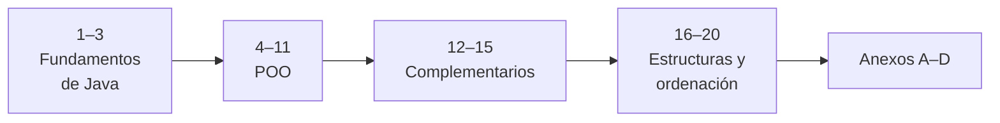

### Qué priorizar

> [!important] Orden de estudio (según la guía de la compañera)
> | Nivel | Temas |
> |---|---|
> | **1 — Imprescindible** | Clase, objeto, atributo y método · encapsulamiento, herencia y polimorfismo |
> | **2 — Explicar** | Sobrecarga vs. sobrescritura · arreglo vs. `ArrayList` · pila LIFO y cola FIFO · nodo y enlaces · complejidades de ordenación |
> | **3 — Reconocer y aplicar** | JVM/bytecode/JDK/JRE · constructores, `this`, `super`, `static` · abstracta vs. interfaz · `==` vs. `equals` · listas · ordenación · trazar código · elegir estructura |

### Mapa del libro

#### Parte 1 — Fundamentos y Java (3.1)

- 1. Paradigmas y arquitectura de Java
- 2. Tipos, memoria y operadores
- 3. Control de flujo y estructura del programa

#### Parte 2 — Programación orientada a objetos (3.2–3.3)

- 4. Paradigma orientado a objetos y UML
- 5. Clase, objeto, atributo y método
- 6. Constructores, sobrecarga, `this` y `super`
- 7. Encapsulamiento y control de acceso
- 8. Herencia
- 9. Clases abstractas
- 10. Interfaces
- 11. Polimorfismo y miembros estáticos

#### Parte 3 — Complementarios de Java (3.4)

- 12. Arreglos y ArrayList
- 13. String y comparación de objetos
- 14. Excepciones
- 15. Archivos

#### Parte 4 — Estructuras y ordenación (4.1–4.3)

- 16. Pilas y colas
- 17. Listas enlazadas
- 18. Listas dobles, circulares y ordenadas
- 19. Ordenación por inserción y Shellsort
- 20. Mergesort y Quicksort

#### Anexos

- A. Código listo para papel
- B. Banco de preguntas de oral
- C. Errores frecuentes
- D. Complejidades y mapa del programa

### Canon y cobertura

| Lectura oficial | Capítulo(s) |
|---|---|
| M0L1 Algoritmos y pensamiento lógico | 1 · 3 |
| M0L2 Paradigmas | 1 · 4 |
| M0L3 Conceptos de POO | 4 · 5 |
| M0L4 Lenguajes y Java | 1 |
| M1L1 Lenguajes | 1 |
| M1L2 ¿Qué es Java? | 1 |
| M1L3 Sintaxis | 3 |
| M1L4 Variables y constantes | 2 |
| M2L1 Dos paradigmas | 1 · 4 |
| M2L2 Pilas | 16 |
| M2L3 Abstracción y polimorfismo | 11 |
| M2L4 Ventajas de la POO | 4 |
| M3L1 Polimorfismo en Java | 11 |
| M3L2 Encapsulamiento | 7 |
| M3L3 Clases abstractas | 9 |
| M3L4 Ejemplos de POO | 8 · 10 |
| M4L1 Arreglos | 12 |
| M4L2 Strings | 13 |
| M4L3 Excepciones | 14 |
| M4L4 Archivos | 15 |

### El caso que atraviesa el libro

> [!example] Caso integrador
> Un sistema de **señalización urbana** modela semáforos, cámaras y alertas.
>
> - Los dispositivos comparten una superclase y se tratan igual (4, 8–11).
> - Las alertas se guardan en arreglos y listas, y se ordenan por prioridad (12–20).
> - Los archivos y las excepciones sostienen la operación (14–15).

### Regla de oro del módulo

> [!important] El error más caro: escribir antes de modelar
> Si arrancás con `main` y variables sueltas, terminás con un programa estructurado disfrazado de POO. El orden es: **modelar objetos → asignar responsabilidades → escribir métodos → probar**.

<div style="page-break-after: always;"></div>

# 1. Paradigmas y arquitectura de Java

> [!info] Al terminar este capítulo tenés que poder
> - Explicar qué es programar y qué es un algoritmo.
> - Diferenciar imperativo, estructurado y orientado a objetos.
> - Describir el recorrido `.java` → `.class` → JVM.
> - Distinguir JDK, JRE y JVM.

> [!abstract] Qué debés saber (nivel 1)
> - **Programar** es resolver un problema y expresar la solución para que la máquina la ejecute.
> - **Algoritmo:** pasos finitos, definidos y eficaces, con entrada y salida.
> - **Paradigma:** forma de organizar la solución, no solo sintaxis.
> - Java **compila a bytecode** y la JVM lo ejecuta (modelo híbrido, con JIT).
> - **JDK** = JRE + herramientas; **JRE** = JVM + bibliotecas; **JVM** ejecuta bytecode.

## 1.1 Programa y algoritmo

**Programa:** expresión de un algoritmo en un lenguaje formal, con datos y control.

| Propiedad del algoritmo | Qué exige |
|---|---|
| **Finito** | Termina |
| **Definido** | Cada paso es inequívoco |
| **Entrada / salida** | Recibe datos y produce un resultado |
| **Eficaz** | Cada paso es realizable |

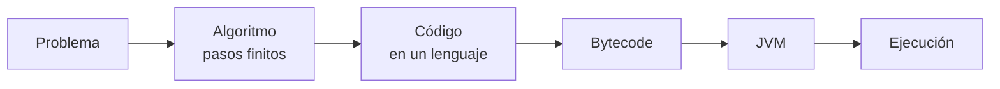

> [!important] La distinción que se pregunta
> El algoritmo es independiente del lenguaje; el programa es su expresión en uno concreto. El mismo algoritmo puede escribirse en Java o en pseudocódigo.

### Niveles de lenguaje

| Nivel | Qué usa | Cómo se traduce |
|---|---|---|
| **Máquina** | Binario, propio de cada CPU | Se ejecuta tal cual |
| **Ensamblador** | Mnemónicos (`MOV`, `ADD`) | Un *ensamblador* lo traduce |
| **Alto nivel** | Variables, `if`, `while`, clases | Compilador o intérprete |

> [!important] Compilar no es interpretar
> El **compilador** traduce antes de ejecutar (`javac` → bytecode); el **intérprete** traduce mientras ejecuta. Java hace las dos: compila a bytecode y la JVM lo interpreta, con JIT.

## 1.2 Paradigmas

| Paradigma | Idea central | Unidad |
|---|---|---|
| **Imperativo** | Instrucciones que cambian estado | Instrucción |
| **Estructurado** | Secuencia, selección e iteración, sin `goto` | Función |
| **Orientado a objetos** | Objetos que integran datos y comportamiento | Clase / objeto |
| **Funcional** | Funciones puras, sin estado mutable | Función |
| **Lógico** | Hechos y reglas; el motor deduce | Predicado |

> [!important] Estructurado vs. POO
> En estructurado los datos y las funciones que los usan están **separados**: `depositar(cuenta, monto)`. En POO el estado y la operación viven juntos: `cuenta.depositar(monto)`. Eso localiza los cambios.

Java es **multiparadigma** (tiene lambdas), pero el EFIP lo evalúa como **lenguaje orientado a objetos**.

## 1.3 Java: características


| Característica | Consecuencia |
|---|---|
| **Portable** | El bytecode corre en cualquier JVM |
| **Tipado estático** | Los tipos se verifican al compilar |
| **Orientado a objetos** | Todo el código vive en clases |
| **Gestionado** | Recolector de basura; no hay `delete` |
| **Multihilo** | Soporte de concurrencia en el lenguaje |

## 1.4 El recorrido de un programa

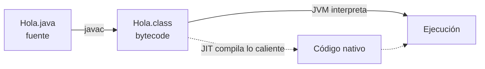

```bash
javac Hola.java     # genera Hola.class
java Hola           # la JVM ejecuta el bytecode
```

| Concepto | Qué es |
|---|---|
| **Bytecode** | Instrucciones de la JVM, no de la máquina física |
| **JVM** | Máquina virtual que ejecuta el bytecode |
| **JIT** | Compilador en tiempo de ejecución que acelera lo repetido |
| **WORA** | "Write once, run anywhere" |

> [!warning] Java no es puramente interpretado
> Compila a bytecode y la JVM lo ejecuta, con JIT. Decir "Java es interpretado" a secas es incompleto.

## 1.5 JDK, JRE y JVM

| Sigla | Contiene | Para qué |
|---|---|---|
| **JVM** | Máquina virtual | Ejecutar bytecode |
| **JRE** | JVM + bibliotecas estándar | Ejecutar aplicaciones |
| **JDK** | JRE + `javac`, `jar`, `javadoc` | Desarrollar |

> [!tip] La regla
> Para **programar** necesitás el JDK; para **ejecutar**, el JRE; la JVM es el motor.

## Errores que suelen tomar

| Error | Corrección |
|---|---|
| "Java es interpretado" | Es híbrido: bytecode + JVM + JIT |
| Confundir JDK con JVM | El JDK incluye la JVM y las herramientas |
| Decir que un algoritmo depende del lenguaje | Es independiente |
| "POO es usar clases" | Es modelar objetos que colaboran |
| Confundir paradigma con sintaxis | El paradigma es la forma de pensar |

## Ejercicios

> [!example] 1. Propiedades
> **Enunciado:** un algoritmo que divide por cero si el número es negativo, ¿qué propiedad incumple?
> **Solución:** eficacia (y definición, si no aclara qué hacer).

> [!example] 2. Recorrido
> **Enunciado:** ¿qué genera `javac` y quién lo ejecuta?
> **Solución:** bytecode `.class`; lo ejecuta la JVM.

> [!example] 3. Siglas
> **Enunciado:** ¿qué necesitás para compilar y qué para ejecutar?
> **Solución:** JDK para compilar; JRE (o JDK) para ejecutar.

> [!example] 4. Paradigma
> **Enunciado:** `depositar(cuenta, monto)` vs. `cuenta.depositar(monto)`.
> **Solución:** estructurado vs. orientado a objetos.

> [!example] 5. a papel
> **Enunciado:** dibujá el recorrido de `Hola.java` hasta la ejecución.
> **Solución:** fuente → `javac` → bytecode → JVM (intérprete + JIT) → ejecución.


<div style="page-break-after: always;"></div>


# 2. Tipos, memoria y operadores

> [!info] Al terminar este capítulo tenés que poder
> - Elegir el tipo correcto para cada dato.
> - Explicar la diferencia entre primitivo y referencia.
> - Predecir el resultado de una expresión con casting y división entera.
> - Evitar las trampas de `=`, `==` y `.equals()`.

> [!abstract] Qué debés saber (nivel 1)
> - Java es de **tipado fuerte y estático**.
> - **8 primitivos**: `byte`, `short`, `int`, `long`, `float`, `double`, `char`, `boolean`.
> - Los objetos se guardan como **referencias**; el objeto vive en el *heap*.
> - `7 / 2` da `3`; `7 / 2.0` da `3.5`.
> - `&&` y `||` **cortocircuitan**.
> - `=` asigna, `==` compara referencias, `.equals()` compara contenido.

## 2.1 Tipos primitivos

| Tipo | Tamaño | Rango / uso |
|---|---|---|
| `byte` | 1 byte | −128 a 127 |
| `short` | 2 | −32.768 a 32.767 |
| `int` | 4 | ±2.147 millones (el más usado) |
| `long` | 8 | Enteros grandes (`10L`) |
| `float` | 4 | Decimal aproximado (`1.5f`); 6–7 dígitos significativos |
| `double` | 8 | Decimal aproximado (por defecto); 15–16 dígitos |
| `char` | 2 | Un carácter Unicode (`'A'`) |
| `boolean` | 1 bit lógico | `true` / `false` |

| Categoría | Tipos | Para qué |
|---|---|---|
| **Enteros** | `byte`, `short`, `int`, `long` | Contadores, IDs |
| **Reales** | `float`, `double` | Medidas |
| **Carácter** | `char` | Una letra |
| **Lógico** | `boolean` | Condiciones |

> [!warning] Dinero no va en `double`
> `0.1 + 0.2` no da exactamente `0.3`. Para importes se usa `BigDecimal`.

## 2.2 Primitivos, referencias y memoria

```java
int a = 10;                 // valor en el stack
String s = "EFIP";          // referencia en el stack → objeto en el heap
```

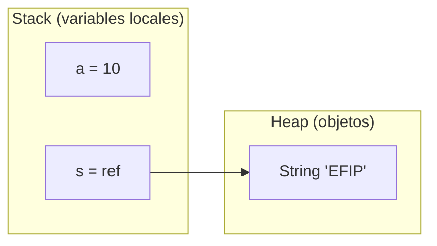

| | Primitivo | Referencia |
|---|---|---|
| Guarda | El valor | La dirección del objeto |
| Dónde | Stack | Referencia en stack, objeto en heap |
| Comparar | `==` | `.equals()` para contenido |
| Nulo | No | Sí (`null`) |

> [!important] `null`
> Una referencia sin objeto no puede recibir mensajes: `NullPointerException`. Es la excepción más común.

## 2.3 Casting y división

| Expresión | Resultado | Por qué |
|---|---|---|
| `7 / 2` | `3` | División entera |
| `7 / 2.0` | `3.5` | Un operando es `double` |
| `(double) 7 / 2` | `3.5` | Casting explícito |
| `(int) 3.9` | `3` | Truncamiento |
| `7 % 2` | `1` | Resto |

```java
int a = 7, b = 2;
double r = (double) a / b;   // 3.5
```

> [!warning] El casting no redondea
> `(int) 3.9` da `3`, no `4`. Para redondear: `Math.round(3.9)`.

## 2.4 Operadores y precedencia

| Grupo | Operadores |
|---|---|
| Aritméticos | `+ - * / %` |
| Incremento | `++ --` |
| Relacionales | `> < >= <= == !=` |
| Lógicos | `&& || !` |
| Ternario | `condición ? valor1 : valor2` |
| Asignación | `= += -= *= /= %=` |

Orden práctico: **paréntesis → unarios → aritméticos → relacionales → lógicos → asignación**.

### Cortocircuito

```java
if (obj != null && obj.activo()) { ... }   // seguro: si es null, no evalúa la segunda
```

| Operador | Si el primero es… | Qué hace |
|---|---|---|
| `&&` | `false` | No evalúa el segundo |
| `\|\|` | `true` | No evalúa el segundo |

> [!important] `&` y `\|` no cortocircuitan
> Con `&` se evalúan ambos lados aunque no haga falta. En condiciones, usá `&&` y `||`.

### `i++` vs. `++i`

| Expresión | Usa el valor… | Efecto |
|---|---|---|
| `i++` | Anterior | Suma después |
| `++i` | Nuevo | Suma antes |

```java
int i = 5;
int a = i++;   // a = 5, i = 6
int b = ++i;   // i = 7, b = 7
```

## 2.5 Igualdad

| Comparación | Qué compara | Ejemplo |
|---|---|---|
| `=` | Asigna | `x = 5;` |
| `==` | Referencias (o valores primitivos) | `s1 == s2` |
| `.equals()` | Contenido | `s1.equals(s2)` |

```java
String a = new String("EFIP");
String b = new String("EFIP");
a == b          // false: objetos distintos
a.equals(b)     // true: mismo contenido
```

> [!warning] El error que más cuesta puntos
> Comparar `String` con `==` funciona a veces (por el *pool* de literales) y falla otras. **Siempre** `.equals()` para contenido.

## Errores que suelen tomar

| Error | Corrección |
|---|---|
| `7 / 2` esperando `3.5` | Es `3`; usá `7 / 2.0` |
| `(int) 3.9` esperando `4` | Trunca: `3` |
| `==` para comparar `String` | `.equals()` |
| Usar `double` para dinero | `BigDecimal` |
| Confundir `i++` con `++i` | Uno usa el valor anterior |
| `&` en una condición | `&&` para cortocircuito |
| Inicializar una local y no usarla | Java exige inicializar antes de leer |

## Ejercicios

> [!example] 1. División
> **Enunciado:** ¿cuánto da `9 / 4` y `9 / 4.0`?
> **Solución:** `2` y `2.25`.

> [!example] 2. Casting
> **Enunciado:** ¿cuánto da `(int) 7.9 + 1`?
> **Solución:** `8` (trunca a 7 y suma 1).

> [!example] 3. Incremento
> **Enunciado:** `int i=3; int x=i++ + ++i;` ¿cuánto vale `x`?
> **Solución:** `3 + 5 = 8`; `i` queda en 5.

> [!example] 4. Igualdad
> **Enunciado:** ¿por qué `"a" == new String("a")` es `false`?
> **Solución:** compara punteros; el literal está en el pool y el `new` crea otro objeto.

> [!example] 5. Cortocircuito
> **Enunciado:** ¿por qué `obj != null && obj.activo()` no lanza excepción?
> **Solución:** si `obj` es `null`, `&&` no evalúa la segunda parte.

> [!example] 6. a papel
> **Enunciado:** escribí una expresión que convierta `gradosC` a `double` y calcule `F = C * 9/5 + 32`.
> **Solución:** `double f = gradosC * 9.0 / 5 + 32;`.


<div style="page-break-after: always;"></div>


# 3. Control de flujo y estructura del programa

> [!info] Al terminar este capítulo tenés que poder
> - Elegir entre `if`, `switch`, `for`, `while` y `do-while`.
> - Explicar el *fall-through* de `switch` y el uso de `break`.
> - Leer datos con `Scanner`.
> - Escribir la anatomía mínima de un programa Java.

> [!abstract] Qué debés saber (nivel 1)
> - Tres estructuras: **secuencia, selección, iteración**.
> - `switch` sin `break` **cae** al siguiente caso.
> - `for` se usa cuando sabés cuántas veces; `while`, cuando no.
> - `do-while` ejecuta **al menos una vez**.
> - Todo programa necesita `public static void main(String[] args)`.

## 3.1 Selección

```java
if (prioridad == 1) {
    System.out.println("Crítica");
} else if (prioridad <= 3) {
    System.out.println("Media");
} else {
    System.out.println("Baja");
}
```

| Estructura | Cuándo |
|---|---|
| `if` | Una o dos alternativas |
| `if / else if` | Varias alternativas con rangos |
| `switch` | Varias alternativas sobre un valor discreto |

```java
switch (prioridad) {
    case 1:
        System.out.println("Crítica");
        break;
    case 2:
    case 3:
        System.out.println("Media");
        break;
    default:
        System.out.println("Baja");
}
```

> [!warning] El *fall-through*
> Sin `break`, la ejecución continúa en el caso siguiente. A veces se usa a propósito (casos 2 y 3 comparten código); si no, es un bug.

> [!tip] `switch` moderno
> Desde Java 14: `case 1 -> "Crítica";` no cae y no necesita `break`. El EFIP suele pedir el clásico.

## 3.2 Iteración

| Bucle | Cuándo | Garantía |
|---|---|---|
| `for` | Cantidad conocida | Puede ejecutarse 0 veces |
| `while` | Condición al inicio | Puede ejecutarse 0 veces |
| `do-while` | Condición al final | **Al menos 1 vez** |

```java
for (int i = 0; i < 5; i++) {
    System.out.println(i);
}

int j = 0;
while (j < 5) {
    System.out.println(j);
    j++;
}

int k = 0;
do {
    System.out.println(k);
    k++;
} while (k < 5);
```

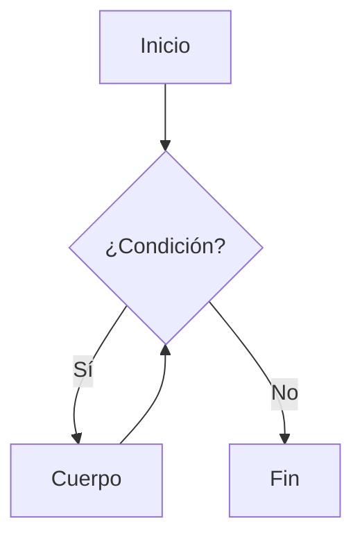

| Sentencia | Efecto |
|---|---|
| `break` | Sale del bucle o `switch` |
| `continue` | Salta a la próxima iteración |
| `return` | Sale del método |

> [!warning] Bucle infinito
> `while (i < 5)` sin `i++` nunca termina. Verificá que la condición pueda volverse falsa.

## 3.3 Entrada por consola

```java
import java.util.Scanner;

Scanner sc = new Scanner(System.in);
System.out.print("Prioridad: ");
int prioridad = sc.nextInt();
sc.nextLine();                 // consume el Enter pendiente
String mensaje = sc.nextLine();
```

| Método | Lee |
|---|---|
| `nextInt()` | Un entero |
| `nextDouble()` | Un decimal |
| `next()` | Una palabra |
| `nextLine()` | Una línea completa |

> [!important] El `nextLine()` después de `nextInt()`
> `nextInt()` deja el Enter en el buffer y el `nextLine()` siguiente lo consume vacío. Por eso se agrega un `nextLine()` de limpieza.

## 3.4 Anatomía de un programa

```java
package municipio.alertas;          // 1. paquete (opcional)

import java.util.Scanner;           // 2. imports

public class RegistroAlerta {       // 3. clase pública = nombre del archivo

    public static void main(String[] args) {   // 4. punto de entrada
        System.out.println("Hola, EFIP");
    }
}
```

| Parte | Regla |
|---|---|
| `package` | Minúscula, dominio invertido |
| `import` | Solo lo que se usa |
| `class` | Una pública por archivo, mismo nombre |
| `main` | `public static void main(String[] args)` exacto |
| Archivo | `RegistroAlerta.java` |

> [!important] `main` es `static`
> La JVM lo llama sin crear un objeto. Por eso no podés usar métodos de instancia directamente dentro de `main`: necesitás un objeto.

## 3.5 Convenciones

| Elemento | Convención | Ejemplo |
|---|---|---|
| Clase | PascalCase | `ControlAlertas` |
| Método / variable | camelCase | `registrarAlerta`, `idDispositivo` |
| Constante | MAYÚSCULAS | `MAX_PRIORIDAD` |
| Paquete | minúsculas | `municipio.alertas` |

## Errores que suelen tomar

| Error | Corrección |
|---|---|
| `switch` sin `break` | Agregalo salvo que el *fall-through* sea intencional |
| `while` sin actualizar la variable | Condición de corte |
| `do-while` con `;` faltante | `} while (cond);` |
| `nextInt()` seguido de `nextLine()` | Consumir el Enter |
| Llamar un método de instancia desde `main` | Crear el objeto |
| Archivo con nombre distinto a la clase pública | No compila |

## Ejercicios

> [!example] 1. Bucle
> **Enunciado:** imprimí los pares del 1 al 10.
> **Solución:** `for (int i = 2; i <= 10; i += 2) System.out.println(i);`.

> [!example] 2. Switch
> **Enunciado:** ¿qué imprime `case 1` sin `break` seguido de `case 2`?
> **Solución:** ambos mensajes, por *fall-through*.

> [!example] 3. Do-while
> **Enunciado:** ¿cuántas veces se ejecuta `do { } while (false);`?
> **Solución:** una.

> [!example] 4. Scanner
> **Enunciado:** leé un entero y luego una línea completa.
> **Solución:** `int n = sc.nextInt(); sc.nextLine(); String s = sc.nextLine();`.

> [!example] 5. a papel
> **Enunciado:** escribí la clase `Pares` con `main` que imprima los pares del 1 al 20.
> **Solución:** clase pública `Pares`, `main`, `for` con `i += 2`.


<div style="page-break-after: always;"></div>


# 4. Paradigma orientado a objetos y UML

> [!info] Al terminar este capítulo tenés que poder
> - Explicar qué es un paradigma y por qué la POO organiza distinto.
> - Definir los cuatro pilares con un ejemplo propio.
> - Identificar clases, atributos y métodos desde un enunciado.
> - Distinguir asociación, agregación, composición y herencia.

> [!abstract] Qué debés saber (nivel 1)
> - La POO agrupa **datos y métodos** en objetos que se comunican por **mensajes**.
> - Cuatro pilares: **abstracción, encapsulamiento, herencia, polimorfismo**.
> - “Es un” → herencia. “Tiene un” → asociación/agregación/composición.
> - Composición: la parte **no existe** sin el todo. Agregación: la parte **sobrevive**.
> - La programación estructurada no desaparece: vive **dentro** de los métodos.

## 4.1 Qué es un paradigma

**Paradigma:** modelo de trabajo compartido que orienta la conceptualización de los problemas y la organización de las soluciones.

| Paradigma | Organiza la solución en… |
|---|---|
| Modular | Módulos |
| Procedimental | Procedimientos y funciones |
| Estructurada | Secuencia, selección, iteración |
| Orientada a eventos | Manejadores de eventos |
| **Orientada a objetos** | **Objetos que integran datos y comportamiento** |

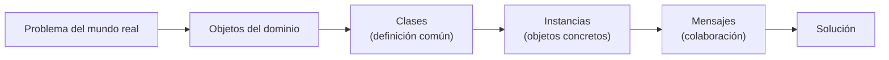

> [!important] La diferencia central
> En el paradigma estructurado, los **datos** y las **funciones** están separados: una función recibe datos y los procesa. En POO, **datos y comportamiento viven juntos** en el objeto, y solo se accede a los datos mediante sus métodos.

## 4.2 Los cuatro pilares

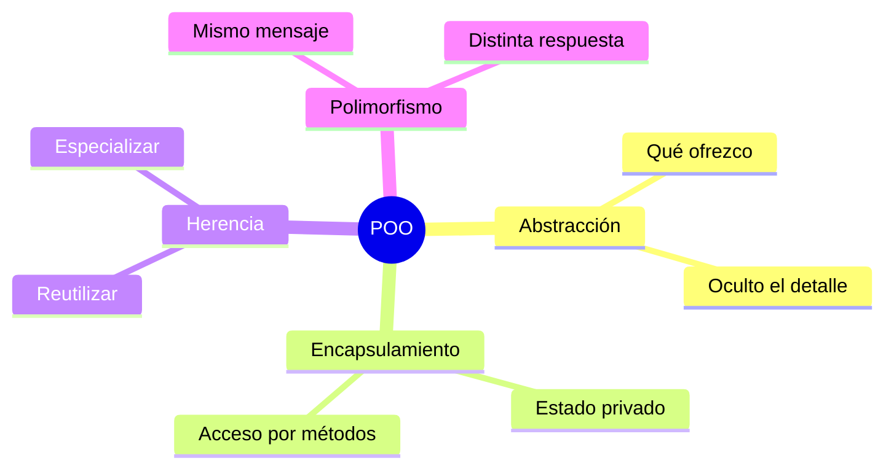

### Abstracción

**Representar lo esencial y omitir los detalles irrelevantes.**

Al modelar un semáforo para el sistema del municipio, no te interesa el color de la pintura ni el fabricante del poste: te interesa su ubicación, su estado y su capacidad de cambiar de color.

> [!quote] Cátedra
> La abstracción representa las características esenciales de un objeto y oculta los detalles de implementación.

### Encapsulamiento

**Agrupar estado y comportamiento y controlar el acceso.**

```java
public class Semaforo {
    private String colorActual;          // estado protegido

    public void cambiarColor(String nuevo) {
        if (esColorValido(nuevo)) {
            colorActual = nuevo;
        }
    }

    public String getColorActual() {
        return colorActual;
    }

    private boolean esColorValido(String color) {
        return color.equals("ROJO") || color.equals("AMARILLO") || color.equals("VERDE");
    }
}
```

Nadie puede escribir `semaforo.colorActual = "VIOLETA"`: el atributo es privado y el único camino es `cambiarColor`, que valida.

> [!warning] Corrección a un apunte de cátedra
> El material de Siglo 21 menciona `restricted` como modificador de acceso. **Ese modificador no existe en Java.** Los niveles reales son `public`, `protected`, sin modificador (package-private) y `private`. Ver 7. Encapsulamiento y control de acceso.

### Herencia

**Crear una subclase especializada a partir de una superclase.** Expresa “es un”.

```java
class Dispositivo {
    protected String ubicacion;

    public String getUbicacion() {
        return ubicacion;
    }
}

class Camara extends Dispositivo {      // una cámara ES UN dispositivo
    private boolean grabando;
}
```

### Polimorfismo

**Usar una referencia común para objetos distintos y ejecutar el método del objeto real.**

```java
Dispositivo d = new Camara("C-01");
d.descripcion();        // se ejecuta la versión de Camara, no la de Dispositivo
```

Se profundiza en 11. Polimorfismo y miembros estáticos.

## 4.3 Ventajas de la POO

| Ventaja | Por qué |
|---|---|
| **Correspondencia con el dominio** | El código refleja las entidades del problema: semáforo, cámara, alerta |
| **Reutilización** | Clases existentes se extienden o se usan en otros sistemas |
| **Modularidad** | Cada clase tiene una responsabilidad acotada |
| **Mantenibilidad** | Un cambio en una clase queda localizado |
| **Ocultamiento de información** | El estado interno no se manipula desde afuera |
| **Trabajo en equipo** | Se reparten clases, no archivos gigantes |

> [!warning] No vendas humo
> “La POO es más rápida” es falso como afirmación general. Es más **mantenible** y **modelable**; el rendimiento depende del diseño y la implementación.

## 4.4 Cómo identificar clases desde un enunciado

Método del compañero, en seis pasos:

1. **Subrayá sustantivos**: candidatos a clases, objetos o atributos.
2. **Subrayá verbos**: candidatos a métodos, eventos o responsabilidades.
3. **Distinguí entidades con identidad** de simples datos descriptivos.
4. **Asigná cada responsabilidad** a la clase que tiene la información necesaria.
5. **Identificá relaciones**: contiene, usa, conoce, es una especialización.
6. **Validá el modelo** recorriendo los casos de uso principales.

> [!example] Aplicado al caso del municipio
> “El municipio administra semáforos y cámaras conectadas. Los dispositivos informan estado y generan alertas.”
>
> | Sustantivo | ¿Clase? | Motivo |
> |---|---|---|
> | Municipio | Sí | Tiene identidad y responsabilidades de coordinación |
> | Semáforo | Sí | Entidad con estado propio |
> | Cámara | Sí | Entidad con estado propio |
> | Alerta | Sí | Entidad con datos y ciclo de vida |
> | Estado | Depende | Atributo si es un texto; clase si tiene comportamiento |
> | Ubicación | Depende | Atributo si es una dirección simple |
>
> Verbos → métodos: `informarEstado()`, `activar()`, `capturar()`, `generarAlerta()`.
>
> **La decisión se justifica por identidad y responsabilidad, no porque aparezca un sustantivo.**

## 4.5 Relaciones entre clases

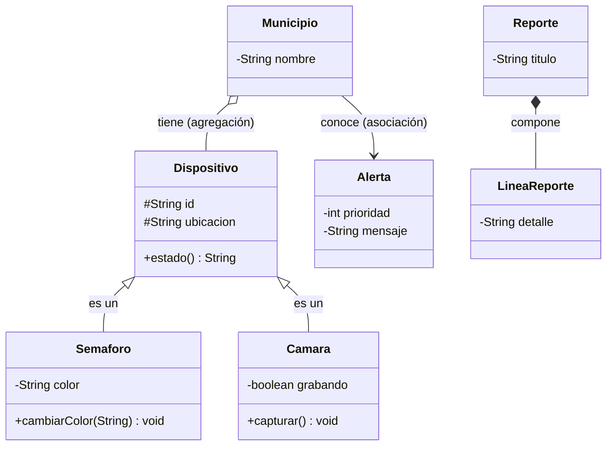

| Relación | Qué significa | Ejemplo | Notación UML |
|---|---|---|---|
| **Asociación** | Una clase conoce o utiliza otra | Operador atiende Alerta | línea simple |
| **Agregación** | Todo-parte **débil**; la parte puede existir sola | Municipio agrupa Dispositivos | rombo hueco |
| **Composición** | La parte **depende** del ciclo de vida del todo | Reporte contiene Líneas | rombo relleno |
| **Herencia** | Especialización (“es un”) | Cámara es un Dispositivo | flecha con triángulo hueco |
| **Dependencia** | Uso puntual (parámetro, variable local) | Servicio usa un Archivo | flecha punteada |

> [!important] La pregunta que resuelve todo
> **¿“Es un” o “tiene un”?**
> - “Cámara **es un** dispositivo” → herencia.
> - “Municipio **tiene** dispositivos” → asociación o agregación.
> - “Reporte **tiene** líneas que no existen sin él” → composición.

## 4.6 Programa completo con varios objetos colaborando

```java
public class Alerta {
    String mensaje;
    int prioridad;
    boolean atendida;

    void atender() {
        atendida = true;
    }

    String estado() {
        return "[" + prioridad + "] " + mensaje + (atendida ? " (atendida)" : " (pendiente)");
    }
}
```

```java
public class Municipio {

    String nombre;

    void reportar(Alerta a, String dispositivo) {
        System.out.println(nombre + " | " + dispositivo + " → " + a.estado());
    }

    public static void main(String[] args) {

        Municipio m = new Municipio();
        m.nombre = "Municipio de La Plata";

        Alerta a1 = new Alerta();
        a1.mensaje = "Cámara desconectada";
        a1.prioridad = 1;

        Alerta a2 = new Alerta();
        a2.mensaje = "Semáforo sin energía";
        a2.prioridad = 2;

        m.reportar(a1, "Cámara C-01");
        m.reportar(a2, "Semáforo S-04");

        a1.atender();

        m.reportar(a1, "Cámara C-01");
    }
}
```

Salida:

```text
Municipio de La Plata | Cámara C-01 → [1] Cámara desconectada (pendiente)
Municipio de La Plata | Semáforo S-04 → [2] Semáforo sin energía (pendiente)
Municipio de La Plata | Cámara C-01 → [1] Cámara desconectada (atendida)
```

Observá: `Municipio` **conoce** `Alerta` (la recibe como parámetro) y las alertas tienen **estado** propio.

## 4.7 Diagrama de clases UML

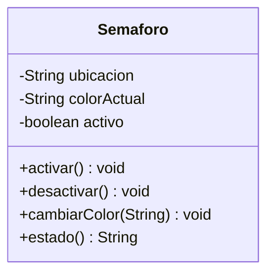

Lectura:

| Símbolo | Significado |
|---|---|
| `-` | `private` |
| `+` | `public` |
| `#` | `protected` |
| `~` | package-private |
| `nombre: Tipo` | Atributo |
| `metodo(params) Tipo` | Método |

> [!tip] En el examen escrito
> Si no te piden visibilidad, igual conviene marcarla: `-` en atributos y `+` en métodos es el mínimo profesional.

## Cómo trazar un modelo (no código)

| Paso | Pregunta | Resultado |
|---|---|---|
| 1 | ¿Qué entidades tienen identidad? | Municipio, Dispositivo, Semaforo, Camara, Alerta |
| 2 | ¿Qué datos guarda cada una? | `id`, `ubicacion`, `color`, `prioridad` |
| 3 | ¿Qué sabe hacer cada una? | `cambiarColor`, `capturar`, `atender` |
| 4 | ¿Cómo se relacionan? | Camara es Dispositivo; Municipio tiene Dispositivos |
| 5 | ¿Qué NO es clase? | `estado` como texto, `ubicacion` simple |

## Errores que suelen tomar

| Error | Corrección |
|---|---|
| Decir que encapsular es “poner `private`” | Encapsular es **ocultar estado y controlar el acceso**; `private` es el mecanismo |
| Confundir abstracción con encapsulamiento | Abstracción elige lo esencial; encapsulamiento protege el acceso |
| Usar herencia para “reutilizar código” sin relación “es un” | Si no hay “es un”, usar composición |
| Llamar composición a cualquier relación todo-parte | Composición = la parte muere con el todo |
| Crear una clase por cada sustantivo | Solo si tiene identidad y responsabilidad |
| Confundir objeto con clase en el oral | “El semáforo de la esquina” es objeto; `Semaforo` es clase |

## Ejercicios

> [!example] 1. Pilares
> **Enunciado:** relacioná cada situación con un pilar: (a) `saldo` privado y `depositar()` público; (b) `Camara extends Dispositivo`; (c) `d.descripcion()` ejecuta la de `Camara`; (d) modelar solo ubicación y estado del semáforo.
> **Solución:** (a) encapsulamiento; (b) herencia; (c) polimorfismo; (d) abstracción.

> [!example] 2. ¿Es un o tiene un?
> **Enunciado:** clasificá: (a) Chofer y Camión; (b) Reporte y LíneaReporte; (c) Municipio y Semáforo; (d) Camara y Dispositivo.
> **Solución:** (a) asociación (el chofer conduce el camión); (b) composición (la línea no existe sin el reporte); (c) agregación (los semáforos existen sin el municipio); (d) herencia.

> [!example] 3. Identificar clases
> **Enunciado:** del texto “el operador registra la alerta y el sistema avisa al supervisor”, extraé clases, atributos y métodos.
> **Solución:** clases `Operador`, `Alerta`, `Supervisor`; atributos `legajo`, `prioridad`, `mensaje`; métodos `registrarAlerta()`, `notificar()`. `Sistema` no es clase si no tiene estado propio: es el conjunto de objetos colaborando.

> [!example] 4. a papel
> **Enunciado:** modelá en 4 clases el dominio “biblioteca”: préstamo, libro, socio, bibliotecario. Indicá una relación de cada tipo (asociación, agregación, composición).
> **Solución:** `Biblioteca o-- Libro` (agregación: el libro existe sin la biblioteca); `Prestamo *-- LineaPrestamo` (composición); `Socio --> Prestamo` (asociación); `Bibliotecario --> Prestamo` (asociación).


<div style="page-break-after: always;"></div>


# 5. Clase, objeto, atributo y método

> [!info] Al terminar este capítulo tenés que poder
> - Distinguir clase de objeto con un ejemplo propio.
> - Identificar atributos (estado) y métodos (comportamiento).
> - Crear objetos con `new` y usar referencias.
> - Dibujar y leer un diagrama de clases UML básico.

> [!abstract] Qué debés saber (nivel 1)
> - **Clase:** molde o plantilla que define atributos y métodos.
> - **Objeto:** instancia concreta de una clase, con identidad, estado y comportamiento.
> - **Atributo:** dato que representa el estado.
> - **Método:** operación o comportamiento.
> - **Instancia:** objeto creado con `new`.
> - **Mensaje:** llamada a un método de un objeto (`objeto.metodo()`).

## 5.1 Clase y objeto

> [!quote] Definiciones de cátedra
> **Clase:** molde, plantilla o template para construir múltiples instancias de objetos similares.
> **Objeto:** entidad que agrupa datos y funcionalidad; ante un mensaje ejecuta el comportamiento asociado.

Pensalo así:

- `Semaforo` es la **clase**: define que todo semáforo tiene ubicación, color y estado.
- El semáforo de Av. Belgrano es un **objeto**: tiene ubicación `"Av. Belgrano"`, color `"VERDE"` y está activo.

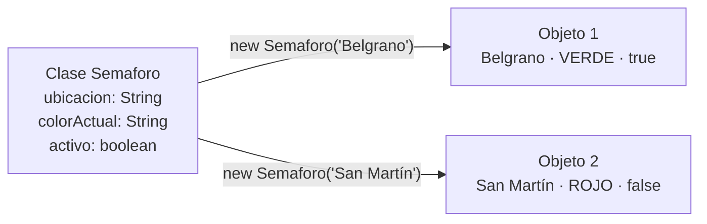

| Concepto | Pregunta que responde | Ejemplo |
|---|---|---|
| Clase | ¿Qué es? ¿Qué tiene y qué sabe hacer? | `Semaforo` |
| Objeto | ¿Cuál, concretamente? | el de Av. Belgrano |
| Atributo | ¿Qué estado guarda? | `colorActual` |
| Método | ¿Qué comportamiento tiene? | `cambiarColor()` |
| Identidad | ¿Cómo lo distingo de otro? | la referencia en memoria |

## 5.2 Declarar una clase

```java
public class Semaforo {

    // Atributos: estado
    String ubicacion;
    String colorActual;
    boolean activo;

    // Métodos: comportamiento
    void activar() {
        activo = true;
    }

    void desactivar() {
        activo = false;
    }

    void cambiarColor(String nuevoColor) {
        if (activo) {
            colorActual = nuevoColor;
        }
    }

    String estado() {
        return ubicacion + " | " + colorActual + " | " + (activo ? "activo" : "apagado");
    }
}
```

> [!warning] Sin `private` todavía
> En este capítulo los atributos son accesibles para simplificar. En 7. Encapsulamiento y control de acceso se encapsulan, que es como se escribe en el examen.

## 5.3 Crear y usar objetos

```java
public class Municipalidad {

    public static void main(String[] args) {

        // 1. Declaración de la referencia
        Semaforo s1;

        // 2. Creación del objeto (reserva memoria y devuelve la referencia)
        s1 = new Semaforo();

        // 3. Estado inicial
        s1.ubicacion = "Av. Belgrano";
        s1.colorActual = "ROJO";

        // 4. Mensajes
        s1.activar();
        s1.cambiarColor("VERDE");

        System.out.println(s1.estado());

        // Segundo objeto: independiente
        Semaforo s2 = new Semaforo();
        s2.ubicacion = "Av. San Martín";
        s2.colorActual = "ROJO";

        System.out.println(s2.estado());

        System.out.println("s1 sigue siendo: " + s1.colorActual);
    }
}
```

Salida:

```text
Av. Belgrano | VERDE | activo
Av. San Martín | ROJO | apagado
s1 sigue siendo: VERDE
```

> [!important] Cada objeto tiene su propio estado
> `s1` y `s2` comparten la **definición** (la clase), no los **valores**. Cambiar `s1.colorActual` no toca `s2`.

## 5.4 Referencias: el error más frecuente

```java
Semaforo a = new Semaforo();
a.ubicacion = "Centro";

Semaforo b = a;              // NO copia el objeto: copia la referencia
b.ubicacion = "Norte";

System.out.println(a.ubicacion);   // Norte
```

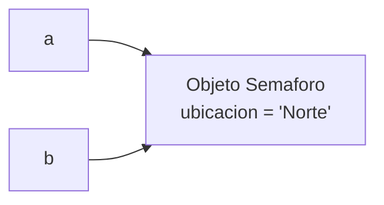

| Operación | Qué hace |
|---|---|
| `Semaforo b = a;` | Dos referencias, **un** objeto |
| `Semaforo b = new Semaforo();` | Dos referencias, **dos** objetos |
| `a == b` | Compara si apuntan al mismo objeto |

> [!warning] `null`
> ```java
> Semaforo x = null;
> x.activar();      // NullPointerException
> ```
> Una referencia sin objeto no puede recibir mensajes. Es la excepción más común en Java.

## 5.5 Métodos: parámetros y retorno

```java
public class Calculadora {

    // Sin parámetros, sin retorno
    void saludar() {
        System.out.println("Hola");
    }

    // Con parámetros, sin retorno
    void imprimirSuma(int a, int b) {
        System.out.println("Suma: " + (a + b));
    }

    // Con parámetros y con retorno
    int sumar(int a, int b) {
        return a + b;
    }

    // Retorno double
    double promedio(int total, int cantidad) {
        return (double) total / cantidad;
    }
}
```

| Firma | Significado |
|---|---|
| `void saludar()` | No recibe datos, no devuelve |
| `void imprimirSuma(int a, int b)` | Recibe dos enteros, no devuelve |
| `int sumar(int a, int b)` | Recibe dos enteros, devuelve un entero |
| `double promedio(int, int)` | Devuelve decimal |

> [!important] `void` vs. `return`
> `void` significa "no devuelve valor". Un método con retorno **debe** ejecutar `return` en todos los caminos posibles; si no, no compila.

## 5.6 Diagrama de clases UML


Lectura:

| Símbolo | Significado |
|---|---|
| `-` | `private` |
| `+` | `public` |
| `#` | `protected` |
| `~` | package-private |
| `nombre: Tipo` | Atributo |
| `metodo(params) Tipo` | Método |

> [!tip] En el examen escrito
> Si no te piden visibilidad, igual conviene marcarla: `-` en atributos y `+` en métodos es el mínimo profesional.

## 5.7 Programa completo

```java
public class CuentaBancaria {

    String titular;
    double saldo;

    void depositar(double monto) {
        if (monto > 0) {
            saldo += monto;
        }
    }

    boolean extraer(double monto) {
        if (monto > 0 && monto <= saldo) {
            saldo -= monto;
            return true;
        }
        return false;
    }

    String resumen() {
        return titular + ": $" + saldo;
    }

    public static void main(String[] args) {

        CuentaBancaria c = new CuentaBancaria();
        c.titular = "Ana";
        c.saldo = 1000;

        c.depositar(500);
        System.out.println(c.resumen());        // Ana: $1500.0

        boolean ok = c.extraer(2000);
        System.out.println("¿Extrajo? " + ok);  // false
        System.out.println(c.resumen());        // Ana: $1500.0

        c.extraer(300);
        System.out.println(c.resumen());        // Ana: $1200.0
    }
}
```

Salida:

```text
Ana: $1500.0
¿Extrajo? false
Ana: $1500.0
Ana: $1200.0
```

## Cómo trazar el estado de un objeto

| Paso | Operación | `saldo` | Resultado |
|---|---|---|---|
| 0 | `saldo = 1000` | 1000.0 | — |
| 1 | `depositar(500)` | 1500.0 | — |
| 2 | `extraer(2000)` | 1500.0 | `false` (no alcanza) |
| 3 | `extraer(300)` | 1200.0 | `true` |

**Regla:** en objetos, la tabla de traza lleva **una columna por atributo** y una fila por mensaje, no por línea interna del método.

## Errores que suelen tomar

| Error | Consecuencia |
|---|---|
| `Semaforo s; s.activar();` | No compila: variable no inicializada |
| `Semaforo s = null; s.activar();` | `NullPointerException` |
| `Semaforo b = a;` creyendo que copia | Dos referencias al mismo objeto |
| Confundir clase con objeto | "El semáforo es la clase" (mal) |
| Método con retorno sin `return` | No compila |
| Llamar a un método no estático desde `main` sin objeto | No compila |

> [!warning] El último es clave
> `main` es `static`. Para llamar a `cambiarColor()` (no estático) necesitás **un objeto**: `s1.cambiarColor("VERDE")`. Se profundiza en 11. Polimorfismo y miembros estáticos.

## Ejercicios

> [!example] 1. Clase y objeto
> **Enunciado:** definí una clase `Sensor` con `ubicacion`, `valor` y un método `leer()` que devuelva el valor. Creá dos sensores y mostrá que son independientes.
> **Solución:**
> ```java
> public class Sensor {
>     String ubicacion;
>     double valor;
>
>     double leer() {
>         return valor;
>     }
>
>     public static void main(String[] args) {
>         Sensor a = new Sensor();
>         a.ubicacion = "Esquina 1";
>         a.valor = 21.5;
>
>         Sensor b = new Sensor();
>         b.ubicacion = "Esquina 2";
>         b.valor = 30.0;
>
>         System.out.println(a.ubicacion + ": " + a.leer());
>         System.out.println(b.ubicacion + ": " + b.leer());
>     }
> }
> ```

> [!example] 2. Estado
> **Enunciado:** ¿qué imprime?
> ```java
> Semaforo a = new Semaforo();
> a.colorActual = "ROJO";
> Semaforo b = a;
> b.colorActual = "VERDE";
> System.out.println(a.colorActual);
> ```
> **Solución:** `VERDE`. `b` y `a` apuntan al mismo objeto.

> [!example] 3. Método con retorno
> **Enunciado:** agregá a `CuentaBancaria` un método `double saldoConInteres(double tasa)` que devuelva el saldo con interés sin modificar el saldo.
> **Solución:**
> ```java
> double saldoConInteres(double tasa) {
>     return saldo * (1 + tasa);
> }
> ```

> [!example] 4. a papel
> **Enunciado:** dibujá el diagrama de clases de `Semaforo` con tres atributos y cuatro métodos, usando `-` y `+`.
> **Solución:** ver el diagrama de la sección 4.7. Debe tener atributos con `-`, métodos con `+`, y tipos en cada miembro.

> [!example] 5. Identificar miembros
> **Enunciado:** del texto "el semáforo de la esquina cambia a verde y registra la hora del cambio", ¿qué es clase, objeto, atributo y método?
> **Solución:** clase `Semaforo`; objeto el de la esquina; atributos `color`, `horaUltimoCambio`, `ubicacion`; métodos `cambiarColor()`, `registrarHora()`.


<div style="page-break-after: always;"></div>


# 6. Constructores, sobrecarga, this y super

> [!info] Al terminar este capítulo tenés que poder
> - Escribir constructores por defecto y parametrizados.
> - Explicar qué hace `new` paso por paso.
> - Decidir cuándo conviene validar en el constructor.
> - Reconocer por qué un objeto puede quedar en estado inválido.
> - Usar sobrecarga, `this` y `super` sin confundirlos.

> [!abstract] Qué debés saber (nivel 1)
> - El constructor **se llama igual que la clase** y **no tiene tipo de retorno** (ni `void`).
> - Se ejecuta una sola vez, al crear el objeto con `new`.
> - Si no escribís ningún constructor, Java genera uno vacío por defecto.
> - Si escribís uno con parámetros, el vacío **desaparece**.
> - Un constructor puede validar y rechazar datos inválidos.

## 6.1 Qué es un constructor

**Constructor:** bloque que inicializa un objeto en el momento de su creación. Garantiza que el objeto nazca en un estado válido.

```java
public class Cuenta {

    private String titular;
    private double saldo;

    // Constructor
    public Cuenta(String titular, double saldoInicial) {
        this.titular = titular;
        this.saldo = saldoInicial;
    }
}
```

| Aspecto | Regla |
|---|---|
| Nombre | Idéntico al de la clase, con mayúscula inicial |
| Retorno | **Ninguno**, ni siquiera `void` |
| Invocación | Solo con `new` |
| Cantidad | Puede haber varios (sobrecarga) |

> [!warning] Error de sintaxis clásico
> ```java
> public void Cuenta(String titular) { }   // NO es constructor: tiene void
> ```
> Eso es un **método** llamado `Cuenta`, no un constructor. El compilador no lo usa al hacer `new`.

## 6.2 Qué hace `new`

```java
Cuenta c = new Cuenta("Ana", 1000);
```

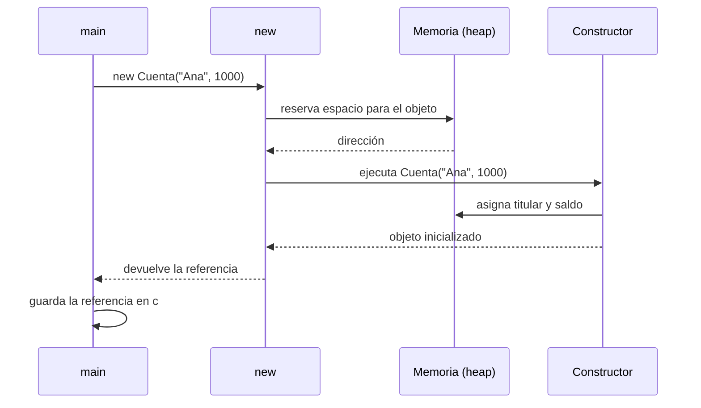

Cuatro pasos:

1. **Reserva** memoria para el objeto.
2. **Inicializa** los atributos con su valor por defecto (`null`, `0`, `false`).
3. **Ejecuta** el constructor.
4. **Devuelve** la referencia, que se guarda en la variable.

> [!important] `new` devuelve una referencia
> `Cuenta c = new Cuenta(...)` no guarda el objeto en `c`: guarda **dónde está**. Por eso dos variables pueden apuntar al mismo objeto (5. Clase, objeto, atributo y método).

## 6.3 Constructor por defecto

Si la clase **no declara ningún constructor**, Java agrega uno sin parámetros que no hace nada especial:

```java
public class Sensor {
    String ubicacion;
    double valor;
}
```

```java
// Uso: el constructor vacío lo genera Java
Sensor s = new Sensor();
s.ubicacion = "Esquina 1";
```

Pero si declarás **un** constructor, el vacío ya no existe:

```java
public class Sensor {
    String ubicacion;

    public Sensor(String ubicacion) {
        this.ubicacion = ubicacion;
    }
}

// Sensor s = new Sensor();          // ERROR: no existe el constructor vacío
Sensor s = new Sensor("Esquina 1");  // OK
```

> [!warning] La trampa del “dejó de compilar”
> Agregás un constructor con parámetros y de golpe fallan todos los `new Sensor()`. No es un bug: el constructor por defecto desapareció. Solución: declarar también el vacío.

```java
public Sensor() {
    this.ubicacion = "sin asignar";
}
```

## 6.4 Constructores sobrecargados

Varios constructores con la misma clase y distintos parámetros.

```java
public class Dispositivo {

    private String id;
    private String ubicacion;
    private boolean activo;

    // 1. Completo
    public Dispositivo(String id, String ubicacion, boolean activo) {
        this.id = id;
        this.ubicacion = ubicacion;
        this.activo = activo;
    }

    // 2. Sin estado: arranca apagado
    public Dispositivo(String id, String ubicacion) {
        this(id, ubicacion, false);          // delega en el constructor 1
    }

    // 3. Mínimo: ubicación por defecto
    public Dispositivo(String id) {
        this(id, "sin asignar");
    }

    public String resumen() {
        return id + " @ " + ubicacion + " [" + (activo ? "ON" : "OFF") + "]";
    }
}
```

```java
public class PruebaConstructores {
    public static void main(String[] args) {
        Dispositivo a = new Dispositivo("D-01", "Centro", true);
        Dispositivo b = new Dispositivo("D-02", "Norte");
        Dispositivo c = new Dispositivo("D-03");

        System.out.println(a.resumen());
        System.out.println(b.resumen());
        System.out.println(c.resumen());
    }
}
```

Salida:

```text
D-01 @ Centro [ON]
D-02 @ Norte [OFF]
D-03 @ sin asignar [OFF]
```

> [!tip] `this(...)` evita duplicar código
> Un constructor llama a otro de la misma clase y le pasa los valores. **Debe ser la primera sentencia.** Se detalla en 6. Constructores, sobrecarga, this y super.

## 6.5 Validar en el constructor

El constructor es el mejor lugar para garantizar los **invariantes**: condiciones que siempre deben cumplirse.

```java
public class CuentaBancaria {

    private final String titular;
    private double saldo;

    public CuentaBancaria(String titular, double saldoInicial) {
        if (titular == null || titular.isBlank()) {
            throw new IllegalArgumentException("Titular obligatorio");
        }
        if (saldoInicial < 0) {
            throw new IllegalArgumentException("Saldo inicial no puede ser negativo");
        }
        this.titular = titular;
        this.saldo = saldoInicial;
    }

    public void depositar(double monto) {
        if (monto <= 0) {
            throw new IllegalArgumentException("Monto inválido");
        }
        saldo += monto;
    }

    public double getSaldo() {
        return saldo;
    }

    public String getTitular() {
        return titular;
    }
}
```

```java
public class Banco {
    public static void main(String[] args) {

        CuentaBancaria c = new CuentaBancaria("Ana", 1000);
        c.depositar(500);
        System.out.println(c.getTitular() + ": $" + c.getSaldo());

        try {
            CuentaBancaria mala = new CuentaBancaria("", -10);
            System.out.println(mala.getTitular());
        } catch (IllegalArgumentException e) {
            System.out.println("Rechazado: " + e.getMessage());
        }
    }
}
```

Salida:

```text
Ana: $1500.0
Rechazado: Titular obligatorio
```

> [!important] Por qué validar acá
> Si el objeto se crea inválido, todos los métodos posteriores arrastran el error. Validar al nacer es más barato que corregir después.

## 6.6 Objeto completo: del enunciado al constructor

**Enunciado:** “De cada semáforo se conoce su identificador, su ubicación y su color actual, que al instalarse es siempre ROJO”.

```java
public class Semaforo {

    private final String id;
    private final String ubicacion;
    private String colorActual;

    public Semaforo(String id, String ubicacion) {
        this.id = id;
        this.ubicacion = ubicacion;
        this.colorActual = "ROJO";       // regla del dominio
    }

    public void cambiarColor(String nuevo) {
        if (nuevo.equals("ROJO") || nuevo.equals("AMARILLO") || nuevo.equals("VERDE")) {
            this.colorActual = nuevo;
        }
    }

    public String estado() {
        return id + " (" + ubicacion + "): " + colorActual;
    }
}
```

```java
public class Instalacion {
    public static void main(String[] args) {
        Semaforo s = new Semaforo("S-01", "Av. Belgrano");
        System.out.println(s.estado());      // S-01 (Av. Belgrano): ROJO
        s.cambiarColor("VERDE");
        System.out.println(s.estado());      // S-01 (Av. Belgrano): VERDE
        s.cambiarColor("VIOLETA");           // ignorado por la validación
        System.out.println(s.estado());      // S-01 (Av. Belgrano): VERDE
    }
}
```

Salida:

```text
S-01 (Av. Belgrano): ROJO
S-01 (Av. Belgrano): VERDE
S-01 (Av. Belgrano): VERDE
```

## 6.7 Firma y sobrecarga

**Signatura o firma:** combinación del nombre del método con la cantidad, el tipo y el orden de sus parámetros.

```java
public class Alerta {

    // Firma: registrar(String)
    public void registrar(String mensaje) {
        System.out.println("Simple: " + mensaje);
    }

    // Firma: registrar(String, int)
    public void registrar(String mensaje, int prioridad) {
        System.out.println("Con prioridad " + prioridad + ": " + mensaje);
    }

    // Firma: registrar(int, String)  → distinto ORDEN, es sobrecarga válida
    public void registrar(int prioridad, String mensaje) {
        System.out.println("[" + prioridad + "] " + mensaje);
    }

    // NO es sobrecarga: solo cambia el retorno → no compila
    // public String registrar(String mensaje) { return mensaje; }
}
```

```java
public class Prueba {
    public static void main(String[] args) {
        Alerta a = new Alerta();
        a.registrar("Cámara caída");
        a.registrar("Semáforo apagado", 1);
        a.registrar(2, "Sensor sin batería");
    }
}
```

Salida:

```text
Simple: Cámara caída
Con prioridad 1: Semáforo apagado
[2] Sensor sin batería
```

> [!important] Sobrecarga vs. sobrescritura
> | | Sobrecarga | Sobrescritura |
> |---|---|---|
> | Dónde | Misma clase | Subclase redefine un método heredado |
> | Firma | **Distinta** | **Igual** |
> | Se resuelve | Al compilar | En ejecución (despacho dinámico) |
> | Se ve en | 6. Constructores, sobrecarga, this y super | 8. Herencia y 11. Polimorfismo y miembros estáticos |

> [!warning] Trampa de examen
> “El tipo de retorno alcanza para sobrecargar” → **falso**. `int f()` y `String f()` no pueden coexistir.

### Conversiones y ambigüedad

```java
void enviar(int x)    { System.out.println("int"); }
void enviar(double x) { System.out.println("double"); }

enviar(5);      // int  → coincidencia exacta
enviar(5.0);    // double
enviar('A');    // int  → char se promueve a int
```

Si dos versiones son **igualmente aplicables**, el compilador da error por ambigüedad. Evitá sobrecargas que solo difieran en tipos que se convierten entre sí.

## 6.8 `this`

Tres usos:

### 1. Desambiguar atributo y parámetro

```java
public class Semaforo {
    private String color;

    public void cambiarColor(String color) {
        this.color = color;        // izquierda: atributo; derecha: parámetro
    }
}
```

Sin `this`, `color = color` asigna el parámetro a sí mismo y el atributo queda sin cambios.

### 2. Llamar a otro constructor de la misma clase

```java
public class Dispositivo {

    private final String id;
    private String ubicacion;
    private boolean activo;

    public Dispositivo(String id, String ubicacion, boolean activo) {
        this.id = id;
        this.ubicacion = ubicacion;
        this.activo = activo;
    }

    public Dispositivo(String id, String ubicacion) {
        this(id, ubicacion, false);     // delega; debe ser la primera línea
    }

    public Dispositivo(String id) {
        this(id, "sin asignar");
    }
}
```

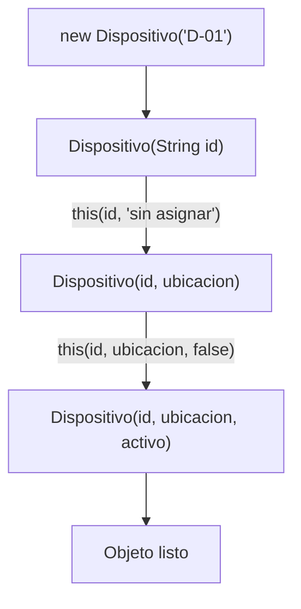

### 3. Devolver el objeto actual (encadenamiento)

```java
public class Consulta {

    private String tabla = "";
    private String condicion = "";

    public Consulta desde(String tabla) {
        this.tabla = tabla;
        return this;
    }

    public Consulta donde(String condicion) {
        this.condicion = condicion;
        return this;
    }

    public String sql() {
        return "SELECT * FROM " + tabla + " WHERE " + condicion;
    }

    public static void main(String[] args) {
        String q = new Consulta()
                .desde("alerta")
                .donde("prioridad = 1")
                .sql();
        System.out.println(q);
    }
}
```

Salida:

```text
SELECT * FROM alerta WHERE prioridad = 1
```

> [!warning] `this` no existe en contexto estático
> En un método `static` no hay objeto actual. `this` produce error de compilación (11. Polimorfismo y miembros estáticos).

## 6.9 `super`

### 1. Llamar al constructor del padre

```java
class Persona {

    protected String nombre;
    protected String dni;

    public Persona(String nombre, String dni) {
        this.nombre = nombre;
        this.dni = dni;
    }
}

class Empleado extends Persona {

    private double sueldo;

    public Empleado(String nombre, String dni, double sueldo) {
        super(nombre, dni);        // primero el padre
        this.sueldo = sueldo;      // después lo propio
    }
}
```

> [!important] Regla de orden
> `super(...)` debe ser **la primera sentencia** del constructor. No podés asignar atributos propios antes.

### 2. Acceder a un método del padre

```java
class Empleado extends Persona {

    private double sueldo;

    public Empleado(String nombre, String dni, double sueldo) {
        super(nombre, dni);
        this.sueldo = sueldo;
    }

    public String descripcion() {
        return "Empleado: " + super.toString();   // reutiliza el del padre
    }
}
```

Si la subclase sobrescribe `descripcion()` y quiere usar la versión del padre, `super.descripcion()`.

### 3. `super` no es un objeto

No se puede hacer `super = new Persona(...)` ni guardar `super` en una variable. Es una referencia especial de acceso.

## 6.10 Orden de ejecución en una jerarquía

```java
class A {
    A() { System.out.println("Constructor A"); }
}

class B extends A {
    B() {
        // Java inserta super() aquí
        System.out.println("Constructor B");
    }
}

class C extends B {
    C() {
        super();
        System.out.println("Constructor C");
    }
}
```

```java
new C();
```

Salida:

```text
Constructor A
Constructor B
Constructor C
```

**Regla:** se construye **de arriba hacia abajo**: primero el padre, después el hijo.

> [!warning] El error de `super()` implícito
> Si el padre **no tiene** constructor sin parámetros y el hijo no llama a `super(...)`, no compila:
> ```java
> class Persona { Persona(String nombre) { } }
> class Empleado extends Persona {
>     Empleado() { }   // ERROR: no hay Persona()
> }
> ```
> Solución: `Empleado(String nombre) { super(nombre); }`.

## Cómo trazar la creación de un objeto

```java
Dispositivo d = new Dispositivo("D-02", "Norte");
```

| Paso | Qué ocurre | `id` | `ubicacion` | `activo` |
|---|---|---|---|---|
| 0 | Reserva de memoria | `null` | `null` | `false` |
| 1 | Entra al constructor `(id, ubicacion)` | `null` | `null` | `false` |
| 2 | `this(id, ubicacion, false)` | `null` | `null` | `false` |
| 3 | Constructor completo asigna | `"D-02"` | `"Norte"` | `false` |
| 4 | Vuelve y termina | `"D-02"` | `"Norte"` | `false` |

**Regla:** si hay `this(...)`, la traza sigue la cadena de constructores, no el orden visual del archivo.

## Errores que suelen tomar

| Error | Consecuencia |
|---|---|
| `public void Cuenta()` | Es un método, no un constructor |
| Constructor con `return` de valor | No compila |
| `Cuenta c = Cuenta("Ana", 100);` | Falta `new` |
| Agregar constructor con parámetros y usar `new Clase()` | El vacío ya no existe |
| No validar en el constructor | Objetos inválidos circulando |
| Asignar `this.id = id` con tipos incompatibles | No compila |
| Olvidar `this` cuando parámetro y atributo se llaman igual | El atributo queda sin asignar |

## Ejercicios

> [!example] 1. ¿Constructor o método?
> **Enunciado:** ¿cuáles son constructores?
> ```java
> public void Persona() {}
> public Persona() {}
> public Persona(String n) {}
> public int Persona() { return 1; }
> ```
> **Solución:** solo el segundo y el tercero. El primero y el cuarto tienen tipo de retorno (`void` e `int`), así que son métodos.

> [!example] 2. Constructor por defecto
> **Enunciado:** la clase `Libro` tiene `Libro(String titulo)`. ¿Compila `new Libro()`? ¿Cómo lo arreglás?
> **Solución:** no compila: el constructor vacío no existe. Se agrega `public Libro() { this.titulo = "sin título"; }`.

> [!example] 3. Validación
> **Enunciado:** escribí el constructor de `Edificio` que reciba `pisos` y rechace valores menores a 1.
> **Solución:**
> ```java
> public class Edificio {
>     private int pisos;
>
>     public Edificio(int pisos) {
>         if (pisos < 1) {
>             throw new IllegalArgumentException("Debe tener al menos 1 piso");
>         }
>         this.pisos = pisos;
>     }
> }
> ```

> [!example] 4. Cadena de constructores
> **Enunciado:** ¿qué imprime?
> ```java
> public class A {
>     public A() { this(1); System.out.println("A()"); }
>     public A(int x) { System.out.println("A(" + x + ")"); }
>     public static void main(String[] a) { new A(); }
> }
> ```
> **Solución:** `A(1)` y luego `A()`. `this(1)` va primero porque debe ser la primera sentencia.

> [!example] 5. a papel
> **Enunciado:** escribí la clase `Turno` con `paciente`, `fecha` y `estado` (inicial `"PENDIENTE"`), un constructor que valide que `paciente` no esté vacío y un método `cancelar()` que solo cancele si está pendiente.
> **Solución:**
> ```java
> public class Turno {
>     private final String paciente;
>     private final String fecha;
>     private String estado;
>
>     public Turno(String paciente, String fecha) {
>         if (paciente == null || paciente.isBlank()) {
>             throw new IllegalArgumentException("Paciente obligatorio");
>         }
>         this.paciente = paciente;
>         this.fecha = fecha;
>         this.estado = "PENDIENTE";
>     }
>
>     public void cancelar() {
>         if (estado.equals("PENDIENTE")) {
>             estado = "CANCELADO";
>         }
>     }
>
>     public String getEstado() { return estado; }
> }
> ```


<div style="page-break-after: always;"></div>


# 7. Encapsulamiento y control de acceso

> [!info] Al terminar este capítulo tenés que poder
> - Explicar qué protege el encapsulamiento y por qué.
> - Aplicar `public`, `protected`, sin modificador y `private`.
> - Escribir getters y setters que no rompan los invariantes.
> - Justificar por qué un atributo no debe ser público.

> [!abstract] Qué debés saber (nivel 1)
> - Encapsular = ocultar el estado y exponer operaciones controladas.
> - `private`: solo la propia clase. `public`: todos. `protected`: paquete + subclases. Sin modificador: solo el paquete.
> - Los getters **devuelven**; los setters **modifican** con validación.
> - No todo atributo necesita setter: si es identidad o inmutable, no se expone.
> - El alcance (scope) no es lo mismo que el control de acceso.

## 7.1 El problema que resuelve

```java
// Sin encapsulamiento
public class Cuenta {
    public double saldo;
}
```

```java
// Uso: cualquier clase puede romper el estado
Cuenta c = new Cuenta();
c.saldo = -5000;
```

Un atributo público permite cualquier valor, en cualquier momento, desde cualquier clase. El objeto no puede defender sus reglas.

```java
// Con encapsulamiento
public class Cuenta {
    private double saldo;

    public void depositar(double monto) {
        if (monto <= 0) throw new IllegalArgumentException("Monto inválido");
        saldo += monto;
    }

    public double getSaldo() {
        return saldo;
    }
}
```

Ahora el saldo **solo** cambia por un camino válido.

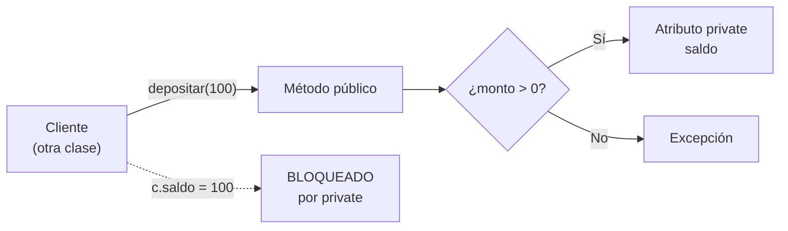

## 7.2 Los cuatro niveles de acceso

| Modificador | Misma clase | Mismo paquete | Subclase (otro paquete) | Cualquier clase |
|---|---|---|---|---|
| `private` | ✅ | ❌ | ❌ | ❌ |
| sin modificador | ✅ | ✅ | ❌ | ❌ |
| `protected` | ✅ | ✅ | ✅ | ❌ |
| `public` | ✅ | ✅ | ✅ | ✅ |

> [!warning] Corrección importante
> El material de Siglo 21 menciona un modificador `restricted`. **No existe en Java.** Los cuatro niveles son los de la tabla. Si te lo preguntan, corregilo con seguridad.

> [!important] `protected` no es “casi público”
> Permite acceso a subclases **y** al mismo paquete. Se usa cuando una clase está pensada para ser heredada. En el examen, si no hay herencia, no lo uses.

## 7.3 Getters y setters

```java
public class Dispositivo {

    private final String id;           // identidad: no cambia
    private String ubicacion;
    private boolean activo;

    public Dispositivo(String id, String ubicacion) {
        this.id = id;
        this.ubicacion = ubicacion;
    }

    // Getter: solo lectura
    public String getId() {
        return id;
    }

    public String getUbicacion() {
        return ubicacion;
    }

    // Setter con validación
    public void setUbicacion(String ubicacion) {
        if (ubicacion == null || ubicacion.isBlank()) {
            throw new IllegalArgumentException("Ubicación obligatoria");
        }
        this.ubicacion = ubicacion;
    }

    public boolean isActivo() {           // boolean: is + nombre
        return activo;
    }

    public void activar() {
        activo = true;
    }

    public void desactivar() {
        activo = false;
    }
}
```

| Convención | Ejemplo |
|---|---|
| Atributo `double saldo` | `getSaldo()` / `setSaldo(double)` |
| Atributo `boolean activo` | `isActivo()` / `setActivo(boolean)` |
| Sin setter | El atributo es inmutable desde afuera |

> [!tip] No generes setters por reflejo
> Un setter para todo convierte el encapsulamiento en decoración: si cualquiera puede cambiar cualquier cosa, no protegiste nada. Preguntate: *¿esta modificación es una operación válida del dominio?* Si no, no la expongas.

## 7.4 Invariantes

**Invariante:** condición que debe cumplirse siempre, antes y después de cada operación pública.

Ejemplos:

- El saldo nunca es negativo (si el dominio lo prohíbe).
- Un turno cancelado no puede volver a pendiente.
- La prioridad de una alerta está entre 1 y 5.
- El stock no puede ser menor que cero.

```java
public class Alerta {

    private final int prioridad;       // 1..5
    private String estado;             // PENDIENTE, ATENDIDA

    public Alerta(int prioridad, String mensaje) {
        if (prioridad < 1 || prioridad > 5) {
            throw new IllegalArgumentException("Prioridad fuera de rango");
        }
        this.prioridad = prioridad;
        this.estado = "PENDIENTE";
    }

    public int getPrioridad() {
        return prioridad;
    }

    public void atender() {
        if (estado.equals("ATENDIDA")) {
            throw new IllegalStateException("Ya estaba atendida");
        }
        estado = "ATENDIDA";
    }

    public String getEstado() {
        return estado;
    }
}
```

> [!important] El invariante se protege en **todos** los caminos
> No alcanza con validar en el constructor: cada método público debe dejar el objeto en un estado válido. Si `atender()` pudiera ejecutarse dos veces, el estado sería inconsistente.

## 7.5 Alcance no es acceso

| Concepto | Pregunta | Ejemplo |
|---|---|---|
| **Alcance (scope)** | ¿Dónde existe este identificador? | Un parámetro existe solo dentro del método |
| **Control de acceso** | ¿Quién puede verlo? | `private` impide verlo desde otra clase |

```java
public class Ejemplo {

    private int contador;                 // atributo de la clase

    public void procesar(int contador) {  // parámetro con el mismo nombre
        int aux = contador;               // parámetro
        this.contador = aux;              // atributo, por this
    }
}
```

- `contador` (parámetro) tiene alcance del método.
- `this.contador` es el atributo del objeto.
- **No se puede** declarar otra variable `contador` dentro del mismo método: ya está en ese alcance.

## 7.6 Diagrama UML con visibilidad

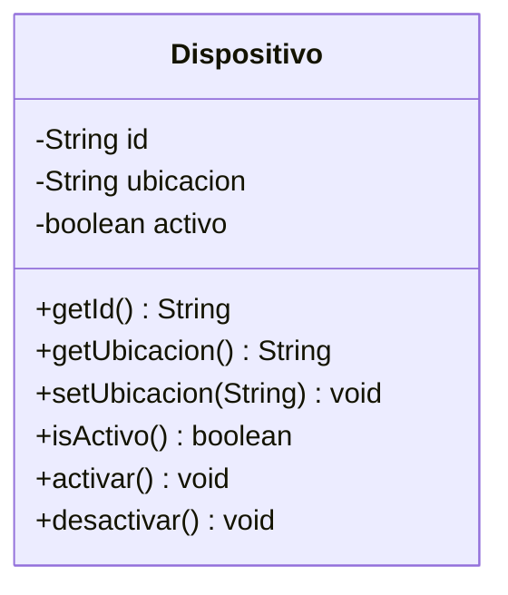

| Símbolo | Visibilidad |
|---|---|
| `-` | `private` |
| `+` | `public` |
| `#` | `protected` |
| `~` | package-private |

> [!tip] Regla de diseño para el escrito
> Atributos `-`, métodos de negocio `+`, métodos auxiliares `-`. Si todos los miembros son `+`, el diagrama está mal.

## 7.7 Programa completo

```java
public class CuentaBancaria {

    private final String cbu;
    private String titular;
    private double saldo;

    public CuentaBancaria(String cbu, String titular, double saldoInicial) {
        if (cbu == null || cbu.length() != 22) {
            throw new IllegalArgumentException("CBU inválido");
        }
        if (saldoInicial < 0) {
            throw new IllegalArgumentException("Saldo inicial inválido");
        }
        this.cbu = cbu;
        this.titular = titular;
        this.saldo = saldoInicial;
    }

    public void depositar(double monto) {
        if (monto <= 0) {
            throw new IllegalArgumentException("El depósito debe ser positivo");
        }
        saldo += monto;
    }

    public void extraer(double monto) {
        if (monto <= 0) {
            throw new IllegalArgumentException("El monto debe ser positivo");
        }
        if (monto > saldo) {
            throw new IllegalStateException("Saldo insuficiente");
        }
        saldo -= monto;
    }

    public double getSaldo() { return saldo; }
    public String getTitular() { return titular; }
    public String getCbu() { return cbu; }

    public void setTitular(String titular) {
        if (titular == null || titular.isBlank()) {
            throw new IllegalArgumentException("Titular obligatorio");
        }
        this.titular = titular;
    }
}
```

```java
public class Banco {

    public static void main(String[] args) {

        CuentaBancaria c = new CuentaBancaria(
                "0000000000000000000001", "Ana", 1000);

        c.depositar(500);
        System.out.println("Saldo: " + c.getSaldo());

        try {
            c.extraer(5000);
        } catch (IllegalStateException e) {
            System.out.println("Error: " + e.getMessage());
        }

        System.out.println("Saldo final: " + c.getSaldo());
    }
}
```

Salida:

```text
Saldo: 1500.0
Error: Saldo insuficiente
Saldo final: 1500.0
```

## Cómo trazar el estado con encapsulamiento

| Paso | Operación | `saldo` | ¿Excepción? |
|---|---|---|---|
| 0 | constructor(1000) | 1000 | no |
| 1 | `depositar(500)` | 1500 | no |
| 2 | `extraer(5000)` | 1500 | sí: saldo insuficiente |
| 3 | `extraer(200)` | 1300 | no |

**Regla:** cuando hay excepción, el estado **no cambia**. Ese es el sentido de validar antes de modificar.

## Errores que suelen tomar

| Error | Consecuencia |
|---|---|
| Atributos `public` | Cualquiera rompe el estado |
| Setter para el `id` | Se pierde la identidad del objeto |
| Getter que devuelve una colección interna | El cliente la modifica desde afuera |
| Validar solo en el setter y no en el constructor | El objeto nace inválido |
| Validar después de modificar | El estado queda corrupto si falla |
| Confundir `protected` con público | Filtra estado a todo el paquete |

> [!warning] El getter que rompe todo
> ```java
> private final List<String> historial = new ArrayList<>();
> public List<String> getHistorial() { return historial; }   // MAL
> ```
> El cliente hace `getHistorial().clear()` y vacía el estado interno. Solución: devolver una copia o una vista no modificable.

## Ejercicios

> [!example] 1. Visibilidad
> **Enunciado:** ¿qué miembros deberían ser `private` y cuáles `public` en `Semaforo` (id, ubicación, color, cambiarColor, estado)?
> **Solución:** `private` para `id`, `ubicacion`, `color`; `public` para `cambiarColor()` y `estado()`; getters públicos para los datos de consulta. `id` sin setter.

> [!example] 2. Setter con validación
> **Enunciado:** escribí `setPrioridad(int)` para una alerta que solo acepta 1 a 5.
> **Solución:**
> ```java
> public void setPrioridad(int prioridad) {
>     if (prioridad < 1 || prioridad > 5) {
>         throw new IllegalArgumentException("Prioridad 1..5");
>     }
>     this.prioridad = prioridad;
> }
> ```

> [!example] 3. Invariante
> **Enunciado:** ¿qué invariante rompe este código?
> ```java
> Cuenta c = new Cuenta("Ana", 100);
> c.setSaldo(-50);
> ```
> **Solución:** rompe “saldo ≥ 0”. El problema es que existe `setSaldo` sin validación. Debe eliminarse y reemplazarse por `depositar` y `extraer`.

> [!example] 4. Alcance vs. acceso
> **Enunciado:** en `public void m(int x) { int x = 2; }`, ¿cuál es el error?
> **Solución:** error de **alcance**: `x` ya está declarada como parámetro en ese bloque. No se puede redeclarar.

> [!example] 5. a papel
> **Enunciado:** escribí la clase `Sensor` encapsulada: `id` inmutable, `valor` privado con getter, y `actualizar(double)` que rechace valores fuera de −50 a 100.
> **Solución:**
> ```java
> public class Sensor {
>     private final String id;
>     private double valor;
>
>     public Sensor(String id) {
>         if (id == null || id.isBlank()) throw new IllegalArgumentException("id");
>         this.id = id;
>     }
>
>     public String getId() { return id; }
>     public double getValor() { return valor; }
>
>     public void actualizar(double nuevo) {
>         if (nuevo < -50 || nuevo > 100) {
>             throw new IllegalArgumentException("Valor fuera de rango");
>         }
>         this.valor = nuevo;
>     }
> }
> ```


<div style="page-break-after: always;"></div>


# 8. Herencia

> [!info] Al terminar este capítulo tenés que poder
> - Modelar una jerarquía “es un” con `extends`.
> - Sobrescribir métodos con `@Override`.
> - Explicar qué se hereda y qué no.
> - Decidir entre herencia y composición.

> [!abstract] Qué debés saber (nivel 1)
> - `class Hija extends Padre` expresa **“es un”**.
> - Se heredan atributos y métodos **accesibles** (`public`, `protected`, package si comparte paquete).
> - Los **constructores no se heredan**; se invocan con `super(...)`.
> - Los `private` no se heredan (existen, pero no son accesibles).
> - Sobrescribir = misma firma en la subclase. `@Override` lo verifica.
> - `final` en clase impide heredar; en método impide sobrescribir.

## 8.1 Qué es heredar

```java
class Dispositivo {

    protected final String id;
    protected String ubicacion;

    public Dispositivo(String id, String ubicacion) {
        this.id = id;
        this.ubicacion = ubicacion;
    }

    public String estado() {
        return id + " en " + ubicacion;
    }
}

class Camara extends Dispositivo {

    private boolean grabando;

    public Camara(String id, String ubicacion) {
        super(id, ubicacion);
    }

    public void iniciarGrabacion() {
        grabando = true;
    }

    public void detenerGrabacion() {
        grabando = false;
    }

    @Override
    public String estado() {
        return super.estado() + " | " + (grabando ? "grabando" : "detenida");
    }
}
```

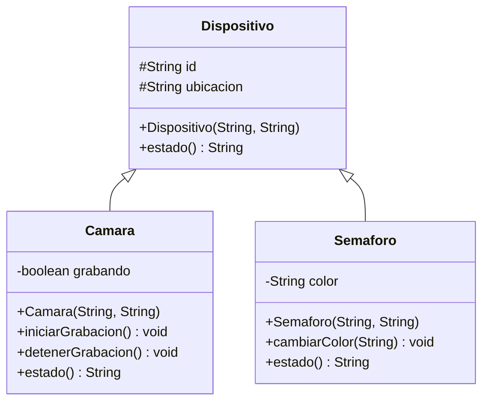

> [!important] Lectura del diagrama
> El triángulo hueco apunta **al padre**. `Camara` y `Semaforo` heredan de `Dispositivo`: ambos **son** dispositivos.

## 8.2 Qué se hereda y qué no

| Miembro del padre | ¿Se hereda? | Detalle |
|---|---|---|
| Atributos `public` | Sí | Accesibles directamente |
| Atributos `protected` | Sí | Accesibles en la subclase |
| Atributos `private` | No accesibles | Existen, pero solo el padre los toca |
| Métodos `public` / `protected` | Sí | Se pueden usar o sobrescribir |
| Métodos `private` | No | No se ven desde la subclase |
| Constructores | **No** | Se invocan con `super(...)` |
| Miembros `static` | Se heredan, pero pertenecen a la clase | Se accede con el nombre de la clase |

```java
class Padre {
    private int secreto = 42;
    protected int visible = 7;

    public int getSecreto() { return secreto; }
}

class Hija extends Padre {
    void probar() {
        System.out.println(visible);       // OK
        // System.out.println(secreto);    // ERROR: private
        System.out.println(getSecreto());  // OK: vía método público
    }
}
```

> [!warning] “No se hereda el private” mal explicado
> El atributo **existe** en el objeto (ocupa memoria) y se inicializa con el constructor del padre. Lo que no hay es **acceso directo** desde la subclase. Se llega por getters o métodos protegidos.

## 8.3 Sobrescritura

```java
class Dispositivo {
    public String estado() {
        return "dispositivo";
    }
}

class Semaforo extends Dispositivo {

    private String color = "ROJO";

    @Override
    public String estado() {          // misma firma
        return "semáforo " + color;
    }
}
```

Reglas:

1. **Misma firma** (nombre + parámetros).
2. El retorno debe ser igual o un subtipo (retorno covariante).
3. No se puede reducir la visibilidad: `public` no puede pasar a `protected`.
4. No se puede sobrescribir un método `final`.
5. `@Override` no es obligatorio, pero **detecta errores de tipeo** en la firma.

> [!warning] El error que `@Override` evita
> ```java
> @Override
> public String Estado() { ... }   // mayúscula: NO sobrescribe
> ```
> Sin la anotación, el compilador lo acepta como método nuevo y el polimorfismo no funciona. Con `@Override`, falla y te avisa.

### `super` en la sobrescritura

```java
@Override
public String estado() {
    return super.estado() + " (actualizado)";
}
```

Sirve para **aprovechar** la implementación del padre y agregar comportamiento.

## 8.4 La raíz: `Object`

Toda clase en Java hereda (implícitamente) de `Object`. Por eso todo objeto tiene:

| Método | Para qué |
|---|---|
| `toString()` | Representación textual; se usa al concatenar |
| `equals(Object)` | Igualdad lógica (por defecto, identidad) |
| `hashCode()` | Código hash coherente con `equals` |
| `getClass()` | Clase real del objeto |

```java
class Punto {
    int x, y;

    Punto(int x, int y) { this.x = x; this.y = y; }

    @Override
    public String toString() {
        return "(" + x + ", " + y + ")";
    }
}

public class Prueba {
    public static void main(String[] args) {
        System.out.println(new Punto(2, 3));   // (2, 3)
    }
}
```

Se profundiza en 13. String y comparación de objetos.

## 8.5 `final`

| Dónde | Efecto |
|---|---|
| `final` en atributo | No se reasigna |
| `final` en método | No se puede sobrescribir |
| `final` en clase | No se puede heredar |

```java
final class Utilidades { }          // nadie puede extenderla

class Base {
    public final void plantilla() { }   // no se puede sobrescribir
}
```

## 8.6 Herencia vs. composición

> [!important] Regla de diseño
> Usá herencia solo si hay una relación **“es un”** real y la subclase **especializa** el comportamiento. Si solo querés reutilizar código, usá **composición** (“tiene un”).

| Criterio | Herencia | Composición |
|---|---|---|
| Relación | “es un” | “tiene un” |
| Acoplamiento | Fuerte (depende del padre) | Débil (depende de una interfaz) |
| Cambio en el padre | Impacta en los hijos | No impacta |
| Cuándo | Jerarquía real del dominio | Reutilizar sin jerarquía |

```java
// MAL: un motor no "es un" auto
class Auto extends Motor { }

// BIEN: un auto "tiene un" motor
class Auto {
    private Motor motor;
}
```

> [!warning] Herencia por conveniencia
> Es el error de diseño más común en el examen. Si no podés decir “A **es un** B” en voz alta, no uses `extends`.

## 8.7 Programa completo

```java
class Dispositivo {

    protected final String id;
    protected String ubicacion;
    protected boolean activo;

    public Dispositivo(String id, String ubicacion) {
        this.id = id;
        this.ubicacion = ubicacion;
    }

    public void activar() { activo = true; }
    public void desactivar() { activo = false; }

    public String estado() {
        return id + " @ " + ubicacion + " [" + (activo ? "ON" : "OFF") + "]";
    }
}

class Semaforo extends Dispositivo {

    private String color;

    public Semaforo(String id, String ubicacion) {
        super(id, ubicacion);
        this.color = "ROJO";
    }

    public void cambiarColor(String nuevo) {
        if (nuevo.equals("ROJO") || nuevo.equals("AMARILLO") || nuevo.equals("VERDE")) {
            this.color = nuevo;
        }
    }

    @Override
    public String estado() {
        return super.estado() + " color=" + color;
    }
}

class Camara extends Dispositivo {

    private boolean grabando;

    public Camara(String id, String ubicacion) {
        super(id, ubicacion);
    }

    public void grabar() { grabando = true; }

    @Override
    public String estado() {
        return super.estado() + " " + (grabando ? "REC" : "sin grabar");
    }
}

public class Municipio {

    public static void main(String[] args) {

        Semaforo s = new Semaforo("S-01", "Belgrano");
        Camara c = new Camara("C-01", "Plaza");

        s.activar();
        s.cambiarColor("VERDE");
        c.activar();
        c.grabar();

        System.out.println(s.estado());
        System.out.println(c.estado());

        Dispositivo d = new Camara("C-02", "Terminal");
        d.activar();
        System.out.println(d.estado());     // se ejecuta el de Camara
    }
}
```

Salida:

```text
S-01 @ Belgrano [ON] color=VERDE
C-01 @ Plaza [ON] REC
C-02 @ Terminal [ON] sin grabar
```

> [!important] Fijate en la última línea
> `d` es de tipo `Dispositivo` pero apunta a una `Camara`. Se ejecuta `estado()` de `Camara`. Eso es **polimorfismo** (11. Polimorfismo y miembros estáticos).

## Cómo trazar una jerarquía

| Paso | Acción | Objeto `c` (Camara) |
|---|---|---|
| 1 | `new Camara("C-01","Plaza")` | reserva memoria |
| 2 | `super(id, ubicacion)` | `id`, `ubicacion` asignados; `activo=false` |
| 3 | vuelve al constructor de Camara | `grabando=false` |
| 4 | `c.activar()` | `activo=true` |
| 5 | `c.grabar()` | `grabando=true` |
| 6 | `c.estado()` | ejecuta la versión de `Camara` |

## Errores que suelen tomar

| Error | Consecuencia |
|---|---|
| Herencia sin “es un” | Modelo incorrecto |
| Esperar que se hereden los constructores | No ocurre: hay que llamar `super(...)` |
| Acceder a un `private` del padre | No compila |
| Sobrescribir cambiando la firma | Es sobrecarga, no sobrescritura |
| Reducir visibilidad al sobrescribir | No compila |
| Olvidar `super(...)` cuando el padre no tiene constructor vacío | No compila |
| Usar `extends` solo para reutilizar | Acoplamiento innecesario |

## Ejercicios

> [!example] 1. Jerarquía
> **Enunciado:** modelá `Vehiculo` con `patente` y `velocidadMaxima`, y las subclases `Auto` (cantidadPuertas) y `Moto` (cilindrada). Escribí los constructores.
> **Solución:**
> ```java
> class Vehiculo {
>     protected String patente;
>     protected int velocidadMaxima;
>
>     Vehiculo(String patente, int velocidadMaxima) {
>         this.patente = patente;
>         this.velocidadMaxima = velocidadMaxima;
>     }
> }
>
> class Auto extends Vehiculo {
>     private int puertas;
>     Auto(String p, int v, int puertas) {
>         super(p, v);
>         this.puertas = puertas;
>     }
> }
>
> class Moto extends Vehiculo {
>     private int cilindrada;
>     Moto(String p, int v, int cilindrada) {
>         super(p, v);
>         this.cilindrada = cilindrada;
>     }
> }
> ```

> [!example] 2. Sobrescritura
> **Enunciado:** ¿qué está mal?
> ```java
> class A { public void f(int x) { } }
> class B extends A {
>     @Override
>     public void f(double x) { }
> }
> ```
> **Solución:** `B.f(double)` **no sobrescribe** `A.f(int)`: es sobrecarga. `@Override` hace que no compile, que es justamente lo útil.

> [!example] 3. `private`
> **Enunciado:** ¿qué imprime?
> ```java
> class A { private int x = 1; public int getX() { return x; } }
> class B extends A { public int getX() { return 2; } }
> new B().getX();
> ```
> **Solución:** `2`. `B` sobrescribe `getX()`; el `x` privado de `A` sigue existiendo pero no se usa.

> [!example] 4. Composición
> **Enunciado:** reescribí `class Auto extends Motor` con composición.
> **Solución:**
> ```java
> class Auto {
>     private final Motor motor;
>     Auto(Motor motor) { this.motor = motor; }
> }
> ```

> [!example] 5. a papel
> **Enunciado:** escribí `Empleado` con `nombre` y `sueldoBase`, y `Gerente extends Empleado` con `bono`. Sobrescribí `sueldoTotal()`.
> **Solución:**
> ```java
> class Empleado {
>     protected String nombre;
>     protected double sueldoBase;
>
>     Empleado(String nombre, double sueldoBase) {
>         this.nombre = nombre;
>         this.sueldoBase = sueldoBase;
>     }
>
>     double sueldoTotal() { return sueldoBase; }
> }
>
> class Gerente extends Empleado {
>     private double bono;
>
>     Gerente(String nombre, double sueldoBase, double bono) {
>         super(nombre, sueldoBase);
>         this.bono = bono;
>     }
>
>     @Override
>     double sueldoTotal() { return super.sueldoTotal() + bono; }
> }
> ```


<div style="page-break-after: always;"></div>


# 9. Clases abstractas

> [!info] Al terminar este capítulo tenés que poder
> - Declarar una clase abstracta y un método abstracto.
> - Explicar por qué no se puede instanciar.
> - Implementar subclases concretas completas.
> - Justificar cuándo conviene una clase abstracta.

> [!abstract] Qué debés saber (nivel 1)
> - `abstract class` declara una clase que **no se instancia**.
> - `abstract` en un método = **sin cuerpo**; la subclase concreta está obligada a implementarlo.
> - Una clase abstracta **puede** tener atributos, constructor y métodos concretos.
> - Se puede declarar una **referencia** del tipo abstracto, pero no hacer `new`.
> - Si una subclase no implementa todos los métodos abstractos, también debe ser abstracta.

## 9.1 El problema

Tenés `Semaforo` y `Camara`, ambos con `id`, `ubicacion` y `estado()`. Querés una base común, pero **no existe un “dispositivo genérico”** que tenga sentido crear.

```java
Dispositivo d = new Dispositivo("D-01", "Centro");   // ¿qué dispositivo es?
```

Ahí aparece la clase abstracta: define el contrato y el estado común, pero **prohíbe** la instancia directa.

## 9.2 Declaración

```java
public abstract class Dispositivo {

    protected final String id;
    protected String ubicacion;

    public Dispositivo(String id, String ubicacion) {
        this.id = id;
        this.ubicacion = ubicacion;
    }

    // Método concreto: se hereda tal cual
    public String identificacion() {
        return id + " @ " + ubicacion;
    }

    // Método abstracto: sin cuerpo, obligatorio para las subclases
    public abstract String tipo();

    public abstract void realizarTarea();
}
```

```java
public class Camara extends Dispositivo {

    public Camara(String id, String ubicacion) {
        super(id, ubicacion);
    }

    @Override
    public String tipo() {
        return "Camara";
    }

    @Override
    public void realizarTarea() {
        System.out.println("Capturando imagen en " + ubicacion);
    }
}
```

```java
public class Semaforo extends Dispositivo {

    private String color = "ROJO";

    public Semaforo(String id, String ubicacion) {
        super(id, ubicacion);
    }

    @Override
    public String tipo() {
        return "Semaforo";
    }

    @Override
    public void realizarTarea() {
        System.out.println("Gestionando tránsito en " + ubicacion + " (" + color + ")");
    }

    public void cambiarColor(String nuevo) {
        color = nuevo;
    }
}
```

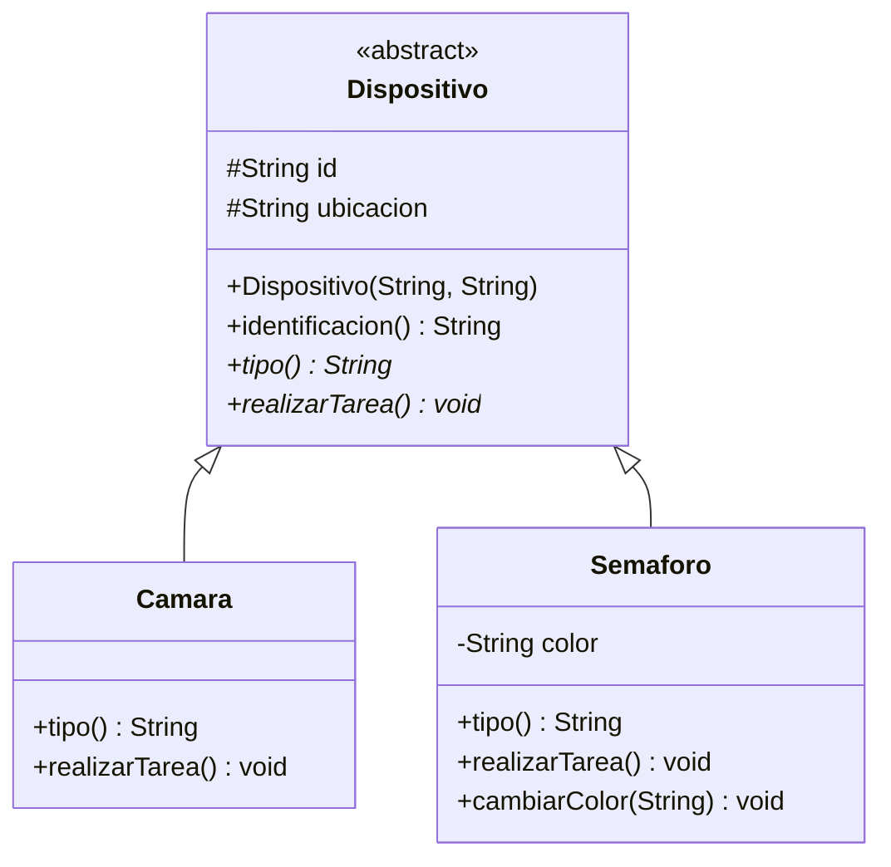

> [!important] En UML
> La clase abstracta se marca con `<<abstract>>` y los métodos abstractos con `*` o con la letra en cursiva. En el escrito, escribí `{abstract}` si no recordás la notación.

## 9.3 Reglas

| Regla | Detalle |
|---|---|
| No se instancia | `new Dispositivo(...)` no compila |
| Sí se referencia | `Dispositivo d = new Camara(...)` es válido |
| Puede tener constructor | Se invoca desde la subclase con `super(...)` |
| Puede tener métodos concretos | Se heredan y se pueden sobrescribir |
| Puede no tener ningún método abstracto | Igual no se instancia |
| `abstract` no se aplica a constructores | Un constructor abstracto no existe |
| `abstract` no se aplica a `static` | No tiene sentido: no hay objeto |
| `final` y `abstract` son incompatibles | `final` prohíbe heredar; `abstract` exige heredar |

## 9.4 Subclase incompleta

```java
abstract class Figura {
    abstract double area();
    abstract double perimetro();
}

// Si no implementa todo, debe seguir siendo abstracta
abstract class FiguraIncompleta extends Figura {
    @Override
    double area() { return 0; }
    // falta perimetro()
}

// Concreta: implementa todo
class Cuadrado extends Figura {
    private final double lado;

    Cuadrado(double lado) { this.lado = lado; }

    @Override double area() { return lado * lado; }
    @Override double perimetro() { return 4 * lado; }
}
```

> [!warning] Error de compilación
> “`Cuadrado` is not abstract and does not override abstract method `perimetro()`”. Es el mensaje típico cuando falta implementar un método abstracto.

## 9.5 Clase abstracta con lógica común

La ventaja real no es “obligar”, es **compartir** el algoritmo y dejar huecos.

```java
public abstract class ProcesadorDispositivo {

    // Método concreto: define el esqueleto
    public final void procesar() {
        conectar();
        String dato = leer();
        guardar(dato);
        desconectar();
    }

    protected void conectar() {
        System.out.println("Conectando...");
    }

    protected abstract String leer();       // cada dispositivo lo implementa

    protected void guardar(String dato) {
        System.out.println("Guardando: " + dato);
    }

    protected void desconectar() {
        System.out.println("Desconectando...");
    }
}
```

```java
public class SensorHumedad extends ProcesadorDispositivo {
    @Override
    protected String leer() {
        return "humedad=62%";
    }
}
```

```java
public class SensorTemperatura extends ProcesadorDispositivo {
    @Override
    protected String leer() {
        return "temp=21.5C";
    }
}
```

```java
public class Planta {
    public static void main(String[] args) {
        new SensorHumedad().procesar();
        new SensorTemperatura().procesar();
    }
}
```

Salida:

```text
Conectando...
Guardando: humedad=62%
Desconectando...
Conectando...
Guardando: temp=21.5C
Desconectando...
```

> [!tip] Patrón “método plantilla”
> El método `procesar()` fija el orden; las subclases solo aportan `leer()`. Es la aplicación más útil de las clases abstractas y se pregunta en el oral.

## 9.6 Cuándo usar clase abstracta

| Situación | ¿Abstracta? |
|---|---|
| Hay estado común (atributos) | Sí |
| Hay código común que conviene reutilizar | Sí |
| Nunca se instancia directamente | Sí |
| Solo se define un contrato, sin estado | Mejor **interfaz** (10. Interfaces) |
| Se necesita herencia múltiple de tipo | Interfaz |

> [!important] La diferencia que se pregunta
> Clase abstracta = **base parcial** con estado y comportamiento. Interfaz = **contrato** de capacidades. Se compara en detalle en 10. Interfaces.

## 9.7 Programa completo

```java
public abstract class FiguraGeometrica {

    protected final String nombre;

    protected FiguraGeometrica(String nombre) {
        this.nombre = nombre;
    }

    public abstract double area();
    public abstract double perimetro();

    public String descripcion() {
        return String.format("%s: área=%.2f, perímetro=%.2f",
                nombre, area(), perimetro());
    }
}
```

```java
public class Circulo extends FiguraGeometrica {

    private final double radio;

    public Circulo(double radio) {
        super("Círculo");
        this.radio = radio;
    }

    @Override
    public double area() { return Math.PI * radio * radio; }

    @Override
    public double perimetro() { return 2 * Math.PI * radio; }
}
```

```java
public class Rectangulo extends FiguraGeometrica {

    private final double base;
    private final double altura;

    public Rectangulo(double base, double altura) {
        super("Rectángulo");
        this.base = base;
        this.altura = altura;
    }

    @Override
    public double area() { return base * altura; }

    @Override
    public double perimetro() { return 2 * (base + altura); }
}
```

```java
public class Figuras {

    public static void main(String[] args) {

        FiguraGeometrica[] figuras = {
            new Circulo(2),
            new Rectangulo(3, 4)
        };

        for (FiguraGeometrica f : figuras) {
            System.out.println(f.descripcion());
        }
    }
}
```

Salida:

```text
Círculo: área=12,57, perímetro=12,57
Rectángulo: área=12,00, perímetro=14,00
```

> [!warning] Formato con coma
> `String.format` usa la configuración regional. Si tu sistema está en español, imprime coma decimal. En el examen no importa el formato; importa el cálculo.

## Cómo trazar

```java
Figura f = new Circulo(2);
f.area();
```

| Paso | Acción | Resultado |
|---|---|---|
| 1 | `new Circulo(2)` | constructor de `Circulo` → `super("Círculo")` → `radio=2` |
| 2 | Asignar a `f` (tipo `Figura`) | referencia válida |
| 3 | `f.area()` | se ejecuta la de `Circulo` → `π·4` |
| 4 | `f.descripcion()` | método concreto de `Figura`, que llama a `area()` y `perimetro()` de `Circulo` |

## Errores que suelen tomar

| Error | Consecuencia |
|---|---|
| `new Dispositivo(...)` | No compila |
| Método abstracto con cuerpo | No compila |
| Subclase concreta sin implementar todo | No compila |
| Marcar `abstract` una clase que se quiere instanciar | No compila |
| `final abstract class` | Combinación inválida |
| Confundir abstracta con interfaz | Error conceptual |

## Ejercicios

> [!example] 1. ¿Compila?
> **Enunciado:** ¿qué pasa con `abstract class A { void f(); }`?
> **Solución:** no compila: un método sin cuerpo debe declararse `abstract`. La clase ya es abstracta, pero falta el modificador en el método.

> [!example] 2. Subclase
> **Enunciado:** `abstract class Animal { abstract void sonido(); }`. Escribí `Perro` y `Gato`.
> **Solución:**
> ```java
> abstract class Animal { abstract void sonido(); }
>
> class Perro extends Animal {
>     @Override void sonido() { System.out.println("Guau"); }
> }
> class Gato extends Animal {
>     @Override void sonido() { System.out.println("Miau"); }
> }
> ```

> [!example] 3. Referencia abstracta
> **Enunciado:** ¿es válido `Animal a = new Perro(); a.sonido();`?
> **Solución:** sí. Se puede declarar la referencia con el tipo abstracto; en ejecución se llama al método del objeto real (`Perro`).

> [!example] 4. Método plantilla
> **Enunciado:** explicá por qué `procesar()` es `final` en el ejemplo.
> **Solución:** para que ninguna subclase cambie el orden del algoritmo. Solo puede variar `leer()`, que es el punto de extensión.

> [!example] 5. a papel
> **Enunciado:** escribí `Empleado` abstracto con `nombre` y `sueldoBase`, método abstracto `calcularSueldo()`, y dos subclases: `Fijo` (sueldo base) y `PorHora` (horas × valor).
> **Solución:**
> ```java
> abstract class Empleado {
>     protected String nombre;
>     protected double sueldoBase;
>
>     Empleado(String nombre, double sueldoBase) {
>         this.nombre = nombre;
>         this.sueldoBase = sueldoBase;
>     }
>
>     abstract double calcularSueldo();
> }
>
> class Fijo extends Empleado {
>     Fijo(String n, double s) { super(n, s); }
>     @Override double calcularSueldo() { return sueldoBase; }
> }
>
> class PorHora extends Empleado {
>     private int horas;
>     PorHora(String n, double valorHora, int horas) {
>         super(n, valorHora);
>         this.horas = horas;
>     }
>     @Override double calcularSueldo() { return sueldoBase * horas; }
> }
> ```


<div style="page-break-after: always;"></div>


# 10. Interfaces

> [!info] Al terminar este capítulo tenés que poder
> - Definir una interfaz como contrato.
> - Implementarla, incluso varias a la vez.
> - Usarla como tipo de referencia.
> - Elegir entre clase abstracta e interfaz y justificarlo.

> [!abstract] Qué debés saber (nivel 1)
> - `interface` define un **contrato**: qué se debe hacer, no cómo.
> - Una clase **implementa** con `implements` (no `extends`).
> - Se pueden implementar **varias** interfaces.
> - Los métodos son públicos y abstractos por defecto (hasta Java 7); hoy puede haber `default` y `static`.
> - Los atributos son `public static final` implícitamente (constantes).
> - No se instancia: `new Activable()` no compila.

## 10.1 Qué es un contrato

> [!quote] Cátedra
> Una interfaz define un contrato que especifica el comportamiento que las clases implementadoras deben cumplir.

Pensá en un enchufe: no importa qué aparato conectes, todos cumplen la misma forma. La interfaz define la forma; cada clase decide qué hace al conectarse.

```java
public interface Activable {

    void activar();
    void desactivar();
    boolean estaActivo();
}
```

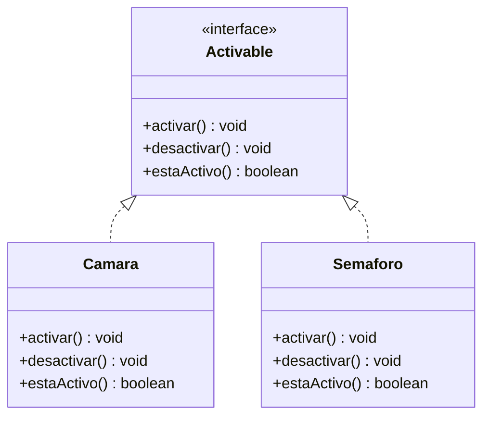

> [!important] Notación UML
> La interfaz se marca `<<interface>>` y la relación es **línea punteada con triángulo hueco** (`<|..`). La herencia de clase es línea continua (`<|--`).

## 10.2 Implementar

```java
public class CamaraSimple implements Activable {

    private boolean activo = false;

    @Override
    public void activar() {
        activo = true;
    }

    @Override
    public void desactivar() {
        activo = false;
    }

    @Override
    public boolean estaActivo() {
        return activo;
    }
}
```

Reglas:

1. La clase **debe** implementar todos los métodos del contrato.
2. Los métodos deben ser `public` (no se puede reducir la visibilidad).
3. `@Override` es recomendable: verifica la firma.

> [!warning] Error clásico
> ```java
> public class CamaraSimple implements Activable {
>     void activar() { }        // sin public: NO compila
> }
> ```
> El método de la interfaz es público; la implementación no puede ser más restrictiva.

## 10.3 Varias interfaces

`Activable` ya está definida arriba; acá se agregan dos contratos más.

```java
public interface Conectable {
    void conectar(String red);
    void desconectar();
}
```

```java
public interface Auditable {
    String auditoria();
}
```

```java
public class CamaraConectada implements Activable, Conectable, Auditable {

    private boolean activo;
    private String red = "sin red";
    private int cambios = 0;

    @Override public void activar()   { activo = true;  cambios++; }
    @Override public void desactivar(){ activo = false; cambios++; }
    @Override public boolean estaActivo() { return activo; }
    @Override public void conectar(String red) { this.red = red; }
    @Override public void desconectar() { this.red = "sin red"; }

    @Override
    public String auditoria() {
        return "activo=" + activo + ", red=" + red + ", cambios=" + cambios;
    }
}
```

```java
public class Prueba {
    public static void main(String[] args) {
        CamaraConectada c = new CamaraConectada();
        c.activar();
        c.conectar("LAN-01");
        System.out.println(c.auditoria());   // activo=true, red=LAN-01, cambios=1
    }
}
```

> [!important] Herencia múltiple de tipo, no de implementación
> Java no permite `extends A, B`, pero sí `implements A, B`. La clase hereda **una** implementación y adopta **varios** contratos. Eso evita el problema del diamante.

## 10.4 La interfaz como tipo

```java
public class Panel {

    public static void main(String[] args) {

        Activable a = new CamaraSimple();   // referencia de interfaz
        a.activar();                        // se ejecuta la de CamaraSimple

        Activable[] dispositivos = {
            new CamaraSimple(),
            new CamaraConectada()
        };

        for (Activable d : dispositivos) {
            d.activar();                // cada uno responde a su manera
        }
    }
}
```

El código cliente **no necesita saber** qué clase concreta es: le alcanza con que cumpla el contrato. Eso es bajo acoplamiento.

> [!warning] Solo ves el contrato
> Con una referencia `Activable`, no podés llamar a métodos propios de `CamaraConectada` (como `conectar("LAN-01")`). Para eso necesitás un cast o cambiar el tipo de la referencia.

## 10.5 Clase abstracta vs. interfaz

| Aspecto | Clase abstracta | Interfaz |
|---|---|---|
| Propósito | Base común con estado y comportamiento parcial | Contrato de capacidades |
| Instanciación | No | No |
| Atributos de instancia | Sí | No (solo constantes) |
| Constructores | Sí | No |
| Métodos | Abstractos y concretos | Abstractos, `default` y `static` |
| Herencia | Una sola clase (`extends`) | Varias interfaces (`implements`) |
| Cuándo | Las subclases comparten estado o código | Varias clases necesitan la misma capacidad |

> [!important] La respuesta de oral
> “Uso clase abstracta cuando las subclases comparten **estado o implementación**; uso interfaz cuando varias clases necesitan cumplir una **capacidad común**, aunque no pertenezcan a la misma jerarquía.”

## 10.6 Programa completo

```java
public interface Activable {
    void activar();
    void desactivar();
    boolean estaActivo();
}
```

```java
public abstract class Dispositivo implements Activable {

    protected final String id;
    protected String ubicacion;
    protected boolean activo;

    protected Dispositivo(String id, String ubicacion) {
        this.id = id;
        this.ubicacion = ubicacion;
    }

    @Override public void activar()   { activo = true; }
    @Override public void desactivar(){ activo = false; }
    @Override public boolean estaActivo() { return activo; }

    public abstract String tipo();

    public String ficha() {
        return tipo() + " " + id + " @ " + ubicacion + " [" + (activo ? "ON" : "OFF") + "]";
    }
}
```

```java
public class Camara extends Dispositivo {

    private boolean grabando;

    public Camara(String id, String ubicacion) {
        super(id, ubicacion);
    }

    @Override public String tipo() { return "Camara"; }

    public void grabar() { grabando = true; }

    @Override
    public String ficha() {
        return super.ficha() + (grabando ? " REC" : "");
    }
}
```

```java
public class Semaforo extends Dispositivo {

    private String color = "ROJO";

    public Semaforo(String id, String ubicacion) {
        super(id, ubicacion);
    }

    @Override public String tipo() { return "Semaforo"; }

    public void cambiarColor(String c) { color = c; }

    @Override
    public String ficha() {
        return super.ficha() + " color=" + color;
    }
}
```

```java
public class CentroControl {

    public static void main(String[] args) {

        Dispositivo[] red = {
            new Camara("C-01", "Plaza"),
            new Semaforo("S-01", "Belgrano")
        };

        for (Dispositivo d : red) {
            d.activar();                 // método de la interfaz, implementado en la abstracta
            System.out.println(d.ficha()); // método sobrescrito en cada subclase
        }

        Activable a = red[0];
        a.desactivar();
        System.out.println("¿Activo? " + a.estaActivo());
    }
}
```

Salida:

```text
Camara C-01 @ Plaza [ON]
Semaforo S-01 @ Belgrano [ON] color=ROJO
¿Activo? false
```

Observá las tres capas: **interfaz** (contrato), **clase abstracta** (estado y comportamiento común) y **clases concretas** (especialización).

## Cómo trazar

| Paso | Acción | `red[0]` (Camara) |
|---|---|---|
| 1 | `new Camara("C-01","Plaza")` | `super(...)` inicializa `id`, `ubicacion`, `activo=false` |
| 2 | `d.activar()` con `d` de tipo `Dispositivo` | ejecuta `Dispositivo.activar()` → `activo=true` |
| 3 | `d.ficha()` | se ejecuta la de `Camara` (sobrescrita) |
| 4 | `a.desactivar()` con `a` de tipo `Activable` | ejecuta la implementación de `Dispositivo` |

## Errores que suelen tomar

| Error | Consecuencia |
|---|---|
| `class X extends Activable` | No compila: es `implements` |
| `new Activable()` | No compila: no se instancia |
| Implementar solo algunos métodos | No compila |
| Método implementado sin `public` | No compila |
| Declarar atributos de instancia en la interfaz | Solo constantes |
| Confundir interfaz con clase abstracta | Error conceptual en el oral |
| Poner lógica de negocio en `default` | Mala práctica, acopla el contrato |

## Ejercicios

> [!example] 1. Contrato
> **Enunciado:** definí `Notificable` con `notificar(String)` y `cantidadNotificaciones()`, e implementalo en `Alerta`.
> **Solución:**
> ```java
> interface Notificable {
>     void notificar(String mensaje);
>     int cantidadNotificaciones();
> }
>
> class Alerta implements Notificable {
>     private int cantidad;
>     @Override public void notificar(String m) { cantidad++; System.out.println(m); }
>     @Override public int cantidadNotificaciones() { return cantidad; }
> }
> ```

> [!example] 2. Varias interfaces
> **Enunciado:** ¿puede una clase implementar `Activable` y `Auditable` a la vez? ¿Y extender `Dispositivo`?
> **Solución:** sí a ambas: `class Camara extends Dispositivo implements Activable, Auditable`.

> [!example] 3. Referencia de interfaz
> **Enunciado:** ¿qué imprime?
> ```java
> Activable a = new Camara();
> a.activar();
> System.out.println(a.estaActivo());
> ```
> **Solución:** `true`. Se ejecuta la implementación de `Camara` (o la heredada de `Dispositivo`, según el caso).

> [!example] 4. Elección
> **Enunciado:** para “todo dispositivo puede activarse” y “todas las figuras comparten color y nombre”, ¿interfaz o abstracta?
> **Solución:** “puede activarse” es una **capacidad** → interfaz. “Comparten estado” (color, nombre) → **clase abstracta**.

> [!example] 5. a papel
> **Enunciado:** escribí la interfaz `ComparablePorPrioridad` con `int prioridad()` y hacé que `Alerta` la implemente. Ordená dos alertas a mano según su prioridad.
> **Solución:**
> ```java
> interface ComparablePorPrioridad {
>     int prioridad();
> }
>
> class AlertaPriorizable implements ComparablePorPrioridad {
>     private final int prioridad;
>     AlertaPriorizable(int p) { this.prioridad = p; }
>     @Override public int prioridad() { return prioridad; }
> }
>
> // A mano: menor número = mayor prioridad → la de 1 va antes que la de 3
> ```


<div style="page-break-after: always;"></div>


# 11. Polimorfismo y miembros estáticos

> [!info] Al terminar este capítulo tenés que poder
> - Explicar qué es abstraer y para qué sirve.
> - Definir polimorfismo y distinguir sus tipos.
> - Diferenciar enlace estático de dinámico.
> - Justificar cómo el polimorfismo permite extender sin modificar.
> - Usar `static` y distinguir instancia de clase.

> [!abstract] Qué debés saber (nivel 1)
> - **Abstracción:** quedarse con lo relevante y ocultar el detalle.
> - **Polimorfismo:** el mismo mensaje produce comportamientos distintos según el objeto.
> - Tipos: **sobrecarga** (estático), **inclusión** (dinámico), **paramétrico** (genéricos).
> - **Enlace dinámico:** el método se elige en ejecución según el objeto real.
> - Ventaja central: agregar un tipo nuevo **sin tocar** el código que lo usa.

> [!quote] Cátedra
> La **abstracción** es la acción de separar lo esencial de lo accidental. En POO se materializa en clases e interfaces: el cliente conoce **qué** hace un objeto, no **cómo** lo hace.

## 11.1 Abstraer

Abstraer es decidir qué mirar y qué ignorar. Un semáforo, para el sistema de tránsito, es un objeto con `estado` y `cambiar()`; no importa su color de pintura ni su número de serie.

| Nivel de abstracción | Qué muestra | Ejemplo |
|---|---|---|
| **Muy bajo** | Detalle de implementación | "arreglo de 3 bytes con 0/1/2" |
| **Medio** | Operaciones | "encender, apagar, estado" |
| **Alto** | Concepto del dominio | "dispositivo de señalización" |

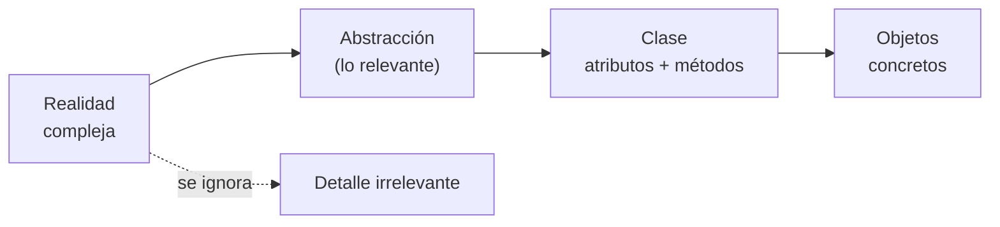

> [!important] Abstraer no es "simplificar porque sí"
> Es elegir el nivel de detalle que el problema necesita. Si el sistema solo enciende y apaga, no modeles la resistencia del LED.

## 11.2 Qué es polimorfismo

**Polimorfismo:** capacidad de que un mismo mensaje (nombre de método) se resuelva de formas distintas según el objeto que lo recibe.

```java
abstract class Dispositivo {
    abstract String estado();
}

class Semaforo extends Dispositivo {
    String estado() { return "verde"; }
}

class Camara extends Dispositivo {
    String estado() { return "grabando"; }
}

// El cliente no cambia
for (Dispositivo d : dispositivos) {
    System.out.println(d.estado());
}
```

| Objeto real | Mensaje | Resultado |
|---|---|---|
| `Semaforo` | `estado()` | `"verde"` |
| `Camara` | `estado()` | `"grabando"` |

> [!important] La frase que se pregunta
> "El mismo mensaje, objetos distintos, comportamientos distintos." Si agregás `Sensor`, el `for` no cambia: eso es **extensibilidad por polimorfismo**.

## 11.3 Tipos de polimorfismo

| Tipo | Cuándo se resuelve | Ejemplo |
|---|---|---|
| **Sobrecarga** (ad hoc) | Compilación | `sumar(int, int)` y `sumar(double, double)` |
| **Inclusión** (subtipo) | Ejecución | `Dispositivo d = new Semaforo(); d.estado()` |
| **Paramétrico** (genéricos) | Compilación | `ArrayList<Alerta>` |
| **Coerción** | Compilación | `int` → `double` |

```java
// Sobrecarga: mismo nombre, distinta firma
int sumar(int a, int b) { return a + b; }
double sumar(double a, double b) { return a + b; }

// Inclusión: mismo mensaje, distinto objeto
Dispositivo d = new Camara();
d.estado();
```

> [!warning] Sobrecarga no es lo mismo que sobrescritura
> **Sobrecarga:** mismo nombre, **distinta firma**, en la misma clase o en una subclase. **Sobrescritura:** misma firma, en una subclase, con `@Override`. La sobrecarga se resuelve al compilar; la sobrescritura, al ejecutar.

## 11.4 Enlace estático y dinámico

| | Estático (temprano) | Dinámico (tardío) |
|---|---|---|
| Cuándo | Compilación | Ejecución |
| Se decide por | Tipo declarado | Tipo real del objeto |
| Aplica a | `static`, `private`, `final`, sobrecarga | Métodos sobrescritos |
| Ejemplo | `Math.abs(-3)` | `d.estado()` |

```mermaid
flowchart TD
    A["d.estado()"] --> B{"¿El método es<br/>static/private/final?"}
    B -- "Sí" --> C["Enlace estático<br/>según el tipo declarado"]
    B -- "No" --> D["Enlace dinámico<br/>según el objeto real"]
    D --> E["Se ejecuta la versión<br/>de la subclase"]
```

> [!important] La tabla de métodos virtuales
> La JVM guarda, por clase, qué implementación corresponde a cada método. Al llamar, busca en la clase del **objeto**, no en la del tipo de la variable. Por eso `Dispositivo d = new Camara()` ejecuta `Camara.estado()`.

## 11.5 Por qué el polimorfismo cambia el diseño

Sin polimorfismo, cada tipo nuevo obliga a tocar el código cliente:

```java
// Mal: crece con cada tipo
if (d instanceof Semaforo) { ... }
else if (d instanceof Camara) { ... }
else if (d instanceof Sensor) { ... }
```

Con polimorfismo, el cliente depende de una **abstracción** y no conoce los tipos concretos:

```java
// Bien: no cambia al agregar tipos
for (Dispositivo d : dispositivos) {
    d.estado();
}
```

| Principio | Efecto |
|---|---|
| Depender de la abstracción | El cliente no conoce las subclases |
| Agregar, no modificar | Se cumple abierto/cerrado |
| Cada clase resuelve lo suyo | Se elimina el `if` por tipo |

> [!important] La relación con los otros pilares
> La abstracción define **qué**; la herencia permite **compartir**; el encapsulamiento **protege** el cómo; el polimorfismo **varía** el cómo sin cambiar el qué. Se necesitan entre sí.

## 11.6 Método: detectar polimorfismo en un diseño

| Paso | Pregunta | Señal |
|---|---|---|
| 1 | ¿Hay una superclase o interfaz común? | Abstracción |
| 2 | ¿El cliente usa esa abstracción? | Buen diseño |
| 3 | ¿Hay `if` por tipo? | Falta polimorfismo |
| 4 | ¿El método se sobrescribe? | Enlace dinámico |
| 5 | ¿Agregar un tipo obliga a tocar el cliente? | Diseño rígido |

## 11.7 Jerarquía completa

```java
abstract class Dispositivo {

    protected final String id;
    protected String ubicacion;

    protected Dispositivo(String id, String ubicacion) {
        this.id = id;
        this.ubicacion = ubicacion;
    }

    public abstract void realizarTarea();

    public String ficha() {
        return id + " @ " + ubicacion;
    }
}

class Semaforo extends Dispositivo {

    private String color = "ROJO";

    Semaforo(String id, String u) { super(id, u); }

    public void cambiarColor(String c) { color = c; }

    @Override
    public void realizarTarea() {
        System.out.println("Semáforo " + id + ": gestionando tránsito (" + color + ")");
    }
}

class Camara extends Dispositivo {

    Camara(String id, String u) { super(id, u); }

    @Override
    public void realizarTarea() {
        System.out.println("Cámara " + id + ": capturando imagen");
    }
}
```

```java
public class CentroControl {

    public static void main(String[] args) {

        Dispositivo[] red = {
            new Semaforo("S-01", "Belgrano"),
            new Camara("C-01", "Plaza"),
            new Semaforo("S-02", "San Martín")
        };

        // Un solo recorrido, tres comportamientos distintos
        for (Dispositivo d : red) {
            d.realizarTarea();
        }
    }
}
```

Salida:

```text
Semáforo S-01: gestionando tránsito (ROJO)
Cámara C-01: capturando imagen
Semáforo S-02: gestionando tránsito (ROJO)
```

> [!important] La ventaja
> El `for` no sabe qué dispositivo es cada uno. Si mañana agregás `Sensor`, **no cambiás el recorrido**: agregás la clase y ya funciona. Eso es bajo acoplamiento.

## 11.8 Upcasting y downcasting

### Upcasting (automático)

De hijo a padre. Siempre es seguro.

```java
Camara c = new Camara("C-01", "Plaza");
Dispositivo d = c;              // upcast implícito
d.realizarTarea();
```

### Downcasting (explícito)

De padre a hijo. Puede fallar si el objeto no es de ese tipo.

```java
Dispositivo d = new Camara("C-01", "Plaza");
Camara c = (Camara) d;          // OK: el objeto es una Camara
c.realizarTarea();

Dispositivo s = new Semaforo("S-01", "Centro");
// Camara mala = (Camara) s;    // ClassCastException en ejecución
```

### `instanceof`

Verifica antes de convertir.

```java
for (Dispositivo d : red) {
    if (d instanceof Semaforo) {
        Semaforo s = (Semaforo) d;
        s.cambiarColor("VERDE");
    }
}
```

Java 16+ permite el patrón:

```java
if (d instanceof Semaforo s) {
    s.cambiarColor("VERDE");
}
```

> [!warning] `instanceof` no reemplaza el polimorfismo
> Si tu código está lleno de `instanceof`, probablemente el método debería estar en la clase padre. Usalo solo para casos genuinos.

## 11.9 Instancia vs. clase

```mermaid
flowchart TD
    subgraph Clase["Clase Dispositivo"]
        S["static int contador<br/>(compartido)"]
        C["static final int MAX = 100"]
        M["static boolean validarId(String)"]
    end
    subgraph Objetos["Instancias"]
        O1["D-01<br/>id: D-01<br/>ubicacion: Centro"]
        O2["D-02<br/>id: D-02<br/>ubicacion: Norte"]
    end
    S -.->|"una sola copia"| O1
    S -.->|"misma copia"| O2
```

| | Atributo de instancia | Atributo de clase (`static`) |
|---|---|---|
| Copias | Una por objeto | **Una** para toda la clase |
| Se accede | `objeto.atributo` | `Clase.atributo` |
| Cambia con el objeto | Sí | No: es compartido |
| Uso típico | Estado propio | Contadores, configuración, constantes |

## 11.10 Atributo estático: contador compartido

```java
public class Dispositivo {

    private static int cantidadCreados = 0;   // compartido

    private final String id;
    private String ubicacion;

    public Dispositivo(String id, String ubicacion) {
        this.id = id;
        this.ubicacion = ubicacion;
        cantidadCreados++;                     // afecta a la clase
    }

    public static int getCantidadCreados() {
        return cantidadCreados;
    }

    public String resumen() {
        return id + " @ " + ubicacion;
    }
}
```

```java
public class Prueba {

    public static void main(String[] args) {

        System.out.println("Antes: " + Dispositivo.getCantidadCreados());  // 0

        Dispositivo a = new Dispositivo("D-01", "Centro");
        Dispositivo b = new Dispositivo("D-02", "Norte");
        Dispositivo c = new Dispositivo("D-03", "Sur");

        System.out.println("Después: " + Dispositivo.getCantidadCreados()); // 3

        System.out.println(a.resumen());
        System.out.println(b.resumen());
        System.out.println(c.resumen());
    }
}
```

Salida:

```text
Antes: 0
Después: 3
D-01 @ Centro
D-02 @ Norte
D-03 @ Sur
```

> [!important] Por qué el contador funciona
> `cantidadCreados` no vive en `a`, `b` ni `c`: vive en la clase. Cada constructor la incrementa y todos ven el mismo valor.

> [!warning] Error clásico
> ```java
> a.cantidadCreados = 100;   // compila, pero es pésimo estilo
> ```
> Se puede acceder a un `static` desde una instancia, pero confunde: parece parte del objeto y no lo es. Siempre `Clase.atributo`.

## 11.11 Métodos estáticos

No dependen del estado de un objeto: reciben todo por parámetros.

```java
public class Validador {

    private Validador() { }        // evita instanciar una clase de utilidades

    public static boolean esIdValido(String id) {
        return id != null && id.matches("[A-Z]-\\d{2}");
    }

    public static boolean estaEnRango(double valor, double min, double max) {
        return valor >= min && valor <= max;
    }

    public static String normalizar(String texto) {
        return texto == null ? "" : texto.trim().toUpperCase();
    }
}
```

```java
public class UsoValidador {
    public static void main(String[] args) {
        System.out.println(Validador.esIdValido("D-01"));     // true
        System.out.println(Validador.esIdValido("d-1"));      // false
        System.out.println(Validador.estaEnRango(25, 0, 100)); // true
        System.out.println(Validador.normalizar("  centro ")); // CENTRO
    }
}
```

Salida:

```text
true
false
true
CENTRO
```

### Por qué no puede usar `this`

```java
public class Ejemplo {

    private int contador;          // de instancia

    public static void mostrar() {
        // System.out.println(contador);   // ERROR: no hay objeto
        // System.out.println(this.contador); // ERROR: no existe this
    }
}
```

Un método estático se ejecuta **sin objeto**. Si no hay objeto, no hay estado de instancia al que acceder.

```mermaid
flowchart LR
    A["Clase.metodoEstatico()"] --> B["No crea objeto"]
    B --> C["No puede leer<br/>atributos de instancia"]
    D["objeto.metodoInstancia()"] --> E["Usa el estado<br/>de ese objeto"]
    E --> F["Sí puede leer<br/>static"]
```

| Puede llamar | Desde método estático | Desde método de instancia |
|---|---|---|
| Método estático | ✅ | ✅ |
| Método de instancia | ❌ | ✅ |
| Atributo estático | ✅ | ✅ |
| Atributo de instancia | ❌ | ✅ |
| `this` | ❌ | ✅ |

## 11.12 Constantes de clase

```java
public class Configuracion {

    public static final int MAX_DISPOSITIVOS = 500;
    public static final double TARIFA_BASE = 12.5;
    public static final String VERSION = "1.0.0";

    private Configuracion() { }
}
```

`static final` = una sola copia, inmutable, accesible por nombre de clase. Es el patrón de las constantes de dominio.

> [!important] `static final` vs. `final`
> - `final` en un atributo de instancia: cada objeto tiene su valor, fijo.
> - `static final`: un único valor para toda la clase.
> - Los nombres de constantes van en `MAYÚSCULAS_CON_GUION`.

## 11.13 `main` es estático

```java
public static void main(String[] args)
```

| Modificador | Por qué |
|---|---|
| `public` | La JVM debe poder llamarlo desde fuera |
| `static` | La JVM lo llama **sin crear un objeto** de la clase |
| `void` | No devuelve nada al sistema operativo |
| `String[] args` | Recibe los argumentos de la línea de comandos |

> [!warning] Consecuencia práctica
> En `main` no podés llamar directamente a un método de instancia:
> ```java
> public class App {
>     void ejecutar() { }
>     public static void main(String[] args) {
>         // ejecutar();          // ERROR
>         new App().ejecutar();   // BIEN
>     }
> }
> ```

## Errores que suelen tomar

| Error | Corrección |
|---|---|
| Confundir polimorfismo con herencia | La herencia es un mecanismo; el polimorfismo, un efecto |
| Decir que la sobrecarga es dinámica | Se resuelve al compilar |
| Creer que el tipo declarado decide el método | Decide el tipo **real** (salvo static/private/final) |
| Usar `instanceof` para todo | Reemplazar por sobrescritura |
| Confundir abstracción con interfaz | La interfaz es una herramienta de abstracción |
| Decir que el polimorfismo "oculta" métodos | Cambia qué implementación se ejecuta |

## Ejercicios

> [!example] 1. Definir
> **Enunciado:** definí polimorfismo en una frase.
> **Solución:** el mismo mensaje produce comportamientos distintos según el objeto que lo recibe.

> [!example] 2. Clasificar
> **Enunciado:** `imprimir(int)` e `imprimir(String)` en la misma clase. ¿Qué tipo?
> **Solución:** sobrecarga (polimorfismo estático).

> [!example] 3. Enlace
> **Enunciado:** `Animal a = new Perro(); a.hablar();` ¿qué se ejecuta?
> **Solución:** `Perro.hablar()`, por enlace dinámico.

> [!example] 4. Diseño
> **Enunciado:** ¿por qué `if (d instanceof ...)` es una señal de mal diseño?
> **Solución:** porque obliga a modificar el cliente por cada tipo nuevo; el polimorfismo lo evita.

> [!example] 5. Abstracción
> **Enunciado:** ¿qué atributos modelarías de un vehículo para un sistema de peajes?
> **Solución:** patente, categoría, saldo; no color, marca ni motor.

> [!example] 6. a papel
> **Enunciado:** dibujá una jerarquía `Dispositivo` con dos subclases y mostrá el enlace dinámico.
> **Solución:** `Dispositivo` abstracto con `estado()`; `Semaforo` y `Camara` lo sobrescriben; el `for` sobre `Dispositivo` ejecuta la versión real.


<div style="page-break-after: always;"></div>


# 12. Arreglos y ArrayList

> [!info] Al terminar este capítulo tenés que poder
> - Declarar, crear e inicializar arreglos.
> - Recorrerlos con `for` y con `for-each`.
> - Explicar por qué `length` no lleva paréntesis.
> - Detectar y evitar el error de índice fuera de rango.
> - Elegir entre arreglo y `ArrayList` con criterio.

> [!abstract] Qué debés saber (nivel 1)
> - Un arreglo tiene **tamaño fijo** desde su creación.
> - Los índices van de **0 a length − 1**.
> - `length` es una **propiedad**, no un método.
> - Los elementos se inicializan solos: `0`, `false` o `null`.
> - Un arreglo es un **objeto**: se pasa por referencia.
> - Acceder fuera de rango lanza `ArrayIndexOutOfBoundsException`.

## 12.1 Declarar y crear

```java
// 1. Declaración
int[] notas;

// 2. Creación (reserva memoria, inicializa en 0)
notas = new int[5];

// 3. Declaración + creación
double[] precios = new double[10];

// 4. Con valores iniciales (el tamaño se deduce)
int[] edades = {18, 25, 30, 42};

// 5. Sintaxis alternativa (equivalente, menos usada)
int edades2[] = new int[3];
```

```mermaid
flowchart LR
    subgraph Arreglo["int[] edades = {18, 25, 30, 42}"]
        I0["[0]<br/>18"]
        I1["[1]<br/>25"]
        I2["[2]<br/>30"]
        I3["[3]<br/>42"]
    end
    I0 --> I1 --> I2 --> I3
```

| Concepto | Valor |
|---|---|
| Nombre | `edades` |
| Tipo | `int[]` |
| Longitud | `edades.length` → 4 |
| Primer índice | 0 |
| Último índice | `length - 1` → 3 |

## 12.2 Acceso y recorrido

```java
public class Arreglos {

    public static void main(String[] args) {

        int[] edades = {18, 25, 30, 42};

        // Acceso directo
        System.out.println("Primero: " + edades[0]);
        System.out.println("Último: " + edades[edades.length - 1]);

        // Recorrido con índice
        for (int i = 0; i < edades.length; i++) {
            System.out.println("edades[" + i + "] = " + edades[i]);
        }

        // Recorrido con for-each (solo lectura del elemento)
        int suma = 0;
        for (int edad : edades) {
            suma += edad;
        }
        System.out.println("Suma: " + suma);
        System.out.printf("Promedio: %.2f%n", (double) suma / edades.length);
    }
}
```

Salida:

```text
Primero: 18
Último: 42
edades[0] = 18
edades[1] = 25
edades[2] = 30
edades[3] = 42
Suma: 115
Promedio: 28.75
```

> [!warning] `length` vs. `length()`
> - Arreglos: `edades.length` (propiedad).
> - `String`: `texto.length()` (método).
> - `ArrayList`: `lista.size()` (método).
> Confundirlos es un error de compilación frecuente.

### Modificar elementos

```java
int[] stock = new int[3];       // {0, 0, 0}
stock[0] = 10;
stock[1] = stock[0] * 2;
stock[2] = stock[0] + stock[1];

for (int s : stock) System.out.print(s + " ");   // 10 20 30
```

### El error de índice

```java
int[] v = new int[3];      // índices válidos: 0, 1, 2
v[3] = 10;                 // ArrayIndexOutOfBoundsException
```

> [!important] Por qué `i <= length` está mal
> ```java
> for (int i = 0; i <= v.length; i++) { ... }   // falla en la última vuelta
> ```
> Cuando `i == length`, el índice ya no existe. Siempre `i < length`.

## 12.3 Valores por defecto

```java
int[] enteros = new int[3];          // 0, 0, 0
double[] decimales = new double[3];  // 0.0, 0.0, 0.0
boolean[] banderas = new boolean[3]; // false, false, false
String[] nombres = new String[3];    // null, null, null
```

> [!warning] `null` en arreglos de objetos
> ```java
> String[] n = new String[3];
> System.out.println(n[0].length());   // NullPointerException
> ```
> El arreglo existe; los elementos todavía no. Hay que asignarlos.

## 12.4 Arreglos de objetos

```java
class Alerta {
    String mensaje;
    int prioridad;

    Alerta(String mensaje, int prioridad) {
        this.mensaje = mensaje;
        this.prioridad = prioridad;
    }

    String resumen() {
        return "[" + prioridad + "] " + mensaje;
    }
}

public class CentroMonitoreo {

    public static void main(String[] args) {

        Alerta[] alertas = new Alerta[3];       // arreglo de referencias

        alertas[0] = new Alerta("Cámara caída", 1);
        alertas[1] = new Alerta("Semáforo apagado", 2);
        alertas[2] = new Alerta("Sensor sin batería", 3);

        for (Alerta a : alertas) {
            System.out.println(a.resumen());
        }

        // Buscar la de mayor prioridad (menor número)
        Alerta urgente = alertas[0];
        for (Alerta a : alertas) {
            if (a.prioridad < urgente.prioridad) {
                urgente = a;
            }
        }
        System.out.println("Más urgente: " + urgente.resumen());
    }
}
```

Salida:

```text
[1] Cámara caída
[2] Semáforo apagado
[3] Sensor sin batería
Más urgente: [1] Cámara caída
```

```mermaid
flowchart LR
    A["alertas (arreglo)"] --> R0["[0] → Alerta 1"]
    A --> R1["[1] → Alerta 2"]
    A --> R2["[2] → Alerta 3"]
    R0 --> O1["'Cámara caída', 1"]
    R1 --> O2["'Semáforo apagado', 2"]
    R2 --> O3["'Sensor sin batería', 3"]
```

> [!important] El arreglo guarda **referencias**
> `new Alerta[3]` crea tres casilleros vacíos (`null`). Recién con `new Alerta(...)` cada casillero apunta a un objeto.

## 12.5 La clase `Arrays`

```java
import java.util.Arrays;

public class Utilidades {

    public static void main(String[] args) {

        int[] v = {5, 2, 9, 1};

        System.out.println(Arrays.toString(v));   // [5, 2, 9, 1]

        Arrays.sort(v);
        System.out.println(Arrays.toString(v));   // [1, 2, 5, 9]

        int[] copia = Arrays.copyOf(v, 6);        // copia con nuevo tamaño
        System.out.println(Arrays.toString(copia)); // [1, 2, 5, 9, 0, 0]

        int[] relleno = new int[3];
        Arrays.fill(relleno, 7);
        System.out.println(Arrays.toString(relleno)); // [7, 7, 7]

        System.out.println(Arrays.binarySearch(v, 5)); // 2 (requiere ordenado)
    }
}
```

> [!warning] Imprimir un arreglo con `println`
> ```java
> System.out.println(v);            // [I@1b6d3586  (no sirve)
> System.out.println(Arrays.toString(v));  // [1, 2, 5, 9]
> ```

## 12.6 Los arreglos se pasan por referencia

```java
public class Referencia {

    static void duplicar(int[] datos) {
        for (int i = 0; i < datos.length; i++) {
            datos[i] *= 2;
        }
    }

    public static void main(String[] args) {
        int[] v = {1, 2, 3};
        duplicar(v);
        System.out.println(java.util.Arrays.toString(v));   // [2, 4, 6]
    }
}
```

El método recibe **la referencia**, así que modifica el arreglo original.

> [!important] Copiar de verdad
> ```java
> int[] copia = v;                    // NO copia: dos referencias al mismo arreglo
> int[] copiaReal = v.clone();        // copia superficial
> int[] otra = Arrays.copyOf(v, v.length);
> ```

## 12.7 El límite del arreglo

```java
int[] v = new int[3];
v[3] = 10;      // no hay lugar
```

Un arreglo no crece. Si necesitás más capacidad, tenés que crear otro y copiar. `ArrayList` resuelve eso.

```java
import java.util.ArrayList;

ArrayList<String> nombres = new ArrayList<>();
nombres.add("Ana");
nombres.add("Luis");
nombres.add("Eva");
nombres.add("Sofía");      // crece solo
```

### Cómo crece por dentro

`ArrayList` guarda un arreglo interno y dos números: `size` (cuántos elementos hay) y la **capacidad** del arreglo. Cuando `size` llega a la capacidad, crea un arreglo más grande y copia todo.

```mermaid
flowchart LR
    subgraph A["capacidad 4 · size 4"]
        A1["Ana"] --- A2["Luis"] --- A3["Eva"] --- A4["Sofía"]
    end
    A -->|"add(Marco)"| B
    subgraph B["capacidad 6 · size 5"]
        B1["Ana"] --- B2["Luis"] --- B3["Eva"] --- B4["Sofía"] --- B5["Marco"] --- B6["libre"]
    end
```

| Dato | Valor |
|---|---|
| Capacidad inicial | 10 (se reserva en el primer `add`) |
| Crecimiento | 1,5× (`oldCap + oldCap/2`) |
| Costo de crecer | `O(n)`: copia todos los elementos |
| `size()` | Cuántos elementos hay, no la capacidad |

> [!important] `size` no es capacidad
> `new ArrayList<>(100)` reserva capacidad para 100, pero `size()` devuelve **0** hasta que agregás elementos. La capacidad es una optimización; el tamaño es el contenido.

## 12.8 Declaración con genéricos

```java
import java.util.ArrayList;

// Forma recomendada (Java 7+)
ArrayList<String> alertas = new ArrayList<>();

// Forma explícita
ArrayList<String> otra = new ArrayList<String>();

// Con capacidad inicial (optimización, no límite)
ArrayList<Integer> numeros = new ArrayList<>(100);
```

| Parte | Significado |
|---|---|
| `ArrayList` | Clase de la biblioteca (`java.util`) |
| `<String>` | **Genérico**: tipo de los elementos |
| `new ArrayList<>()` | Crea la lista vacía |
| `alertas` | Referencia a la lista |

> [!warning] No se puede usar un primitivo como genérico
> ```java
> ArrayList<int> mal;          // NO compila
> ArrayList<Integer> bien;     // correcto
> ```
> Java usa **clases envoltorio**: `Integer`, `Double`, `Boolean`, `Character`, `Long`.

### Boxing y unboxing

```java
ArrayList<Integer> numeros = new ArrayList<>();
numeros.add(10);              // autoboxing: int → Integer
int x = numeros.get(0);       // unboxing: Integer → int
```

> [!important] Consecuencia
> `numeros.get(0) == 10` funciona por unboxing, pero comparar dos `Integer` con `==` compara **referencias** para valores fuera del rango −128..127. Usá `.equals()` o compará como `int`.

## 12.9 Operaciones

| Operación | Método | Costo |
|---|---|---|
| Agregar al final | `add(elemento)` | O(1) amortizado |
| Insertar en posición | `add(i, elemento)` | O(n): desplaza |
| Obtener | `get(i)` | O(1) |
| Reemplazar | `set(i, elemento)` | O(1) |
| Eliminar por índice | `remove(i)` | O(n): desplaza |
| Eliminar por objeto | `remove(elemento)` | O(n): busca |
| Tamaño | `size()` | O(1) |
| ¿Vacía? | `isEmpty()` | O(1) |
| ¿Contiene? | `contains(elemento)` | O(n) |
| Posición | `indexOf(elemento)` | O(n) |
| Limpiar | `clear()` | O(n) |

```java
import java.util.ArrayList;

public class Operaciones {

    public static void main(String[] args) {

        ArrayList<String> alertas = new ArrayList<>();

        alertas.add("Cámara caída");            // [Cámara caída]
        alertas.add("Semáforo apagado");        // [Cámara caída, Semáforo apagado]
        alertas.add(0, "URGENTE");              // inserta al inicio

        System.out.println(alertas);            // [URGENTE, Cámara caída, Semáforo apagado]
        System.out.println("Tamaño: " + alertas.size());
        System.out.println("Primera: " + alertas.get(0));

        alertas.set(0, "CRÍTICO");              // reemplaza
        System.out.println("¿Contiene 'CRÍTICO'? " + alertas.contains("CRÍTICO"));
        System.out.println("Posición: " + alertas.indexOf("Cámara caída"));

        alertas.remove(1);                      // elimina por índice
        System.out.println(alertas);            // [CRÍTICO, Semáforo apagado]

        alertas.remove("Semáforo apagado");     // elimina por objeto
        System.out.println(alertas);            // [CRÍTICO]
        System.out.println("¿Vacía? " + alertas.isEmpty());
    }
}
```

Salida:

```text
[URGENTE, Cámara caída, Semáforo apagado]
Tamaño: 3
Primera: URGENTE
¿Contiene 'CRÍTICO'? true
Posición: 1
[CRÍTICO, Semáforo apagado]
[CRÍTICO]
¿Vacía? false
```

> [!warning] `remove` tiene dos versiones
> - `remove(int indice)` elimina **por posición**.
> - `remove(Object elemento)` elimina **por valor**.
> - Con `ArrayList<Integer>`, `remove(1)` elimina el índice 1; `remove(Integer.valueOf(1))` elimina el valor 1. Es la trampa más famosa de las colecciones.

## 12.10 Recorrido

```java
ArrayList<String> alertas = new ArrayList<>();
alertas.add("A");
alertas.add("B");
alertas.add("C");

// Por índice
for (int i = 0; i < alertas.size(); i++) {
    System.out.println(alertas.get(i));
}

// for-each (recomendado para leer)
for (String a : alertas) {
    System.out.println(a);
}
```

> [!warning] No elimines dentro de un `for-each`
> ```java
> for (String a : alertas) {
>     if (a.equals("B")) alertas.remove(a);   // ConcurrentModificationException
> }
> ```
> Solución: recorrer al revés por índice o usar `removeIf`.
> ```java
> for (int i = alertas.size() - 1; i >= 0; i--) {
>     if (alertas.get(i).equals("B")) alertas.remove(i);
> }
> // o:
> alertas.removeIf(a -> a.equals("B"));
> ```

## 12.11 Arreglo vs. `ArrayList`

| Aspecto | Arreglo | `ArrayList` |
|---|---|---|
| Tamaño | Fijo | Dinámico |
| Tipos | Primitivos u objetos | Solo objetos (genéricos) |
| Longitud | `length` | `size()` |
| Acceso | `v[i]` | `get(i)` |
| Agregar | Manual o nuevo arreglo | `add()` |
| Eliminar | Manual | `remove()` |
| Costo de acceso | O(1) | O(1) |
| Costo de inserción al inicio | O(n) | O(n) |

> [!important] Cuándo cada uno
> - Arreglo: cantidad **conocida** y fija, mejor rendimiento y menos memoria.
> - `ArrayList`: cantidad **variable**, muchas altas y bajas, código más simple.

> [!tip] ¿Y `Vector`?
> `Vector` es la colección histórica y **sincronizada**. `ArrayList` es la habitual cuando no necesitás sincronización. Si el enunciado pide `ArrayList`, respondé con `ArrayList`.

### Conversión

```java
import java.util.ArrayList;
import java.util.Arrays;
import java.util.List;

int[] v = {1, 2, 3};
ArrayList<Integer> lista = new ArrayList<>();
for (int x : v) lista.add(x);

// Lista → arreglo
Integer[] arr = lista.toArray(new Integer[0]);

// Arreglo → lista (tamaño fijo, no admite add)
List<String> fija = Arrays.asList("A", "B");
```

## Cómo trazar un recorrido

```java
int[] v = {4, 1, 7};
int suma = 0;
for (int i = 0; i < v.length; i++) {
    suma += v[i];
}
```

| Iteración | `i` | `v[i]` | `suma` |
|---|---|---|---|
| 1 | 0 | 4 | 4 |
| 2 | 1 | 1 | 5 |
| 3 | 2 | 7 | 12 |
| fin | 3 | condición falsa | **12** |

## Programa completo

```java
import java.util.Arrays;

public class Temperaturas {

    public static void main(String[] args) {

        double[] temps = {21.5, 19.0, 25.3, 30.1, 18.7};

        double max = temps[0];
        double min = temps[0];
        double suma = 0;

        for (double t : temps) {
            if (t > max) max = t;
            if (t < min) min = t;
            suma += t;
        }

        double promedio = suma / temps.length;
        int sobrePromedio = 0;

        for (double t : temps) {
            if (t > promedio) sobrePromedio++;
        }

        System.out.println("Máxima: " + max);
        System.out.println("Mínima: " + min);
        System.out.printf("Promedio: %.2f%n", promedio);
        System.out.println("Sobre el promedio: " + sobrePromedio);

        double[] ordenadas = temps.clone();
        Arrays.sort(ordenadas);
        System.out.println("Ordenadas: " + Arrays.toString(ordenadas));
    }
}
```

Salida:

```text
Máxima: 30.1
Mínima: 18.7
Promedio: 22.92
Sobre el promedio: 2
Ordenadas: [18.7, 19.0, 21.5, 25.3, 30.1]
```

## Errores que suelen tomar

| Error | Consecuencia |
|---|---|
| `v.length()` | No compila: es propiedad |
| `i <= v.length` | `ArrayIndexOutOfBoundsException` |
| `int[] v = new int[-1]` | `NegativeArraySizeException` |
| `v = {1,2,3};` fuera de la declaración | No compila |
| `System.out.println(v)` | Imprime la dirección |
| `int[] b = a;` creyendo que copia | Dos referencias, un arreglo |
| Acceder a un elemento `null` | `NullPointerException` |
| Asignar `double` a `int[]` | No compila |

## Ejercicios

> [!example] 1. Recorrido
> **Enunciado:** sumar los elementos pares de `{3, 8, 5, 10, 7}`.
> **Solución:**
> ```java
> int[] v = {3, 8, 5, 10, 7};
> int suma = 0;
> for (int x : v) {
>     if (x % 2 == 0) suma += x;
> }
> System.out.println(suma);   // 18
> ```

> [!example] 2. Máximo y posición
> **Enunciado:** encontrar el mayor y su índice.
> **Solución:**
> ```java
> int[] v = {4, 9, 2, 9, 7};
> int max = v[0], pos = 0;
> for (int i = 1; i < v.length; i++) {
>     if (v[i] > max) { max = v[i]; pos = i; }
> }
> System.out.println(max + " en " + pos);   // 9 en 1
> ```

> [!example] 3. Invertir
> **Enunciado:** invertir un arreglo en el mismo arreglo.
> **Solución:**
> ```java
> int[] v = {1, 2, 3, 4, 5};
> for (int i = 0; i < v.length / 2; i++) {
>     int aux = v[i];
>     v[i] = v[v.length - 1 - i];
>     v[v.length - 1 - i] = aux;
> }
> // [5, 4, 3, 2, 1]
> ```

> [!example] 4. Contar
> **Enunciado:** contar cuántas veces aparece un valor.
> **Solución:**
> ```java
> int[] v = {1, 2, 1, 3, 1};
> int buscado = 1, contador = 0;
> for (int x : v) if (x == buscado) contador++;
> System.out.println(contador);   // 3
> ```

> [!example] 5. Matriz
> **Enunciado:** sumar la diagonal principal de una matriz 3×3.
> **Solución:**
> ```java
> int[][] m = {{1,2,3},{4,5,6},{7,8,9}};
> int suma = 0;
> for (int i = 0; i < m.length; i++) suma += m[i][i];
> System.out.println(suma);   // 15
> ```

> [!example] 6. a papel
> **Enunciado:** escribir un método `static int[] sinDuplicados(int[] v)` que devuelva un arreglo nuevo sin repetidos, conservando el orden.
> **Solución:**
> ```java
> static int[] sinDuplicados(int[] v) {
>     int[] temp = new int[v.length];
>     int n = 0;
>     for (int x : v) {
>         boolean existe = false;
>         for (int i = 0; i < n; i++) {
>             if (temp[i] == x) { existe = true; break; }
>         }
>         if (!existe) temp[n++] = x;
>     }
>     int[] out = new int[n];
>     for (int i = 0; i < n; i++) out[i] = temp[i];
>     return out;
> }
> ```


<div style="page-break-after: always;"></div>


# 13. String y comparación de objetos

> [!info] Al terminar este capítulo tenés que poder
> - Usar los métodos principales de `String`.
> - Explicar por qué `String` es inmutable.
> - Comparar cadenas con `equals` y ordenar con `compareTo`.
> - Decidir cuándo usar `StringBuilder`.

> [!abstract] Qué debés saber (nivel 1)
> - `String` es una **clase**, no un primitivo.
> - Es **inmutable**: sus métodos devuelven una cadena nueva.
> - `==` compara **referencias**; `equals()` compara **contenido**.
> - `length()` lleva paréntesis (es método).
> - `substring(inicio, fin)` incluye `inicio` y **excluye** `fin`.
> - Para muchas concatenaciones, `StringBuilder`.

## 13.1 Crear cadenas

```java
String a = "Hola";              // literal (va al pool)
String b = new String("Hola");  // objeto nuevo
String c = "Hola";

System.out.println(a == c);      // true  (misma referencia del pool)
System.out.println(a == b);      // false (objeto distinto)
System.out.println(a.equals(b)); // true  (mismo contenido)
```

```mermaid
flowchart LR
    subgraph Pool["Pool de Strings"]
        P["'Hola'"]
    end
    A["a"] --> P
    C["c"] --> P
    B["b"] --> N["Objeto nuevo<br/>'Hola'"]
    P -.->|"mismo contenido"| N
```

> [!important] Regla de oro
> **Nunca compares `String` con `==`.** Usá `equals()`. El `==` solo dice si son el mismo objeto, y eso depende de cómo se creó.

## 13.2 Métodos esenciales

| Método | Qué hace | Ejemplo | Resultado |
|---|---|---|---|
| `length()` | Cantidad de caracteres | `"Hola".length()` | `4` |
| `charAt(i)` | Carácter en posición `i` | `"Hola".charAt(1)` | `'o'` |
| `substring(i, f)` | Subcadena `[i, f)` | `"Hola".substring(1, 3)` | `"ol"` |
| `substring(i)` | Desde `i` hasta el final | `"Hola".substring(2)` | `"la"` |
| `indexOf(s)` | Primera posición | `"Hola".indexOf("l")` | `2` |
| `lastIndexOf(s)` | Última posición | `"ala".lastIndexOf("a")` | `2` |
| `toUpperCase()` | Mayúsculas | `"hola".toUpperCase()` | `"HOLA"` |
| `toLowerCase()` | Minúsculas | `"HOLA".toLowerCase()` | `"hola"` |
| `trim()` | Quita espacios de los extremos | `"  hola  ".trim()` | `"hola"` |
| `replace(a, b)` | Reemplaza | `"a-b".replace("-", "_")` | `"a_b"` |
| `contains(s)` | ¿Contiene? | `"Hola".contains("ol")` | `true` |
| `startsWith(s)` / `endsWith(s)` | Prefijo / sufijo | `"Hola".startsWith("Ho")` | `true` |
| `isEmpty()` | ¿Longitud 0? | `"".isEmpty()` | `true` |
| `isBlank()` | ¿Solo espacios? | `"   ".isBlank()` | `true` |
| `equals(s)` | Igualdad de contenido | `"a".equals("a")` | `true` |
| `equalsIgnoreCase(s)` | Igualdad sin distinguir mayúsculas | `"A".equalsIgnoreCase("a")` | `true` |
| `compareTo(s)` | Orden lexicográfico | `"a".compareTo("b")` | negativo |
| `split(regex)` | Divide | `"a,b,c".split(",")` | `["a","b","c"]` |

```java
public class Cadenas {

    public static void main(String[] args) {

        String texto = "  Municipio de La Plata  ";

        System.out.println("Original: [" + texto + "]");
        System.out.println("Largo: " + texto.length());

        String limpio = texto.trim();
        System.out.println("Limpio: [" + limpio + "]");
        System.out.println("Mayúsculas: " + limpio.toUpperCase());
        System.out.println("¿Contiene 'Plata'? " + limpio.contains("Plata"));
        System.out.println("Posición de 'de': " + limpio.indexOf("de"));
        System.out.println("Primeros 9: " + limpio.substring(0, 9));
        System.out.println("Desde 13: " + limpio.substring(13));

        String[] partes = limpio.split(" ");
        System.out.println("Palabras: " + partes.length);
        for (String p : partes) {
            System.out.println("  - " + p);
        }

        System.out.println("Reemplazo: " + limpio.replace("La Plata", "Berisso"));
    }
}
```

Salida:

```text
Original: [  Municipio de La Plata  ]
Largo: 25
Limpio: [Municipio de La Plata]
Mayúsculas: MUNICIPIO DE LA PLATA
¿Contiene 'Plata'? true
Posición de 'de': 10
Primeros 9: Municipio
Desde 13: La Plata
Palabras: 4
  - Municipio
  - de
  - La
  - Plata
Reemplazo: Municipio de Berisso
```

> [!warning] Índices de `substring`
> `"Hola".substring(1, 3)` devuelve `"ol"`: incluye el 1 y **excluye** el 3. Si pedís `substring(0, length())` obtenés la cadena completa; `substring(0, length()+1)` lanza `StringIndexOutOfBoundsException`.

## 13.3 Inmutabilidad

```java
String s = "Hola";
s.toUpperCase();              // devuelve "HOLA" pero NO cambia s
System.out.println(s);        // Hola

s = s.toUpperCase();          // ahora sí, reasignamos la referencia
System.out.println(s);        // HOLA
```

> [!important] Por qué importa
> Cada operación crea un **nuevo** `String`. En un ciclo de 10.000 concatenaciones se crean 10.000 objetos. Por eso existe `StringBuilder`.

```mermaid
flowchart LR
    S1["s → 'Hola'"] -->|"toUpperCase()"| S2["nuevo 'HOLA'"]
    S1 -.->|"s sigue apuntando"| S1
    S2 -->|"s = ..."| S3["s → 'HOLA'"]
```

## 13.4 Comparación

```java
String a = "Ana";
String b = "Ana";
String c = new String("Ana");

System.out.println(a == b);          // true  (pool)
System.out.println(a == c);          // false (objeto nuevo)
System.out.println(a.equals(c));     // true  (contenido)
System.out.println(a.equalsIgnoreCase("ANA")); // true
```

### `compareTo`

Devuelve:

- **negativo** si `a` va antes que `b`,
- **0** si son iguales,
- **positivo** si `a` va después.

```java
System.out.println("Ana".compareTo("Beto"));   // negativo
System.out.println("Beto".compareTo("Ana"));   // positivo
System.out.println("Ana".compareTo("Ana"));    // 0
```

Sirve para ordenar:

```java
import java.util.ArrayList;
import java.util.Collections;

ArrayList<String> nombres = new ArrayList<>();
nombres.add("Carlos");
nombres.add("Ana");
nombres.add("Beto");

Collections.sort(nombres);
System.out.println(nombres);   // [Ana, Beto, Carlos]
```

## 13.5 `StringBuilder`

Para construir cadenas en un ciclo.

```java
public class Constructor {

    public static void main(String[] args) {

        // MAL: concatena en cada vuelta (crea objetos)
        String mal = "";
        for (int i = 1; i <= 5; i++) {
            mal += i + " ";
        }
        System.out.println(mal);

        // BIEN: un solo objeto mutable
        StringBuilder sb = new StringBuilder();
        for (int i = 1; i <= 5; i++) {
            sb.append(i).append(" ");
        }
        String bien = sb.toString();
        System.out.println(bien);
    }
}
```

Salida:

```text
1 2 3 4 5
1 2 3 4 5
```

| Operación | `String` | `StringBuilder` |
|---|---|---|
| Concatenar | `+` (crea nuevo) | `append()` (muta) |
| Insertar | — | `insert(i, s)` |
| Borrar | — | `delete(i, f)` |
| Invertir | — | `reverse()` |
| Convertir | — | `toString()` |

> [!tip] Regla práctica
> Pocas concatenaciones → `+` está bien. Muchas, o dentro de un ciclo → `StringBuilder`.

## 13.6 Comparar objetos propios

`equals` y `hashCode` definen la **igualdad lógica**.

```java
import java.util.Objects;

class Dispositivo {

    private final String id;
    private final String ubicacion;

    Dispositivo(String id, String ubicacion) {
        this.id = id;
        this.ubicacion = ubicacion;
    }

    @Override
    public boolean equals(Object otro) {
        if (this == otro) return true;
        if (otro == null || getClass() != otro.getClass()) return false;
        Dispositivo d = (Dispositivo) otro;
        return id.equals(d.id);
    }

    @Override
    public int hashCode() {
        return Objects.hash(id);
    }

    @Override
    public String toString() {
        return id + " @ " + ubicacion;
    }
}
```

```java
public class Prueba {
    public static void main(String[] args) {
        Dispositivo a = new Dispositivo("D-01", "Centro");
        Dispositivo b = new Dispositivo("D-01", "Norte");

        System.out.println(a == b);         // false: objetos distintos
        System.out.println(a.equals(b));    // true: mismo id (decisión de dominio)
    }
}
```

> [!important] Contrato `equals` / `hashCode`
> Si dos objetos son iguales según `equals`, **deben** tener el mismo `hashCode`. Si lo rompés, fallan `HashSet` y `HashMap`.
> Si no redefinís `equals`, dos objetos son iguales solo si son el mismo (`==`).

### Ordenar objetos: `Comparable` y `Comparator`

`Comparable` define el **orden natural** dentro de la clase; `Comparator`, un criterio **externo** y alternativo.

```java
import java.util.ArrayList;
import java.util.Collections;
import java.util.Comparator;

class Alerta implements Comparable<Alerta> {

    private final int prioridad;

    Alerta(int prioridad) { this.prioridad = prioridad; }

    public int getPrioridad() { return prioridad; }

    @Override
    public int compareTo(Alerta otra) {
        return Integer.compare(prioridad, otra.prioridad);   // <0, 0, >0
    }
}

ArrayList<Alerta> alertas = new ArrayList<>();
Collections.sort(alertas);                                            // orden natural
alertas.sort(Comparator.comparingInt(Alerta::getPrioridad).reversed()); // otro criterio
```

| Aspecto | `Comparable` | `Comparator` |
|---|---|---|
| Dónde vive | En la clase (`implements`) | Fuera, como objeto aparte |
| Método | `compareTo(otro)` | `compare(a, b)` |
| Cuántos órdenes | Uno: el natural | Tantos como criterios necesites |

> [!warning] No restes para comparar
> `return this.prioridad - otra.prioridad` puede **desbordar** con valores extremos y devolver el signo equivocado. Usá `Integer.compare(a, b)`, que además expresa la intención.

## 13.7 Programa completo

```java
public class Normalizador {

    public static void main(String[] args) {

        String[] entradas = {
            "  Av. Belgrano  ",
            "av. san martín",
            "PLAZA  MORENO",
            ""
        };

        for (String e : entradas) {

            String limpio = e.trim();

            if (limpio.isEmpty()) {
                System.out.println("(vacío) → descartado");
                continue;
            }

            String normalizado = limpio.substring(0, 1).toUpperCase()
                    + limpio.substring(1).toLowerCase();

            String clave = normalizado.replace(" ", "_").replace(".", "");

            System.out.println("[" + limpio + "] → " + normalizado + " | clave: " + clave);
        }
    }
}
```

Salida:

```text
[Av. Belgrano] → Av. belgrano | clave: Av_Belgrano
[av. san martín] → Av. san martín | clave: Av_san_martín
[PLAZA  MORENO] → Plaza  moreno | clave: Plaza__moreno
[(vacío)] → descartado
```

> [!warning] `substring(0,1)` con cadena vacía
> Lanza excepción. Por eso se valida `isEmpty()` antes. Es el tipo de detalle que el tribunal pregunta como “caso borde”.

## Cómo trazar operaciones con `String`

```java
String s = "EFIP";
s = s.substring(1);
s = s + "2026";
```

| Paso | `s` | Objeto creado |
|---|---|---|
| 0 | `"EFIP"` | — |
| 1 | `"FIP"` | nuevo `String` |
| 2 | `"FIP2026"` | nuevo `String` |

## Errores que suelen tomar

| Error | Consecuencia |
|---|---|
| `s == "texto"` | Compara referencias; puede fallar |
| `s.length` | No compila: es método |
| `s[0]` | No compila: es `charAt(0)` |
| `substring(2, 1)` | `StringIndexOutOfBoundsException` |
| Concatenar en un ciclo enorme | Rendimiento pésimo |
| `s.equals(null)` | Devuelve `false` (seguro), pero `null.equals(s)` lanza NPE |
| Redefinir `equals` sin `hashCode` | Colecciones hash se comportan mal |

> [!important] Comparar con la constante primero
> `"VERDE".equals(color)` es seguro aunque `color` sea `null`; `color.equals("VERDE")` lanza `NullPointerException`.

## Ejercicios

> [!example] 1. Métodos
> **Enunciado:** contar las vocales de una cadena.
> **Solución:**
> ```java
> String s = "Murcielago";
> int vocales = 0;
> String banco = "aeiouAEIOU";
> for (int i = 0; i < s.length(); i++) {
>     if (banco.indexOf(s.charAt(i)) >= 0) vocales++;
> }
> System.out.println(vocales);   // 5
> ```

> [!example] 2. Invertir
> **Enunciado:** invertir una cadena con `StringBuilder`.
> **Solución:**
> ```java
> String invertida = new StringBuilder("EFIP").reverse().toString();
> ```

> [!example] 3. Palíndromo
> **Enunciado:** determinar si una palabra es palíndroma (sin distinguir mayúsculas).
> **Solución:**
> ```java
> String s = "Neuquen".toLowerCase();
> String r = new StringBuilder(s).reverse().toString();
> System.out.println(s.equals(r));   // true
> ```

> [!example] 4. Split
> **Enunciado:** de `"Juan,25,La Plata"`, extraer los tres campos.
> **Solución:**
> ```java
> String[] p = "Juan,25,La Plata".split(",");
> System.out.println(p[0] + " | " + p[1] + " | " + p[2]);
> ```

> [!example] 5. Comparación
> **Enunciado:** ¿qué imprime?
> ```java
> String a = "x";
> String b = new String("x");
> System.out.println(a == b);
> System.out.println(a.equals(b));
> ```
> **Solución:** `false` y `true`.

> [!example] 6. a papel
> **Enunciado:** escribir `static String iniciales(String nombreCompleto)` que devuelva las iniciales en mayúscula.
> **Solución:**
> ```java
> static String iniciales(String nombre) {
>     String[] partes = nombre.trim().split("\\s+");
>     StringBuilder sb = new StringBuilder();
>     for (String p : partes) {
>         if (!p.isEmpty()) sb.append(p.charAt(0));
>     }
>     return sb.toString().toUpperCase();
> }
> ```


<div style="page-break-after: always;"></div>


# 14. Excepciones

> [!info] Al terminar este capítulo tenés que poder
> - Explicar qué es una excepción y cómo altera el flujo.
> - Distinguir checked de unchecked.
> - Escribir `try / catch / finally` correctamente.
> - Crear y lanzar una excepción propia.
> - Decidir entre capturar, declarar con `throws` o dejar propagar.

> [!abstract] Qué debés saber (nivel 1)
> - Una excepción **interrumpe el flujo normal** y se propaga hacia arriba.
> - `try` contiene el código riesgoso; `catch` lo maneja; `finally` se ejecuta **siempre**.
> - **Checked**: el compilador obliga a capturarla o declararla (`IOException`).
> - **Unchecked**: `RuntimeException` y sus hijas; no obliga (`NullPointerException`).
> - `throw` lanza; `throws` declara.
> - `Error` no se maneja: es un fallo grave de la JVM.

## 14.1 Jerarquía

```mermaid
classDiagram
    class Throwable
    class Error {
        <<no se maneja>>
    }
    class Exception
    class RuntimeException {
        <<unchecked>>
    }
    class IOException {
        <<checked>>
    }
    class NullPointerException
    class ArithmeticException
    class ArrayIndexOutOfBoundsException
    class NumberFormatException

    Throwable <|-- Error
    Throwable <|-- Exception
    Exception <|-- RuntimeException
    Exception <|-- IOException
    RuntimeException <|-- NullPointerException
    RuntimeException <|-- ArithmeticException
    RuntimeException <|-- ArrayIndexOutOfBoundsException
    RuntimeException <|-- NumberFormatException
```

| Tipo | ¿Obliga a manejarla? | Ejemplo |
|---|---|---|
| `Error` | No (no se debe) | `OutOfMemoryError`, `StackOverflowError` |
| `Exception` (checked) | **Sí** | `IOException`, `FileNotFoundException` |
| `RuntimeException` (unchecked) | No | `NullPointerException`, `ArithmeticException`, `ArrayIndexOutOfBoundsException` |

> [!important] La diferencia que se pregunta
> **Checked**: el compilador te obliga a anticiparte. **Unchecked**: es un error de programación; podés manejarlo, pero no es obligatorio.

## 14.2 `try / catch / finally`

```java
public class Division {

    public static void main(String[] args) {

        int a = 10;
        int b = 0;

        try {
            int resultado = a / b;
            System.out.println("Resultado: " + resultado);   // no se ejecuta
        } catch (ArithmeticException e) {
            System.out.println("Error: " + e.getMessage());
        } finally {
            System.out.println("Fin del cálculo");
        }

        System.out.println("El programa continúa");
    }
}
```

Salida:

```text
Error: / by zero
Fin del cálculo
El programa continúa
```

Flujo:

```mermaid
flowchart TD
    A["try"] --> B{"¿Excepción?"}
    B -- No --> C["resto del try"]
    C --> D["finally"]
    B -- Sí --> E["se salta el resto del try"]
    E --> F{"¿catch compatible?"}
    F -- Sí --> G["catch"]
    F -- No --> H["se propaga al llamador"]
    G --> D
    D --> I["sigue el programa"]
```

> [!important] `finally` se ejecuta siempre
> Haya o no excepción, y aunque el `catch` haga `return`. Es el lugar para liberar recursos (aunque hoy se prefiere try-with-resources).

### Qué pasa cuando nadie la atrapa

```mermaid
flowchart TD
    A["Ocurre la excepción<br/>en el método"] --> B{"¿Hay try/catch<br/>en este método?"}
    B -- "Sí" --> C["Se ejecuta el catch<br/>y el programa sigue"]
    B -- "No" --> D["El método se aborta<br/>y sube al que lo llamó"]
    D --> E{"¿Quedan<br/>métodos en la pila?"}
    E -- "Sí" --> B
    E -- "No" --> F["Excepción no capturada:<br/>el programa termina"]
```

> [!important] La pila se desarma
> Si `main` llama a `a()`, que llama a `b()`, y `b()` lanza una excepción sin `try`, Java aborta `b()`, después `a()` y después `main`. Los `finally` de cada método **sí se ejecutan** en ese camino de salida.

## 14.3 Varios `catch` y orden

```java
try {
    String s = null;
    System.out.println(s.length());
} catch (NullPointerException e) {
    System.out.println("Nulo");
} catch (RuntimeException e) {
    System.out.println("Otra runtime");
} catch (Exception e) {
    System.out.println("Cualquier otra");
}
```

> [!warning] El orden importa
> Se evalúa de arriba hacia abajo y se ejecuta **el primero compatible**. Si ponés `catch (Exception e)` primero, los demás son inalcanzables y **no compila**.

### Multi-catch

```java
try {
    // ...
} catch (NumberFormatException | ArithmeticException e) {
    System.out.println("Error de número: " + e.getMessage());
}
```

## 14.4 `throws`: declarar

```java
import java.io.IOException;

public class Lector {

    // Declara que puede propagar la excepción
    public static String leer(String ruta) throws IOException {
        if (ruta == null) {
            throw new IOException("Ruta nula");
        }
        return "contenido";
    }

    public static void main(String[] args) {
        try {
            System.out.println(leer("datos.txt"));
        } catch (IOException e) {
            System.out.println("No se pudo leer: " + e.getMessage());
        }
    }
}
```

| Palabra | Dónde va | Qué hace |
|---|---|---|
| `throw` | Dentro del método | Lanza una excepción ahora |
| `throws` | En la firma | Declara que puede propagarla |

> [!warning] No confundir
> `throw new IOException(...)` lanza. `public void m() throws IOException` declara. Son cosas distintas y se escriben distinto.

## 14.5 Excepción propia

```java
public class SaldoInsuficienteException extends Exception {

    private final double faltante;

    public SaldoInsuficienteException(double faltante) {
        super("Saldo insuficiente. Faltan: $" + faltante);
        this.faltante = faltante;
    }

    public double getFaltante() {
        return faltante;
    }
}
```

```java
public class Cuenta {

    private double saldo;

    public Cuenta(double saldo) { this.saldo = saldo; }

    public void extraer(double monto) throws SaldoInsuficienteException {
        if (monto > saldo) {
            throw new SaldoInsuficienteException(monto - saldo);
        }
        saldo -= monto;
    }

    public double getSaldo() { return saldo; }
}
```

```java
public class Cajero {

    public static void main(String[] args) {

        Cuenta c = new Cuenta(1000);

        try {
            c.extraer(1500);
        } catch (SaldoInsuficienteException e) {
            System.out.println(e.getMessage());
            System.out.println("Faltan: " + e.getFaltante());
        }

        System.out.println("Saldo: " + c.getSaldo());
    }
}
```

Salida:

```text
Saldo insuficiente. Faltan: $500.0
Faltan: 500.0
Saldo: 1000.0
```

> [!important] El estado no cambia
> La validación ocurre **antes** de modificar el saldo. Si la excepción se lanza, el objeto queda intacto. Es la misma idea de los invariantes (7. Encapsulamiento y control de acceso).

## 14.6 Checked vs. unchecked en la práctica

| Situación | Qué usar |
|---|---|
| Error de programación (null, índice, división) | **Unchecked** (`RuntimeException`) |
| Falla externa recuperable (archivo, red, base) | **Checked** (`Exception`) |
| Regla de negocio violada | **Checked** propia o unchecked, según el diseño |

```java
// Unchecked: el llamador no está obligado
public class EdadInvalidaException extends RuntimeException {
    public EdadInvalidaException(String msg) { super(msg); }
}
```

```java
// Checked: obliga a manejar
public class DatosCorruptosException extends Exception {
    public DatosCorruptosException(String msg) { super(msg); }
}
```

> [!tip] Criterio para el oral
> Si el programa **puede recuperarse** y seguir, checked. Si es un **error de uso** del API, unchecked.

## 14.7 `try-with-resources`

Cierra automáticamente lo que implemente `AutoCloseable` (archivos, streams).

```java
import java.io.BufferedReader;
import java.io.FileReader;
import java.io.IOException;

public class Lectura {

    public static void main(String[] args) {

        try (BufferedReader br = new BufferedReader(new FileReader("datos.txt"))) {

            String linea;
            while ((linea = br.readLine()) != null) {
                System.out.println(linea);
            }

        } catch (IOException e) {
            System.out.println("Error de lectura: " + e.getMessage());
        }
    }
}
```

Equivale a un `try/finally` con `close()`, pero más corto y seguro.

## 14.8 Programa completo

```java
public class Promedio {

    public static double calcular(String[] valores) {
        if (valores == null || valores.length == 0) {
            throw new IllegalArgumentException("Sin datos");
        }

        int suma = 0;
        int validos = 0;

        for (String v : valores) {
            try {
                suma += Integer.parseInt(v);
                validos++;
            } catch (NumberFormatException e) {
                System.out.println("Descartado: '" + v + "' no es un número");
            }
        }

        if (validos == 0) {
            throw new ArithmeticException("Ningún valor válido");
        }

        return (double) suma / validos;
    }

    public static void main(String[] args) {

        String[] datos = {"10", "20", "x", "30", ""};

        try {
            System.out.println("Promedio: " + calcular(datos));
        } catch (IllegalArgumentException | ArithmeticException e) {
            System.out.println("Error: " + e.getMessage());
        } finally {
            System.out.println("Proceso terminado");
        }
    }
}
```

Salida:

```text
Descartado: 'x' no es un número
Descartado: '' no es un número
Promedio: 20.0
Proceso terminado
```

> [!warning] Capturar y seguir vs. capturar y callar
> Descartar un dato inválido e informarlo es aceptable. Capturar y no hacer nada (`catch (Exception e) {}`) oculta el problema: es un error grave de diseño.

## Cómo trazar el flujo

```java
try {
    System.out.println("A");
    int x = 1 / 0;
    System.out.println("B");
} catch (ArithmeticException e) {
    System.out.println("C");
} finally {
    System.out.println("D");
}
System.out.println("E");
```

| Paso | Se ejecuta | Detalle |
|---|---|---|
| 1 | `A` | dentro del try |
| 2 | excepción | se corta el try: **B no se ejecuta** |
| 3 | `C` | catch compatible |
| 4 | `D` | finally |
| 5 | `E` | continúa el programa |

## Errores que suelen tomar

| Error | Consecuencia |
|---|---|
| `catch (Exception)` primero | Los siguientes son inalcanzables: no compila |
| `catch` vacío | Oculta el error |
| Usar excepciones para el flujo normal | Código lento y confuso |
| `throw` con una clase que no hereda de `Throwable` | No compila |
| No cerrar archivos | Fuga de recursos |
| Confundir `throw` con `throws` | Error de sintaxis |
| Declarar `throws` y no manejarlo arriba | Se propaga hasta `main` y corta el programa |

## Ejercicios

> [!example] 1. Clasificar
> **Enunciado:** ¿checked o unchecked? `IOException`, `NullPointerException`, `NumberFormatException`, `FileNotFoundException`.
> **Solución:** `IOException` checked; `NullPointerException` unchecked; `NumberFormatException` unchecked (hereda de `IllegalArgumentException`); `FileNotFoundException` checked (hereda de `IOException`).

> [!example] 2. Predicción
> **Enunciado:** ¿qué imprime?
> ```java
> try {
>     int[] v = new int[2];
>     v[2] = 1;
> } catch (ArrayIndexOutOfBoundsException e) {
>     System.out.println("índice");
> } finally {
>     System.out.println("fin");
> }
> ```
> **Solución:** `índice` y `fin`.

> [!example] 3. Excepción propia
> **Enunciado:** creá `PrioridadInvalidaException` unchecked para valores fuera de 1..5.
> **Solución:**
> ```java
> class PrioridadInvalidaException extends RuntimeException {
>     PrioridadInvalidaException(int p) {
>         super("Prioridad inválida: " + p);
>     }
> }
> ```

> [!example] 4. `finally`
> **Enunciado:** ¿se ejecuta `finally` si el `try` hace `return`?
> **Solución:** sí. `finally` se ejecuta antes de salir del método, incluso con `return`.

> [!example] 5. Parseo
> **Enunciado:** leer un entero y repetir hasta que sea válido.
> **Solución:**
> ```java
> import java.util.Scanner;
>
> Scanner sc = new Scanner(System.in);
> int n = -1;
> while (n < 0) {
>     System.out.print("Número: ");
>     String linea = sc.nextLine();
>     try {
>         n = Integer.parseInt(linea);
>     } catch (NumberFormatException e) {
>         System.out.println("No es un número");
>     }
> }
> ```

> [!example] 6. a papel
> **Enunciado:** escribí un método que reciba dos enteros y lance `IllegalArgumentException` si el divisor es cero. Mostrá cómo se maneja.
> **Solución:**
> ```java
> static int dividir(int a, int b) {
>     if (b == 0) throw new IllegalArgumentException("Divisor cero");
>     return a / b;
> }
>
> try {
>     System.out.println(dividir(10, 0));
> } catch (IllegalArgumentException e) {
>     System.out.println(e.getMessage());
> }
> ```


<div style="page-break-after: always;"></div>


# 15. Archivos

> [!info] Al terminar este capítulo tenés que poder
> - Leer y escribir archivos de texto.
> - Usar `try-with-resources` para cerrar bien.
> - Manejar `IOException` sin romper el programa.
> - Guardar y recuperar objetos en formato CSV.

> [!abstract] Qué debés saber (nivel 1)
> - Todo acceso a disco puede fallar: se maneja con `IOException`.
> - `Files.readString` y `Files.writeString` son la forma más simple (Java 11+).
> - `BufferedReader` / `BufferedWriter` sirven para línea por línea.
> - `try-with-resources` cierra solo; es la forma correcta.
> - Las rutas pueden ser relativas (`datos.txt`) o absolutas (`/home/...`).

## 15.1 El archivo como recurso externo

```mermaid
flowchart LR
    A["Programa Java"] -->|"escribe"| B["Archivo de texto"]
    B -->|"lee"| A
    A -.->|"puede fallar"| C["IOException"]
    C --> D["archivo inexistente<br/>sin permisos<br/>disco lleno"]
```

Cualquier operación de entrada/salida es **checked**: el compilador obliga a manejarla o declararla.

### Bytes o caracteres

| Flujo | Clases | Para qué |
|---|---|---|
| **Bytes** | `FileInputStream` / `FileOutputStream` | Binarios: imágenes, audio, cualquier archivo |
| **Caracteres** | `FileReader` / `FileWriter`, `BufferedReader` / `BufferedWriter` | Texto, respetando la codificación |
| **NIO.2** | `Files` con `Path` | Operaciones comunes: leer/escribir texto, copiar, `readAllBytes` |

> [!important] Cuál elegir
> Texto legible → lector/escritor de caracteres o `Files`. Bytes arbitrarios (o contenido desconocido) → flujo de bytes. En el oral nombrando **apertura, operación, manejo de error y cierre** ya cubrís la respuesta.

## 15.2 Escritura simple

```java
import java.io.IOException;
import java.nio.file.Files;
import java.nio.file.Path;

public class Escritura {

    public static void main(String[] args) {

        Path ruta = Path.of("estado.txt");

        try {
            Files.writeString(ruta, "Semáforo S-01: VERDE\nCámara C-01: ACTIVA\n");
            System.out.println("Archivo escrito");
        } catch (IOException e) {
            System.out.println("No se pudo escribir: " + e.getMessage());
        }
    }
}
```

Contenido de `estado.txt`:

```text
Semáforo S-01: VERDE
Cámara C-01: ACTIVA
```

### Escribir varias líneas

```java
import java.nio.file.Files;
import java.nio.file.Path;
import java.util.List;

List<String> lineas = List.of(
        "S-01,VERDE,activo",
        "C-01,-,activo",
        "S-02,ROJO,inactivo"
);

Files.write(Path.of("dispositivos.csv"), lineas);
```

> [!warning] `writeString` **sobrescribe**
> Si el archivo existía, se reemplaza. Para agregar sin borrar:
> ```java
> Files.writeString(ruta, texto,
>         java.nio.file.StandardOpenOption.CREATE,
>         java.nio.file.StandardOpenOption.APPEND);
> ```

## 15.3 Lectura simple

```java
import java.io.IOException;
import java.nio.file.Files;
import java.nio.file.Path;
import java.util.List;

public class Lectura {

    public static void main(String[] args) {

        Path ruta = Path.of("dispositivos.csv");

        try {
            List<String> lineas = Files.readAllLines(ruta);

            for (String linea : lineas) {
                System.out.println("→ " + linea);
            }

            System.out.println("Total de líneas: " + lineas.size());

        } catch (IOException e) {
            System.out.println("No se pudo leer: " + e.getMessage());
        }
    }
}
```

Salida (si el archivo existe):

```text
→ S-01,VERDE,activo
→ C-01,-,activo
→ S-02,ROJO,inactivo
Total de líneas: 3
```

### Leer todo de una vez

```java
String contenido = Files.readString(Path.of("estado.txt"));
System.out.println(contenido);
```

## 15.4 Lectura línea por línea con `BufferedReader`

Útil para archivos grandes: no carga todo en memoria.

```java
import java.io.BufferedReader;
import java.io.IOException;
import java.nio.file.Files;
import java.nio.file.Path;

public class LectorLineas {

    public static void main(String[] args) {

        Path ruta = Path.of("log.txt");

        try (BufferedReader br = Files.newBufferedReader(ruta)) {

            String linea;
            int numero = 0;

            while ((linea = br.readLine()) != null) {
                numero++;
                System.out.printf("%3d: %s%n", numero, linea);
            }

        } catch (IOException e) {
            System.out.println("Error: " + e.getMessage());
        }
    }
}
```

> [!important] `readLine()` devuelve `null` al final
> No devuelve cadena vacía: devuelve `null`. Por eso la condición es `!= null`. Una línea vacía sí devuelve `""`.

## 15.5 `try-with-resources`

```java
try (BufferedReader br = Files.newBufferedReader(ruta)) {
    // usar br
} catch (IOException e) {
    // manejar
}
// br se cierra automáticamente, incluso si hay excepción
```

| Sin try-with-resources | Con try-with-resources |
|---|---|
| Hay que llamar `close()` en `finally` | Se cierra solo |
| Fácil olvidarse | Imposible olvidarse |
| Más código | Más claro |

## 15.6 Guardar y recuperar objetos (CSV)

```java
import java.io.IOException;
import java.nio.file.Files;
import java.nio.file.Path;
import java.util.ArrayList;
import java.util.List;

class Dispositivo {

    private final String id;
    private final String tipo;
    private boolean activo;

    Dispositivo(String id, String tipo, boolean activo) {
        this.id = id;
        this.tipo = tipo;
        this.activo = activo;
    }

    String aCsv() {
        return id + "," + tipo + "," + activo;
    }

    static Dispositivo desdeCsv(String linea) {
        String[] p = linea.split(",");
        return new Dispositivo(p[0], p[1], Boolean.parseBoolean(p[2]));
    }

    @Override
    public String toString() {
        return id + " (" + tipo + ") " + (activo ? "ON" : "OFF");
    }
}

public class Persistencia {

    static final Path ARCHIVO = Path.of("dispositivos.csv");

    static void guardar(List<Dispositivo> lista) throws IOException {
        List<String> lineas = new ArrayList<>();
        for (Dispositivo d : lista) {
            lineas.add(d.aCsv());
        }
        Files.write(ARCHIVO, lineas);
    }

    static List<Dispositivo> cargar() throws IOException {
        List<Dispositivo> lista = new ArrayList<>();
        if (!Files.exists(ARCHIVO)) {
            return lista;                 // primera ejecución
        }
        for (String linea : Files.readAllLines(ARCHIVO)) {
            if (!linea.isBlank()) {
                lista.add(Dispositivo.desdeCsv(linea));
            }
        }
        return lista;
    }

    public static void main(String[] args) {

        List<Dispositivo> red = new ArrayList<>();
        red.add(new Dispositivo("S-01", "semaforo", true));
        red.add(new Dispositivo("C-01", "camara", false));

        try {
            guardar(red);
            System.out.println("Guardados: " + red.size());

            List<Dispositivo> recuperados = cargar();
            System.out.println("Recuperados:");
            for (Dispositivo d : recuperados) {
                System.out.println("  " + d);
            }

        } catch (IOException e) {
            System.out.println("Error de archivo: " + e.getMessage());
        }
    }
}
```

Salida:

```text
Guardados: 2
Recuperados:
  S-01 (semaforo) ON
  C-01 (camara) OFF
```

> [!tip] Por qué CSV y no serialización
> CSV es texto legible, se abre en Excel y no depende de la versión de la clase. Para el EFIP alcanza y se explica en dos líneas.

## 15.7 Rutas y directorios

```java
import java.nio.file.Files;
import java.nio.file.Path;

Path dir = Path.of("datos");
Path archivo = dir.resolve("alertas.txt");

Files.createDirectories(dir);          // crea si no existe
System.out.println(Files.exists(archivo));
System.out.println(archivo.toAbsolutePath());
System.out.println(Files.size(archivo));   // tamaño en bytes
```

| Método | Para qué |
|---|---|
| `Path.of("...")` | Crear una ruta |
| `resolve("nombre")` | Componer rutas |
| `Files.exists(p)` | ¿Existe? |
| `Files.createDirectories(p)` | Crear carpetas |
| `Files.delete(p)` | Borrar |
| `Files.size(p)` | Tamaño |
| `toAbsolutePath()` | Ruta absoluta |

> [!warning] Ruta relativa
> `Path.of("datos.txt")` es relativa al **directorio de ejecución**, no al archivo `.java`. Si corrés desde otro lugar, el archivo se busca en otro lado. Para probar, usá `toAbsolutePath()` e imprimí.

## 15.8 Programa completo: bitácora

```java
import java.io.IOException;
import java.nio.file.Files;
import java.nio.file.Path;
import java.nio.file.StandardOpenOption;
import java.time.LocalDateTime;

public class Bitacora {

    static final Path LOG = Path.of("bitacora.log");

    static void registrar(String nivel, String mensaje) {
        String linea = LocalDateTime.now() + " [" + nivel + "] " + mensaje + System.lineSeparator();
        try {
            Files.writeString(LOG, linea,
                    StandardOpenOption.CREATE,
                    StandardOpenOption.APPEND);
        } catch (IOException e) {
            System.err.println("No se pudo registrar: " + e.getMessage());
        }
    }

    public static void main(String[] args) {

        registrar("INFO", "Sistema iniciado");
        registrar("WARN", "Cámara C-01 sin respuesta");
        registrar("INFO", "Semáforo S-01 en verde");

        try {
            for (String linea : Files.readAllLines(LOG)) {
                System.out.println(linea);
            }
        } catch (IOException e) {
            System.out.println("No se pudo leer la bitácora");
        }
    }
}
```

Salida (aproximada):

```text
2026-11-18T10:15:02.123 [INFO] Sistema iniciado
2026-11-18T10:15:02.130 [WARN] Cámara C-01 sin respuesta
2026-11-18T10:15:02.134 [INFO] Semáforo S-01 en verde
```

## Cómo trazar un flujo con archivo

| Paso | Operación | Resultado |
|---|---|---|
| 1 | `Files.exists(ruta)` | `false` si es la primera vez |
| 2 | `Files.write(ruta, lineas)` | crea el archivo |
| 3 | `Files.readAllLines(ruta)` | devuelve las líneas |
| 4 | `split(",")` por línea | arreglo de campos |
| 5 | `new Dispositivo(...)` | objeto reconstruido |

## Errores que suelen tomar

| Error | Consecuencia |
|---|---|
| No manejar `IOException` | No compila |
| `readLine()` comparado con `""` | Nunca termina: al final es `null` |
| Olvidar cerrar el `BufferedReader` | Fuga de recursos |
| `writeString` esperando agregar | Sobrescribe |
| Ruta relativa mal asumida | `NoSuchFileException` |
| `split(",")` con campos que contienen comas | Datos corruptos |
| Leer sin verificar existencia | Excepción en la primera ejecución |

## Ejercicios

> [!example] 1. Escribir y leer
> **Enunciado:** guardar tres nombres y volver a leerlos.
> **Solución:**
> ```java
> Path p = Path.of("nombres.txt");
> Files.write(p, List.of("Ana", "Luis", "Eva"));
> for (String n : Files.readAllLines(p)) System.out.println(n);
> ```

> [!example] 2. Contar líneas
> **Enunciado:** contar las líneas de un archivo sin cargarlo completo.
> **Solución:**
> ```java
> int contador = 0;
> try (BufferedReader br = Files.newBufferedReader(p)) {
>     while (br.readLine() != null) contador++;
> }
> ```

> [!example] 3. Agregar
> **Enunciado:** agregar una línea a `bitacora.log` sin borrar lo anterior.
> **Solución:**
> ```java
> Files.writeString(Path.of("bitacora.log"), "nueva línea\n",
>         StandardOpenOption.CREATE, StandardOpenOption.APPEND);
> ```

> [!example] 4. CSV
> **Enunciado:** de `"A,1"` crear un objeto con nombre y prioridad.
> **Solución:**
> ```java
> String[] p = "A,1".split(",");
> Alerta a = new Alerta(p[0], Integer.parseInt(p[1]));
> ```

> [!example] 5. a papel
> **Enunciado:** escribir un método `static int contarPalabras(Path p) throws IOException` que cuente palabras separadas por espacios.
> **Solución:**
> ```java
> static int contarPalabras(Path p) throws IOException {
>     int total = 0;
>     for (String linea : Files.readAllLines(p)) {
>         String limpia = linea.trim();
>         if (!limpia.isEmpty()) {
>             total += limpia.split("\\s+").length;
>         }
>     }
>     return total;
> }
> ```


<div style="page-break-after: always;"></div>


# 16. Pilas y colas

> [!info] Al terminar este capítulo tenés que poder
> - Explicar LIFO y sus operaciones.
> - Implementar una pila con vector y con lista enlazada.
> - Simular `push` y `pop` paso a paso.
> - Elegir una pila para un problema real y justificarlo.
> - Explicar FIFO, cola circular y cola con lista enlazada.

> [!abstract] Qué debés saber (nivel 1)
> - **Pila = LIFO**: el último que entra es el primero que sale.
> - Operaciones: `push` (apilar), `pop` (desapilar), `peek`/`top` (consultar), `isEmpty`, `size`.
> - Solo se accede a la **cima**; no hay acceso al medio.
> - Con vector: índice `tope`, capacidad fija, O(1).
> - Con lista: la cima es el primer nodo, sin capacidad fija, O(1).
> - Aplicaciones: deshacer, paréntesis, llamadas, navegación, recursión.

## 16.1 El principio LIFO

```mermaid
flowchart TB
    subgraph Pila["Pila"]
        direction TB
        C["C ← cima (último en entrar)"]
        B["B"]
        A["A ← base (primero en entrar)"]
    end
    C -->|"pop() sale primero"| S["Salida"]
    A -.->|"sale último"| S
```

`push(A)`, `push(B)`, `push(C)` → `pop()` devuelve `C`, luego `B`, luego `A`.

| Operación | Efecto | Costo |
|---|---|---|
| `push(x)` | Agrega en la cima | O(1) |
| `pop()` | Quita y devuelve la cima | O(1) |
| `peek()` | Devuelve la cima sin quitarla | O(1) |
| `isEmpty()` | ¿Vacía? | O(1) |
| `size()` | Cantidad | O(1) |

> [!warning] La confusión más común
> **Pila = LIFO.** **Cola = FIFO.** Hay apuntes que lo invierten; si te toca corregir, hacelo.

## 16.2 Implementación con vector

```java
public class PilaArray {

    private int[] datos;
    private int tope;          // índice del último elemento (-1 si vacía)

    public PilaArray(int capacidad) {
        if (capacidad <= 0) {
            throw new IllegalArgumentException("Capacidad inválida");
        }
        datos = new int[capacidad];
        tope = -1;
    }

    public void push(int valor) {
        if (tope == datos.length - 1) {
            throw new IllegalStateException("Pila llena");
        }
        datos[++tope] = valor;
    }

    public int pop() {
        if (isEmpty()) {
            throw new IllegalStateException("Pila vacía");
        }
        return datos[tope--];
    }

    public int peek() {
        if (isEmpty()) {
            throw new IllegalStateException("Pila vacía");
        }
        return datos[tope];
    }

    public boolean isEmpty() {
        return tope == -1;
    }

    public int size() {
        return tope + 1;
    }
}
```

```java
public class PruebaPila {

    public static void main(String[] args) {

        PilaArray p = new PilaArray(5);

        p.push(10);
        p.push(20);
        p.push(30);

        System.out.println("Tope: " + p.peek());     // 30
        System.out.println("Tamaño: " + p.size());   // 3

        System.out.println("Sale: " + p.pop());      // 30
        System.out.println("Sale: " + p.pop());      // 20
        System.out.println("Tope: " + p.peek());     // 10
        System.out.println("Tamaño: " + p.size());   // 1
    }
}
```

Salida:

```text
Tope: 30
Tamaño: 3
Sale: 30
Sale: 20
Tope: 10
Tamaño: 1
```

### Traza del vector

Estado de `datos` (capacidad 5):

| Operación | `tope` | `datos` |
|---|---|---|
| inicio | −1 | `[_, _, _, _, _]` |
| `push(10)` | 0 | `[10, _, _, _, _]` |
| `push(20)` | 1 | `[10, 20, _, _, _]` |
| `push(30)` | 2 | `[10, 20, 30, _, _]` |
| `pop()` → 30 | 1 | `[10, 20, _, _, _]` |
| `pop()` → 20 | 0 | `[10, _, _, _, _]` |

> [!important] `tope` es un **índice**, no una cantidad
> Vacía = `-1`. Con un elemento = `0`. `size()` es `tope + 1`. Confundirlo es el error de implementación más común.

## 16.3 Implementación con lista enlazada

```java
public class PilaLista {

    private static class Nodo {
        int dato;
        Nodo siguiente;

        Nodo(int dato, Nodo siguiente) {
            this.dato = dato;
            this.siguiente = siguiente;
        }
    }

    private Nodo cima;
    private int cantidad;

    public void push(int valor) {
        cima = new Nodo(valor, cima);   // el nuevo apunta al anterior
        cantidad++;
    }

    public int pop() {
        if (isEmpty()) {
            throw new IllegalStateException("Pila vacía");
        }
        int valor = cima.dato;
        cima = cima.siguiente;
        cantidad--;
        return valor;
    }

    public int peek() {
        if (isEmpty()) {
            throw new IllegalStateException("Pila vacía");
        }
        return cima.dato;
    }

    public boolean isEmpty() {
        return cima == null;
    }

    public int size() {
        return cantidad;
    }
}
```

```mermaid
flowchart LR
    C["cima"] --> N3["30"] --> N2["20"] --> N1["10"] --> X["null"]
```

`push(30)`:

```java
cima = new Nodo(30, cima);
```

| Antes | Después |
|---|---|
| `cima → 20 → 10 → null` | `cima → 30 → 20 → 10 → null` |

> [!important] El orden de la asignación
> Primero se crea el nodo **apuntando al anterior**, después se mueve `cima`. Si hacés `cima = nuevo` antes de enlazar, perdés el resto de la pila.

## 16.4 Vector vs. lista

| | Con vector | Con lista |
|---|---|---|
| Capacidad | Fija (o redimensionar) | Dinámica |
| Memoria | Menos por elemento | Un objeto por nodo |
| `push`/`pop` | O(1) | O(1) |
| Acceso al medio | No permitido | No permitido (solo cima) |
| Riesgo | Desborde | `null` mal manejado |

## 16.5 Aplicación: paréntesis balanceados

```java
public class Balanceo {

    public static boolean estaBalanceado(String expresion) {

        PilaLista pila = new PilaLista();

        for (int i = 0; i < expresion.length(); i++) {
            char c = expresion.charAt(i);

            if (c == '(' || c == '[' || c == '{') {
                pila.push(c);
            } else if (c == ')' || c == ']' || c == '}') {
                if (pila.isEmpty()) {
                    return false;                 // cierre sin apertura
                }
                char abre = (char) pila.pop();
                if (!coinciden(abre, c)) {
                    return false;                 // tipo incorrecto
                }
            }
        }

        return pila.isEmpty();                    // no debe sobrar ninguna apertura
    }

    private static boolean coinciden(char abre, char cierra) {
        return (abre == '(' && cierra == ')')
            || (abre == '[' && cierra == ']')
            || (abre == '{' && cierra == '}');
    }

    public static void main(String[] args) {
        System.out.println(estaBalanceado("(a[b]{c})"));   // true
        System.out.println(estaBalanceado("(a[b)]"));     // false
        System.out.println(estaBalanceado("((("));        // false
    }
}
```

Salida:

```text
true
false
false
```

> [!tip] Por qué una pila y no una cola
> El último paréntesis abierto es el que debe cerrarse primero: LIFO. Una cola cerraría el primero abierto, que es incorrecto.

## 16.6 La pila de Java

```java
import java.util.ArrayDeque;
import java.util.Deque;

public class PilaJava {
    public static void main(String[] args) {

        Deque<Integer> pila = new ArrayDeque<>();

        pila.push(10);
        pila.push(20);
        pila.push(30);

        System.out.println(pila.peek());   // 30
        System.out.println(pila.pop());    // 30
        System.out.println(pila.size());   // 2
    }
}
```

| Clase | Cuándo |
|---|---|
| `Stack` | Legado; no se recomienda |
| `ArrayDeque` | **Recomendada** para pila y cola |
| `LinkedList` | También sirve, pero más memoria |

> [!warning] Si usás `ArrayDeque` como pila
> `push` agrega al frente y `pop` quita del frente. No mezcles `push` con `removeLast` salvo que sepas lo que hacés.

## 16.7 El principio FIFO

```mermaid
flowchart LR
    E["entra"] --> F["frente → A"]
    F --> G["B"]
    G --> H["C ← final"]
    H -->|"próximo en entrar"| E
    F -->|"sale primero"| S["sale"]
```

`enqueue(A)`, `enqueue(B)`, `enqueue(C)` → `dequeue()` devuelve `A`, luego `B`, luego `C`.

| Operación | Efecto | Costo |
|---|---|---|
| `enqueue(x)` | Agrega al final | O(1) |
| `dequeue()` | Quita y devuelve el frente | O(1) |
| `peek()` | Devuelve el frente sin quitar | O(1) |
| `isEmpty()` | ¿Vacía? | O(1) |
| `size()` | Cantidad | O(1) |

## 16.8 El problema del vector lineal

Si usás un vector y al extraer "corrés" todos los elementos:

```java
// MAL: O(n) por extracción
public int dequeue() {
    int valor = datos[0];
    for (int i = 0; i < cantidad - 1; i++) {
        datos[i] = datos[i + 1];
    }
    cantidad--;
    return valor;
}
```

Funciona, pero cada extracción mueve todo. Con 1.000 elementos y 1.000 extracciones son 1.000.000 de movimientos.

**Solución:** cola circular con dos índices y módulo.

## 16.9 Cola circular con vector

```java
public class ColaCircular {

    private final int[] datos;
    private int frente;      // índice del primero
    private int fin;         // índice donde entrará el próximo
    private int cantidad;

    public ColaCircular(int capacidad) {
        if (capacidad <= 0) throw new IllegalArgumentException("Capacidad inválida");
        datos = new int[capacidad];
        frente = 0;
        fin = 0;
        cantidad = 0;
    }

    public void enqueue(int valor) {
        if (cantidad == datos.length) {
            throw new IllegalStateException("Cola llena");
        }
        datos[fin] = valor;
        fin = (fin + 1) % datos.length;     // vuelve a 0 al llegar al final
        cantidad++;
    }

    public int dequeue() {
        if (isEmpty()) {
            throw new IllegalStateException("Cola vacía");
        }
        int valor = datos[frente];
        frente = (frente + 1) % datos.length;
        cantidad--;
        return valor;
    }

    public int peek() {
        if (isEmpty()) throw new IllegalStateException("Cola vacía");
        return datos[frente];
    }

    public boolean isEmpty() { return cantidad == 0; }
    public int size() { return cantidad; }
}
```

```java
public class PruebaCola {

    public static void main(String[] args) {

        ColaCircular c = new ColaCircular(3);

        c.enqueue(10);
        c.enqueue(20);
        c.enqueue(30);

        System.out.println("Frente: " + c.peek());    // 10
        System.out.println("Sale: " + c.dequeue());   // 10
        System.out.println("Sale: " + c.dequeue());   // 20

        c.enqueue(40);
        c.enqueue(50);

        while (!c.isEmpty()) {
            System.out.print(c.dequeue() + " ");      // 30 40 50
        }
    }
}
```

Salida:

```text
Frente: 10
Sale: 10
Sale: 20
30 40 50
```

### Traza de la cola circular (capacidad 3)

| Operación | `frente` | `fin` | `cantidad` | `datos` |
|---|---|---|---|---|
| inicio | 0 | 0 | 0 | `[_, _, _]` |
| `enqueue(10)` | 0 | 1 | 1 | `[10, _, _]` |
| `enqueue(20)` | 0 | 2 | 2 | `[10, 20, _]` |
| `enqueue(30)` | 0 | 0 | 3 | `[10, 20, 30]` |
| `dequeue()` → 10 | 1 | 0 | 2 | `[_, 20, 30]` |
| `dequeue()` → 20 | 2 | 0 | 1 | `[_, _, 30]` |
| `enqueue(40)` | 2 | 1 | 2 | `[40, _, 30]` |
| `enqueue(50)` | 2 | 2 | 3 | `[40, 50, 30]` |

> [!important] Por qué el módulo
> Cuando `fin` llega al final del arreglo, `(fin + 1) % capacidad` lo devuelve a 0 y reutiliza el espacio que dejó `dequeue`. Sin módulo, la cola se "agota" aunque haya lugar.

> [!warning] Distinguir llena de vacía
> `frente == fin` puede significar **vacía** o **llena**. Por eso se lleva `cantidad`. Sin ese contador, hay que sacrificar una posición.

## 16.10 Cola con lista enlazada

```java
public class ColaLista {

    private static class Nodo {
        int dato;
        Nodo siguiente;

        Nodo(int dato) { this.dato = dato; }
    }

    private Nodo frente;
    private Nodo fin;
    private int cantidad;

    public void enqueue(int valor) {
        Nodo nuevo = new Nodo(valor);
        if (isEmpty()) {
            frente = nuevo;
        } else {
            fin.siguiente = nuevo;
        }
        fin = nuevo;
        cantidad++;
    }

    public int dequeue() {
        if (isEmpty()) {
            throw new IllegalStateException("Cola vacía");
        }
        int valor = frente.dato;
        frente = frente.siguiente;
        if (frente == null) {
            fin = null;                 // se vació
        }
        cantidad--;
        return valor;
    }

    public int peek() {
        if (isEmpty()) throw new IllegalStateException("Cola vacía");
        return frente.dato;
    }

    public boolean isEmpty() { return frente == null; }
    public int size() { return cantidad; }
}
```

```mermaid
flowchart LR
    F["frente"] --> N1["10"] --> N2["20"] --> N3["30"]
    N3 --> X["null"]
    FI["fin"] --> N3
```

> [!important] El caso de la cola vacía
> Al extraer el último elemento, `frente` queda en `null`. Si no ponés `fin = null`, `fin` apunta a un nodo que ya no está en la cola y el próximo `enqueue` corrompe la estructura.

## 16.11 Vector vs. lista

| | Cola circular con vector | Cola con lista |
|---|---|---|
| Capacidad | Fija | Dinámica |
| Memoria | Menos por elemento | Un nodo por elemento |
| `enqueue`/`dequeue` | O(1) | O(1) |
| Complejidad de código | Índices y módulo | Enlaces |
| Riesgo | Cola llena | `null` mal manejado |

## 16.12 Aplicación: atención por orden de llegada

```java
public class Atencion {

    static class Turno {
        String paciente;
        int prioridad;      // menor = más urgente, pero FIFO dentro de igual prioridad

        Turno(String paciente, int prioridad) {
            this.paciente = paciente;
            this.prioridad = prioridad;
        }

        @Override
        public String toString() {
            return paciente + " (prioridad " + prioridad + ")";
        }
    }

    public static void main(String[] args) {

        ColaListaTurnos cola = new ColaListaTurnos();

        cola.enqueue(new Turno("Ana", 2));
        cola.enqueue(new Turno("Luis", 1));
        cola.enqueue(new Turno("Eva", 3));

        while (!cola.isEmpty()) {
            System.out.println("Atendiendo: " + cola.dequeue());
        }
    }

    static class ColaListaTurnos {
        private static class Nodo {
            Turno dato;
            Nodo siguiente;
            Nodo(Turno t) { this.dato = t; }
        }

        private Nodo frente, fin;

        void enqueue(Turno t) {
            Nodo n = new Nodo(t);
            if (frente == null) frente = n;
            else fin.siguiente = n;
            fin = n;
        }

        Turno dequeue() {
            Turno t = frente.dato;
            frente = frente.siguiente;
            if (frente == null) fin = null;
            return t;
        }

        boolean isEmpty() { return frente == null; }
    }
}
```

Salida:

```text
Atendiendo: Ana (prioridad 2)
Atendiendo: Luis (prioridad 1)
Atendiendo: Eva (prioridad 3)
```

> [!important] FIFO puro vs. prioridad
> Esta cola respeta el orden de llegada, no la prioridad. Si el problema pide prioridad, necesitás una **cola de prioridad**, que **no** está en el programa del EFIP. En el oral, aclaralo: “con una cola FIFO se atiende por llegada; si se requiere prioridad, hace falta otra estructura”.

## 16.13 La cola de Java

```java
import java.util.ArrayDeque;
import java.util.Queue;

public class ColaJava {
    public static void main(String[] args) {

        Queue<String> cola = new ArrayDeque<>();

        cola.offer("A");
        cola.offer("B");
        cola.offer("C");

        System.out.println(cola.peek());    // A
        System.out.println(cola.poll());    // A
        System.out.println(cola.size());    // 2
    }
}
```

| Método | Si está vacía |
|---|---|
| `offer` / `add` | `add` lanza excepción; `offer` devuelve `false` |
| `poll` | Devuelve `null` |
| `remove` | Lanza excepción |
| `peek` | Devuelve `null` |
| `element` | Lanza excepción |

> [!tip] Convención
> `offer/poll/peek` son las versiones seguras. `add/remove/element` lanzan excepción.

## Cómo trazar una pila

Secuencia: `push(1)`, `push(2)`, `pop()`, `push(3)`, `peek()`, `pop()`, `pop()`

| Paso | Operación | Resultado | Pila (cima → base) |
|---|---|---|---|
| 1 | `push(1)` | — | 1 |
| 2 | `push(2)` | — | 2, 1 |
| 3 | `pop()` | 2 | 1 |
| 4 | `push(3)` | — | 3, 1 |
| 5 | `peek()` | 3 | 3, 1 |
| 6 | `pop()` | 3 | 1 |
| 7 | `pop()` | 1 | vacía |

## Errores que suelen tomar

| Error | Consecuencia |
|---|---|
| Confundir LIFO con FIFO | Respuesta incorrecta en el oral |
| `tope = 0` para pila vacía | `size()` y `isEmpty()` mal |
| `pop()` sin verificar vacía | Excepción o valor basura |
| `push` en pila llena con vector | `ArrayIndexOutOfBoundsException` |
| Perder la referencia al enlazar | Se pierde el resto de la pila |
| Usar `Stack` por costumbre | Clase legada; mejor `ArrayDeque` |

## Ejercicios

> [!example] 1. Simulación
> **Enunciado:** ¿qué devuelve `pop()` tras `push(5), push(8), push(2), pop()`?
> **Solución:** el primer `pop()` devuelve `2`; la pila queda `5, 8`. Si se hace otro `pop()`, devuelve `8`.

> [!example] 2. Invertir
> **Enunciado:** invertir una cadena usando una pila.
> **Solución:**
> ```java
> Deque<Character> p = new ArrayDeque<>();
> for (char c : texto.toCharArray()) p.push(c);
> StringBuilder sb = new StringBuilder();
> while (!p.isEmpty()) sb.append(p.pop());
> ```

> [!example] 3. Vector
> **Enunciado:** ¿qué valor tiene `tope` después de 3 `push` y 1 `pop`?
> **Solución:** `1`. Empieza en −1; tres push → 2; un pop → 1.

> [!example] 4. Evaluación postfija
> **Enunciado:** evaluar `"3 4 + 2 *"` con una pila.
> **Solución:**
> ```java
> Deque<Integer> p = new ArrayDeque<>();
> for (String t : expresion.split(" ")) {
>     if (t.equals("+")) p.push(p.pop() + p.pop());
>     else if (t.equals("-")) { int b = p.pop(), a = p.pop(); p.push(a - b); }
>     else if (t.equals("*")) p.push(p.pop() * p.pop());
>     else if (t.equals("/")) { int b = p.pop(), a = p.pop(); p.push(a / b); }
>     else p.push(Integer.parseInt(t));
> }
> System.out.println(p.pop());   // 14
> ```

> [!example] 5. a papel
> **Enunciado:** escribir la clase `PilaArray` completa e indicar el estado interno tras `push(7), push(9), pop(), push(4)`.
> **Solución:** código en 16.2. Estado: `tope = 1`, `datos = [7, 4, _, _, _]`, `pop()` devolvió `9`.


<div style="page-break-after: always;"></div>


# 17. Listas enlazadas

> [!info] Al terminar este capítulo tenés que poder
> - Explicar qué es un nodo y cómo se enlazan.
> - Implementar una lista simple con sus operaciones.
> - Insertar y eliminar sin perder la referencia al resto.
> - Escribir un iterador propio.
> - Justificar el costo de cada operación.

> [!abstract] Qué debés saber (nivel 1)
> - Una lista enlazada son **nodos** con un dato y una referencia al siguiente.
> - `primero` apunta al inicio; el último apunta a `null`.
> - Insertar al inicio es O(1); buscar y acceder por índice son O(n).
> - No hay acceso directo por índice: hay que recorrer.
> - Un **iterador** permite recorrer sin exponer los nodos.
> - Ventaja: crece sin reservar capacidad fija y inserta/elimina en extremos en O(1).

## 17.1 El nodo

```java
class Nodo {
    int dato;
    Nodo siguiente;

    Nodo(int dato) {
        this.dato = dato;
        this.siguiente = null;
    }
}
```

```mermaid
flowchart LR
    P["primero"] --> A["[10 | •]"] --> B["[20 | •]"] --> C["[30 | null]"]
```

| Parte | Qué guarda |
|---|---|
| `dato` | El valor |
| `siguiente` | Referencia al próximo nodo (o `null`) |
| `primero` | Referencia al primer nodo de la lista |

> [!important] La lista no es el arreglo de nodos
> No hay un contenedor con posiciones. Solo existe `primero`, y desde ahí se llega a todos encadenando `siguiente`.

## 17.2 Lista simple completa

```java
public class ListaSimple {

    private static class Nodo {
        int dato;
        Nodo siguiente;

        Nodo(int dato) {
            this.dato = dato;
        }
    }

    private Nodo primero;
    private int cantidad;

    // O(1)
    public void agregarAlInicio(int valor) {
        Nodo nuevo = new Nodo(valor);
        nuevo.siguiente = primero;      // 1. enlazar al resto
        primero = nuevo;                // 2. mover la cabeza
        cantidad++;
    }

    // O(n) sin referencia al último
    public void agregarAlFinal(int valor) {
        Nodo nuevo = new Nodo(valor);
        if (primero == null) {
            primero = nuevo;
        } else {
            Nodo actual = primero;
            while (actual.siguiente != null) {
                actual = actual.siguiente;
            }
            actual.siguiente = nuevo;
        }
        cantidad++;
    }

    // O(n)
    public boolean contiene(int valor) {
        Nodo actual = primero;
        while (actual != null) {
            if (actual.dato == valor) return true;
            actual = actual.siguiente;
        }
        return false;
    }

    // O(n)
    public int obtener(int indice) {
        if (indice < 0 || indice >= cantidad) {
            throw new IndexOutOfBoundsException("Índice " + indice);
        }
        Nodo actual = primero;
        for (int i = 0; i < indice; i++) {
            actual = actual.siguiente;
        }
        return actual.dato;
    }

    // O(1)
    public int eliminarPrimero() {
        if (primero == null) {
            throw new IllegalStateException("Lista vacía");
        }
        int valor = primero.dato;
        primero = primero.siguiente;
        cantidad--;
        return valor;
    }

    // O(n)
    public boolean eliminar(int valor) {
        if (primero == null) return false;

        if (primero.dato == valor) {
            primero = primero.siguiente;
            cantidad--;
            return true;
        }

        Nodo anterior = primero;
        Nodo actual = primero.siguiente;

        while (actual != null) {
            if (actual.dato == valor) {
                anterior.siguiente = actual.siguiente;   // "saltear" el nodo
                cantidad--;
                return true;
            }
            anterior = actual;
            actual = actual.siguiente;
        }
        return false;
    }

    public int size() { return cantidad; }
    public boolean isEmpty() { return primero == null; }

    public String mostrar() {
        StringBuilder sb = new StringBuilder("[");
        Nodo actual = primero;
        while (actual != null) {
            sb.append(actual.dato);
            if (actual.siguiente != null) sb.append(", ");
            actual = actual.siguiente;
        }
        return sb.append("]").toString();
    }
}
```

```java
public class PruebaLista {

    public static void main(String[] args) {

        ListaSimple l = new ListaSimple();

        l.agregarAlInicio(20);
        l.agregarAlInicio(10);
        l.agregarAlFinal(30);
        l.agregarAlFinal(40);

        System.out.println(l.mostrar());        // [10, 20, 30, 40]
        System.out.println("Tamaño: " + l.size());
        System.out.println("Índice 2: " + l.obtener(2));
        System.out.println("¿Contiene 30? " + l.contiene(30));

        l.eliminar(20);
        System.out.println(l.mostrar());        // [10, 30, 40]

        l.eliminarPrimero();
        System.out.println(l.mostrar());        // [30, 40]
    }
}
```

Salida:

```text
[10, 20, 30, 40]
Tamaño: 4
Índice 2: 30
¿Contiene 30? true
[10, 30, 40]
[30, 40]
```

> [!warning] El orden de la inserción al inicio
> ```java
> nuevo.siguiente = primero;   // primero enlazar
> primero = nuevo;             // después mover
> ```
> Si lo hacés al revés, perdés la referencia al resto de la lista y la lista "pierde" todos sus nodos.

## 17.3 Costos

| Operación | Costo | Por qué |
|---|---|---|
| Agregar al inicio | O(1) | Solo cambia `primero` |
| Agregar al final | O(n) sin `ultimo` · O(1) con `ultimo` | Hay que llegar al final |
| Buscar | O(n) | Recorrido secuencial |
| Acceder por índice | O(n) | No hay índice directo |
| Eliminar el primero | O(1) | Cambia `primero` |
| Eliminar por valor | O(n) | Hay que encontrarlo |
| Recorrer | O(n) | Una visita por nodo |

| Aspecto | Arreglo / `ArrayList` | Lista enlazada |
|---|---|---|
| Acceso por índice | O(1) | O(n): hay que recorrer |
| Inserción al inicio | O(n): desplaza | O(1) |
| Inserción al final | O(1) amortizado | O(1) con `ultimo`; O(n) sin él |
| Eliminar un nodo ya ubicado | O(n): desplaza | O(1) si tenés el anterior |
| Memoria | Compacta | Un nodo con referencia extra por elemento |
| Localidad de caché | Buena | Mala: los nodos están dispersos |

> [!important] La comparación que se pregunta
> `ArrayList` accede por índice en O(1) y desplaza al insertar en el medio (O(n)). La lista enlazada accede en O(n) pero inserta en un extremo en O(1). **Ninguna es “mejor”: depende de la operación dominante.**

## 17.4 Iterador

Un iterador recorre sin exponer los nodos.

```java
import java.util.Iterator;
import java.util.NoSuchElementException;

public class ListaConIterador implements Iterable<Integer> {

    private static class Nodo {
        int dato;
        Nodo siguiente;
        Nodo(int dato) { this.dato = dato; }
    }

    private Nodo primero;
    private int cantidad;

    public void agregar(int valor) {
        Nodo nuevo = new Nodo(valor);
        if (primero == null) {
            primero = nuevo;
        } else {
            Nodo a = primero;
            while (a.siguiente != null) a = a.siguiente;
            a.siguiente = nuevo;
        }
        cantidad++;
    }

    @Override
    public Iterator<Integer> iterator() {
        return new Iterator<Integer>() {

            private Nodo actual = primero;

            @Override
            public boolean hasNext() {
                return actual != null;
            }

            @Override
            public Integer next() {
                if (!hasNext()) {
                    throw new NoSuchElementException();
                }
                int valor = actual.dato;
                actual = actual.siguiente;
                return valor;
            }
        };
    }

    public static void main(String[] args) {

        ListaConIterador l = new ListaConIterador();
        l.agregar(10);
        l.agregar(20);
        l.agregar(30);

        for (int x : l) {              // usa el iterador
            System.out.println(x);
        }

        Iterator<Integer> it = l.iterator();
        while (it.hasNext()) {
            System.out.print(it.next() + " ");
        }
    }
}
```

Salida:

```text
10
20
30
10 20 30 
```

| Método | Contrato |
|---|---|
| `hasNext()` | `true` si queda al menos un elemento |
| `next()` | Devuelve el actual y avanza |
| `remove()` | Opcional; si no se implementa, lanza `UnsupportedOperationException` |

> [!tip] Por qué el iterador es encapsulamiento puro
> El cliente recorre valores sin tocar `primero` ni `siguiente`. Si mañana cambiás la estructura interna, el `for-each` sigue funcionando.

## 17.5 Programa completo

```java
public class Inventario {

    private static class Nodo {
        String nombre;
        int stock;
        Nodo siguiente;

        Nodo(String nombre, int stock) {
            this.nombre = nombre;
            this.stock = stock;
        }
    }

    private Nodo primero;

    public void agregar(String nombre, int stock) {
        Nodo nuevo = new Nodo(nombre, stock);
        if (primero == null) {
            primero = nuevo;
        } else {
            Nodo a = primero;
            while (a.siguiente != null) a = a.siguiente;
            a.siguiente = nuevo;
        }
    }

    public int totalStock() {
        int total = 0;
        Nodo a = primero;
        while (a != null) {
            total += a.stock;
            a = a.siguiente;
        }
        return total;
    }

    public String buscar(String nombre) {
        Nodo a = primero;
        while (a != null) {
            if (a.nombre.equals(nombre)) {
                return nombre + ": " + a.stock;
            }
            a = a.siguiente;
        }
        return nombre + ": no encontrado";
    }

    public static void main(String[] args) {

        Inventario inv = new Inventario();
        inv.agregar("Semáforo", 12);
        inv.agregar("Cámara", 8);
        inv.agregar("Sensor", 25);

        System.out.println("Total: " + inv.totalStock());
        System.out.println(inv.buscar("Cámara"));
        System.out.println(inv.buscar("Router"));
    }
}
```

Salida:

```text
Total: 45
Cámara: 8
Router: no encontrado
```

## Cómo trazar una lista

`agregarAlInicio(10)`, `agregarAlInicio(20)`, `agregarAlFinal(30)`:

| Paso | Operación | `primero` | Lista |
|---|---|---|---|
| 1 | inicio | `null` | `[]` |
| 2 | `agregarAlInicio(10)` | nodo 10 | `10` |
| 3 | `agregarAlInicio(20)` | nodo 20 | `20 → 10` |
| 4 | `agregarAlFinal(30)` | nodo 20 | `20 → 10 → 30` |

`eliminar(10)`:

| Paso | Acción | Resultado |
|---|---|---|
| 1 | `anterior = 20`, `actual = 10` | coincide |
| 2 | `anterior.siguiente = actual.siguiente` | `20 → 30` |
| 3 | Nodo 10 queda sin referencias | lo libera el GC |

## Errores que suelen tomar

| Error | Consecuencia |
|---|---|
| Mover `primero` antes de enlazar | Se pierde el resto de la lista |
| No actualizar `cantidad` | `size()` incorrecto |
| No verificar `null` al recorrer | `NullPointerException` |
| Perder el `anterior` al eliminar | No se puede "saltear" el nodo |
| Asumir acceso O(1) por índice | Error conceptual y de rendimiento |
| Modificar la lista mientras se itera | Recorrido inconsistente |

## Ejercicios

> [!example] 1. Costos
> **Enunciado:** ¿costo de agregar al final sin referencia a `ultimo`? ¿Y con `ultimo`?
> **Solución:** O(n) sin `ultimo` (hay que recorrer); O(1) con `ultimo` (se enlaza directo).

> [!example] 2. Eliminar el último
> **Enunciado:** escribí `eliminarUltimo()`.
> **Solución:**
> ```java
> public void eliminarUltimo() {
>     if (primero == null) return;
>     if (primero.siguiente == null) { primero = null; cantidad--; return; }
>     Nodo a = primero;
>     while (a.siguiente.siguiente != null) a = a.siguiente;
>     a.siguiente = null;
>     cantidad--;
> }
> ```

> [!example] 3. Contar
> **Enunciado:** contar cuántos nodos tienen dato par.
> **Solución:**
> ```java
> int pares = 0;
> Nodo a = primero;
> while (a != null) { if (a.dato % 2 == 0) pares++; a = a.siguiente; }
> ```

> [!example] 4. Invertir
> **Enunciado:** invertir la lista sin crear otra.
> **Solución:**
> ```java
> Nodo anterior = null, actual = primero, siguiente;
> while (actual != null) {
>     siguiente = actual.siguiente;
>     actual.siguiente = anterior;
>     anterior = actual;
>     actual = siguiente;
> }
> primero = anterior;
> ```

> [!example] 5. a papel
> **Enunciado:** dibujar la lista tras `agregarAlInicio(3)`, `agregarAlInicio(2)`, `agregarAlInicio(1)` e indicar qué devuelve `obtener(1)`.
> **Solución:** `1 → 2 → 3 → null`; `obtener(1)` devuelve `2` (recorre un nodo desde `primero`).


<div style="page-break-after: always;"></div>


# 18. Listas dobles, circulares y ordenadas

> [!info] Al terminar este capítulo tenés que poder
> - Implementar una lista doblemente enlazada.
> - Explicar cuándo conviene y qué hay que mantener sincronizado.
> - Implementar una lista circular y su condición de parada.
> - Insertar en una lista ordenada respetando el criterio.

> [!abstract] Qué debés saber (nivel 1)
> - **Doble**: cada nodo tiene `anterior` y `siguiente`.
> - Permite recorrer en ambos sentidos y eliminar un nodo conocido en O(1).
> - **Circular**: el último apunta al primero; no hay `null`.
> - La condición de parada de la circular **no** puede ser `!= null`.
> - **Ordenada**: se inserta en la posición que mantiene el orden.
> - La búsqueda en una ordenada puede cortarse antes.

## 18.1 Lista doblemente enlazada

```java
public class ListaDoble {

    private static class Nodo {
        int dato;
        Nodo anterior;
        Nodo siguiente;

        Nodo(int dato) { this.dato = dato; }
    }

    private Nodo primero;
    private Nodo ultimo;
    private int cantidad;

    public void agregarAlInicio(int valor) {
        Nodo nuevo = new Nodo(valor);
        if (primero == null) {
            primero = ultimo = nuevo;
        } else {
            nuevo.siguiente = primero;
            primero.anterior = nuevo;
            primero = nuevo;
        }
        cantidad++;
    }

    public void agregarAlFinal(int valor) {
        Nodo nuevo = new Nodo(valor);
        if (ultimo == null) {
            primero = ultimo = nuevo;
        } else {
            nuevo.anterior = ultimo;
            ultimo.siguiente = nuevo;
            ultimo = nuevo;
        }
        cantidad++;
    }

    public boolean eliminar(int valor) {
        Nodo actual = primero;

        while (actual != null) {
            if (actual.dato == valor) {
                if (actual.anterior != null) {
                    actual.anterior.siguiente = actual.siguiente;
                } else {
                    primero = actual.siguiente;      // era el primero
                }
                if (actual.siguiente != null) {
                    actual.siguiente.anterior = actual.anterior;
                } else {
                    ultimo = actual.anterior;        // era el último
                }
                cantidad--;
                return true;
            }
            actual = actual.siguiente;
        }
        return false;
    }

    public String mostrar() {
        StringBuilder sb = new StringBuilder("[");
        Nodo a = primero;
        while (a != null) {
            sb.append(a.dato);
            if (a.siguiente != null) sb.append(" ⇄ ");
            a = a.siguiente;
        }
        return sb.append("]").toString();
    }

    public String mostrarInverso() {
        StringBuilder sb = new StringBuilder("[");
        Nodo a = ultimo;
        while (a != null) {
            sb.append(a.dato);
            if (a.anterior != null) sb.append(" ⇄ ");
            a = a.anterior;
        }
        return sb.append("]").toString();
    }

    public int size() { return cantidad; }
}
```

```java
public class PruebaDoble {
    public static void main(String[] args) {

        ListaDoble l = new ListaDoble();

        l.agregarAlFinal(10);
        l.agregarAlFinal(20);
        l.agregarAlFinal(30);
        l.agregarAlInicio(5);

        System.out.println(l.mostrar());          // [5 ⇄ 10 ⇄ 20 ⇄ 30]
        System.out.println(l.mostrarInverso());   // [30 ⇄ 20 ⇄ 10 ⇄ 5]

        l.eliminar(10);
        System.out.println(l.mostrar());          // [5 ⇄ 20 ⇄ 30]
        System.out.println("Tamaño: " + l.size());
    }
}
```

Salida:

```text
[5 ⇄ 10 ⇄ 20 ⇄ 30]
[30 ⇄ 20 ⇄ 10 ⇄ 5]
[5 ⇄ 20 ⇄ 30]
Tamaño: 3
```

```mermaid
flowchart LR
    N1["5"] <--> N2["20"] <--> N3["30"]
    P["primero"] --> N1
    U["ultimo"] --> N3
```

> [!important] La regla de oro
> Cada vez que cambiás un enlace, actualizá **los dos sentidos**. Si te olvidás de `anterior`, la lista se rompe al recorrer hacia atrás.

### Los cuatro casos de eliminación

| Caso | Qué actualizar |
|---|---|
| Único nodo | `primero = ultimo = null` |
| Primero | `primero = siguiente`; `primero.anterior = null` |
| Último | `ultimo = anterior`; `ultimo.siguiente = null` |
| Del medio | `anterior.siguiente = siguiente`; `siguiente.anterior = anterior` |

> [!tip] La ventaja real
> Si ya tenés el nodo, eliminar cuesta **O(1)** porque no hay que buscarlo ni recorrer desde el inicio. En la simple necesitás el anterior, y eso obliga a O(n).

## 18.2 Lista circular

```java
public class ListaCircular {

    private static class Nodo {
        int dato;
        Nodo siguiente;
        Nodo(int dato) { this.dato = dato; }
    }

    private Nodo ultimo;      // guardamos el último: ultimo.siguiente es el primero
    private int cantidad;

    public void agregar(int valor) {
        Nodo nuevo = new Nodo(valor);
        if (ultimo == null) {
            ultimo = nuevo;
            nuevo.siguiente = nuevo;         // se apunta a sí mismo
        } else {
            nuevo.siguiente = ultimo.siguiente;
            ultimo.siguiente = nuevo;
            ultimo = nuevo;
        }
        cantidad++;
    }

    public String mostrar() {
        if (ultimo == null) return "[]";

        StringBuilder sb = new StringBuilder("[");
        Nodo actual = ultimo.siguiente;      // el primero
        do {
            sb.append(actual.dato);
            actual = actual.siguiente;
            if (actual != ultimo.siguiente) sb.append(", ");
        } while (actual != ultimo.siguiente);

        return sb.append("]").toString();
    }

    public int size() { return cantidad; }
}
```

```java
public class PruebaCircular {
    public static void main(String[] args) {

        ListaCircular c = new ListaCircular();
        c.agregar(10);
        c.agregar(20);
        c.agregar(30);

        System.out.println(c.mostrar());     // [10, 20, 30]
        System.out.println("Tamaño: " + c.size());
    }
}
```

Salida:

```text
[10, 20, 30]
Tamaño: 3
```

```mermaid
flowchart LR
    A["10"] --> B["20"] --> C["30"] -->|"siguiente"| A
    U["ultimo"] --> C
```

> [!warning] La condición de parada
> En una circular **no hay `null`**. Si recorrés con `while (actual != null)`, el ciclo nunca termina. Opciones:
> - `do { ... } while (actual != primero);`
> - guardar `primero` antes de empezar y comparar contra él;
> - recorrer exactamente `cantidad` veces.

> [!important] Cuándo usar circular
> Turnos rotativos, buffers circulares, recorridos que se repiten. **No** sirve para recorridos con fin natural.

## 18.3 Lista ordenada

```java
public class ListaOrdenada {

    private static class Nodo {
        int dato;
        Nodo siguiente;
        Nodo(int dato) { this.dato = dato; }
    }

    private Nodo primero;
    private int cantidad;

    public void insertar(int valor) {
        Nodo nuevo = new Nodo(valor);

        if (primero == null || valor < primero.dato) {
            nuevo.siguiente = primero;
            primero = nuevo;
        } else {
            Nodo actual = primero;
            while (actual.siguiente != null && actual.siguiente.dato < valor) {
                actual = actual.siguiente;
            }
            nuevo.siguiente = actual.siguiente;
            actual.siguiente = nuevo;
        }
        cantidad++;
    }

    public boolean contiene(int valor) {
        Nodo actual = primero;
        while (actual != null && actual.dato <= valor) {
            if (actual.dato == valor) return true;
            actual = actual.siguiente;      // corta antes si se pasó
        }
        return false;
    }

    public String mostrar() {
        StringBuilder sb = new StringBuilder("[");
        Nodo a = primero;
        while (a != null) {
            sb.append(a.dato);
            if (a.siguiente != null) sb.append(", ");
            a = a.siguiente;
        }
        return sb.append("]").toString();
    }
}
```

```java
public class PruebaOrdenada {
    public static void main(String[] args) {
        ListaOrdenada l = new ListaOrdenada();
        l.insertar(30);
        l.insertar(10);
        l.insertar(20);
        l.insertar(5);

        System.out.println(l.mostrar());          // [5, 10, 20, 30]
        System.out.println(l.contiene(20));       // true
        System.out.println(l.contiene(25));       // false
    }
}
```

Salida:

```text
[5, 10, 20, 30]
true
false
```

> [!tip] La ventaja de estar ordenada
> La búsqueda se corta cuando el dato actual supera al buscado. En el peor caso sigue siendo O(n), pero en promedio mejora y permite recorridos ordenados sin ordenar después.

## 18.4 Comparación de variantes

| Variante | Enlaces | Ventaja | Cuidado |
|---|---|---|---|
| Simple | `siguiente` | Menos memoria; simple de implementar | No retrocede |
| Doble | `anterior` + `siguiente` | Recorre en ambos sentidos; elimina nodo conocido O(1) | Mantener ambos enlaces |
| Circular | `siguiente` (último → primero) | Turnos y recorridos cíclicos | Condición de parada |
| Ordenada | `siguiente` + criterio | Búsqueda con corte; recorrido ordenado | Insertar cuesta O(n) |

```mermaid
flowchart TD
    S["Simple<br/>A → B → C → null"]
    D["Doble<br/>null ← A ⇄ B ⇄ C → null"]
    C["Circular<br/>A → B → C ↺"]
    O["Ordenada<br/>1 → 3 → 7 → 9"]
```

## 18.5 Programa completo

```java
public class TurnosRotativos {

    private static class Nodo {
        String nombre;
        Nodo siguiente;
        Nodo(String nombre) { this.nombre = nombre; }
    }

    private Nodo ultimo;
    private int cantidad;

    public void agregar(String nombre) {
        Nodo nuevo = new Nodo(nombre);
        if (ultimo == null) {
            ultimo = nuevo;
            nuevo.siguiente = nuevo;
        } else {
            nuevo.siguiente = ultimo.siguiente;
            ultimo.siguiente = nuevo;
            ultimo = nuevo;
        }
        cantidad++;
    }

    public String siguienteTurno() {
        if (ultimo == null) return "sin turnos";
        ultimo = ultimo.siguiente;          // rota el "último"
        return ultimo.siguiente.nombre;     // devuelve el que sigue
    }

    public static void main(String[] args) {

        TurnosRotativos t = new TurnosRotativos();
        t.agregar("Ana");
        t.agregar("Luis");
        t.agregar("Eva");

        for (int i = 0; i < 5; i++) {
            System.out.println("Turno: " + t.siguienteTurno());
        }
    }
}
```

Salida:

```text
Turno: Luis
Turno: Eva
Turno: Ana
Turno: Luis
Turno: Eva
```

## Cómo trazar una inserción ordenada

Insertar `20` en `[10, 30, 40]`:

| Paso | `actual` | `actual.siguiente.dato < 20` | Acción |
|---|---|---|---|
| 1 | 10 | `30 < 20` → false | corta |
| 2 | — | — | `nuevo.siguiente = 30`; `10.siguiente = 20` |
| 3 | — | — | lista: `[10, 20, 30, 40]` |

## Errores que suelen tomar

| Error | Consecuencia |
|---|---|
| No actualizar `anterior` en la doble | Recorrido inverso roto |
| `while (actual != null)` en circular | Ciclo infinito |
| Perder `ultimo` al insertar en circular | Se rompe el ciclo |
| Insertar en ordenada sin recorrer | Lista desordenada |
| No manejar el caso de lista vacía | `NullPointerException` |
| Eliminar el último sin actualizar `ultimo` | Puntero colgante |

## Ejercicios

> [!example] 1. Doble
> **Enunciado:** ¿qué ventaja concreta tiene la doble sobre la simple?
> **Solución:** recorrer en ambos sentidos y eliminar un nodo conocido en O(1), sin buscar su anterior.

> [!example] 2. Circular
> **Enunciado:** ¿cómo sabés que terminaste de recorrer una circular?
> **Solución:** cuando volvés al nodo inicial. Se guarda `primero` antes del `do-while` y se compara.

> [!example] 3. Ordenada
> **Enunciado:** insertar `15` en `[5, 10, 20]`.
> **Solución:** queda `[5, 10, 15, 20]`. Se corta en `20` porque `20 < 15` es falso.

> [!example] 4. Eliminar
> **Enunciado:** en una doble, eliminar el último nodo. ¿Qué actualizás?
> **Solución:** `ultimo = ultimo.anterior; ultimo.siguiente = null; cantidad--;`

> [!example] 5. a papel
> **Enunciado:** dibujar una lista doble con `[3, 6, 9]`, marcando `primero`, `ultimo`, `anterior` y `siguiente`.
> **Solución:**
> ```
> primero → [3] ⇄ [6] ⇄ [9] ← ultimo
>            anterior=null      siguiente=null
> ```


<div style="page-break-after: always;"></div>


# 19. Ordenación por inserción y Shellsort

> [!info] Al terminar este capítulo tenés que poder
> - Explicar estabilidad, in-place y complejidad.
> - Trazar la ordenación por inserción paso a paso.
> - Implementar Shellsort y explicar el rol del gap.
> - Elegir entre inserción y Shellsort según el caso.

> [!abstract] Qué debés saber (nivel 1)
> - **Inserción**: toma cada elemento y lo inserta en la parte ya ordenada.
> - Es **estable**, **in-place**, O(n) si ya está casi ordenado y O(n²) en promedio y peor caso.
> - **Shellsort**: hace inserciones con saltos (`gap`) que se reducen hasta 1.
> - Es **in-place**, **no estable**, y su costo depende de la secuencia de gaps (hasta O(n²)).
> - Insertar no es intercambiar: se **desplazan** los mayores y se coloca el elemento.

## 19.1 Conceptos previos

| Concepto | Significado |
|---|---|
| **Clave** | Atributo por el que se ordena (prioridad, nombre, fecha) |
| **Estable** | Elementos con la misma clave conservan su orden relativo |
| **In-place** | Usa poca memoria adicional (no crea otra colección del tamaño de n) |
| **Complejidad** | Costo en función de n; distinguir mejor, promedio y peor |
| **Ordenado parcialmente** | Casi ordenado: pocos elementos fuera de lugar |

> [!important] La pregunta “¿cuál es mejor?”
> No existe un algoritmo mejor en todos los casos. Se elige por tamaño, orden inicial, estabilidad, memoria y garantía del peor caso.

## 19.2 Ordenación por inserción

**Idea:** como ordenar cartas en la mano. La zona izquierda ya está ordenada; tomás el siguiente elemento y lo insertás en su lugar, desplazando los mayores.

```mermaid
flowchart LR
    A["[5, 2, 4, 1]"] --> B["[2, 5, 4, 1]"]
    B --> C["[2, 4, 5, 1]"]
    C --> D["[1, 2, 4, 5]"]
```

```java
public class Insercion {

    public static void ordenar(int[] v) {
        for (int i = 1; i < v.length; i++) {

            int actual = v[i];
            int j = i - 1;

            // Desplaza a la derecha los mayores que "actual"
            while (j >= 0 && v[j] > actual) {
                v[j + 1] = v[j];
                j--;
            }

            v[j + 1] = actual;     // inserta en el hueco
        }
    }

    public static void main(String[] args) {

        int[] datos = {5, 2, 4, 1};

        ordenar(datos);

        for (int x : datos) System.out.print(x + " ");   // 1 2 4 5
    }
}
```

Salida:

```text
1 2 4 5
```

### Traza

`[5, 2, 4, 1]`

| `i` | `actual` | Comparaciones | Arreglo |
|---|---|---|---|
| 1 | 2 | `5 > 2` → desplaza | `[2, 5, 4, 1]` |
| 2 | 4 | `5 > 4` → desplaza; `2 > 4` no | `[2, 4, 5, 1]` |
| 3 | 1 | `5 > 1`, `4 > 1`, `2 > 1` → desplaza todo | `[1, 2, 4, 5]` |

### Propiedades

| Aspecto | Valor |
|---|---|
| Mejor caso | O(n) — ya ordenado (solo una comparación por elemento) |
| Promedio | O(n²) |
| Peor caso | O(n²) — ordenado al revés |
| Memoria | O(1) |
| Estable | **Sí** (no salta iguales) |
| In-place | Sí |

> [!tip] Cuándo conviene
> Conjuntos chicos (n < 50) o **casi ordenados**. También es la base de Shellsort y del ordenamiento por inserción que usan algoritmos híbridos.

> [!warning] Error típico
> Usar `if` en vez de `while` para desplazar. Solo moverías un lugar y el elemento no llega a su posición.

## 19.3 Shellsort

**Idea:** inserción sobre elementos separados por una distancia `gap`. Al reducir el gap, el arreglo ya está casi ordenado y la inserción final es barata.

```java
public class Shellsort {

    public static void ordenar(int[] v) {

        int n = v.length;

        for (int gap = n / 2; gap > 0; gap /= 2) {

            for (int i = gap; i < n; i++) {

                int actual = v[i];
                int j = i;

                while (j >= gap && v[j - gap] > actual) {
                    v[j] = v[j - gap];
                    j -= gap;
                }

                v[j] = actual;
            }
        }
    }

    public static void main(String[] args) {

        int[] datos = {9, 4, 7, 2, 8, 1, 6, 3};

        ordenar(datos);

        for (int x : datos) System.out.print(x + " ");
    }
}
```

Salida:

```text
1 2 3 4 6 7 8 9
```

### La secuencia de gaps

Con `n = 8`: `gap = 4, 2, 1`.

| Gap | Comparaciones |
|---|---|
| 4 | (0,4), (1,5), (2,6), (3,7) |
| 2 | (0,2), (2,4), (4,6) y (1,3), (3,5), (5,7) |
| 1 | Inserción final sobre un arreglo casi ordenado |

```mermaid
flowchart TD
    A["gap = n/2 = 4"] --> B["gap = 2"]
    B --> C["gap = 1"]
    C --> D["arreglo ordenado"]
```

> [!important] Por qué funciona
> Con gaps grandes, los elementos muy desubicados se mueven rápido a su zona. Al llegar a `gap = 1`, la inserción hace pocos desplazamientos.

### Propiedades

| Aspecto | Valor |
|---|---|
| Mejor caso | Depende de la secuencia (con gap 1 sola pasada si está ordenado) |
| Promedio | Depende de los gaps; típicamente mejor que O(n²) |
| Peor caso | Hasta O(n²) |
| Memoria | O(1) |
| Estable | **No** (los saltos rompen el orden relativo) |
| In-place | Sí |

> [!warning] No confundas
> Shellsort **no** es “inserción con pasos más grandes”. Es una secuencia de inserciones con gaps decrecientes. El último gap **siempre** es 1, si no el arreglo no queda ordenado.

## 19.4 Comparación

| Algoritmo | Mejor | Promedio | Peor | Memoria | Estable |
|---|---|---|---|---|---|
| Inserción | O(n) | O(n²) | O(n²) | O(1) | Sí |
| Shellsort | Depende | Depende | O(n²) | O(1) | No |

## 19.5 Programa completo

```java
public class Comparador {

    static int comparaciones;

    static void insercion(int[] v) {
        comparaciones = 0;
        for (int i = 1; i < v.length; i++) {
            int actual = v[i];
            int j = i - 1;
            while (j >= 0 && v[j] > actual) {
                comparaciones++;
                v[j + 1] = v[j];
                j--;
            }
            if (j >= 0) comparaciones++;
            v[j + 1] = actual;
        }
    }

    static void shell(int[] v) {
        comparaciones = 0;
        int n = v.length;
        for (int gap = n / 2; gap > 0; gap /= 2) {
            for (int i = gap; i < n; i++) {
                int actual = v[i];
                int j = i;
                while (j >= gap && v[j - gap] > actual) {
                    comparaciones++;
                    v[j] = v[j - gap];
                    j -= gap;
                }
                if (j >= gap) comparaciones++;
                v[j] = actual;
            }
        }
    }

    public static void main(String[] args) {

        int[] ordenado = {1, 2, 3, 4, 5, 6, 7, 8};
        int[] desordenado = {8, 7, 6, 5, 4, 3, 2, 1};

        int[] a = ordenado.clone();
        insercion(a);
        System.out.println("Inserción sobre ordenado: " + comparaciones + " comparaciones");

        int[] b = desordenado.clone();
        insercion(b);
        System.out.println("Inserción sobre inverso: " + comparaciones + " comparaciones");

        int[] c = desordenado.clone();
        shell(c);
        System.out.println("Shellsort sobre inverso: " + comparaciones + " comparaciones");
    }
}
```

Salida (aproximada):

```text
Inserción sobre ordenado: 7 comparaciones
Inserción sobre inverso: 28 comparaciones
Shellsort sobre inverso: 19 comparaciones
```

> [!important] Qué demuestra
> Inserción es O(n) si ya está ordenado y O(n²) al revés. Shellsort reduce las comparaciones en el caso desfavorable, a costa de perder estabilidad.

## Cómo trazar Shellsort

`[9, 4, 7, 2, 8, 1, 6, 3]`, `gap = 4`:

| Comparación | Intercambio | Arreglo |
|---|---|---|
| `9` y `8` | sí | `[8, 4, 7, 2, 9, 1, 6, 3]` |
| `4` y `1` | sí | `[8, 1, 7, 2, 9, 4, 6, 3]` |
| `7` y `6` | sí | `[8, 1, 6, 2, 9, 4, 7, 3]` |
| `2` y `3` | no | igual |

Con `gap = 2` y luego `1` se termina de ordenar.

## Errores que suelen tomar

| Error | Consecuencia |
|---|---|
| `if` en vez de `while` en inserción | Solo desplaza una posición |
| `j >= 0` mal escrito (`j > 0`) | No inserta en la posición 0 |
| Olvidar `v[j + 1] = actual` | Se pierde el elemento |
| Shellsort sin llegar a `gap = 1` | El arreglo no queda ordenado |
| Decir que Shellsort es estable | Falso |
| Confundir `gap` con el índice | El bucle interno usa `j - gap` |

## Ejercicios

> [!example] 1. Trazar
> **Enunciado:** ordenar `[4, 1, 3, 2]` por inserción, mostrando cada paso.
> **Solución:**
> `[4, 1, 3, 2]` → `[1, 4, 3, 2]` → `[1, 3, 4, 2]` → `[1, 2, 3, 4]`.

> [!example] 2. Mejor caso
> **Enunciado:** ¿por qué la inserción es O(n) si ya está ordenado?
> **Solución:** Porque en cada iteración hace **una sola comparación** (`v[i-1] > v[i]` es falso) y no desplaza nada.

> [!example] 3. Gaps
> **Enunciado:** ¿qué gaps usa Shellsort con n = 10?
> **Solución:** 5, 2, 1 (división entera sucesiva por 2).

> [!example] 4. Estabilidad
> **Enunciado:** ordenar por nota `[(Ana,7),(Luis,7),(Eva,6)]`. ¿Inserción o Shellsort conserva el orden de Ana y Luis?
> **Solución:** **Inserción** (estable): queda `Eva, Ana, Luis`. Shellsort puede alterarlo.

> [!example] 5. a papel
> **Enunciado:** escribir el código de inserción y contar las comparaciones para `[3, 1, 2]`.
> **Solución:**
> ```java
> for (int i = 1; i < v.length; i++) {
>     int actual = v[i], j = i - 1;
>     while (j >= 0 && v[j] > actual) { v[j+1] = v[j]; j--; }
>     v[j+1] = actual;
> }
> ```
> Comparaciones: `3>1` (sí), `3>2` (sí), `1>2` (no) → 3.


<div style="page-break-after: always;"></div>


# 20. Mergesort y Quicksort

> [!info] Al terminar este capítulo tenés que poder
> - Explicar divide y vencerás en los dos algoritmos.
> - Trazar una partición de Quicksort.
> - Comparar complejidades, memoria y estabilidad.
> - Justificar cuál elegir según el caso.

> [!abstract] Qué debés saber (nivel 1)
> - **Mergesort**: divide en mitades, ordena y **mezcla**. O(n log n) siempre, O(n) de memoria, **estable**.
> - **Quicksort**: elige **pivote**, particiona, y ordena cada lado. Promedio O(n log n), peor O(n²), **in-place**, **no estable**.
> - Ambos son **divide y vencerás**.
> - Mergesort garantiza el peor caso; Quicksort suele ser más rápido en la práctica.
> - El pivote mal elegido degrada Quicksort a O(n²).

## 20.1 Divide y vencerás

```mermaid
flowchart TD
    A["Problema de tamaño n"] --> B["Dividir en subproblemas"]
    B --> C["Resolver cada subproblema"]
    C --> D["Combinar las soluciones"]
    D --> E["Solución de tamaño n"]
```

| Algoritmo | Cómo divide | Cómo combina |
|---|---|---|
| Mergesort | A la mitad, por posición | **Mezcla** dos mitades ordenadas |
| Quicksort | Por valor, alrededor del pivote | No combina: ordena en el lugar |

## 20.2 Mergesort

```java
public class Mergesort {

    public static void ordenar(int[] v) {
        if (v.length < 2) return;
        mergeSort(v, 0, v.length - 1);
    }

    private static void mergeSort(int[] v, int izq, int der) {
        if (izq >= der) return;

        int medio = (izq + der) / 2;

        mergeSort(v, izq, medio);
        mergeSort(v, medio + 1, der);

        mezclar(v, izq, medio, der);
    }

    private static void mezclar(int[] v, int izq, int medio, int der) {

        int[] aux = new int[der - izq + 1];

        int i = izq;          // recorre la mitad izquierda
        int j = medio + 1;    // recorre la mitad derecha
        int k = 0;            // recorre el auxiliar

        while (i <= medio && j <= der) {
            if (v[i] <= v[j]) {       // <= conserva la estabilidad
                aux[k++] = v[i++];
            } else {
                aux[k++] = v[j++];
            }
        }

        while (i <= medio) aux[k++] = v[i++];
        while (j <= der) aux[k++] = v[j++];

        for (int x = 0; x < aux.length; x++) {
            v[izq + x] = aux[x];
        }
    }

    public static void main(String[] args) {

        int[] datos = {8, 3, 5, 1, 9, 2};

        ordenar(datos);

        for (int x : datos) System.out.print(x + " ");
    }
}
```

Salida:

```text
1 2 3 5 8 9
```

### Cómo funciona

```mermaid
flowchart TD
    A["[8, 3, 5, 1]"] --> B["[8, 3]"]
    A --> C["[5, 1]"]
    B --> D["[8] y [3]"]
    C --> E["[5] y [1]"]
    D --> F["[3, 8]"]
    E --> G["[1, 5]"]
    F --> H["[1, 3, 5, 8]"]
    G --> H
```

| Etapa | Resultado |
|---|---|
| Dividir | `[8, 3, 5, 1]` → `[8, 3]` y `[5, 1]` |
| Dividir otra vez | `[8]`, `[3]`, `[5]`, `[1]` |
| Mezclas parciales | `[3, 8]` y `[1, 5]` |
| Mezcla final | `[1, 3, 5, 8]` |

### Propiedades

| Aspecto | Valor |
|---|---|
| Mejor caso | O(n log n) |
| Promedio | O(n log n) |
| Peor caso | **O(n log n)** (garantizado) |
| Memoria | **O(n)** auxiliar |
| Estable | **Sí** (si se toma primero la izquierda en igualdad) |
| In-place | No |

> [!important] La clave de la estabilidad
> `if (v[i] <= v[j])` toma primero el de la izquierda cuando son iguales. Si usás `<`, el de la derecha pasa antes y se pierde la estabilidad.

### Traza de una mezcla

Mezclar `[3, 8]` y `[1, 5]`:

| Paso | `i` | `j` | Comparación | Auxiliar |
|---|---|---|---|---|
| 1 | 3 | 1 | `3 <= 1`? no → toma 1 | `[1]` |
| 2 | 3 | 5 | `3 <= 5`? sí → toma 3 | `[1, 3]` |
| 3 | 8 | 5 | `8 <= 5`? no → toma 5 | `[1, 3, 5]` |
| 4 | 8 | — | copia el resto | `[1, 3, 5, 8]` |

## 20.3 Quicksort

```java
public class Quicksort {

    public static void ordenar(int[] v) {
        if (v.length < 2) return;
        quickSort(v, 0, v.length - 1);
    }

    private static void quickSort(int[] v, int izq, int der) {
        if (izq >= der) return;

        int pivote = particionar(v, izq, der);

        quickSort(v, izq, pivote - 1);
        quickSort(v, pivote + 1, der);
    }

    private static int particionar(int[] v, int izq, int der) {

        int pivote = v[der];       // último elemento como pivote
        int i = izq - 1;           // límite de los menores

        for (int j = izq; j < der; j++) {
            if (v[j] <= pivote) {
                i++;
                int aux = v[i];
                v[i] = v[j];
                v[j] = aux;
            }
        }

        int aux = v[i + 1];
        v[i + 1] = v[der];
        v[der] = aux;

        return i + 1;              // posición definitiva del pivote
    }

    public static void main(String[] args) {

        int[] datos = {8, 3, 5, 1, 9, 2};

        ordenar(datos);

        for (int x : datos) System.out.print(x + " ");
    }
}
```

Salida:

```text
1 2 3 5 8 9
```

### La partición, paso a paso

`[8, 3, 5, 1, 9, 2]`, pivote = `2`:

| `j` | `v[j]` | `<= 2`? | Acción | Arreglo |
|---|---|---|---|---|
| 0 | 8 | no | — | `[8, 3, 5, 1, 9, 2]` |
| 1 | 3 | no | — | `[8, 3, 5, 1, 9, 2]` |
| 2 | 5 | no | — | `[8, 3, 5, 1, 9, 2]` |
| 3 | 1 | sí | `i=0`, intercambia 8 y 1 | `[1, 3, 5, 8, 9, 2]` |
| 4 | 9 | no | — | `[1, 3, 5, 8, 9, 2]` |
| fin | — | — | pivote a `i+1=1` | `[1, 2, 5, 8, 9, 3]` |

Después se ordena `[1]` (ya está) y `[5, 8, 9, 3]` recursivamente.

```mermaid
flowchart TD
    A["[8,3,5,1,9,2] pivote 2"] --> B["[1] + pivote 2 + [5,8,9,3]"]
    B --> C["ordenar [1]"]
    B --> D["ordenar [5,8,9,3]"]
    D --> E["pivote 3 → [ ] + 3 + [8,9,5]"]
    E --> F["... hasta ordenar"]
```

### Propiedades

| Aspecto | Valor |
|---|---|
| Mejor caso | O(n log n) — pivotes que parten a la mitad |
| Promedio | O(n log n) |
| Peor caso | **O(n²)** — pivote siempre mínimo o máximo (arreglo ya ordenado con pivote en un extremo) |
| Memoria | O(log n) promedio (pila de recursión) |
| Estable | **No** |
| In-place | Sí (respecto del arreglo) |

> [!warning] El peor caso clásico
> Arreglo ya ordenado + pivote en el extremo → cada partición deja un lado vacío. Se hacen `n` niveles en lugar de `log n`. Solución: pivote aleatorio o mediana de tres.

> [!important] Por qué es rápido en la práctica
> Tiene constantes bajas y buena localidad de caché (trabaja sobre el mismo arreglo). Por eso su promedio O(n log n) suele ganarle a Mergesort, que necesita memoria auxiliar.

## 20.4 Comparación final

| Algoritmo | Mejor | Promedio | Peor | Memoria | Estable | In-place |
|---|---|---|---|---|---|---|
| Inserción | O(n) | O(n²) | O(n²) | O(1) | Sí | Sí |
| Shellsort | Depende | Depende | O(n²) | O(1) | No | Sí |
| **Mergesort** | O(n log n) | O(n log n) | **O(n log n)** | O(n) | **Sí** | No |
| **Quicksort** | O(n log n) | O(n log n) | **O(n²)** | O(log n) | No | Sí |

### Guía de elección

| Situación | Elección | Por qué |
|---|---|---|
| Pocos datos o casi ordenados | Inserción | Mejor caso O(n) y simple |
| Memoria limitada, arreglo mediano | Shellsort | In-place y mejor que inserción |
| Estabilidad y tiempo predecible | **Mergesort** | O(n log n) garantizado y estable |
| Buen rendimiento promedio en arreglos | **Quicksort** | Constantes bajas y bajo uso de memoria |
| Datos que no entran en memoria | Mergesort externo | Acceso secuencial |

> [!important] Cómo responder “¿cuál es mejor?”
> “No existe uno mejor en todos los casos. Para pocos datos o casi ordenados, inserción. Si necesito garantía de O(n log n) y estabilidad, Mergesort, a costa de O(n) de memoria. Si busco rendimiento promedio con memoria acotada, Quicksort, asumiendo el riesgo de O(n²) con pivotes malos.”

## 20.5 Programa completo comparativo

```java
import java.util.Arrays;

public class Comparacion {

    public static void main(String[] args) {

        int n = 10_000;
        int[] base = new int[n];

        java.util.Random r = new java.util.Random(42);
        for (int i = 0; i < n; i++) base[i] = r.nextInt(100_000);

        int[] a = base.clone();
        int[] b = base.clone();
        int[] c = base.clone();

        long t1 = System.nanoTime();
        Mergesort.ordenar(a);
        long t2 = System.nanoTime();

        Quicksort.ordenar(b);
        long t3 = System.nanoTime();

        insercion(c);
        long t4 = System.nanoTime();

        System.out.printf("Mergesort: %.2f ms%n", (t2 - t1) / 1e6);
        System.out.printf("Quicksort: %.2f ms%n", (t3 - t2) / 1e6);
        System.out.printf("Inserción: %.2f ms%n", (t4 - t3) / 1e6);

        System.out.println("¿Mismo resultado? "
                + (Arrays.equals(a, b) && Arrays.equals(b, c)));
    }

    static void insercion(int[] v) {
        for (int i = 1; i < v.length; i++) {
            int actual = v[i];
            int j = i - 1;
            while (j >= 0 && v[j] > actual) {
                v[j + 1] = v[j];
                j--;
            }
            v[j + 1] = actual;
        }
    }
}
```

Salida (varía por máquina):

```text
Mergesort: 3.12 ms
Quicksort: 2.05 ms
Inserción: 85.44 ms
¿Mismo resultado? true
```

> [!warning] Medir no es demostrar
> Los tiempos dependen del hardware y de los datos. La comparación conceptual es por complejidad; la medición solo ilustra.
>
> Este ejemplo usa las clases `Mergesort` y `Quicksort` de este capítulo y una copia local de `insercion`, para que compile sin depender del capítulo anterior.

## Errores que suelen tomar

| Error | Consecuencia |
|---|---|
| Mergesort con `<` en vez de `<=` | Pierde estabilidad |
| Mergesort sin arreglo auxiliar | No puede mezclar |
| Quicksort con pivote fijo en arreglo ordenado | O(n²) |
| `particionar` mal el límite `i` | Bucle infinito o resultado incorrecto |
| Olvidar el caso base (`izq >= der`) | Recursión infinita / `StackOverflowError` |
| Decir que Quicksort es estable | Falso |
| Decir que Mergesort es in-place | Falso: usa O(n) |

## Ejercicios

> [!example] 1. Partición
> **Enunciado:** particionar `[5, 1, 4, 2]` con pivote 2 (último). Indicá el arreglo final de la partición.
> **Solución:** menores que 2: `1`. Resultado: `[1, 2, 4, 5]` con el pivote en el índice 1.

> [!example] 2. Complejidad
> **Enunciado:** ¿por qué Mergesort es O(n log n) siempre?
> **Solución:** siempre divide en dos mitades iguales (log n niveles) y en cada nivel mezcla n elementos. No depende del orden inicial.

> [!example] 3. Estabilidad
> **Enunciado:** ordenar por nota `[(Ana,7),(Luis,7),(Eva,6)]` con Mergesort y con Quicksort. ¿Qué pasa con Ana y Luis?
> **Solución:** Mergesort los mantiene en orden (`Eva, Ana, Luis`). Quicksort puede invertirlos, porque no es estable.

> [!example] 4. Peor caso
> **Enunciado:** ¿qué entrada degrada Quicksort a O(n²) con pivote en el último elemento?
> **Solución:** un arreglo ya ordenado (ascendente o descendente): el pivote siempre queda en un extremo y la partición es 0 / n−1.

> [!example] 5. Mergesort manual
> **Enunciado:** ordenar `[4, 1, 3, 2]` mostrando divisiones y mezclas.
> **Solución:**
> `[4,1] [3,2]` → `[4][1] [3][2]` → `[1,4] [2,3]` → `[1,2,3,4]`.

> [!example] 6. a papel
> **Enunciado:** escribir el método `mezclar` de Mergesort y explicar por qué usa un arreglo auxiliar.
> **Solución:** ver 20.2. Usa auxiliar porque no se puede mezclar en el mismo arreglo sin pisar elementos aún no leídos.


<div style="page-break-after: always;"></div>


# A. Código listo para papel

> [!info] Para qué sirve
> Los fragmentos que más se piden escribir a mano. Están completos, compilan y son cortos a propósito. Practicá escribirlos **sin mirar**.

## A.1 Clase con encapsulamiento y validación

```java
public class Cuenta {

    private final String titular;
    private double saldo;

    public Cuenta(String titular, double saldoInicial) {
        if (titular == null || titular.isBlank()) {
            throw new IllegalArgumentException("Titular obligatorio");
        }
        if (saldoInicial < 0) {
            throw new IllegalArgumentException("Saldo inválido");
        }
        this.titular = titular;
        this.saldo = saldoInicial;
    }

    public void depositar(double monto) {
        if (monto <= 0) throw new IllegalArgumentException("Monto inválido");
        saldo += monto;
    }

    public void extraer(double monto) {
        if (monto <= 0) throw new IllegalArgumentException("Monto inválido");
        if (monto > saldo) throw new IllegalStateException("Saldo insuficiente");
        saldo -= monto;
    }

    public double getSaldo() { return saldo; }
    public String getTitular() { return titular; }
}
```

## A.2 Herencia + abstracta + interface

```java
interface Activable {
    void activar();
    void desactivar();
    boolean estaActivo();
}

abstract class Dispositivo implements Activable {

    protected final String id;
    protected boolean activo;

    protected Dispositivo(String id) {
        this.id = id;
    }

    @Override public void activar()    { activo = true; }
    @Override public void desactivar() { activo = false; }
    @Override public boolean estaActivo() { return activo; }

    public abstract String tipo();

    public String ficha() {
        return tipo() + " " + id + (activo ? " [ON]" : " [OFF]");
    }
}

class Semaforo extends Dispositivo {
    private String color = "ROJO";

    Semaforo(String id) { super(id); }

    @Override public String tipo() { return "Semaforo"; }

    public void cambiarColor(String c) { color = c; }

    @Override public String ficha() { return super.ficha() + " " + color; }
}
```

## A.3 Polimorfismo en un recorrido

```java
Dispositivo[] red = {
    new Semaforo("S-01"),
    new Camara("C-01")
};

for (Dispositivo d : red) {
    d.activar();
    System.out.println(d.ficha());
}
```

## A.4 Arreglos: recorrido, máximo, promedio

```java
int[] v = {4, 9, 2, 7};

int max = v[0];
int suma = 0;

for (int x : v) {
    if (x > max) max = x;
    suma += x;
}

double promedio = (double) suma / v.length;
```

## A.5 ArrayList: alta, baja y recorrido

```java
import java.util.ArrayList;

ArrayList<String> lista = new ArrayList<>();

lista.add("A");
lista.add("B");
lista.set(0, "Z");

// eliminar al revés para no saltear
for (int i = lista.size() - 1; i >= 0; i--) {
    if (lista.get(i).equals("B")) lista.remove(i);
}

for (String s : lista) System.out.println(s);
```

## A.6 Pila con vector

```java
public class PilaArray {

    private final int[] datos;
    private int tope = -1;

    public PilaArray(int capacidad) { datos = new int[capacidad]; }

    public void push(int x) {
        if (tope == datos.length - 1) throw new IllegalStateException("Llena");
        datos[++tope] = x;
    }

    public int pop() {
        if (tope == -1) throw new IllegalStateException("Vacía");
        return datos[tope--];
    }

    public int peek() {
        if (tope == -1) throw new IllegalStateException("Vacía");
        return datos[tope];
    }

    public boolean isEmpty() { return tope == -1; }
    public int size() { return tope + 1; }
}
```

## A.7 Pila con lista

```java
public class PilaLista {

    private static class Nodo {
        int dato;
        Nodo siguiente;
        Nodo(int dato, Nodo siguiente) {
            this.dato = dato;
            this.siguiente = siguiente;
        }
    }

    private Nodo cima;

    public void push(int x) { cima = new Nodo(x, cima); }

    public int pop() {
        if (cima == null) throw new IllegalStateException("Vacía");
        int v = cima.dato;
        cima = cima.siguiente;
        return v;
    }

    public int peek() {
        if (cima == null) throw new IllegalStateException("Vacía");
        return cima.dato;
    }

    public boolean isEmpty() { return cima == null; }
}
```

## A.8 Cola circular

```java
public class ColaCircular {

    private final int[] datos;
    private int frente, fin, cantidad;

    public ColaCircular(int capacidad) { datos = new int[capacidad]; }

    public void enqueue(int x) {
        if (cantidad == datos.length) throw new IllegalStateException("Llena");
        datos[fin] = x;
        fin = (fin + 1) % datos.length;
        cantidad++;
    }

    public int dequeue() {
        if (cantidad == 0) throw new IllegalStateException("Vacía");
        int v = datos[frente];
        frente = (frente + 1) % datos.length;
        cantidad--;
        return v;
    }

    public boolean isEmpty() { return cantidad == 0; }
    public int size() { return cantidad; }
}
```

## A.9 Cola con lista

```java
public class ColaLista {

    private static class Nodo {
        int dato;
        Nodo siguiente;
        Nodo(int dato) { this.dato = dato; }
    }

    private Nodo frente, fin;

    public void enqueue(int x) {
        Nodo n = new Nodo(x);
        if (frente == null) frente = n;
        else fin.siguiente = n;
        fin = n;
    }

    public int dequeue() {
        if (frente == null) throw new IllegalStateException("Vacía");
        int v = frente.dato;
        frente = frente.siguiente;
        if (frente == null) fin = null;
        return v;
    }

    public boolean isEmpty() { return frente == null; }
}
```

## A.10 Lista simple: insertar, eliminar, recorrer

```java
public class ListaSimple {

    private static class Nodo {
        int dato;
        Nodo siguiente;
        Nodo(int dato) { this.dato = dato; }
    }

    private Nodo primero;
    private int cantidad;

    public void agregarAlInicio(int x) {
        Nodo n = new Nodo(x);
        n.siguiente = primero;      // enlazar primero
        primero = n;                // mover después
        cantidad++;
    }

    public boolean eliminar(int x) {
        if (primero == null) return false;

        if (primero.dato == x) {
            primero = primero.siguiente;
            cantidad--;
            return true;
        }

        Nodo ant = primero;
        Nodo act = primero.siguiente;

        while (act != null) {
            if (act.dato == x) {
                ant.siguiente = act.siguiente;
                cantidad--;
                return true;
            }
            ant = act;
            act = act.siguiente;
        }
        return false;
    }

    public void mostrar() {
        Nodo a = primero;
        while (a != null) {
            System.out.print(a.dato + " ");
            a = a.siguiente;
        }
        System.out.println();
    }
}
```

## A.11 Inserción y Shellsort

```java
static void insercion(int[] v) {
    for (int i = 1; i < v.length; i++) {
        int actual = v[i];
        int j = i - 1;
        while (j >= 0 && v[j] > actual) {
            v[j + 1] = v[j];
            j--;
        }
        v[j + 1] = actual;
    }
}

static void shell(int[] v) {
    for (int gap = v.length / 2; gap > 0; gap /= 2) {
        for (int i = gap; i < v.length; i++) {
            int actual = v[i];
            int j = i;
            while (j >= gap && v[j - gap] > actual) {
                v[j] = v[j - gap];
                j -= gap;
            }
            v[j] = actual;
        }
    }
}
```

## A.12 Mergesort

```java
static void mergeSort(int[] v, int izq, int der) {
    if (izq >= der) return;

    int medio = (izq + der) / 2;
    mergeSort(v, izq, medio);
    mergeSort(v, medio + 1, der);

    int[] aux = new int[der - izq + 1];
    int i = izq, j = medio + 1, k = 0;

    while (i <= medio && j <= der) {
        aux[k++] = (v[i] <= v[j]) ? v[i++] : v[j++];
    }
    while (i <= medio) aux[k++] = v[i++];
    while (j <= der) aux[k++] = v[j++];

    for (int x = 0; x < aux.length; x++) v[izq + x] = aux[x];
}
```

## A.13 Quicksort

```java
static void quickSort(int[] v, int izq, int der) {
    if (izq >= der) return;

    int pivote = v[der];
    int i = izq - 1;

    for (int j = izq; j < der; j++) {
        if (v[j] <= pivote) {
            i++;
            int aux = v[i]; v[i] = v[j]; v[j] = aux;
        }
    }

    int aux = v[i + 1]; v[i + 1] = v[der]; v[der] = aux;

    quickSort(v, izq, i);
    quickSort(v, i + 2, der);
}
```

> [!warning] Verificá los índices
> Al copiar de memoria, revisá que la recursión use `i` y `i + 2`. Un error de índice acá produce `StackOverflowError` o un arreglo mal ordenado.

## A.14 Leer un archivo

```java
import java.nio.file.Files;
import java.nio.file.Path;
import java.io.IOException;

try {
    for (String linea : Files.readAllLines(Path.of("datos.txt"))) {
        System.out.println(linea);
    }
} catch (IOException e) {
    System.out.println("Error: " + e.getMessage());
}
```

## A.15 Escribir un archivo

```java
import java.nio.file.Files;
import java.nio.file.Path;
import java.util.List;

Files.write(Path.of("salida.txt"), List.of("linea 1", "linea 2"));
```

<div style="page-break-after: always;"></div>


# B. Banco de preguntas de oral

> [!info] Cómo usarlo
> Tapá la respuesta, contestá en voz alta en 30–90 segundos y recién después abrí. Si no podés aplicar el concepto a un ejemplo, no está aprendido.
> Recordá la regla del EFIP: **definir → cómo funciona → operaciones → aplicar al caso → justificar**.

## Sub-eje 3.1 — Java básico

> [!question] 1. ¿Qué es un lenguaje de programación?
> Lenguaje formal con reglas sintácticas y semánticas que permite expresar algoritmos para controlar el comportamiento de un sistema informático.

> [!question] 2. ¿Por qué Java es portable?
> Porque compila a bytecode independiente de la CPU y cada plataforma tiene una JVM que lo ejecuta.

> [!question] 3. JDK, JRE y JVM: diferencias.
> JDK = herramientas + JRE (compila). JRE = bibliotecas + JVM (ejecuta). JVM = ejecuta bytecode.

> [!question] 4. ¿Qué es el bytecode?
> Representación intermedia portable que genera `javac` y almacena en archivos `.class`.

> [!question] 5. ¿Cuál es la diferencia entre error de compilación y excepción?
> El primero impide generar el `.class`; la segunda ocurre en ejecución y puede capturarse.

> [!question] 6. Enumerá los ocho tipos primitivos.
> `byte`, `short`, `int`, `long`, `float`, `double`, `char`, `boolean`.

> [!question] 7. ¿Qué significa tipado fuerte?
> Que toda variable tiene un tipo declarado y el compilador controla la compatibilidad en cada asignación.

> [!question] 8. Variable vs. constante.
> La variable puede reasignarse; la constante se declara `final` y recibe un solo valor.

> [!question] 9. ¿Por qué `7 / 2` da 3?
> Porque ambos operandos son `int` y la división entera trunca. Para 3.5: `(double) 7 / 2`.

> [!question] 10. Precedencia y asociatividad.
> La precedencia define qué se evalúa primero; la asociatividad, cómo se agrupan los de igual precedencia. `=` asocia a derecha.

> [!question] 11. ¿Qué es el cortocircuito?
> `&&` no evalúa el segundo operando si el primero es `false`; `||` no lo evalúa si es `true`.

> [!question] 12. `while` vs. `do-while`.
> `while` puede ejecutarse cero veces; `do-while` al menos una, porque evalúa al final.

> [!question] 13. ¿Cuándo usar `switch` y cuándo `if`?
> `switch` para opciones discretas de una misma expresión; `if` para rangos y condiciones compuestas.

> [!question] 14. ¿Qué pasa si olvidás un `break` en un `switch`?
> Se ejecuta el `case` siguiente (fall-through) hasta encontrar un `break`.

> [!question] 15. ¿Por qué `main` es `static`?
> Porque la JVM lo invoca sin crear un objeto de la clase.

## Sub-eje 3.2 — Paradigma OO

> [!question] 16. Clase vs. objeto.
> La clase es la definición (atributos y métodos); el objeto es una instancia con estado propio.

> [!question] 17. ¿Qué es un mensaje?
> La invocación de un método sobre un objeto (`objeto.metodo()`), que dispara su comportamiento.

> [!question] 18. Los cuatro pilares.
> Abstracción (lo esencial), encapsulamiento (control de acceso), herencia (es un), polimorfismo (mismo mensaje, distinta respuesta).

> [!question] 19. ¿Cómo identificás clases en un enunciado?
> Sustantivos con identidad y responsabilidad; verbos como métodos; se valida recorriendo los casos de uso.

> [!question] 20. Asociación, agregación y composición.
> Asociación: conoce/usa. Agregación: todo-parte débil (la parte vive sin el todo). Composición: la parte muere con el todo.

> [!question] 21. ¿Cómo distinguís herencia de composición?
> “Es un” → herencia. “Tiene un” → composición o agregación.

## Sub-eje 3.3 — POO en Java

> [!question] 22. ¿Qué hace `new`?
> Reserva memoria, inicializa atributos por defecto, ejecuta el constructor y devuelve la referencia.

> [!question] 23. Reglas de un constructor.
> Mismo nombre que la clase, sin tipo de retorno, se invoca con `new`, puede estar sobrecargado.

> [!question] 24. ¿Qué pasa si declaro un constructor con parámetros?
> Desaparece el constructor vacío por defecto; si lo necesito, debo declararlo.

> [!question] 25. Niveles de acceso.
> `private` (clase), sin modificador (paquete), `protected` (paquete + subclases), `public` (todos).

> [!question] 26. ¿Para qué sirve encapsular?
> Para ocultar el estado y obligar a modificarlo por operaciones que preservan los invariantes.

> [!question] 27. Getter y setter: ¿siempre?
> No. El setter solo existe si la modificación es una operación válida del dominio; la identidad suele ser inmutable.

> [!question] 28. Atributo de instancia vs. `static`.
> Uno por objeto vs. uno compartido por toda la clase.

> [!question] 29. ¿Por qué un método estático no puede usar `this`?
> Porque se ejecuta sin objeto y `this` representa al objeto actual.

> [!question] 30. Firma de un método.
> Nombre + cantidad, tipo y orden de parámetros. El tipo de retorno no forma parte de la firma.

> [!question] 31. Sobrecarga vs. sobrescritura.
> Sobrecarga: misma clase, distinta firma, se resuelve al compilar. Sobrescritura: subclase, misma firma, se resuelve en ejecución.

> [!question] 32. `this` y `super`.
> `this` es el objeto actual (y llama a otro constructor de la clase); `super` es la superclase (y llama a su constructor o método).

> [!question] 33. ¿Qué se hereda y qué no?
> Se heredan atributos y métodos accesibles; **no** los constructores ni los `private` (aunque existan).

> [!question] 34. ¿Para qué sirve `@Override`?
> Para que el compilador verifique que realmente se está sobrescribiendo un método heredado.

> [!question] 35. Clase abstracta: reglas.
> No se instancia, puede tener estado, constructor y métodos concretos; los abstractos deben implementarse en la subclase concreta.

> [!question] 36. ¿Cuándo clase abstracta y cuándo interfaz?
> Abstracta si hay estado o implementación compartida; interfaz si es un contrato de capacidad que varias clases pueden cumplir.

> [!question] 37. ¿Puede una clase implementar varias interfaces?
> Sí. Solo puede extender una clase, pero implementar múltiples interfaces.

## Sub-eje 3.4 — Complementarios

> [!question] 38. Arreglo vs. `ArrayList`.
> Arreglo: tamaño fijo, `length`, admite primitivos. `ArrayList`: dinámico, `size()`, solo objetos con genéricos.

> [!question] 39. ¿Qué hace `remove(1)` en un `ArrayList<Integer>`?
> Elimina el elemento en el **índice** 1, no el valor 1.

> [!question] 40. ¿Por qué no se puede eliminar dentro de un `for-each`?
> Porque modifica la estructura mientras se itera y lanza `ConcurrentModificationException`.

> [!question] 41. `==` vs. `equals` en `String`.
> `==` compara referencias; `equals` compara contenido.

> [!question] 42. ¿Qué es la inmutabilidad de `String`?
> Que sus métodos no modifican el objeto: devuelven una cadena nueva.

> [!question] 43. ¿Cuándo usar `StringBuilder`?
> Cuando hay muchas concatenaciones, especialmente dentro de un ciclo.

> [!question] 44. ¿Qué devuelve `substring(1, 3)` de `"Hola"`?
> `"ol"`: incluye el índice 1 y excluye el 3.

> [!question] 45. Polimorfismo: ¿qué método se ejecuta?
> El del objeto real, no el del tipo de la referencia (despacho dinámico).

> [!question] 46. ¿Qué no es polimórfico?
> Los atributos (`field hiding`) y los métodos `static`.

> [!question] 47. Checked vs. unchecked.
> Checked: el compilador obliga a manejarla (`IOException`). Unchecked: `RuntimeException`, no obliga.

> [!question] 48. `throw` vs. `throws`.
> `throw` lanza una excepción; `throws` la declara en la firma.

> [!question] 49. ¿Cuándo se ejecuta `finally`?
> Siempre, haya o no excepción, incluso si hay `return` en el `try`.

> [!question] 50. ¿Cómo leés un archivo de texto?
> `Files.readAllLines(Path)` o `BufferedReader.readLine()` con `try-with-resources`, capturando `IOException`.

## Sub-eje 4.1 — Pilas y colas

> [!question] 51. Pila: principio y operaciones.
> LIFO. `push`, `pop`, `peek`, `isEmpty`, `size`.

> [!question] 52. Cola: principio y operaciones.
> FIFO. `enqueue`/`offer`, `dequeue`/`poll`, `peek`, `isEmpty`, `size`.

> [!question] 53. Pila con vector: ¿cómo se representa el tope?
> Con un índice que empieza en −1; `push` hace `datos[++tope]`, `pop` devuelve `datos[tope--]`.

> [!question] 54. ¿Por qué la cola circular usa módulo?
> Para reutilizar posiciones liberadas: `fin = (fin + 1) % capacidad`.

> [!question] 55. ¿Cómo distinguís cola llena de vacía?
> Con un contador `cantidad`; `frente == fin` es ambiguo sin él.

> [!question] 56. Aplicaciones de pila y cola.
> Pila: deshacer, paréntesis, recursión. Cola: turnos, impresión, mensajes.

## Sub-eje 4.2 — Listas enlazadas

> [!question] 57. ¿Qué es un nodo?
> Una estructura con un dato y una referencia al siguiente (y al anterior, en la doble).

> [!question] 58. Costo de insertar al inicio.
> O(1): se enlaza el nuevo al primero y se mueve la referencia.

> [!question] 59. Costo de acceder por índice.
> O(n): hay que recorrer desde el primero.

> [!question] 60. ¿Qué ventaja tiene la doble?
> Recorrer en ambos sentidos y eliminar un nodo conocido en O(1).

> [!question] 61. ¿Cómo se recorre una circular?
> Guardando la referencia inicial y parando al volver a ella, o recorriendo exactamente `cantidad` nodos.

> [!question] 62. ¿Qué es un iterador?
> Un objeto con `hasNext()` y `next()` que recorre sin exponer los nodos internos.

> [!question] 63. Lista ordenada: ¿qué gana y qué pierde?
> Gana corte temprano en la búsqueda y recorrido ordenado; pierde O(n) en la inserción.

## Sub-eje 4.3 — Ordenación

> [!question] 64. Inserción: idea y complejidad.
> Inserta cada elemento en la parte ordenada; O(n) mejor, O(n²) promedio y peor, estable, in-place.

> [!question] 65. Shellsort: idea.
> Inserciones con gaps decrecientes hasta 1; in-place, no estable, costo según la secuencia de gaps.

> [!question] 66. Mergesort: idea y complejidad.
> Divide en mitades y mezcla; O(n log n) siempre, O(n) de memoria, estable.

> [!question] 67. Quicksort: idea y complejidad.
> Elige pivote y particiona; promedio O(n log n), peor O(n²), in-place, no estable.

> [!question] 68. ¿Cuándo Quicksort es O(n²)?
> Con pivotes que siempre dejan un lado vacío, por ejemplo arreglo ordenado con pivote en un extremo.

> [!question] 69. ¿Qué significa estable?
> Que elementos con igual clave conservan su orden relativo.

> [!question] 70. ¿Qué algoritmo elegir con pocos datos casi ordenados?
> Inserción: mejor caso O(n), simple y estable.

> [!question] 71. ¿Qué algoritmo elegir si necesito garantía de peor caso?
> Mergesort: O(n log n) garantizado, a costa de O(n) de memoria.

> [!question] 72. ¿Por qué Mergesort necesita memoria auxiliar?
> Porque la mezcla requiere comparar y escribir en un arreglo temporal sin pisar elementos aún no leídos.

## Preguntas integradoras

> [!question] 73. ¿Cómo modelás un sistema de semáforos y cámaras?
> `Dispositivo` abstracta con `id` y `tipo()`, `Semaforo` y `Camara` como subclases, `Activable` como interfaz, `ArrayList` para la colección, cola para alertas y pila para deshacer.

> [!question] 74. ¿Qué estructura usarías para las alertas y por qué?
> Una cola, porque deben atenderse por orden de llegada (FIFO) y no se debe saltear ninguna.

> [!question] 75. ¿Qué estructura para deshacer acciones?
> Una pila, porque la última acción debe revertirse primero (LIFO).

> [!question] 76. ¿Cómo justificás una elección de estructura?
> Definiendo la regla de acceso (LIFO/FIFO/índice), el costo de las operaciones dominantes y el requisito del dominio.

<div style="page-break-after: always;"></div>


# C. Errores frecuentes

> [!info] Cómo usarlo
> Antes de un simulacro, leé solo esta lista. Después del simulacro, marcá los que cometiste. Es el registro de errores en formato tabla.

## C.1 Compilación

| Error | Mensaje típico | Causa | Solución |
|---|---|---|---|
| Falta `;` | `';' expected` | Sentencia sin cerrar | Agregar `;` |
| Llave sin cerrar | `reached end of file while parsing` | `{` o `}` desbalanceada | Contar llaves |
| Nombre de archivo | `class X is public, should be declared in a file named X.java` | Clase pública y archivo distintos | Renombrar el archivo |
| Símbolo no encontrado | `cannot find symbol` | `import` faltante o tipeo | Revisar nombre e import |
| Variable no inicializada | `variable x might not have been initialized` | Local sin valor | Inicializar |
| Tipo incompatible | `incompatible types` | Asignar `double` a `int` sin cast | Cast explícito |
| Retorno faltante | `missing return statement` | Método con retorno sin `return` | Agregar `return` en todos los caminos |
| `main` mal declarado | `Main method not found` | Falta `static` o firma distinta | `public static void main(String[] args)` |
| Método no estático desde estático | `non-static method cannot be referenced` | Llamar método de instancia desde `main` | Crear objeto o hacer el método `static` |
| `this` en estático | `non-static variable this cannot be referenced` | Contexto sin objeto | Quitar `this` o hacer el método de instancia |

## C.2 Ejecución

| Excepción | Cuándo | Prevención |
|---|---|---|
| `NullPointerException` | Usar una referencia `null` | Verificar antes de invocar |
| `ArrayIndexOutOfBoundsException` | Índice ≥ `length` o negativo | `i < length` |
| `StringIndexOutOfBoundsException` | `charAt`/`substring` fuera de rango | Validar longitud |
| `ArithmeticException: / by zero` | División entera por 0 | Validar divisor |
| `NumberFormatException` | `parseInt` con texto no numérico | `try/catch` |
| `ClassCastException` | Downcast a tipo incorrecto | `instanceof` antes |
| `IndexOutOfBoundsException` | `get`/`remove` con índice inválido en lista | Validar `0 <= i < size()` |
| `ConcurrentModificationException` | Modificar colección mientras se itera | Recorrer al revés o `removeIf` |
| `StackOverflowError` | Recursión sin caso base | Definir caso base |
| `IllegalStateException` | Operación inválida para el estado (pila vacía) | Validar estado |
| `NoSuchElementException` | `Scanner` o iterador sin elementos | `hasNext()` |
| `IOException` no capturada | Operación de archivo sin `try/catch` | `try-with-resources` + catch |

## C.3 Errores conceptuales

| Error | Corrección |
|---|---|
| “Pila = FIFO, cola = LIFO” | **Pila = LIFO**, **cola = FIFO** |
| “Java es interpretado” | Compila a bytecode; la JVM lo ejecuta (híbrido) |
| “El JRE compila” | Compila el **JDK** |
| “`String` es un tipo primitivo” | Es una **clase** |
| “`==` compara contenido de `String`” | Compara **referencias**; contenido con `equals` |
| “El retorno distingue sobrecargas” | Solo la firma (nombre + parámetros) |
| “Los constructores se heredan” | No se heredan; se invocan con `super(...)` |
| “Los `private` se heredan” | Existen, pero no son accesibles |
| “Una clase abstracta se instancia con `new`” | No se instancia |
| “Una interfaz se extiende con `extends` desde una clase” | Se implementa con `implements` |
| “`static` es polimórfico” | No: se resuelve por el tipo de la referencia |
| “Los atributos son polimórficos” | No: se ocultan, no se sobrescriben |
| “`ArrayList` guarda primitivos” | Guarda objetos (`Integer`, `Double`…) |
| “`remove(1)` elimina el valor 1” | Elimina el **índice** 1 |
| “Mergesort es in-place” | Usa O(n) de memoria |
| “Quicksort es estable” | No es estable |
| “Shellsort siempre es O(n log n)” | Depende de los gaps; peor O(n²) |
| “Todo `catch` debe ir en cualquier orden” | Del más específico al más general |
| “`finally` no se ejecuta con `return`” | Se ejecuta siempre |
| “La lista enlazada accede por índice en O(1)” | Es O(n) |

## C.4 Errores de diseño (los que bajan nota en el oral)

| Error | Por qué está mal | Cómo corregirlo |
|---|---|---|
| Herencia sin “es un” | Acopla innecesariamente | Composición |
| Atributos públicos | Rompen el encapsulamiento | `private` + métodos |
| Setter para todo | El estado queda sin protección | Solo operaciones del dominio |
| Clase “Gestor” que hace todo | Baja cohesión | Repartir responsabilidades |
| `instanceof` en cadena | El polimorfismo no se está usando | Método en la clase padre |
| Duplicar código en subclases | Mantenimiento costoso | Subir a la clase base |
| `catch` vacío | Oculta errores | Registrar o relanzar |
| Nombres `a`, `b`, `x1` | Ilegibilidad | Nombres del dominio |
| Comentar lo obvio | Ruido | Comentar decisiones |

## C.5 Checklist de 60 segundos antes de entregar

- [ ] El archivo se llama igual que la clase pública.
- [ ] Todos los `;` y llaves están.
- [ ] No usé `=` donde iba `==`.
- [ ] Los ciclos tienen condición de corte que se cumple.
- [ ] Los índices van de `0` a `length - 1` / `size() - 1`.
- [ ] Inicialicé las variables locales.
- [ ] No llamé métodos de instancia desde `main` sin objeto.
- [ ] Cerré los archivos o usé `try-with-resources`.
- [ ] Los `catch` van del más específico al más general.
- [ ] Los nombres siguen las convenciones.

<div style="page-break-after: always;"></div>


# D. Complejidades y mapa del programa

> [!info] Cómo usarlo
> Dos usos: la tabla de complejidades para 4.3 y el mapa de lecturas oficiales para verificar cobertura. No memorices la tabla sin entender **qué operación** mide cada fila.

## D.1 Estructuras de datos

| Estructura | Acceso por índice | Búsqueda | Inserción al inicio | Inserción al final | Eliminación al inicio | Memoria |
|---|---|---|---|---|---|---|
| Arreglo | O(1) | O(n) | O(n) | O(n) | O(n) | O(n) |
| `ArrayList` | O(1) | O(n) | O(n) | O(1) amortizado | O(n) | O(n) |
| Lista simple | O(n) | O(n) | O(1) | O(n)* | O(1) | O(n) |
| Lista doble | O(n) | O(n) | O(1) | O(1) | O(1) | O(n) |
| Pila | — | — | — | `push` O(1) | — | O(n) |
| Cola | — | — | — | `enqueue` O(1) | `dequeue` O(1) | O(n) |

\* O(1) si se mantiene una referencia al último nodo.

> [!important] Cómo leerla
> “La lista es más rápida” no significa nada. Hay que decir **para qué operación**. Insertar al inicio: lista O(1) vs. arreglo O(n). Acceder por índice: arreglo O(1) vs. lista O(n).

## D.2 Operaciones sobre listas

| Operación | Lista simple | Lista doble | Lista circular | Lista ordenada |
|---|---|---|---|---|
| Insertar al inicio | O(1) | O(1) | O(1) | O(n) |
| Insertar al final | O(n) | O(1) | O(1) | O(n) |
| Buscar | O(n) | O(n) | O(n) | O(n), con corte |
| Eliminar conocido | O(n) | **O(1)** | O(n) | O(n) |
| Recorrer | O(n) | O(n) | O(n) | O(n) |

## D.3 Ordenación

| Algoritmo | Mejor | Promedio | Peor | Memoria | Estable | In-place |
|---|---|---|---|---|---|---|
| Inserción | O(n) | O(n²) | O(n²) | O(1) | Sí | Sí |
| Shellsort | Depende | Depende | O(n²) | O(1) | No | Sí |
| Mergesort | O(n log n) | O(n log n) | **O(n log n)** | **O(n)** | **Sí** | No |
| Quicksort | O(n log n) | O(n log n) | **O(n²)** | O(log n) | No | Sí |

### Cómo se lee cada columna

| Columna | Significado |
|---|---|
| Mejor | Con datos ya ordenados o condiciones ideales |
| Promedio | Con datos aleatorios |
| Peor | Con datos adversos (ordenados al revés, pivotes malos) |
| Memoria | Espacio adicional además del arreglo |
| Estable | Conserva el orden relativo de claves iguales |
| In-place | No necesita otra estructura del tamaño de n |

## D.4 Búsqueda

| Algoritmo | Requisito | Costo |
|---|---|---|
| Lineal | Ninguno | O(n) |
| Binaria | Datos **ordenados** | O(log n) |

> [!warning] La búsqueda binaria no está en el programa
> Se menciona solo para comparar. Si la usás en un ejercicio, aclaralo y no la presentes como obligatoria.

## D.5 Crecimiento

| n | log n | n log n | n² |
|---:|---:|---:|---:|
| 10 | 3,3 | 33 | 100 |
| 100 | 6,6 | 664 | 10.000 |
| 1.000 | 10 | 10.000 | 1.000.000 |
| 10.000 | 13 | 133.000 | 100.000.000 |

> [!important] Lo que hay que poder decir
> “Para n = 10.000, un algoritmo O(n²) hace cien millones de operaciones; uno O(n log n), alrededor de ciento treinta mil. Por eso la diferencia se nota a partir de conjuntos medianos.”

## D.6 Reglas para justificar

1. Nombrá la **operación** (no “la estructura”).
2. Distinguí **mejor / promedio / peor**.
3. Aclarí **memoria** y **estabilidad** si el problema lo pide.
4. Cerrá con la **decisión**: “elijo X porque el caso tiene Y”.

Ejemplo de respuesta completa:

> “Para 20 elementos casi ordenados elijo **inserción**: su mejor caso es O(n), es estable e in-place. No necesito la garantía de Mergesort y evito su O(n) de memoria auxiliar.”


## D.7 Cobertura del canon

Base: POO — INF382, 16 lecturas (`poo-y-taller-alg-1`), ya condensadas en 20 capítulos.

| Lectura | Título oficial | Capítulo(s) |
|---|---|---|
| M0L1 | Algoritmos y pensamiento lógico | 1 · 3 |
| M0L2 | Paradigmas de programación | 1 |
| M0L3 | Conceptos fundamentales de la POO | 4 · 5 |
| M0L4 | Lenguajes y nociones de Java | 1 |
| M1L1 | Lenguajes de programación | 1 |
| M1L2 | ¿Qué es Java? | 1 |
| M1L3 | Sintaxis | 3 |
| M1L4 | Variables y constantes | 2 |
| M2L1 | Dos paradigmas | 1 · 4 |
| M2L2 | Pilas | 16 |
| M2L3 | Abstracción y polimorfismo | 11 |
| M2L4 | Ventajas de la POO | 4 |
| M3L1 | Polimorfismo en Java | 11 |
| M3L2 | Encapsulamiento | 7 |
| M3L3 | Clases abstractas | 9 |
| M3L4 | Ejemplos de POO | 8 · 10 |
| M4L1 | Arreglos | 12 |
| M4L2 | Strings | 13 |
| M4L3 | Excepciones | 14 |
| M4L4 | Archivos | 15 |

## D.8 Cobertura por sub-eje

| Sub-eje | Capítulos | Estado |
|---|---|---|
| **3.1** Java: lenguajes, sintaxis, tipos, operadores, control | 1 · 2 · 3 | ✅ |
| **3.2** Paradigma OO: conceptos, objeto, clase, atributos, métodos | 4 · 5 · 11 | ✅ |
| **3.3** POO en Java: constructores, acceso, `main`, `static`, sobrecarga, `this`/`super`, abstracta, interface | 6 · 7 · 8 · 9 · 10 · 11 | ✅ |
| **3.4** Arreglos, `ArrayList`, `String`, polimorfismo, comparación, excepciones, archivos | 11 · 12 · 13 · 14 · 15 | ✅ |
| **4.1** Pilas y colas | 16 | ✅ |
| **4.2** Listas enlazadas, dobles, circulares y ordenadas | 17 · 18 | ✅ |
| **4.3** Inserción, Shellsort, Mergesort, Quicksort | 19 · 20 | ✅ |

## D.9 Fuentes

| Bloque | Canon Siglo 21 | Complemento |
|---|---|---|
| 1–3 | Módulos 0 y 1 | UP Lab I; UNLP Programación 1 |
| 4–11 | Módulos 2 y 3 | UNLP OO1; UP Lab I 04–05; Larman (GRASP) |
| 12–15 | Módulo 4 | UP Lab I 06–08; UNLP colecciones |
| 16–20 | INF386 (no incluido en la carpeta canon) | Weiss, Sznajdleder, UNLP AYED, UP EDA |

> [!important] Hueco declarado
> La carpeta canon trae las 16 lecturas de **POO**. Las estructuras del Taller (16–20) se apoyan en la bibliografía de la cátedra y en UNLP/UP, y se declaran como Parte 4.

## D.10 Fuera del programa

| Tema | Motivo |
|---|---|
| Árboles, grafos, hashing | Fuera del EFIP |
| Hilos, sockets, GUI | Fuera del alcance |
| Patrones GoF | Libro 3, anexo opcional |
