<div style="text-align:center; margin-top:30mm;">

<div style="font-size:26pt; letter-spacing:3pt; color:#6b7785;">LIBRO 2</div>

<div style="font-size:34pt; font-weight:700; line-height:1.15; margin-top:4mm;">Base de Datos</div>

<div style="font-size:13pt; color:#44515e; margin-top:6mm;">Modelo relacional, diseño, SQL y PL/SQL</div>

Biblioteca EFIP I · Licenciatura en Informática · Universidad Siglo 21

</div>

<div style="page-break-after: always;"></div>

## Contenido


- 1. Motores de base de datos relacionales
- 2. Componentes de una aplicación en base de datos
- 3. Componentes del modelo relacional
- 4. Claves e integridad
- 5. Álgebra relacional
- Cierre del Módulo 1 — Motores y modelo relacional
- 6. Análisis y diseño de un modelo de datos
- 7. Normalización: de 1FN a 3FN
- 8. Normalización: casos y formas superiores
- 9. Diagrama entidad-relación
- 10. Del DER a las tablas
- Cierre del Módulo 2 — Análisis y diseño
- 11. El lenguaje SQL
- 12. DML: insertar, actualizar y borrar
- 13. DDL: definir estructuras
- 14. Convenciones de nombres y tipos de datos
- 15. SELECT: proyección, filtro y orden
- 16. JOIN y subconsultas
- 17. Método para resolver consultas
- 18. Agrupamiento y funciones de grupo
- 19. DCL: permisos y roles
- Cierre del Módulo 3 — SQL
- 20. Extensiones procedimentales de SQL
- 21. Programas almacenados: procedimientos y funciones
- 22. Cursores
- 23. Excepciones
- 24. Triggers
- 25. Paquetes
- Cierre del Módulo 4 — Extensión procedimental
- A. SQL listo para papel
- B. Banco de preguntas de oral — Base de Datos
- C. Errores frecuentes — Base de Datos
- D. Mapa del programa y trazabilidad — Base de Datos
- E. Transacciones (anexo opcional)

<div style="page-break-after: always;"></div>

## Presentación del libro

> [!info] Qué es este libro
> Manual para el **Módulo 3 del EFIP I** (Licenciatura en Informática, Siglo 21). Cubre los sub-ejes **5.1** (modelo relacional y álgebra), **5.2** (diseño y normalización), **5.3** (SQL) y **5.4** (extensión procedimental).
> **Canon:** las **16 lecturas oficiales** de INF387 — Base de Datos I (Módulo 1 a Módulo 4, cuatro lecturas por módulo). El libro sigue ese orden. Los complementos de UTN, UP y UNLP están marcados como tales y nunca reemplazan la definición de cátedra.


### Cómo leerlo

> [!tip] Antes de empezar
> Leé el método de estudio: tres niveles y respuesta en cinco pasos.

1. Cada capítulo declara a qué **lectura oficial** corresponde (`M1L1`, `M2L3`, etc.).
2. Cada capítulo abre con **lo que tenés que poder hacer**.
3. Los capítulos marcados **complemento** cubren temas que el programa del EFIP pide pero que la cátedra no desarrolla en una lectura propia (SELECT, JOIN, DCL, excepciones, paquetes).
4. Al final: errores típicos y ejercicios con solución plegable.
5. El **método** (pasos, reglas, plantillas) es el de la cátedra; donde aporta, se suma el de UTN.

### Qué priorizar

> [!important] Orden de estudio (según la guía de la compañera)
> | Nivel | Temas |
> |---|---|
> | **1 — Imprescindible** | Modelo relacional · claves y cardinalidades · normalización 1FN–3FN · `SELECT` |
> | **2 — Muy importante** | Álgebra relacional · `JOIN` · funciones de grupo · subconsultas · DDL · DML · transacciones |
> | **3 — Complementario** | DCL · motores relacionales · ingeniería reversa · extensión procedimental |

### Mapa del libro (orden oficial)

#### Módulo 1 — Motores y modelo relacional (5.1)

| Lectura | Capítulo |
|---|---|
| **M1L1** Motores de base de datos relacionales | 1. Motores de base de datos relacionales |
| **M1L2** Componentes del motor MySQL | 2. Componentes de una aplicación en base de datos |
| **M1L3** Componentes del modelo relacional en MySQL | 3. Componentes del modelo relacional · 4. Claves e integridad |
| **M1L4** Álgebra relacional | 5. Álgebra relacional |

Cierre del Módulo 1

#### Módulo 2 — Análisis y diseño (5.2)

| Lectura | Capítulo |
|---|---|
| **M2L1** Análisis y diseño de un modelo de datos | 6. Análisis y diseño de un modelo de datos |
| **M2L2** Normalización de tablas | 7. Normalización: de 1FN a 3FN |
| **M2L3** Normalización más allá de 1NF | 8. Normalización: casos y formas superiores |
| **M2L4** Herramienta gráfica DER | 9. Diagrama entidad-relación · 10. Del DER a las tablas |

Cierre del Módulo 2

#### Módulo 3 — SQL (5.3)

| Lectura | Capítulo |
|---|---|
| **M3L1** El lenguaje SQL | 11. El lenguaje SQL |
| **M3L2** DML: INSERT, UPDATE y DELETE | 12. DML: insertar, actualizar y borrar |
| **M3L3** DDL: CREATE, ALTER y DROP | 13. DDL: definir estructuras |
| **M3L4** Convenciones y tipos de datos | 14. Convenciones de nombres y tipos de datos |
| Complemento (programa 5.3) | 15. SELECT: proyección, filtro y orden · 16. JOIN y subconsultas · 17. Método para resolver consultas · 18. Agrupamiento |
| Complemento (programa 5.3) | 19. DCL: permisos y roles |

Cierre del Módulo 3

#### Módulo 4 — Extensión procedimental (5.4)

| Lectura | Capítulo |
|---|---|
| **M4L1** Extensiones procedimentales de SQL | 20. Extensiones procedimentales de SQL |
| **M4L2** Programas almacenados en MySQL | 21. Programas almacenados: procedimientos y funciones |
| **M4L3** El uso de SQL en SQL/PSM | 22. Cursores |
| Complemento | 23. Excepciones |
| **M4L4** Triggers | 24. Triggers |
| Complemento | 25. Paquetes |

Cierre del Módulo 4

#### Anexos

- A. SQL listo para papel
- B. Banco de preguntas de oral
- C. Errores frecuentes
- D. Mapa del programa y trazabilidad
- E. Transacciones (opcional, fuera del programa S21)

### Qué cambió respecto de la versión anterior

> [!note] Reordenamiento por módulos
> La versión anterior seguía un orden pedagógico propio (motores → modelo → álgebra → diseño → SQL → PL/SQL). Esta versión sigue el **orden oficial de las 16 lecturas** y conserva el contenido, reubicado:
> - **M1L2** era un hueco: ahora es el capítulo 2 (aplicación en base de datos, roles, esquema, diccionario).
> - **M3L4** era un hueco: ahora es el capítulo 14 (convenciones y tipos).
> - La normalización se dividió en **7** (1FN–3FN) y **8** (casos y formas superiores), como las lecturas M2L2 y M2L3.
> - **Triggers** (M4L4) y **paquetes** (complemento) se separaron en dos capítulos.

### El caso que atraviesa el libro

> [!example] Caso integrador
> El municipio necesita registrar **dispositivos**, sus **alertas** y las **reparaciones**.
>
> - Un dispositivo genera muchas alertas (1:N).
> - Una alerta puede derivar en una reparación (1:1).
> - Un técnico atiende muchas reparaciones (1:N).
>
> Cada módulo resuelve una etapa: modelo (M1), diseño y normalización (M2), consultas (M3) y automatización con rutinas y triggers (M4).

### Regla de oro del módulo

> [!important] El error más caro: saltar el modelo
> Si empezás por el `CREATE TABLE`, vas a normalizar tarde y mal. El orden es: **entidades y relaciones → claves → normalización → DDL → DML → consultas → rutinas**.

<div style="page-break-after: always;"></div>

# 1. Motores de base de datos relacionales

> [!info] Al terminar este capítulo tenés que poder
> - Definir base de datos, SGBD y motor relacional sin confundirlos.
> - Explicar el modelo cliente-servidor.
> - Ubicar Oracle, MySQL y SQLite según su ámbito de uso.
> - Reconocer MySQL Workbench y el esquema `sakila`.

> [!abstract] Qué debés saber (nivel 1)
> - **Base de datos:** conjunto de datos estructurados, definidos por un proceso, que evita redundancia y se guarda en almacenamiento masivo.
> - **SGBD:** software que administra la base (definir, almacenar, consultar, controlar).
> - **Motor relacional:** SGBD que organiza los datos en **relaciones** (tablas).
> - **Cliente-servidor:** el cliente pide, el servidor procesa y responde.
> - MySQL es el motor de la cátedra; `sakila` es la base de ejemplo.

## 1.1 Qué es una base de datos

> [!quote] Definición de cátedra
> **Base de datos:** conjunto de datos estructurados y definidos a través de un proceso específico, que busca evitar la redundancia y que se almacena en algún medio de almacenamiento masivo.

Tres ideas que la definición exige:

1. **Estructurados:** no es un montón de archivos sueltos; hay un esquema.
2. **Sin redundancia innecesaria:** el dato se guarda una vez y se referencia.
3. **Persistente:** sobrevive al apagado del sistema.

| Concepto | Qué es | Ejemplo |
|---|---|---|
| Dato | Valor mínimo almacenado | `30` |
| Campo / columna | Atributo con un dominio | `edad` |
| Registro / fila | Conjunto de valores de una entidad | `(1, Ana, 30)` |
| Tabla / relación | Conjunto de filas del mismo tipo | `cliente` |
| Base de datos | Conjunto de tablas relacionadas | `municipio` |
| SGBD | Software que administra todo | MySQL, Oracle |

> [!warning] Confusión clásica
> “MySQL es la base de datos”. **MySQL es el motor (SGBD)**; la base de datos es `municipio`, `sakila`, etc. El examen pregunta la diferencia.

## 1.2 Arquitectura cliente-servidor

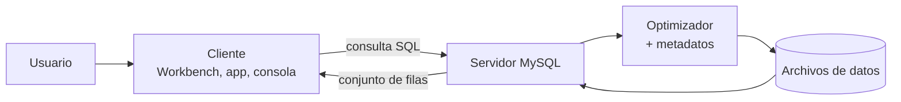

| Componente | Función |
|---|---|
| Cliente | Envía sentencias SQL y muestra resultados |
| Servidor | Interpreta, optimiza, ejecuta y controla el acceso |
| Optimizador | Decide el plan de acceso más eficiente |
| Diccionario de datos | Metadatos: tablas, columnas, tipos, restricciones, permisos |
| Almacenamiento | Archivos donde viven los datos |

> [!important] Por qué importa el optimizador
> SQL es **declarativo**: vos decís *qué* querés, no *cómo* obtenerlo. El optimizador elige índices y orden de join usando los metadatos. Por eso dos consultas equivalentes pueden tener planes distintos.

## 1.3 Motores: Oracle, MySQL y SQLite

| Motor | Ámbito | Características | Uso en la cátedra |
|---|---|---|---|
| **Oracle Database** | Empresarial, gran porte | Instancias, servicios, *tablespaces* (`SYSTEM`, `USERS`), SQL Developer | 5.4 (PL/SQL) |
| **MySQL** | Web y aplicaciones | Licencia dual (Community / Enterprise), Workbench, InnoDB | **5.1 a 5.3** |
| **SQLite** | Pequeñas apps y móviles | Archivo único, sin servidor, sin usuarios | Mención conceptual |

### Oracle (lo mínimo)

- `SYSTEM`: diccionario de datos.
- `USERS`: donde se crean tablas e índices del usuario.
- Se administra con SQL Developer; se crean usuarios y se otorgan permisos.

### MySQL (lo que se usa)

- **Community** (gratuita) y **Enterprise** (paga).
- **MySQL Workbench**: modelado, desarrollo SQL, administración.
- Usuario de práctica: `BD1`, con permisos sobre el esquema `sakila`.

```sql
-- Conectado como BD1
SHOW DATABASES;
USE sakila;
SHOW TABLES;
SELECT COUNT(*) FROM actor;
```

Salida esperada (fragmento):

```text
+--------------------+
| Database           |
+--------------------+
| information_schema |
| mysql              |
| performance_schema |
| sakila             |
| sys                |
+--------------------+
```

```text
+----------------------------+
| Tables_in_sakila           |
+----------------------------+
| actor                      |
| address                    |
| category                   |
| city                       |
| customer                   |
| film                       |
| film_actor                 |
| rental                     |
| ...                        |
+----------------------------+
```

## 1.4 El esquema `sakila`

Es una base de ejemplo de alquiler de películas. Sirve para practicar porque tiene **relaciones 1:N y N:M reales**.

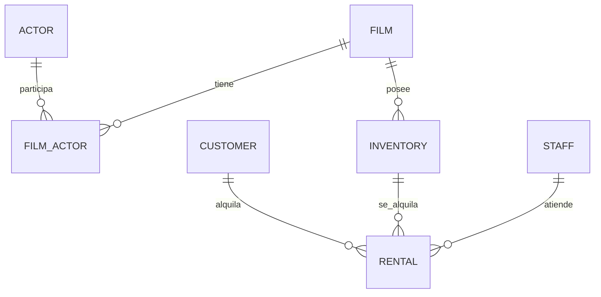

| Tabla | Rol |
|---|---|
| `actor` | Actores |
| `film` | Películas |
| `film_actor` | Tabla puente N:M entre actor y film |
| `customer` | Clientes |
| `inventory` | Copias físicas de cada película |
| `rental` | Alquileres |

> [!tip] Para qué sirve `sakila` en el examen
> Es el ejemplo concreto que la cátedra usa para hablar de claves, relaciones y consultas. Si te preguntan “¿dónde está la tabla puente?”, la respuesta es `film_actor`.

## 1.5 Programa completo: primera conexión

```sql
-- 1. Crear una base propia
CREATE DATABASE IF NOT EXISTS municipio
    CHARACTER SET utf8mb4
    COLLATE utf8mb4_0900_ai_ci;

-- 2. Usarla
USE municipio;

-- 3. Crear una tabla mínima
CREATE TABLE dispositivo (
    id          INT AUTO_INCREMENT PRIMARY KEY,
    codigo      VARCHAR(10) NOT NULL UNIQUE,
    tipo        VARCHAR(20) NOT NULL,
    ubicacion   VARCHAR(100) NOT NULL,
    activo      BOOLEAN NOT NULL DEFAULT TRUE
);

-- 4. Insertar y consultar
INSERT INTO dispositivo (codigo, tipo, ubicacion)
VALUES ('S-01', 'semaforo', 'Av. Belgrano'),
       ('C-01', 'camara', 'Plaza Moreno');

SELECT * FROM dispositivo;
```

Salida:

```text
+----+--------+----------+---------------+--------+
| id | codigo | tipo     | ubicacion     | activo |
+----+--------+----------+---------------+--------+
|  1 | S-01   | semaforo | Av. Belgrano  |      1 |
|  2 | C-01   | camara   | Plaza Moreno  |      1 |
+----+--------+----------+---------------+--------+
```

> [!warning] `BOOLEAN` en MySQL
> Es un alias de `TINYINT(1)`: se muestra `1`/`0`, no `TRUE`/`FALSE`. No es un error; es la implementación.

## Errores que suelen tomar

| Error | Corrección |
|---|---|
| “MySQL es una base de datos” | MySQL es el **motor**; la base es el esquema |
| Confundir SGBD con base | El SGBD es el software; la base, los datos |
| Creer que SQL dice *cómo* | SQL es declarativo: dice *qué* |
| Usar `sakila` como si fuera propia | Es una base de ejemplo, de solo lectura en la cátedra |
| Olvidar `USE` | `ERROR 1046: No database selected` |

## Ejercicios

> [!example] 1. Definiciones
> **Enunciado:** ¿cuál es la diferencia entre base de datos y SGBD?
> **Solución:** la base son los datos estructurados y persistentes; el SGBD es el software que los define, almacena, consulta y controla.

> [!example] 2. Ámbitos
> **Enunciado:** asigná cada motor a su ámbito: Oracle, MySQL, SQLite.
> **Solución:** Oracle → empresarial de gran porte; MySQL → web y aplicaciones; SQLite → apps pequeñas y móviles.

> [!example] 3. Tabla puente
> **Enunciado:** en `sakila`, ¿qué tabla resuelve la relación N:M entre `actor` y `film`?
> **Solución:** `film_actor`, con las claves foráneas `actor_id` y `film_id`.

> [!example] 4. a papel
> **Enunciado:** escribí el DDL mínimo de una tabla `alerta` con id, mensaje, prioridad y fecha.
> **Solución:**
> ```sql
> CREATE TABLE alerta (
>     id        INT AUTO_INCREMENT PRIMARY KEY,
>     mensaje   VARCHAR(200) NOT NULL,
>     prioridad TINYINT NOT NULL,
>     atendida  BOOLEAN NOT NULL DEFAULT FALSE,
>     fecha     DATETIME NOT NULL DEFAULT CURRENT_TIMESTAMP
> );
> ```


<div style="page-break-after: always;"></div>


# 2. Componentes de una aplicación en base de datos

> [!info] Al terminar este capítulo tenés que poder
> - Describir los componentes de una aplicación que usa una base de datos.
> - Explicar la arquitectura cliente-servidor y las capas.
> - Diferenciar los roles de DBA, desarrollador y usuario final.
> - Distinguir servidor, instancia, esquema y catálogo.
> - Usar el diccionario de datos para inspeccionar un esquema.

> [!abstract] Qué debés saber (nivel 1)
> - Una aplicación en BD tiene **presentación**, **lógica** y **datos**.
> - El **servidor** guarda y procesa; el **cliente** pide.
> - **Instancia:** el proceso en ejecución. **Esquema:** el conjunto de objetos de un usuario/base.
> - **Catálogo:** el conjunto de esquemas; en MySQL `information_schema` expone los metadatos.
> - Tres roles: **DBA** (administra), **desarrollador** (crea objetos y consulta), **usuario final** (usa la aplicación).
> - MySQL escucha en el puerto **3306** por defecto.

> [!quote] Cátedra
> La lectura presenta los componentes del motor MySQL y los elementos de una aplicación en base de datos: al instalar el software y ponerlo a disposición somos **administradores**; al conectarnos con el cliente y crear tablas somos **desarrolladores**; al usar una aplicación somos **usuarios finales**.

## 2.1 Las tres capas de una aplicación

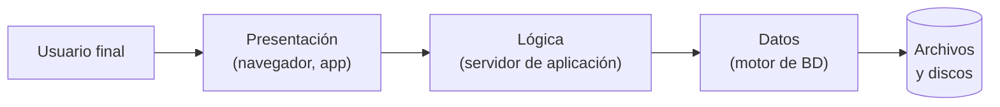

| Capa | Qué hace | Ejemplo |
|---|---|---|
| **Presentación** | Muestra y captura datos | Navegador, app móvil, escritorio |
| **Lógica** | Reglas del negocio, validaciones | Java, PHP, Node |
| **Datos** | Almacena, indexa, garantiza integridad | MySQL, Oracle, SQLite |

> [!important] Dos capas o tres
> En **dos capas** el cliente habla directo con el motor (típico de una herramienta como Workbench). En **tres capas** hay un servidor de aplicación en el medio (típico de un sistema web). El EFIP pide reconocer ambas.

## 2.2 Cliente y servidor

| Concepto | Qué es |
|---|---|
| **Servidor** | Proceso que escucha conexiones, valida usuarios y ejecuta sentencias |
| **Instancia** | El servidor en ejecución, con su memoria y sus procesos |
| **Cliente** | Programa que se conecta, envía SQL y recibe resultados |
| **Conexión** | Sesión autenticada entre cliente y servidor |
| **Puerto** | 3306 en MySQL; 1521 en Oracle; 5432 en PostgreSQL |

```text
Cliente  ---(TCP 3306, usuario/contraseña)--->  Servidor MySQL
   |                                               |
   +--- SQL -------------------------------------->|
   |<-- filas / error -----------------------------+
```

> [!warning] El cliente no "tiene" los datos
> La herramienta gráfica es solo una ventana. Si cerrás el cliente, la base sigue en el servidor. Confundir "mi conexión" con "mi base" es el error que lleva a borrar el esquema equivocado.

## 2.3 Servidor, esquema y catálogo

| Nivel | Qué agrupa | Ejemplo |
|---|---|---|
| **Servidor** | Todas las bases y usuarios | `localhost:3306` |
| **Catálogo** | Conjunto de esquemas | `information_schema` |
| **Esquema** | Tablas, vistas, rutinas de un dominio | `sakila`, `bd1_tp2` |
| **Tabla** | Filas y columnas | `sakila.actor` |

En MySQL, `CREATE DATABASE` y `CREATE SCHEMA` son sinónimos: cada base es un esquema.

> [!tip] La regla de nombres
> Se puede escribir `esquema.tabla` para no depender de la base por defecto: `SELECT * FROM sakila.actor;`. Es la forma de trabajar cuando una consulta toca dos esquemas.

## 2.4 Los tres roles

| Rol | Qué hace | Qué usa |
|---|---|---|
| **DBA** | Instala, crea usuarios, asigna permisos, respalda, ajusta rendimiento | `CREATE USER`, `GRANT`, `BACKUP` |
| **Desarrollador** | Crea tablas, vistas, rutinas; escribe consultas | `CREATE TABLE`, `SELECT`, `INSERT` |
| **Usuario final** | Usa la aplicación; no escribe SQL | Formularios, reportes |

> [!important] El principio de menor privilegio
> Cada rol recibe solo los permisos que necesita. El usuario de la aplicación no debe poder borrar tablas; el DBA no debería usarse para navegar datos.

```sql
-- El DBA crea el usuario de la aplicación
CREATE USER 'app_alertas'@'localhost' IDENTIFIED BY 'clave_segura';
GRANT SELECT, INSERT, UPDATE ON municipio.* TO 'app_alertas'@'localhost';
-- Sin DROP, sin ALTER, sin acceso a otros esquemas
```

## 2.5 Herramientas

| Herramienta | Tipo | Para qué |
|---|---|---|
| **MySQL Workbench** | Gráfica oficial | Modelado, consultas, administración |
| **Cliente `mysql`** | Línea de comandos | Scripts, automatización |
| **phpMyAdmin** | Web | Administración rápida |
| **Navicat / DBeaver** | Gráfica de terceros | Multi-motor |
| **JDBC / drivers** | Biblioteca | Conectar desde Java |

> [!example] Primer contacto con el esquema
> ```sql
> SHOW DATABASES;                     -- qué esquemas hay
> USE sakila;                         -- cuál es el actual
> SHOW TABLES;                        -- qué tablas tiene
> DESCRIBE actor;                     -- columnas, tipos y claves
> SELECT COUNT(*) FROM actor;         -- cuántas filas
> ```
> Ese recorrido —base → tabla → columnas → filas— es el que se hace al llegar a un sistema desconocido.

## 2.6 El diccionario de datos

El motor guarda **metadatos**: datos sobre los datos. En MySQL se consultan en `information_schema`.

```sql
-- Columnas de una tabla
SELECT column_name, data_type, is_nullable, column_key
FROM information_schema.columns
WHERE table_schema = 'sakila' AND table_name = 'actor';

-- Claves foráneas
SELECT constraint_name, table_name, referenced_table_name
FROM information_schema.key_column_usage
WHERE referenced_table_name IS NOT NULL
  AND table_schema = 'sakila';
```

| Vista | Qué muestra |
|---|---|
| `information_schema.tables` | Tablas y vistas |
| `information_schema.columns` | Columnas y tipos |
| `information_schema.key_column_usage` | Claves |
| `information_schema.routines` | Procedimientos y funciones |

> [!important] Para qué sirve en el examen
> Si te dan una base desconocida, el diccionario te dice **qué hay** sin abrir cada tabla. Es la forma técnica de hacer ingeniería reversa.

## 2.7 El esquema `sakila`

La base de ejemplo de MySQL trae un videoclub con 16 tablas: `actor`, `film`, `film_actor`, `customer`, `rental`, `payment`, `store`, `staff`, `inventory`, `category`, `language`, `address`, `city`, `country`, `film_category` y `film_text`.

| Tabla | Rol |
|---|---|
| `film` | Catálogo de películas |
| `actor` | Actores |
| `film_actor` | Relación M:N entre películas y actores |
| `customer` | Clientes |
| `rental` | Alquileres |
| `payment` | Pagos |
| `inventory` | Copias disponibles por tienda |

> [!tip] Por qué se usa Sakila
> Porque tiene relaciones 1:N y M:N reales, claves foráneas y datos suficientes para practicar consultas sin inventar un esquema. Todo el libro usa Sakila cuando necesita un ejemplo con datos.

## 2.8 Método: leer una aplicación en base de datos

| Paso | Pregunta | Dónde se responde |
|---|---|---|
| 1 | ¿Dónde está el motor? | Host, puerto, instancia |
| 2 | ¿Con qué usuario me conecto? | `CREATE USER`, `GRANT` |
| 3 | ¿Qué esquema uso? | `SHOW DATABASES`, `USE` |
| 4 | ¿Qué objetos tiene? | `SHOW TABLES`, diccionario |
| 5 | ¿Cómo se relacionan? | Claves foráneas |
| 6 | ¿Quién hace cada rol? | DBA, desarrollador, aplicación |

## Errores que suelen tomar

| Error | Corrección |
|---|---|
| Confundir base con servidor | El servidor aloja varias bases |
| Confundir esquema con tabla | El esquema agrupa tablas |
| Usar el usuario `root` para la aplicación | Se crea un usuario con permisos mínimos |
| Creer que Workbench "contiene" los datos | Los datos están en el servidor |
| Ignorar el puerto al conectar | 3306 por defecto en MySQL |
| No fijar la base con `USE` | La sentencia falla o usa la base equivocada |

## Ejercicios

> [!example] 1. Capas
> **Enunciado:** una app web con Java y MySQL, ¿cuántas capas tiene?
> **Solución:** tres: navegador (presentación), servidor Java (lógica), MySQL (datos).

> [!example] 2. Roles
> **Enunciado:** ¿quién crea el usuario de la aplicación?
> **Solución:** el DBA, con `CREATE USER` y `GRANT`.

> [!example] 3. Objetos
> **Enunciado:** ¿qué sentencia lista las tablas del esquema actual?
> **Solución:** `SHOW TABLES;`.

> [!example] 4. Metadatos
> **Enunciado:** ¿dónde consultás los tipos de las columnas?
> **Solución:** en `information_schema.columns`.

> [!example] 5. a papel
> **Enunciado:** dibujá una arquitectura de tres capas con sus componentes.
> **Solución:** ver 2.1.


<div style="page-break-after: always;"></div>


# 3. Componentes del modelo relacional

> [!info] Al terminar este capítulo tenés que poder
> - Nombrar y ubicar cada componente de una relación.
> - Calcular grado y cardinalidad.
> - Aplicar el **método de selección de clave primaria** de la cátedra.
> - Enumerar las propiedades de una relación y las reglas de Codd.
> - Distinguir los tres tipos de integridad.

> [!abstract] Qué debés saber (nivel 1)
> - **Relación** = tabla; **tupla** = fila; **atributo** = columna.
> - **Grado** = columnas; **cardinalidad** = filas; **dominio** = valores permitidos.
> - Una relación no tiene tuplas duplicadas ni orden.
> - Clave: **unicidad + minimalidad** (irreducibilidad).
> - Atributo **primo**: pertenece a alguna clave candidata.
> - Tres integridades: **de entidad**, **referencial** y **de dominio/negocio**.

## 3.1 Componentes

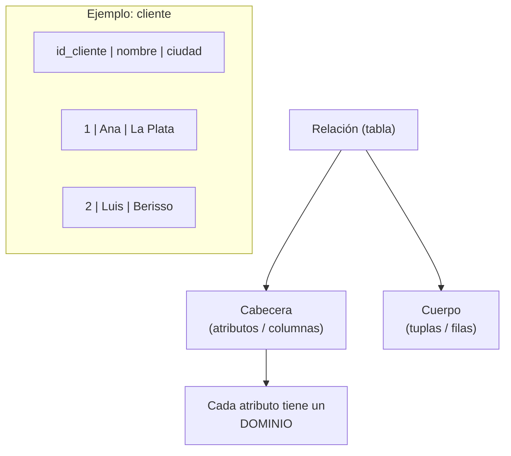

| Concepto | Definición de cátedra | En la práctica |
|---|---|---|
| Relación | Representación bidimensional de filas y columnas | Tabla |
| Tupla | Hecho contenido en una relación; combinación única | Fila |
| Atributo | Propiedad ligada a un dominio | Columna |
| Cabecera | Conjunto de atributos | Nombres de columnas |
| Cuerpo | Conjunto de tuplas | Filas |
| Dato | Intersección de fila y columna | Celda |
| Grado | Número de columnas | 3 en `cliente` |
| Cardinalidad | Número de tuplas | 2 en `cliente` |
| Dominio | Valores posibles del atributo | Texto de 50, entero 1..5 |

> [!important] Grado y cardinalidad
> 📌 **Grado = columnas** (estático, cambia si cambia el esquema). **Cardinalidad = filas** (dinámica, cambia con cada alta o baja).

## 3.2 Propiedades de una relación

| # | Propiedad | Consecuencia |
|---|---|---|
| 1 | **Cada entrada es atómica** | No hay listas ni grupos repetitivos en una celda |
| 2 | **El orden de los atributos no importa** | `(a, b)` y `(b, a)` son la misma relación |
| 3 | **El orden de las tuplas no importa** | No existe “la primera fila” conceptualmente |
| 4 | **No hay tuplas duplicadas** | Una relación es un conjunto |
| 5 | **Cada atributo tiene un dominio** | El DBMS controla los valores |

> [!warning] La tabla no siempre es una relación
> Sin clave primaria ni `UNIQUE`, MySQL **permite** filas duplicadas. En ese momento la tabla deja de cumplir la propiedad 4. La clave no es un adorno: es lo que la hace relación.

## 3.3 Las reglas de Codd

En 1985 Codd publicó 13 reglas (0 a 12) para definir qué es un SGBD verdaderamente relacional. No se memorizan todas; estas son las que se preguntan:

| Regla | Contenido | Idea para el oral |
|---|---|---|
| **0 — Fundación** | Un SGBD relacional debe gestionar datos solo con capacidades relacionales | No vale un sistema “con algo de SQL” |
| **1 — Información** | Toda la información se representa como valores en relaciones | No hay punteros ni estructuras ocultas para el usuario |
| **2 — Acceso garantizado** | Todo dato atómico es accesible por tabla + clave + columna | No hace falta conocer el almacenamiento |
| **3 — Nulos** | Los `NULL` se tratan de forma sistemática | Distintos de 0 y de `''` |
| **4 — Catálogo dinámico** | Los metadatos se guardan como relaciones y se consultan igual | `information_schema` |
| **7 — Operaciones de alto nivel** | Se puede insertar, actualizar y borrar conjuntos completos | `INSERT ... SELECT`, `UPDATE` masivo |
| **8 — Independencia física** | Cambiar el almacenamiento no cambia las aplicaciones | Índices, tablespaces |
| **9 — Independencia lógica** | Cambiar el esquema sin romper lo que preserva información | Vistas |
| **10 — Independencia de integridad** | Las reglas se definen en el catálogo, no en el programa | `CHECK`, `FK` |
| **11 — Independencia de distribución** | La ubicación de los datos no afecta al usuario | Replicación, sharding |
| **12 — No subversión** | No se puede violar una regla relacional con una herramienta de bajo nivel | Sin accesos que salteen las restricciones |

> [!tip] Cómo responder
> “Codd definió trece reglas para certificar que un SGBD es relacional. Las más citadas son la de información (todo se representa en relaciones), la de acceso garantizado, la de nulos sistemáticos, la de catálogo dinámico y las de independencia física y lógica.”

## 3.4 Claves: el método de selección

### Definiciones

| Tipo | Definición | Ejemplo |
|---|---|---|
| **Superclave** | Cualquier conjunto de atributos que identifica de forma única una fila; puede tener atributos de más | `(legajo)`, `(legajo, nombre)`, `(dni, email)` |
| **Candidata** | Atributo o conjunto que cumple **unicidad** y **minimalidad** | `dni`, `legajo`, `email` |
| **Primaria (PK)** | La candidata elegida como identificador principal | `legajo` |
| **Alternativa** | Candidata no elegida | `dni` con `UNIQUE` |
| **Foránea (FK)** | Atributo que es PK en otra tabla | `id_depto` en `empleado` |
| **Compuesta** | Clave de dos o más atributos | `(id_pelicula, id_actor)` |

> [!tip] La cadena: superclave ⊃ candidata ⊃ primaria
> Toda clave candidata **es** una superclave, pero no al revés: `(legajo, nombre)` identifica la fila y sin embargo no es candidata, porque `legajo` solo ya alcanza. La candidata es la superclave **mínima**; la primaria es la candidata que el diseñador elige.

> [!important] Unicidad **y** minimalidad
> `(dni, nombre)` identifica de forma única, pero **no es minimal**: `dni` solo ya alcanza. Una clave candidata no puede tener atributos de más.

### Método de la cátedra (UTN)

Si la entidad tiene **un solo identificador**, ese es la PK. Si tiene **varios**:

1. **Entre un identificador simple y uno compuesto → elegir el simple.**
2. **Entre dos simples → elegir el de menor tamaño físico** (menos bytes).
3. El resto queda como **clave candidata / alternativa** (`UNIQUE`).
4. Se puede usar **autoincremental** como PK subrogada; el usuario solo consulta, no la genera ni modifica.

> [!example] Aplicación
> `Empleado(legajo INT, dni VARCHAR(10), email VARCHAR(100), nombre, apellido)`
>
> - Candidatas: `legajo`, `dni`, `email`.
> - `legajo` es `INT` (4 bytes): la más chica → **PK**.
> - `dni` y `email` quedan `UNIQUE`.

### Criterios complementarios (UNLP/UP)

| Criterio | Por qué |
|---|---|
| Única siempre | No puede repetirse |
| No nula | La PK no admite `NULL` |
| **Estable** | Si cambia, hay que actualizar todas las referencias |
| Simple antes que compuesta | Menos joins y menos errores |
| Sin significado | Un código arbitrario no cambia aunque cambie el negocio |

> [!warning] El error de usar la dirección
> La dirección cambia cuando la persona se muda. Si es PK, hay que actualizar todas las FK que la referencian. Mal candidato. Lo mismo con teléfono o email corporativo.

## 3.5 Reglas de integridad

| Integridad | Regla | Se implementa con |
|---|---|---|
| **De entidad** | La PK no se repite y no es nula | `PRIMARY KEY` |
| **Referencial** | Toda FK existe en la PK referenciada, o es nula si la relación es opcional | `FOREIGN KEY` |
| **De dominio** | El valor pertenece al conjunto permitido | Tipo, `CHECK`, `ENUM`, `NOT NULL` |
| **De negocio** | Reglas propias de la organización | `CHECK`, triggers, aplicación |

```sql
CREATE TABLE alerta (
    id        INT AUTO_INCREMENT PRIMARY KEY,        -- entidad
    prioridad TINYINT NOT NULL,
    atendida  BOOLEAN NOT NULL DEFAULT FALSE,
    id_disp   INT NOT NULL,
    CONSTRAINT ck_prio CHECK (prioridad BETWEEN 1 AND 5),   -- dominio
    CONSTRAINT fk_disp FOREIGN KEY (id_disp)
        REFERENCES dispositivo(id)                          -- referencial
);
```

## 3.6 Diccionario de datos

Es una base de datos que el DBMS mantiene con los **metadatos**: tablas, columnas, tipos, claves, restricciones, índices, usuarios y permisos.

| En MySQL | Qué muestra |
|---|---|
| `SHOW TABLES` | Tablas del esquema |
| `DESCRIBE tabla` | Columnas, tipos, claves |
| `SHOW CREATE TABLE` | DDL completo con restricciones |
| `information_schema.COLUMNS` | Metadatos consultables con SQL |

```sql
SELECT table_name, column_name, data_type, is_nullable
FROM information_schema.columns
WHERE table_schema = 'municipio'
ORDER BY table_name, ordinal_position;
```

> [!important] Para qué sirve en el examen
> Es la prueba de la regla 4 de Codd: **el catálogo se consulta con el mismo lenguaje relacional** que los datos.

## 3.7 Ejemplo completo

```sql
CREATE TABLE departamento (
    id_depto     INT PRIMARY KEY,
    nombre_depto VARCHAR(50) NOT NULL,
    ciudad       VARCHAR(50) NOT NULL
);

CREATE TABLE empleado (
    legajo   INT PRIMARY KEY,
    dni      VARCHAR(10) NOT NULL UNIQUE,
    nombre   VARCHAR(50) NOT NULL,
    apellido VARCHAR(50) NOT NULL,
    sueldo   DECIMAL(10,2) NOT NULL,
    id_depto INT NOT NULL,
    CONSTRAINT ck_sueldo CHECK (sueldo > 0),
    CONSTRAINT fk_depto FOREIGN KEY (id_depto)
        REFERENCES departamento(id_depto)
);
```

| Tabla | Grado | Cardinalidad (ejemplo) |
|---|---|---|
| `departamento` | 3 | 2 |
| `empleado` | 6 | 3 |

## Cómo analizar una tabla en 6 pasos

| Paso | Pregunta | Ejemplo |
|---|---|---|
| 1 | ¿Cuántas columnas? | Grado 6 |
| 2 | ¿Cuántas filas? | Cardinalidad 3 |
| 3 | ¿Cada celda es atómica? | Sí → 1FN |
| 4 | ¿Hay claves candidatas? | `legajo`, `dni` |
| 5 | ¿Cuál es la PK y por qué? | `legajo`: simple y más chica |
| 6 | ¿Qué integridades aplican? | PK, FK, `CHECK` |

## Errores que suelen tomar

| Error | Corrección |
|---|---|
| Invertir grado y cardinalidad | Grado = columnas; cardinalidad = filas |
| Creer que toda tabla es relación | Sin clave puede haber duplicados |
| Elegir una clave compuesta habiendo una simple | La simple |
| Elegir un atributo mutable | Elegir uno estable |
| Confundir candidata con primaria | Todas las primarias son candidatas; no al revés |
| Olvidar `NOT NULL` en la FK obligatoria | La relación queda opcional sin querer |
| Decir que `NULL` es 0 | Es “desconocido” |

## Ejercicios

> [!example] 1. Grado y cardinalidad
> **Enunciado:** `curso(id, nombre, horas, docente)` con 40 filas.
> **Solución:** grado 4; cardinalidad 40.

> [!example] 2. Candidatas
> **Enunciado:** `persona(dni, cuil, email, nombre)`. ¿Qué claves candidatas ves?
> **Solución:** `dni`, `cuil` y `email` si son únicos. Se elige una como PK; las otras quedan `UNIQUE`.

> [!example] 3. Método UTN
> **Enunciado:** `Socio(id_socio INT, nro_socio VARCHAR(20), dni VARCHAR(10))`, los tres únicos. ¿Cuál es la PK?
> **Solución:** `id_socio`, por ser simple y el de menor tamaño físico. `nro_socio` y `dni` quedan alternativas.

> [!example] 4. Propiedades
> **Enunciado:** ¿por qué el modelo formal prohíbe tuplas duplicadas?
> **Solución:** porque una relación es un conjunto y un conjunto no repite elementos. Sin clave, MySQL permite duplicados y la tabla deja de ser relación.

> [!example] 5. Integridad
> **Enunciado:** clasificá: (a) `dni UNIQUE`, (b) `id_depto REFERENCES departamento`, (c) `prioridad BETWEEN 1 AND 5`.
> **Solución:** (a) entidad/unicidad; (b) referencial; (c) dominio.

> [!example] 6. a papel
> **Enunciado:** escribí el DDL de `alerta` con PK, FK y un `CHECK`, e indicá grado y cardinalidad si tiene 5 filas.
> **Solución:** ver 4.2. Grado 4 (`id`, `prioridad`, `id_disp`, `fecha`), cardinalidad 5.


<div style="page-break-after: always;"></div>


# 4. Claves e integridad

> [!info] Al terminar este capítulo tenés que poder
> - Definir PK, FK y restricciones en DDL.
> - Explicar integridad de entidad, referencial y de dominio.
> - Elegir la acción referencial correcta (`CASCADE`, `SET NULL`, etc.).
> - Provocar y reconocer los errores de violación.

> [!abstract] Qué debés saber (nivel 1)
> - **PK**: identifica la fila; única y no nula.
> - **FK**: referencia la PK de otra tabla; puede ser nula si la relación es opcional.
> - **UNIQUE**: único pero admite varios `NULL` (en MySQL).
> - **NOT NULL**, **CHECK**, **DEFAULT**: restricciones de columna.
> - **Integridad referencial**: no puede existir una FK que apunte a una fila inexistente.
> - Acciones: `NO ACTION`, `CASCADE`, `SET NULL`, `SET DEFAULT`.

## 4.1 Los tres tipos de integridad

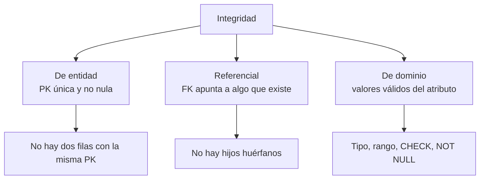

| Integridad | Regla | Se implementa con |
|---|---|---|
| **De entidad** | La PK no se repite ni es nula | `PRIMARY KEY` |
| **Referencial** | Toda FK referencia una fila existente (o es `NULL`) | `FOREIGN KEY` |
| **De dominio** | El valor pertenece al conjunto permitido | Tipo, `CHECK`, `NOT NULL`, `ENUM` |

## 4.2 DDL de las restricciones

```sql
CREATE TABLE dispositivo (
    id        INT AUTO_INCREMENT,
    codigo    VARCHAR(10) NOT NULL,
    tipo      VARCHAR(20) NOT NULL,
    activo    BOOLEAN NOT NULL DEFAULT TRUE,
    prioridad TINYINT NOT NULL DEFAULT 3,

    CONSTRAINT pk_dispositivo PRIMARY KEY (id),
    CONSTRAINT uq_dispositivo_codigo UNIQUE (codigo),
    CONSTRAINT ck_dispositivo_tipo
        CHECK (tipo IN ('semaforo', 'camara', 'sensor')),
    CONSTRAINT ck_dispositivo_prioridad
        CHECK (prioridad BETWEEN 1 AND 5)
);
```

```sql
CREATE TABLE alerta (
    id             INT AUTO_INCREMENT,
    mensaje        VARCHAR(200) NOT NULL,
    prioridad      TINYINT NOT NULL,
    atendida       BOOLEAN NOT NULL DEFAULT FALSE,
    fecha          DATETIME NOT NULL DEFAULT CURRENT_TIMESTAMP,
    id_dispositivo INT NOT NULL,

    CONSTRAINT pk_alerta PRIMARY KEY (id),
    CONSTRAINT fk_alerta_dispositivo
        FOREIGN KEY (id_dispositivo) REFERENCES dispositivo(id)
        ON DELETE CASCADE
        ON UPDATE CASCADE,
    CONSTRAINT ck_alerta_prioridad CHECK (prioridad BETWEEN 1 AND 5)
);
```

> [!warning] El orden de creación importa
> No podés crear `alerta` antes que `dispositivo`: la FK necesita que la tabla referenciada **exista**. Si te equivocás, MySQL da `ERROR 1824: Failed to open the referenced table`.

## 4.3 Clave primaria compuesta

```sql
CREATE TABLE film_actor (
    actor_id SMALLINT UNSIGNED NOT NULL,
    film_id  SMALLINT UNSIGNED NOT NULL,
    CONSTRAINT pk_film_actor PRIMARY KEY (actor_id, film_id),
    CONSTRAINT fk_fa_actor FOREIGN KEY (actor_id)
        REFERENCES actor(actor_id) ON DELETE CASCADE,
    CONSTRAINT fk_fa_film FOREIGN KEY (film_id)
        REFERENCES film(film_id) ON DELETE CASCADE
);
```

| Concepto | Detalle |
|---|---|
| PK compuesta | `(actor_id, film_id)` |
| Cada columna sola | No es única: un actor participa en muchas películas |
| La combinación | Sí es única |
| Uso | Tabla puente de una relación N:M |

> [!important] La PK compuesta y la 2FN
> Cuando la PK es compuesta, aparece el riesgo de **dependencia parcial**: un atributo que depende solo de una parte de la clave. Eso viola 2FN (7. Normalización: de 1FN a 3FN).

## 4.4 Acciones referenciales

| Acción | Qué hace al borrar/actualizar el padre | Cuándo usarla |
|---|---|---|
| `RESTRICT` / `NO ACTION` | **Impide** la operación si hay hijos | Lo más seguro por defecto |
| `CASCADE` | Borra/actualiza los hijos | Dependencia fuerte (detalle de factura) |
| `SET NULL` | Pone la FK en `NULL` | Relación opcional (equipo sin técnico asignado) |
| `SET DEFAULT` | Pone el valor por defecto | Poco frecuente; requiere columna con `DEFAULT` |

```sql
-- Ejemplo: si se borra un dispositivo, sus alertas se borran
ON DELETE CASCADE

-- Ejemplo: si se borra un técnico, la reparación queda sin técnico
ON DELETE SET NULL
```

> [!warning] `CASCADE` no es la opción por defecto
> Si no especificás nada, MySQL usa `RESTRICT`. Un `CASCADE` mal puesto puede borrar media base en cascada. En el examen, justificá la elección.

## 4.5 Violaciones: qué error esperar

```sql
-- 1. PK duplicada
INSERT INTO dispositivo (id, codigo, tipo)
VALUES (1, 'S-01', 'semaforo');
INSERT INTO dispositivo (id, codigo, tipo)
VALUES (1, 'S-02', 'semaforo');
-- ERROR 1062: Duplicate entry '1' for key 'PRIMARY'
```

```sql
-- 2. FK inexistente
INSERT INTO alerta (mensaje, prioridad, id_dispositivo)
VALUES ('Falla', 1, 999);
-- ERROR 1452: Cannot add or update a child row:
-- a foreign key constraint fails
```

```sql
-- 3. CHECK violado
INSERT INTO dispositivo (codigo, tipo)
VALUES ('X-01', 'router');
-- ERROR 3819: Check constraint 'ck_dispositivo_tipo' is violated
```

```sql
-- 4. NOT NULL
INSERT INTO alerta (mensaje, prioridad, id_dispositivo)
VALUES (NULL, 1, 1);
-- ERROR 1048: Column 'mensaje' cannot be null
```

| Error | Restricción violada | Solución |
|---|---|---|
| 1062 | PK o `UNIQUE` | Cambiar el valor duplicado |
| 1452 | FK | Crear el padre o corregir la FK |
| 1451 | FK al borrar el padre | Borrar hijos primero o usar `CASCADE` |
| 3819 | `CHECK` | Corregir el valor |
| 1048 | `NOT NULL` | Enviar un valor |

## 4.6 Programa completo

```sql
CREATE TABLE tecnico (
    id     INT AUTO_INCREMENT PRIMARY KEY,
    nombre VARCHAR(60) NOT NULL
);

CREATE TABLE reparacion (
    id          INT AUTO_INCREMENT PRIMARY KEY,
    fecha       DATE NOT NULL,
    costo       DECIMAL(10,2) NOT NULL DEFAULT 0,
    id_alerta   INT NOT NULL,
    id_tecnico  INT NULL,
    CONSTRAINT fk_rep_alerta FOREIGN KEY (id_alerta)
        REFERENCES alerta(id) ON DELETE CASCADE,
    CONSTRAINT fk_rep_tecnico FOREIGN KEY (id_tecnico)
        REFERENCES tecnico(id) ON DELETE SET NULL,
    CONSTRAINT ck_rep_costo CHECK (costo >= 0)
);
```

```sql
INSERT INTO tecnico (nombre) VALUES ('Luis'), ('Eva');

INSERT INTO reparacion (fecha, costo, id_alerta, id_tecnico)
VALUES ('2026-11-18', 15000, 1, 1),
       ('2026-11-19', 0, 2, NULL);      -- todavía sin técnico

SELECT r.id, r.fecha, r.costo, t.nombre AS tecnico
FROM reparacion r
LEFT JOIN tecnico t ON r.id_tecnico = t.id;
```

Salida:

```text
+----+------------+----------+---------+
| id | fecha      | costo    | tecnico |
+----+------------+----------+---------+
|  1 | 2026-11-18 | 15000.00 | Luis    |
|  2 | 2026-11-19 |     0.00 | NULL    |
+----+------------+----------+---------+
```

> [!tip] `LEFT JOIN` para no perder los huérfanos
> Con `INNER JOIN`, la reparación sin técnico **desaparece**. Con `LEFT JOIN`, se conserva y muestra `NULL`. Es la consulta que se pregunta cuando hay FK opcional.

## Cómo trazar la integridad

| Paso | Pregunta | En el ejemplo |
|---|---|---|
| 1 | ¿Qué tabla es el padre? | `dispositivo`, `alerta`, `tecnico` |
| 2 | ¿Qué tabla es el hijo? | `alerta`, `reparacion` |
| 3 | ¿La relación es obligatoria? | `alerta.id_dispositivo`: sí (`NOT NULL`) |
| 4 | ¿Puede quedar huérfana? | `reparacion.id_tecnico`: sí (`NULL`) |
| 5 | ¿Qué acción elegir? | `CASCADE` para alertas; `SET NULL` para técnico |

## Errores que suelen tomar

| Error | Corrección |
|---|---|
| Crear el hijo antes que el padre | Crear primero el padre |
| FK con tipo distinto al de la PK referenciada | Mismo tipo y signo (`INT UNSIGNED`) |
| Poner `CASCADE` en todo | Elegir según la dependencia real |
| Creer que `UNIQUE` admite un solo `NULL` | MySQL admite varios `NULL` en `UNIQUE` |
| Confundir PK con `UNIQUE` | PK = única + no nula + una por tabla |
| Olvidar `NOT NULL` en la FK obligatoria | La relación quedaría opcional sin querer |

## Ejercicios

> [!example] 1. Restricciones
> **Enunciado:** escribí el DDL de `sensor(id, codigo, rango_min, rango_max)` con PK, código único y `CHECK` de rango.
> **Solución:**
> ```sql
> CREATE TABLE sensor (
>     id        INT AUTO_INCREMENT PRIMARY KEY,
>     codigo    VARCHAR(10) NOT NULL UNIQUE,
>     rango_min DECIMAL(6,2) NOT NULL,
>     rango_max DECIMAL(6,2) NOT NULL,
>     CONSTRAINT ck_rango CHECK (rango_max > rango_min)
> );
> ```

> [!example] 2. FK opcional
> **Enunciado:** ¿qué acción referencial usás si al borrar un técnico la reparación debe conservarse?
> **Solución:** `ON DELETE SET NULL`, y la columna `id_tecnico` debe admitir `NULL`.

> [!example] 3. Error
> **Enunciado:** `ERROR 1452` al insertar una alerta. ¿Qué pasó?
> **Solución:** el `id_dispositivo` no existe en `dispositivo`. Se violó la integridad referencial.

> [!example] 4. PK compuesta
> **Enunciado:** ¿por qué `film_actor` necesita PK compuesta?
> **Solución:** porque ni `actor_id` ni `film_id` son únicos por separado; la combinación sí identifica cada participación.

> [!example] 5. a papel
> **Enunciado:** escribí el DDL de `dispositivo` y `alerta` con `ON DELETE CASCADE`, y explicá qué pasa al borrar el dispositivo 1.
> **Solución:** ver 4.2. Al borrar `dispositivo` 1, se borran **todas** sus alertas y, si hubiera `reparacion` con `CASCADE` sobre `alerta`, también esas reparaciones.


<div style="page-break-after: always;"></div>


# 5. Álgebra relacional

> [!info] Al terminar este capítulo tenés que poder
> - Aplicar las operaciones básicas **y** las adicionales (join natural, división, asignación, agregación).
> - Resolver una consulta con el **método de 7 pasos**.
> - Expresar “todos los que…” con división o doble negación.
> - Traducir cualquier expresión a SQL.

> [!abstract] Qué debés saber (nivel 1)
> - Toda operación devuelve **otra relación** (propiedad de cierre).
> - **σ** filtra filas; **π** elige columnas y **elimina duplicados**; **ρ** renombra.
> - **∪**, **−**, **∩** exigen relaciones **compatibles** (mismo grado y dominios).
> - **×** combina todo con todo: columnas se suman, filas se multiplican.
> - **⋈** es selección sobre producto por igualdad de claves.
> - **÷** responde “todos los que…”.
> - **←** guarda un resultado intermedio.

## 5.1 Qué es y por qué importa

> [!quote] Definición de cátedra
> **Álgebra relacional:** conjunto de operaciones básicas del modelo relacional que permite especificar peticiones fundamentales de recuperación.

Tres razones de su importancia (las enumera la cátedra):

1. Es el **fundamento formal** del modelo relacional.
2. Es la base de la **implementación y optimización** de consultas.
3. Sus conceptos se **incorporaron a SQL**.

> [!important] Nunca devuelve “un dato suelto”
> Toda operación devuelve una **relación**. Si el resultado es un solo valor, la relación es de 1×1. Esa es la diferencia con una función.

## 5.2 Clasificación de operaciones

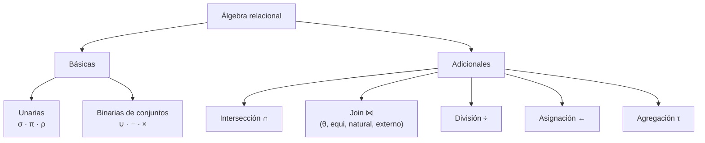

| Grupo | Operaciones |
|---|---|
| **Básicas unarias** | Selección `σ`, proyección `π`, renombre `ρ` |
| **Básicas binarias** | Unión `∪`, diferencia `−`, producto cartesiano `×` |
| **Adicionales** | Intersección `∩`, join `⋈`, división `÷`, asignación `←`, agregación `τ` |

## 5.3 Base de ejemplo

**EMPLEADO**

| legajo | nombre | apellido | id_depto | sueldo |
|---:|---|---|---:|---:|
| 1001 | Ana | Pérez | 10 | 950000 |
| 1002 | Luis | Gómez | 10 | 870000 |
| 1003 | Eva | Díaz | 20 | 720000 |
| 1004 | Juan | Sosa | 30 | 610000 |

**DEPARTAMENTO**

| id_depto | nombre_depto | ciudad |
|---:|---|---|
| 10 | Sistemas | La Plata |
| 20 | Compras | Berisso |
| 30 | Ventas | Ensenada |
| 40 | Legales | La Plata |

**PROYECTO**

| id_proyecto | nombre | id_depto | presupuesto |
|---:|---|---:|---:|
| 1 | Portal | 10 | 5000000 |
| 2 | Stock | 20 | 2000000 |
| 3 | App | 10 | 3500000 |

**ASIGNACION**

| legajo | id_proyecto | horas |
|---:|---:|---:|
| 1001 | 1 | 120 |
| 1001 | 3 | 80 |
| 1002 | 1 | 60 |
| 1003 | 2 | 200 |

## 5.4 Selección `σ`

$$\sigma_{predicado}(R)$$

Filtra **tuplas**. El predicado compara un atributo con un valor u otro atributo; **no compara tablas**.

```text
σ sueldo > 800000 (EMPLEADO)
```

| legajo | nombre | apellido | id_depto | sueldo |
|---:|---|---|---:|---:|
| 1001 | Ana | Pérez | 10 | 950000 |
| 1002 | Luis | Gómez | 10 | 870000 |

```text
σ (id_depto = 4) OR (sueldo > 60000) (EMPLEADO)
```

| Operador | Significado |
|---|---|
| `=`, `≠`, `<`, `≤`, `>`, `≥` | Comparación |
| `∧` / `AND` | Y |
| `∨` / `OR` | O |
| `¬` / `NOT` | Negación |

> [!tip] Regla de optimización
> Aplicá la selección **lo antes posible**: reduce filas antes de los joins y del producto.

## 5.5 Proyección `π`

$$\pi_{atributos}(R)$$

Elige **columnas** y **elimina duplicados**.

```text
π nombre, apellido (EMPLEADO)
```

```text
π id_depto (EMPLEADO)
```

Resultado: `10`, `20`, `30`. **Tres** filas, no cuatro: el `10` aparece una sola vez.

> [!warning] La diferencia con SQL
> `SELECT id_depto FROM empleado` devuelve **4** filas (con repetidos). El equivalente exacto es `SELECT DISTINCT`. La proyección del álgebra siempre es `DISTINCT`.

## 5.6 Renombre `ρ`

Tres formas válidas:

```text
ρ NuevoNombre (R)
ρ NuevoNombre(A1, A2, …, An) (R)
ρ (A1, A2, …, An) (R)
```

| Uso | Ejemplo |
|---|---|
| Cambiar el nombre de la relación | `ρ Jefes (EMPLEADO)` |
| Cambiar atributos | `ρ (legajo, nom, ap, depto, sueldo) (EMPLEADO)` |
| Evitar ambigüedad en autojuntura | `EMPLEADO e ⋈_{e.id_jefe = j.legajo} ρ j (EMPLEADO)` |

## 5.7 Operaciones de conjuntos

### Unión `∪`

```text
π ciudad (DEPARTAMENTO) ∪ π ciudad (PROVEEDOR)
```

- Exige **compatibilidad**: mismo grado y dominios correspondientes.
- **Elimina duplicados**.

### Diferencia `−`

```text
π ciudad (DEPARTAMENTO) − π ciudad (PROVEEDOR)
```

Devuelve las tuplas de la primera que **no** están en la segunda.

### Intersección `∩`

```text
π ciudad (DEPARTAMENTO) ∩ π ciudad (PROVEEDOR)
```

Se puede expresar solo con diferencia:

$$R \cap S = R - (R - S)$$

> [!important] Compatibilidad de unión
> Mismo **número** de columnas y dominios **correspondientes** en el mismo orden. `(nombre, sueldo)` no es compatible con `(sueldo, nombre)`.

## 5.8 Producto cartesiano `×`

```text
EMPLEADO × DEPARTAMENTO
```

| Regla | Fórmula |
|---|---|
| Columnas del resultado | columnas de R + columnas de S |
| Filas del resultado | filas de R × filas de S |
| Ambigüedad | usar `tabla.columna` |

Con 4 empleados y 4 departamentos → **16 filas**.

> [!warning] El producto solo no sirve
> Combina a Ana con Compras, que no tiene sentido. Para que sirva hay que **filtrar por la igualdad de claves**: eso es el join.

## 5.9 Join `⋈`

### Join theta y equijoin

$$R \bowtie_{\theta} S = \sigma_{\theta}(R \times S)$$

```text
EMPLEADO ⋈ EMPLEADO.id_depto = DEPARTAMENTO.id_depto DEPARTAMENTO
```

Cuando el operador es `=`, es **equijoin**. El atributo común aparece **dos veces** salvo que se proyecte.

### Join natural `⋈`

Iguala **todos los atributos comunes** y los deja **una sola vez** en la cabecera.

```text
EMPLEADO ⋈ DEPARTAMENTO
```

| legajo | nombre | apellido | sueldo | id_depto | nombre_depto | ciudad |
|---:|---|---|---:|---:|---|---|
| 1001 | Ana | Pérez | 950000 | 10 | Sistemas | La Plata |
| 1002 | Luis | Gómez | 870000 | 10 | Sistemas | La Plata |
| 1003 | Eva | Díaz | 720000 | 20 | Compras | Berisso |
| 1004 | Juan | Sosa | 610000 | 30 | Ventas | Ensenada |

> [!important] Natural join vs. producto cartesiano
> Mismas **columnas** (salvo la común que se fusiona), muchas **menos filas**. El producto devuelve 16; el natural, 4.

### Join externo (outer join)

Conserva las tuplas que **no** tienen par, rellenando con `NULL`.

| Tipo | Conserva |
|---|---|
| `⟕` izquierdo | Todas las de la izquierda |
| `⟖` derecho | Todas las de la derecha |
| `⟗` completo | Todas las de ambas |

```text
EMPLEADO ⟕ DEPARTAMENTO
```

Sirve para “empleados **sin** departamento”.

## 5.10 División `÷`

Responde preguntas con **“todos”**.

$$R \div S$$

Devuelve los valores de `R` que se relacionan con **todos** los de `S`. La cabecera de `S` debe estar incluida en la de `R`.

**Consulta:** “legajos que trabajan en **todos** los proyectos del departamento 10”.

```text
DIVIDENDO = π legajo, id_proyecto (ASIGNACION)
DIVISOR   = π id_proyecto ( σ id_depto = 10 (PROYECTO) )
RESULTADO = DIVIDENDO ÷ DIVISOR
```

| legajo |
|---:|
| 1001 |

Porque 1001 trabaja en 1 y 3, que son los dos proyectos del depto 10. 1002 solo en 1; 1003 en 2.

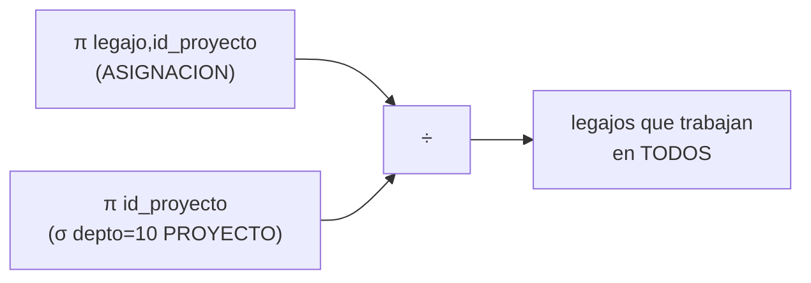

> [!important] Cómo reconocerlo
> Palabras clave: **“todos”**, **“cada uno de”**, **“no existe ninguno que no”**. Si el enunciado se puede reescribir como “no hay un proyecto del depto 10 en el que no trabaje”, es división.

## 5.11 Asignación `←`

Guarda un resultado intermedio y mejora la legibilidad.

```text
SISTEMAS ← σ nombre_depto = 'Sistemas' (DEPARTAMENTO)
EMP_SISTEMAS ← π legajo, nombre (EMPLEADO ⋈ SISTEMAS)
```

| Ventaja | Detalle |
|---|---|
| Legibilidad | Evita expresiones anidadas gigantes |
| Reutilización | Usás el temporal en varias consultas |
| Equivalencia SQL | `WITH nombre AS (...)` |

> [!tip] En el examen
> Si la expresión se vuelve ilegible, usá asignaciones. El tribunal valora el orden.

## 5.12 Agregación y funciones `τ`

Aplica funciones de grupo a conjuntos de tuplas.

```text
τ ciudad; COUNT(legajo), AVG(sueldo) (EMPLEADO ⋈ DEPARTAMENTO)
```

| Función | Resultado |
|---|---|
| `COUNT` | Cantidad |
| `SUM` | Suma |
| `AVG` | Promedio |
| `MIN` / `MAX` | Mínimo / máximo |

| ciudad | COUNT(legajo) | AVG(sueldo) |
|---|---:|---:|
| La Plata | 2 | 910000 |
| Berisso | 1 | 720000 |
| Ensenada | 1 | 610000 |

> [!warning] Sin `GROUP BY` no hay grupos
> Si no indicás atributos de agrupación, la función se aplica a **toda** la relación y devuelve una fila.

## 5.13 Actualizaciones en álgebra

| Operación | Cómo se expresa |
|---|---|
| **Alta** | `R ← R ∪ {tupla}` |
| **Baja** | `R ← R − {tupla}` o `R ← R − σ_cond (R)` |
| **Modificación** | `δ atributo = "nuevo valor" (R)` |

```text
-- Alta de un empleado
EMPLEADO ← EMPLEADO ∪ {(1005, 'Ana', 'Ruiz', 10, 800000)}

-- Baja de los empleados con sueldo menor a 700000
EMPLEADO ← EMPLEADO − σ sueldo < 700000 (EMPLEADO)

-- Modificación de sueldo
δ sueldo = 1000000 ( σ legajo = 1001 (EMPLEADO) )
```

> [!important] Por qué se pregunta
> Demuestra que el álgebra no es solo de consulta: también permite expresar actualizaciones de conjunto.

## 5.14 Método de resolución en 7 pasos

| Paso | Pregunta | Acción |
|---|---|---|
| 1 | ¿Qué columnas quiero **ver**? | Es la proyección final |
| 2 | ¿Qué tablas contienen esos datos? | Listarlas |
| 3 | ¿Cómo se conectan? | Camino de joins por PK-FK |
| 4 | Escribir el **join** (o producto) | Base de la expresión |
| 5 | Aplicar **selecciones** lo antes posible | Filtros |
| 6 | **Proyectar** las columnas finales | `π` |
| 7 | Verificar **cardinalidad** y duplicados | ¿Tiene sentido? |

> [!example] Aplicación
> “Nombre y apellido de los empleados de La Plata.”
>
> 1. Salida: `nombre`, `apellido`.
> 2. Tablas: `EMPLEADO`, `DEPARTAMENTO`.
> 3. Camino: `id_depto`.
> 4. Join: `EMPLEADO ⋈ DEPARTAMENTO`.
> 5. Filtro: `σ ciudad = 'La Plata'`.
> 6. Proyección: `π nombre, apellido`.
> 7. Resultado: 3 filas (Ana, Luis, Juan).
>
> ```text
> π nombre, apellido ( σ ciudad = 'La Plata' ( EMPLEADO ⋈ DEPARTAMENTO ) )
> ```

## 5.15 Traducción a SQL

| Álgebra | SQL |
|---|---|
| `σ cond (R)` | `SELECT * FROM R WHERE cond` |
| `π a, b (R)` | `SELECT DISTINCT a, b FROM R` |
| `R ∪ S` | `UNION` |
| `R − S` | `EXCEPT` / `NOT IN` |
| `R ∩ S` | `INTERSECT` / `IN` |
| `R × S` | `FROM R, S` sin condición |
| `R ⋈ S` | `FROM R JOIN S ON ...` |
| `R ⟕ S` | `LEFT JOIN` |
| `R ÷ S` | Doble `NOT EXISTS` |
| `τ grupo; f(x) (R)` | `GROUP BY` + `HAVING` |
| `WITH x AS (...)` | Asignación `←` |

## Errores que suelen tomar

| Error | Corrección |
|---|---|
| Decir que `π` conserva duplicados | Los elimina |
| Confundir `σ` con `π` | σ = filas; π = columnas |
| Unir relaciones con distinto grado | No compatibles |
| Calcular mal la cardinalidad de `×` | Es el producto |
| Creer que el join es primitivo | Es `σ` sobre `×` |
| Olvidar `ON` y llamarlo join | Es producto cartesiano |
| Usar `÷` con cabecera no incluida | El divisor debe estar contenido |
| Sumar sin agrupar | Devuelve una sola fila |

## Ejercicios

> [!example] 1. Selección
> **Enunciado:** empleados con sueldo mayor a 800.000.
> **Solución:** `σ sueldo > 800000 (EMPLEADO)` → Ana y Luis.

> [!example] 2. Proyección
> **Enunciado:** ¿cuántas filas devuelve `π id_depto (EMPLEADO)`?
> **Solución:** 3 (`10`, `20`, `30`).

> [!example] 3. Producto
> **Enunciado:** 4 empleados y 4 departamentos. ¿Filas y columnas del producto?
> **Solución:** 16 filas y suma de columnas (5 + 3 = 8).

> [!example] 4. Natural join
> **Enunciado:** `EMPLEADO ⋈ DEPARTAMENTO`. ¿Cuántas filas y qué pasa con `id_depto`?
> **Solución:** 4 filas (un empleado por departamento existente) y `id_depto` aparece una sola vez.

> [!example] 5. División
> **Enunciado:** legajos que trabajan en todos los proyectos.
> **Solución:** `π legajo, id_proyecto (ASIGNACION) ÷ π id_proyecto (PROYECTO)` → 1001 (trabaja en 1 y 3; los otros no en todos).

> [!example] 6. Agregación
> **Enunciado:** cantidad de empleados por ciudad.
> **Solución:** `τ ciudad; COUNT(legajo) (EMPLEADO ⋈ DEPARTAMENTO)`.

> [!example] 7. a papel
> **Enunciado:** nombre de los proyectos del departamento de Ana.
> **Solución:**
> ```text
> π PROYECTO.nombre (
>   σ EMPLEADO.nombre = 'Ana' (
>     σ PROYECTO.id_depto = EMPLEADO.id_depto (EMPLEADO × PROYECTO)
>   )
> )
> ```
> O mejor, con asignaciones:
> ```text
> ANA ← σ nombre = 'Ana' (EMPLEADO)
> PROY_ANA ← PROYECTO ⋈ ANA
> π nombre (PROY_ANA)
> ```


<div style="page-break-after: always;"></div>


# Cierre del Módulo 1 — Motores y modelo relacional

> [!info] Qué hacer con este archivo
> Verificación, no contenido nuevo. Si fallás en algo, volvé al capítulo antes de seguir.

## Checklist del Módulo 1

| Puedo… | Capítulo | ✔ |
|---|---|---|
| Diferenciar base de datos, SGBD y motor | Cap. 1 | ☐ |
| Explicar cliente-servidor y el rol del optimizador | Cap. 1 | ☐ |
| Describir las capas de una aplicación en BD | Cap. 2 | ☐ |
| Diferenciar servidor, instancia, esquema y catálogo | Cap. 2 | ☐ |
| Asignar permisos con menor privilegio | Cap. 2 | ☐ |
| Consultar el diccionario de datos | Cap. 2 | ☐ |
| Ubicar Oracle, MySQL y SQLite | Cap. 1 | ☐ |
| Nombrar cada componente de una relación | Cap. 3 | ☐ |
| Calcular grado y cardinalidad | Cap. 3 | ☐ |
| Elegir una clave primaria y justificarla | Cap. 3 | ☐ |
| Aplicar σ, π, ρ, ×, ∪, − | Cap. 5 | ☐ |
| Construir un join desde el producto | Cap. 5 | ☐ |
| Usar join natural, división, asignación y agregación | Cap. 5 | ☐ |
| Expresar “todos” con división | Cap. 5 | ☐ |
| Explicar las reglas de Codd y el diccionario | Cap. 3 | ☐ |
| Escribir PK, FK, `UNIQUE`, `CHECK` | Cap. 4 | ☐ |
| Elegir la acción referencial correcta | Cap. 4 | ☐ |
| Reconocer errores 1062, 1451, 1452, 3819 | Cap. 4 | ☐ |

## Tabla de diferencias

| A | B | Diferencia central |
|---|---|---|
| Base de datos | SGBD | Datos vs. software que los administra |
| Relación | Tabla | Concepto formal vs. implementación (que puede repetir filas) |
| Grado | Cardinalidad | Columnas vs. filas |
| Clave candidata | Clave primaria | Todas las que identifican vs. la elegida |
| PK | `UNIQUE` | No nula y una sola vs. admite `NULL` y varias |
| `σ` | `π` | Filtra filas vs. elige columnas |
| `×` | Join | Todas las combinaciones vs. solo las que cumplen la igualdad |
| `RESTRICT` | `CASCADE` | Impide borrar vs. borra en cascada |

## Ejercicio integrador del Módulo 1

> [!example] Enunciado (25 minutos)
> El municipio tiene dispositivos (semáforos y cámaras) y alertas. Se pide:
> 1. Identificar entidades, atributos y claves.
> 2. Escribir el DDL con PK, FK y dos `CHECK`.
> 3. Expresar en álgebra: “código de los dispositivos que tienen alertas de prioridad 1”.
> 4. Escribir el SQL equivalente.

> [!success] Solución
> **1. Modelo**
>
> | Entidad | Atributos | PK |
> |---|---|---|
> | `dispositivo` | id, codigo, tipo, ubicacion, activo | `id` |
> | `alerta` | id, mensaje, prioridad, fecha, id_dispositivo | `id` |
>
> **2. DDL**
> ```sql
> CREATE TABLE dispositivo (
>     id        INT AUTO_INCREMENT PRIMARY KEY,
>     codigo    VARCHAR(10) NOT NULL UNIQUE,
>     tipo      VARCHAR(20) NOT NULL,
>     ubicacion VARCHAR(100) NOT NULL,
>     activo    BOOLEAN NOT NULL DEFAULT TRUE,
>     CONSTRAINT ck_tipo CHECK (tipo IN ('semaforo','camara'))
> );
>
> CREATE TABLE alerta (
>     id             INT AUTO_INCREMENT PRIMARY KEY,
>     mensaje        VARCHAR(200) NOT NULL,
>     prioridad      TINYINT NOT NULL,
>     atendida       BOOLEAN NOT NULL DEFAULT FALSE,
>     fecha          DATETIME NOT NULL DEFAULT CURRENT_TIMESTAMP,
>     id_dispositivo INT NOT NULL,
>     CONSTRAINT ck_prioridad CHECK (prioridad BETWEEN 1 AND 5),
>     CONSTRAINT fk_alerta_disp FOREIGN KEY (id_dispositivo)
>         REFERENCES dispositivo(id) ON DELETE CASCADE
> );
> ```
> **3. Álgebra**
> ```text
> π codigo ( σ prioridad = 1 ( DISPOSITIVO ⋈ ALERTA ) )
> ```
> **4. SQL**
> ```sql
> SELECT DISTINCT d.codigo
> FROM dispositivo d
> JOIN alerta a ON a.id_dispositivo = d.id
> WHERE a.prioridad = 1;
> ```
>
> **Qué evalúa el tribunal:** que la FK esté en el lado N, que el `CHECK` limite valores, que el join use la clave y que la proyección no repita códigos.

## Oral del Módulo 1 (8 preguntas)

> [!question] 1. ¿Qué es una base de datos?
> Conjunto de datos estructurados y definidos por un proceso, que evita redundancia y se almacena en un medio masivo.

> [!question] 2. ¿Qué diferencia hay entre grado y cardinalidad?
> El grado es la cantidad de columnas; la cardinalidad, la cantidad de filas.

> [!question] 3. ¿Qué es un dominio?
> El conjunto de valores permitidos para un atributo.

> [!question] 4. ¿Qué es una clave candidata?
> Un conjunto de atributos que identifica de forma única cada fila. La primaria es la candidata elegida.

> [!question] 5. ¿Por qué conviene una clave estable?
> Porque si cambia, hay que actualizar todas las referencias; se rompe la integridad y se complica el mantenimiento.

> [!question] 6. ¿Qué diferencia hay entre `σ` y `π`?
> `σ` filtra filas por una condición; `π` elige columnas y elimina duplicados.

> [!question] 7. ¿Qué es el join en álgebra relacional?
> Una selección sobre el producto cartesiano, con la condición de igualdad entre claves.

> [!question] 8. ¿Qué es la integridad referencial?
> La garantía de que toda clave foránea referencia una fila existente (o es nula si la relación es opcional).


<div style="page-break-after: always;"></div>


# 6. Análisis y diseño de un modelo de datos

> [!info] Al terminar este capítulo tenés que poder
> - Pasar de un enunciado a entidades, atributos y relaciones.
> - Decidir si algo es atributo, entidad o relación.
> - Determinar cardinalidad y participación.
> - Justificar los valores nulos.

> [!abstract] Qué debés saber (nivel 1)
> - **Entidad:** clase de objetos distinguibles; se convierte en tabla.
> - **Atributo:** propiedad de la entidad; se convierte en columna.
> - Tipos: simple, compuesto, monovalorado, multivalorado, derivado.
> - **Cardinalidad:** 1:1, 1:M, M:N.
> - **Participación:** total (obligatoria) o parcial (opcional).
> - Un **nulo** puede ser “no aplica”, “desconocido” o “perdido”.

## 6.1 El proceso de diseño

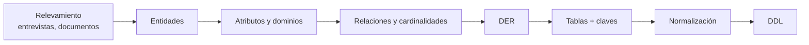

| Paso | Pregunta clave | Producto |
|---|---|---|
| 1 | ¿Qué cosas tienen identidad propia? | Entidades |
| 2 | ¿Qué datos las describen? | Atributos y dominios |
| 3 | ¿Cómo se vinculan? | Relaciones y cardinalidades |
| 4 | ¿Qué es obligatorio? | Participación |
| 5 | ¿Cómo se transforma? | Tablas, PK y FK |
| 6 | ¿Hay redundancia? | Formas normales |

## 6.2 Entidades y atributos

### Cómo reconocer una entidad

Un sustantivo es entidad si:

1. Tiene **identidad propia** (se puede distinguir uno de otro).
2. Tiene **atributos** que le pertenecen.
3. **Participa en relaciones**.
4. **Sobrevive** aunque no exista otra cosa.

> [!example] En el caso del municipio
> “El municipio registra semáforos y cámaras instalados en la vía pública, y las alertas que generan.”
>
> | Sustantivo | ¿Entidad? | Motivo |
> |---|---|---|
> | Municipio | No (en este alcance) | Es el contexto, no un dato a registrar |
> | Semáforo | **Sí** | Tiene código, ubicación, estado |
> | Cámara | **Sí** | Ídem |
> | Alerta | **Sí** | Tiene fecha, prioridad y ciclo de vida |
> | Ubicación | Depende | Atributo si es una dirección simple; entidad si tiene barrio, zona, coordenadas y responsable |
> | Estado | Atributo | Texto acotado (`ACTIVO`, `FUERA_DE_SERVICIO`) |

> [!important] La regla que resuelve todo
> **¿Necesito guardar datos de esto?** Si sí, es entidad. **¿Solo lo nombro?** Es atributo.

### Tipos de atributo

| Tipo | Definición | Ejemplo | Cómo se implementa |
|---|---|---|---|
| Simple | Un solo valor atómico | `edad` | Columna |
| Compuesto | Se descompone en partes | `direccion` (calle, número, piso) | Varias columnas o tabla |
| Monovalorado | Un valor por instancia | `fecha_nacimiento` | Columna |
| **Multivalorado** | Varios valores | `telefonos` | **Tabla aparte** |
| Derivado | Se calcula | `edad` a partir de la fecha | No se guarda (o se materializa) |

> [!warning] El error de “teléfono1, teléfono2, teléfono3”
> Es la violación de 1FN más común. Si ponés columnas numeradas, estás escondiendo un grupo repetitivo. Solución: tabla `telefono(id_persona, numero, tipo)`.

### Valores nulos

| Situación | Significado | Ejemplo |
|---|---|---|
| No aplica | El atributo no corresponde a esa instancia | `fecha_baja` en un dispositivo activo |
| Desconocido | Existe pero no se conoce | `dni` de un visitante |
| Perdido | Existía y no se conservó | `fecha_instalacion` de un equipo viejo |

> [!important] Nulo ≠ cero ≠ cadena vacía
> `NULL` significa “no hay valor”. `0` es un valor. `''` es una cadena vacía. Confundirlos produce promedios y conteos incorrectos.

## 6.3 Relaciones y cardinalidad

| Cardinalidad | Significado | Ejemplo | Implementación |
|---|---|---|---|
| **1:1** | Uno con uno | Persona–Pasaporte | FK con `UNIQUE` en uno de los lados |
| **1:N** | Uno con muchos | Departamento–Empleado | FK en el lado **N** |
| **M:N** | Muchos con muchos | Película–Actor | **Tabla puente** |

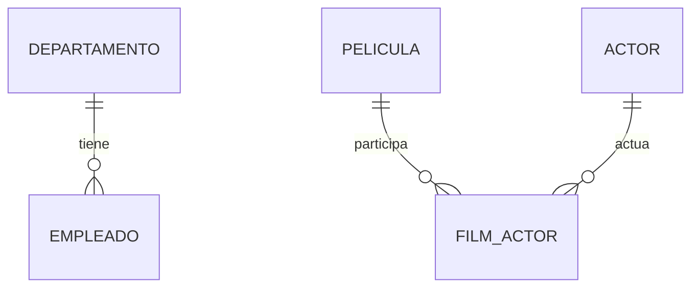

### Participación

| Participación | Significado | Notación | Ejemplo |
|---|---|---|---|
| **Total** | Obligatoria | `1..*` o línea doble | Toda alerta pertenece a un dispositivo |
| **Parcial** | Opcional | `0..*` o `0..1` | Un técnico puede no tener reparaciones |

> [!important] Leer `mín..máx`
> `0..1` = opcional, como máximo uno.
> `1..1` = obligatorio y exactamente uno.
> `0..*` = opcional, muchos.
> `1..*` = obligatorio, al menos uno.

## 6.4 Aplicar el método al caso

**Enunciado:** “El municipio registra dispositivos (semáforos y cámaras) con código único, ubicación y estado. Cada dispositivo genera alertas con fecha, mensaje y prioridad. Una alerta puede derivar en una reparación, que tiene fecha, técnico y costo. Un técnico puede hacer muchas reparaciones.”

| Paso | Resultado |
|---|---|
| Entidades | `DISPOSITIVO`, `ALERTA`, `REPARACION`, `TECNICO` |
| Atributos | `codigo`, `ubicacion`, `estado`; `fecha`, `mensaje`, `prioridad`; `fecha`, `costo`; `nombre`, `matricula` |
| Relaciones | Dispositivo 1:N Alerta · Alerta 1:1 Reparación · Técnico 1:N Reparación |
| Participación | Alerta→Dispositivo total; Reparación→Técnico parcial |
| Claves | `id` en cada tabla; `codigo` único en dispositivo |

> [!tip] Reparación 1:1 con Alerta
> Si cada alerta puede tener **como máximo una** reparación, la FK va en `reparacion` con `UNIQUE`. Si pudiera tener varias, sería 1:N y la FK va sin `UNIQUE`.

## 6.5 Programa completo

```sql
CREATE TABLE tecnico (
    id        INT AUTO_INCREMENT PRIMARY KEY,
    nombre    VARCHAR(60) NOT NULL,
    matricula VARCHAR(20) NOT NULL UNIQUE
);

CREATE TABLE dispositivo (
    id        INT AUTO_INCREMENT PRIMARY KEY,
    codigo    VARCHAR(10) NOT NULL UNIQUE,
    tipo      VARCHAR(20) NOT NULL,
    ubicacion VARCHAR(100) NOT NULL,
    estado    VARCHAR(20) NOT NULL DEFAULT 'ACTIVO',
    CONSTRAINT ck_disp_tipo CHECK (tipo IN ('semaforo','camara')),
    CONSTRAINT ck_disp_estado CHECK (estado IN ('ACTIVO','FUERA_DE_SERVICIO'))
);

CREATE TABLE alerta (
    id             INT AUTO_INCREMENT PRIMARY KEY,
    fecha          DATETIME NOT NULL DEFAULT CURRENT_TIMESTAMP,
    mensaje        VARCHAR(200) NOT NULL,
    prioridad      TINYINT NOT NULL,
    atendida       BOOLEAN NOT NULL DEFAULT FALSE,
    id_dispositivo INT NOT NULL,
    CONSTRAINT fk_alerta_disp FOREIGN KEY (id_dispositivo)
        REFERENCES dispositivo(id) ON DELETE CASCADE,
    CONSTRAINT ck_alerta_prio CHECK (prioridad BETWEEN 1 AND 5)
);

CREATE TABLE reparacion (
    id         INT AUTO_INCREMENT PRIMARY KEY,
    fecha      DATE NOT NULL,
    costo      DECIMAL(10,2) NOT NULL DEFAULT 0,
    id_alerta  INT NOT NULL UNIQUE,       -- 1:1
    id_tecnico INT NULL,                  -- participación parcial
    CONSTRAINT fk_rep_alerta FOREIGN KEY (id_alerta)
        REFERENCES alerta(id) ON DELETE CASCADE,
    CONSTRAINT fk_rep_tecnico FOREIGN KEY (id_tecnico)
        REFERENCES tecnico(id) ON DELETE SET NULL,
    CONSTRAINT ck_rep_costo CHECK (costo >= 0)
);
```

> [!warning] El `UNIQUE` en `id_alerta`
> Es lo que convierte la relación en 1:1. Sin ese `UNIQUE`, una alerta podría tener varias reparaciones (1:N).

## Cómo trazar un diseño

| Paso | Pregunta | Resultado |
|---|---|---|
| 1 | ¿Qué sustantivos tienen identidad? | Dispositivo, Alerta, Reparación, Técnico |
| 2 | ¿Qué datos guardo de cada uno? | Atributos de la tabla |
| 3 | ¿Qué relación hay? | 1:N y 1:1 |
| 4 | ¿Dónde va la FK? | En el lado N o en el 1:1 opcional |
| 5 | ¿Qué es obligatorio? | `NOT NULL` y participación total |

## Errores que suelen tomar

| Error | Corrección |
|---|---|
| Guardar varios valores en una columna | Tabla aparte (1FN) |
| Poner la FK en el lado 1 de una 1:N | Va en el lado N |
| Olvidar `UNIQUE` en una 1:1 | Se convierte en 1:N |
| Guardar un atributo derivado | Calcularlo o documentar que se materializa |
| Usar `NULL` como si fuera 0 | Son cosas distintas |
| Crear una entidad para cada sustantivo | Solo si tiene identidad y datos propios |

## Ejercicios

> [!example] 1. Entidad o atributo
> **Enunciado:** en un sistema de biblioteca, clasificá: libro, título, autor, editorial, socio, préstamo.
> **Solución:** entidades: libro, autor, editorial, socio, préstamo. Atributos: título (de libro), nombre (de autor/editorial/socio).

> [!example] 2. Cardinalidad
> **Enunciado:** “un socio puede tener muchos préstamos, cada préstamo es de un socio”. ¿Cardinalidad y dónde va la FK?
> **Solución:** 1:N; la FK `id_socio` va en `prestamo`.

> [!example] 3. 1:1
> **Enunciado:** “cada persona tiene un solo pasaporte y cada pasaporte pertenece a una persona”. ¿Cómo lo implementás?
> **Solución:** FK `id_persona` en `pasaporte` con `UNIQUE` (o al revés, con `UNIQUE`).

> [!example] 4. Multivaluado
> **Enunciado:** un cliente tiene varios teléfonos. ¿Cómo lo modelás?
> **Solución:** tabla `telefono(id_cliente, numero, tipo)` con FK a `cliente` y PK compuesta `(id_cliente, numero)`.

> [!example] 5. a papel
> **Enunciado:** modelá “un proyecto tiene muchos empleados y un empleado participa en varios proyectos, con horas asignadas”.
> **Solución:** entidades `empleado` y `proyecto`; tabla puente `participacion(id_empleado, id_proyecto, horas)` con PK compuesta.


<div style="page-break-after: always;"></div>


# 7. Normalización: de 1FN a 3FN

> [!info] Al terminar este capítulo tenés que poder
> - Listar las dependencias funcionales de un enunciado.
> - Identificar claves candidatas y atributos primos.
> - Clasificar cada DF en completa, parcial o transitiva.
> - Llevar una tabla a 3FN con el **método de 7 pasos**.
> - Verificar que no se perdió información.

> [!abstract] Qué debés saber (nivel 1)
> - **DF:** `X → Y` (X determina Y). X es **determinante**; Y, **consecuente**.
> - **Parcial:** parte de la clave determina un atributo no primo.
> - **Transitiva:** un atributo no primo determina otro no primo.
> - **Primo:** pertenece a alguna clave candidata. **No primo:** no pertenece a ninguna.
> - **1FN:** valores atómicos. **2FN:** sin parciales. **3FN:** sin transitivas.
> - Se normaliza **descomponiendo** y vinculando con FK.

> [!important] La diferencia con el libro de conceptos
> Acá no alcanza con definir las formas normales: hay que **aplicar un procedimiento**. La cátedra UTN evalúa el procedimiento completo: listar DF, clasificarlas, descomponer y justificar.

> [!quote] Fuentes del método
> **UTN** aporta el procedimiento (DF, atributos primos, 7 pasos, tips de cátedra). **UNLP** aporta la verificación de que la descomposición no pierde información ni dependencias. **Siglo 21** aporta las definiciones y el vocabulario.

## 7.1 Para qué normalizar

> [!quote] Definición de cátedra
> **Normalización:** técnica de diseño de bases de datos que comienza examinando las relaciones entre los atributos (dependencias funcionales) para identificar el agrupamiento óptimo y evitar redundancia, anomalías y pérdida de integridad.

| Anomalía | Qué pasa | Ejemplo |
|---|---|---|
| **Inserción** | No puedo agregar un dato sin repetir otro | Cargar un empleado obliga a repetir el nombre del departamento |
| **Borrado** | Borrar una fila pierde información no relacionada | Borrar al único empleado de Ventas elimina el departamento |
| **Modificación** | Cambiar un dato obliga a tocar muchas filas | Renombrar un departamento en 40 filas |

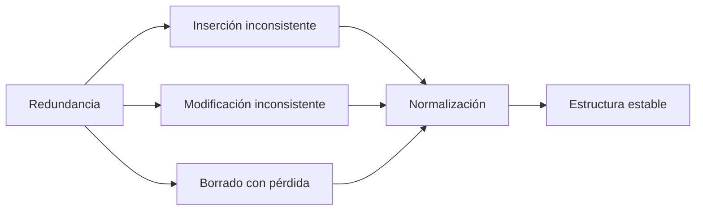

## 7.2 Dependencias funcionales

**DF:** `X → Y` significa que dos tuplas con el mismo valor de X tienen el mismo valor de Y.

- **Determinante:** X.
- **Consecuente:** Y.
- Es una propiedad de la **semántica**, no de los datos que hay hoy: la define el diseñador a partir del enunciado.

| Tipo | Definición | Fórmula |
|---|---|---|
| **Completa** | Y depende de X y de **ningún subconjunto** de X | `(A,B) → C` y ni `A → C` ni `B → C` |
| **Parcial** | Existe un atributo que se puede quitar de X y la DF sigue valiendo | `(A,B) → C` y `A → C` |
| **Transitiva** | `A → B` y `B → C`, con B **no primo** | `A → B → C` |

> [!important] El resumen que hay que memorizar
> - **Parcial:** `parte_de_la_clave → no_primo`.
> - **Transitiva:** `no_primo → no_primo`.
> - Si la PK es de **un solo atributo**, no puede haber dependencia parcial. La 2FN se cumple automáticamente.

## 7.3 El método de 7 pasos

| Paso | Qué hacés | Resultado |
|---|---|---|
| **0** | Escribir la **relación universal** con todos los atributos | Punto de partida |
| **1** | Listar **todas** las DF del enunciado (y anotar los supuestos) | Lista de DF |
| **2** | Identificar **claves candidatas** | PK y alternativas |
| **3** | Marcar **atributos primos / no primos** | Base para clasificar |
| **4** | Verificar **1FN** (atomicidad) | Tablas sin grupos repetitivos |
| **5** | Verificar **2FN** (parciales) | Tablas sin dependencias parciales |
| **6** | Verificar **3FN** (transitivas) | Tablas sin dependencias transitivas |
| **7** | Verificar **pérdida de información** | Join inverso posible |

### Paso 0 — relación universal

Todos los atributos del enunciado en una sola tabla, con la PK provisoria.

### Paso 1 — listar las DF

> [!tip] Cómo escribirlas
> Una por línea, con flecha. Anotá los supuestos en una línea aparte, con la palabra **“Contexto:”**, como hace la cátedra. Ejemplo: “Contexto: asumo que un departamento tiene un solo administrador.”

### Paso 2 — claves candidatas

Regla práctica: el **determinante que no aparece a la derecha de ninguna otra DF** es candidato a clave. Si hay dos, hay dos claves candidatas.

### Paso 3 — atributos primos

Un atributo es **primo** si pertenece a **alguna** clave candidata. No alcanza con la PK elegida.

> [!example]
> `EmpleadoEnProyecto(DNI, nroProy, horas, nombreEmp, nombreProy, localizacionProy)`
> Claves candidatas: `(DNI, nroProy)`.
> Primos: `DNI`, `nroProy`. No primos: `horas`, `nombreEmp`, `nombreProy`, `localizacionProy`.

### El mapa de la normalización

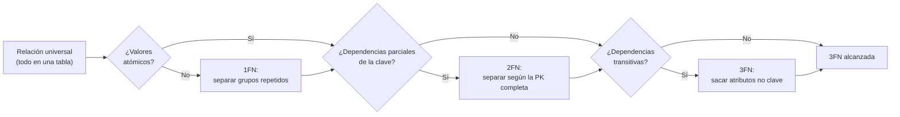

> [!tip] Se avanza en orden
> No se puede saltar a 3FN sin pasar por 1FN y 2FN: cada forma normal supone que se cumplen las anteriores. Si al separar por 2FN aparece un grupo repetido, hay que volver a 1FN.

## 7.4 Ejemplo completo: `itemsFactura`

**Enunciado (cátedra UTN):**

```text
itemsFactura (númeroFactura, idProducto, descripciónProducto, fecha,
              idCliente, domicilioCliente, telCliente, nomCliente,
              cantidad, precioUnitario)
```

**DF del enunciado:**

```text
DF1: (númeroFactura, idProducto) → descripciónProducto, fecha, idCliente,
      domicilioCliente, telCliente, nomCliente, cantidad, precioUnitario
DF2: idProducto → descripciónProducto, precioUnitario
DF3: númeroFactura → fecha, idCliente
DF4: idCliente → domicilioCliente, telCliente, nomCliente
```

### Paso 2 — claves candidatas

`(númeroFactura, idProducto)` determina todo. Ni `númeroFactura` solo ni `idProducto` solo determinan toda la fila. → **PK compuesta**.

### Paso 3 — primos

`númeroFactura`, `idProducto`. El resto son **no primos**.

### Paso 4 — 1FN

¿Hay valores repetidos en una celda? **No** (`telCliente` es uno solo). → Cumple 1FN.

### Paso 5 — 2FN: buscar parciales

| DF | ¿Parcial? | Por qué |
|---|---|---|
| DF2 `idProducto → descripción, precio` | **Sí** | `idProducto` es **parte** de la clave |
| DF3 `númeroFactura → fecha, idCliente` | **Sí** | `númeroFactura` es **parte** de la clave |
| DF1 | No | Depende de la clave completa |

**Descomposición:**

```text
Producto(idProducto, descripciónProducto, precioUnitario)
Factura(númeroFactura, fecha, idCliente, domicilioCliente, telCliente, nomCliente)
ItemsFactura(númeroFactura, idProducto, cantidad)
```

### Paso 6 — 3FN: buscar transitivas

En `Factura`, `idCliente` es **no primo** y determina `domicilioCliente`, `telCliente`, `nomCliente`, también no primos.

**DF4 es transitiva.** Se separa:

```text
Cliente(idCliente, domicilioCliente, telCliente, nomCliente)
Factura(númeroFactura, fecha, idCliente)
```

### Resultado final

```text
Cliente(idCliente, domicilioCliente, telCliente, nomCliente)
Factura(númeroFactura, fecha, idCliente)
Producto(idProducto, descripciónProducto, precioUnitario)
ItemsFactura(númeroFactura, idProducto, cantidad)
```

| Tabla | PK | FK |
|---|---|---|
| `Cliente` | `idCliente` | — |
| `Factura` | `númeroFactura` | `idCliente` → `Cliente` |
| `Producto` | `idProducto` | — |
| `ItemsFactura` | `(númeroFactura, idProducto)` | ambas |

### Paso 7 — verificar

- ¿Se puede reconstruir? `ItemsFactura ⋈ Factura ⋈ Cliente` y `ItemsFactura ⋈ Producto`. **Sí**.
- ¿Se perdió alguna DF? Todas quedaron en alguna tabla. **No**.
- ¿Cada tabla tiene PK? Sí.

> [!warning] El precio histórico
> La DF dice que `precioUnitario` depende de `idProducto`, así que va en `Producto`. Pero si necesitás **el precio al que se vendió**, agregá `precioUnitario` también en `ItemsFactura` como **decisión consciente**. En el examen, aclaralo: “lo dejo en Producto por la DF; si el negocio requiere precio histórico, lo replico en la línea”.

## Cómo trazar una normalización

| Paso | Pregunta | Acción |
|---|---|---|
| 1 | ¿Hay listas en una celda? | 1FN |
| 2 | ¿La PK es compuesta? | Revisar parciales |
| 3 | ¿Hay no primo que dependa de otro no primo? | 3FN |
| 4 | ¿Cada tabla tiene PK? | Definirlas |
| 5 | ¿Puedo reconstruir con joins? | Verificar |

## Errores que suelen tomar

| Error | Corrección |
|---|---|
| Creer que 1FN es "tener PK" | Es **atomicidad** |
| Aplicar 2FN con PK simple | No aporta |
| Confundir parcial con transitiva | Parcial = parte de la clave; transitiva = no primo → no primo |
| Olvidar marcar los primos | Sin eso no podés clasificar |
| Empezar por 3FN | Primero 1FN y 2FN |

## Ejercicios

> [!example] 1. 1FN
> **Enunciado:** `alumno(legajo, nombre, materias)` con `'AED, BD, Redes'`.
> **Solución:** viola 1FN. `alumno(legajo, nombre)` + `inscripcion(legajo, materia)`.

> [!example] 2. 2FN
> **Enunciado:** `inscripcion(legajo, id_materia, nombre_materia, nota)`.
> **Solución:** `nombre_materia` depende solo de `id_materia` (parcial): `materia(id_materia, nombre_materia)` + `inscripcion(legajo, id_materia, nota)`.

> [!example] 3. 3FN
> **Enunciado:** `empleado(leg, nombre, id_depto, nombre_depto)`.
> **Solución:** `nombre_depto` depende de `id_depto`, no de `leg` (transitiva): `depto(id_depto, nombre_depto)` + `empleado(leg, nombre, id_depto)`.

> [!example] 4. a papel
> **Enunciado:** explicá la diferencia entre dependencia parcial y transitiva.
> **Solución:** parcial = un atributo depende de **parte** de la PK compuesta; transitiva = un no primo depende de otro no primo.


<div style="page-break-after: always;"></div>


# 8. Normalización: casos y formas superiores

> [!info] Al terminar este capítulo tenés que poder
> - Resolver casos reales de 2FN y 3FN con anomalías de actualización.
> - Explicar por qué cada forma normal elimina un tipo de anomalía.
> - Reconocer cuándo hace falta BCNF.
> - Decidir con criterio si conviene desnormalizar.

> [!abstract] Qué debés saber (nivel 1)
> - Cada forma normal supone la anterior.
> - 2FN elimina dependencias **parciales**; 3FN, **transitivas**.
> - La anomalía se ve como un dato que hay que repetir en varias filas y puede quedar contradictorio.
> - **BCNF** es más estricta que 3FN: todo determinante es clave candidata.
> - Desnormalizar es una **decisión de rendimiento**, no un atajo de diseño.

> [!quote] Cátedra
> "El modelo relacional solo requiere un conjunto de relaciones en primera forma normal. Las restantes formas normales son opcionales. Sin embargo, es recomendable llegar, al menos, a la tercera forma normal. A un modelo de tablas que cumple con la tercera forma normal se lo denomina normalizado."

## 8.1 Tres casos de la cátedra

### Caso 1 — `MailSubscriptores` (1FN sin 2FN)

| ID suscriptor | Dirección de correo | Teléfono | Nombre |
|---|---|---|---|
| 252 | carol@ejemplo.com | 555-1234 | Carol Robertson |
| 252 | carol@ejemplo.com | 555-9876 | Carol Robertson |

La PK es `{ID suscriptor, Dirección de correo}`. `Nombre` depende **solo** de `ID suscriptor`: es una dependencia parcial.

> [!warning] La anomalía
> Si Carol se cambia el apellido, hay que actualizar **dos** filas. Si se actualiza una sola, la pregunta "¿cuál es el nombre del cliente 252?" tiene dos respuestas contradictorias.

**Solución (2FN):** `suscriptor(id, nombre)` + `suscriptor_correo(id, correo)` + `suscriptor_telefono(id, telefono)`.

### Caso 2 — `HabilidadesXEmpleados`

| Empleado | Habilidad | Lugar actual de trabajo |
|---|---|---|
| Ana | Java | Sede Centro |
| Ana | SQL | Sede Centro |
| Luis | Java | Sede Norte |

PK `{Empleado, Habilidad}`. `Lugar actual de trabajo` depende solo de `Empleado`.

**Solución (2FN):** `empleado(empleado, lugar)` + `habilidad_empleado(empleado, habilidad)`.

### Caso 3 — `GanadoresdeTorneos` (2FN sin 3FN)

| Torneo | Año | Ganador | Fecha de nacimiento del ganador |
|---|---|---|---|
| Abierto | 2024 | Ana | 1996-04-12 |
| Abierto | 2025 | Ana | 1996-04-12 |
| Nacional | 2025 | Luis | 1998-09-30 |

PK `{Torneo, Año}`. `Ganador` y `Fecha de nacimiento` dependen de la clave completa, pero `Fecha de nacimiento` depende de `Ganador`, que **no es clave**: dependencia transitiva.

**Solución (3FN):** `torneo(torneo, anio, ganador)` + `jugador(ganador, fecha_nacimiento)`.

> [!important] Cómo se reconoce en el examen
> 1. Marcá la PK.
> 2. Preguntá: "¿este atributo depende de **toda** la clave o de una parte?" → parcial (2FN).
> 3. Preguntá: "¿depende de otro atributo que **no** es clave?" → transitiva (3FN).
> 4. Si el dato se repite en varias filas y puede quedar contradictorio, hay anomalía.

## 8.2 Segundo ejemplo: `CURSADAS`

**Enunciado:**

```text
CURSADAS (MateriaCódigo, MateriaNombre, DeptoCódigo, DeptoNombre,
          AlumLegajo, AlumApellido, AlumNombre, AlumDomicilio, AlumNroDoc,
          Teléfonos, Cuatrimestre, AñoAcadémico, CursadaResultado)
```

**DF:**

```text
MateriaCódigo → MateriaNombre, DeptoCódigo, DeptoNombre
DeptoCódigo  → DeptoNombre
AlumLegajo   → AlumApellido, AlumNombre, AlumDomicilio, AlumNroDoc, Teléfonos
(MateriaCódigo, AlumLegajo, Cuatrimestre, AñoAcadémico) → CursadaResultado
```

### Análisis

| Paso | Resultado |
|---|---|
| 1FN | **No**: `Teléfonos` es multivaluado |
| PK | `(MateriaCódigo, AlumLegajo, Cuatrimestre, AñoAcadémico)` |
| 2FN | Parciales: `MateriaCódigo → ...` y `AlumLegajo → ...` |
| 3FN | Transitiva: `MateriaCódigo → DeptoCódigo → DeptoNombre` |

### Descomposición

```text
Materia(MateriaCódigo, MateriaNombre, DeptoCódigo)
Departamento(DeptoCódigo, DeptoNombre)
Alumno(AlumLegajo, AlumApellido, AlumNombre, AlumDomicilio, AlumNroDoc)
Telefono(AlumLegajo, Teléfono)          -- por 1FN
Cursada(MateriaCódigo, AlumLegajo, Cuatrimestre, AñoAcadémico, CursadaResultado)
```

> [!important] El orden importa
> Primero 1FN (teléfonos), después 2FN (parciales) y por último 3FN (transitivas). Si empezás por 3FN, arrastrás el multivaluado.

## 8.3 Los tips de la cátedra

| Tip | Aplicación |
|---|---|
| “Si la PK tiene un solo atributo, la relación no puede ser incompleta” | No hay 2FN que revisar |
| “Las dependencias parciales son las incompletas” | Parcial = parte de la clave |
| “Cuando una tabla tiene un tipo (tipoLibro), se hace una tabla aparte” | Evita repetir la descripción del tipo |
| “Se hace tabla aparte cuando varios datos dependen de dos ids” | Relación N:M con atributos |
| “En una N:M, las PK de las originales son PK y FK en la tabla intermedia” | Tabla puente |

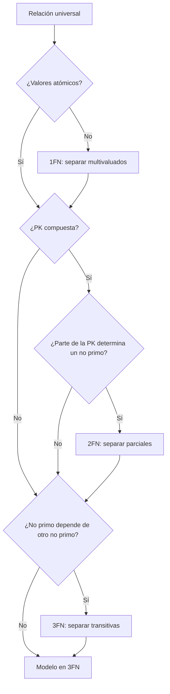

## 8.4 BCFN (mención)

> [!quote] Regla
> Una relación está en **BCFN** si **todo determinante es una clave candidata**.

Es más fuerte que 3FN. Se viola cuando hay un determinante que no es clave.

**Ejemplo:** `ATENCIONES(codHospital, nombreHospital, dniPaciente, legajoPaciente, dniMedico)`

```text
codHospital → nombreHospital
(legajoPaciente, codHospital) → dniPaciente
(dniPaciente, codHospital) → legajoPaciente
```

`codHospital` es determinante y **no** es clave candidata → viola BCFN. Se separa `Hospital(codHospital, nombreHospital)`.

> [!warning] Alcance del programa
> El EFIP pide **1FN, 2FN y 3FN**. BCFN se menciona para saber que existe y que es más estricta. No la apliques como obligatoria.

## 8.5 ¿Cuándo desnormalizar?

| Situación | Decisión |
|---|---|
| Reporte crítico que se ejecuta miles de veces | Materializar una tabla resumen |
| Columna calculada muy usada | Guardarla, documentando el riesgo |
| Tabla de 3 filas que nunca cambia | No vale la pena separar |
| **Examen** | Normalizar a 3FN y justificar |

> [!important] Regla de oro
> Primero normalizá. Si después necesitás rendimiento, desnormalizá **con una razón medida** y dejá documentado cómo mantenés la consistencia.

## 8.6 Resumen de las formas

| Forma | Elimina | Regla práctica |
|---|---|---|
| 1FN | Grupos repetidos | Un valor atómico por celda |
| 2FN | Dependencias parciales | Todo no primo depende de **toda** la PK |
| 3FN | Dependencias transitivas | Ningún no primo depende de otro no primo |
| BCNF | Determinantes que no son clave | Todo determinante es clave candidata |
| 4FN | Dependencias multivaluadas | Un hecho por tabla |

## Errores que suelen tomar

| Error | Corrección |
|---|---|
| Decir que 2FN "elimina la redundancia" | Elimina **parciales**; la redundancia total se va en 3FN |
| Aplicar 2FN con PK de un solo atributo | No hay parciales posibles |
| Confundir ganador con clave | En `GanadoresdeTorneos`, la clave es `{Torneo, Año}` |
| Separar sin verificar el join | Podés perder información |
| Pasar a BCNF sin necesidad | 3FN suele alcanzar para el EFIP |
| Desnormalizar sin medir | Se justifica con una consulta crítica concreta |

## Ejercicios

> [!example] 1. Diagnóstico
> **Enunciado:** `pedido(id_pedido, id_cliente, nombre_cliente, fecha)` con PK `id_pedido`. ¿Forma normal?
> **Solución:** 2FN (PK simple), pero no 3FN: `nombre_cliente` depende de `id_cliente` (transitiva).

> [!example] 2. Corrección
> **Enunciado:** pasá el caso anterior a 3FN.
> **Solución:** `cliente(id_cliente, nombre_cliente)` + `pedido(id_pedido, id_cliente, fecha)`.

> [!example] 3. Parcial
> **Enunciado:** `detalle(id_pedido, id_producto, nombre_producto, cantidad)`. ¿Qué DF es parcial?
> **Solución:** `id_producto → nombre_producto` depende de parte de la PK.

> [!example] 4. Anomalía
> **Enunciado:** explicá qué anomalía produce el caso 1.
> **Solución:** de actualización: el nombre se repite y puede quedar contradictorio.

> [!example] 5. BCNF
> **Enunciado:** ¿cuándo una tabla en 3FN no está en BCNF?
> **Solución:** cuando hay un determinante que no es clave candidata (por ejemplo, dos atributos que se determinan mutuamente).

> [!example] 6. a papel
> **Enunciado:** normalizá `GanadoresdeTorneos` y justificá cada paso.
> **Solución:** ver 8.1, caso 3.


<div style="page-break-after: always;"></div>


# 9. Diagrama entidad-relación

> [!info] Al terminar este capítulo tenés que poder
> - Dibujar un DER con la notación correcta.
> - Distinguir entidad fuerte, débil y clave parcial.
> - Modelar especialización.
> - Convertir cualquier DER a tablas con PK y FK.

> [!abstract] Qué debés saber (nivel 1)
> - Rectángulo = entidad; elipse = atributo; rombo = relación.
> - Elipse doble = multivalorado; elipse discontinua = derivado.
> - Atributo de la clave se **subraya**.
> - Entidad débil = rectángulo doble; su clave es parcial (subrayado discontinuo).
> - Relación identificadora = rombo doble.
> - Especialización: el hijo **es un** padre.

## 9.1 Notación

| Símbolo | Significado |
|---|---|
| Rectángulo | Entidad |
| Rectángulo doble | Entidad débil |
| Elipse | Atributo |
| Elipse doble | Atributo multivalorado |
| Elipse discontinua | Atributo derivado |
| Subrayado | Atributo que forma la clave |
| Subrayado discontinuo | Clave parcial |
| Rombo | Relación |
| Rombo doble | Relación identificadora |
| Línea doble | Participación total |
| `1`, `N`, `M` | Cardinalidad |

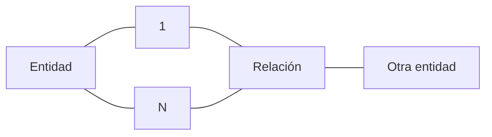

> [!tip] En el examen escrito
> Si no tenés la notación completa, **rotulá**. Un rectángulo con el nombre y las cardinalidades `1..N` se entiende y se corrige bien.

## 9.2 Entidades débiles

**Entidad débil:** no tiene clave propia. Se identifica por la clave de otra entidad (**identificadora**) más una **clave parcial**.

> [!example] Ejemplo clásico
> `CUOTA` no existe sin `PRESTAMO`. Su número de cuota (`1`, `2`, `3`) solo es único dentro de un préstamo.
>
> - Entidad fuerte: `PRESTAMO(id_prestamo)`.
> - Entidad débil: `CUOTA(nro_cuota)`.
> - Clave primaria final: `(id_prestamo, nro_cuota)`.
> - Relación identificadora: `PRESTAMO —tiene— CUOTA` (rombo doble, participación total de CUOTA).

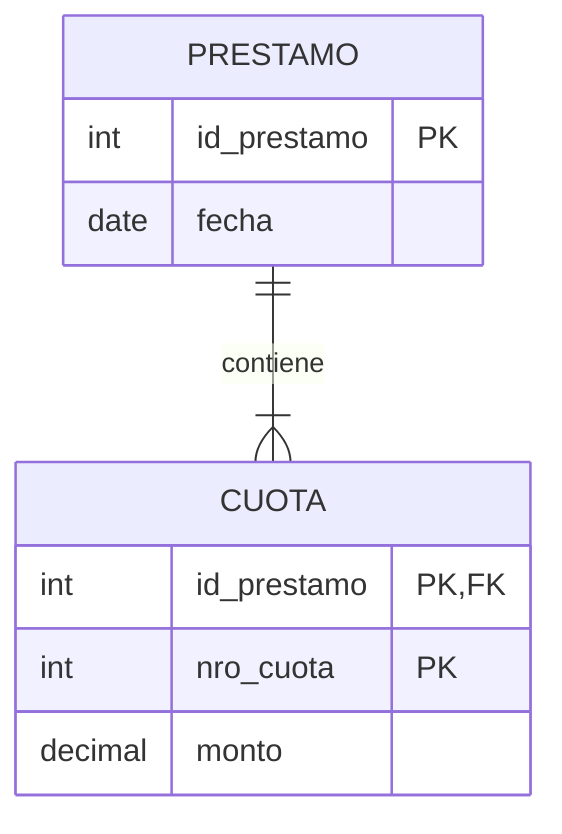

> [!important] Cómo reconocerla
> Preguntate: *¿este objeto tiene sentido solo, sin el otro?* Si la respuesta es no, es débil. La cuota, el detalle de factura, el ítem de pedido.

## 9.3 Especialización

Cuando varias entidades comparten atributos y se diferencian por algunos propios.

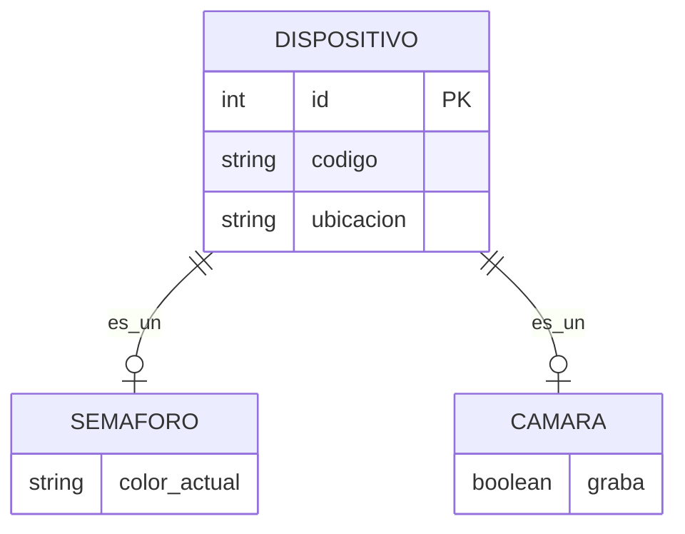

| Concepto | Regla |
|---|---|
| Superclase | Tiene los atributos comunes |
| Subclase | Agrega atributos propios |
| Participación | Puede ser total (todo dispositivo es de algún tipo) o parcial |
| Exclusividad | Puede ser disjunta (un dispositivo es semáforo **o** cámara) o solapada |

### Cómo se pasa a tablas

| Estrategia | Cuándo | Ventaja | Costo |
|---|---|---|---|
| **Una tabla por clase** | Especialización con atributos propios | Simple, sin `NULL` | Requiere `JOIN` |
| Tabla única con discriminador | Pocas subclases y atributos | Sin `JOIN` | Muchos `NULL` |
| Tabla por subclase con todos los atributos | Consultas por subclase | Rápido | Duplica estructura |

> [!important] Para el EFIP
> La estrategia recomendada es **una tabla por entidad**. `dispositivo` + `semaforo(id_dispositivo PK/FK, color)` + `camara(id_dispositivo PK/FK, graba)`.

## 9.4 Cardinalidad y participación

| Notación | Lectura |
|---|---|
| `1..1` | Exactamente uno |
| `0..1` | Cero o uno |
| `1..*` | Al menos uno |
| `0..*` | Cero o más |

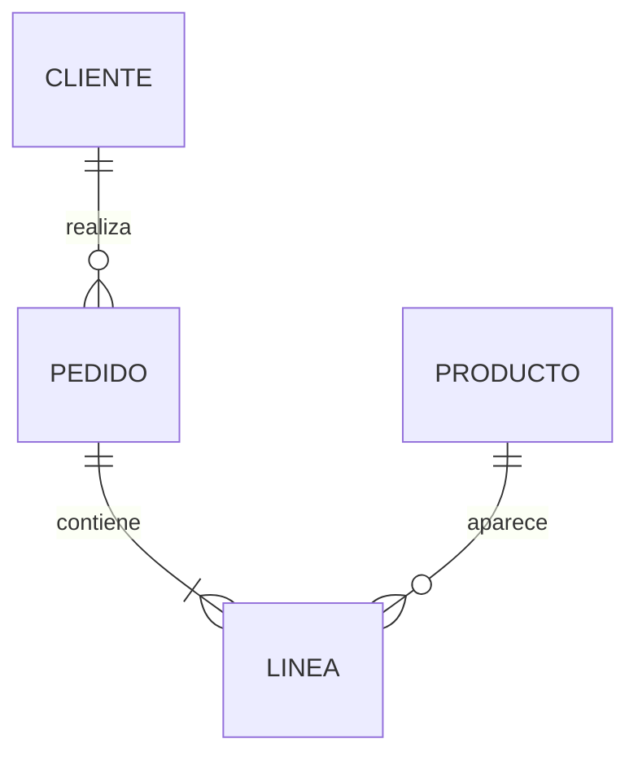

| Relación | Cardinalidad | Participación |
|---|---|---|
| Cliente–Pedido | 1:N | Pedido total (todo pedido es de un cliente); cliente parcial (puede no tener pedidos) |
| Pedido–Línea | 1:N (o 1:1 débil) | Línea total |
| Producto–Línea | 1:N | Línea total; producto parcial |

## 9.5 Del DER a las tablas: reglas

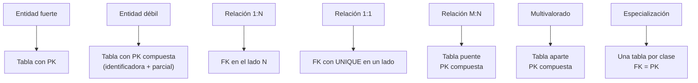

### Ejemplo completo

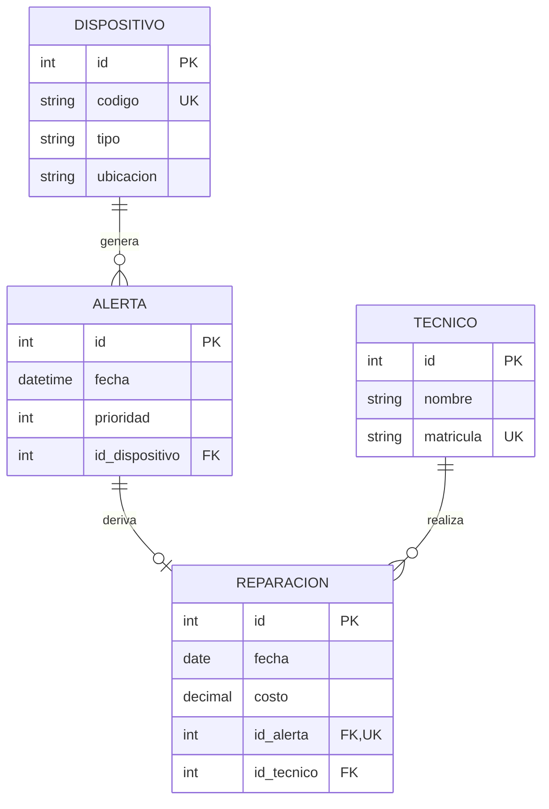

```sql
CREATE TABLE dispositivo (
    id        INT AUTO_INCREMENT PRIMARY KEY,
    codigo    VARCHAR(10) NOT NULL UNIQUE,
    tipo      VARCHAR(20) NOT NULL,
    ubicacion VARCHAR(100) NOT NULL
);

CREATE TABLE alerta (
    id             INT AUTO_INCREMENT PRIMARY KEY,
    fecha          DATETIME NOT NULL DEFAULT CURRENT_TIMESTAMP,
    prioridad      TINYINT NOT NULL,
    atendida       BOOLEAN NOT NULL DEFAULT FALSE,
    id_dispositivo INT NOT NULL,
    FOREIGN KEY (id_dispositivo) REFERENCES dispositivo(id)
);

CREATE TABLE tecnico (
    id        INT AUTO_INCREMENT PRIMARY KEY,
    nombre    VARCHAR(60) NOT NULL,
    matricula VARCHAR(20) NOT NULL UNIQUE
);

CREATE TABLE reparacion (
    id         INT AUTO_INCREMENT PRIMARY KEY,
    fecha      DATE NOT NULL,
    costo      DECIMAL(10,2) NOT NULL DEFAULT 0,
    id_alerta  INT NOT NULL UNIQUE,
    id_tecnico INT NULL,
    FOREIGN KEY (id_alerta) REFERENCES alerta(id),
    FOREIGN KEY (id_tecnico) REFERENCES tecnico(id)
);
```

> [!warning] El `UNIQUE` de `id_alerta`
> Convierte la relación en 1:1. Sin él, sería 1:N (varias reparaciones por alerta).

## Cómo trazar un DER

| Paso | Pregunta | Resultado |
|---|---|---|
| 1 | ¿Entidades fuertes? | Dispositivo, Técnico |
| 2 | ¿Débiles? | Reparación depende de Alerta; ¿Alerta de Dispositivo? No: tiene id propio |
| 3 | ¿Relaciones y cardinalidad? | 1:N, 1:1 |
| 4 | ¿Participación? | Alerta total; reparación con técnico parcial |
| 5 | ¿Tablas y FK? | Según las reglas de 10.1 |

## Errores que suelen tomar

| Error | Corrección |
|---|---|
| Usar rectángulo para una relación | Rombo |
| Subrayar todos los atributos | Solo la clave |
| Poner M:N sin tabla puente | Toda M:N se resuelve con tabla intermedia |
| FK en el lado 1 | Va en el lado N |
| Entidad débil con PK propia | Su PK es compuesta (identificadora + parcial) |
| Especializar por un atributo de tipo | Solo si hay comportamiento/atributos propios |

## Ejercicios

> [!example] 1. Notación
> **Enunciado:** ¿cómo se representa un atributo multivalorado y uno derivado?
> **Solución:** multivalorado con elipse doble; derivado con elipse discontinua.

> [!example] 2. Entidad débil
> **Enunciado:** ¿es débil `detalle_factura`? Justificá.
> **Solución:** sí: no existe sin la factura y su número de línea solo es único dentro de ella. PK `(id_factura, nro_linea)`.

> [!example] 3. 1:1
> **Enunciado:** modelá persona–pasaporte y explicá el `UNIQUE`.
> **Solución:** `pasaporte(id, numero, id_persona UNIQUE)`; el `UNIQUE` impide que una persona tenga dos pasaportes.

> [!example] 4. M:N
> **Enunciado:** películas y actores, con personaje interpretado. ¿Cómo queda?
> **Solución:** `film_actor(id_pelicula, id_actor, personaje)` con PK compuesta `(id_pelicula, id_actor)`.

> [!example] 5. a papel
> **Enunciado:** dibujá el DER del municipio con las cuatro entidades y todas las cardinalidades.
> **Solución:** ver el capítulo 10. Debe incluir `1:N` dispositivo–alerta, `1:1` alerta–reparación y `1:N` técnico–reparación, con la participación parcial de técnico.


<div style="page-break-after: always;"></div>


# 10. Del DER a las tablas

> [!info] Al terminar este capítulo tenés que poder
> - Convertir cualquier DER a tablas sin perder información.
> - Decidir **dónde va la FK** según la participación.
> - Resolver entidades débiles, multivaluados, recursivas y ternarias.
> - Elegir entre las tres estrategias de especialización.

> [!abstract] Qué debés saber (nivel 1)
> - Cada **entidad** se convierte en **tabla**.
> - Cada **atributo simple** se convierte en **columna**.
> - Un **multivaluado** genera **tabla aparte**.
> - Una **relación 1:N** pone la FK en el lado **N**.
> - Una **relación N:M** genera **tabla puente**.
> - Una **entidad débil** hereda la PK de su identificadora.
> - La **cobertura** de una especialización decide qué estrategia usar.

> [!important] Este capítulo es el puente
> El DER (9. Diagrama entidad-relación) es conceptual; el modelo relacional (3. Componentes del modelo relacional) es físico. Acá se hace la traducción con reglas. La cátedra UTN lo evalúa como “pasar el DER a tablas”.

> [!quote] Fuentes del método
> **UTN** aporta la clasificación por participación, las tres opciones de 1:1, la entidad débil, la ternaria y la decisión por cobertura. **UP** aporta el criterio de recursivas (frecuencia de nulos) y la conversión de supertipo/subtipo. **Siglo 21** aporta el vocabulario y los ejemplos del caso.

## 10.1 Regla general

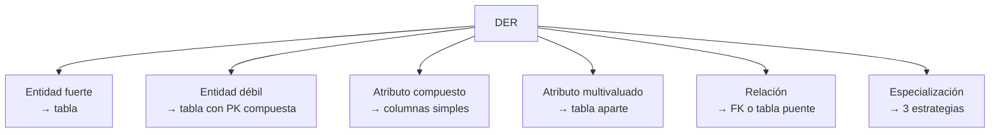

| Elemento del DER | Se convierte en |
|---|---|
| Entidad fuerte | Tabla con todos sus atributos simples |
| Entidad débil | Tabla con PK = PK identificadora + clave parcial |
| Atributo simple | Columna |
| Atributo compuesto | Varias columnas (una por componente) |
| Atributo multivalorado | Tabla nueva con FK + valor |
| Atributo derivado | No se guarda (se calcula) |
| Relación 1:N | FK en el lado N |
| Relación 1:1 | FK en uno de los lados (con `UNIQUE`) |
| Relación N:M | Tabla puente con PK compuesta |
| Generalización | Una de tres estrategias según cobertura |

## 10.2 Entidades y atributos

### Entidad fuerte

```text
CLIENTE(id_cliente, nombre, apellido, dni)
```

- PK: el identificador de la entidad.
- Atributos simples: columnas.
- `dni` único → `UNIQUE`.

### Atributo compuesto

```text
CLIENTE(id_cliente, nombre, calle, numero, localidad)
```

El atributo `domicilio` desaparece como tal; quedan sus componentes.

> [!warning] No dejes el compuesto y sus partes
> Tener `domicilio` **y** `calle`, `numero`, `localidad` duplica la información. Elegí una: columnas separadas (recomendado) o una sola columna de texto.

### Atributo multivalorado

```text
EMPLEADO(legajo, nombre, apellido)
TELEFONO(legajo, numero, tipo)
```

- PK de `TELEFONO`: `(legajo, numero)`.
- `legajo` es FK a `EMPLEADO`.

> [!important] La regla de la cátedra
> “Por cada atributo multivalorado se crea una tabla; se agrega el atributo multivalorado y la PK de la entidad a la que pertenece, que será FK. La PK se forma con **todos** sus atributos.”

### Entidad débil

```text
PRESTAMO(id_prestamo, fecha, ...)
CUOTA(id_prestamo, nro_cuota, monto, vencimiento)
```

- PK de `CUOTA`: `(id_prestamo, nro_cuota)`.
- `nro_cuota` es la **clave parcial** (discriminante).
- `id_prestamo` es FK y parte de la PK.

```mermaid
erDiagram
    PRESTAMO ||--|{ CUOTA : contiene
    PRESTAMO {
        int id_prestamo PK
        date fecha
    }
    CUOTA {
        int id_prestamo PK,FK
        int nro_cuota PK
        decimal monto
    }
```

## 10.3 Relaciones según la participación

La participación se escribe `mín..máx` en cada extremo. La **máxima** define la cardinalidad; la **mínima** indica obligatoriedad.

### Caso A — 1..1 con 0..1

**Ejemplo:** `Usuario 1..1 — Tiene — Canal_YouTube 0..1`.

**Regla:** la FK va en el lado **0..1** (el que puede no participar).

```text
Usuario(idUsuario, nombre, apellido, email, password)
Canal_YouTube(id, fecha_creacion, descripcion, idUsuario)
idUsuario: FK de Usuario
```

> [!important] Por qué en el lado 0..1
> Si la pusieras en `Usuario`, todos los usuarios que no tienen canal quedarían con `idCanal` nulo. Poniéndola en `Canal`, solo hay nulos donde no hay canal, que es lo natural.

### Caso B — 1..1 con 1..1

**Ejemplo:** `País 1..1 — Gobierna — Presidente 1..1`.

Hay **tres soluciones válidas**:

| Opción | Cómo queda | Cuándo conviene |
|---|---|---|
| **1** | FK en `País` | Si consultás más “el presidente de un país” |
| **2** | FK en `Presidente` | Si consultás más “el país de un presidente” |
| **3** | FK en **ambas** (con `UNIQUE`) | Si las dos consultas son frecuentes; acepta redundancia |

```text
-- Opción 1
Pais(idPais, nombre, habitantes, DNI)
Presidente(DNI, nombre, apellido)
DNI en Pais: FK de Presidente

-- Opción 2
Pais(idPais, nombre, habitantes)
Presidente(DNI, nombre, apellido, idPais)
idPais en Presidente: FK de Pais
```

> [!warning] El `UNIQUE` no es opcional
> Sin `UNIQUE` en la FK, la relación 1:1 se convierte en 1:N. Es el error más caro de este caso.

### Caso C — 0..1 con 0..1

**Ejemplo:** `Alquiler 0..1 — Renueva — Alquiler 0..1` (recursiva).

**Regla:** se crea una **tabla nueva** con las dos claves; la PK es una de ellas.

```text
Alquiler(idAlquiler, fecha_inicio, fecha_fin, importe, fianza)
Renovacion(idAlquiler, id_alquiler_anterior)
PK: idAlquiler
idAlquiler: FK de Alquiler
id_alquiler_anterior: FK de Alquiler
```

### Caso D — 1..1 con 0..N (1:N)

**Ejemplo:** `Usuario 1..1 — Publica — Video 0..N`.

**Regla:** la FK va en el lado **N**, apuntando al lado 1.

```text
Usuario(idUsuario, nombre, apellido, email, password)
Video(idVideo, nombre, descripcion, duracion, idUsuario)
idUsuario en Video: FK de Usuario
```

> [!important] La regla que no falla
> En 1:N, la FK siempre va en el lado **“muchos”**. Si la ponés en el lado 1, necesitarías varios valores en una columna.

### Caso E — 0..N con 0..N (M:N)

**Regla:** tabla nueva con las dos PK como FK y **PK compuesta**. Los atributos de la relación se agregan ahí.

```text
Alumno(nroAlumno, nombre, apellido, DNI)
Examen(idExamen, fecha)
Alumno_rinde_Examen(nroAlumno, idExamen, nota)
PK: (nroAlumno, idExamen)
```

> [!important] Cuándo la PK incluye un atributo de la relación
> Si la relación tiene **fecha** y querés guardar el histórico (por ejemplo, un proveedor suministra la misma pieza en fechas distintas), la fecha entra en la PK: `(idProveedor, idPieza, fecha)`. Alternativa: agregar un `id` autoincremental como PK subrogada.

### Caso F — relación recursiva

| Situación | Solución |
|---|---|
| 1:N y **la mayoría** tiene jefe | FK en la misma tabla: `Empleado(legajo, ..., legajoJefe)` |
| 1:N y **la mayoría no** tiene jefe | Tabla aparte: `Subordinado(legajoSub, legajoJefe)` |
| N:M (por ejemplo, correlativas) | Tabla nueva con dos FK: `Correlativa(codAnterior, codPosterior)` |

> [!tip] Criterio de UP
> La frecuencia de nulos decide: si la columna va a estar vacía casi siempre, conviene tabla aparte.

### Caso G — relación ternaria

**Regla:** tabla nueva con las **tres** PK como FK; la PK es la combinación de las tres.

```text
Proveedor(idProveedor, ...)
Pieza(idPieza, ...)
Proyecto(idProyecto, ...)
Suministra(idProveedor, idPieza, idProyecto, cantidad)
PK: (idProveedor, idPieza, idProyecto)
```

## 10.4 Especialización

Tres estrategias:

| Estrategia | Cómo | Ventaja | Riesgo |
|---|---|---|---|
| **1. Solo el padre** | Una tabla con todos los atributos de los hijos, **nullable** | Sin joins | Muchos `NULL` |
| **2. Solo los hijos** | Se elimina el padre y sus atributos se copian en cada hijo | Sin tabla padre | **No sirve si la cobertura es parcial**: se pierden entidades que no son de ningún hijo |
| **3. Padre + hijos** | Tabla padre + una tabla por hijo con **PK = FK al padre** | Capta la herencia; sin `NULL` | Más joins |

> [!important] La cobertura decide
> - **Total** (todo padre es de algún hijo) → la opción 2 es viable.
> - **Parcial** (hay padres que no son de ningún hijo) → la opción 2 **pierde información**; no se puede.
> - **Superpuesta** (un padre puede ser de varios hijos) → la opción 2 duplica datos; conviene la 3.
>
> La cátedra concluye que la **opción 3** es la que mejor capta la herencia, a costa de más tablas y joins.

```mermaid
erDiagram
    DISPOSITIVO ||--o| SEMAFORO : es_un
    DISPOSITIVO ||--o| CAMARA : es_un
    DISPOSITIVO {
        int id PK
        string codigo
        string ubicacion
    }
    SEMAFORO {
        int id PK,FK
        string color
    }
    CAMARA {
        int id PK,FK
        boolean graba
    }
```

```sql
CREATE TABLE dispositivo (
    id        INT AUTO_INCREMENT PRIMARY KEY,
    codigo    VARCHAR(10) NOT NULL UNIQUE,
    ubicacion VARCHAR(100) NOT NULL
);

CREATE TABLE semaforo (
    id    INT PRIMARY KEY,
    color VARCHAR(10) NOT NULL DEFAULT 'ROJO',
    FOREIGN KEY (id) REFERENCES dispositivo(id) ON DELETE CASCADE
);

CREATE TABLE camara (
    id    INT PRIMARY KEY,
    graba BOOLEAN NOT NULL DEFAULT FALSE,
    FOREIGN KEY (id) REFERENCES dispositivo(id) ON DELETE CASCADE
);
```

## 10.5 Claves e integridad en la conversión

1. **Elegir la PK** con el método de 3. Componentes del modelo relacional: simple antes que compuesta, menor tamaño, estable.
2. **Marcar `UNIQUE`** en las claves alternativas.
3. **Definir la FK** con la acción referencial:
   - `RESTRICT` si la relación es obligatoria y no querés borrados en cascada.
   - `CASCADE` si el hijo no existe sin el padre (detalle, cuota).
   - `SET NULL` si la relación es opcional (técnico de una reparación).

| Situación | Acción |
|---|---|
| Alerta → Dispositivo (obligatoria) | `ON DELETE CASCADE` |
| Reparación → Técnico (opcional) | `ON DELETE SET NULL` |
| Empleado → Departamento (obligatoria, histórica) | `RESTRICT` |

## 10.6 Ejemplo integrado

**DER del municipio:**

```mermaid
erDiagram
    DISPOSITIVO ||--o{ ALERTA : genera
    ALERTA ||--o| REPARACION : deriva
    TECNICO ||--o{ REPARACION : realiza
    DISPOSITIVO ||--o{ MANTENIMIENTO : recibe
```

**Enunciado:** un dispositivo tiene código único, tipo y ubicación. Genera muchas alertas (fecha, mensaje, prioridad). Una alerta puede derivar en **una** reparación (fecha, costo). Un técnico realiza muchas reparaciones. Un dispositivo recibe muchos mantenimientos (fecha, descripción).

| Paso | Elemento | Decisión |
|---|---|---|
| 1 | `DISPOSITIVO` | Tabla; PK `id`; `codigo` `UNIQUE` |
| 2 | `ALERTA` | Tabla; PK `id`; FK `id_dispositivo` (1:N, lado N) |
| 3 | `REPARACION` | Tabla; PK `id`; FK `id_alerta` **`UNIQUE`** (1:1); FK `id_tecnico` (1:N, opcional) |
| 4 | `TECNICO` | Tabla; PK `id`; `matricula` `UNIQUE` |
| 5 | `MANTENIMIENTO` | Tabla; PK `id`; FK `id_dispositivo` (1:N) |

```sql
CREATE TABLE dispositivo (
    id        INT AUTO_INCREMENT PRIMARY KEY,
    codigo    VARCHAR(10) NOT NULL UNIQUE,
    tipo      VARCHAR(20) NOT NULL,
    ubicacion VARCHAR(100) NOT NULL
);

CREATE TABLE alerta (
    id             INT AUTO_INCREMENT PRIMARY KEY,
    fecha          DATETIME NOT NULL DEFAULT CURRENT_TIMESTAMP,
    mensaje        VARCHAR(200) NOT NULL,
    prioridad      TINYINT NOT NULL,
    atendida       BOOLEAN NOT NULL DEFAULT FALSE,
    id_dispositivo INT NOT NULL,
    CONSTRAINT fk_alerta_disp FOREIGN KEY (id_dispositivo)
        REFERENCES dispositivo(id) ON DELETE CASCADE,
    CONSTRAINT ck_prio CHECK (prioridad BETWEEN 1 AND 5)
);

CREATE TABLE tecnico (
    id        INT AUTO_INCREMENT PRIMARY KEY,
    nombre    VARCHAR(60) NOT NULL,
    matricula VARCHAR(20) NOT NULL UNIQUE
);

CREATE TABLE reparacion (
    id         INT AUTO_INCREMENT PRIMARY KEY,
    fecha      DATE NOT NULL,
    costo      DECIMAL(10,2) NOT NULL DEFAULT 0,
    id_alerta  INT NOT NULL UNIQUE,
    id_tecnico INT NULL,
    CONSTRAINT fk_rep_alerta FOREIGN KEY (id_alerta)
        REFERENCES alerta(id) ON DELETE CASCADE,
    CONSTRAINT fk_rep_tecnico FOREIGN KEY (id_tecnico)
        REFERENCES tecnico(id) ON DELETE SET NULL
);

CREATE TABLE mantenimiento (
    id             INT AUTO_INCREMENT PRIMARY KEY,
    fecha          DATE NOT NULL,
    descripcion    VARCHAR(200) NOT NULL,
    id_dispositivo INT NOT NULL,
    FOREIGN KEY (id_dispositivo) REFERENCES dispositivo(id) ON DELETE CASCADE
);
```

> [!tip] El `UNIQUE` que define la relación
> `id_alerta UNIQUE` es lo que hace que una alerta tenga **como máximo una** reparación. Sin él, sería 1:N.

## 10.7 Checklist de conversión

- [ ] ¿Cada entidad tiene su tabla?
- [ ] ¿Cada atributo simple es una columna?
- [ ] ¿Los compuestos se descompusieron?
- [ ] ¿Los multivaluados tienen tabla propia?
- [ ] ¿Las entidades débiles tienen PK compuesta?
- [ ] ¿La FK está en el lado N?
- [ ] ¿Las 1:1 tienen `UNIQUE`?
- [ ] ¿Las N:M tienen tabla puente?
- [ ] ¿Las ternarias tienen las tres FK?
- [ ] ¿La especialización respeta la cobertura?
- [ ] ¿Cada FK tiene acción referencial definida?
- [ ] ¿Se puede reconstruir el DER con joins?

## Errores que suelen tomar

| Error | Consecuencia |
|---|---|
| FK en el lado 1 de una 1:N | Modelo inválido |
| 1:1 sin `UNIQUE` | Se transforma en 1:N |
| Multivaluado en una columna | Viola 1FN |
| Entidad débil con PK simple | No se puede distinguir la cuota 1 del préstamo A de la del B |
| N:M sin tabla puente | No se puede representar |
| Aplicar “solo hijos” con cobertura parcial | Se pierden entidades |
| No definir acción referencial | Comportamiento inesperado al borrar |
| Usar el nombre del atributo compuesto y sus partes | Redundancia |

## Ejercicios

> [!example] 1. 1:N
> **Enunciado:** `Departamento 1 — Empleado N`. ¿Dónde va la FK?
> **Solución:** `id_depto` en `empleado`, FK a `departamento`.

> [!example] 2. 1:1
> **Enunciado:** `Persona 1..1 — Pasaporte 0..1`. ¿Dónde va la FK y qué restricción lleva?
> **Solución:** `id_persona` en `pasaporte`, con `UNIQUE`.

> [!example] 3. N:M con atributos
> **Enunciado:** `Pelicula N — Actor M`, con personaje interpretado.
> **Solución:** `film_actor(id_pelicula, id_actor, personaje)`, PK `(id_pelicula, id_actor)`.

> [!example] 4. Entidad débil
> **Enunciado:** `Factura 1 — Linea N`. ¿PK de `linea`?
> **Solución:** `(id_factura, nro_linea)`.

> [!example] 5. Especialización
> **Enunciado:** `Cuenta` con subclases `Ahorro`, `Corriente`, `Inversion`, cobertura parcial. ¿Qué estrategia usás?
> **Solución:** opción 3 (padre + hijos), porque la cobertura parcial descarta “solo hijos” y la superposición posible descarta la tabla única.

> [!example] 6. a papel
> **Enunciado:** convertí este DER: `Alumno 0..N — Cursa — Materia 0..N` con `nota` y `fecha`.
> **Solución:** `cursada(id_alumno, id_materia, fecha, nota)`, PK `(id_alumno, id_materia, fecha)` si se quiere histórico, o `(id_alumno, id_materia)` si hay una sola cursada por materia.


<div style="page-break-after: always;"></div>


# Cierre del Módulo 2 — Análisis y diseño

> [!info] Qué hacer con este archivo
> Verificación de modelado y normalización. Si algo falla, volvé al capítulo.

## Checklist del Módulo 2

| Puedo… | Capítulo | ✔ |
|---|---|---|
| Pasar de un enunciado a entidades y atributos | Cap. 6 | ☐ |
| Decidir si algo es atributo, entidad o relación | Cap. 6 | ☐ |
| Determinar cardinalidad y participación | Cap. 6 | ☐ |
| Justificar un valor nulo | Cap. 6 | ☐ |
| Dibujar un DER con notación correcta | Cap. 9 | ☐ |
| Modelar una entidad débil con clave parcial | Cap. 9 | ☐ |
| Convertir un DER a tablas con PK y FK | Cap. 10 | ☐ |
| Decidir dónde va la FK según la participación | Cap. 10 | ☐ |
| Resolver multivaluados, débiles y ternarias | Cap. 10 | ☐ |
| Elegir la estrategia de especialización por cobertura | Cap. 10 | ☐ |
| Detectar dependencias parciales y transitivas | Cap. 7 | ☐ |
| Diagnosticar anomalías en casos reales | Cap. 8 | ☐ |
| Decidir cuándo hace falta BCNF | Cap. 8 | ☐ |
| Justificar una desnormalización | Cap. 8 | ☐ |
| Normalizar hasta 3FN paso a paso | Cap. 7 | ☐ |
| Explicar las tres anomalías | Cap. 7 | ☐ |

## Diferencias que no podés confundir

| A | B | Diferencia central |
|---|---|---|
| Entidad | Atributo | Tiene identidad y datos propios vs. describe a otra |
| 1:N | M:N | FK en el lado N vs. tabla puente |
| Participación total | Parcial | Obligatoria vs. opcional |
| Entidad fuerte | Débil | Clave propia vs. clave compuesta con identificadora |
| 1FN | 2FN | Atomicidad vs. dependencia de la clave completa |
| 2FN | 3FN | Dependencia parcial vs. transitiva |
| Multivalorado | Derivado | Varios valores vs. calculable |
| Normalizar | Desnormalizar | Eliminar redundancia vs. aceptarla con justificación |

## Ejercicio integrador del Módulo 2

> [!example] Enunciado (30 minutos)
> Una clínica registra **turnos**. De cada turno se guarda fecha, hora, paciente y médico. Un paciente tiene DNI, nombre, teléfono y obra social. Un médico tiene matrícula, nombre y especialidad. Un paciente puede tener muchos turnos; un médico atiende muchos turnos. Se quiere saber cuántos turnos atendió cada médico por especialidad.
>
> 1. Modelá el DER.
> 2. Pasalo a tablas con PK y FK.
> 3. Verificá 1FN, 2FN y 3FN.
> 4. Escribí la consulta del punto 4.

> [!success] Solución
> **1. DER**
> ```mermaid
> erDiagram
>     PACIENTE ||--o{ TURNO : solicita
>     MEDICO ||--o{ TURNO : atiende
>     OBRA_SOCIAL ||--o{ PACIENTE : cubre
>     PACIENTE { int id PK
>                string dni UK
>                string nombre
>                string telefono
>                int id_obra FK }
>     MEDICO { int id PK
>              string matricula UK
>              string nombre
>              string especialidad }
>     TURNO { int id PK
>             datetime fecha_hora
>             int id_paciente FK
>             int id_medico FK }
>     OBRA_SOCIAL { int id PK
>                   string nombre }
> ```
> **2. Tablas**
> ```sql
> CREATE TABLE obra_social (
>     id     INT AUTO_INCREMENT PRIMARY KEY,
>     nombre VARCHAR(60) NOT NULL UNIQUE
> );
>
> CREATE TABLE paciente (
>     id          INT AUTO_INCREMENT PRIMARY KEY,
>     dni         VARCHAR(10) NOT NULL UNIQUE,
>     nombre      VARCHAR(60) NOT NULL,
>     telefono    VARCHAR(20),
>     id_obra     INT NULL,
>     FOREIGN KEY (id_obra) REFERENCES obra_social(id)
> );
>
> CREATE TABLE medico (
>     id          INT AUTO_INCREMENT PRIMARY KEY,
>     matricula   VARCHAR(20) NOT NULL UNIQUE,
>     nombre      VARCHAR(60) NOT NULL,
>     especialidad VARCHAR(40) NOT NULL
> );
>
> CREATE TABLE turno (
>     id          INT AUTO_INCREMENT PRIMARY KEY,
>     fecha_hora  DATETIME NOT NULL,
>     id_paciente INT NOT NULL,
>     id_medico   INT NOT NULL,
>     FOREIGN KEY (id_paciente) REFERENCES paciente(id),
>     FOREIGN KEY (id_medico) REFERENCES medico(id)
> );
> ```
> **3. Formas normales**
>
> | Tabla | 1FN | 2FN | 3FN | Justificación |
> |---|---|---|---|---|
> | `paciente` | ✅ | ✅ | ✅ | PK simple; `id_obra` es FK, no dependencia transitiva de datos |
> | `medico` | ✅ | ✅ | ✅ | Atributos dependen solo de `id` |
> | `turno` | ✅ | ✅ | ✅ | PK simple; paciente y médico por FK |
>
> **4. Consulta**
> ```sql
> SELECT m.especialidad, m.nombre, COUNT(*) AS turnos
> FROM turno t
> JOIN medico m ON m.id = t.id_medico
> GROUP BY m.especialidad, m.nombre
> ORDER BY m.especialidad, turnos DESC;
> ```
>
> **Qué evalúa el tribunal:** que la relación N:M entre paciente y médico se resuelva con `turno` (entidad asociativa con atributos propios), que no haya datos del médico repetidos en `turno` y que la consulta agrupe por especialidad.

## Oral del Módulo 2 (8 preguntas)

> [!question] 1. ¿Qué es una entidad débil?
> Una entidad sin clave propia, que se identifica por la clave de otra entidad más una clave parcial.

> [!question] 2. ¿Cómo se implementa una relación M:N?
> Con una tabla puente cuya PK es la combinación de las dos FK, más los atributos propios de la relación.

> [!question] 3. ¿Qué es una dependencia funcional?
> Una relación `A → B` donde un valor de A determina un único valor de B.

> [!question] 4. ¿Qué exige la 1FN?
> Que todos los valores sean atómicos: sin grupos repetitivos ni listas en una celda.

> [!question] 5. ¿Cuándo importa la 2FN?
> Solo cuando la clave primaria es compuesta: exige que todo atributo no clave dependa de la clave completa.

> [!question] 6. ¿Qué es una dependencia transitiva?
> `A → B` y `B → C`, con B no clave. Viola 3FN.

> [!question] 7. Nombrá las tres anomalías.
> Inserción, modificación y borrado.

> [!question] 8. ¿Normalizarías siempre hasta 3FN?
> Sí como punto de partida. Si necesito rendimiento, desnormalizo con una razón medida y documento cómo mantengo la consistencia.


<div style="page-break-after: always;"></div>


# 11. El lenguaje SQL

> [!info] Al terminar este capítulo tenés que poder
> - Explicar por qué SQL es declarativo.
> - Clasificar cualquier sentencia en DDL, DML o DCL.
> - Enunciar el orden lógico de evaluación de una consulta.
> - Elegir el tipo de dato adecuado.

> [!abstract] Qué debés saber (nivel 1)
> - SQL comunica al usuario con la base: consulta, modifica y controla.
> - Es **declarativo**: describís el resultado; el motor decide cómo.
> - **DDL** define estructura (`CREATE`, `ALTER`, `DROP`).
> - **DML** manipula datos (`SELECT`, `INSERT`, `UPDATE`, `DELETE`).
> - **DCL** controla acceso (`GRANT`, `REVOKE`).
> - El orden lógico es `FROM → WHERE → GROUP BY → HAVING → SELECT → ORDER BY → LIMIT`.

## 11.1 Qué es SQL

> [!quote] Definición de cátedra
> **SQL:** lenguaje diseñado para la comunicación entre usuarios y bases de datos, que permite consultar, modificar y controlar datos y estructuras.

### Declarativo, no procedimental

```sql
SELECT nombre, sueldo
FROM empleado
WHERE sueldo > 800000;
```

Vos decís **qué** querés. El **optimizador** decide si conviene usar un índice, en qué orden hacer los joins, etc.

> [!important] La consecuencia
> Dos consultas equivalentes pueden tener planes distintos. Y una misma consulta puede cambiar de plan si cambian los datos o las estadísticas. Eso es normal.

| Característica | Significado |
|---|---|
| Declarativo | Se describe el resultado, no el procedimiento |
| Orientado a conjuntos | Opera sobre filas, no sobre registros de a uno |
| Estándar | ANSI/ISO, con dialectos por motor |
| No procedimental original | Sin `if`/`while`; eso llega con las extensiones (5.4) |

## 11.2 Sublenguajes

```mermaid
flowchart TD
    SQL["SQL"] --> DDL["DDL<br/>estructura"]
    SQL --> DML["DML<br/>datos"]
    SQL --> DCL["DCL<br/>acceso"]
    DDL --> D1["CREATE · ALTER · DROP"]
    DML --> D2["SELECT · INSERT · UPDATE · DELETE"]
    DCL --> D3["GRANT · REVOKE"]
```

| Sublenguaje | Para qué | Sentencias |
|---|---|---|
| **DDL** | Definir, modificar y eliminar estructuras | `CREATE`, `ALTER`, `DROP`, `TRUNCATE` |
| **DML** | Administrar los datos | `SELECT`, `INSERT`, `UPDATE`, `DELETE` |
| **DCL** | Controlar acceso | `GRANT`, `REVOKE` |
| TCL | Transacciones (no lo pide el programa) | `COMMIT`, `ROLLBACK` |

> [!warning] Clasificación que se pregunta
> `TRUNCATE` vacía una tabla: se considera **DDL** (opera sobre la estructura), no DML. `DELETE` es DML porque borra filas con condición y se puede revertir.

## 11.3 Orden lógico de una consulta

Se escribe en un orden y se evalúa en otro.

| Orden | Cláusula | Qué hace |
|---:|---|---|
| 1 | `FROM` | Identifica las tablas y arma el conjunto de filas |
| 2 | `WHERE` | Filtra filas **antes** de agrupar |
| 3 | `GROUP BY` | Forma grupos |
| 4 | `HAVING` | Filtra **grupos** |
| 5 | `SELECT` | Elige columnas y calcula expresiones |
| 6 | `ORDER BY` | Ordena el resultado |
| 7 | `LIMIT` | Recorta filas |

```mermaid
flowchart LR
    F["FROM"] --> W["WHERE"] --> G["GROUP BY"] --> H["HAVING"] --> S["SELECT"] --> O["ORDER BY"] --> L["LIMIT"]
```

> [!important] Por qué importa
> `WHERE` no puede usar alias definidos en `SELECT` (todavía no se evaluó). `ORDER BY` sí puede. Y `WHERE` filtra filas; `HAVING`, grupos.

## 11.4 Tipos de datos

| Categoría | Tipos MySQL | Cuándo |
|---|---|---|
| Enteros exactos | `TINYINT`, `SMALLINT`, `INT`, `BIGINT` | IDs, cantidades |
| Decimales exactos | `DECIMAL(p, s)`, `NUMERIC` | **Dinero** |
| Decimales aproximados | `FLOAT`, `DOUBLE` | Medidas científicas |
| Fecha y hora | `DATE`, `TIME`, `DATETIME`, `TIMESTAMP` | Fechas |
| Cadenas | `CHAR(n)`, `VARCHAR(n)`, `TEXT` | Textos |
| Booleanos | `BOOLEAN` (alias de `TINYINT(1)`) | Estados |
| Binarios | `BLOB` | Archivos |
| Enumeración | `ENUM('A','B')` | Conjuntos cerrados |

### `CHAR` vs. `VARCHAR`

| | `CHAR(n)` | `VARCHAR(n)` |
|---|---|---|
| Longitud | Fija | Variable |
| Espacio | Rellena con espacios | Usa lo necesario |
| Uso | Códigos de longitud fija (`'AR'`) | Nombres, direcciones |

> [!warning] Dinero con `DOUBLE`
> `DOUBLE` es aproximado: `0.1 + 0.2` no da exactamente `0.3`. Para importes se usa `DECIMAL(10,2)`. Es una pregunta de oral.

## 11.5 Primeras consultas

```sql
-- Proyección
SELECT nombre, apellido FROM empleado;

-- Filtro
SELECT nombre, sueldo
FROM empleado
WHERE sueldo > 800000;

-- Orden
SELECT nombre, sueldo
FROM empleado
ORDER BY sueldo DESC;

-- Límite
SELECT nombre, sueldo
FROM empleado
ORDER BY sueldo DESC
LIMIT 2;

-- Alias
SELECT nombre AS empleado, sueldo * 12 AS sueldo_anual
FROM empleado;
```

Salida de la última:

```text
+----------+--------------+
| empleado | sueldo_anual |
+----------+--------------+
| Ana      |  11400000.00 |
| Luis     |  10440000.00 |
| Eva      |   8640000.00 |
| Juan     |   7320000.00 |
+----------+--------------+
```

> [!tip] `AS` es opcional
> `SELECT nombre empleado` funciona, pero `AS` mejora la lectura y evita ambigüedad.

## 11.6 Comentarios y buenas formas

```sql
-- Comentario de una línea

/* Comentario
   de bloque */

SELECT 1;   -- toda sentencia termina en ;
```

| Buena práctica | Motivo |
|---|---|
| Palabras clave en MAYÚSCULA | Distinguir del identificador |
| Un ítem por línea en listas largas | Legibilidad |
| Alias en tablas | Evitar ambigüedad en joins |
| Nunca `SELECT *` en producción | Trae columnas de más y rompe si cambia el esquema |

## Cómo leer una consulta

| Paso | Pregunta | Ejemplo |
|---|---|---|
| 1 | ¿De qué tablas? | `FROM empleado` |
| 2 | ¿Qué filas? | `WHERE sueldo > 800000` |
| 3 | ¿Agrupado? | `GROUP BY id_depto` |
| 4 | ¿Qué grupos? | `HAVING COUNT(*) > 2` |
| 5 | ¿Qué columnas? | `SELECT id_depto, AVG(sueldo)` |
| 6 | ¿Orden? | `ORDER BY 2 DESC` |

## Errores que suelen tomar

| Error | Corrección |
|---|---|
| Decir que SQL es procedimental | Es declarativo |
| Confundir DDL con DML | DDL = estructura; DML = datos |
| Usar alias de `SELECT` en `WHERE` | No está permitido |
| Guardar dinero en `DOUBLE` | `DECIMAL` |
| Usar `CHAR` para nombres | `VARCHAR` |
| Creer que `TRUNCATE` es DML | Es DDL |

## Ejercicios

> [!example] 1. Clasificar
> **Enunciado:** clasificá: `CREATE TABLE`, `UPDATE`, `GRANT`, `SELECT`, `DROP`, `DELETE`.
> **Solución:** DDL: `CREATE TABLE`, `DROP`. DML: `UPDATE`, `SELECT`, `DELETE`. DCL: `GRANT`.

> [!example] 2. Orden lógico
> **Enunciado:** ¿por qué `SELECT nombre AS n FROM e WHERE n = 'Ana'` falla?
> **Solución:** porque `WHERE` se evalúa antes que `SELECT`; el alias `n` todavía no existe.

> [!example] 3. Tipos
> **Enunciado:** elegí tipos para precio, fecha de alta, código de provincia y descripción.
> **Solución:** `DECIMAL(10,2)`, `DATE`, `CHAR(2)`, `VARCHAR(200)` o `TEXT`.

> [!example] 4. a papel
> **Enunciado:** escribí una consulta que devuelva nombre y sueldo anual de los empleados con sueldo mayor a 700.000, ordenado de mayor a menor.
> **Solución:**
> ```sql
> SELECT nombre, sueldo * 12 AS sueldo_anual
> FROM empleado
> WHERE sueldo > 700000
> ORDER BY sueldo_anual DESC;
> ```


<div style="page-break-after: always;"></div>


# 12. DML: insertar, actualizar y borrar

> [!info] Al terminar este capítulo tenés que poder
> - Insertar una o varias filas, y desde otra consulta.
> - Actualizar con condición y verificar antes.
> - Borrar sin destruir la tabla.
> - Explicar `COMMIT` y `ROLLBACK`.

> [!abstract] Qué debés saber (nivel 1)
> - `INSERT INTO ... VALUES (...)` agrega filas.
> - `UPDATE ... SET ... WHERE ...` modifica; **sin `WHERE` modifica todas**.
> - `DELETE FROM ... WHERE ...` borra filas.
> - `DELETE` sin `WHERE` vacía la tabla, pero se puede revertir.
> - `COMMIT` confirma; `ROLLBACK` deshace.
> - Antes de `UPDATE`/`DELETE`, corré el mismo `WHERE` con `SELECT`.

## 12.1 Insertar

```sql
-- Una fila, todas las columnas en orden
INSERT INTO departamento (id_depto, nombre, ciudad, presupuesto)
VALUES (10, 'Sistemas', 'La Plata', 5000000);

-- Varias filas
INSERT INTO departamento (id_depto, nombre, ciudad, presupuesto)
VALUES (20, 'Compras', 'Berisso', 2000000),
       (30, 'Ventas',  'Ensenada', 1500000);

-- Columnas omitidas: toman su DEFAULT
INSERT INTO departamento (nombre, ciudad)
VALUES ('Legales', 'La Plata');

-- Desde una consulta
INSERT INTO departamento_audit (id_depto, nombre)
SELECT id_depto, nombre FROM departamento WHERE presupuesto > 1000000;
```

| Variante | Uso |
|---|---|
| `VALUES` | Datos literales |
| `INSERT ... SELECT` | Copiar o transformar datos |
| `DEFAULT` | Usar el valor por defecto |
| `NULL` | Dejar el campo vacío (si lo admite) |

> [!warning] Orden de las columnas
> Si no nombrás las columnas, los valores deben ir **en el orden exacto** del `CREATE TABLE`. Es frágil: si mañana agregan una columna, se rompe. **Siempre nombrá las columnas.**

### `AUTO_INCREMENT`

```sql
INSERT INTO dispositivo (codigo, tipo, ubicacion)
VALUES ('S-01', 'semaforo', 'Av. Belgrano');

SELECT LAST_INSERT_ID();      -- id generado
```

## 12.2 Actualizar

```sql
-- Una columna
UPDATE empleado
SET sueldo = sueldo * 1.10
WHERE id_depto = 10;

-- Varias columnas
UPDATE empleado
SET sueldo = sueldo * 1.05,
    id_depto = 20
WHERE legajo = 1003;

-- Con subconsulta
UPDATE empleado
SET sueldo = sueldo * 1.20
WHERE id_depto IN (
    SELECT id_depto FROM departamento WHERE ciudad = 'La Plata'
);
```

> [!warning] El `UPDATE` sin `WHERE`
> ```sql
> UPDATE empleado SET sueldo = 0;   -- ¡todos los empleados!
> ```
> Antes de ejecutarlo, corré:
> ```sql
> SELECT * FROM empleado WHERE id_depto = 10;
> ```
> Si el `SELECT` trae lo que esperás, cambiá `SELECT *` por `UPDATE ... SET`.

### Modo seguro

```sql
SET SQL_SAFE_UPDATES = 1;   -- impide UPDATE/DELETE sin clave en WHERE
```

> [!tip] Hábito profesional
> Trabajá siempre dentro de una transacción:
> ```sql
> START TRANSACTION;
> UPDATE ...;
> SELECT ...;        -- verificás
> -- si está bien: COMMIT;   si no: ROLLBACK;
> ```

## 12.3 Borrar

```sql
-- Borrar filas que cumplen una condición
DELETE FROM alerta WHERE prioridad = 5;

-- Borrar con límite
DELETE FROM alerta ORDER BY fecha ASC LIMIT 10;

-- Borrar todo (se puede revertir con ROLLBACK)
DELETE FROM alerta;
```

| Sentencia | Efecto | ¿Reversible? |
|---|---|---|
| `DELETE ... WHERE ...` | Borra filas | Sí, con transacción |
| `DELETE FROM t` | Borra todas las filas | Sí, con transacción |
| `TRUNCATE TABLE t` | Vacía y reinicia el contador | No |
| `DROP TABLE t` | Elimina la tabla | No |

## 12.4 Transacciones (lo mínimo)

```sql
START TRANSACTION;

UPDATE cuenta SET saldo = saldo - 1000 WHERE id = 1;
UPDATE cuenta SET saldo = saldo + 1000 WHERE id = 2;

-- Si ambas están bien:
COMMIT;

-- Si algo falló:
-- ROLLBACK;
```

```mermaid
sequenceDiagram
    participant C as Cliente
    participant DB as MySQL
    C->>DB: START TRANSACTION
    C->>DB: UPDATE origen (-1000)
    C->>DB: UPDATE destino (+1000)
    alt todo OK
        C->>DB: COMMIT
        DB-->>C: cambios permanentes
    else error
        C->>DB: ROLLBACK
        DB-->>C: estado anterior
    end
```

> [!important] Por qué importa
> Una transferencia son **dos** operaciones. Si falla la segunda sin transacción, el dinero desaparece. `COMMIT`/`ROLLBACK` garantizan que se apliquen todas o ninguna.

## 12.5 Programa completo

```sql
-- Datos de prueba
INSERT INTO dispositivo (codigo, tipo, ubicacion) VALUES
    ('S-01', 'semaforo', 'Av. Belgrano'),
    ('S-02', 'semaforo', 'Av. San Martín'),
    ('C-01', 'camara',   'Plaza Moreno');

INSERT INTO alerta (mensaje, prioridad, id_dispositivo) VALUES
    ('Lámpara quemada', 2, 1),
    ('Sin energía',     1, 2),
    ('Cámara offline',  1, 3),
    ('Lente sucio',     4, 3);

-- Actualizar: subir prioridad de las alertas de la cámara C-01
UPDATE alerta
SET prioridad = prioridad - 1
WHERE id_dispositivo = (
    SELECT id FROM dispositivo WHERE codigo = 'C-01'
)
AND prioridad > 1;

-- Verificar
SELECT d.codigo, a.mensaje, a.prioridad
FROM alerta a
JOIN dispositivo d ON d.id = a.id_dispositivo
ORDER BY a.prioridad, d.codigo;

-- Borrar las alertas ya resueltas de prioridad 4
DELETE FROM alerta WHERE prioridad = 4;
```

Salida del `SELECT`:

```text
+--------+-----------------+-----------+
| codigo | mensaje         | prioridad |
+--------+-----------------+-----------+
| C-01   | Cámara offline  |         1 |
| S-02   | Sin energía     |         1 |
| S-01   | Lámpara quemada |         2 |
| C-01   | Lente sucio     |         4 |
+--------+-----------------+-----------+
```

> [!warning] `UPDATE` con subconsulta sobre la misma tabla
> MySQL no permite, en algunos casos, subconsultar la tabla que estás actualizando. Solución: usar un `JOIN` en el `UPDATE` o una tabla temporal.
> ```sql
> UPDATE alerta a
> JOIN dispositivo d ON d.id = a.id_dispositivo
> SET a.prioridad = a.prioridad - 1
> WHERE d.codigo = 'C-01' AND a.prioridad > 1;
> ```

## Cómo trazar un DML

| Paso | Acción | Verificación |
|---|---|---|
| 1 | Escribir el `SELECT` con el `WHERE` | ¿Trae las filas correctas? |
| 2 | Convertirlo en `UPDATE`/`DELETE` | Mismo `WHERE` |
| 3 | Ejecutar dentro de transacción | `START TRANSACTION` |
| 4 | Revisar `ROW_COUNT()` | Filas afectadas |
| 5 | `COMMIT` o `ROLLBACK` | Según el resultado |

```sql
START TRANSACTION;
UPDATE empleado SET sueldo = sueldo * 1.1 WHERE id_depto = 10;
SELECT ROW_COUNT() AS afectadas;
-- si es el número esperado:
COMMIT;
```

## Errores que suelen tomar

| Error | Consecuencia |
|---|---|
| `UPDATE` sin `WHERE` | Modifica toda la tabla |
| `DELETE` sin `WHERE` | Vacía la tabla |
| `INSERT` sin nombrar columnas | Se rompe al cambiar el esquema |
| No usar transacción | No hay vuelta atrás |
| `DELETE` con FK sin `CASCADE` | `ERROR 1451` |
| Confundir `TRUNCATE` con `DELETE` | `TRUNCATE` no se revierte |

## Ejercicios

> [!example] 1. Insertar
> **Enunciado:** insertá dos técnicos en una sola sentencia.
> **Solución:**
> ```sql
> INSERT INTO tecnico (nombre, matricula) VALUES
>     ('Luis', 'MAT-001'),
>     ('Eva',  'MAT-002');
> ```

> [!example] 2. Actualizar
> **Enunciado:** subí un 15 % el sueldo de los empleados de Sistemas.
> **Solución:**
> ```sql
> UPDATE empleado
> SET sueldo = sueldo * 1.15
> WHERE id_depto = (SELECT id_depto FROM departamento WHERE nombre = 'Sistemas');
> ```

> [!example] 3. Borrar
> **Enunciado:** borrá las alertas de prioridad 5 anteriores a 2026.
> **Solución:**
> ```sql
> DELETE FROM alerta
> WHERE prioridad = 5 AND fecha < '2026-01-01';
> ```

> [!example] 4. Transacción
> **Enunciado:** escribí una transferencia entre dos cuentas.
> **Solución:**
> ```sql
> START TRANSACTION;
> UPDATE cuenta SET saldo = saldo - 1000 WHERE id = 1;
> UPDATE cuenta SET saldo = saldo + 1000 WHERE id = 2;
> COMMIT;
> ```

> [!example] 5. a papel
> **Enunciado:** escribí el `SELECT` de verificación y el `DELETE` para borrar las reparaciones con costo 0.
> **Solución:**
> ```sql
> SELECT * FROM reparacion WHERE costo = 0;
> DELETE FROM reparacion WHERE costo = 0;
> ```


<div style="page-break-after: always;"></div>


# 13. DDL: definir estructuras

> [!info] Al terminar este capítulo tenés que poder
> - Crear una base y una tabla con todos sus tipos y restricciones.
> - Modificar una tabla existente con `ALTER TABLE`.
> - Diferenciar `DROP`, `TRUNCATE` y `DELETE`.
> - Decidir cuándo crear un índice.

> [!abstract] Qué debés saber (nivel 1)
> - `CREATE DATABASE`, `CREATE TABLE`, `ALTER TABLE`, `DROP TABLE`.
> - `ALTER` permite `ADD`, `MODIFY`, `DROP`, `RENAME`.
> - `DROP` borra la estructura **y** los datos.
> - `TRUNCATE` vacía los datos, deja la estructura.
> - Los índices aceleran búsquedas a costa de espacio y escritura.

## 13.1 Crear la base

```sql
CREATE DATABASE IF NOT EXISTS municipio
    CHARACTER SET utf8mb4
    COLLATE utf8mb4_0900_ai_ci;

USE municipio;
```

| Cláusula | Para qué |
|---|---|
| `IF NOT EXISTS` | Evita el error si ya existe |
| `CHARACTER SET utf8mb4` | Soporta emojis y caracteres completos |
| `COLLATE` | Reglas de comparación y orden |

> [!warning] `utf8` vs. `utf8mb4`
> En MySQL, `utf8` es un alias incompleto (3 bytes) y **no** guarda emojis. Usá `utf8mb4`.

### Qué objetos crea el DDL

```mermaid
flowchart TD
    DDL["DDL"] --> DB["CREATE DATABASE"]
    DDL --> T["CREATE TABLE"]
    DDL --> I["CREATE INDEX"]
    DDL --> V["CREATE VIEW"]
    T --> C["columnas y tipos"]
    T --> K["PRIMARY KEY<br/>FOREIGN KEY"]
    T --> R["NOT NULL · UNIQUE<br/>CHECK · DEFAULT"]
```

> [!important] El orden importa
> Primero la base, después las tablas **sin** claves foráneas (o al menos las referenciadas), y al final las `FOREIGN KEY`. Si creás la tabla hija antes que la padre, la referencia falla.

## 13.2 Crear tablas

```sql
CREATE TABLE departamento (
    id_depto     INT AUTO_INCREMENT,
    nombre       VARCHAR(60) NOT NULL,
    ciudad       VARCHAR(60) NOT NULL,
    presupuesto  DECIMAL(12,2) NOT NULL DEFAULT 0,

    CONSTRAINT pk_departamento PRIMARY KEY (id_depto),
    CONSTRAINT uq_departamento_nombre UNIQUE (nombre),
    CONSTRAINT ck_departamento_presu CHECK (presupuesto >= 0)
) ENGINE=InnoDB;
```

```sql
CREATE TABLE empleado (
    legajo    INT,
    dni       VARCHAR(10) NOT NULL,
    nombre    VARCHAR(60) NOT NULL,
    apellido  VARCHAR(60) NOT NULL,
    sueldo    DECIMAL(10,2) NOT NULL,
    fecha_alta DATE NOT NULL DEFAULT (CURRENT_DATE),
    id_depto  INT NOT NULL,

    CONSTRAINT pk_empleado PRIMARY KEY (legajo),
    CONSTRAINT uq_empleado_dni UNIQUE (dni),
    CONSTRAINT fk_empleado_depto FOREIGN KEY (id_depto)
        REFERENCES departamento(id_depto)
        ON DELETE RESTRICT
        ON UPDATE CASCADE,
    CONSTRAINT ck_empleado_sueldo CHECK (sueldo > 0)
) ENGINE=InnoDB;
```

| Elemento | Función |
|---|---|
| `AUTO_INCREMENT` | Genera el próximo valor |
| `NOT NULL` | Obliga a tener valor |
| `DEFAULT` | Valor si no se especifica |
| `PRIMARY KEY` | Identifica la fila |
| `UNIQUE` | Prohíbe duplicados |
| `FOREIGN KEY` | Integridad referencial |
| `CHECK` | Regla de dominio (MySQL 8.0.16+) |
| `ENGINE=InnoDB` | Motor con transacciones y FK |

> [!important] `CHECK` en MySQL
> Antes de 8.0.16 se **ignoraba** silenciosamente. Si tu versión es vieja, la restricción no se aplica. En el examen, igual se escribe.

## 13.3 Modificar tablas

```sql
-- Agregar columna
ALTER TABLE empleado
    ADD COLUMN email VARCHAR(100) NULL;

-- Modificar tipo
ALTER TABLE empleado
    MODIFY COLUMN email VARCHAR(150) NOT NULL;

-- Renombrar columna
ALTER TABLE empleado
    RENAME COLUMN email TO correo;

-- Eliminar columna
ALTER TABLE empleado
    DROP COLUMN correo;

-- Agregar restricción
ALTER TABLE empleado
    ADD CONSTRAINT uq_empleado_email UNIQUE (correo);

-- Eliminar restricción
ALTER TABLE empleado
    DROP FOREIGN KEY fk_empleado_depto;

-- Renombrar tabla
ALTER TABLE empleado RENAME TO empleados;
```

| Operación | Sintaxis |
|---|---|
| Agregar columna | `ADD COLUMN nombre tipo` |
| Cambiar tipo | `MODIFY COLUMN nombre tipo` |
| Renombrar | `RENAME COLUMN viejo TO nuevo` |
| Borrar columna | `DROP COLUMN nombre` |
| Agregar FK | `ADD CONSTRAINT ... FOREIGN KEY ...` |

> [!warning] `MODIFY` puede truncar datos
> Si pasás de `VARCHAR(150)` a `VARCHAR(50)`, los textos más largos se cortan o la operación falla según el modo SQL. Verificá antes con un `SELECT MAX(LENGTH(columna))`.

## 13.4 `DROP`, `TRUNCATE` y `DELETE`

| Sentencia | Qué borra | ¿Se puede deshacer? | Tipo |
|---|---|---|---|
| `DELETE FROM t WHERE ...` | Filas que cumplen la condición | Sí (con transacción) | DML |
| `TRUNCATE TABLE t` | **Todas** las filas | No (implícito commit) | DDL |
| `DROP TABLE t` | Estructura **y** datos | No | DDL |

```sql
DELETE FROM alerta WHERE prioridad = 5;   -- borra algunas
TRUNCATE TABLE alerta;                    -- vacía la tabla
DROP TABLE alerta;                        -- elimina la tabla
```

> [!warning] El DDL hace `COMMIT` implícito: no se revierte
> `CREATE`, `ALTER`, `DROP` y `TRUNCATE` **confirman la transacción en curso** y no se pueden deshacer con `ROLLBACK`. Por eso un `DROP TABLE` es irreversible aunque lo escribas “dentro de una transacción”: el motor confirma antes (y en Oracle también después) de ejecutarlo. Es la razón por la que el DDL se prueba primero en un entorno de desarrollo.

> [!important] `DELETE` sin `WHERE`
> ```sql
> DELETE FROM alerta;   -- borra TODAS las filas, pero la tabla queda
> ```
> Es el equivalente a `TRUNCATE`, pero registra fila por fila y se puede revertir dentro de una transacción.

## 13.5 Índices

Un índice acelera la búsqueda por una columna, como el índice de un libro.

```sql
CREATE INDEX idx_alerta_fecha ON alerta(fecha);
CREATE INDEX idx_alerta_disp_prio ON alerta(id_dispositivo, prioridad);

DROP INDEX idx_alerta_fecha ON alerta;
```

| Ventaja | Costo |
|---|---|
| `SELECT` con `WHERE`/`JOIN` más rápido | Ocupa espacio |
| `ORDER BY` puede aprovecharse | `INSERT`/`UPDATE` más lentos |

> [!tip] Cuándo indexar
> Columnas usadas en `WHERE`, `JOIN` y `ORDER BY`, con alta selectividad. **No** indexes una columna booleana con dos valores: no discrimina.

## 13.6 Programa completo

```sql
DROP DATABASE IF EXISTS municipio;
CREATE DATABASE municipio CHARACTER SET utf8mb4;
USE municipio;

CREATE TABLE dispositivo (
    id        INT AUTO_INCREMENT PRIMARY KEY,
    codigo    VARCHAR(10) NOT NULL UNIQUE,
    tipo      VARCHAR(20) NOT NULL,
    ubicacion VARCHAR(100) NOT NULL,
    CONSTRAINT ck_tipo CHECK (tipo IN ('semaforo','camara'))
);

CREATE TABLE alerta (
    id             INT AUTO_INCREMENT PRIMARY KEY,
    fecha          DATETIME NOT NULL DEFAULT CURRENT_TIMESTAMP,
    mensaje        VARCHAR(200) NOT NULL,
    prioridad      TINYINT NOT NULL,
    atendida       BOOLEAN NOT NULL DEFAULT FALSE,
    id_dispositivo INT NOT NULL,
    CONSTRAINT ck_prio CHECK (prioridad BETWEEN 1 AND 5),
    CONSTRAINT fk_alerta_disp FOREIGN KEY (id_dispositivo)
        REFERENCES dispositivo(id) ON DELETE CASCADE
);

CREATE INDEX idx_alerta_prio ON alerta(prioridad);

SHOW TABLES;
DESCRIBE alerta;
```

Salida de `DESCRIBE alerta`:

```text
+----------------+--------------+------+-----+-------------------+
| Field          | Type         | Null | Key | Default           |
+----------------+--------------+------+-----+-------------------+
| id             | int          | NO   | PRI | NULL              |
| fecha          | datetime     | NO   |     | CURRENT_TIMESTAMP |
| mensaje        | varchar(200) | NO   |     | NULL              |
| prioridad      | tinyint      | NO   | MUL | NULL              |
| atendida       | tinyint(1)   | NO   |     | 0                 |
| id_dispositivo | int          | NO   | MUL | NULL              |
+----------------+--------------+------+-----+-------------------+
```

> [!tip] Leer `DESCRIBE`
> `PRI` = clave primaria. `MUL` = índice no único (por la FK o el índice). `UNI` = único. Es la forma rápida de auditar una tabla.

## Cómo trazar un DDL

| Paso | Pregunta | Acción |
|---|---|---|
| 1 | ¿Qué entidades? | Una tabla por entidad |
| 2 | ¿Qué tipos? | Elegir por dominio |
| 3 | ¿Qué es obligatorio? | `NOT NULL` |
| 4 | ¿Qué identifica? | `PRIMARY KEY` |
| 5 | ¿Qué referencia? | `FOREIGN KEY` |
| 6 | ¿Qué reglas? | `CHECK`, `UNIQUE` |
| 7 | ¿Qué se consulta? | Índices |

## Errores que suelen tomar

| Error | Corrección |
|---|---|
| Crear la FK antes que la tabla padre | Orden correcto |
| `DROP TABLE` creyendo que solo borra datos | Borra todo |
| `TRUNCATE` esperando poder revertir | No se revierte |
| `VARCHAR` sin longitud | Error de sintaxis |
| `CHECK` en MySQL < 8.0.16 | Se ignora |
| Indexar todo | Escrituras lentas |
| `DELETE` sin `WHERE` | Borra toda la tabla |

## Ejercicios

> [!example] 1. Crear
> **Enunciado:** creá `tecnico(id, nombre, matricula única)`.
> **Solución:**
> ```sql
> CREATE TABLE tecnico (
>     id        INT AUTO_INCREMENT PRIMARY KEY,
>     nombre    VARCHAR(60) NOT NULL,
>     matricula VARCHAR(20) NOT NULL UNIQUE
> );
> ```

> [!example] 2. Alterar
> **Enunciado:** agregá `telefono` a `tecnico` y luego hacelo obligatorio.
> **Solución:**
> ```sql
> ALTER TABLE tecnico ADD COLUMN telefono VARCHAR(20) NULL;
> UPDATE tecnico SET telefono = '000-000' WHERE telefono IS NULL;
> ALTER TABLE tecnico MODIFY COLUMN telefono VARCHAR(20) NOT NULL;
> ```

> [!example] 3. Diferencias
> **Enunciado:** ¿qué usás para borrar solo las alertas de prioridad 5?
> **Solución:** `DELETE FROM alerta WHERE prioridad = 5;`

> [!example] 4. Índice
> **Enunciado:** ¿qué índice crearías para `WHERE id_dispositivo = ? AND prioridad = 1`?
> **Solución:** compuesto `(id_dispositivo, prioridad)`, en ese orden (primero la columna más selectiva o la de igualdad).

> [!example] 5. a papel
> **Enunciado:** escribí el DDL de `reparacion` con FK a `alerta` y a `tecnico`, costo no negativo y `ON DELETE SET NULL` para técnico.
> **Solución:**
> ```sql
> CREATE TABLE reparacion (
>     id         INT AUTO_INCREMENT PRIMARY KEY,
>     fecha      DATE NOT NULL,
>     costo      DECIMAL(10,2) NOT NULL DEFAULT 0,
>     id_alerta  INT NOT NULL,
>     id_tecnico INT NULL,
>     CONSTRAINT ck_costo CHECK (costo >= 0),
>     FOREIGN KEY (id_alerta) REFERENCES alerta(id) ON DELETE CASCADE,
>     FOREIGN KEY (id_tecnico) REFERENCES tecnico(id) ON DELETE SET NULL
> );
> ```


<div style="page-break-after: always;"></div>


# 14. Convenciones de nombres y tipos de datos

> [!info] Al terminar este capítulo tenés que poder
> - Escribir SQL legible con un criterio uniforme.
> - Nombrar tablas, columnas y constraints sin ambigüedad.
> - Elegir el tipo de dato correcto para cada columna.
> - Justificar `DECIMAL` vs. `FLOAT` y `CHAR` vs. `VARCHAR`.
> - Traducir tipos entre Oracle y MySQL.

> [!abstract] Qué debés saber (nivel 1)
> - Palabras reservadas en **mayúscula**; nombres de objetos en **minúscula**.
> - Una cláusula por línea; indentar las continuaciones.
> - Sin espacios en los nombres: se usa `_`. Empiezan con letra.
> - Longitud máxima: **30** caracteres en Oracle, **64** en MySQL.
> - Constraints: prefijo `pk_`, `fk_`, `uq_`, `ck_`, `ix_`.
> - Dinero: **`DECIMAL`**, nunca `FLOAT`/`DOUBLE`.
> - Texto de longitud variable: **`VARCHAR`**; código fijo: `CHAR`.

> [!quote] Cátedra
> "Se puede adoptar el criterio de escribir en mayúscula las palabras reservadas de la sentencia y en minúscula los nombres de tablas, columnas y variables. […] escribir una cláusula por línea."

## 14.1 Convenciones léxicas

| Regla | Ejemplo correcto | Ejemplo a evitar |
|---|---|---|
| Reservadas en mayúscula | `SELECT`, `FROM`, `WHERE` | `select * from` |
| Objetos en minúscula | `alerta`, `id_dispositivo` | `Alerta`, `IDDispositivo` |
| Una cláusula por línea | `FROM alerta` / `WHERE ...` | Todo en una línea |
| Indentar continuaciones | columnas alineadas | sin sangría |
| Punto y coma final | `;` | omitirlo |
| Comentarios con `--` | `-- alertas activas` | comentarios sin marca |

```sql
-- Mal
select a.idDispositivo,a.Mensaje from Alerta a where a.Prioridad>2 order by 1;

-- Bien
SELECT a.id_dispositivo,
       a.mensaje
FROM alerta AS a
WHERE a.prioridad > 2
ORDER BY a.id_dispositivo;
```

> [!important] Por qué importa
> SQL no distingue mayúsculas de minúsculas en las palabras clave, pero un criterio uniforme hace visible un error de sintaxis: si una palabra reservada está en minúscula y el resto no, probablemente falte algo.

## 14.2 Nombres de objetos

| Regla | Detalle |
|---|---|
| Caracteres permitidos | Letras, dígitos, `_`, `$`, `#` |
| Primer carácter | Letra (no número ni signo) |
| Espacios | **No**; se reemplazan por `_` |
| Longitud | Oracle: 30; MySQL: 64 |
| Mayúsculas | Depende del motor y del sistema de archivos |
| Calificación | `esquema.tabla` |
| Sinónimos | Alias público de un objeto (Oracle) |

> [!warning] Nombres con mayúsculas
> En MySQL sobre Linux, el nombre de una tabla **distingue mayúsculas** si el sistema de archivos lo hace. `Alerta` y `alerta` pueden ser dos tablas distintas. Usá siempre minúscula.

### Nombres de constraints

| Prefijo | Tipo | Ejemplo |
|---|---|---|
| `pk_` | Primary key | `pk_alerta` |
| `fk_` | Foreign key | `fk_alerta_dispositivo` |
| `uq_` | Unique | `uq_usuario_email` |
| `ck_` | Check | `ck_alerta_prioridad` |
| `ix_` | Índice | `ix_alerta_fecha` |

> [!tip] La regla de la cátedra
> El nombre del constraint debe decir **qué restringe y sobre qué tabla**: `fk_alerta_dispositivo` se lee solo. Evitá `constraint1`, `fk_temp`, `prueba`.

```sql
CREATE TABLE alerta (
    id_alerta      INT AUTO_INCREMENT,
    id_dispositivo INT NOT NULL,
    mensaje        VARCHAR(200) NOT NULL,
    prioridad      TINYINT NOT NULL,
    atendida       BOOLEAN NOT NULL DEFAULT FALSE,
    fecha          DATETIME NOT NULL DEFAULT CURRENT_TIMESTAMP,
    CONSTRAINT pk_alerta PRIMARY KEY (id_alerta),
    CONSTRAINT fk_alerta_dispositivo FOREIGN KEY (id_dispositivo)
        REFERENCES dispositivo (id_dispositivo),
    CONSTRAINT ck_alerta_prioridad CHECK (prioridad BETWEEN 1 AND 5)
);
```

### El mapa de los tipos

```mermaid
flowchart TD
    T["Tipo de dato"] --> N["Numérico"]
    N --> NE["Entero<br/>INT · BIGINT"]
    N --> ND["Exacto<br/>DECIMAL"]
    N --> NA["Aproximado<br/>FLOAT · DOUBLE"]
    T --> C["Carácter"]
    C --> CF["Fijo<br/>CHAR"]
    C --> CV["Variable<br/>VARCHAR · TEXT"]
    T --> F["Fecha y hora"]
    F --> FD["DATE · DATETIME"]
    F --> FT["TIMESTAMP"]
    T --> O["Otros"]
    O --> OB["BOOLEAN = TINYINT(1)"]
    O --> OE["ENUM · JSON · BLOB"]
```

> [!tip] La primera decisión
> Preguntá "¿es dinero?" y "¿es un código de longitud fija?". Con esas dos respuestas ya elegiste la mitad de las columnas.

## 14.3 Tipos numéricos

| Tipo MySQL | Bytes | Rango | Uso |
|---|---|---|---|
| `TINYINT` | 1 | −128 a 127 | Estados, prioridades |
| `SMALLINT` | 2 | −32.768 a 32.767 | Contadores chicos |
| `MEDIUMINT` | 3 | ±8,3 millones | — |
| `INT` | 4 | ±2.147 mil millones | IDs, cantidades |
| `BIGINT` | 8 | ±9,2×10¹⁸ | IDs globales |
| `DECIMAL(p,s)` | variable | Exacto | **Dinero** |
| `FLOAT` | 4 | Aproximado | Medidas |
| `DOUBLE` | 8 | Aproximado | Ciencia |

| Oracle | MySQL | Nota |
|---|---|---|
| `NUMBER(p,s)` | `DECIMAL(p,s)` | Exacto |
| `NUMBER` | `INT` / `BIGINT` | Según rango |
| `BINARY_FLOAT` | `FLOAT` | Aproximado |

> [!important] Dinero es exacto
> `FLOAT` y `DOUBLE` guardan aproximaciones binarias: `0.1 + 0.2` no da exactamente `0.3`. Para importes se usa `DECIMAL(12,2)`. Es una de las preguntas de oral más frecuentes.

### Entero sin signo

`INT UNSIGNED` duplica el rango positivo y evita negativos. Se usa para IDs y cantidades que nunca son negativas.

## 14.4 Tipos de carácter

| Tipo | Longitud | Espacio | Uso |
|---|---|---|---|
| `CHAR(n)` | Fija | Rellena con espacios | Códigos (`'AR'`, `'M'`) |
| `VARCHAR(n)` | Variable | Usa lo necesario | Nombres, direcciones |
| `TEXT` | Hasta 64 KB | Variable | Descripciones largas |
| `ENUM('A','B')` | Lista cerrada | 1–2 bytes | Estados controlados |

| Oracle | MySQL |
|---|---|
| `CHAR(n)` | `CHAR(n)` |
| `VARCHAR2(n)` | `VARCHAR(n)` |
| `CLOB` | `TEXT` |

> [!warning] `CHAR` rellena con espacios
> `CHAR(10)` con `'AR'` guarda `'AR        '`. Al comparar puede sorprender. Para longitud variable, `VARCHAR`.

> [!tip] `VARCHAR(n)`: ¿cuánto poner?
> El máximo real de la columna, no 255 por costumbre. Un `VARCHAR(200)` para un código de 3 letras desperdicia en índices y confunde.

## 14.5 Fechas y horas

| Tipo | Guarda | Nota |
|---|---|---|
| `DATE` | Año-mes-día | Sin hora |
| `TIME` | Hora | Sin fecha |
| `DATETIME` | Fecha y hora | No depende de zona |
| `TIMESTAMP` | Fecha y hora | Se actualiza y depende de zona |
| `YEAR` | Año | MySQL |

| Oracle | MySQL |
|---|---|
| `DATE` (con hora) | `DATETIME` |
| `TIMESTAMP` | `TIMESTAMP` |

> [!important] `DATETIME` vs. `TIMESTAMP`
> `TIMESTAMP` se convierte a UTC y puede actualizarse solo (`ON UPDATE CURRENT_TIMESTAMP`); `DATETIME` guarda tal cual. Para "cuándo ocurrió" en una auditoría, `DATETIME` es más predecible.

## 14.6 Booleanos y otros

| Necesidad | MySQL | Oracle |
|---|---|---|
| Verdadero/falso | `BOOLEAN` = `TINYINT(1)` | `NUMBER(1)` con `CHECK` |
| Conjunto cerrado | `ENUM` | `VARCHAR` + `CHECK` |
| Documento | `JSON` | `JSON` (21c+) |
| Binario | `BLOB` | `BLOB` |

> [!warning] No hay `BOOLEAN` real en MySQL
> `BOOLEAN` es un alias de `TINYINT(1)`: acepta 0, 1 y también 2. Si necesitás restringirlo, agregá `CHECK (activo IN (0,1))`.

## 14.7 Método: elegir el tipo

| Paso | Pregunta | Decisión |
|---|---|---|
| 1 | ¿Es un importe? | `DECIMAL(p,2)` |
| 2 | ¿Es un identificador? | `INT`/`BIGINT` (o `CHAR` si es código) |
| 3 | ¿Longitud fija? | `CHAR(n)` |
| 4 | ¿Texto libre? | `VARCHAR(n)` o `TEXT` |
| 5 | ¿Fecha con hora? | `DATETIME` |
| 6 | ¿Conjunto cerrado? | `ENUM` o tabla de dominio |
| 7 | ¿Puede ser nulo? | `NOT NULL` salvo que el negocio lo permita |

## Errores que suelen tomar

| Error | Corrección |
|---|---|
| Usar `FLOAT` para dinero | `DECIMAL` |
| Poner `VARCHAR(255)` a todo | Ajustar al dominio real |
| Usar `CHAR` para nombres | `VARCHAR` |
| Confundir `DATETIME` con `TIMESTAMP` | Zona horaria y autoactualización |
| Nombres con espacios o tildes | `_` y sin acentos |
| Constraints sin nombre | Prefijo `pk_`, `fk_`, `ck_` |
| `BOOLEAN` creyendo que es un tipo propio | Es `TINYINT(1)` |
| Nombrar `Alerta` y consultar `alerta` | Un solo criterio: minúscula |

## Ejercicios

> [!example] 1. Tipo
> **Enunciado:** columna `precio` de un producto. ¿Qué tipo?
> **Solución:** `DECIMAL(10,2)`: exacto y con dos decimales.

> [!example] 2. Tipo
> **Enunciado:** código de país de 2 letras. ¿Qué tipo?
> **Solución:** `CHAR(2)`: longitud fija.

> [!example] 3. Nombre
> **Enunciado:** nombrá la FK de `alerta` hacia `dispositivo`.
> **Solución:** `fk_alerta_dispositivo`.

> [!example] 4. Fecha
> **Enunciado:** `creado_en` que se actualiza sola al modificar. ¿Qué tipo?
> **Solución:** `TIMESTAMP DEFAULT CURRENT_TIMESTAMP ON UPDATE CURRENT_TIMESTAMP`.

> [!example] 5. Legibilidad
> **Enunciado:** reescribí en tres líneas: `select id,nombre from cliente where activo=1`.
> **Solución:** `SELECT id, nombre` / `FROM cliente` / `WHERE activo = 1;`.

> [!example] 6. a papel
> **Enunciado:** escribí el `CREATE TABLE` de `dispositivo` con convenciones y tipos justificados.
> **Solución:** `id_dispositivo INT AUTO_INCREMENT`, `nombre VARCHAR(80) NOT NULL`, `tipo ENUM('semaforo','camara') NOT NULL`, `activo TINYINT(1) DEFAULT 1`, `CONSTRAINT pk_dispositivo PRIMARY KEY (id_dispositivo)`.


<div style="page-break-after: always;"></div>


# 15. SELECT: proyección, filtro y orden

> [!info] Al terminar este capítulo tenés que poder
> - Elegir columnas, filtrar filas y ordenar.
> - Usar `BETWEEN`, `IN`, `LIKE` y `IS NULL`.
> - Explicar la lógica de tres valores.
> - Escribir consultas con expresiones y funciones.

> [!abstract] Qué debés saber (nivel 1)
> - `SELECT columnas FROM tabla WHERE condición ORDER BY criterio LIMIT n`.
> - `DISTINCT` elimina duplicados.
> - `LIKE` usa `%` (cualquier cantidad) y `_` (un carácter).
> - `NULL` no se compara con `=`; se usa `IS NULL` / `IS NOT NULL`.
> - `ORDER BY` va al final (después de `SELECT`).
> - Las funciones de fila transforman **una fila**.

## 15.1 Proyección

```sql
-- Todas las columnas (solo para explorar)
SELECT * FROM empleado;

-- Columnas elegidas
SELECT nombre, apellido, sueldo FROM empleado;

-- Alias de columna
SELECT nombre AS empleado, sueldo * 12 AS anual FROM empleado;

-- Sin duplicados
SELECT DISTINCT id_depto FROM empleado;
```

> [!warning] `SELECT *` en producción
> Trae columnas que no necesitás, rompe si cambia el esquema y impide usar índices de cobertura. En el examen se acepta para explorar; en código real, no.

## 15.2 Filtro: `WHERE`

| Operador | Significado | Ejemplo |
|---|---|---|
| `=` `<>` `!=` | Igualdad / desigualdad | `id_depto = 10` |
| `<` `<=` `>` `>=` | Comparación | `sueldo >= 800000` |
| `BETWEEN a AND b` | Rango inclusivo | `sueldo BETWEEN 700000 AND 900000` |
| `IN (...)` | Pertenece a una lista | `id_depto IN (10, 20)` |
| `LIKE` | Patrón de texto | `nombre LIKE 'A%'` |
| `IS NULL` | Es nulo | `id_tecnico IS NULL` |
| `AND` `OR` `NOT` | Lógica | `prioridad = 1 AND activo = 1` |

```sql
SELECT nombre, sueldo
FROM empleado
WHERE sueldo BETWEEN 700000 AND 900000
  AND id_depto IN (10, 20)
  AND nombre LIKE 'A%';
```

### `LIKE`

| Patrón | Significado |
|---|---|
| `'A%'` | Empieza con A |
| `'%a'` | Termina con a |
| `'%an%'` | Contiene “an” |
| `'_na'` | Un carácter + “na” (`Ana`) |

```sql
SELECT nombre FROM empleado WHERE nombre LIKE '%a%';
```

> [!tip] `LIKE` y los índices
> `LIKE 'A%'` puede usar índice; `LIKE '%a'` normalmente **no**, porque no sabe por dónde empezar.

## 15.3 `NULL`: la trampa

```sql
-- MAL: no devuelve nada
SELECT * FROM reparacion WHERE id_tecnico = NULL;

-- BIEN
SELECT * FROM reparacion WHERE id_tecnico IS NULL;
```

> [!important] Lógica de tres valores
> `NULL` significa “desconocido”. Cualquier comparación con `NULL` da **desconocido**, no verdadero.
> | Expresión | Resultado |
> |---|---|
> | `NULL = NULL` | Desconocido |
> | `NULL <> 5` | Desconocido |
> | `NULL IS NULL` | Verdadero |
> | `COALESCE(NULL, 0)` | 0 |

```sql
-- Reemplazar nulos en la salida
SELECT id, COALESCE(id_tecnico, 0) AS tecnico FROM reparacion;
```

## 15.4 Orden

```sql
SELECT nombre, sueldo
FROM empleado
ORDER BY sueldo DESC;

-- Varios criterios
SELECT id_depto, nombre, sueldo
FROM empleado
ORDER BY id_depto ASC, sueldo DESC;

-- Por alias o por posición
SELECT nombre, sueldo * 12 AS anual
FROM empleado
ORDER BY anual DESC;
```

| Cláusula | Efecto |
|---|---|
| `ASC` | Ascendente (por defecto) |
| `DESC` | Descendente |
| `ORDER BY 2` | Ordena por la segunda columna del `SELECT` |
| `NULLS FIRST/LAST` | MySQL no lo soporta directo; se emula con `IS NULL` |

> [!warning] Ordenar con `NULL`
> En MySQL, `NULL` se considera menor que cualquier valor: aparece primero en `ASC` y último en `DESC`.

## 15.5 Límite y paginación

```sql
-- Los 3 mejores sueldos
SELECT nombre, sueldo
FROM empleado
ORDER BY sueldo DESC
LIMIT 3;

-- Página 2 (de 5 en 5)
SELECT nombre, sueldo
FROM empleado
ORDER BY legajo
LIMIT 5 OFFSET 5;
```

> [!important] `LIMIT` sin `ORDER BY` no tiene sentido
> El motor puede devolver cualquier fila. Siempre ordená antes de limitar.

## 15.6 Funciones de fila

| Función | Qué hace | Ejemplo |
|---|---|---|
| `CONCAT(a, b)` | Une textos | `CONCAT(nombre, ' ', apellido)` |
| `UPPER` / `LOWER` | Mayúsculas / minúsculas | `UPPER(nombre)` |
| `LENGTH` | Largo en bytes | `LENGTH(nombre)` |
| `CHAR_LENGTH` | Largo en caracteres | `CHAR_LENGTH(nombre)` |
| `TRIM` | Quita espacios | `TRIM(nombre)` |
| `ROUND(x, d)` | Redondea | `ROUND(sueldo/12, 2)` |
| `CEIL` / `FLOOR` | Techo / piso | `CEIL(3.2)` |
| `ABS` | Valor absoluto | `ABS(-5)` |
| `COALESCE` | Primer valor no nulo | `COALESCE(telefono, 'sin dato')` |
| `IFNULL` | Idem, dos argumentos | `IFNULL(telefono, 'sin dato')` |
| `NOW` / `CURDATE` | Fecha y hora actual | `NOW()` |
| `YEAR` / `MONTH` / `DAY` | Parte de una fecha | `YEAR(fecha)` |
| `DATEDIFF` | Días entre fechas | `DATEDIFF(NOW(), fecha)` |

```sql
SELECT
    CONCAT(nombre, ' ', apellido) AS completo,
    ROUND(sueldo / 12, 2) AS mensual,
    UPPER(ciudad) AS ciudad,
    YEAR(fecha_alta) AS anio
FROM empleado
WHERE fecha_alta >= '2024-01-01'
ORDER BY anio DESC, completo;
```

### El orden en que lo resuelve el motor

```mermaid
flowchart LR
    F["FROM<br/>origen"] --> W["WHERE<br/>filtra filas"]
    W --> G["GROUP BY<br/>agrupa"]
    G --> H["HAVING<br/>filtra grupos"]
    H --> S["SELECT<br/>proyecta y calcula"]
    S --> O["ORDER BY<br/>ordena"]
    O --> L["LIMIT<br/>recorta"]
```

> [!important] Por qué `WHERE` no ve los alias
> `WHERE` se evalúa **antes** de `SELECT`, así que no puede usar los alias definidos ahí. `ORDER BY` se evalúa después y sí puede. Es la causa de la mitad de los errores de consulta.

## 15.7 Programa completo

```sql
SELECT
    d.codigo,
    d.tipo,
    d.ubicacion,
    COUNT(a.id) AS alertas,
    MAX(a.prioridad) AS prioridad_maxima
FROM dispositivo d
LEFT JOIN alerta a ON a.id_dispositivo = d.id
WHERE d.activo = TRUE
GROUP BY d.codigo, d.tipo, d.ubicacion
HAVING alertas > 0
ORDER BY prioridad_maxima DESC, alertas DESC;
```

> [!note] Este ejemplo adelanta `JOIN` y `GROUP BY`
> Se desarrollan en 16. JOIN y subconsultas y 18. Agrupamiento y funciones de grupo. Sirve para ver cómo se combinan las cláusulas en una consulta real.

## Cómo trazar una consulta

Tabla `empleado`:

| legajo | nombre | id_depto | sueldo |
|---:|---|---:|---:|
| 1 | Ana | 10 | 950000 |
| 2 | Luis | 10 | 870000 |
| 3 | Eva | 20 | 720000 |
| 4 | Juan | NULL | 610000 |

```sql
SELECT nombre, sueldo
FROM empleado
WHERE sueldo > 700000
ORDER BY sueldo DESC
LIMIT 2;
```

| Paso | Resultado |
|---|---|
| `FROM` | 4 filas |
| `WHERE` | Ana (950k), Luis (870k), Eva (720k) |
| `ORDER BY` | Ana, Luis, Eva |
| `LIMIT 2` | Ana, Luis |

> [!warning] Lo que **no** entra
> Juan queda afuera por el `WHERE`, aunque su `id_depto` sea `NULL`. El filtro es por sueldo, no por departamento.

## Errores que suelen tomar

| Error | Corrección |
|---|---|
| `WHERE col = NULL` | `WHERE col IS NULL` |
| `LIKE '%x'` esperando índice | No lo usa |
| `LIMIT` sin `ORDER BY` | Resultado impredecible |
| Alias de `SELECT` en `WHERE` | No permitido |
| `DISTINCT` con `SELECT *` | Elimina filas enteras, no columnas |
| `AND`/`OR` sin paréntesis | Precedencia inesperada |

> [!important] Paréntesis en `OR`
> ```sql
> WHERE id_depto = 10 OR id_depto = 20 AND sueldo > 800000
> ```
> `AND` tiene prioridad: se lee `10 OR (20 AND sueldo>800k)`. Casi seguro querías `(10 OR 20) AND ...`.

## Ejercicios

> [!example] 1. Filtro simple
> **Enunciado:** empleados con sueldo entre 700.000 y 900.000.
> **Solución:**
> ```sql
> SELECT * FROM empleado WHERE sueldo BETWEEN 700000 AND 900000;
> ```

> [!example] 2. `LIKE`
> **Enunciado:** nombres que terminen en “a”.
> **Solución:**
> ```sql
> SELECT nombre FROM empleado WHERE nombre LIKE '%a';
> ```

> [!example] 3. `NULL`
> **Enunciado:** reparaciones sin técnico asignado.
> **Solución:**
> ```sql
> SELECT * FROM reparacion WHERE id_tecnico IS NULL;
> ```

> [!example] 4. Orden y límite
> **Enunciado:** los 5 dispositivos con más alertas (adelanta `GROUP BY`).
> **Solución:**
> ```sql
> SELECT id_dispositivo, COUNT(*) AS total
> FROM alerta
> GROUP BY id_dispositivo
> ORDER BY total DESC
> LIMIT 5;
> ```

> [!example] 5. a papel
> **Enunciado:** listar código y ubicación de las cámaras activas, ordenadas por ubicación.
> **Solución:**
> ```sql
> SELECT codigo, ubicacion
> FROM dispositivo
> WHERE tipo = 'camara' AND activo = TRUE
> ORDER BY ubicacion;
> ```


<div style="page-break-after: always;"></div>


# 16. JOIN y subconsultas

> [!info] Al terminar este capítulo tenés que poder
> - Unir dos o más tablas por su clave.
> - Elegir entre `INNER`, `LEFT`, `RIGHT` y `CROSS`.
> - Escribir un autojuntura.
> - Resolver una consulta con subconsulta o `EXISTS`.

> [!abstract] Qué debés saber (nivel 1)
> - `JOIN ... ON` une filas que cumplen la condición.
> - `INNER JOIN`: solo las que coinciden en ambas tablas.
> - `LEFT JOIN`: todas las de la izquierda, aunque no tengan par.
> - Sin `ON` (o con `WHERE` mal puesto) se produce un **producto cartesiano**.
> - Subconsulta escalar: devuelve un valor. `IN`: una lista. `EXISTS`: verdadero/falso.
> - `UNION` combina resultados; `UNION ALL` no elimina duplicados.

## 16.1 Por qué unir

Los datos están separados por normalización. Para responder “¿qué dispositivo generó esta alerta?” hay que **reunir** las tablas por la clave.

```mermaid
erDiagram
    DISPOSITIVO ||--o{ ALERTA : genera
    ALERTA ||--o| REPARACION : deriva
    TECNICO ||--o{ REPARACION : realiza
```

## 16.2 `INNER JOIN`

```sql
SELECT a.id, a.mensaje, d.codigo, d.ubicacion
FROM alerta a
INNER JOIN dispositivo d ON d.id = a.id_dispositivo
ORDER BY a.id;
```

| id | mensaje | codigo | ubicacion |
|---:|---|---|---|
| 1 | Lámpara quemada | S-01 | Av. Belgrano |
| 2 | Sin energía | S-02 | Av. San Martín |
| 3 | Cámara offline | C-01 | Plaza Moreno |
| 4 | Lente sucio | C-01 | Plaza Moreno |

> [!important] Alias de tabla
> `alerta a` permite escribir `a.id`. Sin alias, con columnas homónimas, MySQL da `Column 'id' in field list is ambiguous`.

### Unir tres tablas

```sql
SELECT a.id, d.codigo, t.nombre AS tecnico, r.costo
FROM alerta a
JOIN dispositivo d ON d.id = a.id_dispositivo
LEFT JOIN reparacion r ON r.id_alerta = a.id
LEFT JOIN tecnico t ON t.id = r.id_tecnico
ORDER BY a.id;
```

| Tabla | Tipo de join | Por qué |
|---|---|---|
| `dispositivo` | `INNER` | Toda alerta tiene dispositivo (`NOT NULL`) |
| `reparacion` | `LEFT` | Puede no tener reparación |
| `tecnico` | `LEFT` | La reparación puede no tener técnico |

> [!tip] Regla práctica
> Si la FK es `NOT NULL`, `INNER` está bien. Si es `NULL` o la relación es opcional, usá `LEFT`.

## 16.3 `LEFT` y `RIGHT JOIN`

```sql
-- Todos los dispositivos, tengan o no alertas
SELECT d.codigo, COUNT(a.id) AS alertas
FROM dispositivo d
LEFT JOIN alerta a ON a.id_dispositivo = d.id
GROUP BY d.codigo;

-- Equivalente con RIGHT (menos legible)
SELECT d.codigo, COUNT(a.id) AS alertas
FROM alerta a
RIGHT JOIN dispositivo d ON d.id = a.id_dispositivo
GROUP BY d.codigo;
```

| Join | Conserva | Descarta |
|---|---|---|
| `INNER` | Coincidencias | Filas sin par |
| `LEFT` | Todas las de la izquierda | Nada de la izquierda |
| `RIGHT` | Todas las de la derecha | Nada de la derecha |
| `FULL OUTER` | Todas las de **ambas** tablas | Nada |
| `CROSS` | Todas las combinaciones | Nada |

> [!warning] `FULL OUTER JOIN` no existe en MySQL
> El estándar lo define, pero MySQL solo trae `LEFT` y `RIGHT`. Se emula con la unión de las dos mitades:
> ```sql
> SELECT d.codigo, a.id
> FROM dispositivo d LEFT JOIN alerta a ON a.id_dispositivo = d.id
> UNION
> SELECT d.codigo, a.id
> FROM dispositivo d RIGHT JOIN alerta a ON a.id_dispositivo = d.id;
> ```

### Encontrar huérfanos

```sql
SELECT d.codigo
FROM dispositivo d
LEFT JOIN alerta a ON a.id_dispositivo = d.id
WHERE a.id IS NULL;
```

> [!important] El patrón `LEFT JOIN ... IS NULL`
> Es la forma estándar de responder “dispositivos **sin** alertas”. Se pregunta mucho.

## 16.4 `CROSS JOIN`

```sql
SELECT d.codigo, t.nombre
FROM dispositivo d
CROSS JOIN tecnico t;
```

Genera `filas(dispositivo) × filas(tecnico)`. Sirve para generar combinaciones (por ejemplo, una grilla de asignaciones posibles), no para consultar relaciones.

> [!warning] El error más caro
> Olvidar el `ON`:
> ```sql
> SELECT * FROM alerta, dispositivo;   -- producto cartesiano
> ```
> Si hay 1.000 alertas y 50 dispositivos, devuelve 50.000 filas.

## 16.5 Autojuntura

Para comparar filas de la misma tabla: empleado con su supervisor.

```sql
SELECT e.nombre AS empleado,
       j.nombre AS jefe
FROM empleado e
LEFT JOIN empleado j ON j.legajo = e.id_jefe;
```

| Alias | Rol |
|---|---|
| `e` | El empleado |
| `j` | El jefe (misma tabla, otro alias) |

> [!tip] Sin alias no se puede
> `FROM empleado JOIN empleado` es ambiguo. Los alias son obligatorios en la autojuntura.

### ¿Join, subconsulta o `UNION`?

```mermaid
flowchart TD
    Q["Necesito combinar datos"] --> A{"¿Necesito columnas<br/>de ambas tablas?"}
    A -- "Sí" --> J["JOIN"]
    A -- "No" --> B{"¿Solo filtro por<br/>existencia?"}
    B -- "Sí" --> E["EXISTS o IN"]
    B -- "No" --> C{"¿Un único<br/>valor calculado?"}
    C -- "Sí" --> S["Subconsulta escalar"]
    C -- "No" --> U["UNION de dos consultas"]
```

## 16.6 Subconsultas

### Escalar (devuelve un valor)

```sql
SELECT nombre, sueldo
FROM empleado
WHERE sueldo > (SELECT AVG(sueldo) FROM empleado);
```

### Con `IN` (devuelve una lista)

```sql
SELECT nombre
FROM empleado
WHERE id_depto IN (
    SELECT id_depto FROM departamento WHERE ciudad = 'La Plata'
);
```

### Con `EXISTS`

```sql
SELECT d.codigo
FROM dispositivo d
WHERE EXISTS (
    SELECT 1 FROM alerta a
    WHERE a.id_dispositivo = d.id AND a.prioridad = 1
);
```

| Tipo | Devuelve | Se usa con |
|---|---|---|
| Escalar | Un valor | `=`, `>`, `<` |
| Lista | Una columna, varias filas | `IN`, `NOT IN` |
| Correlacionada | Depende de la fila externa | `EXISTS`, `NOT EXISTS` |

> [!warning] `NOT IN` con `NULL`
> Si la subconsulta devuelve un `NULL`, `NOT IN` no devuelve **ninguna** fila. Es un error silencioso. Preferí `NOT EXISTS`.

### Subconsulta en `SELECT`

```sql
SELECT d.codigo,
       (SELECT COUNT(*) FROM alerta a WHERE a.id_dispositivo = d.id) AS alertas
FROM dispositivo d;
```

> [!important] Rendimiento
> Una subconsulta correlacionada se ejecuta por cada fila externa. Con muchos datos conviene un `JOIN` con `GROUP BY`. En el examen, primero que sea correcta; después, eficiente.

## 16.7 `UNION`

```sql
SELECT codigo AS identificador, 'dispositivo' AS origen FROM dispositivo
UNION
SELECT CAST(id AS CHAR), 'alerta' FROM alerta;
```

| | `UNION` | `UNION ALL` |
|---|---|---|
| Duplicados | Elimina | Conserva |
| Velocidad | Más lento | Más rápido |
| Requisito | Mismo número y tipo de columnas | Ídem |

## 16.8 Programa completo

```sql
-- 1. Alertas con su dispositivo
SELECT a.id, a.mensaje, a.prioridad, d.codigo, d.ubicacion
FROM alerta a
JOIN dispositivo d ON d.id = a.id_dispositivo
ORDER BY a.prioridad, a.id;

-- 2. Dispositivos sin alertas
SELECT d.codigo
FROM dispositivo d
LEFT JOIN alerta a ON a.id_dispositivo = d.id
WHERE a.id IS NULL;

-- 3. Reparaciones con técnico y alerta
SELECT r.id, r.fecha, r.costo,
       a.mensaje, t.nombre AS tecnico
FROM reparacion r
JOIN alerta a ON a.id = r.id_alerta
LEFT JOIN tecnico t ON t.id = r.id_tecnico
WHERE r.costo > 0;

-- 4. Dispositivos con al menos una alerta crítica
SELECT d.codigo
FROM dispositivo d
WHERE EXISTS (
    SELECT 1 FROM alerta a
    WHERE a.id_dispositivo = d.id AND a.prioridad = 1
);

-- 5. Promedio de costo por técnico (adelanta GROUP BY)
SELECT t.nombre, AVG(r.costo) AS costo_promedio
FROM tecnico t
JOIN reparacion r ON r.id_tecnico = t.id
GROUP BY t.nombre;
```

## Cómo trazar un join

| Paso | Pregunta | Ejemplo |
|---|---|---|
| 1 | ¿Qué tablas? | `alerta`, `dispositivo` |
| 2 | ¿Cuál es la clave? | `a.id_dispositivo = d.id` |
| 3 | ¿Inner o left? | `INNER`: la FK es `NOT NULL` |
| 4 | ¿Qué filas espero? | Una por alerta |
| 5 | ¿Se duplican? | No, porque `id` es único en `dispositivo` |

> [!warning] Joins que multiplican filas
> Si unís `dispositivo` con `alerta`, obtenés **una fila por alerta**, no una por dispositivo. Para eso se agrupa (18. Agrupamiento y funciones de grupo).

## Errores que suelen tomar

| Error | Consecuencia |
|---|---|
| Olvidar `ON` | Producto cartesiano |
| `INNER` donde hacía falta `LEFT` | Se pierden filas sin par |
| Columna ambigua | `Column 'id' is ambiguous` |
| `NOT IN` con nulos | Resultado vacío |
| Unir por una columna que no es clave | Duplicados |
| Filtrar la tabla derecha en el `WHERE` de un `LEFT JOIN` | Lo convierte en `INNER` |

> [!important] El último es sutil
> ```sql
> FROM dispositivo d LEFT JOIN alerta a ON ...
> WHERE a.prioridad = 1      -- elimina las filas con a NULL → se vuelve INNER
> ```
> Solución: poner la condición en el `ON`:
> ```sql
> LEFT JOIN alerta a ON a.id_dispositivo = d.id AND a.prioridad = 1
> ```

## Ejercicios

> [!example] 1. Inner
> **Enunciado:** listar alertas con código de dispositivo.
> **Solución:**
> ```sql
> SELECT a.mensaje, d.codigo
> FROM alerta a JOIN dispositivo d ON d.id = a.id_dispositivo;
> ```

> [!example] 2. Left
> **Enunciado:** todos los dispositivos y su cantidad de alertas, incluidos los que tienen cero.
> **Solución:**
> ```sql
> SELECT d.codigo, COUNT(a.id) AS alertas
> FROM dispositivo d
> LEFT JOIN alerta a ON a.id_dispositivo = d.id
> GROUP BY d.codigo;
> ```

> [!example] 3. Huérfanos
> **Enunciado:** alertas sin reparación.
> **Solución:**
> ```sql
> SELECT a.id
> FROM alerta a
> LEFT JOIN reparacion r ON r.id_alerta = a.id
> WHERE r.id IS NULL;
> ```

> [!example] 4. Subconsulta
> **Enunciado:** dispositivos cuya cantidad de alertas supera el promedio.
> **Solución:**
> ```sql
> SELECT id_dispositivo, COUNT(*) AS total
> FROM alerta
> GROUP BY id_dispositivo
> HAVING total > (SELECT AVG(total) FROM (
>     SELECT COUNT(*) AS total FROM alerta GROUP BY id_dispositivo
> ) x);
> ```

> [!example] 5. a papel
> **Enunciado:** escribí una consulta que devuelva código de dispositivo, mensaje de alerta y nombre del técnico que la reparó (si lo hubo).
> **Solución:**
> ```sql
> SELECT d.codigo, a.mensaje, t.nombre
> FROM dispositivo d
> JOIN alerta a ON a.id_dispositivo = d.id
> LEFT JOIN reparacion r ON r.id_alerta = a.id
> LEFT JOIN tecnico t ON t.id = r.id_tecnico;
> ```


<div style="page-break-after: always;"></div>


# 17. Método para resolver consultas

> [!info] Al terminar este capítulo tenés que poder
> - Convertir un enunciado en una consulta en 7 pasos.
> - Reconocer el patrón detrás de cada pregunta.
> - Evitar los tres errores que más se repiten: `WHERE` vs `HAVING`, `NULL` y duplicados por join.

> [!abstract] Qué debés saber (nivel 1)
> - Primero se identifica **qué columnas** se piden; después **qué tablas**.
> - El join se arma por **PK-FK**, no por “parecido”.
> - `WHERE` filtra filas; `HAVING`, grupos.
> - Un join puede **multiplicar filas**: si contás, contá la columna correcta.
> - “No tiene” se resuelve con `LEFT JOIN ... IS NULL` o `NOT EXISTS`.
> - “Todos” se resuelve con **doble `NOT EXISTS`**.

> [!important] Por qué un método
> Bajo presión, la consulta se escribe de memoria y falla en un detalle. El método obliga a decidir en orden: salida → tablas → join → filtros → grupos → orden.

> [!quote] Fuentes del método
> **UTN** aporta el orden de resolución y las prácticas con resoluciones (`4) SQL`). **UP** aporta los módulos de SQL y el criterio de `LEFT JOIN` para opcionales. **Siglo 21** aporta las cláusulas y el vocabulario.

## 17.1 Los 7 pasos

| Paso | Pregunta | Se traduce en |
|---|---|---|
| **1** | ¿Qué columnas deben aparecer? | `SELECT` |
| **2** | ¿En qué tablas están esos datos? | `FROM` |
| **3** | ¿Cómo se conectan? | `JOIN ... ON` (PK-FK) |
| **4** | ¿Qué filas se descartan? | `WHERE` |
| **5** | ¿Hay que agrupar o contar? | `GROUP BY` + función |
| **6** | ¿Se filtra por un agregado? | `HAVING` |
| **7** | ¿Orden y cantidad? | `ORDER BY` + `LIMIT` |

```mermaid
flowchart LR
    A["1. Salida"] --> B["2. Tablas"]
    B --> C["3. Join"]
    C --> D["4. Filtros"]
    D --> E["5. Grupos"]
    E --> F["6. Having"]
    F --> G["7. Orden"]
```

> [!tip] Regla de verificación
> Antes de ejecutar, simulá con **3 filas**. Si el resultado mental no coincide con lo que esperás, el error está en el join o en el filtro.

## 17.2 Catálogo de patrones

### Patrón 1 — Listado simple con filtro

> “Código y ubicación de las cámaras activas.”

```sql
SELECT codigo, ubicacion
FROM dispositivo
WHERE tipo = 'camara' AND activo = TRUE;
```

Pasos: salida (2 columnas) → tabla (`dispositivo`) → sin join → filtro → sin grupo → sin orden.

### Patrón 2 — “No tiene” / huérfanos

> “Dispositivos que no tienen ninguna alerta.”

```sql
SELECT d.codigo
FROM dispositivo d
LEFT JOIN alerta a ON a.id_dispositivo = d.id
WHERE a.id IS NULL;
```

```sql
-- Alternativa
SELECT d.codigo
FROM dispositivo d
WHERE NOT EXISTS (
    SELECT 1 FROM alerta a WHERE a.id_dispositivo = d.id
);
```

> [!important] Por qué no `NOT IN`
> Si la subconsulta devuelve un `NULL`, `NOT IN` no devuelve nada. `NOT EXISTS` es seguro.

### Patrón 3 — “Todos” (división)

> “Dispositivos que tienen alertas de **todas** las prioridades 1, 2 y 3.”

```sql
SELECT d.id, d.codigo
FROM dispositivo d
WHERE NOT EXISTS (
    SELECT 1 FROM prioridad p
    WHERE p.id IN (1,2,3)
      AND NOT EXISTS (
          SELECT 1 FROM alerta a
          WHERE a.id_dispositivo = d.id
            AND a.prioridad = p.id
      )
);
```

Lectura: “no existe una prioridad exigida para la que **no** exista una alerta de ese dispositivo”.

```mermaid
flowchart TD
    A["Para cada dispositivo"] --> B{"¿Existe una prioridad<br/>sin alerta?"}
    B -- Sí --> C["Descartar"]
    B -- No --> D["Cumple: tiene todas"]
```

> [!tip] Reconocerlo
> “Todos”, “cada uno”, “ninguno queda afuera”. Si podés decirlo como “no hay X que no tenga Y”, es doble negación.

### Patrón 4 — Top N por grupo

> “Las 2 alertas más prioritarias de cada dispositivo.”

```sql
SELECT *
FROM (
    SELECT a.*, d.codigo,
           ROW_NUMBER() OVER (PARTITION BY a.id_dispositivo
                              ORDER BY a.prioridad) AS rn
    FROM alerta a
    JOIN dispositivo d ON d.id = a.id_dispositivo
) t
WHERE rn <= 2;
```

> [!warning] Función de ventana
> `ROW_NUMBER()` es MySQL 8 y **no está en el programa S21**. Si la usás, aclaralo. Alternativa clásica: subconsulta correlacionada que cuenta cuántas alertas tienen prioridad menor.

### Patrón 5 — Comparar con el promedio

> “Dispositivos con más alertas que el promedio.”

```sql
SELECT id_dispositivo, COUNT(*) AS total
FROM alerta
GROUP BY id_dispositivo
HAVING COUNT(*) > (
    SELECT AVG(total) FROM (
        SELECT COUNT(*) AS total FROM alerta GROUP BY id_dispositivo
    ) x
);
```

| Parte | Rol |
|---|---|
| Subconsulta interna | Cuenta por dispositivo |
| `AVG(total)` | Promedio de esos conteos |
| `HAVING` | Compara el grupo con el promedio |

> [!warning] No se puede usar `WHERE` con `AVG`
> El promedio es un agregado: se compara en `HAVING` o con una subconsulta escalar.

### Patrón 6 — Contar por grupo **incluyendo ceros**

> “Cantidad de alertas por dispositivo, incluso los que no tienen.”

```sql
SELECT d.codigo, COUNT(a.id) AS alertas
FROM dispositivo d
LEFT JOIN alerta a ON a.id_dispositivo = d.id
GROUP BY d.codigo;
```

> [!important] `COUNT(a.id)`, no `COUNT(*)`
> Con `LEFT JOIN` y sin alertas, hay una fila con `a.id = NULL`. `COUNT(*)` la cuenta (daría 1); `COUNT(a.id)` la ignora (da 0).

### Patrón 7 — Cadena de joins con relación opcional

> “Alerta, dispositivo y técnico que la reparó (si lo hubo).”

```sql
SELECT a.id, d.codigo, a.mensaje, t.nombre
FROM alerta a
JOIN dispositivo d ON d.id = a.id_dispositivo
LEFT JOIN reparacion r ON r.id_alerta = a.id
LEFT JOIN tecnico t ON t.id = r.id_tecnico;
```

| Join | Tipo | Por qué |
|---|---|---|
| `alerta → dispositivo` | `INNER` | FK obligatoria |
| `alerta → reparacion` | `LEFT` | Puede no estar reparada |
| `reparacion → tecnico` | `LEFT` | Puede no tener técnico |

### Patrón 8 — Agregación condicional (tabla cruzada)

> “Cantidad de alertas por dispositivo y prioridad, en columnas.”

```sql
SELECT d.codigo,
       SUM(CASE WHEN a.prioridad = 1 THEN 1 ELSE 0 END) AS p1,
       SUM(CASE WHEN a.prioridad = 2 THEN 1 ELSE 0 END) AS p2,
       SUM(CASE WHEN a.prioridad >= 3 THEN 1 ELSE 0 END) AS p3
FROM dispositivo d
LEFT JOIN alerta a ON a.id_dispositivo = d.id
GROUP BY d.codigo;
```

### Patrón 9 — Fechas

```sql
-- Por año y mes
SELECT YEAR(fecha) AS anio, MONTH(fecha) AS mes, COUNT(*) AS total
FROM alerta
GROUP BY YEAR(fecha), MONTH(fecha)
ORDER BY anio, mes;

-- Rango
SELECT * FROM alerta
WHERE fecha BETWEEN '2026-01-01' AND '2026-06-30';

-- Últimos 30 días
SELECT * FROM alerta
WHERE fecha >= DATE_SUB(CURDATE(), INTERVAL 30 DAY);
```

> [!warning] `YEAR(columna)` en el `WHERE`
> `WHERE YEAR(fecha) = 2026` **no usa el índice** de `fecha`. Para rangos, usá `BETWEEN`.

### Patrón 10 — Texto

```sql
SELECT nombre FROM tecnico WHERE nombre LIKE 'L%';      -- usa índice
SELECT nombre FROM tecnico WHERE nombre LIKE '%uis%';   -- no lo usa
```

## 17.3 Ejemplo completo con razonamiento

> “Código de cada dispositivo y cantidad de alertas críticas, solo para los que tienen al menos dos, ordenado de mayor a menor.”

**Paso 1 — salida:** `codigo`, `COUNT(*)`.
**Paso 2 — tablas:** `dispositivo`, `alerta`.
**Paso 3 — join:** `d.id = a.id_dispositivo`. ¿Inner o left? Como pido “al menos dos”, los que tienen cero no interesan → `INNER`.
**Paso 4 — filtro:** `a.prioridad = 1` (críticas).
**Paso 5 — grupo:** por `d.codigo`.
**Paso 6 — having:** `COUNT(*) >= 2`.
**Paso 7 — orden:** `COUNT(*) DESC`.

```sql
SELECT d.codigo, COUNT(*) AS criticas
FROM dispositivo d
JOIN alerta a ON a.id_dispositivo = d.id
WHERE a.prioridad = 1
GROUP BY d.codigo
HAVING COUNT(*) >= 2
ORDER BY criticas DESC;
```

> [!example] Variante
> Si pidiera “incluyendo los que no tienen”, cambiaría a `LEFT JOIN` y `COUNT(a.id)`, y el `HAVING` a `HAVING COUNT(a.id) >= 2` (o se quitaría).

## 17.4 Los tres errores que más cuestan

| Error | Por qué pasa | Cómo evitarlo |
|---|---|---|
| `WHERE` con un agregado | Se confunde filtro de filas con filtro de grupos | Usar `HAVING` |
| `COUNT(*)` con `LEFT JOIN` | Cuenta la fila nula | `COUNT(columna)` |
| Filas duplicadas por join | Se une una tabla que multiplica (1:N) | `DISTINCT` si el enunciado pide listado; `GROUP BY` si pide totales |

> [!important] “Me salen filas de más”
> Casi siempre es un join 1:N sin `DISTINCT` o sin `GROUP BY`. Preguntate: *¿una fila por qué?* Si la respuesta es “una por alerta”, está bien. Si es “una por dispositivo”, agrupá.

## Cómo revisar una consulta

- [ ] ¿La salida tiene exactamente las columnas pedidas?
- [ ] ¿Cada tabla del `FROM` se usa en el `SELECT` o en el `ON`?
- [ ] ¿El join es por PK-FK?
- [ ] ¿`INNER` o `LEFT` según la obligatoriedad?
- [ ] ¿El filtro de filas está en `WHERE`?
- [ ] ¿El filtro de grupos está en `HAVING`?
- [ ] ¿`COUNT(col)` donde puede haber `NULL`?
- [ ] ¿Hay `ORDER BY` si se pide “mayor/menor/primero”?
- [ ] ¿Hay `DISTINCT` si se pide “listado de” y el join duplica?

## Ejercicios

> [!example] 1. Huérfanos
> **Enunciado:** técnicos sin reparaciones.
> **Solución:**
> ```sql
> SELECT t.nombre
> FROM tecnico t
> LEFT JOIN reparacion r ON r.id_tecnico = t.id
> WHERE r.id IS NULL;
> ```

> [!example] 2. Promedio
> **Enunciado:** dispositivos con más alertas que el promedio.
> **Solución:** ver patrón 5.

> [!example] 3. Top N
> **Enunciado:** la alerta más prioritaria de cada dispositivo.
> **Solución:**
> ```sql
> SELECT a.*
> FROM alerta a
> WHERE a.prioridad = (
>     SELECT MIN(a2.prioridad)
>     FROM alerta a2
>     WHERE a2.id_dispositivo = a.id_dispositivo
> );
> ```

> [!example] 4. Ceros
> **Enunciado:** cantidad de reparaciones por técnico, incluidos los que tienen cero.
> **Solución:**
> ```sql
> SELECT t.nombre, COUNT(r.id) AS reparaciones
> FROM tecnico t
> LEFT JOIN reparacion r ON r.id_tecnico = t.id
> GROUP BY t.nombre;
> ```

> [!example] 5. Todos
> **Enunciado:** dispositivos que tienen alertas de todas las prioridades 1, 2 y 3.
> **Solución:** ver patrón 3.

> [!example] 6. a papel
> **Enunciado:** código y ubicación de los dispositivos con al menos una alerta prioridad 1, sin repetir.
> **Solución:**
> ```sql
> SELECT DISTINCT d.codigo, d.ubicacion
> FROM dispositivo d
> JOIN alerta a ON a.id_dispositivo = d.id
> WHERE a.prioridad = 1;
> ```


<div style="page-break-after: always;"></div>


# 18. Agrupamiento y funciones de grupo

> [!info] Al terminar este capítulo tenés que poder
> - Usar `COUNT`, `SUM`, `AVG`, `MIN` y `MAX`.
> - Diferenciar `COUNT(*)`, `COUNT(columna)` y `COUNT(DISTINCT ...)`.
> - Explicar `WHERE` vs. `HAVING`.
> - Agrupar por una o varias columnas.

> [!abstract] Qué debés saber (nivel 1)
> - Las funciones de grupo resumen **muchas filas en una**.
> - `GROUP BY` forma grupos; cada grupo devuelve una fila.
> - `WHERE` filtra **filas** antes de agrupar; `HAVING` filtra **grupos** después.
> - En el `SELECT` solo pueden ir columnas agrupadas y funciones de grupo.
> - `COUNT(*)` cuenta filas; `COUNT(col)` ignora `NULL`.
> - Los agregados ignoran `NULL`, salvo `COUNT(*)`.

## 18.1 Funciones de grupo

| Función | Qué devuelve | Ignora `NULL` |
|---|---|---|
| `COUNT(*)` | Cantidad de filas | No (cuenta todo) |
| `COUNT(col)` | Cantidad de valores no nulos | Sí |
| `COUNT(DISTINCT col)` | Cantidad de valores distintos no nulos | Sí |
| `SUM(col)` | Suma | Sí |
| `AVG(col)` | Promedio | Sí |
| `MIN(col)` | Mínimo | Sí |
| `MAX(col)` | Máximo | Sí |

```sql
SELECT COUNT(*) AS total_alertas,
       COUNT(id_tecnico) AS con_tecnico,
       COUNT(DISTINCT id_alerta) AS alertas_distintas
FROM reparacion;
```

> [!warning] `COUNT(*)` vs. `COUNT(columna)`
> Si hay 10 reparaciones y 3 sin técnico:
> - `COUNT(*)` = 10.
> - `COUNT(id_tecnico)` = 7.
> Es la pregunta clásica para ver si entendiste `NULL`.

## 18.2 `GROUP BY`

```sql
SELECT id_dispositivo, COUNT(*) AS alertas
FROM alerta
GROUP BY id_dispositivo;
```

| id_dispositivo | alertas |
|---:|---:|
| 1 | 3 |
| 2 | 1 |
| 3 | 5 |

### Regla de oro

> [!important] Todo lo que está en el `SELECT` debe estar agrupado o dentro de un agregado
> ```sql
> SELECT id_dispositivo, mensaje, COUNT(*)   -- MAL: mensaje no está agrupado
> FROM alerta GROUP BY id_dispositivo;
> ```
> MySQL con `ONLY_FULL_GROUP_BY` (por defecto en 8.0) lo rechaza. Es correcto que lo rechace: ¿qué mensaje mostrarías si hay 5?

### Agrupar por varias columnas

```sql
SELECT id_dispositivo, prioridad, COUNT(*) AS cantidad
FROM alerta
GROUP BY id_dispositivo, prioridad
ORDER BY id_dispositivo, prioridad;
```

Cada combinación `(dispositivo, prioridad)` es un grupo.

### Agrupar con `JOIN`

```sql
SELECT d.codigo, COUNT(a.id) AS alertas
FROM dispositivo d
LEFT JOIN alerta a ON a.id_dispositivo = d.id
GROUP BY d.codigo
ORDER BY alertas DESC;
```

> [!tip] `LEFT JOIN` + `COUNT(a.id)`
> Devuelve `0` para los dispositivos sin alertas. Si usás `COUNT(*)`, devuelve `1` (cuenta la fila del `LEFT` con `NULL`). **Contá la columna, no la fila.**

## 18.3 `WHERE` vs. `HAVING`

```mermaid
flowchart LR
    F["FROM"] --> W["WHERE<br/>filtra filas"] --> G["GROUP BY"] --> H["HAVING<br/>filtra grupos"] --> S["SELECT"]
```

```sql
-- Filtrar filas antes de agrupar
SELECT id_dispositivo, COUNT(*) AS criticas
FROM alerta
WHERE prioridad = 1
GROUP BY id_dispositivo;

-- Filtrar grupos después
SELECT id_dispositivo, COUNT(*) AS total
FROM alerta
GROUP BY id_dispositivo
HAVING COUNT(*) > 2;

-- Los dos
SELECT id_dispositivo, COUNT(*) AS criticas
FROM alerta
WHERE prioridad = 1
GROUP BY id_dispositivo
HAVING COUNT(*) >= 2;
```

> [!important] Criterio
> - La condición depende de **una fila** → `WHERE`.
> - La condición depende de **un agregado** → `HAVING`.
> - Si podés usar `WHERE`, usalo: filtra antes y trabaja con menos datos.

## 18.4 `NULL` en agregados

| Consulta | Resultado con valores `10, NULL, 20` |
|---|---|
| `SUM(x)` | `30` |
| `AVG(x)` | `15` (divide por 2, no por 3) |
| `COUNT(*)` | `3` |
| `COUNT(x)` | `2` |
| `MIN(x)` / `MAX(x)` | `10` / `20` |

> [!warning] El promedio que sorprende
> `AVG` divide por la cantidad de valores **no nulos**. Si querés que los nulos cuenten como cero: `AVG(COALESCE(x, 0))`.

## 18.5 Programa completo

```sql
-- 1. Alertas por dispositivo, incluyendo los que no tienen
SELECT d.codigo,
       d.tipo,
       COUNT(a.id) AS alertas,
       IFNULL(MAX(a.prioridad), 0) AS prioridad_max
FROM dispositivo d
LEFT JOIN alerta a ON a.id_dispositivo = d.id
GROUP BY d.codigo, d.tipo
ORDER BY alertas DESC, d.codigo;

-- 2. Dispositivos con más de 2 alertas
SELECT d.codigo, COUNT(*) AS total
FROM dispositivo d
JOIN alerta a ON a.id_dispositivo = d.id
GROUP BY d.codigo
HAVING COUNT(*) > 2;

-- 3. Costo total y promedio por técnico
SELECT t.nombre,
       COUNT(r.id) AS reparaciones,
       SUM(r.costo) AS total,
       ROUND(AVG(r.costo), 2) AS promedio
FROM tecnico t
LEFT JOIN reparacion r ON r.id_tecnico = t.id
GROUP BY t.nombre
ORDER BY total DESC;

-- 4. Alertas por mes
SELECT YEAR(fecha) AS anio,
       MONTH(fecha) AS mes,
       COUNT(*) AS alertas
FROM alerta
GROUP BY YEAR(fecha), MONTH(fecha)
ORDER BY anio, mes;
```

Salida del punto 1 (ejemplo):

```text
+--------+----------+---------+---------------+
| codigo | tipo     | alertas | prioridad_max |
+--------+----------+---------+---------------+
| C-01   | camara   |       5 |             1 |
| S-01   | semaforo |       3 |             2 |
| S-02   | semaforo |       0 |             0 |
+--------+----------+---------+---------------+
```

## Cómo trazar una agrupación

Tabla `alerta`:

| id | id_dispositivo | prioridad |
|---:|---:|---:|
| 1 | 1 | 2 |
| 2 | 1 | 1 |
| 3 | 2 | 4 |
| 4 | 1 | 1 |

```sql
SELECT id_dispositivo, COUNT(*) AS total
FROM alerta
WHERE prioridad <= 2
GROUP BY id_dispositivo
HAVING COUNT(*) >= 2;
```

| Paso | Resultado |
|---|---|
| `WHERE` | filas 1, 2 y 4 |
| `GROUP BY` | dispositivo 1: 3 filas; dispositivo 2: 0 |
| `HAVING` | solo dispositivo 1 (3 ≥ 2) |
| Resultado | `(1, 3)` |

## Errores que suelen tomar

| Error | Corrección |
|---|---|
| Columna no agrupada en `SELECT` | Agregarla al `GROUP BY` o envolverla en un agregado |
| Filtrar agregados con `WHERE` | Usar `HAVING` |
| `COUNT(*)` esperando ignorar nulos | `COUNT(columna)` |
| `AVG` con nulos esperando dividir por n | `AVG(COALESCE(col, 0))` |
| `GROUP BY` por el alias | Usar el nombre o la expresión |
| Agrupar de más | Resultado con filas repetidas |

## Ejercicios

> [!example] 1. Básico
> **Enunciado:** cantidad total de alertas y cantidad de prioridad 1.
> **Solución:**
> ```sql
> SELECT COUNT(*) AS total,
>        SUM(prioridad = 1) AS criticas
> FROM alerta;
> ```

> [!example] 2. Por grupo
> **Enunciado:** cantidad de dispositivos por tipo.
> **Solución:**
> ```sql
> SELECT tipo, COUNT(*) AS cantidad
> FROM dispositivo
> GROUP BY tipo;
> ```

> [!example] 3. `HAVING`
> **Enunciado:** técnicos con más de 3 reparaciones.
> **Solución:**
> ```sql
> SELECT id_tecnico, COUNT(*) AS total
> FROM reparacion
> GROUP BY id_tecnico
> HAVING COUNT(*) > 3;
> ```

> [!example] 4. Promedio
> **Enunciado:** costo promedio de reparación por mes.
> **Solución:**
> ```sql
> SELECT YEAR(fecha) AS anio, MONTH(fecha) AS mes,
>        ROUND(AVG(costo), 2) AS promedio
> FROM reparacion
> GROUP BY anio, mes
> ORDER BY anio, mes;
> ```

> [!example] 5. a papel
> **Enunciado:** código de dispositivo y cantidad de alertas críticas (prioridad 1), solo para los que tienen al menos 2.
> **Solución:**
> ```sql
> SELECT d.codigo, COUNT(*) AS criticas
> FROM dispositivo d
> JOIN alerta a ON a.id_dispositivo = d.id
> WHERE a.prioridad = 1
> GROUP BY d.codigo
> HAVING COUNT(*) >= 2;
> ```


<div style="page-break-after: always;"></div>


# 19. DCL: permisos y roles

> [!info] Al terminar este capítulo tenés que poder
> - Crear un usuario y asignarle permisos.
> - Diferenciar los niveles de privilegio.
> - Revocar permisos.
> - Explicar el principio de menor privilegio.

> [!abstract] Qué debés saber (nivel 1)
> - **DCL** controla el acceso: `GRANT` y `REVOKE`.
> - Se otorgan permisos sobre objetos: base, tabla, columna.
> - `ALL PRIVILEGES` da todo; mejor otorgar lo mínimo.
> - `WITH GRANT OPTION` permite que el usuario otorgue a otros.
> - Los roles agrupan permisos (MySQL 8).
> - Después de crear un usuario hay que darle permisos: **no tiene ninguno**.

> [!warning] Vacío en el material de cátedra
> La ficha de Siglo 21 marca DCL como **hueco**: el programa lo exige, pero el material no desarrolla las sentencias. Este capítulo se completa con la sintaxis estándar de MySQL, que es lo que se espera en el oral.

## 19.1 Usuarios

```sql
-- Crear
CREATE USER 'bd1'@'localhost' IDENTIFIED BY 'ClaveSegura123!';

-- Ver usuarios
SELECT user, host FROM mysql.user;

-- Eliminar
DROP USER 'bd1'@'localhost';
```

| Parte | Significado |
|---|---|
| `'bd1'` | Nombre de usuario |
| `'localhost'` | Desde dónde puede conectarse (`%` = cualquier host) |
| `IDENTIFIED BY` | Contraseña |

> [!important] `'usuario'@'host'` es la identidad completa
> `'bd1'@'localhost'` y `'bd1'@'%'` son **usuarios distintos**. Es una fuente clásica de “no me conecta”.

## 19.2 Privilegios

| Nivel | Otorga sobre | Ejemplo |
|---|---|---|
| Global | Todo el servidor | `GRANT SELECT ON *.* TO ...` |
| Base de datos | Todas las tablas de una base | `GRANT SELECT ON sakila.* TO ...` |
| Tabla | Una tabla | `GRANT SELECT ON sakila.actor TO ...` |
| Columna | Una columna | `GRANT SELECT (nombre) ON ...` |
| Rutina | Procedimientos/funciones | `GRANT EXECUTE ON PROCEDURE ...` |

### Privilegios frecuentes

| Privilegio | Permite |
|---|---|
| `SELECT` | Leer |
| `INSERT` | Insertar |
| `UPDATE` | Modificar |
| `DELETE` | Borrar |
| `CREATE` / `DROP` | Crear/eliminar objetos |
| `ALTER` | Modificar estructura |
| `EXECUTE` | Ejecutar procedimientos |
| `ALL PRIVILEGES` | Todo lo anterior |

```sql
-- Solo lectura sobre sakila
GRANT SELECT ON sakila.* TO 'bd1'@'localhost';

-- Lectura y escritura sobre una base propia
GRANT SELECT, INSERT, UPDATE, DELETE ON municipio.* TO 'bd1'@'localhost';

-- Todo sobre una base (usar con cuidado)
GRANT ALL PRIVILEGES ON municipio.* TO 'bd1'@'localhost';
```

## 19.3 Revocar

```sql
REVOKE DELETE ON municipio.* FROM 'bd1'@'localhost';

-- Quitar todo
REVOKE ALL PRIVILEGES, GRANT OPTION FROM 'bd1'@'localhost';
```

> [!warning] `REVOKE` no borra al usuario
> Solo quita permisos. Para eliminarlo: `DROP USER`.

### Ver permisos

```sql
SHOW GRANTS FOR 'bd1'@'localhost';
```

Salida:

```text
+---------------------------------------------------------------+
| Grants for bd1@localhost                                      |
+---------------------------------------------------------------+
| GRANT USAGE ON *.* TO `bd1`@`localhost`                       |
| GRANT SELECT ON `sakila`.* TO `bd1`@`localhost`               |
| GRANT SELECT, INSERT, UPDATE, DELETE ON `municipio`.* TO ...  |
+---------------------------------------------------------------+
```

> [!important] `USAGE`
> Significa “puede conectarse, pero sin privilegios”. Es el estado inicial de todo usuario nuevo.

## 19.4 Roles

Un rol agrupa permisos y se asigna a varios usuarios.

```sql
CREATE ROLE 'lector';

GRANT SELECT ON municipio.* TO 'lector';

GRANT 'lector' TO 'bd1'@'localhost';
GRANT 'lector' TO 'analista'@'localhost';

-- Activarlo en la sesión
SET DEFAULT ROLE 'lector' TO 'bd1'@'localhost';
```

```mermaid
flowchart LR
    R["Rol lector<br/>SELECT"] --> U1["bd1"]
    R --> U2["analista"]
    R --> U3["auditor"]
    P["Permisos sobre<br/>municipio.*"] --> R
```

| Ventaja | Detalle |
|---|---|
| Menos errores | Se define una vez |
| Cambio centralizado | Se modifica el rol, no cada usuario |
| Auditoría | “Quién tiene el rol X” |

## 19.5 `WITH GRANT OPTION`

```sql
GRANT SELECT ON municipio.* TO 'supervisor'@'localhost'
WITH GRANT OPTION;
```

Permite que `supervisor` otorgue ese permiso a otros. **Riesgo:** se pierde el control de quién tiene qué.

> [!warning] No lo uses por comodidad
> Es una de las causas más comunes de permisos descontrolados. En el oral, mencioná que existe y por qué se evita.

## 19.6 `FLUSH PRIVILEGES`

```sql
FLUSH PRIVILEGES;
```

Se usa solo si modificaste las tablas de permisos **manualmente** (`mysql.user`, `mysql.db`). Si usás `GRANT`/`REVOKE`, MySQL recarga solo.

> [!important] Error frecuente
> “Puse `FLUSH PRIVILEGES` y no pasa nada”. Si el `GRANT` está bien, no hace falta. Si modificaste tablas del sistema, sí.

## 19.7 Programa completo

```sql
-- 1. Usuario de solo lectura para reportes
CREATE USER 'reportes'@'localhost' IDENTIFIED BY 'Reportes2026!';
GRANT SELECT ON municipio.* TO 'reportes'@'localhost';

-- 2. Usuario de carga
CREATE USER 'operador'@'localhost' IDENTIFIED BY 'Operador2026!';
GRANT SELECT, INSERT, UPDATE ON municipio.alerta TO 'operador'@'localhost';

-- 3. Rol de auditoría
CREATE ROLE 'auditor';
GRANT SELECT ON municipio.* TO 'auditor';
GRANT 'auditor' TO 'reportes'@'localhost';
SET DEFAULT ROLE 'auditor' TO 'reportes'@'localhost';

-- 4. Verificación
SHOW GRANTS FOR 'operador'@'localhost';

-- 5. Revocar escritura al operador
REVOKE INSERT, UPDATE ON municipio.alerta FROM 'operador'@'localhost';
```

## Cómo trazar un permiso

| Paso | Pregunta | Ejemplo |
|---|---|---|
| 1 | ¿Quién es el usuario? | `'operador'@'localhost'` |
| 2 | ¿Sobre qué objeto? | `municipio.alerta` |
| 3 | ¿Qué acción? | `INSERT`, `UPDATE` |
| 4 | ¿Necesita otorgar? | No → sin `WITH GRANT OPTION` |
| 5 | ¿Cómo verifico? | `SHOW GRANTS` |

## Errores que suelen tomar

| Error | Corrección |
|---|---|
| Crear usuario y creer que ya puede leer | Otorgar `SELECT` |
| `GRANT ... ON tabla` sin base | `base.tabla` |
| Confundir `REVOKE` con `DROP USER` | Revoke quita permisos |
| `'user'@'%'` sin necesidad | Restringir a `localhost` o IP |
| Dar `ALL PRIVILEGES` a todos | Menor privilegio |
| Usar `WITH GRANT OPTION` sin control | Evitarlo |

## Ejercicios

> [!example] 1. Crear y otorgar
> **Enunciado:** creá el usuario `consulta` con permiso de lectura sobre `municipio`.
> **Solución:**
> ```sql
> CREATE USER 'consulta'@'localhost' IDENTIFIED BY 'Clave123!';
> GRANT SELECT ON municipio.* TO 'consulta'@'localhost';
> ```

> [!example] 2. Revocar
> **Enunciado:** quitale el permiso de borrar sobre `alerta`.
> **Solución:**
> ```sql
> REVOKE DELETE ON municipio.alerta FROM 'consulta'@'localhost';
> ```

> [!example] 3. Rol
> **Enunciado:** creá un rol `solo_lectura` y asignalo a dos usuarios.
> **Solución:**
> ```sql
> CREATE ROLE 'solo_lectura';
> GRANT SELECT ON municipio.* TO 'solo_lectura';
> GRANT 'solo_lectura' TO 'u1'@'localhost', 'u2'@'localhost';
> ```

> [!example] 4. Interpretar
> **Enunciado:** `SHOW GRANTS` devuelve solo `GRANT USAGE ON *.*`. ¿Qué significa?
> **Solución:** el usuario puede conectarse pero no tiene ningún privilegio sobre datos.

> [!example] 5. a papel
> **Enunciado:** escribí los permisos mínimos para un operador que solo registra alertas.
> **Solución:**
> ```sql
> GRANT SELECT, INSERT ON municipio.alerta TO 'operador'@'localhost';
> ```
> No necesita `UPDATE`, `DELETE` ni `DROP`.


<div style="page-break-after: always;"></div>


# Cierre del Módulo 3 — SQL

> [!info] Qué hacer con este archivo
> Verificación de DDL, DML, consultas y permisos. Si algo falla, volvé al capítulo.

## Checklist del Módulo 3

| Puedo… | Capítulo | ✔ |
|---|---|---|
| Clasificar sentencias en DDL/DML/DCL | Cap. 11 | ☐ |
| Nombrar objetos y constraints con convención | Cap. 14 | ☐ |
| Elegir el tipo de dato correcto | Cap. 14 | ☐ |
| Justificar DECIMAL vs. FLOAT | Cap. 14 | ☐ |
| Explicar el orden lógico de una consulta | Cap. 11 | ☐ |
| Crear una base y una tabla con restricciones | Cap. 13 | ☐ |
| Modificar una tabla con `ALTER` | Cap. 13 | ☐ |
| Diferenciar `DROP`, `TRUNCATE` y `DELETE` | Cap. 13 | ☐ |
| Insertar, actualizar y borrar con seguridad | Cap. 12 | ☐ |
| Filtrar con `BETWEEN`, `IN`, `LIKE`, `IS NULL` | Cap. 15 | ☐ |
| Ordenar y paginar | Cap. 15 | ☐ |
| Unir tablas con `INNER`, `LEFT` y autojuntura | Cap. 16 | ☐ |
| Resolver con subconsulta o `EXISTS` | Cap. 16 | ☐ |
| Aplicar el método de 7 pasos a un enunciado | Cap. 17 | ☐ |
| Reconocer los patrones “no tiene” y “todos” | Cap. 17 | ☐ |
| Agrupar y filtrar grupos con `HAVING` | Cap. 18 | ☐ |
| Crear usuarios y otorgar permisos | Cap. 19 | ☐ |

## Diferencias que no podés confundir

| A | B | Diferencia central |
|---|---|---|
| `WHERE` | `HAVING` | Filtra filas vs. grupos |
| `COUNT(*)` | `COUNT(col)` | Cuenta filas vs. valores no nulos |
| `INNER` | `LEFT` | Solo coincidencias vs. todas las de la izquierda |
| `DELETE` | `TRUNCATE` | Filas con condición y reversible vs. tabla vacía irreversible |
| `DROP` | `TRUNCATE` | Elimina estructura y datos vs. solo datos |
| `UNION` | `UNION ALL` | Elimina duplicados vs. los conserva |
| Subconsulta escalar | `EXISTS` | Devuelve un valor vs. verdadero/falso |
| `GRANT` | `REVOKE` | Otorga vs. quita |
| `VARCHAR` | `CHAR` | Longitud variable vs. fija |
| `DECIMAL` | `DOUBLE` | Exacto vs. aproximado |

## Ejercicio integrador del Módulo 3

> [!example] Enunciado (30 minutos)
> Sobre el esquema del municipio (`dispositivo`, `alerta`, `reparacion`, `tecnico`), escribí:
> 1. DDL de las cuatro tablas con PK, FK y dos `CHECK`.
> 2. Insertar 3 dispositivos, 5 alertas y 2 reparaciones.
> 3. Consulta: código y ubicación de los dispositivos con alertas de prioridad 1.
> 4. Consulta: cantidad de alertas por dispositivo, incluyendo los que tienen 0.
> 5. Consulta: costo total por técnico, solo los que superan $10.000.
> 6. Un usuario `reportes` con solo lectura.

> [!success] Solución
> **1–2.**
> ```sql
> CREATE TABLE dispositivo (
>     id        INT AUTO_INCREMENT PRIMARY KEY,
>     codigo    VARCHAR(10) NOT NULL UNIQUE,
>     tipo      VARCHAR(20) NOT NULL,
>     ubicacion VARCHAR(100) NOT NULL,
>     CONSTRAINT ck_tipo CHECK (tipo IN ('semaforo','camara'))
> );
>
> CREATE TABLE alerta (
>     id             INT AUTO_INCREMENT PRIMARY KEY,
>     fecha          DATETIME NOT NULL DEFAULT CURRENT_TIMESTAMP,
>     mensaje        VARCHAR(200) NOT NULL,
>     prioridad      TINYINT NOT NULL,
>     atendida       BOOLEAN NOT NULL DEFAULT FALSE,
>     id_dispositivo INT NOT NULL,
>     CONSTRAINT ck_prio CHECK (prioridad BETWEEN 1 AND 5),
>     FOREIGN KEY (id_dispositivo) REFERENCES dispositivo(id) ON DELETE CASCADE
> );
>
> CREATE TABLE tecnico (
>     id        INT AUTO_INCREMENT PRIMARY KEY,
>     nombre    VARCHAR(60) NOT NULL,
>     matricula VARCHAR(20) NOT NULL UNIQUE
> );
>
> CREATE TABLE reparacion (
>     id         INT AUTO_INCREMENT PRIMARY KEY,
>     fecha      DATE NOT NULL,
>     costo      DECIMAL(10,2) NOT NULL DEFAULT 0,
>     id_alerta  INT NOT NULL UNIQUE,
>     id_tecnico INT NULL,
>     CONSTRAINT ck_costo CHECK (costo >= 0),
>     FOREIGN KEY (id_alerta) REFERENCES alerta(id) ON DELETE CASCADE,
>     FOREIGN KEY (id_tecnico) REFERENCES tecnico(id) ON DELETE SET NULL
> );
>
> INSERT INTO dispositivo (codigo, tipo, ubicacion) VALUES
>     ('S-01','semaforo','Belgrano'),
>     ('S-02','semaforo','San Martín'),
>     ('C-01','camara','Plaza');
>
> INSERT INTO alerta (mensaje, prioridad, id_dispositivo) VALUES
>     ('Lámpara', 2, 1),
>     ('Sin luz', 1, 2),
>     ('Offline', 1, 3),
>     ('Lente',   4, 3),
>     ('Suciedad',3, 1);
>
> INSERT INTO tecnico (nombre, matricula) VALUES ('Luis','M-01'), ('Eva','M-02');
>
> INSERT INTO reparacion (fecha, costo, id_alerta, id_tecnico) VALUES
>     ('2026-11-10', 15000, 1, 1),
>     ('2026-11-11', 5000,  2, 2);
> ```
> **3.**
> ```sql
> SELECT DISTINCT d.codigo, d.ubicacion
> FROM dispositivo d
> JOIN alerta a ON a.id_dispositivo = d.id
> WHERE a.prioridad = 1;
> ```
> **4.**
> ```sql
> SELECT d.codigo, COUNT(a.id) AS alertas
> FROM dispositivo d
> LEFT JOIN alerta a ON a.id_dispositivo = d.id
> GROUP BY d.codigo;
> ```
> **5.**
> ```sql
> SELECT t.nombre, SUM(r.costo) AS total
> FROM tecnico t
> JOIN reparacion r ON r.id_tecnico = t.id
> GROUP BY t.nombre
> HAVING SUM(r.costo) > 10000;
> ```
> **6.**
> ```sql
> CREATE USER 'reportes'@'localhost' IDENTIFIED BY 'Reportes2026!';
> GRANT SELECT ON municipio.* TO 'reportes'@'localhost';
> ```
>
> **Qué evalúa el tribunal:** que la FK esté en el lado N, que uses `LEFT JOIN` + `COUNT(a.id)` para el cero, que `HAVING` filtre el agregado y que el permiso sea mínimo.

## Oral del Módulo 3 (10 preguntas)

> [!question] 1. ¿Por qué SQL es declarativo?
> Porque se describe el resultado deseado y el motor, mediante el optimizador, decide cómo obtenerlo.

> [!question] 2. ¿Cuál es la diferencia entre DDL, DML y DCL?
> DDL define estructura; DML manipula datos; DCL controla el acceso.

> [!question] 3. ¿Qué hace `ALTER TABLE`?
> Modifica la estructura: agrega, cambia o elimina columnas y restricciones.

> [!question] 4. ¿Qué diferencia hay entre `DELETE` y `TRUNCATE`?
> `DELETE` borra filas con condición y puede revertirse; `TRUNCATE` vacía la tabla y no se revierte.

> [!question] 5. ¿Por qué `WHERE col = NULL` no funciona?
> Porque `NULL` es desconocido: toda comparación da desconocido. Se usa `IS NULL`.

> [!question] 6. `WHERE` vs. `HAVING`.
> `WHERE` filtra filas antes de agrupar; `HAVING` filtra grupos ya formados.

> [!question] 7. `COUNT(*)` vs. `COUNT(columna)`.
> `COUNT(*)` cuenta filas; `COUNT(columna)` cuenta solo los valores no nulos.

> [!question] 8. ¿Cuándo usás `LEFT JOIN`?
> Cuando querés conservar todas las filas de la izquierda aunque no tengan coincidencia, por ejemplo dispositivos sin alertas.

> [!question] 9. ¿Qué es una subconsulta correlacionada?
> Una subconsulta que referencia una columna de la consulta externa y se evalúa por cada fila.

> [!question] 10. ¿Qué es el principio de menor privilegio?
> Otorgar solo los permisos necesarios para la tarea, ni más ni por más tiempo.


<div style="page-break-after: always;"></div>


# 20. Extensiones procedimentales de SQL

> [!info] Al terminar este capítulo tenés que poder
> - Explicar la diferencia entre SQL declarativo y PL/SQL procedural.
> - Escribir un bloque anónimo con sus tres secciones.
> - Declarar variables con `%TYPE` y `%ROWTYPE`.
> - Usar `IF`, `CASE`, `LOOP`, `FOR` y `WHILE`.
> - Traducir el bloque a MySQL.

> [!abstract] Qué debés saber (nivel 1)
> - **PL/SQL** es la extensión procedural de SQL creada por Oracle.
> - Un bloque tiene `DECLARE` (opcional), `BEGIN...END` (obligatorio) y `EXCEPTION` (opcional).
> - `DECLARE` declara variables, constantes, cursores y excepciones.
> - `:=` asigna; `=` compara.
> - El bloque anónimo **no** queda guardado en la base.
> - `DBMS_OUTPUT.PUT_LINE` muestra resultados; requiere `SET SERVEROUTPUT ON`.

## 20.1 Declarativo vs. procedural

| | SQL | PL/SQL |
|---|---|---|
| Enfoque | Declarativo | Procedural, por bloques |
| Dice | Qué resultado | Cómo ejecutar una secuencia |
| Tiene variables | No | Sí |
| Tiene control de flujo | No | `IF`, `CASE`, `LOOP` |
| Se guarda | Consultas sueltas | Programas (procedimientos, funciones, paquetes) |

> [!important] Por qué existe
> SQL no puede hacer un `for`, ni capturar un error fila por fila, ni calcular un valor y usarlo después. PL/SQL agrega eso **dentro** de la base, sin sacar los datos al cliente.

```mermaid
flowchart LR
    C["Cliente"] -->|"CALL"| B["Bloque PL/SQL<br/>en el servidor"]
    B --> Q["Consultas SQL"]
    Q --> D[("Datos")]
    B --> R["Lógica: variables,<br/>ciclos, excepciones"]
    B -->|"resultado"| C
```

## 20.2 Estructura de un bloque

```sql
DECLARE
    v_variable NUMBER := 0;
BEGIN
    v_variable := v_variable + 1;
    DBMS_OUTPUT.PUT_LINE('Valor: ' || v_variable);
END;
/
```

| Sección | Obligatoria | Contiene |
|---|---|---|
| `DECLARE` | No | Variables, constantes, cursores, excepciones propias |
| `BEGIN ... END` | **Sí** | Instrucciones ejecutables |
| `EXCEPTION` | No | Manejo de errores |

> [!warning] La barra `/`
> En SQL*Plus y SQL Developer, `/` ejecuta el bloque. Sin ella, el bloque queda abierto esperando más líneas.

### `NULL` como instrucción

```sql
BEGIN
    NULL;   -- bloque válido que no hace nada
END;
/
```

Es útil cuando querés un bloque vacío para probar sintaxis.

## 20.3 Variables y constantes

```sql
DECLARE
    v_nombre    VARCHAR2(50) := 'Ana';
    v_sueldo    NUMBER(10,2);
    v_fecha     DATE DEFAULT SYSDATE;
    c_iva       CONSTANT NUMBER := 0.21;
    v_total     NUMBER(10,2);
BEGIN
    v_sueldo := 950000;
    v_total  := v_sueldo * (1 + c_iva);

    DBMS_OUTPUT.PUT_LINE('Nombre: ' || v_nombre);
    DBMS_OUTPUT.PUT_LINE('Total: '  || v_total);
    DBMS_OUTPUT.PUT_LINE('Fecha: '  || v_fecha);
END;
/
```

| Elemento | Regla |
|---|---|
| Nombre | Letra inicial, hasta 30 caracteres |
| Asignación | `:=` o `DEFAULT` |
| Constante | `CONSTANT`; no se reasigna |
| `NOT NULL` | Exige valor inicial |
| Comentarios | `--` o `/* */` |

> [!warning] `||` es concatenación
> En PL/SQL se usa `||`, no `+`. `'Total: ' + 5` da error.

### `%TYPE` y `%ROWTYPE`

```sql
DECLARE
    v_nombre empleado.nombre%TYPE;          -- mismo tipo que la columna
    v_fila   empleado%ROWTYPE;              -- toda la fila
BEGIN
    SELECT nombre INTO v_nombre
    FROM empleado
    WHERE legajo = 1001;

    SELECT * INTO v_fila
    FROM empleado
    WHERE legajo = 1001;

    DBMS_OUTPUT.PUT_LINE(v_nombre);
    DBMS_OUTPUT.PUT_LINE(v_fila.apellido || ' - ' || v_fila.sueldo);
END;
/
```

| Ancla | Qué hace | Ventaja |
|---|---|---|
| `%TYPE` | Toma el tipo de una columna o variable | Si cambia el tipo en la tabla, el bloque sigue compilando |
| `%ROWTYPE` | Toma la estructura completa de una fila | Evita declarar cada variable |

> [!important] Por qué se usa
> Evita desincronización: si `nombre` pasa de `VARCHAR2(50)` a `(100)`, no hay que tocar el bloque.

## 20.4 Control de flujo

### `IF / ELSIF / ELSE`

```sql
DECLARE
    v_prioridad NUMBER := 2;
BEGIN
    IF v_prioridad = 1 THEN
        DBMS_OUTPUT.PUT_LINE('Crítica');
    ELSIF v_prioridad = 2 THEN
        DBMS_OUTPUT.PUT_LINE('Alta');
    ELSE
        DBMS_OUTPUT.PUT_LINE('Normal');
    END IF;
END;
/
```

### `CASE`

```sql
DECLARE
    v_prioridad NUMBER := 3;
    v_texto     VARCHAR2(20);
BEGIN
    v_texto := CASE v_prioridad
                   WHEN 1 THEN 'Crítica'
                   WHEN 2 THEN 'Alta'
                   WHEN 3 THEN 'Media'
                   ELSE 'Baja'
               END;
    DBMS_OUTPUT.PUT_LINE(v_texto);
END;
/
```

### `LOOP` simple

```sql
DECLARE
    i NUMBER := 1;
BEGIN
    LOOP
        EXIT WHEN i > 3;
        DBMS_OUTPUT.PUT_LINE('Vuelta ' || i);
        i := i + 1;
    END LOOP;
END;
/
```

### `FOR`

```sql
BEGIN
    FOR i IN 1..3 LOOP
        DBMS_OUTPUT.PUT_LINE('Vuelta ' || i);
    END LOOP;
END;
/
```

### `WHILE`

```sql
DECLARE
    i NUMBER := 1;
BEGIN
    WHILE i <= 3 LOOP
        DBMS_OUTPUT.PUT_LINE('Vuelta ' || i);
        i := i + 1;
    END LOOP;
END;
/
```

| Estructura | Cuándo |
|---|---|
| `LOOP ... EXIT WHEN` | No sabés cuántas vueltas |
| `FOR i IN a..b` | Cantidad conocida |
| `WHILE cond` | Mientras se cumpla algo |

> [!warning] `EXIT WHEN` vs. `IF ... EXIT`
> `EXIT WHEN` es la forma idiomática. `IF cond THEN EXIT; END IF;` también funciona, pero es más verboso.

## 20.5 `SELECT INTO`

Asigna el resultado de una consulta a variables. **Debe devolver exactamente una fila.**

```sql
DECLARE
    v_cantidad NUMBER;
BEGIN
    SELECT COUNT(*) INTO v_cantidad
    FROM alerta
    WHERE prioridad = 1;

    DBMS_OUTPUT.PUT_LINE('Críticas: ' || v_cantidad);
END;
/
```

| Situación | Excepción |
|---|---|
| 0 filas | `NO_DATA_FOUND` |
| 2 o más filas | `TOO_MANY_ROWS` |
| 1 fila | OK |

> [!important] `COUNT(*)` siempre devuelve una fila
> `SELECT COUNT(*) INTO v` nunca lanza `NO_DATA_FOUND`, porque el agregado devuelve `0`, no “sin filas”.

## 20.6 `DBMS_OUTPUT`

```sql
SET SERVEROUTPUT ON;

BEGIN
    DBMS_OUTPUT.PUT_LINE('Hola');
END;
/
```

| Procedimiento | Uso |
|---|---|
| `PUT_LINE(texto)` | Imprime y baja línea |
| `PUT(texto)` | Imprime sin bajar línea |
| `NEW_LINE` | Baja línea |

> [!warning] “No veo nada”
> Casi siempre falta `SET SERVEROUTPUT ON;`. Es la primera cosa que hay que verificar.

## 20.7 El equivalente en MySQL

MySQL **no tiene bloques anónimos** fuera de un programa almacenado. Lo que en Oracle es un bloque, en MySQL es el cuerpo de un procedimiento:

```sql
DELIMITER //

CREATE PROCEDURE demo_bloque()
BEGIN
    DECLARE v_prioridad INT DEFAULT 2;
    DECLARE v_texto VARCHAR(20);

    IF v_prioridad = 1 THEN
        SET v_texto = 'Crítica';
    ELSEIF v_prioridad = 2 THEN
        SET v_texto = 'Alta';
    ELSE
        SET v_texto = 'Normal';
    END IF;

    SELECT v_texto AS resultado;
END //

DELIMITER ;

CALL demo_bloque();
```

| Oracle | MySQL |
|---|---|
| `DECLARE` al inicio del bloque | `DECLARE` al inicio del `BEGIN` |
| `:=` | `SET variable = valor` |
| `DBMS_OUTPUT.PUT_LINE` | `SELECT ...` |
| `%TYPE` / `%ROWTYPE` | `%TYPE` no existe; se declara el tipo |
| Bloque anónimo | Solo dentro de procedimiento/función |

> [!important] Lo que evalúa el EFIP
> El programa pide **PL/SQL**. Enseñá el bloque Oracle y mostrá el equivalente MySQL como traducción. No mezcles sintaxis en un mismo ejemplo.

## 20.8 Las extensiones en otros motores

El concepto es el mismo en todos los motores; lo que cambia es la sintaxis. Conviene poder nombrarlos:

| Aspecto | PL/SQL (Oracle) | T-SQL (SQL Server) | PL/pgSQL (PostgreSQL) | MySQL |
|---|---|---|---|---|
| Extensión | PL/SQL | Transact-SQL | PL/pgSQL (y otros lenguajes) | Rutinas basadas en SQL/PSM |
| Bloque | `DECLARE`–`BEGIN`–`EXCEPTION`–`END` | `BEGIN ... END` (sin `DECLARE`) | `DECLARE`–`BEGIN`–`EXCEPTION`–`END` | `BEGIN ... END` dentro de una rutina |
| Errores | `EXCEPTION` + `SQLERRM` | `TRY ... CATCH` + `THROW` | `EXCEPTION` + `SQLSTATE` | `HANDLER` + `SIGNAL` |
| Paquetes | Sí, nativo | Sin equivalente exacto | No | No |
| Parámetros | `IN`, `OUT`, `IN OUT` | Entrada + `OUTPUT` | `IN`, `OUT`, `INOUT` | `IN`, `OUT`, `INOUT` |
| Fin de bloque | `/` | `GO` | `$$ ... $$` | `DELIMITER //` |

> [!important] Cómo responder en el oral
> Primero el **concepto común** —una extensión procedimental agrega variables, control de flujo, cursores, manejo de errores y encapsulamiento dentro del motor— y después la aclaración: la sintaxis cambia según el motor y solo Oracle tiene paquetes. Nunca mezcles dos sintaxis en un mismo ejemplo.

## Cómo trazar un bloque

```sql
DECLARE
    v_suma NUMBER := 0;
BEGIN
    FOR i IN 1..4 LOOP
        v_suma := v_suma + i;
    END LOOP;
    DBMS_OUTPUT.PUT_LINE(v_suma);
END;
/
```

| Iteración | `i` | `v_suma` |
|---|---|---|
| 1 | 1 | 1 |
| 2 | 2 | 3 |
| 3 | 3 | 6 |
| 4 | 4 | 10 |

Salida: `10`.

## Errores que suelen tomar

| Error | Corrección |
|---|---|
| Usar `=` para asignar | `:=` |
| Olvidar `SET SERVEROUTPUT ON` | Agregarlo antes del bloque |
| `SELECT` sin `INTO` dentro de PL/SQL | No compila |
| `SELECT INTO` que devuelve varias filas | `TOO_MANY_ROWS` |
| Olvidar `/` al final | El bloque no se ejecuta |
| Concatenar con `+` | Usar `||` |
| Declarar variables después de `BEGIN` | Van en `DECLARE` |

## Ejercicios

> [!example] 1. Bloque mínimo
> **Enunciado:** escribí un bloque que declare una variable, le asigne 5 y la muestre.
> **Solución:**
> ```sql
> SET SERVEROUTPUT ON;
> DECLARE
>     v NUMBER := 5;
> BEGIN
>     DBMS_OUTPUT.PUT_LINE('Valor: ' || v);
> END;
> /
> ```

> [!example] 2. `%TYPE`
> **Enunciado:** declarar una variable con el tipo de `empleado.sueldo`.
> **Solución:**
> ```sql
> DECLARE
>     v_sueldo empleado.sueldo%TYPE;
> BEGIN
>     NULL;
> END;
> /
> ```

> [!example] 3. `IF`
> **Enunciado:** mostrar “crítica”, “alta” o “normal” según prioridad 1, 2 o el resto.
> **Solución:** ver 20.4 (primer ejemplo).

> [!example] 4. `SELECT INTO`
> **Enunciado:** contar alertas de prioridad 1 y mostrarlo.
> **Solución:** ver 20.5.

> [!example] 5. a papel
> **Enunciado:** escribir un bloque que sume los números del 1 al 10 e imprima el total.
> **Solución:**
> ```sql
> DECLARE
>     v_suma NUMBER := 0;
> BEGIN
>     FOR i IN 1..10 LOOP
>         v_suma := v_suma + i;
>     END LOOP;
>     DBMS_OUTPUT.PUT_LINE('Total: ' || v_suma);   -- 55
> END;
> /
> ```


<div style="page-break-after: always;"></div>


# 21. Programas almacenados: procedimientos y funciones

> [!info] Al terminar este capítulo tenés que poder
> - Diferenciar procedimiento de función.
> - Crear rutinas con parámetros `IN`, `OUT` e `IN OUT`.
> - Invocarlas y verificar el resultado.
> - Escribir su equivalente en MySQL.

> [!abstract] Qué debés saber (nivel 1)
> - **Procedimiento:** realiza una tarea; **no** necesita devolver valor.
> - **Función:** **siempre** devuelve un valor.
> - Parámetros: `IN` (entrada), `OUT` (salida), `IN OUT` (ambas).
> - `CREATE OR REPLACE` reemplaza sin borrar.
> - Un procedimiento se llama con `EXEC`/`CALL`; una función, dentro de una expresión.
> - Ambos quedan **almacenados** en la base.

## 21.1 Procedimiento vs. función

| Aspecto | Procedimiento | Función |
|---|---|---|
| Devuelve valor | No (puede por `OUT`) | **Sí, siempre** |
| Se llama | `EXEC procedimiento(...)` | En un `SELECT` o asignación |
| `RETURN` | Opcional (corta la ejecución) | **Obligatorio** |
| Uso típico | Tarea: registrar, actualizar | Cálculo: total, impuesto |
| Puede modificar datos | Sí | Sí, pero no se recomienda en un `SELECT` |

> [!important] Regla para el oral
> Si necesitás **un valor** para usar en otra consulta, función. Si necesitás **ejecutar una acción**, procedimiento.

```mermaid
flowchart LR
    subgraph P["Procedimiento"]
        P1["CALL p(...)"] --> P2["Ejecuta pasos"] --> P3["Devuelve por OUT"]
    end
    subgraph F["Función"]
        F1["SELECT f(...)"] --> F2["Ejecuta pasos"] --> F3["RETURN un valor"]
    end
```

> [!important] La diferencia práctica
> Una función se usa **dentro** de una consulta (`SELECT`), un procedimiento se invoca con `CALL`. Si necesitás devolver varias filas o varios valores, usá procedimiento con cursor o parámetros `OUT`.

## 21.2 Procedimiento

```sql
CREATE OR REPLACE PROCEDURE atender_alerta (
    p_id_alerta IN NUMBER,
    p_id_tecnico IN NUMBER
) AS
BEGIN
    UPDATE alerta
       SET atendida = 1
     WHERE id = p_id_alerta;

    IF SQL%ROWCOUNT = 0 THEN
        RAISE_APPLICATION_ERROR(-20001, 'La alerta no existe');
    END IF;

    INSERT INTO reparacion (fecha, costo, id_alerta, id_tecnico)
    VALUES (SYSDATE, 0, p_id_alerta, p_id_tecnico);
END;
/
```

```sql
EXEC atender_alerta(1, 10);
-- o bien:
BEGIN
    atender_alerta(1, 10);
END;
/
```

| Elemento | Detalle |
|---|---|
| `CREATE OR REPLACE` | Reemplaza la versión anterior |
| `p_` | Convención de nombre para parámetros |
| `IN` | Solo entrada (por defecto) |
| `SQL%ROWCOUNT` | Filas afectadas por la última sentencia |
| `RAISE_APPLICATION_ERROR` | Lanza un error con código y mensaje |

> [!warning] El `AS` / `IS`
> Después de la lista de parámetros va `AS` (o `IS`) y luego el cuerpo, **sin** `DECLARE`. Las declaraciones van entre `AS` y `BEGIN`.

## 21.3 Parámetros `OUT` e `IN OUT`

```sql
CREATE OR REPLACE PROCEDURE contar_alertas (
    p_id_dispositivo IN  NUMBER,
    p_cantidad       OUT NUMBER
) AS
BEGIN
    SELECT COUNT(*)
      INTO p_cantidad
      FROM alerta
     WHERE id_dispositivo = p_id_dispositivo;
END;
/
```

```sql
DECLARE
    v_cantidad NUMBER;
BEGIN
    contar_alertas(1, v_cantidad);
    DBMS_OUTPUT.PUT_LINE('Alertas: ' || v_cantidad);
END;
/
```

| Modo | Dirección | Se modifica en la rutina |
|---|---|---|
| `IN` | Entrada | No (solo lectura) |
| `OUT` | Salida | Sí; arranca en `NULL` |
| `IN OUT` | Entrada y salida | Sí; conserva el valor inicial |

> [!important] `OUT` no es “valor de retorno”
> El procedimiento puede tener varios `OUT`: por eso sirve para devolver más de un dato. La función solo puede devolver uno.

## 21.4 Función

```sql
CREATE OR REPLACE FUNCTION costo_total_dispositivo (
    p_id_dispositivo IN NUMBER
) RETURN NUMBER
IS
    v_total NUMBER := 0;
BEGIN
    SELECT NVL(SUM(r.costo), 0)
      INTO v_total
      FROM alerta a
      JOIN reparacion r ON r.id_alerta = a.id
     WHERE a.id_dispositivo = p_id_dispositivo;

    RETURN v_total;
END;
/
```

```sql
-- Se usa como una columna calculada
SELECT d.codigo,
       costo_total_dispositivo(d.id) AS costo_total
FROM dispositivo d;

-- O en una asignación
DECLARE
    v NUMBER;
BEGIN
    v := costo_total_dispositivo(1);
    DBMS_OUTPUT.PUT_LINE(v);
END;
/
```

| Regla | Detalle |
|---|---|
| `RETURN tipo` | Obligatorio en la firma |
| `RETURN valor;` | Obligatorio en el cuerpo |
| `NVL(x, 0)` | Reemplaza `NULL` por 0 |
| Uso en `SELECT` | Debe ser determinística y no modificar datos |

> [!warning] Función que modifica datos
> Es técnicamente posible, pero rompe la lectura y puede fallar en un `SELECT` con muchas filas. Si la función inserta o actualiza, probablemente deba ser un procedimiento.

## 21.5 Ver, recompilar y borrar

```sql
-- Ver el código fuente
SELECT text FROM user_source
WHERE name = 'ATENDER_ALERTA' AND type = 'PROCEDURE'
ORDER BY line;

-- Recompilar
ALTER PROCEDURE atender_alerta COMPILE;

-- Borrar
DROP PROCEDURE atender_alerta;
DROP FUNCTION costo_total_dispositivo;

-- Ver errores de compilación
SHOW ERRORS;
```

> [!important] `SHOW ERRORS` es tu mejor amigo
> Si el procedimiento “se creó con errores”, el cuerpo no se ejecuta. Siempre revisá `SHOW ERRORS` después de un `CREATE`.

## 21.6 Equivalente en MySQL

```sql
DELIMITER //

CREATE PROCEDURE atender_alerta(
    IN p_id_alerta INT,
    IN p_id_tecnico INT
)
BEGIN
    DECLARE v_filas INT DEFAULT 0;

    UPDATE alerta SET atendida = 1 WHERE id = p_id_alerta;
    SET v_filas = ROW_COUNT();

    IF v_filas = 0 THEN
        SIGNAL SQLSTATE '45000'
            SET MESSAGE_TEXT = 'La alerta no existe';
    END IF;

    INSERT INTO reparacion (fecha, costo, id_alerta, id_tecnico)
    VALUES (CURDATE(), 0, p_id_alerta, p_id_tecnico);
END //

DELIMITER ;

CALL atender_alerta(1, 10);
```

```sql
DELIMITER //

CREATE FUNCTION costo_total_dispositivo(p_id INT)
RETURNS DECIMAL(12,2)
DETERMINISTIC
READS SQL DATA
BEGIN
    DECLARE v_total DECIMAL(12,2);

    SELECT IFNULL(SUM(r.costo), 0) INTO v_total
    FROM alerta a
    JOIN reparacion r ON r.id_alerta = a.id
    WHERE a.id_dispositivo = p_id;

    RETURN v_total;
END //

DELIMITER ;

SELECT d.codigo, costo_total_dispositivo(d.id) FROM dispositivo d;
```

| Oracle | MySQL |
|---|---|
| `CREATE OR REPLACE PROCEDURE` | `CREATE PROCEDURE` |
| `AS ... BEGIN` | `BEGIN ... END` |
| `NVL` | `IFNULL` |
| `SYSDATE` | `CURDATE()` / `NOW()` |
| `RAISE_APPLICATION_ERROR` | `SIGNAL SQLSTATE` |
| `SQL%ROWCOUNT` | `ROW_COUNT()` |
| `DELIMITER` | Necesario para el cuerpo |

> [!warning] `DELIMITER`
> Sin cambiar el delimitador, MySQL corta el `CREATE` en el primer `;` del cuerpo. Por eso se usa `//` y después se restaura.

## 21.7 La PK en Oracle: secuencias

Los procedimientos de arriba insertan sin `id` porque el esquema del libro usa `AUTO_INCREMENT`, que es de MySQL. **Oracle no tiene `AUTO_INCREMENT`**: el identificador se genera con una **secuencia**.

```sql
CREATE SEQUENCE alerta_seq START WITH 1 INCREMENT BY 1;

INSERT INTO alerta (id, mensaje, prioridad, atendida, id_dispositivo)
VALUES (alerta_seq.NEXTVAL, 'Lámpara quemada', 2, 0, 1);
```

| Elemento | Detalle |
|---|---|
| `seq.NEXTVAL` | Entrega el próximo número y avanza la secuencia |
| `seq.CURRVAL` | Último número entregado **en tu sesión** (falla si no hubo `NEXTVAL`) |
| `GENERATED ... AS IDENTITY` | Alternativa desde Oracle 12c; es el equivalente a `AUTO_INCREMENT` |

> [!important] Qué contestar
> “En Oracle la PK se genera con secuencia (`seq.NEXTVAL`) o con una columna `IDENTITY` desde 12c. El número que entrega `NEXTVAL` **no se repite** ni vuelve atrás con `ROLLBACK`: puede quedar un hueco, y eso no es un error.”

## Cómo trazar una llamada

```sql
EXEC atender_alerta(1, 10);
```

| Paso | Acción | Efecto |
|---|---|---|
| 1 | Recibe `p_id_alerta = 1`, `p_id_tecnico = 10` | — |
| 2 | `UPDATE alerta ... WHERE id = 1` | `atendida = 1` |
| 3 | `SQL%ROWCOUNT` | 1 |
| 4 | `INSERT INTO reparacion` | nueva fila |
| 5 | Fin | `COMMIT` pendiente (según el cliente) |

> [!important] ¿Quién hace el `COMMIT`?
> El procedimiento **no** confirma por sí solo. En Oracle, el `COMMIT` lo hace el cliente o el bloque que llama. En MySQL, depende de `AUTOCOMMIT` o de un `START TRANSACTION` explícito.

## Errores que suelen tomar

| Error | Corrección |
|---|---|
| Función sin `RETURN` | No compila |
| `OUT` leído antes de asignarlo | Vale `NULL` |
| Olvidar `;` después de `END` | Error de compilación |
| `CREATE` sin `OR REPLACE` | Falla si ya existe |
| No revisar `SHOW ERRORS` | El cuerpo queda inválido |
| `DELIMITER` sin restaurar en MySQL | El cliente queda raro |

## Ejercicios

> [!example] 1. Procedimiento
> **Enunciado:** creá `registrar_alerta(p_dispositivo, p_mensaje, p_prioridad)` que inserte una alerta.
> **Solución:**
> ```sql
> CREATE OR REPLACE PROCEDURE registrar_alerta (
>     p_dispositivo IN NUMBER,
>     p_mensaje     IN VARCHAR2,
>     p_prioridad   IN NUMBER
> ) AS
> BEGIN
>     INSERT INTO alerta (mensaje, prioridad, id_dispositivo)
>     VALUES (p_mensaje, p_prioridad, p_dispositivo);
> END;
> /
> ```

> [!example] 2. Función
> **Enunciado:** función `cantidad_alertas(p_dispositivo)` que devuelva el total.
> **Solución:**
> ```sql
> CREATE OR REPLACE FUNCTION cantidad_alertas (
>     p_dispositivo IN NUMBER
> ) RETURN NUMBER IS
>     v NUMBER;
> BEGIN
>     SELECT COUNT(*) INTO v FROM alerta WHERE id_dispositivo = p_dispositivo;
>     RETURN v;
> END;
> /
> ```

> [!example] 3. `OUT`
> **Enunciado:** procedimiento que devuelva cantidad y prioridad máxima de un dispositivo.
> **Solución:**
> ```sql
> CREATE OR REPLACE PROCEDURE resumen_dispositivo (
>     p_id IN NUMBER,
>     p_cantidad OUT NUMBER,
>     p_max_prioridad OUT NUMBER
> ) AS
> BEGIN
>     SELECT COUNT(*), NVL(MAX(prioridad), 0)
>       INTO p_cantidad, p_max_prioridad
>       FROM alerta WHERE id_dispositivo = p_id;
> END;
> /
> ```

> [!example] 4. Diferencia
> **Enunciado:** ¿por qué `costo_total_dispositivo` es función y `atender_alerta` es procedimiento?
> **Solución:** la primera **calcula y devuelve un valor** que se usa en una consulta; la segunda **ejecuta una acción** (actualizar e insertar) y no necesita retorno.

> [!example] 5. a papel
> **Enunciado:** escribí el `CREATE` de una función `promedio_costo()` que devuelva el promedio de costo de reparaciones.
> **Solución:**
> ```sql
> CREATE OR REPLACE FUNCTION promedio_costo
> RETURN NUMBER IS
>     v NUMBER;
> BEGIN
>     SELECT NVL(AVG(costo), 0) INTO v FROM reparacion;
>     RETURN v;
> END;
> /
> ```


<div style="page-break-after: always;"></div>


# 22. Cursores

> [!info] Al terminar este capítulo tenés que poder
> - Distinguir cursor implícito de explícito.
> - Recorrer un resultado fila por fila con `OPEN/FETCH/CLOSE`.
> - Usar el `FOR` de cursor (la forma recomendada).
> - Escribir el equivalente en MySQL.

> [!abstract] Qué debés saber (nivel 1)
> - **Cursor implícito:** lo abre Oracle para cada `INSERT`, `UPDATE`, `DELETE` o `SELECT INTO`.
> - Atributos: `SQL%ROWCOUNT`, `SQL%FOUND`, `SQL%NOTFOUND`, `SQL%ISOPEN`.
> - **Cursor explícito:** se declara con nombre para recorrer varias filas.
> - Ciclo: `OPEN` → `FETCH` → `CLOSE`.
> - El `FOR` de cursor hace el ciclo por vos: es la forma preferida.
> - Se usa cuando necesitás **procesar fila por fila**, no para un simple `UPDATE` masivo.

## 22.1 Cursor implícito

Cada sentencia DML abre un cursor interno.

```sql
BEGIN
    UPDATE alerta SET prioridad = 2 WHERE prioridad = 3;

    DBMS_OUTPUT.PUT_LINE('Filas afectadas: ' || SQL%ROWCOUNT);

    IF SQL%NOTFOUND THEN
        DBMS_OUTPUT.PUT_LINE('No se actualizó ninguna');
    END IF;
END;
/
```

| Atributo | Significado |
|---|---|
| `SQL%ROWCOUNT` | Filas afectadas por la última DML |
| `SQL%FOUND` | ¿Afectó al menos una? |
| `SQL%NOTFOUND` | ¿No afectó ninguna? |
| `SQL%ISOPEN` | Siempre `FALSE` para el implícito |

> [!important] `SQL%ROWCOUNT` después de un `SELECT INTO`
> Devuelve 1 si encontró la fila. Si no encontró, lanza `NO_DATA_FOUND` y no llegás a evaluarlo.

## 22.2 Cursor explícito

```sql
DECLARE
    CURSOR c_alertas IS
        SELECT id, mensaje, prioridad
          FROM alerta
         WHERE id_dispositivo = 1
         ORDER BY prioridad;

    v_id        alerta.id%TYPE;
    v_mensaje   alerta.mensaje%TYPE;
    v_prioridad alerta.prioridad%TYPE;
BEGIN
    OPEN c_alertas;

    LOOP
        FETCH c_alertas INTO v_id, v_mensaje, v_prioridad;
        EXIT WHEN c_alertas%NOTFOUND;

        DBMS_OUTPUT.PUT_LINE(v_id || ' [' || v_prioridad || '] ' || v_mensaje);
    END LOOP;

    CLOSE c_alertas;
END;
/
```

```mermaid
flowchart TD
    A["DECLARE CURSOR"] --> B["OPEN"]
    B --> C["FETCH<br/>trae una fila"]
    C --> D{"%NOTFOUND?"}
    D -- No --> E["Procesar fila"]
    E --> C
    D -- Sí --> F["CLOSE"]
```

| Paso | Qué hace |
|---|---|
| `DECLARE` | Define la consulta (no la ejecuta) |
| `OPEN` | Ejecuta la consulta y posiciona antes de la primera fila |
| `FETCH` | Trae la fila actual a variables y avanza |
| `CLOSE` | Libera el cursor |

> [!warning] El orden del `EXIT`
> `FETCH` primero, `EXIT WHEN ...%NOTFOUND` después. Si evaluás antes del `FETCH`, procesás una fila inexistente.

## 22.3 `FOR` de cursor (recomendado)

```sql
BEGIN
    FOR r IN (
        SELECT id, mensaje, prioridad
          FROM alerta
         WHERE prioridad <= 2
         ORDER BY prioridad
    ) LOOP
        DBMS_OUTPUT.PUT_LINE(r.id || ' - ' || r.mensaje);
    END LOOP;
END;
/
```

Ventajas:

1. **No** hay que declarar variables ni abrir/cerrar.
2. El registro `r` toma la estructura de la consulta.
3. Se cierra solo, incluso si hay excepción.

> [!tip] Regla práctica
> Usá `FOR` de cursor **siempre** que puedas. `OPEN/FETCH/CLOSE` se enseña para entender el mecanismo y para el oral.

## 22.4 Cursor con parámetros

```sql
DECLARE
    CURSOR c_alertas (p_dispositivo NUMBER, p_prioridad NUMBER) IS
        SELECT id, mensaje
          FROM alerta
         WHERE id_dispositivo = p_dispositivo
           AND prioridad <= p_prioridad;

    v_id      alerta.id%TYPE;
    v_mensaje alerta.mensaje%TYPE;
BEGIN
    OPEN c_alertas(1, 2);
    LOOP
        FETCH c_alertas INTO v_id, v_mensaje;
        EXIT WHEN c_alertas%NOTFOUND;
        DBMS_OUTPUT.PUT_LINE(v_id || ': ' || v_mensaje);
    END LOOP;
    CLOSE c_alertas;
END;
/
```

Los parámetros se pasan en el `OPEN`.

## 22.5 Actualizar con cursor

```sql
DECLARE
    CURSOR c_pendientes IS
        SELECT id FROM alerta WHERE atendida = 0
        FOR UPDATE;

BEGIN
    FOR r IN c_pendientes LOOP
        UPDATE alerta
           SET atendida = 1
         WHERE CURRENT OF c_pendientes;
    END LOOP;
END;
/
```

| Cláusula | Efecto |
|---|---|
| `FOR UPDATE` | Bloquea las filas seleccionadas |
| `WHERE CURRENT OF cursor` | Actualiza la fila actual del cursor |

> [!warning] `FOR UPDATE` y concurrencia
> Bloquea filas hasta el `COMMIT`. Si otro usuario intenta modificarlas, espera. No lo uses en procesos largos sin necesidad.

## 22.6 Equivalente en MySQL

```sql
DELIMITER //

CREATE PROCEDURE listar_alertas(IN p_dispositivo INT)
BEGIN
    DECLARE v_id INT;
    DECLARE v_mensaje VARCHAR(200);
    DECLARE v_prioridad TINYINT;
    DECLARE v_fin INT DEFAULT 0;

    DECLARE c_alertas CURSOR FOR
        SELECT id, mensaje, prioridad
        FROM alerta
        WHERE id_dispositivo = p_dispositivo
        ORDER BY prioridad;

    DECLARE CONTINUE HANDLER FOR NOT FOUND SET v_fin = 1;

    OPEN c_alertas;

    bucle: LOOP
        FETCH c_alertas INTO v_id, v_mensaje, v_prioridad;
        IF v_fin = 1 THEN
            LEAVE bucle;
        END IF;

        SELECT CONCAT(v_id, ' - ', v_mensaje) AS linea;
    END LOOP;

    CLOSE c_alertas;
END //

DELIMITER ;

CALL listar_alertas(1);
```

| Oracle | MySQL |
|---|---|
| `%NOTFOUND` | `HANDLER FOR NOT FOUND` + bandera |
| `LOOP ... EXIT WHEN` | `LOOP ... LEAVE etiqueta` |
| `DBMS_OUTPUT` | `SELECT` |
| `CURSOR c IS` | `CURSOR c FOR` |

> [!important] La bandera y el `HANDLER`
> En MySQL, cuando el `FETCH` no encuentra más filas, se dispara el handler `NOT FOUND` y se pone `v_fin = 1`. Es el equivalente al `%NOTFOUND` de Oracle.

## 22.7 Cursor vs. SQL de conjunto

```sql
-- MAL: recorrer para contar
DECLARE
    v_total NUMBER := 0;
BEGIN
    FOR r IN (SELECT id FROM alerta) LOOP
        v_total := v_total + 1;
    END LOOP;
    DBMS_OUTPUT.PUT_LINE(v_total);
END;
/

-- BIEN: una sola consulta
SELECT COUNT(*) FROM alerta;
```

> [!important] Regla de oro
> Si podés resolverlo con **una sentencia SQL**, no uses cursor. El cursor es para lógica que **depende fila a fila** (llamar a un procedimiento, calcular algo con estado, actualizar con condiciones complejas).

## Cómo trazar un cursor

`alerta`: `(1, A, 2)`, `(2, B, 1)`, `(3, C, 4)`. Cursor ordenado por prioridad, filtro `<= 2`.

| `FETCH` | Fila | `%NOTFOUND` | Procesa |
|---|---|---|---|
| 1 | `(2, B, 1)` | false | sí |
| 2 | `(1, A, 2)` | false | sí |
| 3 | — | true | sale del loop |

## Errores que suelen tomar

| Error | Corrección |
|---|---|
| `EXIT WHEN` antes del `FETCH` | Evaluar después |
| No cerrar el cursor | Fuga de recursos |
| `SELECT` sin `ORDER BY` y esperar un orden | El orden no está garantizado |
| Usar cursor para un `UPDATE` masivo | Una sola sentencia SQL |
| Variables con tipo distinto al de la columna | Usar `%TYPE` |
| `FOR UPDATE` sin `COMMIT` | Bloqueos retenidos |

## Ejercicios

> [!example] 1. Implícito
> **Enunciado:** luego de `DELETE FROM alerta WHERE prioridad = 5`, ¿cómo sabés cuántas se borraron?
> **Solución:** `DBMS_OUTPUT.PUT_LINE(SQL%ROWCOUNT);`

> [!example] 2. Explícito
> **Enunciado:** recorrer e imprimir los mensajes de las alertas de prioridad 1.
> **Solución:**
> ```sql
> BEGIN
>     FOR r IN (SELECT mensaje FROM alerta WHERE prioridad = 1) LOOP
>         DBMS_OUTPUT.PUT_LINE(r.mensaje);
>     END LOOP;
> END;
> /
> ```

> [!example] 3. Parámetros
> **Enunciado:** cursor que reciba la prioridad máxima.
> **Solución:** ver 22.4, adaptando el `OPEN`.

> [!example] 4. Actualización
> **Enunciado:** marcar como atendidas todas las alertas de un dispositivo.
> **Solución:** no hace falta cursor:
> ```sql
> UPDATE alerta SET atendida = 1 WHERE id_dispositivo = 1;
> ```

> [!example] 5. a papel
> **Enunciado:** escribir el ciclo `OPEN/FETCH/CLOSE` para recorrer `SELECT id FROM alerta`.
> **Solución:**
> ```sql
> DECLARE
>     CURSOR c IS SELECT id FROM alerta;
>     v_id alerta.id%TYPE;
> BEGIN
>     OPEN c;
>     LOOP
>         FETCH c INTO v_id;
>         EXIT WHEN c%NOTFOUND;
>         DBMS_OUTPUT.PUT_LINE(v_id);
>     END LOOP;
>     CLOSE c;
> END;
> /
> ```


<div style="page-break-after: always;"></div>


# 23. Excepciones

> [!info] Al terminar este capítulo tenés que poder
> - Explicar qué es una excepción en PL/SQL.
> - Usar las predefinidas más comunes.
> - Definir y lanzar una excepción propia.
> - Escribir `WHEN OTHERS` correctamente.
> - Traducirlo a MySQL con `HANDLER`.

> [!abstract] Qué debés saber (nivel 1)
> - Una excepción **interrumpe** el flujo normal y salta a la sección `EXCEPTION`.
> - Predefinidas: `NO_DATA_FOUND`, `TOO_MANY_ROWS`, `ZERO_DIVIDE`, `DUP_VAL_ON_INDEX`.
> - Se capturan con `WHEN nombre THEN`.
> - `WHEN OTHERS` va **al final** y captura lo no tratado.
> - `RAISE` lanza; `RAISE_APPLICATION_ERROR` lanza con código y mensaje.
> - Si nadie la captura, se propaga al llamador.

## 23.1 Estructura

```sql
DECLARE
    v_numero NUMBER;
BEGIN
    v_numero := 10 / 0;          -- error
    DBMS_OUTPUT.PUT_LINE('No llega acá');
EXCEPTION
    WHEN ZERO_DIVIDE THEN
        DBMS_OUTPUT.PUT_LINE('No se puede dividir por cero');
    WHEN OTHERS THEN
        DBMS_OUTPUT.PUT_LINE('Error: ' || SQLERRM);
END;
/
```

| Sección | Qué hace |
|---|---|
| `BEGIN` | Código normal |
| `EXCEPTION` | Qué hacer si algo falla |
| `WHEN OTHERS` | Último recurso |

> [!important] Si no hay `EXCEPTION`
> El error se propaga al llamador. En un bloque anónimo, se muestra en consola y termina. En un procedimiento, llega a quien lo invocó.

## 23.2 Excepciones predefinidas

| Excepción | Cuándo se dispara |
|---|---|
| `NO_DATA_FOUND` | `SELECT INTO` no devolvió filas |
| `TOO_MANY_ROWS` | `SELECT INTO` devolvió más de una |
| `ZERO_DIVIDE` | División por cero |
| `DUP_VAL_ON_INDEX` | Se violó una `UNIQUE` o `PK` |
| `INVALID_NUMBER` | Conversión de texto a número fallida |
| `VALUE_ERROR` | Error de conversión o tamaño |
| `CURSOR_ALREADY_OPEN` | Se abrió un cursor ya abierto |

```sql
DECLARE
    v_nombre empleado.nombre%TYPE;
BEGIN
    SELECT nombre INTO v_nombre
    FROM empleado
    WHERE legajo = 999;          -- no existe

    DBMS_OUTPUT.PUT_LINE(v_nombre);
EXCEPTION
    WHEN NO_DATA_FOUND THEN
        DBMS_OUTPUT.PUT_LINE('No existe el legajo 999');
END;
/
```

> [!warning] `NO_DATA_FOUND` y los agregados
> `SELECT COUNT(*) INTO v` **nunca** lanza `NO_DATA_FOUND`: devuelve `0`. Solo se dispara cuando la consulta no devuelve **ninguna fila**.

## 23.3 Excepción definida por el usuario

```sql
DECLARE
    e_prioridad_invalida EXCEPTION;

    v_prioridad NUMBER := 9;
BEGIN
    IF v_prioridad < 1 OR v_prioridad > 5 THEN
        RAISE e_prioridad_invalida;
    END IF;

    DBMS_OUTPUT.PUT_LINE('Prioridad válida');
EXCEPTION
    WHEN e_prioridad_invalida THEN
        DBMS_OUTPUT.PUT_LINE('La prioridad debe estar entre 1 y 5');
END;
/
```

| Paso | Acción |
|---|---|
| 1 | Declarar `e_nombre EXCEPTION;` |
| 2 | `RAISE e_nombre;` cuando se cumple la condición |
| 3 | Capturar con `WHEN e_nombre THEN` |

> [!important] Por qué se usa
> Para tratar como error una **regla de negocio**, no un fallo técnico. “La prioridad debe estar entre 1 y 5” es una regla del dominio.

## 23.4 `RAISE_APPLICATION_ERROR`

Lanza un error con código y mensaje, visible para el cliente.

```sql
CREATE OR REPLACE PROCEDURE validar_prioridad (p_prioridad IN NUMBER) AS
BEGIN
    IF p_prioridad < 1 OR p_prioridad > 5 THEN
        RAISE_APPLICATION_ERROR(-20001, 'Prioridad fuera de rango (1..5)');
    END IF;
END;
/
```

| Parámetro | Regla |
|---|---|
| Código | Entre `-20000` y `-20999` |
| Mensaje | Hasta 2048 caracteres |

> [!warning] El código no es arbitrario
> Fuera del rango `-20000..-20999`, Oracle lo rechaza. Es un dato que se pregunta.

## 23.5 `WHEN OTHERS`

```sql
BEGIN
    -- operaciones riesgosas
EXCEPTION
    WHEN ZERO_DIVIDE THEN
        DBMS_OUTPUT.PUT_LINE('División por cero');
    WHEN OTHERS THEN
        DBMS_OUTPUT.PUT_LINE('Error inesperado: ' || SQLERRM);
        DBMS_OUTPUT.PUT_LINE('Código: ' || SQLCODE);
END;
/
```

| Función | Devuelve |
|---|---|
| `SQLCODE` | Código numérico del error |
| `SQLERRM` | Mensaje |

> [!warning] `WHEN OTHERS` no es un cajón de basura
> Si lo usás para “que no falle nada”, ocultás errores reales. Lo correcto es registrar (`SQLERRM`) y, si no podés resolverlo, **relanzar** con `RAISE;`.

```sql
EXCEPTION
    WHEN OTHERS THEN
        INSERT INTO log_error (fecha, mensaje) VALUES (SYSDATE, SQLERRM);
        RAISE;      -- vuelve a lanzar para que el llamador se entere
END;
/
```

## 23.6 Propagación

```mermaid
flowchart TD
    A["Bloque interno"] -->|"excepción no capturada"| B["Bloque externo"]
    B -->|"¿tiene WHEN?"| C{"Captura"}
    C -- Sí --> D["Se maneja"]
    C -- No --> E["Sube al llamador"]
    E --> F["Cliente / consola"]
```

```sql
BEGIN
    BEGIN
        RAISE_APPLICATION_ERROR(-20002, 'Error interno');
    EXCEPTION
        WHEN OTHERS THEN
            DBMS_OUTPUT.PUT_LINE('Interno: ' || SQLERRM);
            RAISE;      -- se propaga
    END;
EXCEPTION
    WHEN OTHERS THEN
        DBMS_OUTPUT.PUT_LINE('Externo: ' || SQLERRM);
END;
/
```

## 23.7 Equivalente en MySQL

```sql
DELIMITER //

CREATE PROCEDURE dividir(IN a INT, IN b INT)
BEGIN
    DECLARE EXIT HANDLER FOR SQLEXCEPTION
    BEGIN
        SELECT 'Ocurrió un error' AS mensaje;
    END;

    IF b = 0 THEN
        SIGNAL SQLSTATE '45000'
            SET MESSAGE_TEXT = 'No se puede dividir por cero';
    END IF;

    SELECT a / b AS resultado;
END //

DELIMITER ;
```

| Oracle | MySQL |
|---|---|
| `EXCEPTION WHEN ...` | `DECLARE ... HANDLER FOR ...` |
| `ZERO_DIVIDE` | SQLSTATE `22012` |
| `NO_DATA_FOUND` | `HANDLER FOR NOT FOUND` |
| `RAISE_APPLICATION_ERROR` | `SIGNAL SQLSTATE '45000'` |
| `SQLERRM` | `MESSAGE_TEXT` |

> [!important] `EXIT` vs. `CONTINUE` en MySQL
> `EXIT HANDLER` sale del bloque; `CONTINUE HANDLER` sigue con la instrucción siguiente. Para “fin del cursor” se usa `CONTINUE`; para un error fatal, `EXIT`.

## Cómo trazar una excepción

```sql
BEGIN
    DBMS_OUTPUT.PUT_LINE('A');
    RAISE_APPLICATION_ERROR(-20001, 'Falla');
    DBMS_OUTPUT.PUT_LINE('B');
EXCEPTION
    WHEN OTHERS THEN
        DBMS_OUTPUT.PUT_LINE('C');
END;
/
```

| Paso | Salida | Detalle |
|---|---|---|
| 1 | `A` | antes del error |
| 2 | — | se lanza la excepción; **B no se ejecuta** |
| 3 | `C` | se captura en `OTHERS` |

## Errores que suelen tomar

| Error | Corrección |
|---|---|
| `WHEN OTHERS` primero | Va **último** |
| Capturar y no hacer nada | Registrar o relanzar |
| Código fuera de `-20000..-20999` | Rango inválido |
| Esperar `NO_DATA_FOUND` de un `COUNT(*)` | Nunca ocurre |
| No capturar `TOO_MANY_ROWS` | Fallará el bloque |
| Usar excepciones para el flujo normal | Solo para condiciones excepcionales |

## Ejercicios

> [!example] 1. Predefinida
> **Enunciado:** capturar el caso de un `SELECT INTO` sin filas.
> **Solución:**
> ```sql
> EXCEPTION
>     WHEN NO_DATA_FOUND THEN
>         DBMS_OUTPUT.PUT_LINE('Sin resultados');
> ```

> [!example] 2. Propia
> **Enunciado:** lanzar una excepción si el costo es negativo.
> **Solución:**
> ```sql
> DECLARE
>     e_costo EXCEPTION;
> BEGIN
>     IF costo < 0 THEN RAISE e_costo; END IF;
> EXCEPTION
>     WHEN e_costo THEN DBMS_OUTPUT.PUT_LINE('Costo inválido');
> END;
> /
> ```

> [!example] 3. `RAISE_APPLICATION_ERROR`
> **Enunciado:** validar que una prioridad esté entre 1 y 5.
> **Solución:** ver 23.4.

> [!example] 4. `OTHERS`
> **Enunciado:** ¿por qué no conviene un `WHEN OTHERS` vacío?
> **Solución:** porque oculta errores: el programa sigue como si nada y deja datos inconsistentes. Hay que registrar y relanzar.

> [!example] 5. a papel
> **Enunciado:** escribir un bloque que intente dividir por cero y muestre un mensaje.
> **Solución:**
> ```sql
> BEGIN
>     DBMS_OUTPUT.PUT_LINE(10 / 0);
> EXCEPTION
>     WHEN ZERO_DIVIDE THEN
>         DBMS_OUTPUT.PUT_LINE('División por cero');
> END;
> /
> ```


<div style="page-break-after: always;"></div>


# 24. Triggers

> [!info] Al terminar este capítulo tenés que poder
> - Explicar qué es un trigger y cuándo se dispara.
> - Diferenciar `BEFORE`/`AFTER` y fila/sentencia.
> - Escribir un trigger de auditoría y uno de validación.
> - Justificar cuándo **no** conviene usarlo.

> [!abstract] Qué debés saber (nivel 1)
> - **Trigger:** código que se ejecuta **automáticamente** ante `INSERT`, `UPDATE` o `DELETE`.
> - `BEFORE` valida o modifica; `AFTER` audita o propaga.
> - `FOR EACH ROW` = por fila; sin eso, por sentencia.
> - `:NEW` y `:OLD` acceden a los valores nuevos y anteriores.
> - Ocultar lógica en la base tiene costo: usalo para auditoría e integridad técnica.

## 24.1 Qué es un trigger

```mermaid
flowchart LR
    DML["INSERT / UPDATE / DELETE"] --> T{"Trigger"}
    T -->|"BEFORE"| A["Valida o modifica<br/>:NEW"]
    T -->|"AFTER"| B["Audita o propaga"]
    A --> TAB[("Tabla")]
    B --> TAB
```

| Clasificación | Valores |
|---|---|
| Momento | `BEFORE`, `AFTER`, `INSTEAD OF` (vistas) |
| Nivel | `FOR EACH ROW` (fila) o sentencia (sin `FOR EACH ROW`) |
| Evento | `INSERT`, `UPDATE`, `DELETE` (pueden combinarse) |

## 24.2 Dos triggers típicos

### Trigger de auditoría

```sql
CREATE TABLE auditoria_alerta (
    id_auditoria   INT AUTO_INCREMENT PRIMARY KEY,
    id_alerta      INT NOT NULL,
    prioridad_old  TINYINT,
    prioridad_new  TINYINT,
    usuario        VARCHAR(60),
    fecha          DATETIME
);
```

```sql
-- Oracle
CREATE OR REPLACE TRIGGER trg_alerta_aud
AFTER UPDATE OF prioridad ON alerta
FOR EACH ROW
BEGIN
    INSERT INTO auditoria_alerta
        (id_alerta, prioridad_old, prioridad_new, usuario, fecha)
    VALUES
        (:OLD.id, :OLD.prioridad, :NEW.prioridad, USER, SYSDATE);
END;
/
```

```sql
-- MySQL
DELIMITER //

CREATE TRIGGER trg_alerta_aud
AFTER UPDATE ON alerta
FOR EACH ROW
BEGIN
    IF OLD.prioridad <> NEW.prioridad THEN
        INSERT INTO auditoria_alerta
            (id_alerta, prioridad_old, prioridad_new, usuario, fecha)
        VALUES
            (OLD.id, OLD.prioridad, NEW.prioridad, USER(), NOW());
    END IF;
END //

DELIMITER ;
```

| Seudoregistro | Significado |
|---|---|
| `:NEW` / `NEW` | Valores nuevos (en `INSERT` y `UPDATE`) |
| `:OLD` / `OLD` | Valores anteriores (en `UPDATE` y `DELETE`) |

> [!note] La tabla de auditoría
> El `CREATE TABLE` de arriba es de **MySQL** (`AUTO_INCREMENT`). En Oracle 12c+ se usa `GENERATED BY DEFAULT AS IDENTITY`, o una secuencia con trigger. El cuerpo del trigger cambia solo en esa parte.

> [!warning] `:NEW` en un `DELETE`
> No existe. En `DELETE` solo hay `:OLD`. Usarlo da error de compilación.

### Trigger de validación

```sql
-- Oracle: impedir prioridades fuera de rango
CREATE OR REPLACE TRIGGER trg_alerta_prio
BEFORE INSERT OR UPDATE OF prioridad ON alerta
FOR EACH ROW
BEGIN
    IF :NEW.prioridad < 1 OR :NEW.prioridad > 5 THEN
        RAISE_APPLICATION_ERROR(-20002, 'Prioridad inválida');
    END IF;
END;
/
```

```sql
-- MySQL equivalente
DELIMITER //

CREATE TRIGGER trg_alerta_prio
BEFORE INSERT ON alerta
FOR EACH ROW
BEGIN
    IF NEW.prioridad < 1 OR NEW.prioridad > 5 THEN
        SIGNAL SQLSTATE '45000' SET MESSAGE_TEXT = 'Prioridad inválida';
    END IF;
END //

DELIMITER ;
```

> [!important] Trigger vs. `CHECK`
> Si la regla se puede expresar con `CHECK`, usá `CHECK`: es más simple y visible. El trigger queda para reglas que cruzan tablas o requieren lógica.

### Trigger de propagación

El caso típico de regla **entre tablas**: cuando se registra una reparación, la alerta queda atendida. No se puede hacer con `CHECK` porque mira otra tabla.

```sql
CREATE OR REPLACE TRIGGER trg_reparacion_atendida
AFTER INSERT ON reparacion
FOR EACH ROW
BEGIN
    UPDATE alerta
       SET atendida = 1
     WHERE id = :NEW.id_alerta;
END;
/
```

| Decisión | Por qué |
|---|---|
| `AFTER INSERT` | La reparación ya existe: si el `UPDATE` falla, se revierte la operación completa |
| `:NEW.id_alerta` | Es la FK que indica qué alerta quedó atendida |
| Otra tabla | No hay `mutating table`: el trigger lee y escribe en `alerta`, no en la tabla que lo dispara |

> [!warning] Todo dato derivado tiene un solo dueño
> Si la aplicación también hace `UPDATE alerta SET atendida = 1`, hay dos lugares escribiendo lo mismo y tarde o temprano se contradicen. Elegí uno —trigger o procedimiento— y documentalo. En el esquema del libro `atendida` es booleana (`1`/`0`); si la modelás como `CHAR(1)`, usá `'S'`/`'N'`.

## 24.3 Cuándo **no** usar triggers

| Situación | Por qué evitarlo |
|---|---|
| Reglas centrales del negocio | Quedan ocultas: nadie las ve al leer la aplicación |
| Procesos largos o con `COMMIT` | Bloquean y complican transacciones |
| Lógica que depende de muchas tablas | Difícil de probar y depurar |
| Reemplazo de restricciones simples | `CHECK`, `UNIQUE`, `FK` son mejores |

> [!quote] Criterio de la guía del compañero
> Un trigger es apropiado para **auditoría**, **integridad técnica** y **acciones automáticas pequeñas y documentadas**.

## 24.4 Programas almacenados en MySQL (repaso)

| Objeto | Sintaxis | Uso |
|---|---|---|
| Procedimiento | `CREATE PROCEDURE ... CALL` | Tarea |
| Función | `CREATE FUNCTION ... SELECT f()` | Cálculo |
| Trigger | `CREATE TRIGGER ...` | Automatismo |
| Evento | `CREATE EVENT ...` | Tarea programada (fuera del programa) |

```sql
DELIMITER //

CREATE PROCEDURE registrar_alerta(
    IN p_dispositivo INT,
    IN p_mensaje VARCHAR(200),
    IN p_prioridad TINYINT
)
BEGIN
    IF p_prioridad < 1 OR p_prioridad > 5 THEN
        SIGNAL SQLSTATE '45000' SET MESSAGE_TEXT = 'Prioridad inválida';
    END IF;

    INSERT INTO alerta (mensaje, prioridad, id_dispositivo)
    VALUES (p_mensaje, p_prioridad, p_dispositivo);
END //

DELIMITER ;

CALL registrar_alerta(1, 'Lámpara quemada', 2);
```

## 24.5 Programa completo

```sql
-- 1. Tabla de auditoría (MySQL)
CREATE TABLE IF NOT EXISTS auditoria_reparacion (
    id            INT AUTO_INCREMENT PRIMARY KEY,
    id_reparacion INT NOT NULL,
    costo_old     DECIMAL(10,2),
    costo_new     DECIMAL(10,2),
    usuario       VARCHAR(60),
    fecha         DATETIME
);

-- 2. Trigger
DELIMITER //

CREATE TRIGGER trg_reparacion_aud
AFTER UPDATE ON reparacion
FOR EACH ROW
BEGIN
    IF OLD.costo <> NEW.costo THEN
        INSERT INTO auditoria_reparacion
            (id_reparacion, costo_old, costo_new, usuario, fecha)
        VALUES
            (OLD.id, OLD.costo, NEW.costo, USER(), NOW());
    END IF;
END //

DELIMITER ;

-- 3. Probar
UPDATE reparacion SET costo = costo + 1000 WHERE id = 1;

SELECT * FROM auditoria_reparacion;
```

Salida:

```text
+----+---------------+-----------+-----------+---------+---------------------+
| id | id_reparacion | costo_old | costo_new | usuario | fecha               |
+----+---------------+-----------+-----------+---------+---------------------+
|  1 |             1 |  15000.00 |  16000.00 | root    | 2026-11-18 10:30:00 |
+----+---------------+-----------+-----------+---------+---------------------+
```

## Cómo trazar un trigger

| Paso | Acción | `OLD` | `NEW` | Auditoría |
|---|---|---|---|---|
| 1 | `UPDATE reparacion SET costo = 16000 WHERE id = 1` | costo 15000 | costo 16000 | — |
| 2 | Se dispara `AFTER UPDATE` | 15000 | 16000 | — |
| 3 | `IF OLD.costo <> NEW.costo` | — | — | verdadero |
| 4 | `INSERT` | — | — | nueva fila |

## Errores que suelen tomar

| Error | Corrección |
|---|---|
| `:NEW` en `DELETE` | Usar `:OLD` |
| Trigger `BEFORE` que consulta la tabla que modifica | `mutating table` en Oracle |
| Olvidar `FOR EACH ROW` | Se ejecuta una vez por sentencia, no por fila |
| Trigger sin condición de cambio | Audita aunque no cambie nada |
| Lógica de negocio en el trigger | Moverla a la aplicación o a un procedimiento |
| `DELIMITER` sin restaurar | El cliente interpreta mal lo siguiente |

## Ejercicios

> [!example] 1. Trigger
> **Enunciado:** escribí un trigger que impida insertar alertas con prioridad mayor a 5.
> **Solución:** ver `trg_alerta_prio` en 24.2.

> [!example] 2. `:OLD` / `:NEW`
> **Enunciado:** en un `UPDATE`, ¿dónde ves el valor anterior y el nuevo?
> **Solución:** `:OLD.columna` y `:NEW.columna` (Oracle); `OLD.columna` y `NEW.columna` (MySQL).

> [!example] 3. Diseño
> **Enunciado:** ¿usarías un trigger para calcular el total de una factura?
> **Solución:** no es lo ideal: es una regla central. Conviene calcularla en la aplicación o en un procedimiento explícito; el trigger se reserva para auditoría o integridad técnica.

> [!example] 4. a papel
> **Enunciado:** escribí el trigger de auditoría de `prioridad` en Oracle.
> **Solución:** ver `trg_alerta_aud` en 24.2.


<div style="page-break-after: always;"></div>


# 25. Paquetes

> [!info] Al terminar este capítulo tenés que poder
> - Explicar qué es un paquete y qué problema resuelve.
> - Distinguir especificación de cuerpo.
> - Crear un paquete con procedimientos, funciones, constantes y estado de sesión.
> - Decidir cuándo conviene un paquete y cuándo no.

> [!abstract] Qué debés saber (nivel 1)
> - **Paquete:** agrupación con nombre de procedimientos, funciones, variables, cursores y tipos.
> - Tiene **especificación** (lo público) y **cuerpo** (la implementación).
> - Es la forma de **encapsular** lógica en la base.
> - Oracle lo compila una vez y lo mantiene en memoria por sesión.
> - MySQL no tiene paquetes: se agrupa por convención de nombres o se usan procedimientos sueltos.

## 25.1 Qué es un paquete

```mermaid
flowchart LR
    E["Especificación<br/>firmas, constantes, tipos"] --> C["Cuerpo<br/>implementación"]
    C --> D["Compilado y guardado<br/>en el servidor"]
    D --> U["Cliente:<br/>pkg.rutina()"]
    U -.->|"solo ve"| E
```

```sql
-- Especificación: lo que se ve desde afuera
CREATE OR REPLACE PACKAGE pkg_alertas AS
    PROCEDURE registrar (p_dispositivo IN NUMBER, p_mensaje IN VARCHAR2, p_prioridad IN NUMBER);
    FUNCTION  cantidad (p_dispositivo IN NUMBER) RETURN NUMBER;
    c_max_prioridad CONSTANT NUMBER := 5;
END pkg_alertas;
/
```

```sql
-- Cuerpo: la implementación
CREATE OR REPLACE PACKAGE BODY pkg_alertas AS

    PROCEDURE registrar (p_dispositivo IN NUMBER, p_mensaje IN VARCHAR2, p_prioridad IN NUMBER) IS
    BEGIN
        IF p_prioridad < 1 OR p_prioridad > c_max_prioridad THEN
            RAISE_APPLICATION_ERROR(-20001, 'Prioridad fuera de rango');
        END IF;

        INSERT INTO alerta (mensaje, prioridad, id_dispositivo)
        VALUES (p_mensaje, p_prioridad, p_dispositivo);
    END registrar;

    FUNCTION cantidad (p_dispositivo IN NUMBER) RETURN NUMBER IS
        v NUMBER;
    BEGIN
        SELECT COUNT(*) INTO v FROM alerta WHERE id_dispositivo = p_dispositivo;
        RETURN v;
    END cantidad;

END pkg_alertas;
/
```

```sql
-- Uso
BEGIN
    pkg_alertas.registrar(1, 'Semáforo apagado', 2);
    DBMS_OUTPUT.PUT_LINE('Cantidad: ' || pkg_alertas.cantidad(1));
END;
/
```

| Parte | Contiene | Visible |
|---|---|---|
| Especificación | Firmas, constantes, tipos | Sí |
| Cuerpo | Implementación y elementos privados | No |
| Variables de paquete | Estado persistente por sesión | Según se declaren |

> [!important] Por qué se usan paquetes
> **Encapsulamiento en la base**: el cliente ve la interfaz, no la implementación. Además, Oracle compila el paquete una vez y lo mantiene en memoria.

### Permisos sobre el paquete

El permiso se otorga **una vez por paquete**, no rutina por rutina: alcanza con `EXECUTE` sobre la especificación.

```sql
GRANT EXECUTE ON pkg_alertas TO operador;
```

> [!important] Por qué conviene
> Si mañana agregás `pkg_alertas.cerrar` a la especificación, el usuario ya la puede ejecutar sin un `GRANT` nuevo. Esa es la “administración centralizada de permisos” que se cita entre las ventajas del paquete.

> [!warning] Estado del paquete
> Una variable declarada en el cuerpo **persiste durante la sesión**. Es útil para cachés, pero puede sorprender si esperás que se reinicie en cada llamada.

## 25.2 Equivalente en MySQL

MySQL no tiene paquetes. Las alternativas son:

| Alternativa | Cómo |
|---|---|
| Prefijo de nombre | `pkg_alertas_registrar()`, `pkg_alertas_cantidad()` |
| Un procedimiento que llama a otros | `CALL alertas_registrar(...)` |
| Lógica en la aplicación | Servicio o DAO en Java |

```sql
DELIMITER //
CREATE PROCEDURE alertas_registrar(
    IN p_dispositivo INT, IN p_mensaje VARCHAR(200), IN p_prioridad INT)
BEGIN
    IF p_prioridad < 1 OR p_prioridad > 5 THEN
        SIGNAL SQLSTATE '45000' SET MESSAGE_TEXT = 'Prioridad fuera de rango';
    END IF;
    INSERT INTO alerta (mensaje, prioridad, id_dispositivo)
    VALUES (p_mensaje, p_prioridad, p_dispositivo);
END //
DELIMITER ;
```

> [!tip] Si te toca Oracle en el oral
> “El paquete separa interfaz de implementación y permite estado por sesión; en MySQL eso se resuelve con convenciones de nombre o desde la aplicación.”

## 25.3 Cuándo conviene

| Situación | Conviene |
|---|---|
| Varias rutinas relacionadas | Sí: un paquete por dominio |
| Necesitás ocultar rutinas auxiliares | Sí: van en el cuerpo |
| Constantes compartidas | Sí |
| Una sola rutina simple | No: procedimiento suelto |
| MySQL | No existe: usá prefijos |

## Errores que suelen tomar

| Error | Corrección |
|---|---|
| Confundir especificación con cuerpo | La especificación declara; el cuerpo implementa |
| Poner la implementación en la especificación | No compila o queda pública |
| Esperar que la variable se reinicie por llamada | Persiste por sesión |
| Buscar paquetes en MySQL | No existen |
| Usar un paquete para una sola función | Sobra indirección |

## Ejercicios

> [!example] 1. Partes
> **Enunciado:** ¿qué va en la especificación y qué en el cuerpo?
> **Solución:** firmas, constantes y tipos públicos en la especificación; implementación y auxiliares privados en el cuerpo.

> [!example] 2. Estado
> **Enunciado:** ¿por qué una variable de paquete puede dar resultados distintos entre llamadas?
> **Solución:** porque persiste durante la sesión y conserva el valor anterior.

> [!example] 3. MySQL
> **Enunciado:** ¿cómo agruparías `registrar` y `cantidad` en MySQL?
> **Solución:** con prefijo común (`alertas_registrar`, `alertas_cantidad`) o desde la capa de servicio.

> [!example] 4. a papel
> **Enunciado:** escribí la especificación de un paquete `pkg_alertas` con dos rutinas.
> **Solución:** ver 25.1.

> [!example] 5. Paquete
> **Enunciado:** ¿qué diferencia hay entre especificación y cuerpo?
> **Solución:** la especificación declara la interfaz pública (firmas y constantes); el cuerpo implementa y puede tener elementos privados.


<div style="page-break-after: always;"></div>


# Cierre del Módulo 4 — Extensión procedimental

> [!info] Qué hacer con este archivo
> Verificación de PL/SQL. Si algo falla, volvé al capítulo.

## Checklist del Módulo 4

| Puedo… | Capítulo | ✔ |
|---|---|---|
| Escribir un bloque con `DECLARE/BEGIN/EXCEPTION` | Cap. 20 | ☐ |
| Usar `%TYPE` y `%ROWTYPE` | Cap. 20 | ☐ |
| Escribir `IF`, `CASE`, `LOOP`, `FOR`, `WHILE` | Cap. 20 | ☐ |
| Usar `SELECT INTO` y explicar sus excepciones | Cap. 20 | ☐ |
| Crear procedimientos y funciones | Cap. 21 | ☐ |
| Diferenciar `IN`, `OUT`, `IN OUT` | Cap. 21 | ☐ |
| Recorrer con cursor explícito y con `FOR` | Cap. 22 | ☐ |
| Usar `SQL%ROWCOUNT` y `%NOTFOUND` | Cap. 22 | ☐ |
| Capturar excepciones predefinidas y propias | Cap. 23 | ☐ |
| Crear un paquete con especificación y cuerpo | Cap. 25 | ☐ |
| Crear un trigger de auditoría | Cap. 24 | ☐ |
| Explicar por qué un trigger puede ocultar lógica | Cap. 24 | ☐ |
| Traducir todo a MySQL | todos | ☐ |

## Diferencias que no podés confundir

| A | B | Diferencia central |
|---|---|---|
| SQL | PL/SQL | Declarativo vs. procedural |
| Bloque anónimo | Procedimiento | No se almacena vs. queda en la base |
| Procedimiento | Función | No devuelve vs. siempre devuelve |
| `IN` | `OUT` | Solo entrada vs. solo salida |
| Cursor implícito | Explícito | Automático vs. declarado con nombre |
| `%TYPE` | `%ROWTYPE` | Tipo de una columna vs. fila completa |
| Excepción predefinida | Definida por el usuario | La conoce Oracle vs. la declara el programador |
| `RAISE` | `RAISE_APPLICATION_ERROR` | Lanza una excepción declarada vs. lanza un error con código y mensaje |
| Trigger `BEFORE` | `AFTER` | Antes de aplicar el cambio vs. después |
| `:NEW` | `:OLD` | Valores nuevos vs. anteriores |

## Ejercicio integrador del Módulo 4

> [!example] Enunciado (30 minutos)
> Sobre el esquema del municipio, automatizá lo siguiente:
> 1. Un procedimiento `registrar_alerta(p_dispositivo, p_mensaje, p_prioridad)` que valide la prioridad y la inserte.
> 2. Una función `costo_total(p_dispositivo)` que devuelva la suma de reparaciones.
> 3. Un trigger que audite los cambios de prioridad en una tabla `auditoria_alerta`.
> 4. Un bloque anónimo que registre una alerta y muestre el costo total del dispositivo.

> [!success] Solución
> **1. Procedimiento**
> ```sql
> CREATE OR REPLACE PROCEDURE registrar_alerta (
>     p_dispositivo IN NUMBER,
>     p_mensaje     IN VARCHAR2,
>     p_prioridad   IN NUMBER
> ) AS
> BEGIN
>     IF p_prioridad < 1 OR p_prioridad > 5 THEN
>         RAISE_APPLICATION_ERROR(-20001, 'Prioridad inválida');
>     END IF;
>
>     INSERT INTO alerta (mensaje, prioridad, id_dispositivo)
>     VALUES (p_mensaje, p_prioridad, p_dispositivo);
> END;
> /
> ```
> **2. Función**
> ```sql
> CREATE OR REPLACE FUNCTION costo_total (
>     p_dispositivo IN NUMBER
> ) RETURN NUMBER IS
>     v NUMBER;
> BEGIN
>     SELECT NVL(SUM(r.costo), 0)
>       INTO v
>       FROM alerta a
>       JOIN reparacion r ON r.id_alerta = a.id
>      WHERE a.id_dispositivo = p_dispositivo;
>     RETURN v;
> END;
> /
> ```
> **3. Trigger**
> ```sql
> CREATE OR REPLACE TRIGGER trg_alerta_aud
> AFTER UPDATE OF prioridad ON alerta
> FOR EACH ROW
> BEGIN
>     INSERT INTO auditoria_alerta
>         (id_alerta, prioridad_old, prioridad_new, usuario, fecha)
>     VALUES
>         (:OLD.id, :OLD.prioridad, :NEW.prioridad, USER, SYSDATE);
> END;
> /
> ```
> **4. Bloque**
> ```sql
> SET SERVEROUTPUT ON;
> BEGIN
>     registrar_alerta(1, 'Prueba', 2);
>     DBMS_OUTPUT.PUT_LINE('Costo total: ' || costo_total(1));
> END;
> /
> ```
>
> **Qué evalúa el tribunal:** que la validación esté antes del `INSERT`, que la función use `NVL` para no devolver `NULL`, que el trigger use `:OLD`/`:NEW` y que el bloque no mezcle sintaxis de MySQL.

## Oral del Módulo 4 (10 preguntas)

> [!question] 1. ¿Qué es PL/SQL?
> La extensión procedural de SQL creada por Oracle, organizada en bloques con variables, control de flujo, cursores y excepciones.

> [!question] 2. ¿Cuáles son las secciones de un bloque?
> `DECLARE` (opcional), `BEGIN ... END` (obligatoria) y `EXCEPTION` (opcional).

> [!question] 3. ¿Qué diferencia hay entre bloque anónimo y procedimiento?
> El bloque anónimo no tiene nombre ni se almacena: se compila y ejecuta en cada llamada. El procedimiento queda guardado y se invoca por nombre.

> [!question] 4. ¿Procedimiento o función?
> Función si necesito un valor para usar en una expresión; procedimiento si necesito ejecutar una acción.

> [!question] 5. ¿Qué hace `%ROWTYPE`?
> Declara una variable con la estructura completa de una fila de la tabla indicada.

> [!question] 6. ¿Qué es un cursor implícito?
> El área de trabajo que Oracle abre automáticamente para cada DML; se consulta con `SQL%ROWCOUNT`, `SQL%FOUND`, `SQL%NOTFOUND`.

> [!question] 7. ¿Cuál es el ciclo de un cursor explícito?
> `OPEN`, `FETCH` repetido hasta `%NOTFOUND`, `CLOSE`.

> [!question] 8. ¿Qué diferencia hay entre `NO_DATA_FOUND` y `TOO_MANY_ROWS`?
> El primero ocurre cuando el `SELECT INTO` no devuelve filas; el segundo, cuando devuelve más de una.

> [!question] 9. ¿Para qué sirve `WHEN OTHERS`?
> Para capturar errores no tratados previamente. Debe ir al final y no debe silenciar el error: hay que registrar y, si corresponde, relanzar.

> [!question] 10. ¿Cuándo usarías un trigger?
> Para auditoría, integridad técnica o acciones automáticas pequeñas y documentadas; no para reglas centrales del negocio.

## Fin del libro

> [!success] Terminaste el Libro 2
> Cubriste el Módulo 3 del EFIP: **5.1** modelo relacional, **5.2** diseño y normalización, **5.3** SQL y **5.4** extensión procedimental.
>
> Continuá con el mapa del programa, el banco de preguntas y el SQL listo para papel.

<div style="page-break-after: always;"></div>


# A. SQL listo para papel

> [!info] Para qué sirve
> Lo que más se pide escribir a mano. Practicá sin mirar.

## A.1 DDL completo del caso

```sql
CREATE TABLE dispositivo (
    id        INT AUTO_INCREMENT PRIMARY KEY,
    codigo    VARCHAR(10) NOT NULL UNIQUE,
    tipo      VARCHAR(20) NOT NULL,
    ubicacion VARCHAR(100) NOT NULL,
    activo    BOOLEAN NOT NULL DEFAULT TRUE,
    CONSTRAINT ck_tipo CHECK (tipo IN ('semaforo','camara'))
);

CREATE TABLE alerta (
    id             INT AUTO_INCREMENT PRIMARY KEY,
    fecha          DATETIME NOT NULL DEFAULT CURRENT_TIMESTAMP,
    mensaje        VARCHAR(200) NOT NULL,
    prioridad      TINYINT NOT NULL,
    atendida       BOOLEAN NOT NULL DEFAULT FALSE,
    id_dispositivo INT NOT NULL,
    CONSTRAINT ck_prio CHECK (prioridad BETWEEN 1 AND 5),
    CONSTRAINT fk_alerta_disp FOREIGN KEY (id_dispositivo)
        REFERENCES dispositivo(id) ON DELETE CASCADE
);

CREATE TABLE tecnico (
    id        INT AUTO_INCREMENT PRIMARY KEY,
    nombre    VARCHAR(60) NOT NULL,
    matricula VARCHAR(20) NOT NULL UNIQUE
);

CREATE TABLE reparacion (
    id         INT AUTO_INCREMENT PRIMARY KEY,
    fecha      DATE NOT NULL,
    costo      DECIMAL(10,2) NOT NULL DEFAULT 0,
    id_alerta  INT NOT NULL UNIQUE,
    id_tecnico INT NULL,
    CONSTRAINT ck_costo CHECK (costo >= 0),
    CONSTRAINT fk_rep_alerta FOREIGN KEY (id_alerta)
        REFERENCES alerta(id) ON DELETE CASCADE,
    CONSTRAINT fk_rep_tecnico FOREIGN KEY (id_tecnico)
        REFERENCES tecnico(id) ON DELETE SET NULL
);
```

## A.2 Consultas esenciales

```sql
-- 1. Proyección y filtro
SELECT codigo, ubicacion FROM dispositivo WHERE tipo = 'camara';

-- 2. Orden y límite
SELECT codigo FROM dispositivo ORDER BY codigo DESC LIMIT 3;

-- 3. Like
SELECT nombre FROM tecnico WHERE nombre LIKE 'L%';

-- 4. Nulos
SELECT id FROM reparacion WHERE id_tecnico IS NULL;

-- 5. Between
SELECT id FROM alerta WHERE prioridad BETWEEN 1 AND 2;

-- 6. In
SELECT codigo FROM dispositivo WHERE tipo IN ('semaforo','camara');

-- 7. Join simple
SELECT a.id, a.mensaje, d.codigo
FROM alerta a
JOIN dispositivo d ON d.id = a.id_dispositivo;

-- 8. Left join + contar (incluye ceros)
SELECT d.codigo, COUNT(a.id) AS alertas
FROM dispositivo d
LEFT JOIN alerta a ON a.id_dispositivo = d.id
GROUP BY d.codigo;

-- 9. Huérfanos
SELECT d.codigo
FROM dispositivo d
LEFT JOIN alerta a ON a.id_dispositivo = d.id
WHERE a.id IS NULL;

-- 10. Agrupamiento con having
SELECT d.codigo, COUNT(*) AS total
FROM dispositivo d
JOIN alerta a ON a.id_dispositivo = d.id
GROUP BY d.codigo
HAVING COUNT(*) > 2;

-- 11. Promedio y redondeo
SELECT ROUND(AVG(costo), 2) AS promedio FROM reparacion;

-- 12. Agrupar por mes
SELECT YEAR(fecha) AS anio, MONTH(fecha) AS mes, COUNT(*) AS total
FROM alerta
GROUP BY YEAR(fecha), MONTH(fecha)
ORDER BY anio, mes;

-- 13. Subconsulta escalar
SELECT nombre, sueldo
FROM empleado
WHERE sueldo > (SELECT AVG(sueldo) FROM empleado);

-- 14. IN con subconsulta
SELECT nombre
FROM empleado
WHERE id_depto IN (SELECT id_depto FROM departamento WHERE ciudad = 'La Plata');

-- 15. EXISTS
SELECT d.codigo
FROM dispositivo d
WHERE EXISTS (
    SELECT 1 FROM alerta a
    WHERE a.id_dispositivo = d.id AND a.prioridad = 1
);

-- 16. Autojuntura
SELECT e.nombre AS empleado, j.nombre AS jefe
FROM empleado e
LEFT JOIN empleado j ON j.legajo = e.id_jefe;

-- 17. Union
SELECT codigo AS id, 'dispositivo' AS origen FROM dispositivo
UNION
SELECT CAST(id AS CHAR), 'alerta' FROM alerta;

-- 18. Top N por grupo (MySQL 8)
SELECT *
FROM (
    SELECT d.codigo, a.mensaje,
           ROW_NUMBER() OVER (PARTITION BY d.id ORDER BY a.prioridad) AS rn
    FROM dispositivo d
    JOIN alerta a ON a.id_dispositivo = d.id
) t
WHERE rn <= 2;

-- 19. Actualizar con join
UPDATE alerta a
JOIN dispositivo d ON d.id = a.id_dispositivo
SET a.prioridad = 1
WHERE d.tipo = 'camara' AND a.prioridad = 2;

-- 20. Borrar con condición
DELETE FROM alerta WHERE prioridad = 5 AND fecha < '2026-01-01';
```

> [!warning] `ROW_NUMBER()` no está en el programa
> Se incluye para consultas de “top N por grupo”. Si la usás en el examen, aclará que es una función de ventana de MySQL 8; la alternativa clásica es una subconsulta con `COUNT`.

## A.3 Bloque PL/SQL

```sql
SET SERVEROUTPUT ON;

DECLARE
    v_total NUMBER := 0;
    v_nombre empleado.nombre%TYPE;
BEGIN
    SELECT COUNT(*) INTO v_total FROM alerta WHERE prioridad = 1;

    SELECT nombre INTO v_nombre FROM empleado WHERE legajo = 1001;

    DBMS_OUTPUT.PUT_LINE('Críticas: ' || v_total);
    DBMS_OUTPUT.PUT_LINE('Empleado: ' || v_nombre);
EXCEPTION
    WHEN NO_DATA_FOUND THEN
        DBMS_OUTPUT.PUT_LINE('No se encontró el empleado');
    WHEN OTHERS THEN
        DBMS_OUTPUT.PUT_LINE('Error: ' || SQLERRM);
END;
/
```

## A.4 Procedimiento y función

```sql
CREATE OR REPLACE PROCEDURE registrar_alerta (
    p_dispositivo IN NUMBER,
    p_mensaje     IN VARCHAR2,
    p_prioridad   IN NUMBER
) AS
BEGIN
    IF p_prioridad < 1 OR p_prioridad > 5 THEN
        RAISE_APPLICATION_ERROR(-20001, 'Prioridad inválida');
    END IF;

    INSERT INTO alerta (mensaje, prioridad, id_dispositivo)
    VALUES (p_mensaje, p_prioridad, p_dispositivo);
END;
/
```

```sql
CREATE OR REPLACE FUNCTION cantidad_alertas (
    p_dispositivo IN NUMBER
) RETURN NUMBER IS
    v NUMBER;
BEGIN
    SELECT COUNT(*) INTO v FROM alerta WHERE id_dispositivo = p_dispositivo;
    RETURN v;
END;
/
```

## A.5 Cursor

```sql
DECLARE
    CURSOR c IS
        SELECT id, mensaje FROM alerta WHERE prioridad = 1;
    v_id      alerta.id%TYPE;
    v_mensaje alerta.mensaje%TYPE;
BEGIN
    OPEN c;
    LOOP
        FETCH c INTO v_id, v_mensaje;
        EXIT WHEN c%NOTFOUND;
        DBMS_OUTPUT.PUT_LINE(v_id || ': ' || v_mensaje);
    END LOOP;
    CLOSE c;
END;
/
```

## A.6 Trigger de auditoría

```sql
CREATE OR REPLACE TRIGGER trg_alerta_aud
AFTER UPDATE OF prioridad ON alerta
FOR EACH ROW
BEGIN
    INSERT INTO auditoria_alerta
        (id_alerta, prioridad_old, prioridad_new, usuario, fecha)
    VALUES
        (:OLD.id, :OLD.prioridad, :NEW.prioridad, USER, SYSDATE);
END;
/
```

## A.7 Equivalente MySQL de un procedimiento

```sql
DELIMITER //

CREATE PROCEDURE registrar_alerta(
    IN p_dispositivo INT,
    IN p_mensaje VARCHAR(200),
    IN p_prioridad TINYINT
)
BEGIN
    IF p_prioridad < 1 OR p_prioridad > 5 THEN
        SIGNAL SQLSTATE '45000' SET MESSAGE_TEXT = 'Prioridad inválida';
    END IF;

    INSERT INTO alerta (mensaje, prioridad, id_dispositivo)
    VALUES (p_mensaje, p_prioridad, p_dispositivo);
END //

DELIMITER ;

CALL registrar_alerta(1, 'Prueba', 2);
```

## A.8 Permisos

```sql
CREATE USER 'reportes'@'localhost' IDENTIFIED BY 'Clave2026!';
GRANT SELECT ON municipio.* TO 'reportes'@'localhost';
SHOW GRANTS FOR 'reportes'@'localhost';
REVOKE SELECT ON municipio.* FROM 'reportes'@'localhost';
```

<div style="page-break-after: always;"></div>


# B. Banco de preguntas de oral — Base de Datos

> [!info] Cómo usarlo
> Tapá la respuesta, contestá en voz alta y recién después abrí. Aplicá la regla del EFIP: definir → cómo funciona → operaciones → aplicar → justificar.

## 5.1 Modelo relacional

> [!question] 1. ¿Qué es una base de datos?
> Conjunto de datos estructurados y definidos por un proceso, que evita redundancia y se almacena en un medio masivo.

> [!question] 2. ¿Qué diferencia hay entre base de datos y SGBD?
> La base son los datos; el SGBD es el software que los define, almacena, consulta y controla.

> [!question] 3. ¿Qué es una relación?
> Una representación bidimensional de filas (tuplas) y columnas (atributos); el concepto primitivo del modelo relacional.

> [!question] 4. Grado y cardinalidad.
> Grado = cantidad de columnas. Cardinalidad = cantidad de filas.

> [!question] 5. ¿Qué es un dominio?
> El conjunto de valores permitidos para un atributo.

> [!question] 6. ¿Qué diferencia hay entre cabecera y cuerpo?
> La cabecera es el conjunto de atributos; el cuerpo, el conjunto de tuplas.

> [!question] 7. ¿Qué es una clave candidata?
> Un conjunto de atributos que identifica de forma única cada fila.

> [!question] 8. ¿Cómo elegís la clave primaria?
> Debe ser única, no nula, estable, simple si es posible y corta.

> [!question] 9. ¿Por qué no usar la dirección como clave?
> Porque cambia: obligaría a actualizar todas las referencias y rompería la integridad.

> [!question] 10. ¿Qué es la integridad referencial?
> Que toda clave foránea referencie una fila existente o sea nula si la relación es opcional.

> [!question] 11. ¿Qué hace `σ`?
> Selecciona las filas que cumplen una condición.

> [!question] 12. ¿Qué hace `π` y qué pasa con los duplicados?
> Proyecta columnas y **elimina** duplicados, porque el resultado es un conjunto.

> [!question] 13. ¿Qué es el producto cartesiano?
> La combinación de cada fila de una relación con cada fila de otra; su cardinalidad es el producto.

> [!question] 14. ¿Qué es un join en álgebra relacional?
> Una selección sobre el producto cartesiano con la condición de igualdad entre claves.

> [!question] 15. ¿Por qué el álgebra relacional importa?
> Es el fundamento formal de SQL y la base del optimizador de consultas.

## 5.2 Diseño y normalización

> [!question] 16. ¿Qué es una entidad?
> Una clase de objetos del mundo real distinguibles entre sí; se representa como tabla.

> [!question] 17. ¿Cómo distinguís entidad de atributo?
> Si tiene identidad y datos propios, es entidad; si solo describe a otra, es atributo.

> [!question] 18. Tipos de atributo.
> Simple, compuesto, monovalorado, multivalorado, derivado y clave.

> [!question] 19. ¿Qué significa un `NULL`?
> Que el valor no aplica, es desconocido o se perdió. No es cero ni cadena vacía.

> [!question] 20. Cardinalidades posibles.
> 1:1, 1:M y M:N.

> [!question] 21. ¿Dónde va la FK en una 1:N?
> En el lado “muchos”.

> [!question] 22. ¿Cómo se implementa una M:N?
> Con una tabla puente cuya PK es la combinación de las dos FK.

> [!question] 23. ¿Qué es una entidad débil?
> Una entidad sin clave propia, identificada por otra entidad más una clave parcial.

> [!question] 24. ¿Qué es la normalización?
> Técnica para diseñar la estructura lógica de los datos evitando redundancia y anomalías.

> [!question] 25. ¿Qué exige la 1FN?
> Valores atómicos: sin grupos repetitivos ni listas en una celda.

> [!question] 26. ¿Cuándo importa la 2FN?
> Cuando la clave primaria es compuesta: todo atributo no clave debe depender de la clave completa.

> [!question] 27. ¿Qué es una dependencia transitiva?
> `A → B` y `B → C` con B no clave. Viola 3FN.

> [!question] 28. Nombrá las tres anomalías.
> Inserción, modificación y borrado.

> [!question] 29. ¿Qué es BCFN?
> Una forma más estricta que 3FN: todo determinante es una clave candidata.

> [!question] 30. ¿Desnormalizarías?
> Solo con una razón medida (rendimiento) y documentando cómo se mantiene la consistencia.

## 5.3 SQL

> [!question] 31. ¿Por qué SQL es declarativo?
> Porque se describe el resultado y el optimizador decide el procedimiento de acceso.

> [!question] 32. DDL, DML y DCL.
> DDL define estructura (`CREATE`, `ALTER`, `DROP`); DML manipula datos (`SELECT`, `INSERT`, `UPDATE`, `DELETE`); DCL controla acceso (`GRANT`, `REVOKE`).

> [!question] 33. Orden lógico de una consulta.
> `FROM → WHERE → GROUP BY → HAVING → SELECT → ORDER BY → LIMIT`.

> [!question] 34. `CHAR` vs. `VARCHAR`.
> Longitud fija vs. variable.

> [!question] 35. ¿Por qué `DECIMAL` para dinero?
> Porque es exacto; `DOUBLE` es aproximado.

> [!question] 36. `DELETE`, `TRUNCATE` y `DROP`.
> Borra filas (reversible) / vacía la tabla (no reversible) / elimina la tabla.

> [!question] 37. ¿Por qué `WHERE col = NULL` no funciona?
> Porque `NULL` es desconocido: la comparación da desconocido. Se usa `IS NULL`.

> [!question] 38. `WHERE` vs. `HAVING`.
> Filtra filas antes de agrupar vs. filtra grupos ya formados.

> [!question] 39. `COUNT(*)` vs. `COUNT(col)`.
> Cuenta filas vs. cuenta valores no nulos.

> [!question] 40. `INNER` vs. `LEFT JOIN`.
> Solo coincidencias vs. todas las filas de la izquierda, con `NULL` donde no hay par.

> [!question] 41. ¿Cómo encontrás registros sin relación?
> `LEFT JOIN ... WHERE derecha.id IS NULL` o `NOT EXISTS`.

> [!question] 42. ¿Qué es una subconsulta correlacionada?
> Una que referencia una columna de la consulta externa y se evalúa por cada fila.

> [!question] 43. ¿Qué hace `DISTINCT`?
> Elimina filas duplicadas del resultado.

> [!question] 44. ¿Qué es un índice y cuándo lo creás?
> Una estructura que acelera búsquedas por una columna; se crea en columnas usadas en `WHERE`, `JOIN` u `ORDER BY` con buena selectividad.

> [!question] 45. ¿Qué es el principio de menor privilegio?
> Otorgar solo los permisos necesarios, ni más ni por más tiempo.

## 5.4 Extensión procedimental

> [!question] 46. ¿Qué es PL/SQL?
> La extensión procedural de SQL de Oracle, organizada en bloques con variables, control de flujo, cursores y excepciones.

> [!question] 47. Secciones de un bloque.
> `DECLARE` (opcional), `BEGIN ... END` (obligatoria), `EXCEPTION` (opcional).

> [!question] 48. Bloque anónimo vs. procedimiento.
> El anónimo no se almacena y se compila en cada ejecución; el procedimiento queda guardado y se invoca por nombre.

> [!question] 49. Procedimiento vs. función.
> La función siempre devuelve un valor; el procedimiento ejecuta una tarea y puede devolver por `OUT`.

> [!question] 50. `IN`, `OUT`, `IN OUT`.
> Entrada, salida, y ambas.

> [!question] 51. `%TYPE` y `%ROWTYPE`.
> Toman el tipo de una columna y la estructura completa de una fila, respectivamente.

> [!question] 52. ¿Qué hace `SELECT INTO` y qué excepciones puede lanzar?
> Asigna una fila a variables; puede lanzar `NO_DATA_FOUND` o `TOO_MANY_ROWS`.

> [!question] 53. Cursor implícito vs. explícito.
> El implícito lo abre Oracle para cada DML; el explícito se declara con nombre y se recorre con `OPEN/FETCH/CLOSE`.

> [!question] 54. Atributos del cursor implícito.
> `SQL%ROWCOUNT`, `SQL%FOUND`, `SQL%NOTFOUND`, `SQL%ISOPEN`.

> [!question] 55. ¿Cuándo usás cursor y cuándo SQL de conjunto?
> Cursor solo si la lógica depende fila a fila; si se puede resolver con una sentencia, se usa SQL.

> [!question] 56. Excepciones predefinidas importantes.
> `NO_DATA_FOUND`, `TOO_MANY_ROWS`, `ZERO_DIVIDE`, `DUP_VAL_ON_INDEX`.

> [!question] 57. `RAISE` vs. `RAISE_APPLICATION_ERROR`.
> Lanza una excepción declarada vs. lanza un error con código (`-20000..-20999`) y mensaje.

> [!question] 58. ¿Por qué `WHEN OTHERS` va al final?
> Porque captura cualquier error no tratado antes; si va primero, los demás son inalcanzables.

> [!question] 59. ¿Qué es un paquete?
> Un agrupamiento de procedimientos, funciones, variables y cursores, con especificación pública y cuerpo.

> [!question] 60. ¿Qué es un trigger y cuándo lo usás?
> Código que se ejecuta automáticamente ante DML; se usa para auditoría e integridad técnica, no para reglas centrales.

> [!question] 61. `:NEW` y `:OLD`.
> Valores nuevos y anteriores de la fila. En `DELETE` solo existe `:OLD`.

> [!question] 62. Trigger de fila vs. de sentencia.
> `FOR EACH ROW` se ejecuta por fila afectada; sin él, una vez por sentencia.

## Preguntas integradoras

> [!question] 63. Modelá dispositivos y alertas y justificá las claves.
> `dispositivo(id PK, codigo UNIQUE, tipo, ubicacion)` y `alerta(id PK, fecha, mensaje, prioridad, id_dispositivo FK)`. La FK va en alerta porque un dispositivo tiene muchas alertas.

> [!question] 64. ¿Cómo evitás que se carguen alertas sin dispositivo?
> Con `id_dispositivo NOT NULL` y una FK que referencia `dispositivo(id)`.

> [!question] 65. ¿Qué consulta usarías para el tablero de control?
> Un `LEFT JOIN` de dispositivo con alerta, `COUNT(a.id)` y `MAX(prioridad)`, agrupado por dispositivo.

<div style="page-break-after: always;"></div>


# C. Errores frecuentes — Base de Datos

> [!info] Cómo usarlo
> Antes de un simulacro, leé solo esta lista. Después, marcá los que cometiste.

## C.1 Errores de modelado

| Error | Corrección |
|---|---|
| Guardar varios valores en una columna | Tabla aparte (1FN) |
| Columnas `telefono1`, `telefono2`, `telefono3` | Tabla de teléfonos |
| FK en el lado “1” de una 1:N | Va en el lado “N” |
| M:N sin tabla puente | Tabla intermedia con PK compuesta |
| 1:1 sin `UNIQUE` | Se convierte en 1:N |
| Usar un dato mutable como PK | Elegir uno estable |
| Entidad débil con PK simple | PK compuesta (identificadora + parcial) |
| Guardar un atributo derivado sin necesidad | Calcularlo |

## C.2 Errores de normalización

| Error | Corrección |
|---|---|
| Creer que 1FN es “tener PK” | Es atomicidad |
| Aplicar 2FN con PK simple | No aporta |
| Confundir dependencia parcial con transitiva | Parcial = parte de la clave; transitiva = otro no clave |
| Separar el precio histórico de la venta | Es un hecho de la línea |
| Normalizar y perder la FK | Verificar el join inverso |
| Desnormalizar sin justificar | No se acepta |

## C.3 Errores de SQL

| Error | Mensaje / consecuencia | Corrección |
|---|---|---|
| `WHERE col = NULL` | No devuelve filas | `IS NULL` |
| `UPDATE` sin `WHERE` | Modifica todo | Verificar con `SELECT` |
| `DELETE` sin `WHERE` | Vacía la tabla | Idem |
| `SELECT *` en producción | Columnas de más | Nombrar columnas |
| Alias en `WHERE` | `Unknown column` | Usar la expresión |
| `GROUP BY` incompleto | `ONLY_FULL_GROUP_BY` | Agrupar o agregar |
| `HAVING` para filas | Resultado incorrecto | Usar `WHERE` |
| `COUNT(*)` esperando ignorar nulos | Cuenta de más | `COUNT(col)` |
| `AVG` con nulos | Divide por menos | `COALESCE` |
| Olvidar `ON` en join | Producto cartesiano | `JOIN ... ON` |
| `INNER` donde hacía falta `LEFT` | Se pierden filas | `LEFT JOIN` |
| Filtrar la tabla derecha en `WHERE` de un `LEFT` | Se vuelve `INNER` | Condición en el `ON` |
| `NOT IN` con `NULL` | Resultado vacío | `NOT EXISTS` |
| `LIMIT` sin `ORDER BY` | Orden impredecible | Ordenar primero |
| `LIKE '%x'` esperando índice | Escaneo completo | Prefijo fijo |
| `DROP` creyendo que solo borra datos | Se pierde la tabla | `TRUNCATE` o `DELETE` |

## C.4 Errores de DDL

| Error | Mensaje | Corrección |
|---|---|---|
| Crear FK antes que el padre | `ERROR 1824` | Crear el padre primero |
| Tipos distintos en FK y PK | `ERROR 3780` | Mismo tipo y signo |
| `CHECK` ignorado | MySQL < 8.0.16 | Actualizar versión |
| `VARCHAR` sin longitud | Error de sintaxis | `VARCHAR(n)` |
| `utf8` en lugar de `utf8mb4` | No guarda emojis | `utf8mb4` |
| `MODIFY` a un tipo más corto | Trunca datos | Verificar longitudes |

## C.5 Errores de PL/SQL

| Error | Corrección |
|---|---|
| `=` para asignar | `:=` |
| Concatenar con `+` | `||` |
| Olvidar `SET SERVEROUTPUT ON` | Agregarlo |
| `SELECT` sin `INTO` dentro del bloque | `SELECT ... INTO` |
| Declarar variables después de `BEGIN` | En `DECLARE` |
| Olvidar `/` al final | Agregarlo |
| `WHEN OTHERS` primero | Va último |
| `WHEN OTHERS` vacío | Registrar y relanzar |
| Código de error fuera de `-20000..-20999` | Rango válido |
| `:NEW` en `DELETE` | Solo `:OLD` |
| Trigger sin `FOR EACH ROW` | Se ejecuta por sentencia |
| Cursor sin `CLOSE` | Cerrar o usar `FOR` |
| `EXIT WHEN` antes del `FETCH` | Evaluar después |

## C.6 Errores de permisos

| Error | Corrección |
|---|---|
| Crear usuario y esperar que lea | Otorgar `SELECT` |
| `GRANT ... ON tabla` sin base | `base.tabla` |
| `REVOKE` esperando borrar el usuario | `DROP USER` |
| `'user'@'%'` sin necesidad | Restringir host |
| `ALL PRIVILEGES` a todos | Menor privilegio |
| `WITH GRANT OPTION` sin control | Evitarlo |

## C.7 Checklist de 60 segundos

- [ ] ¿La FK está en el lado N?
- [ ] ¿La tabla está en 1FN? ¿Hay listas en una celda?
- [ ] ¿La PK es única y no nula?
- [ ] ¿Usé `IS NULL` y no `= NULL`?
- [ ] ¿El `GROUP BY` incluye todo lo que no es agregado?
- [ ] ¿`WHERE` filtra filas y `HAVING` grupos?
- [ ] ¿El `JOIN` tiene `ON`?
- [ ] ¿Usé `LEFT JOIN` donde podía faltar el par?
- [ ] ¿`COUNT(col)` en lugar de `COUNT(*)` para contar no nulos?
- [ ] ¿El `UPDATE`/`DELETE` tiene `WHERE`?
- [ ] ¿El bloque PL/SQL usa `:=` y tiene `/` al final?
- [ ] ¿`WHEN OTHERS` está al final?

<div style="page-break-after: always;"></div>


# D. Mapa del programa y trazabilidad — Base de Datos

> [!info] Para qué sirve
> Ver qué lectura oficial cubre cada capítulo, de dónde sale el contenido y qué quedó afuera.

## D.1 Cobertura por lectura oficial

Base: **INF387 — Base de Datos I**, 16 lecturas (`/home/jmcanguillen/Documents/siglo21/efip-1/base-de-datos/modulos`).

| Módulo | Lectura | Título oficial | Capítulo(s) |
|---|---|---|---|
| 1 | M1L1 | Motores de base de datos relacionales | 1 |
| 1 | M1L2 | Componentes del motor de bases de datos MySQL | 2 |
| 1 | M1L3 | Componentes del modelo relacional en MySQL | 3 · 4 |
| 1 | M1L4 | Álgebra relacional | 5 |
| 2 | M2L1 | Análisis y diseño de un modelo de datos relacional | 6 |
| 2 | M2L2 | Normalización de tablas de un modelo relacional | 7 |
| 2 | M2L3 | Normalización más allá de la 1NF | 8 |
| 2 | M2L4 | Herramienta gráfica DER | 9 · 10 |
| 3 | M3L1 | El lenguaje SQL | 11 |
| 3 | M3L2 | Sentencias DML: INSERT, UPDATE y DELETE | 12 |
| 3 | M3L3 | Sentencias DDL: CREATE, ALTER y DROP | 13 |
| 3 | M3L4 | Convenciones de nombres y tipos de datos | 14 |
| 4 | M4L1 | Las extensiones procedimentales de SQL | 20 |
| 4 | M4L2 | Programas almacenados en MySQL | 21 |
| 4 | M4L3 | El uso de SQL en SQL/PSM | 22 |
| 4 | M4L4 | Triggers o disparadores | 24 |

### Complementos que pide el programa (5.3 y 5.4)

| Tema | Capítulo | Por qué no tiene lectura propia |
|---|---|---|
| SELECT, JOIN, subconsultas, agrupamiento | 15 · 16 · 17 · 18 | M3L2 incluye SELECT en la definición de DML, pero la lectura solo desarrolla INSERT/UPDATE/DELETE |
| DCL (usuarios, roles, privilegios) | 19 | El programa 5.3 lo exige; la cátedra lo menciona en M1L2 y M3L1 sin desarrollarlo |
| Excepciones | 23 | M4L1 menciona el manejo de condiciones; el detalle es de PL/SQL |
| Paquetes | 25 | Oracle; MySQL no los tiene (se cubre el equivalente) |

## D.2 Cobertura por sub-eje del EFIP

| Sub-eje oficial | Capítulos | Estado |
|---|---|---|
| **5.1** Modelo relacional: introducción, componentes y reglas, álgebra, motor | 1 · 2 · 3 · 4 · 5 | ✅ Completo |
| **5.2** Diseño: normalización, modelo entidad-relación | 6 · 7 · 8 · 9 · 10 | ✅ Completo |
| **5.3** SQL: DDL, DML, DCL, SELECT, estructuras | 11 · 12 · 13 · 14 · 15 · 16 · 17 · 18 · 19 | ✅ Completo |
| **5.4** Extensión procedimental | 20 · 21 · 22 · 23 · 24 · 25 | ✅ Completo |

## D.3 Fuente de cada bloque

| Bloque | Base Siglo 21 | Complemento |
|---|---|---|
| 5.1 | M1L1–M1L4 (`modulos/m1l1.pdf` … `m1l4.pdf`) | **UTN**: `3) Modelo Relacional`, `5) Álgebra relacional` (división, agregación); UP M06/M07 |
| 5.2 | M2L1–M2L4 | **UTN**: `1) Modelo DER`, `3) normalización` + ejercicios resueltos; **UP** M03 (conversión); **UNLP** BD1 |
| 5.3 | M3L1–M3L4 | **UTN**: `4) SQL`, `Tips sobre SQL.pdf`; **UP** M08–M12; MySQL 8.0 |
| 5.4 | M4L1–M4L4 | **UP** Lab II, **UNLP** BD2, manual MySQL (SQL/PSM) |
| Anexo E | **Fuera del programa S21** | **UTN**: `6) Transacciones` |

> [!important] La base manda
> Cada capítulo cita la definición de cátedra antes de ampliar. Los agregados de UTN/UP/UNLP están identificados como "complemento" y no se cuentan como cobertura oficial.

## D.4 Huecos declarados y cómo se cubren

| Hueco | Estado |
|---|---|
| M1L2 (aplicación en base de datos) no tenía capítulo | ✅ Cerrado: capítulo 2 |
| M3L4 (convenciones y tipos) no tenía capítulo | ✅ Cerrado: capítulo 14 |
| SELECT/JOIN/agrupamiento sin lectura propia | ✅ Cubiertos como complementos 15–18 |
| DCL sin lectura propia | ✅ Cubierto en 19 |
| PL/SQL sin lectura oficial (la cátedra usa MySQL) | ✅ 20–23 con equivalencias MySQL y Oracle |

## D.5 Qué quedó fuera (y por qué)

| Tema | Motivo |
|---|---|
| Transacciones y ACID | Fuera del programa S21; anexo E por si se toma |
| Optimización con planes de ejecución (`EXPLAIN`) | Se menciona como diagnóstico, no se desarrolla |
| Réplica, particionado, clustering | Fuera del alcance del EFIP |
| NoSQL | Fuera del programa |
| Administración avanzada (backup, tuning) | Solo lo mínimo del rol DBA en el capítulo 2 |

## D.6 Enlaces con los otros libros

| Tema | Se profundiza en |
|---|---|
| Modelo entidad-relación como insumo del diseño de software | Libro 3 — Análisis y Diseño |
| Tipos y estructuras en Java | Libro 1 — Programación |
| Redes y acceso a la base | Libro 4 — Comunicaciones |

<div style="page-break-after: always;"></div>


# E. Transacciones (anexo opcional)

> [!warning] ¿Entra en el EFIP?
> El programa de **Siglo 21** para el Módulo 3 (sub-ejes 5.1 a 5.4) **no incluye transacciones**. La cátedra **UTN** sí las dicta (clase 11) y son un tema clásico de oral en bases de datos.
>
> **Decisión:** este anexo es **contingencia**. Estudiálo si te sobra tiempo o si el tribunal pregunta por concurrencia. No reemplaza los cuatro sub-ejes.

## E.1 Qué es una transacción

> [!quote] Definición
> **Transacción:** unidad lógica de procesamiento de la base de datos que incluye una o más operaciones de acceso (inserción, eliminación, modificación o recuperación).

```sql
-- Transferencia: dos operaciones que deben ocurrir juntas
START TRANSACTION;
UPDATE cuenta SET saldo = saldo - 1000 WHERE id = 1;
UPDATE cuenta SET saldo = saldo + 1000 WHERE id = 2;
COMMIT;
```

| Concepto | Significado |
|---|---|
| `BEGIN TRANSACTION` | Marca el inicio |
| `READ(X)` / `WRITE(X)` | Operaciones básicas |
| `COMMIT` | Confirma: los cambios son permanentes |
| `ROLLBACK` / `ABORT` | Deshace todo lo hecho |
| **Read-set** | Elementos que la transacción lee |
| **Write-set** | Elementos que escribe |
| **Granularidad** | Tamaño del elemento: campo, registro, bloque |

> [!important] Un programa puede tener varias transacciones
> La transacción es una unidad **lógica**, no todo el programa. Una aplicación puede abrir y cerrar varias.

## E.2 Propiedades ACID

| Propiedad | Significado | Quién la garantiza |
|---|---|---|
| **Atomicidad** | Todo o nada | El gestor de recuperación (`COMMIT`/`ROLLBACK`) |
| **Consistencia** | Pasa de un estado válido a otro válido | Las restricciones + la lógica |
| **Aislamiento** | Una transacción no ve estados intermedios de otra | El control de concurrencia |
| **Durabilidad** | Lo confirmado sobrevive a una caída | El log y el disco |

> [!tip] Cómo recordarlas
> **A**tomicidad, **C**onsistencia, **A**islamiento, **D**urabilidad → ACID.

## E.3 Estados de una transacción

```mermaid
stateDiagram-v2
    [*] --> Activa
    Activa --> ParcialmenteConfirmada: fin de operaciones
    ParcialmenteConfirmada --> Confirmada: checks OK
    ParcialmenteConfirmada --> Fallo: error
    Activa --> Fallo: error o abort
    Fallo --> Terminada: rollback
    Confirmada --> Terminada
    Terminada --> [*]
```

| Estado | Qué significa |
|---|---|
| **Activa** | Ejecutando; puede leer y escribir |
| **Parcialmente confirmada** | Terminó sus operaciones; falta validar |
| **Confirmada** | Pasó las validaciones; efecto permanente |
| **Fallo** | Error o aborto; hay que deshacer |
| **Terminada** | Salió del sistema |

> [!important] Punto de confirmación
> La transacción alcanza el **commit point** cuando todas sus operaciones se ejecutaron y el efecto quedó registrado en el **log**. Desde ahí, es durable.

## E.4 El log

El gestor de recuperación registra:

```text
[start_transaction, T]
[read_item, T, X]
[write_item, T, X, valor_antiguo, valor_nuevo]
[commit, T]
[abort, T]
```

| Entrada | Uso |
|---|---|
| `start` / `commit` / `abort` | Saber qué transacciones terminaron |
| `write_item` con valor antiguo y nuevo | Deshacer (`undo`) o rehacer (`redo`) |

## E.5 Problemas de concurrencia

| Problema | Qué pasa | Ejemplo |
|---|---|---|
| **Actualización perdida** | Dos transacciones leen el valor viejo; la segunda pisa a la primera | Dos retiros simultáneos de $100 sobre $150 |
| **Lectura sucia** | T1 lee un dato escrito por T2 que **no confirmó** y después T2 aborta | Se opera sobre un valor que nunca existió |
| **Análisis inconsistente** | T1 lee un dato mientras T2 modifica otros de la misma operación | El total no cierra |
| **Lectura no repetible** | T1 lee dos veces y T2 cambia el valor entre lecturas | Dos valores distintos del mismo dato |

> [!warning] La lectura sucia es la más grave
> Viola el aislamiento: T1 ve algo que la base nunca confirmó. Se evita con bloqueos o con nivel de aislamiento `READ COMMITTED` o superior.

## E.6 Bloqueos

| Tipo | Para qué | Efecto |
|---|---|---|
| **Compartido (S)** | Leer sin modificar | Varios pueden leer; nadie escribe |
| **Exclusivo (X)** | Escribir | Nadie más lee ni escribe ese dato |

| Compatibilidad | S | X |
|---|---|---|
| **S** | ✅ | ❌ |
| **X** | ❌ | ❌ |

**Protocolo de bloqueo en dos fases (2PL):**

1. **Fase de crecimiento:** se piden bloqueos, no se liberan.
2. **Fase de decrecimiento:** se liberan, no se piden nuevos.

Garantiza **serializabilidad**, pero no evita el deadlock.

### Interbloqueo (deadlock)

```mermaid
flowchart LR
    T1["T1 bloquea A"] --> T2["T2 bloquea B"]
    T2 --> W1["T1 espera B"]
    W1 --> W2["T2 espera A"]
    W2 --> D["Deadlock"]
```

| Estrategia | Cómo |
|---|---|
| **Prevención** | Ordenar los recursos y pedirlos siempre en el mismo orden; timestamps |
| **Detección** | Grafo de espera; si hay ciclo, se aborta una víctima |
| **Timeout** | Si espera demasiado, se aborta |

> [!important] En MySQL
> InnoDB detecta deadlocks y aborta una transacción con `ERROR 1213: Deadlock found`. La aplicación debe reintentar.

## E.7 Niveles de aislamiento

| Nivel | Lectura sucia | Lectura no repetible | Fantasma |
|---|---|---|---|
| `READ UNCOMMITTED` | Posible | Posible | Posible |
| `READ COMMITTED` | No | Posible | Posible |
| `REPEATABLE READ` (MySQL por defecto) | No | No | Posible* |
| `SERIALIZABLE` | No | No | No |

\* InnoDB evita muchos fantasmas con *next-key locks*.

```sql
-- Ver el nivel actual
SELECT @@transaction_isolation;

-- Cambiarlo en la sesión
SET SESSION TRANSACTION ISOLATION LEVEL READ COMMITTED;
```

> [!tip] La respuesta corta
> “A más aislamiento, menos anomalías y menos concurrencia. MySQL usa `REPEATABLE READ` por defecto.”

## E.8 Recuperación

| Técnica | Idea |
|---|---|
| **Actualización diferida** | Los cambios se escriben en disco recién en el `commit` |
| **Actualización inmediata** | Se escriben antes; el log permite deshacer |
| **Checkpoint** | Punto de control: suspende, fuerza buffers a disco, escribe `[checkpoint]`, reanuda |
| **Undo** | Deshacer transacciones no confirmadas al recuperar |
| **Redo** | Rehacer las confirmadas que no llegaron al disco |

```mermaid
flowchart LR
    A["Caída"] --> B["Leer log"]
    B --> C["Undo de no confirmadas"]
    B --> D["Redo de confirmadas"]
    C --> E["Estado consistente"]
    D --> E
```

## E.9 En MySQL, en la práctica

```sql
START TRANSACTION;

UPDATE cuenta SET saldo = saldo - 1000 WHERE id = 1;
SAVEPOINT despues_resta;

UPDATE cuenta SET saldo = saldo + 1000 WHERE id = 2;

-- Si algo falla:
-- ROLLBACK TO despues_resta;

COMMIT;
```

| Sentencia | Uso |
|---|---|
| `START TRANSACTION` | Inicia |
| `COMMIT` | Confirma |
| `ROLLBACK` | Deshace todo |
| `SAVEPOINT nombre` | Punto intermedio |
| `ROLLBACK TO nombre` | Deshace hasta ese punto |

> [!warning] DDL y transacciones
> En MySQL, `CREATE`, `ALTER` y `DROP` hacen **commit implícito**. No los mezcles dentro de una transacción que después querés revertir.

## Preguntas de oral (contingencia)

> [!question] 1. ¿Qué es una transacción?
> Una unidad lógica de procesamiento que agrupa operaciones que deben ejecutarse todas o ninguna.

> [!question] 2. ¿Qué significa ACID?
> Atomicidad, consistencia, aislamiento y durabilidad.

> [!question] 3. ¿Qué diferencia hay entre `COMMIT` y `ROLLBACK`?
> `COMMIT` confirma los cambios de forma permanente; `ROLLBACK` los deshace.

> [!question] 4. ¿Qué es una lectura sucia?
> Leer un dato modificado por otra transacción que todavía no confirmó.

> [!question] 5. ¿Qué es un deadlock?
> Dos o más transacciones se esperan mutuamente y ninguna puede avanzar.

> [!question] 6. ¿Qué garantiza el 2PL?
> Serializabilidad: el resultado equivale a alguna ejecución en serie.

> [!question] 7. ¿Qué nivel de aislamiento usa MySQL?
> `REPEATABLE READ` por defecto.

> [!question] 8. ¿Para qué sirve un checkpoint?
> Para acotar el trabajo de recuperación: todo lo anterior está en disco.
