<div style="text-align:center; margin-top:30mm;">

<div style="font-size:26pt; letter-spacing:3pt; color:#6b7785;">LIBRO 3</div>

<div style="font-size:34pt; font-weight:700; line-height:1.15; margin-top:4mm;">Análisis y Diseño</div>

<div style="font-size:13pt; color:#44515e; margin-top:6mm;">PUD, UML, casos de uso y arquitectura</div>

Biblioteca EFIP I · Licenciatura en Informática · Universidad Siglo 21

</div>

<div style="page-break-after: always;"></div>

## Contenido


- 1. Ingeniería de software, proceso y metodología
- 2. Modelos de proceso y PUD
- 3. UML: lenguaje, bloques y reglas
- 4. Diagramas UML y vistas 4+1
- Cierre de la Parte 1 — Fundamentos y UML
- 5. Modelo de negocio y modelo de dominio
- 6. Captura de requerimientos
- 7. Modelo de casos de uso
- 8. Especificación de casos de uso
- 9. Prototipos de interfaz
- 10. Modelo del análisis
- 11. Modelo de diseño y DCD
- 12. Diagrama de secuencia paso a paso
- 13. GRASP: asignar responsabilidades
- 14. Modelo de implementación
- 15. Modelo de pruebas
- Cierre de la Parte 2 — Del negocio al diseño
- 16. Arquitectura: elementos, estilos y decisiones
- 17. Documentación, implementación y testeo de la arquitectura
- Cierre de la Parte 3 — Arquitectura
- A. Plantillas para el escrito
- B. Banco de preguntas de oral — Análisis y Diseño
- C. Errores frecuentes — Análisis y Diseño
- D. Mapa del programa y trazabilidad — Análisis y Diseño
- E. OCL y patrones GoF (anexo opcional)

<div style="page-break-after: always;"></div>

## Presentación del libro

> [!info] Qué es este libro
> Manual para el **Módulo 1 del EFIP I** (Licenciatura en Informática, Siglo 21). Cubre los sub-ejes **1.1** (modelos, metodologías, PUD y UML), **1.2** (modelos del PUD) y **2.1** (arquitectura del software).
> Base: lecturas oficiales de INF390 y de la materia Ingeniería de Software. **Método**: cátedra UTN (Análisis de Sistemas y Diseño de Sistemas), incluidos GRASP, contratos y DCD.

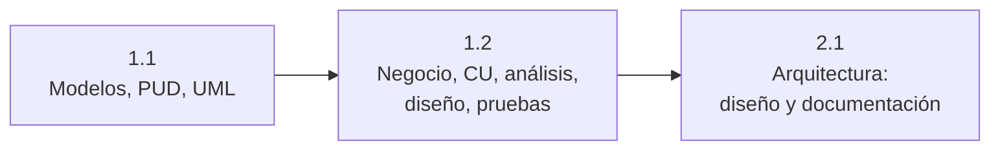

### Cómo leerlo

> [!tip] Antes de empezar
> El método de estudio es el mismo de los libros anteriores: tres niveles, respuesta en cinco pasos y correcciones.

1. Cada capítulo abre con **lo que tenés que poder hacer**.
2. Los diagramas son Mermaid: Obsidian los renderiza.
3. Las **plantillas** y los **procedimientos** están en tablas para copiar a papel.
4. Al final hay errores típicos y ejercicios con solución plegable.
5. La práctica con casos reales está en `PRACTICA_ANALISIS_Y_DISENO/` (20 casos + 4 simulacros).

### Mapa del libro

#### Parte 1 — Fundamentos y UML (1.1)
- 1. Ingeniería de software, proceso y metodología
- 2. Modelos de proceso y PUD
- 3. UML: lenguaje, bloques y reglas
- 4. Diagramas UML y vistas 4+1
- Cierre de la Parte 1

#### Parte 2 — Del negocio al diseño (1.2)
- 5. Modelo de negocio y modelo de dominio
- 6. Captura de requerimientos
- 7. Modelo de casos de uso
- 8. Especificación de casos de uso
- 9. Prototipos de interfaz
- 10. Modelo del análisis
- 11. Modelo de diseño y DCD
- 12. Diagrama de secuencia paso a paso
- 13. GRASP: asignar responsabilidades
- 14. Modelo de implementación
- 15. Modelo de pruebas
- Cierre de la Parte 2

#### Parte 3 — Arquitectura (2.1)
- 16. Arquitectura: elementos, estilos y decisiones
- 17. Documentación, implementación y testeo de la arquitectura
- Cierre de la Parte 3

#### Anexos
- A. Plantillas para el escrito
- B. Banco de preguntas de oral
- C. Errores frecuentes
- D. Mapa del programa y trazabilidad
- E. OCL y patrones GoF — *opcional, fuera del programa S21*

### El caso que atraviesa el libro

> [!example] Caso integrador
> Un municipio contrata un sistema para gestionar **dispositivos** (semáforos y cámaras), las **alertas** que generan y las **reparaciones**.
>
> - El operador registra dispositivos y consulta alertas.
> - El técnico atiende visitas y registra reparaciones.
> - El supervisor consulta reportes por prioridad.
>
> El mismo caso se usa en `PRACTICA_ANALISIS_Y_DISENO/` para los simulacros del escrito.

### Regla de oro del módulo

> [!important] Lo que evalúa el tribunal
> No es “dibujar lindo”: es **justificar decisiones**. Cada artefacto (CU, clase, componente, nodo) tiene que poder explicarse con un “por qué”.

<div style="page-break-after: always;"></div>

# 1. Ingeniería de software, proceso y metodología

> [!info] Al terminar este capítulo tenés que poder
> - Definir ingeniería de software, proceso y metodología.
> - Explicar por qué se modela.
> - Distinguir modelo estructural de modelo de comportamiento.
> - Diferenciar metodología estructurada de orientada a objetos.

> [!abstract] Qué debés saber (nivel 1)
> - **Ingeniería de software:** disciplina que aplica un enfoque sistemático al desarrollo.
> - **Proceso:** conjunto de actividades que transforman requisitos en software.
> - **Metodología:** filosofías + fases + procedimientos + reglas + técnicas + herramientas + documentación.
> - **Modelo:** simplificación de la realidad que da los planos del sistema.
> - Se modela para **comprender, visualizar, especificar, documentar y construir**.
> - Modelo **estructural** = organización; modelo de **comportamiento** = dinámica.

## 1.1 Qué es la ingeniería de software

> [!quote] Definición de cátedra
> **Ingeniería de software:** disciplina de la ingeniería que se interesa por todos los aspectos del desarrollo de software, desde las etapas iniciales de especificación hasta el mantenimiento, aplicando un enfoque sistemático, disciplinado y cuantificable.

Tres ideas que la definición exige:

1. **No es solo programar**: cubre especificación, diseño, construcción, pruebas y evolución.
2. **Es ingeniería**: hay métodos, mediciones y control.
3. **Es social**: participan clientes, usuarios, desarrolladores y stakeholders.

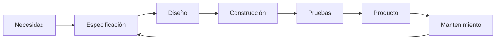

## 1.2 Proceso, modelo de proceso y metodología

| Concepto | Definición | Ejemplo |
|---|---|---|
| **Proceso de software** | Conjunto de actividades que transforman requisitos en un sistema | Especificar, diseñar, construir, probar |
| **Modelo de proceso** | Organización de esas actividades en el tiempo | Cascada, incremental, PUD |
| **Metodología** | Filosofías, fases, procedimientos, reglas, técnicas, herramientas, documentación y formación | PUD con UML; estructurada con DFD |

> [!important] No son sinónimos
> El **proceso** es *qué* actividades; el **modelo de proceso** es *cómo se ordenan*; la **metodología** agrega técnicas, herramientas y reglas. En el oral, definí los tres.

### Componentes de una metodología

| Componente | Qué aporta |
|---|---|
| Filosofía | Principios y paradigma |
| Fases | Etapas del ciclo |
| Procedimientos | Pasos concretos |
| Reglas | Restricciones de aplicación |
| Técnicas | Diagramas, notaciones |
| Herramientas | CASE, IDE |
| Documentación | Artefactos |
| Formación | Capacitación del equipo |

## 1.3 Por qué modelar

> [!quote] Cátedra
> **Modelo:** simplificación de la realidad que proporciona los planos de un sistema. Puede ser general o detallado.

Un modelo permite:

| Objetivo | Pregunta que responde |
|---|---|
| Comprender | ¿Cómo funciona el dominio? |
| Visualizar | ¿Qué forma tiene el sistema? |
| Especificar | ¿Qué debe hacer exactamente? |
| Documentar | ¿Qué decisiones se tomaron? |
| Construir | ¿Qué se implementa? |
| Comunicar | ¿Todos entienden lo mismo? |

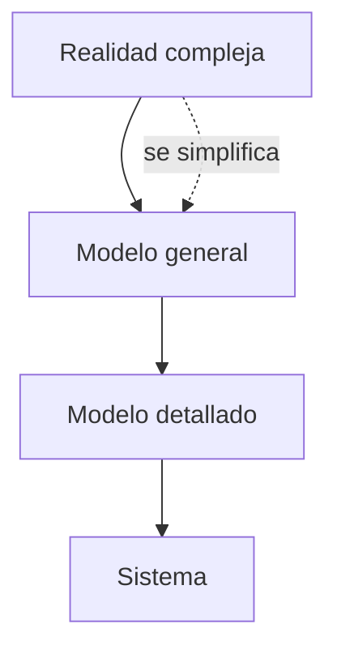

> [!warning] Un modelo no es la realidad
> Omite detalles a propósito. Si el modelo intenta reflejar todo, deja de ser útil. La abstracción es una decisión de diseño.

## 1.4 Modelo estructural y de comportamiento

| Modelo | Qué resalta | Diagramas típicos |
|---|---|---|
| **Estructural** | Organización estática: clases, objetos, componentes, nodos | Clases, objetos, componentes, despliegue |
| **De comportamiento** | Dinámica: interacciones, estados, actividades | Casos de uso, secuencia, comunicación, estados, actividades |

> [!important] Se complementan
> Uno sin el otro es incompleto: la clase `Alerta` (estructura) no dice nada de cómo cambia de estado (comportamiento).

## 1.5 Metodologías estructuradas vs. orientadas a objetos

| Aspecto | Estructurada | Orientada a objetos |
|---|---|---|
| Unidad | Función / proceso | Objeto / clase |
| Datos y procesos | Separados | Integrados |
| Modelado | DFD, diccionario de datos | UML: clases, CU, secuencia |
| Cambio | Se propaga entre módulos | Se encapsula en el objeto |
| Reutilización | Baja | Alta |

> [!quote] Cátedra
> **Modelo de objetos:** marco de referencia conceptual compuesto por abstracción, encapsulamiento, modularidad y jerarquía.

### Los cuatro principios, con ejemplo

| Principio | Qué hace | Dónde se ve en UML |
|---|---|---|
| **Abstracción** | Se queda con lo esencial y descarta el detalle | `Dispositivo` sin marca ni modelo |
| **Encapsulamiento** | Oculta el estado y expone una interfaz | Atributos `-` y operaciones `+` |
| **Modularidad** | Agrupa lo relacionado con bajo acoplamiento | Paquetes y componentes |
| **Jerarquía** | Ordena por generalización/especialización y por todo/parte | Herencia y composición |

> [!important] Objeto = estado + comportamiento + identidad
> `S-102` y `S-103` pueden estar los dos en rojo y seguir siendo **objetos distintos**: la identidad no se deduce de los valores. La **clase** describe lo común (atributos, operaciones, relaciones); el **objeto** es una instancia concreta.
>
> Esa distinción ordena el resto del libro: en **análisis** se habla de responsabilidades, en **diseño** de operaciones con firma y en **implementación** de métodos.

> [!warning] El material de Siglo 21 lo dice explícito
> La programación estructurada **no desaparece**: se aplica **dentro de los métodos** de las clases. No es “una u otra”; es “una dentro de la otra”.

## 1.6 El principio que ordena todo el módulo

> [!important] Separar el problema de la solución
> - **Análisis** responde **qué** debe hacer el sistema, sin decidir tecnología.
> - **Diseño** responde **cómo** se implementa: clases, componentes, nodos, decisiones tecnológicas.
>
> Confundirlos es el error conceptual más caro del EFIP.

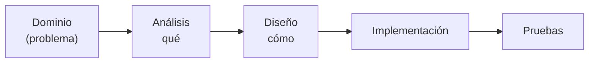

## Método: cómo encarar un enunciado

| Paso | Pregunta | Producto |
|---|---|---|
| 1 | ¿Quién pide el sistema y para qué? | Objetivo y alcance |
| 2 | ¿Qué procesos del negocio lo rodean? | Modelo de negocio |
| 3 | ¿Qué debe hacer el sistema? | RF / CU |
| 4 | ¿Qué restricciones tiene? | RNF |
| 5 | ¿Qué información maneja? | Modelo de dominio |
| 6 | ¿Cómo se estructura la solución? | Análisis y diseño |
| 7 | ¿Cómo se verifica? | Pruebas |

## Errores que suelen tomar

| Error | Corrección |
|---|---|
| Decir “metodología” cuando hablan de proceso | Definir los tres conceptos |
| Creer que modelar es dibujar | Es abstraer para decidir |
| Mezclar análisis con diseño | Qué vs. cómo |
| Decir que OO reemplaza a la estructurada | Conviven: la estructurada vive en los métodos |
| Presentar un solo modelo como suficiente | Estructural + comportamiento |

## Ejercicios

> [!example] 1. Definiciones
> **Enunciado:** diferenciá proceso, modelo de proceso y metodología.
> **Solución:** proceso = actividades; modelo = orden de esas actividades (cascada, PUD); metodología = filosofía + fases + procedimientos + reglas + técnicas + herramientas + documentación + formación.

> [!example] 2. Modelos
> **Enunciado:** ¿un diagrama de clases es estructural o de comportamiento? ¿Y uno de estados?
> **Solución:** clases = estructural; estados = comportamiento.

> [!example] 3. Análisis vs. diseño
> **Enunciado:** “El sistema debe registrar alertas con prioridad” ¿es análisis o diseño? ¿Y “la alerta se guarda en la tabla `alerta`”?
> **Solución:** lo primero es **análisis** (qué); lo segundo es **diseño/implementación** (cómo).

> [!example] 4. a papel
> **Enunciado:** escribí en 5 líneas por qué se modela antes de programar.
> **Solución:** porque permite comprender el dominio, comunicar decisiones, detectar errores temprano (más baratos), especificar con precisión y documentar la solución. El código es la última consecuencia del modelo, no el punto de partida.


<div style="page-break-after: always;"></div>


# 2. Modelos de proceso y PUD

> [!info] Al terminar este capítulo tenés que poder
> - Comparar cascada, incremental y espiral.
> - Explicar las tres características del PUD.
> - Nombrar las cuatro fases, sus objetivos y sus hitos.
> - Distinguir fase, iteración e incremento.

> [!abstract] Qué debés saber (nivel 1)
> - **Cascada:** secuencial; cada fase empieza cuando termina la anterior.
> - **Incremental:** se entrega por partes; cada incremento agrega funcionalidad.
> - **Espiral:** iterativo con análisis de riesgos.
> - **PUD/RUP:** iterativo e incremental, **dirigido por casos de uso**, **centrado en la arquitectura**.
> - Fases: **Inicio → Elaboración → Construcción → Transición**.
> - Fase ≠ iteración ≠ incremento.

## 2.1 Por qué un modelo de proceso

Un proceso ordena el trabajo: qué se hace primero, qué se entrega y cuándo. Sin modelo, el equipo improvisa y el riesgo se descubre tarde.

| Modelo | Forma | Ventaja | Riesgo |
|---|---|---|---|
| **Cascada** | Secuencial | Simple, fácil de contratar | Los cambios son caros; el cliente ve el producto al final |
| **Incremental** | Por incrementos | Entregas tempranas | Requiere buena priorización |
| **DRA (desarrollo rápido)** | Incremental acelerado, por componentes | Entrega muy rápida y mucha participación del usuario | Exige equipo disponible y alcance modularizable |
| **Prototipos** | Versión preliminar que se evalúa y se descarta | Descubre requisitos que el usuario no sabe explicar | Se confunde el prototipo con el producto final |
| **Espiral** | Iterativo + riesgos | Gestiona riesgos | Complejo de administrar |
| **PUD** | Iterativo, por fases | Arquitectura temprana y entregas | Requiere disciplina |

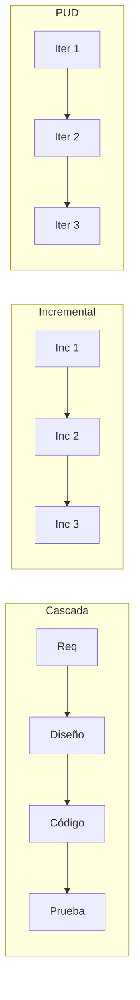

> [!warning] El error de “cascada con iteraciones”
> Un proceso no se vuelve iterativo por repetir reuniones. Lo es cuando **cada iteración produce un incremento ejecutable** y **refina la arquitectura**.

> [!important] DRA no es “programar rápido”
> El **desarrollo rápido de aplicaciones** es una variante del incremental: ciclos muy cortos, construcción basada en componentes y usuarios disponibles de verdad. Fracasa cuando el alcance no se puede modularizar o no hay quién valide.

## 2.2 El PUD

> [!quote] Definición de cátedra
> **PUD/RUP:** proceso de desarrollo de software que utiliza UML para preparar los esquemas de un sistema y fue propuesto por los creadores de UML.

### Las tres características

| Característica | Qué significa | Consecuencia |
|---|---|---|
| **Dirigido por casos de uso** | Los CU guían requisitos, diseño, implementación y prueba | El CU es el hilo conductor |
| **Centrado en la arquitectura** | La arquitectura se define temprano y se valida en cada iteración | Se mitiga el riesgo técnico |
| **Iterativo e incremental** | Se construye en iteraciones cortas que producen incrementos | Entregas tempranas y feedback |

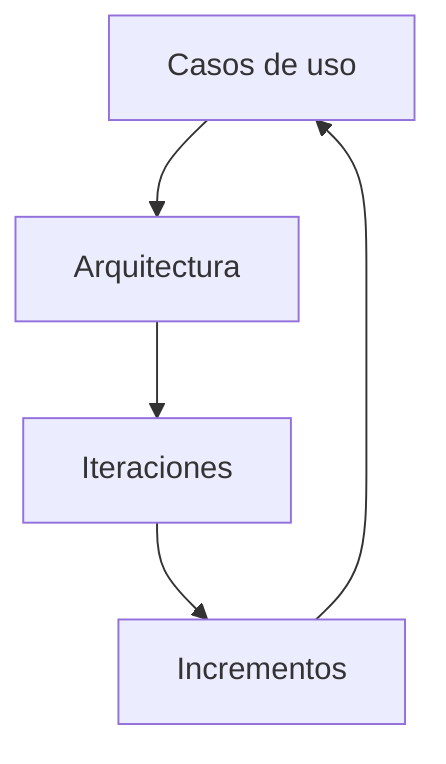

> [!important] Cómo se relacionan
> Los casos de uso **definen** qué construir; la arquitectura **sostiene** lo construido; las iteraciones **verifican** ambos. Si falta uno, el PUD deja de ser PUD.

> [!tip] Si el tribunal agrega “orientado a riesgos”
> Es correcto como **consecuencia**, no como cuarta característica: las iteraciones tempranas atacan primero los riesgos importantes y así estabilizan la arquitectura. Decilo así y no perdés el marco de las tres.

## 2.3 Las cuatro fases

| Fase | Objetivo | Hito | Pregunta que responde |
|---|---|---|---|
| **Inicio** | Alcance y viabilidad | *Lifecycle Objective* | ¿Vale la pena? |
| **Elaboración** | Arquitectura base y riesgos | *Lifecycle Architecture* | ¿Podemos construirlo? |
| **Construcción** | Producto completo | *Initial Operational Capability* | ¿Está terminado? |
| **Transición** | Entrega al usuario | *Product Release* | ¿Funciona en producción? |

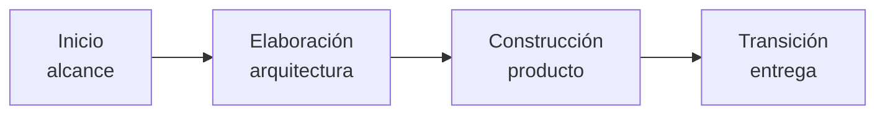

### Qué se hace en cada fase

| Fase | Actividades típicas | Artefactos |
|---|---|---|
| Inicio | Visión, alcance, casos de uso principales, riesgos | Documento de visión, modelo de CU preliminar |
| Elaboración | Arquitectura candidata, CU críticos, prototipos | Línea base de arquitectura, modelo de análisis/diseño |
| Construcción | Implementar el resto, integrar, probar | Construcciones ejecutables, manuales |
| Transición | Beta, correcciones, capacitación | Versión de producción |

> [!warning] “Todas las fases hacen todo”
> En cada fase se recorren **todas** las disciplinas, pero con distinto énfasis. En Inicio casi no hay implementación; en Construcción casi no hay modelado de negocio.

## 2.4 Fase, iteración e incremento

| Concepto | Definición | Ejemplo |
|---|---|---|
| **Fase** | Etapa del ciclo con un objetivo e hito | Elaboración |
| **Iteración** | Miniproyecto que recorre flujos de trabajo y produce un incremento | Iteración 2 de Elaboración |
| **Incremento** | Crecimiento del producto al terminar la iteración | “Alta de dispositivos + consulta de alertas” |

> [!important] La confusión que se pregunta
> Una fase contiene **varias** iteraciones; cada iteración produce **un** incremento. No son sinónimos.

## 2.5 Disciplinas del PUD

| Disciplina | Qué produce |
|---|---|
| Modelado de negocio | Modelo de negocio |
| Requisitos | Modelo de casos de uso |
| Análisis y diseño | Modelo de análisis y de diseño |
| Implementación | Componentes y construcciones |
| Pruebas | Modelo y plan de pruebas |
| Despliegue | Versión instalada |
| Gestión de configuración | Versiones y cambios |
| Gestión de proyecto | Planes y seguimiento |
| Entorno | Herramientas y proceso |

> [!tip] Para el oral
> “El PUD tiene flujos de trabajo **principales** (negocio, requisitos, análisis, diseño, implementación, pruebas, despliegue) y **de apoyo** (configuración, proyecto, entorno). Cada fase recorre todos, con énfasis distinto.”

## 2.6 Método: ubicar una actividad en la fase correcta

| Pregunta | Si la respuesta es… | Va en… |
|---|---|---|
| ¿Estamos definiendo alcance y riesgos? | Sí | Inicio |
| ¿Estamos estabilizando la arquitectura? | Sí | Elaboración |
| ¿Estamos completando funcionalidad? | Sí | Construcción |
| ¿Estamos corrigiendo en el cliente? | Sí | Transición |
| ¿Es una actividad de requisitos? | Sí | Todas las fases, con énfasis en Inicio/Elaboración |

## 2.7 Comparación final

| Criterio | Cascada | PUD |
|---|---|---|
| Entrega | Al final | Por iteraciones |
| Cambios | Caros | Esperados |
| Arquitectura | Se define al principio y se congela | Se define y **se valida** temprano |
| Riesgo | Se descubre tarde | Se ataca en Elaboración |
| Documentación | Exhaustiva por fase | Viva, por artefactos |

## Errores que suelen tomar

| Error | Corrección |
|---|---|
| Confundir fase con iteración | La fase contiene iteraciones |
| Decir que el PUD es cascada | Es iterativo e incremental |
| Nombrar las fases en otro orden | Inicio, Elaboración, Construcción, Transición |
| Decir que UML es una metodología | UML es lenguaje; el PUD es proceso |
| Creer que en Elaboración no se programa | Se hacen prototipos y se valida la arquitectura |
| Olvidar el hito de cada fase | Cada fase termina en un hito |

## Ejercicios

> [!example] 1. Fases
> **Enunciado:** ¿en qué fase se define la línea base de la arquitectura?
> **Solución:** Elaboración, cuyo hito es *Lifecycle Architecture*.

> [!example] 2. Fase vs. iteración
> **Enunciado:** “Iteración 3 de Construcción” ¿es una fase?
> **Solución:** no: es una iteración dentro de la fase Construcción.

> [!example] 3. Características
> **Enunciado:** nombrá las tres características del PUD y explicá una.
> **Solución:** dirigido por casos de uso, centrado en la arquitectura, iterativo e incremental. Los CU guían todo el ciclo: de ellos salen los requisitos, las realizaciones de diseño y los casos de prueba.

> [!example] 4. Modelos
> **Enunciado:** ¿cuándo conviene cascada?
> **Solución:** cuando los requisitos son estables y el riesgo es bajo; por ejemplo, un sistema reglamentado con alcance cerrado.

> [!example] 5. a papel
> **Enunciado:** dibujá las cuatro fases con su hito y una frase de objetivo.
> **Solución:** ver 2.3. Debe incluir Inicio → Objetivo del ciclo; Elaboración → Arquitectura; Construcción → Capacidad operativa inicial; Transición → Release.


<div style="page-break-after: always;"></div>


# 3. UML: lenguaje, bloques y reglas

> [!info] Al terminar este capítulo tenés que poder
> - Explicar por qué UML es lenguaje y no metodología.
> - Nombrar los bloques de construcción y las relaciones.
> - Aplicar las reglas de nombres, alcance y visibilidad.
> - Usar estereotipos, restricciones y notas.

> [!abstract] Qué debés saber (nivel 1)
> - **UML:** lenguaje estándar para visualizar, especificar, construir y documentar artefactos de software.
> - **No es un método**: no dice qué hacer primero ni cuándo.
> - Bloques: **cosas**, **relaciones**, **diagramas**.
> - Relaciones: dependencia, asociación, generalización, realización.
> - Mecanismos comunes: especificaciones, adornos, divisiones comunes y extensibilidad.

## 3.1 Qué es UML

> [!quote] Definición de cátedra
> **UML:** lenguaje estándar para escribir los planos de un software, visualizarlos, especificarlos, construirlos y documentar los artefactos de un sistema.

| UML **es** | UML **no es** |
|---|---|
| Un lenguaje de modelado | Una metodología |
| Una notación estándar | Un proceso |
| Independiente del proceso | Una herramienta |
| Extensible | Un lenguaje de programación |

> [!important] La trampa clásica
> “Usamos UML como metodología” → **mal**. UML dice **cómo se dibuja**; el PUD dice **qué hacer y en qué orden**. Se complementan, no se sustituyen.

### Las tres características que la cátedra destaca

1. **Es un lenguaje**: tiene vocabulario (bloques) y reglas (cómo combinarlos).
2. **Es independiente del proceso**: sirve para cascada, PUD o ágil.
3. **Permite modelar sistemas complejos**: desde un CU hasta el despliegue.

## 3.2 Bloques de construcción

### Cosas

| Tipo | Qué representa | Ejemplo |
|---|---|---|
| **Estructurales** | La parte estática | Clase, interfaz, componente, nodo, caso de uso |
| **De comportamiento** | La parte dinámica | Interacción, máquina de estados |
| **De agrupación** | Organización | Paquete |
| **De anotación** | Explicación | Nota |

### Relaciones

| Relación | Notación | Significado | Ejemplo |
|---|---|---|---|
| **Dependencia** | flecha discontinua `..>` | Un elemento usa a otro | `Servicio ..> Repositorio` |
| **Asociación** | línea `—` | Comunicación estructural | `Cliente — Pedido` |
| **Generalización** | triángulo hueco `<|--` | “Es un” | `Camara --|> Dispositivo` |
| **Realización** | triángulo hueco discontinuo `<|..` | Implementa un contrato | `Camara ..|> Activable` |

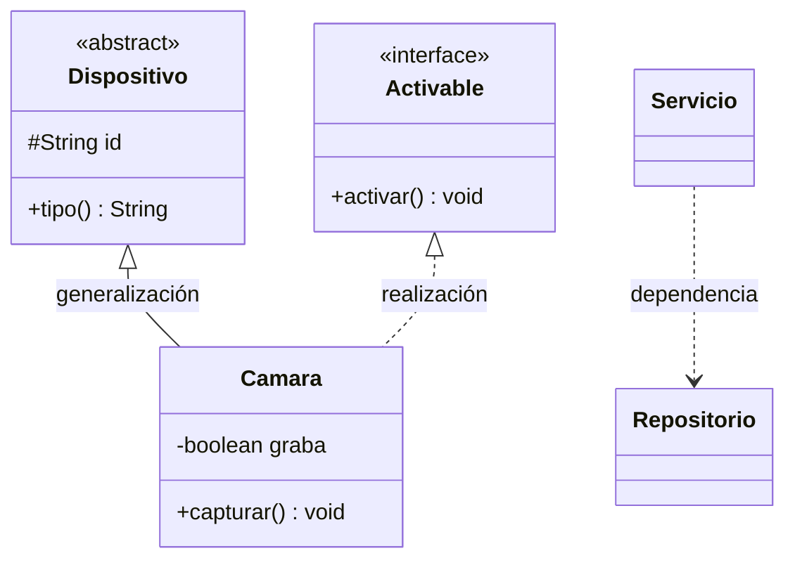

> [!important] Asociación vs. dependencia
> La **asociación** es estructural y duradera (un atributo). La **dependencia** es de uso puntual (un parámetro, una variable local, una llamada).

### Adornos de la asociación

| Adorno | Qué indica | Ejemplo |
|---|---|---|
| **Rol** | Qué papel cumple ese extremo | `Persona` es *titular* en `Póliza` |
| **Multiplicidad** | Cuántas instancias participan | `1..1`, `0..*`, `1..*` |
| **Navegabilidad** | Desde qué clase se puede llegar a la otra | `Pedido → LineaPedido` |

### Agregación y composición

Son dos intensidades del “todo/parte”. La diferencia es **quién sobrevive**:

| Relación | Notación | Vida de la parte | Ejemplo |
|---|---|---|---|
| **Asociación** | línea `—` | Independiente | `Técnico — Reparación` |
| **Agregación** | rombo hueco `◇—` | Independiente: la parte existe sin el todo | `Equipo ◇— Técnico` |
| **Composición** | rombo relleno `◆—` | Dependiente: la parte no existe sin el todo | `Alquiler ◆— Cuota` |

> [!important] La prueba para decidir
> Preguntá: “si borro el todo, ¿la parte sigue teniendo sentido?”. Si sigue → **agregación**; si no → **composición**. Y si el vínculo es solo de uso (un parámetro, una llamada) → **dependencia**, no asociación.

## 3.3 Reglas de UML

UML define reglas para que un modelo sea **bien formado**:

| Regla | Pregunta | Ejemplo |
|---|---|---|
| **Nombres** | ¿Cómo se llama? | Clase en `UpperCamelCase`; atributo en `lowerCamelCase` |
| **Alcance** | ¿Dónde es visible? | Público, privado, protegido, paquete |
| **Visibilidad** | ¿Quién accede? | `+` público, `-` privado, `#` protegido, `~` paquete |
| **Integridad** | ¿Las relaciones son coherentes? | Una especialización no puede ser circular |
| **Ejecución** | ¿El comportamiento es consistente? | Un estado inicial y uno final |

> [!warning] Modelo “bien formado” no es “modelo correcto”
> UML verifica la **sintaxis** del modelo, no que el modelo resuelva el problema. Eso lo decide el análisis.

## 3.4 Mecanismos comunes

| Mecanismo | Qué es | Ejemplo |
|---|---|---|
| **Especificación** | La semántica detrás del símbolo | La clase `Alerta` además de su dibujo tiene su contrato |
| **Adornos** | Detalles agregados al símbolo | `{ordered}`, `{unique}`, multiplicidad |
| **Divisiones comunes** | Clasificación vs. instancia | Clase vs. objeto |
| **Extensibilidad** | Mecanismos para agregar semántica | Estereotipo, valor etiquetado, restricción |

### Estereotipos y restricciones

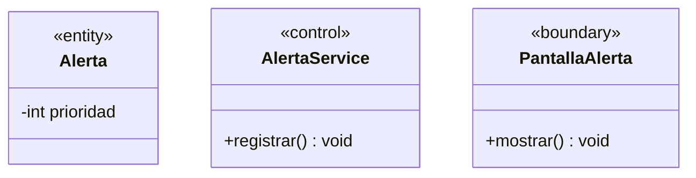

| Elemento | Notación | Uso |
|---|---|---|
| Estereotipo | `<<nombre>>` | Clasificar un elemento con semántica propia |
| Valor etiquetado | `{autor = "equipo"}` | Agregar propiedad |
| Restricción | `{prioridad entre 1 y 5}` | Regla que debe cumplirse |

## 3.5 Lo que UML no decide

| Pregunta | Quién la responde |
|---|---|
| ¿Qué se modela primero? | El proceso (PUD) |
| ¿Qué casos de uso hay? | El análisis del negocio y los requisitos |
| ¿Qué clase tiene cada responsabilidad? | Los patrones de diseño (GRASP) |
| ¿Qué tecnología se usa? | La arquitectura y el entorno |

> [!important] Para el oral
> “UML aporta la notación; el método aporta el orden y los criterios. Un diagrama puede ser UML válido y, aun así, ser un mal diseño.”

## 3.6 Método: leer un diagrama UML en 4 pasos

| Paso | Pregunta |
|---|---|
| 1 | ¿Qué tipo de diagrama es y qué vista representa? |
| 2 | ¿Qué elementos y relaciones aparecen? |
| 3 | ¿Qué reglas o restricciones están anotadas? |
| 4 | ¿Qué decisión de diseño explica? |

> [!example] Aplicación
> Un diagrama de clases con `Dispositivo` abstracta, `Semaforo` y `Camara` como subclases, y una interfaz `Activable`:
> 1. Estructural, vista lógica.
> 2. Dos generalizaciones y una realización.
> 3. `{prioridad 1..5}` en `Alerta`.
> 4. Se decidió modelar “es un” y un contrato de activación.

## Errores que suelen tomar

| Error | Corrección |
|---|---|
| Decir que UML es una metodología | Es un lenguaje |
| Usar un diagrama para todo | Cada diagrama responde una pregunta |
| Mezclar niveles (clase con objeto) | Un diagrama, un nivel |
| Poner todos los miembros públicos | Aplicar visibilidad |
| Olvidar la multiplicidad | Toda asociación la lleva |
| Confundir generalización con realización | Herencia vs. contrato |

## Ejercicios

> [!example] 1. Clasificar
> **Enunciado:** ¿qué relación es `Camara ..|> Activable`?
> **Solución:** realización (implementa un contrato).

> [!example] 2. Bloques
> **Enunciado:** nombrá un elemento estructural, uno de comportamiento y uno de agrupación.
> **Solución:** clase; máquina de estados; paquete.

> [!example] 3. Estereotipo
> **Enunciado:** ¿para qué sirve `<<entity>>`?
> **Solución:** para marcar que la clase representa información del dominio, siguiendo el análisis de Jacobson.

> [!example] 4. a papel
> **Enunciado:** dibujá una clase `Alerta` con dos atributos privados, un método público y una restricción.
> **Solución:**
> ```mermaid
> classDiagram
>     class Alerta {
>         -int prioridad
>         -String mensaje
>         +atender() void
>     }
>     note for Alerta "prioridad 1..5"
> ```


<div style="page-break-after: always;"></div>


# 4. Diagramas UML y vistas 4+1

> [!info] Al terminar este capítulo tenés que poder
> - Clasificar los diagramas en estructurales y de comportamiento.
> - Elegir el diagrama correcto para cada pregunta.
> - Explicar las cinco vistas del modelo 4+1.
> - Dibujar los diagramas que pide el EFIP.

> [!abstract] Qué debés saber (nivel 1)
> - UML 2 tiene **14 tipos** de diagrama; el EFIP usa unos pocos.
> - **Estructurales:** clases, objetos, paquetes, componentes, despliegue.
> - **De comportamiento:** casos de uso, actividad, estados, secuencia, comunicación.
> - **4+1:** lógica, procesos, implementación, despliegue + casos de uso.
> - Cada vista responde una pregunta distinta; no se reemplazan.

## 4.1 Clasificación

| Estructurales (estática) | De comportamiento (dinámica) |
|---|---|
| Clases | Casos de uso |
| Objetos | Actividad |
| Paquetes | Máquina de estados |
| Componentes | Secuencia |
| Estructura compuesta | Comunicación |
| Despliegue | Interacción general |
| Perfil | Tiempos |

> [!tip] Lo que entra en el EFIP
> Clases, objetos, paquetes, componentes, despliegue (estructurales); casos de uso, actividad, estados, secuencia y comunicación (comportamiento). El resto se menciona.

## 4.2 Qué responde cada diagrama

| Diagrama | Pregunta que responde | Ejemplo |
|---|---|---|
| **Casos de uso** | ¿Qué hace el sistema y para quién? | Operador registra alerta |
| **Actividad** | ¿Cómo es el flujo de un proceso? | Flujo de atención de una alerta |
| **Estados** | ¿Cómo cambia un objeto en el tiempo? | Alerta: pendiente → atendida |
| **Secuencia** | ¿Cómo colaboran los objetos en el tiempo? | Pantalla → controlador → entidad |
| **Comunicación** | ¿Qué objetos colaboran y con qué mensajes? | Misma información, otra vista |
| **Clases** | ¿Qué clases hay y cómo se relacionan? | Dispositivo, Alerta |
| **Objetos** | ¿Cómo es una instancia concreta? | `s1: Semaforo` |
| **Paquetes** | ¿Cómo se agrupa el modelo? | `dominio`, `aplicacion`, `ui` |
| **Componentes** | ¿Qué piezas de software hay? | `gestor-alertas.jar` |
| **Despliegue** | ¿Dónde se ejecuta? | Servidor, PC, red |

## 4.3 Ejemplos mínimos

### Casos de uso

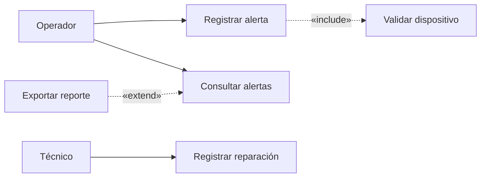

### Secuencia

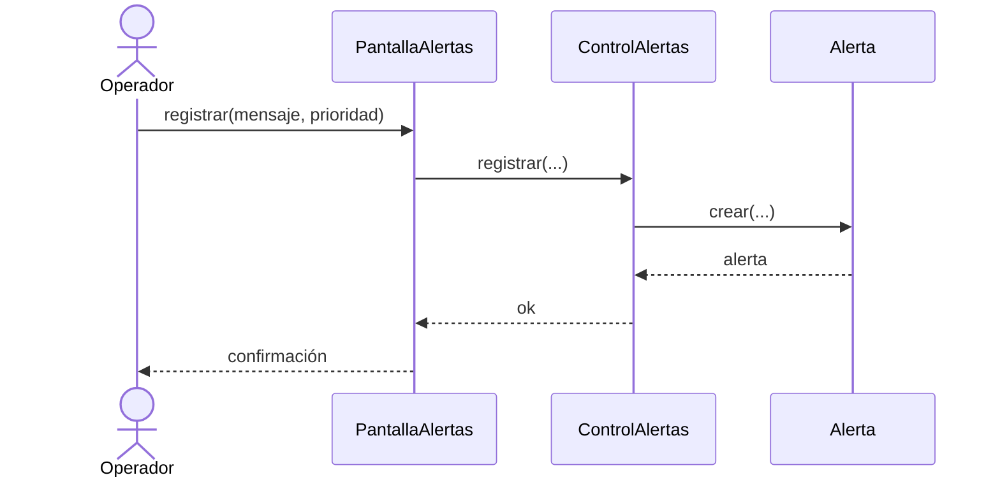

> [!tip] La receta completa
> Este es un ejemplo mínimo. El **método de 5 pasos**, el orden obligatorio de las líneas de vida, los tres tipos de flecha y los marcos `alt/opt/loop` están en 12. Diagrama de secuencia paso a paso.

### Estados

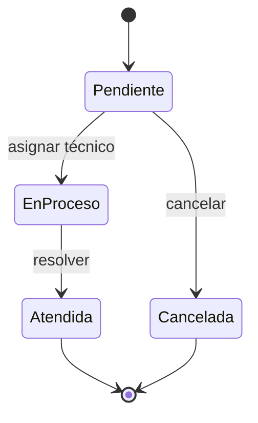

### Actividad

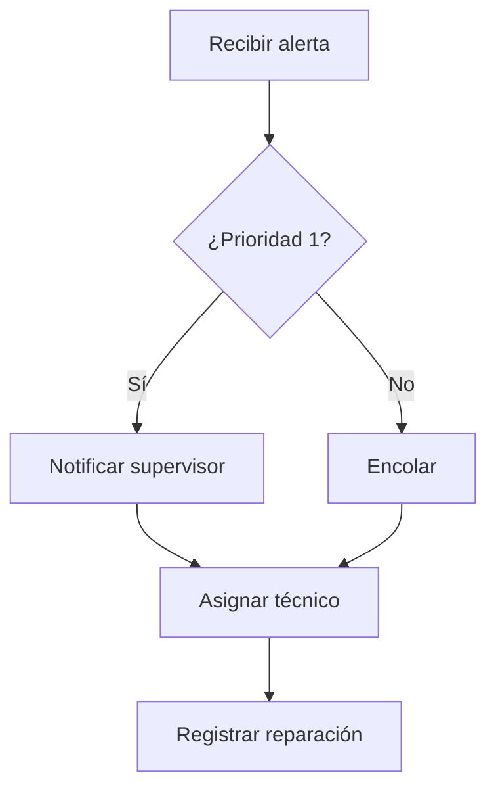

### Componentes

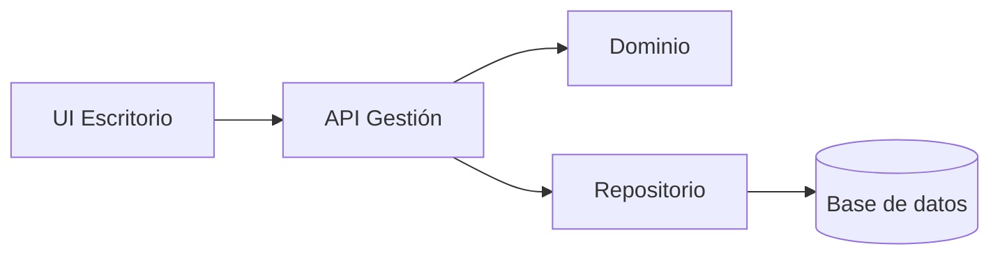

### Despliegue

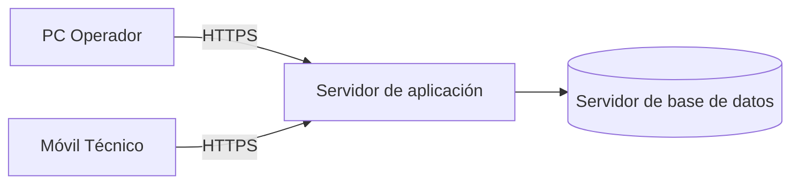

## 4.4 El modelo 4+1

Kruchten propone describir la arquitectura con **cuatro vistas** y **un conjunto de escenarios** que las valida.

| Vista | Qué muestra | Diagramas típicos | Stakeholder |
|---|---|---|---|
| **Lógica** | Estructura de clases y objetos | Clases, objetos, paquetes | Desarrolladores |
| **Procesos** | Concurrencia y actividades en ejecución | Actividad, secuencia | Integradores |
| **Implementación** | Componentes y su organización | Componentes, paquetes | Programadores |
| **Despliegue** | Nodos físicos y distribución | Despliegue | Operaciones |
| **Casos de uso** (+1) | Escenarios que validan las vistas | Casos de uso | Usuarios y cliente |

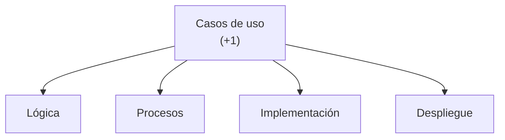

> [!important] Por qué “+1”
> Las cuatro vistas no se validan solas: los **escenarios** (casos de uso) verifican que la arquitectura soporta lo que el usuario necesita. Si un CU crítico no se puede realizar con la arquitectura, la arquitectura está mal.

## 4.5 Método: elegir el diagrama

| Si la pregunta es… | Usá… |
|---|---|
| ¿Quién usa el sistema y para qué? | Casos de uso |
| ¿Cómo se comporta un objeto según su estado? | Estados |
| ¿Cómo colaboran los objetos para un CU? | Secuencia |
| ¿Qué clases y relaciones hay? | Clases |
| ¿Cómo se agrupa el modelo? | Paquetes |
| ¿Qué piezas de software se entregan? | Componentes |
| ¿En qué máquinas corre? | Despliegue |
| ¿Cómo es el proceso de negocio? | Actividad |

> [!warning] No mezcles vistas
> Un diagrama de despliegue no lleva atributos de clase; un diagrama de clases no lleva servidores. Cada vista tiene su nivel.

## 4.6 Del diagrama al argumento

> [!example] Cómo justificar
> “Para el flujo de atención uso un **diagrama de actividad** porque necesito mostrar decisiones y paralelismo del proceso. Para la colaboración de objetos en el CU uso **secuencia**, porque importa el orden temporal de los mensajes. Para la estructura estática, **clases**.”
>
> Eso es lo que el tribunal quiere: **no** “dibujé los tres”.

## Errores que suelen tomar

| Error | Corrección |
|---|---|
| Usar secuencia para mostrar estructura | Es comportamiento |
| Poner lógica de negocio en el diagrama de CU | El CU muestra funcionalidad, no flujo interno |
| Confundir componente con nodo | Componente = software; nodo = hardware |
| Olvidar la vista de despliegue | La arquitectura también es física |
| Presentar 4+1 como “cuatro diagramas” | Son vistas, con varios diagramas cada una |

## Ejercicios

> [!example] 1. Clasificar
> **Enunciado:** ¿estructural o de comportamiento? Clases, estados, componentes, secuencia, despliegue.
> **Solución:** estructurales: clases, componentes, despliegue. Comportamiento: estados, secuencia.

> [!example] 2. Elegir
> **Enunciado:** necesitás mostrar que una alerta pasa por pendiente, en proceso y atendida. ¿Qué diagrama?
> **Solución:** máquina de estados.

> [!example] 3. Vistas
> **Enunciado:** ¿qué vista describe los servidores?
> **Solución:** despliegue.

> [!example] 4. 4+1
> **Enunciado:** ¿por qué los casos de uso son el “+1”?
> **Solución:** porque validan las otras cuatro vistas: si un CU crítico no se puede realizar, la arquitectura falla.

> [!example] 5. a papel
> **Enunciado:** dibujá un diagrama de secuencia para “registrar alerta” con actor, pantalla, control y entidad.
> **Solución:** ver 4.3. Debe tener el actor a la izquierda, mensajes en orden y retorno.


<div style="page-break-after: always;"></div>


# Cierre de la Parte 1 — Fundamentos y UML

> [!info] Qué hacer con este archivo
> Verificación, no contenido nuevo.

## Checklist de la Parte 1

| Puedo… | Capítulo | ✔ |
|---|---|---|
| Definir ingeniería de software, proceso y metodología | Cap. 1 | ☐ |
| Explicar por qué se modela y qué es un modelo | Cap. 1 | ☐ |
| Diferenciar modelo estructural de comportamiento | Cap. 1 | ☐ |
| Comparar cascada, incremental y PUD | Cap. 2 | ☐ |
| Nombrar las tres características del PUD | Cap. 2 | ☐ |
| Ubicar cada fase, su objetivo y su hito | Cap. 2 | ☐ |
| Distinguir fase, iteración e incremento | Cap. 2 | ☐ |
| Explicar por qué UML no es metodología | Cap. 3 | ☐ |
| Nombrar bloques y relaciones | Cap. 3 | ☐ |
| Aplicar visibilidad y estereotipos | Cap. 3 | ☐ |
| Elegir el diagrama correcto | Cap. 4 | ☐ |
| Explicar las cinco vistas del 4+1 | Cap. 4 | ☐ |

## Diferencias que no podés confundir

| A | B | Diferencia central |
|---|---|---|
| Proceso | Metodología | Actividades vs. filosofía + fases + técnicas + reglas + herramientas |
| Cascada | PUD | Secuencial vs. iterativo e incremental |
| Fase | Iteración | Etapa con hito vs. miniproyecto que produce un incremento |
| UML | PUD | Lenguaje vs. proceso |
| Estructural | Comportamiento | Organización vs. dinámica |
| Componente | Nodo | Software vs. hardware |
| Vista lógica | Vista de despliegue | Clases vs. servidores |

## Ejercicio integrador de la Parte 1

> [!example] Enunciado (15 minutos)
> 1. Ubicá estas actividades en la fase del PUD: definir alcance, estabilizar la arquitectura, implementar funcionalidad restante, corregir errores reportados por el cliente.
> 2. Elegí el diagrama para: (a) estados de una alerta, (b) colaboración de objetos, (c) máquinas donde corre el sistema, (d) actores y funcionalidad.
> 3. Explicá en 3 líneas por qué UML no es una metodología.

> [!success] Solución
> **1.** Inicio: definir alcance. Elaboración: estabilizar arquitectura. Construcción: implementar el resto. Transición: corregir lo reportado.
> **2.** (a) estados; (b) secuencia o comunicación; (c) despliegue; (d) casos de uso.
> **3.** Porque UML solo aporta notación y reglas de buena formación; no define qué artefactos hacer, en qué orden ni con qué criterios. Eso lo aporta el proceso (PUD).

## Oral de la Parte 1 (8 preguntas)

> [!question] 1. ¿Qué es una metodología?
> Conjunto de filosofías, fases, procedimientos, reglas, técnicas, herramientas, documentación y formación para desarrollar sistemas.

> [!question] 2. ¿Por qué se modela?
> Para comprender, visualizar, especificar, documentar y construir, reduciendo la complejidad y detectando errores temprano.

> [!question] 3. ¿Qué caracteriza al PUD?
> Dirigido por casos de uso, centrado en la arquitectura, iterativo e incremental.

> [!question] 4. ¿Cuáles son las fases y sus hitos?
> Inicio (objetivo del ciclo), Elaboración (arquitectura), Construcción (capacidad operativa inicial), Transición (release).

> [!question] 5. ¿Qué diferencia hay entre fase e iteración?
> La fase es una etapa con un hito; la iteración es un miniproyecto dentro de la fase que produce un incremento.

> [!question] 6. ¿UML es una metodología?
> No: es un lenguaje de modelado independiente del proceso.

> [!question] 7. ¿Qué es el modelo 4+1?
> Cuatro vistas (lógica, procesos, implementación, despliegue) más los escenarios (casos de uso) que las validan.

> [!question] 8. ¿Qué diferencia hay entre análisis y diseño?
> El análisis responde qué debe hacer el sistema; el diseño, cómo se implementa.


<div style="page-break-after: always;"></div>


# 5. Modelo de negocio y modelo de dominio

> [!info] Al terminar este capítulo tenés que poder
> - Modelar el negocio antes del sistema.
> - Distinguir actor, trabajador y entidad de negocio.
> - Construir un modelo de dominio con las reglas de la cátedra.
> - Decidir cuándo un atributo debe ser una clase.

> [!abstract] Qué debés saber (nivel 1)
> - **Modelo de negocio:** describe los procesos del negocio para entenderlos y derivar requisitos.
> - **Caso de uso de negocio:** secuencia que produce un resultado de valor para un actor del negocio.
> - **Trabajador:** rol interno que ejecuta el proceso.
> - **Entidad de negocio:** objeto que los trabajadores usan o producen.
> - **Modelo de dominio:** clases conceptuales del problema, con atributos y asociaciones.
> - **No se modela la empresa cliente como clase.**

## 5.1 Por qué empezar por el negocio

El sistema no existe en el vacío: automatiza (o cambia) un proceso que ya existe. Si no entendés el negocio, modelás la solución equivocada.

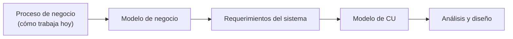

| Pregunta | Artefacto |
|---|---|
| ¿Quién hace qué en el negocio? | Casos de uso de negocio |
| ¿Qué roles internos intervienen? | Trabajadores |
| ¿Qué información se produce o consume? | Entidades de negocio |
| ¿Qué debe hacer el sistema? | Casos de uso del sistema |

## 5.2 Elementos del modelo de negocio

| Elemento | Definición | Ejemplo (municipio) |
|---|---|---|
| **Actor de negocio** | Rol externo al negocio | Vecino, proveedor |
| **Trabajador de negocio** | Rol interno que ejecuta el proceso | Operador de monitoreo, técnico |
| **Entidad de negocio** | Objeto que se toma, inspecciona, produce o usa | Alerta, reparación |
| **Caso de uso de negocio** | Secuencia que produce valor | Atender una alerta |
| **Unidad organizacional** | Área responsable | Centro de monitoreo |

> [!important] Actor de negocio ≠ actor del sistema
> El **actor de negocio** está fuera del negocio. El **actor del sistema** interactúa con el software. Un trabajador de negocio puede ser actor del sistema (el operador usa la pantalla), pero no son el mismo concepto.

## 5.3 Modelo de dominio

> [!quote] Cátedra
> El **modelo de dominio** es un modelo de objetos conceptual que muestra las clases del problema, sus atributos y sus relaciones, sin decidir todavía la implementación.

### Clases conceptuales, no clases de software

| Es | No es |
|---|---|
| `Inmueble`, `Alquiler`, `Cuota` | `InmuebleDAO`, `AlquilerService` |
| Vocabulario del negocio | Vocabulario técnico |
| Atributos y asociaciones | Métodos y herencia de implementación |

### Reglas de la cátedra (UTN)

Son las que hay que aplicar en el escrito:

| # | Regla | Ejemplo |
|---|---|---|
| 1 | **Sustantivos** → clases o atributos; **verbos** → relaciones | “El inquilino alquila un inmueble” → `Inquilino — Alquiler — Inmueble` |
| 2 | Si un atributo **tiene atributos propios**, es clase | `domicilio` con calle, número, piso → clase `Domicilio` |
| 3 | **Nunca** la empresa cliente como clase | Si es para una inmobiliaria, no va `Inmobiliaria` |
| 4 | Siempre modelar **lo que se vende o gestiona** | `Inmueble`, `Curso`, `Producto` |
| 5 | **Tipos y estados** con valores predefinidos → clases simples | `TipoInmueble(descripcion)`, `EstadoAlerta(descripcion)` |
| 6 | Tipos/estados llevan **solo** un atributo descriptivo | `TipoInmueble { descripcion }` |
| 7 | Atributos **primitivos** van dentro; **complejos**, como clase | `edad:int`; `Domicilio` |
| 8 | Relación M:N con atributos → **clase asociativa** | `CobranzaDetalle` |
| 9 | **Estados** se modelan con enumeraciones si son finitos e influyen | `PENDIENTE`, `ATENDIDA` |
| 10 | **Transacciones de negocio** son clases | `Alquiler`, `Venta`, `Cobranza` |
| 11 | **Histórico de precios** → clase `ListaDePrecios` | Producto con precios vigentes |
| 12 | Relaciones **recursivas** son válidas | `Empleado` es jefe de `Empleado` |
| 13 | “Etcétera” en un atributo → probablemente sea clase | “y otros datos del inmueble” |

> [!example] Tipos y estados
> `Inmueble` tiene `tipo`. Como los tipos son un conjunto finito con descripción, se modela:
>
> ```mermaid
> classDiagram
>     class Inmueble {
>         -String codigo
>         -String direccion
>         -double precioAlquiler
>     }
>     class TipoInmueble {
>         -String descripcion
>     }
>     Inmueble --> TipoInmueble : "1..1"
>     TipoInmueble --> Inmueble : "0..*"
> ```
>
> Un inmueble tiene **exactamente un** tipo; un tipo clasifica **cero o muchos** inmuebles. El “muchos” está del lado de la cosa tipificada.

### El patrón de precios

> [!important] Si hay precios y querés histórico
> No pongas `precio` suelto en el producto. Modelá `ListaDePrecios`:
>
> ```mermaid
> classDiagram
>     class Producto
>     class ListaDePrecios {
>         -Date vigenciaDesde
>         -double precio
>     }
>     Producto "1" --> "0..*" ListaDePrecios
> ```
>
> Así podés responder “cuánto costaba en marzo” sin perder el precio actual.

## 5.4 Método: construir el modelo de dominio en 6 pasos

| Paso | Acción | Resultado |
|---|---|---|
| 1 | Subrayar **sustantivos** del enunciado | Candidatos a clase o atributo |
| 2 | Subrayar **verbos** | Candidatos a asociación |
| 3 | Descartar la empresa cliente y lo que no tiene identidad | Lista limpia |
| 4 | Convertir en clase los atributos **complejos**, tipos y estados | Clases simples |
| 5 | Agregar atributos **primitivos** a cada clase | Modelo con datos |
| 6 | Agregar asociaciones y **multiplicidades** | Modelo completo |

### Preguntas de decisión

| Pregunta | Si sí → | Si no → |
|---|---|---|
| ¿Tiene identidad propia? | Clase | Atributo |
| ¿Tiene atributos propios? | Clase | Atributo |
| ¿Es un tipo o estado finito? | Clase simple | Atributo |
| ¿Es una transacción de negocio? | Clase | — |
| ¿Es la empresa para la que trabajo? | **No modelar** | — |

## 5.5 Ejemplo completo

**Enunciado:** “La inmobiliaria administra inmuebles de distintos tipos (casa, departamento, local). De cada inmueble se conoce código, dirección, precio de alquiler y estado. Los inquilinos se registran con nombre, DNI, domicilio y teléfono. Un inquilino alquila inmuebles; de cada alquiler se registra fecha de inicio, fecha de fin y monto. El alquiler se paga en cuotas.”

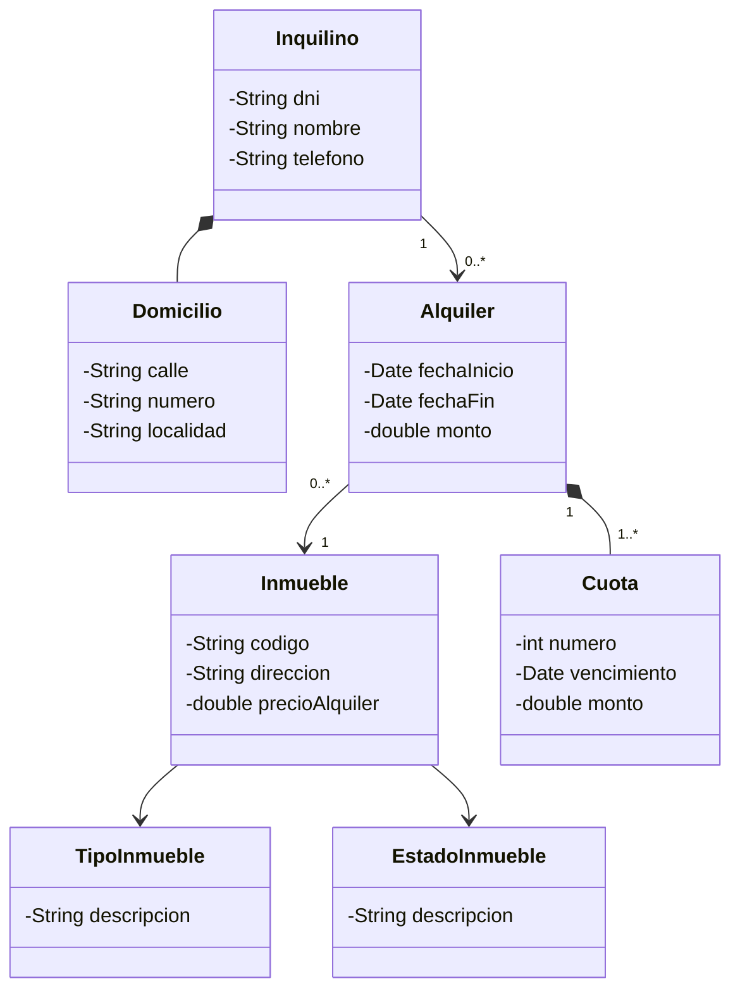

| Decisión | Justificación |
|---|---|
| `TipoInmueble` y `EstadoInmueble` son clases | Valores finitos que influyen en el sistema |
| `Domicilio` es clase | Tiene atributos propios |
| `Alquiler` es clase | Es una transacción de negocio |
| `Cuota` es composición | No existe sin el alquiler |
| No aparece `Inmobiliaria` | Es la empresa cliente |

> [!warning] Multiplicidad de `Alquiler–Inmueble`
> Un inmueble puede tener muchos alquileres a lo largo del tiempo, pero **uno vigente**. Si el negocio lo exige, se modela con estado o con una restricción, no con una multiplicidad mágica.

## Errores que suelen tomar

| Error | Corrección |
|---|---|
| Poner la empresa como clase | Nunca |
| Modelar `precio` sin histórico cuando se pide | `ListaDePrecios` |
| Dejar `tipo` como texto suelto | Clase `TipoX` |
| Poner atributos complejos dentro de la clase | Clase aparte |
| Confundir actor de negocio con actor del sistema | Son niveles distintos |
| Olvidar multiplicidades | Toda asociación las lleva |
| Incluir clases técnicas (`DAO`, `Service`) | Eso es diseño, no dominio |

## Ejercicios

> [!example] 1. Clase o atributo
> **Enunciado:** en una biblioteca: libro, título, autor, editorial, socio, préstamo.
> **Solución:** clases: `Libro`, `Autor`, `Editorial`, `Socio`, `Préstamo`. `título` es atributo de `Libro`.

> [!example] 2. Tipo o atributo
> **Enunciado:** “el curso tiene modalidad (presencial, virtual, mixta)”. ¿Cómo lo modelás?
> **Solución:** clase `Modalidad` con `descripcion`, asociada a `Curso` (1..1 del lado del curso).

> [!example] 3. Complejo
> **Enunciado:** “dirección con calle, número, piso y localidad”. ¿Atributo o clase?
> **Solución:** clase `Domicilio` con esos atributos (y `Localidad` si tiene código postal).

> [!example] 4. M:N con atributos
> **Enunciado:** “un alumno cursa muchas materias y una materia tiene muchos alumnos; se registra la nota”.
> **Solución:** clase asociativa `Cursada(alumno, materia, nota, fecha)`.

> [!example] 5. a papel
> **Enunciado:** modelá “pedido” con cliente, líneas y productos, y un precio histórico.
> **Solución:** `Cliente 1—0..* Pedido`; `Pedido 1 *—1..* LineaPedido`; `LineaPedido *—1 Producto`; `Producto 1—0..* ListaDePrecios`.


<div style="page-break-after: always;"></div>


# 6. Captura de requerimientos

> [!info] Al terminar este capítulo tenés que poder
> - Diferenciar requerimiento funcional, no funcional y restricción.
> - Escribir RF y RNF verificables.
> - Usar historias de usuario con criterios de aceptación.
> - Detectar requisitos ambiguos o incompletos.

> [!abstract] Qué debés saber (nivel 1)
> - **Requerimiento:** característica o descripción de algo que el sistema debe hacer para satisfacer su propósito.
> - **RF:** qué hace el sistema (transforma entradas en salidas).
> - **RNF:** cómo lo hace (rendimiento, seguridad, usabilidad…), con métrica.
> - **Restricción:** límite impuesto (tecnología, norma, presupuesto).
> - Un requisito debe ser **verificable**.
> - RF ≈ caso de uso (regla de cátedra).

## 6.1 Qué es un requerimiento

> [!quote] Definición de cátedra
> **Requerimiento:** característica del sistema o descripción de algo que el sistema es capaz de hacer para satisfacer el propósito de este. Incluye servicios, restricciones y mejoras posibles respecto del sistema actual.

| Tipo | Responde | Ejemplo |
|---|---|---|
| **Funcional (RF)** | ¿Qué hace? | Registrar una alerta con prioridad |
| **No funcional (RNF)** | ¿Con qué calidad? | Responder en menos de 2 s con 50 usuarios |
| **De dominio** | ¿Qué regla del negocio lo origina? | Después del rojo debe venir rojo-amarillo |
| **Restricción** | ¿Con qué límite? | Debe ejecutarse sobre MySQL 8 |

> [!important] La regla que separa todo
> Si podés escribir un caso de prueba que diga “pasa / no pasa” sin mirar la interfaz, es **RF**. Si necesitás medir un atributo de calidad, es **RNF**.

> [!tip] Requerimiento de dominio ≠ restricción
> El **de dominio** es una regla del negocio que el sistema debe respetar (“un turno no puede superponerse”). La **restricción** es un límite impuesto desde afuera: tecnología, norma o presupuesto.

## 6.2 Requerimientos funcionales

### Plantilla

```text
El sistema debe <verbo en infinitivo> <objeto> [<condición>].
```

| Parte | Ejemplo |
|---|---|
| Verbo | registrar, consultar, calcular, notificar, asignar |
| Objeto | una alerta, las reparaciones del mes |
| Condición | para los dispositivos activos |

### Ejemplos correctos

```text
RF-01: El sistema debe registrar una alerta con mensaje, prioridad y dispositivo,
       asignando la fecha y hora automáticamente.
RF-02: El sistema debe listar las alertas pendientes ordenadas por prioridad.
RF-03: El sistema debe asignar un técnico a una reparación y cambiar su estado.
```

### Ejemplos incorrectos

| Mal | Por qué | Corrección |
|---|---|---|
| “El sistema debe ser rápido” | No es funcional ni verificable | RNF con métrica |
| “El sistema debe gestionar alertas y reportes y usuarios” | Tres funciones en una | Un RF por función |
| “El operador aprieta el botón rojo” | Es interfaz, no funcionalidad | “El sistema debe registrar la alerta” |
| “El sistema debe tener una base de datos” | Es diseño | No es requisito |

## 6.3 Requerimientos no funcionales

### Categorías y ejemplos medibles

| Categoría | Ejemplo verificable |
|---|---|
| **Rendimiento** | El 95 % de las consultas responde en ≤ 2 s con 50 usuarios concurrentes |
| **Disponibilidad** | El sistema está operativo el 99,5 % del horario de atención (7–19) |
| **Seguridad** | Solo usuarios autenticados acceden; toda modificación queda auditada |
| **Usabilidad** | Un operador nuevo registra una alerta en ≤ 3 minutos sin ayuda |
| **Mantenibilidad** | Un cambio en una regla de prioridad afecta a ≤ 2 módulos |
| **Portabilidad** | Funciona en Chrome, Firefox y Edge (últimas 2 versiones) |
| **Capacidad** | Soporta 10 000 dispositivos y 1 000 000 de alertas históricas |
| **Legal** | Cumple la Ley 25.326 de protección de datos personales |

### Plantilla

```text
RNF-<n>: <categoría>. El sistema debe <métrica> bajo <condición>,
         verificable mediante <método>.
```

> [!warning] “Amigable”, “rápido”, “robusto” no son requisitos
> Son deseos. Sin número y sin método de verificación, no se pueden evaluar ni testear.

## 6.4 Restricciones

| Restricción | Ejemplo |
|---|---|
| Tecnológica | Backend en Java 17 y MySQL 8 |
| Organizacional | Debe integrarse con el sistema de legajo existente |
| Legal | Los datos personales no pueden salir del país |
| De plazo | Primera versión operativa en 6 meses |
| De presupuesto | Sin licencias pagas |

> [!important] No las mezcles con RNF
> Una restricción **limita la solución**; un RNF **define una calidad medible**. “Usar MySQL” es restricción; “responder en 2 s” es RNF.

## 6.5 Técnicas de elicitación

| Técnica | Cuándo | Riesgo |
|---|---|---|
| Entrevista | Conocer el proceso y las excepciones | El usuario omite lo que considera obvio |
| Observación | Ver el trabajo real | El usuario cambia su comportamiento |
| Análisis de documentos | Formularios, normas, reportes | Documentos desactualizados |
| Taller (workshop) | Acordar alcance con varios actores | Dominan los más extrovertidos |
| Prototipo | Validar interfaz y flujo | El usuario se enfoca en lo visual |
| Cuestionario | Muchos usuarios dispersos | Poco profundidad |

## 6.6 Historias de usuario (regla UTN)

Son otra forma de especificar requerimientos, más ligera.

### Las tres partes

| Parte | Contenido |
|---|---|
| **Tarjeta** | `Como <rol> necesito <funcionalidad> para <beneficio>` |
| **Conversación** | Preguntas que completan la información faltante |
| **Criterios de aceptación** | `Si <condición> entonces <acción>` |

```text
Como operador de monitoreo necesito ver las alertas pendientes
ordenadas por prioridad para atender primero las críticas.
```

> [!important] Si no podés definir el “para”
> La funcionalidad no aporta valor. Reescribila o descartala.

### Criterios de aceptación

```text
- Solo se muestran alertas en estado PENDIENTE.
- El orden es prioridad ascendente y, a igual prioridad, fecha ascendente.
- La lista se actualiza al registrar una alerta nueva.
```

> [!tip] Diferencia con el CU
> La historia es **un recordatorio** para conversar; el CU es una **especificación** completa con escenarios. En el EFIP podés usar cualquiera, pero no mezcles: si te piden CU, especificá el CU.

## 6.7 Método: de la entrevista al requisito

| Paso | Acción | Producto |
|---|---|---|
| 1 | Identificar actores y objetivos | Lista de actores |
| 2 | Describir el proceso actual | Flujo (actividad) |
| 3 | Detectar qué hará el sistema | Lista de RF |
| 4 | Detectar calidades exigidas | Lista de RNF |
| 5 | Detectar límites | Restricciones |
| 6 | Priorizar | Alta / media / baja |
| 7 | Verificar con el usuario | Requisitos validados |

### Cómo verificar un requisito

| Criterio | Pregunta |
|---|---|
| Correcto | ¿Representa una necesidad real y sin errores? |
| Necesario | ¿Si falta, el sistema sirve? |
| No ambiguo | ¿Dos personas lo interpretan igual? |
| Verificable | ¿Puedo escribir una prueba? |
| Completo | ¿Incluye condiciones y excepciones? |
| Consistente | ¿Contradice otro requisito? |
| Realista | ¿Se puede lograr con los recursos y la tecnología disponibles? |
| Rastreable | ¿Sé de dónde salió y qué lo implementa? |

## 6.8 Trazabilidad

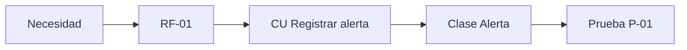

| Qué se traza | Para qué |
|---|---|
| Necesidad → RF | Justificar por qué existe |
| RF → CU | Verificar cobertura |
| CU → clase | Verificar que se diseñó |
| RF → prueba | Verificar que se probó |

> [!important] La matriz de trazabilidad
> Es la herramienta que evita “requisitos huérfanos” (sin CU) y “funcionalidad intrusa” (sin requisito). En el oral, mencionarla suma.

## Errores que suelen tomar

| Error | Corrección |
|---|---|
| RNF sin métrica | Agregar número y método |
| RF con dos verbos | Un requisito por función |
| RF que describe la interfaz | Describir la función |
| Confundir restricción con RNF | Límite vs. calidad medible |
| Omitir al actor que origina el RF | Indicarlo |
| Requisito no verificable | Reescribir con criterio de prueba |
| Historia sin “para” | No aporta valor |

## Ejercicios

> [!example] 1. Clasificar
> **Enunciado:** (a) registrar reparación; (b) 99,5 % de disponibilidad; (c) usar MySQL; (d) listar alertas por prioridad.
> **Solución:** (a) y (d) RF; (b) RNF de disponibilidad; (c) restricción tecnológica.

> [!example] 2. Reescribir
> **Enunciado:** “El sistema debe ser fácil de usar”. Reescribilo como RNF.
> **Solución:** “Un operador nuevo debe registrar una alerta en ≤ 3 minutos sin ayuda, verificado con 5 usuarios en prueba de usabilidad.”

> [!example] 3. Tres RF
> **Enunciado:** escribí 3 RF del caso municipio.
> **Solución:**
> ```text
> RF-01: registrar un dispositivo con código único, tipo y ubicación.
> RF-02: registrar una alerta asociada a un dispositivo, con prioridad 1..5.
> RF-03: consultar las alertas pendientes ordenadas por prioridad y fecha.
> ```

> [!example] 4. Tres RNF
> **Enunciado:** escribí 3 RNF medibles.
> **Solución:**
> ```text
> RNF-01 (rendimiento): 95 % de las consultas ≤ 2 s con 50 usuarios.
> RNF-02 (seguridad): solo usuarios autenticados; auditoría de cambios.
> RNF-03 (usabilidad): alta de alerta en ≤ 3 min por un operador nuevo.
> ```

> [!example] 5. Historia
> **Enunciado:** convertí “consultar alertas” en historia de usuario con criterios.
> **Solución:**
> ```text
> Como supervisor necesito consultar las alertas pendientes por prioridad
> para asignar primero los recursos a las críticas.
>
> Criterios:
> - Solo muestra estado PENDIENTE.
> - Orden: prioridad ascendente, luego fecha ascendente.
> - Permite filtrar por dispositivo.
> ```


<div style="page-break-after: always;"></div>


# 7. Modelo de casos de uso

> [!info] Al terminar este capítulo tenés que poder
> - Identificar actores primarios y secundarios.
> - Escribir casos de uso con verbo en infinitivo.
> - Decidir entre asociación, `include`, `extend` y generalización.
> - Aplicar las reglas de la cátedra sin inventar relaciones.

> [!abstract] Qué debés saber (nivel 1)
> - **Caso de uso:** unidad funcional completa que da un resultado de valor a un actor.
> - **Actor:** todo lo externo al sistema; **nunca** el sistema mismo.
> - **No hay CU sin actor**.
> - `include`: obligatorio, siempre ocurre.
> - `extend`: opcional, bajo condición, con punto de extensión.
> - **RF ≈ CU**: son dos formas de modelar requerimientos.

## 7.1 Qué es un caso de uso

> [!quote] Cátedra
> Un caso de uso describe **qué cosas debe hacer el sistema** para satisfacer las necesidades de los usuarios; es un diálogo entre un usuario y el sistema que representa una **unidad funcional completa**.

Objetivos:

| Objetivo | Producto |
|---|---|
| Definir y modelar los RF | Modelo de CU |
| Describir qué hará el sistema | Acuerdo con el cliente |
| Dar base a las pruebas | Casos de prueba derivados |
| Guiar análisis, diseño e implementación | Realizaciones |

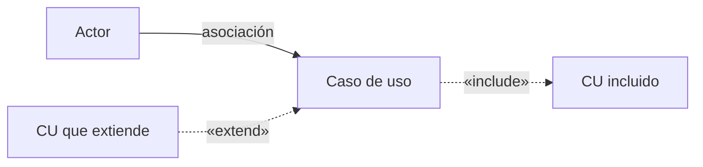

## 7.2 Actores

| Regla | Detalle |
|---|---|
| Es **externo** al sistema | Persona, rol, organización, sensor, sistema externo |
| **Nunca** el sistema es actor | El sistema no se usa a sí mismo |
| **Primario** | Inicia el CU y obtiene el valor |
| **Secundario** | Se ve afectado o participa sin iniciar |

> [!example] Primario vs. secundario
> Si el proveedor carga la mercadería en el sistema, el proveedor es **primario**. Si solo recibe el aviso de pago, es **secundario**.

> [!warning] El error de poner al sistema como actor
> “El sistema notifica al sistema” no es un actor. Si hay dos sistemas, el otro sistema **sí** es actor externo; el nuestro, no.

## 7.3 Relaciones

### Asociación

Comunica un actor con un CU. Es la conversación.

```mermaid
flowchart LR
    Op["Operador"] --- CU["Registrar alerta"]
```

### `include`

Comportamiento **obligatorio** que siempre se ejecuta. La flecha va **del CU base al incluido**.

```mermaid
flowchart LR
    A["Registrar alerta"] -.->|"«include»"| B["Validar dispositivo"]
```

- Se usa para **reutilizar** un comportamiento común.
- El CU base **depende** del incluido: si el incluido falla, el base no termina.

### `extend`

Comportamiento **opcional** que se agrega bajo una condición. La flecha va **del que extiende al base**.

```mermaid
flowchart LR
    B["Exportar reporte"] -.->|"«extend»"| A["Consultar alertas"]
```

- Requiere un **punto de extensión** con condición verdadero/falso.
- El base **funciona sin** el extend.

> [!important] La dirección, que se confunde siempre
> `include`: **base → incluido**.
> `extend`: **extendido → base**.
> Si invertís la flecha, el diagrama dice lo contrario.

### Generalización

El CU hijo **es un tipo** del padre y hereda su comportamiento.

```mermaid
flowchart LR
    P["Registrar alerta"] --> H1["Registrar alerta manual"]
    P --> H2["Registrar alerta automática"]
```

Se usa cuando hay variantes con comportamiento común. **No** es lo mismo que `extend`: acá hay especialización, no opcionalidad.

## 7.4 Reglas de la cátedra (UTN)

| # | Regla |
|---|---|
| 1 | Generalmente **un RF = un CU** |
| 2 | El **CU base** es el que tiene relación con un actor |
| 3 | Normalmente **no hay include/extend anidados** |
| 4 | Las **actividades del workflow** suelen ser CU |
| 5 | Un **nodo de decisión** que lleva a una acción suele ser un **extend** |
| 6 | Si el workflow tiene 3 carriles, probablemente haya 3 actores |
| 7 | **Todo lo que se usa** en el sistema debe tener **ABM** (alta, baja, modificación) |
| 8 | No hace falta detallar de más un CU de ABM |
| 9 | En ventas hay un patrón: **lo que se vende + el cliente + el vínculo** (venta) |
| 10 | En el **escenario principal no hay errores**; los errores van en los alternativos |
| 11 | Si el CU se relaciona con otro por include/extend, se **referencia**, no se repite |
| 12 | Las **postcondiciones** pueden ser estados (“la póliza queda vigente”) |
| 13 | Si aparece un **“etcétera”**, probablemente sea una clase |

> [!example] El patrón de ventas
> “Se vende un producto a un cliente.” → `Producto`, `Cliente` y `Venta` (el vínculo). Se repite en otros dominios: `Inmueble`, `Inquilino`, `Alquiler`; `Curso`, `Alumno`, `Inscripción`.

## 7.5 Método: construir el modelo en 6 pasos

| Paso | Acción | Resultado |
|---|---|---|
| 1 | Identificar **actores** (personas, roles, sistemas, sensores) | Lista |
| 2 | Para cada actor, listar **objetivos** | Funciones candidatas |
| 3 | Nombrar cada CU con **verbo en infinitivo** | Lista de CU |
| 4 | Detectar **include** (obligatorio) y **extend** (opcional) | Relaciones |
| 5 | Dibujar el diagrama con actores, CU y relaciones | Diagrama |
| 6 | Validar: ¿todo CU tiene actor? ¿todo RF está cubierto? | Modelo completo |

### Preguntas de decisión

| Pregunta | Si sí → | Si no → |
|---|---|---|
| ¿Siempre se ejecuta? | `include` | Asociación o `extend` |
| ¿Ocurre solo bajo condición? | `extend` | Asociación |
| ¿Es una variante del mismo objetivo? | Generalización | CU separado |
| ¿Lo inicia el actor? | Actor primario | Secundario |

## 7.6 Ejemplo completo

**Enunciado:** el municipio quiere que el operador registre dispositivos y alertas, que el técnico registre reparaciones y que el supervisor consulte reportes. Las alertas críticas deben notificar al supervisor. Se debe poder exportar el reporte.

```mermaid
flowchart LR
    Op["Operador"] --> C1["Gestionar dispositivos"]
    Op --> C2["Registrar alerta"]
    Tec["Técnico"] --> C3["Registrar reparación"]
    Sup["Supervisor"] --> C4["Consultar reportes"]
    Sup --> C5["Exportar reporte"]

    C2 -.->|"«include»"| V["Validar dispositivo"]
    C2 -.->|"«extend»"| N["Notificar alerta crítica"]
    C5 -.->|"«extend»"| C4
```

| Decisión | Justificación |
|---|---|
| `Validar dispositivo` es include | Toda alerta requiere un dispositivo válido: siempre ocurre |
| `Notificar alerta crítica` es extend | Solo ocurre si la prioridad es 1 |
| `Exportar` es extend de `Consultar` | Es opcional; el reporte se ve sin exportar |
| `Gestionar dispositivos` incluye ABM | Todo lo que se usa debe poder administrarse |

> [!warning] No abuses de `include`
> Si un CU solo tiene un paso, no lo conviertas en include. Un modelo con 20 include es ilegible y no aporta.

## 7.7 Del CU al resto del proceso

```mermaid
flowchart LR
    CU["CU"] --> ESP["Especificación"]
    ESP --> AN["Modelo de análisis"]
    AN --> DI["Modelo de diseño"]
    DI --> IM["Implementación"]
    IM --> PR["Pruebas"]
```

| Artefacto | Qué toma del CU |
|---|---|
| Especificación | Flujo principal y alternativos |
| Análisis | Clases boundary/entity/control |
| Diseño | Realizaciones (diagramas de secuencia) |
| Pruebas | Escenarios como casos de prueba |

## Errores que suelen tomar

| Error | Corrección |
|---|---|
| Poner el sistema como actor | Solo actores externos |
| CU sin actor | Todo CU tiene al menos uno |
| Invertir la flecha de `include`/`extend` | Ver 7.3 |
| Usar `extend` para lo obligatorio | Es `include` |
| Nombrar CU con sustantivo | Verbo en infinitivo |
| Un CU que hace todo | Dividir por objetivo |
| Especificar el CU incluido dentro del base | Solo referenciarlo |
| Poner errores en el escenario principal | Van en alternativos |

## Ejercicios

> [!example] 1. Actores
> **Enunciado:** en un sistema de biblioteca, ¿quiénes son actores?
> **Solución:** socio, bibliotecario y, si existe, el sistema de gestión de socios. La biblioteca **no** es actor.

> [!example] 2. Include o extend
> **Enunciado:** “Registrar préstamo” siempre valida el socio. ¿Include o asociación?
> **Solución:** `include` (siempre ocurre, reutilizable).

> [!example] 3. Include o extend
> **Enunciado:** “Consultar préstamos” permite, opcionalmente, imprimir el listado.
> **Solución:** `extend` de `Consultar` a `Imprimir listado`, con punto de extensión “usuario solicita impresión”.

> [!example] 4. Nombrar
> **Enunciado:** corrige: “Alta de alertas”, “Gestión”, “Pantalla de reportes”.
> **Solución:** “Registrar alerta”, “Gestionar dispositivos” (mejor dividir), “Consultar reportes”.

> [!example] 5. a papel
> **Enunciado:** dibujá el modelo de CU del caso municipio con 3 actores y al menos un include y un extend.
> **Solución:** ver 7.6.


<div style="page-break-after: always;"></div>


# 8. Especificación de casos de uso

> [!info] Al terminar este capítulo tenés que poder
> - Completar la plantilla de especificación de la cátedra.
> - Escribir escenarios principal y alternativos.
> - Redactar precondiciones y postcondiciones.
> - Referenciar include/extend sin duplicar funcionalidad.

> [!abstract] Qué debés saber (nivel 1)
> - **Sin especificación, el CU queda incompleto.**
> - La plantilla tiene datos de gestión, actores y **escenarios**.
> - El **escenario principal no admite errores**.
> - Los **alternativos** describen desvíos y errores.
> - Las **postcondiciones** pueden ser estados.
> - Si el CU incluye o extiende a otro, solo se **referencia**.

## 8.1 Por qué especificar

El diagrama dice **qué** CU hay; la especificación dice **cómo se comporta**. Sin ella:

- El programador inventa el flujo.
- El tester no sabe qué probar.
- El cliente no puede validar.

> [!quote] Regla de cátedra
> “Sin su especificación, el caso de uso queda incompleto.”

## 8.2 La plantilla

| Campo | Qué se escribe | Ejemplo |
|---|---|---|
| **ID** | Identificador | `CU-02` |
| **Paquete** | Agrupación | `Alertas` |
| **Prioridad** | Urgencia (1 a 5) | `1` |
| **Categoría** | Esencial / soporte | `Esencial` |
| **Complejidad** | Cantidad de datos a completar | `Media` |
| **Actores** | Principales y secundarios | Operador (principal) |
| **Stakeholders** | Interesados que no operan | Supervisor |
| **Tipo** | Abstracto / concreto | `Concreto` |
| **Objetivo** | Descripción breve | Registrar una alerta |
| **Precondiciones** | Estado del sistema previo | El dispositivo existe |
| **Postcondiciones** | Estado posterior | La alerta queda `PENDIENTE` |
| **Escenarios** | Principal y alternativos | Ver 8.3 |
| **Reglas de negocio** | Reglas asociadas | Prioridad 1..5 |
| **RNF asociados** | Calidades del CU | Registro en ≤ 3 min |
| **Incluye** | CU obligatorios | `Validar dispositivo` |
| **Extiende** | CU opcionales | `Notificar crítica` |

> [!important] Prioridad y complejidad no son lo mismo
> **Prioridad** = urgencia para el negocio. **Complejidad** = cantidad de datos o pasos para el usuario. Un CU puede ser prioritario y simple.

### La anatomía de una especificación

```mermaid
flowchart TD
    A["Actor que inicia"] --> P["Precondiciones"]
    P --> F["Flujo principal<br/>(camino feliz)"]
    F --> E["Escenarios alternativos"]
    E --> X["Excepciones"]
    X --> Q["Postcondiciones"]
```

> [!important] El orden no es decorativo
> Las precondiciones dicen **qué debe ser cierto antes**; las postcondiciones, **qué quedó cierto después**. Si no podés escribirlas, todavía no entendiste el caso de uso.

## 8.3 Escenarios

### Escenario principal

Describe el camino **feliz**: todo sale bien, sin errores del sistema ni del usuario.

```text
1. El operador selecciona "Nueva alerta".
2. El sistema muestra el formulario.
3. El operador ingresa mensaje, prioridad y dispositivo.
4. El sistema valida los datos y el dispositivo.
5. El sistema registra la alerta en estado PENDIENTE.
6. El sistema confirma el alta.
```

> [!warning] “No se admiten errores” en el principal
> Si en el paso 4 el dispositivo no existe, eso **no** va en el principal: va en un alternativo.

### Escenarios alternativos

| ID | Condición | Acción |
|---|---|---|
| A1 | Faltan datos obligatorios | El sistema muestra el error y no registra |
| A2 | El dispositivo no existe | El sistema informa y cancela la operación |
| A3 | La prioridad está fuera de 1..5 | El sistema rechaza el valor |
| A4 | El operador cancela | El sistema descarta y vuelve al inicio |

> [!tip] Cómo numerarlos
> `A1`, `A2`… y referenciarlos desde el paso del principal donde ocurren (“en el paso 4, si…”). Así el lector sigue el hilo.

## 8.4 Precondiciones y postcondiciones

| Tipo | Qué expresa | Ejemplo |
|---|---|---|
| **Precondición** | Lo que debe cumplirse antes | El usuario está autenticado |
| **Postcondición** | Lo que queda verdadero después | La alerta existe en estado `PENDIENTE` |

> [!important] Las postcondiciones pueden ser estados
> No hace falta describir tablas ni campos: “la póliza queda **vigente**”, “el turno queda **reservado**”. Es vocabulario del dominio, no de la base.

### Diferencia con el flujo

| Precondición | Flujo principal |
|---|---|
| Es un **hecho** que se cumple antes | Es una **secuencia de acciones** |
| “El dispositivo existe” | “El operador selecciona…” |

## 8.5 Include y extend en la especificación

| Situación | Qué escribir |
|---|---|
| El CU **incluye** otro | “Incluye: `Validar dispositivo` (ver CU-05)” |
| El CU **extiende** otro | “Extiende: `Consultar alertas` en el punto *exportar*” |
| El otro CU es obligatorio | Se referencia en el paso correspondiente |
| El otro CU es opcional | Se referencia como extensión |

> [!warning] No copies la funcionalidad del otro CU
> Si `Registrar alerta` incluye `Validar dispositivo`, no escribas los pasos de validación: escribí “el sistema ejecuta `Validar dispositivo`”. La especificación se mantiene una sola vez.

## 8.6 Ejemplo completo: `Registrar alerta`

```text
ID: CU-02
Paquete: Alertas
Prioridad: 1
Categoría: Esencial
Complejidad: Media
Actores: Operador (principal), Supervisor (secundario)
Stakeholders: Municipio
Tipo: Concreto
Objetivo: Registrar una alerta asociada a un dispositivo, con prioridad.

Precondiciones:
- El operador está autenticado.
- El dispositivo existe y está activo.

Postcondiciones:
- La alerta queda registrada en estado PENDIENTE.
- Si la prioridad es 1, el supervisor recibe una notificación.

Escenario principal:
1. El operador selecciona "Nueva alerta".
2. El sistema muestra el formulario.
3. El operador ingresa mensaje, prioridad y código de dispositivo.
4. El sistema ejecuta CU-05 Validar dispositivo.
5. El sistema registra la alerta en estado PENDIENTE con fecha y hora.
6. Si la prioridad es 1, el sistema ejecuta CU-07 Notificar alerta crítica.
7. El sistema confirma el alta.

Alternativos:
A1. En el paso 3, si faltan datos obligatorios:
    el sistema informa el campo faltante y vuelve al paso 2.
A2. En el paso 4, si el dispositivo no existe:
    el sistema informa y cancela la operación.
A3. En el paso 3, si la prioridad está fuera de 1..5:
    el sistema rechaza el valor y vuelve al paso 2.
A4. En cualquier paso, si el operador cancela:
    el sistema descarta los datos y vuelve al inicio.

Reglas de negocio:
- La prioridad es un entero de 1 a 5.
- Una alerta pertenece a un único dispositivo.

RNF asociados:
- El alta completa se realiza en ≤ 3 minutos por un operador entrenado.
- Toda alerta registrada queda auditada.

Incluye: CU-05 Validar dispositivo.
Extiende: —
```

> [!important] Fijate en los detalles que suman
> - Los alternativos están **referenciados al paso**.
> - El include se **ejecuta** en un paso, no se copia.
> - La postcondición es un **estado**.
> - Hay **reglas de negocio** y **RNF** asociados.

## 8.7 Método: escribir una especificación

| Paso | Acción |
|---|---|
| 1 | Completar los datos de gestión (ID, paquete, prioridad) |
| 2 | Identificar actores y stakeholders |
| 3 | Escribir el objetivo en una línea |
| 4 | Listar precondiciones (hechos) |
| 5 | Escribir el escenario principal **sin errores** |
| 6 | Agregar los alternativos con condición y acción |
| 7 | Definir postcondiciones (estados) |
| 8 | Referenciar include/extend, reglas y RNF |

> [!tip] Cómo saber que está completa
> Si un programador puede implementarlo y un tester puede escribir los casos de prueba **sin preguntarte nada**, está completo.

## Errores que suelen tomar

| Error | Corrección |
|---|---|
| Poner errores en el escenario principal | Van en alternativos |
| Describir la interfaz con lujo de detalles | Describir el comportamiento |
| Postcondición como lista de tablas | Usar estados del dominio |
| Copiar el CU incluido | Referenciarlo |
| Precondición como acción | Debe ser un hecho |
| Omitir actores secundarios | Incluirlos |
| Prioridad y complejidad iguales | Son dimensiones distintas |
| Alternativos sin condición | “Si… entonces…” |

## Ejercicios

> [!example] 1. Precondición o paso
> **Enunciado:** “El sistema valida el dispositivo” ¿es precondición o paso?
> **Solución:** es un **paso** (acción). La precondición sería “el dispositivo existe”.

> [!example] 2. Alternativo
> **Enunciado:** escribí el alternativo para “el operador ingresa una prioridad inválida”.
> **Solución:** “A3. En el paso 3, si la prioridad no está entre 1 y 5: el sistema muestra el error y vuelve al paso 2.”

> [!example] 3. Postcondición
> **Enunciado:** escribí la postcondición de “Registrar reparación”.
> **Solución:** “La reparación queda registrada en estado REGISTRADA; la alerta asociada pasa a ATENDIDA.”

> [!example] 4. Include
> **Enunciado:** ¿cómo referenciás `Validar dispositivo`?
> **Solución:** “4. El sistema ejecuta CU-05 Validar dispositivo.” Sin copiar sus pasos.

> [!example] 5. a papel
> **Enunciado:** especificá “Consultar alertas pendientes” con un alternativo.
> **Solución:** datos de gestión + precondición “usuario autenticado” + principal (filtra, ordena, muestra) + A1 “si no hay alertas, muestra mensaje” + postcondición “no modifica datos”.


<div style="page-break-after: always;"></div>


# 9. Prototipos de interfaz

> [!info] Al terminar este capítulo tenés que poder
> - Explicar para qué sirve un prototipo y qué NO resuelve.
> - Elegir el tipo de prototipo según el objetivo.
> - Diseñar un prototipo de pantalla para un CU.
> - Evitar los riesgos clásicos del prototipado.

> [!abstract] Qué debés saber (nivel 1)
> - **Prototipo:** versión inicial de software para demostrar conceptos, probar opciones y precisar requisitos.
> - Se usa **temprano**, con **participación del usuario**.
> - Sirve para **validar requisitos**, no para validar el diseño técnico.
> - Tipos: parcheado, no operacional, primero de una serie.
> - **No** reemplaza la especificación.

## 9.1 Para qué sirve

> [!quote] Cátedra
> **Prototipo de interfaz:** versión inicial de software utilizada para demostrar conceptos, probar opciones de diseño y profundizar el conocimiento del problema y de las soluciones.

Objetivos (los enumera UTN):

| Objetivo | Qué se obtiene |
|---|---|
| Reacciones iniciales | Qué entiende el usuario |
| Nuevas necesidades | Requisitos no detectados |
| Detectar ambigüedad | Requisitos malentendidos |
| Preferencias | Cómo quiere trabajar |
| Actitudes | Resistencia o aceptación |
| Innovaciones | Nuevas capacidades |
| Prioridades | Qué es urgente |
| Redirigir el plan | Ajustar alcance |

> [!important] El prototipo es una herramienta de requisitos
> No es la primera versión del producto (salvo que sea evolutivo y esté pensado así). Si el usuario cree que ya está hecho, el proyecto se complica.

```mermaid
flowchart LR
    R["Requisito o CU"] --> P["Prototipo de<br/>baja fidelidad"]
    P --> V["Validar con<br/>el usuario"]
    V -->|"cambios"| P
    V -->|"aprobado"| D["Prototipo de<br/>alta fidelidad"]
    D --> S["Especificación<br/>y diseño"]
```

> [!tip] Prototipar es conversar
> El primer prototipo no busca verse bien: busca que el usuario diga “esto no es lo que necesito”. Cada iteración es más barata que un cambio después de programar.

## 9.2 Tipos

| Tipo | Característica | Ventaja | Riesgo |
|---|---|---|---|
| **Parcheado** | Operacional, funcionalidad recortada, código sin calidad | El usuario interactúa de verdad | Se puede querer “aprovechar” ese código |
| **No operacional** | No corre: maqueta, esquemas, bosquejos | Rápido y barato | No valida comportamiento real |
| **Primero de una serie** | Proyecto piloto, primera instalación | Valida en contexto real | Costo alto |

También se clasifican por fidelidad:

| Fidelidad | Qué muestra | Cuándo |
|---|---|---|
| **Baja** | Cajas, textos, navegación | Etapas tempranas |
| **Alta** | Apariencia y comportamiento casi final | Validación con usuarios |

> [!warning] El prototipo parcheado no se entrega
> Se construye para aprender y se **descarta**. Si se entrega, arrastra código sin calidad y deuda técnica.

## 9.3 Principios de diseño y estilos de interacción

Antes de dibujar la pantalla, estos seis criterios evitan la mayoría de los reclamos:

| Principio | Qué exige | Ejemplo |
|---|---|---|
| **Familiaridad** | Vocabulario del trabajo real | “Alerta”, no “Registro entidad 4” |
| **Consistencia** | Lo parecido se opera parecido | “Guardar” siempre en el mismo lugar |
| **Mínima sorpresa** | Nada cambia sin avisar | Mostrar “guardando…” |
| **Recuperabilidad** | Poder deshacer o cancelar | Confirmar antes de borrar |
| **Guía** | Mensajes que dicen qué hacer | “La prioridad va de 1 a 5” |
| **Diversidad** | Distintos perfiles y dispositivos | Técnico en móvil, supervisor en PC |

| Estilo | Conviene cuando | Límite |
|---|---|---|
| **Manipulación directa** | Hay objetos visibles que mover | No toda tarea tiene representación |
| **Menús** | El usuario no recuerda comandos | Lento para expertos |
| **Formularios** | Carga estructurada de datos | Sobrecarga la pantalla |
| **Lenguaje de comandos** | Usuarios expertos, tareas repetitivas | Requiere aprendizaje y memoria |
| **Lenguaje natural** | Usuarios ocasionales | Ambigüedad |

## 9.4 Cuándo usarlo (y cuándo no)

| Sí | No |
|---|---|
| Requisitos ambiguos | Requisitos claros y estables |
| Usuarios poco disponibles para leer documentos | El riesgo es técnico, no de interfaz |
| Interfaz compleja o innovadora | El prototipo retrasa una entrega crítica |
| Hay que validar prioridades | No hay quién lo evalúe |

> [!important] Requisito de éxito
> El prototipo sirve si hay **interacción real con el usuario** y **ciclo de retroalimentación**. Sin eso, es un dibujo.

## 9.5 Método: prototipar un CU en 6 pasos

| Paso | Acción | Producto |
|---|---|---|
| 1 | Elegir un CU de alta prioridad o alta incertidumbre | Alcance |
| 2 | Listar datos de entrada y salida | Campos y acciones |
| 3 | Dibujar la pantalla (baja fidelidad) | Wireframe |
| 4 | Recorrer el flujo con el usuario | Observaciones |
| 5 | Registrar cambios y requisitos nuevos | Lista de ajustes |
| 6 | Actualizar especificación y modelo de CU | Artefactos |

### Checklist de una pantalla

- [ ] Título que dice qué hace.
- [ ] Campos obligatorios marcados.
- [ ] Validaciones visibles (formato, rango).
- [ ] Acciones principales y secundarias diferenciadas.
- [ ] Mensajes de error claros.
- [ ] Confirmación antes de acciones destructivas.
- [ ] Navegación de vuelta.
- [ ] Accesibilidad: etiquetas, contraste, teclado.

## 9.6 Ejemplo: pantalla de alta de alerta

```text
┌──────────────────────────────────────────────┐
│  Nueva alerta                                │
├──────────────────────────────────────────────┤
│  Dispositivo *  [ S-01 ▾ ]                   │
│  Prioridad *    ( ) 1  ( ) 2  (•) 3  ( ) 4 5 │
│  Mensaje *      ┌──────────────────────────┐ │
│                 │ Lámpara quemada          │ │
│                 └──────────────────────────┘ │
│                                              │
│  [ Cancelar ]                  [ Registrar ] │
└──────────────────────────────────────────────┘
```

| Decisión | Motivo |
|---|---|
| Prioridad con opciones, no texto libre | Evita valores inválidos (1..5) |
| Dispositivo como lista | Evita códigos inexistentes |
| Mensaje con área de texto | Texto libre acotado |
| “Registrar” destacado | Acción principal |
| `*` en obligatorios | Claridad |

> [!tip] El prototipo revela requisitos ocultos
> “¿Qué pasa si el dispositivo está inactivo?” → aparece un alternativo que no estaba en el enunciado. Ese es el valor del prototipo.

## 9.7 Riesgos

| Riesgo | Mitigación |
|---|---|
| El usuario cree que está terminado | Aclarar que es un prototipo |
| Se entrega el código parcheado | Descartarlo o refactorizarlo |
| “Ya que estamos, agreguemos…” | Congelar alcance por iteración |
| Se prototipa todo | Solo lo incierto o riesgoso |
| Se olvida documentar | Actualizar especificación y CU |

## Errores que suelen tomar

| Error | Corrección |
|---|---|
| Decir que el prototipo valida el diseño | Valida requisitos |
| Prototipo sin usuario | No sirve |
| Prototipo operacional entregado como producto | Es parcheado: se descarta |
| Prototipar todo el sistema | Prototipar lo incierto |
| No registrar los cambios | Se pierden los requisitos descubiertos |
| Confundir maqueta con especificación | La especificación sigue siendo necesaria |

## Ejercicios

> [!example] 1. Tipo
> **Enunciado:** necesitás validar rápido la navegación con 5 usuarios, sin programar.
> **Solución:** prototipo **no operacional** de baja fidelidad (maqueta).

> [!example] 2. Tipo
> **Enunciado:** querés que el usuario pruebe el alta real con datos de prueba.
> **Solución:** prototipo **parcheado** (operacional, funcionalidad recortada).

> [!example] 3. Objetivo
> **Enunciado:** ¿qué se busca con un prototipo?
> **Solución:** obtener reacciones, detectar requisitos faltantes o ambiguos, conocer preferencias y priorizar.

> [!example] 4. Decisión de interfaz
> **Enunciado:** ¿por qué la prioridad se elige con opciones y no con texto?
> **Solución:** porque el dominio la restringe a 1..5; la interfaz evita el error antes de que ocurra.

> [!example] 5. a papel
> **Enunciado:** dibujá en 8 líneas la pantalla de “Consultar alertas” con filtro por dispositivo y orden por prioridad.
> **Solución:** título, filtro (lista de dispositivos), tabla con columnas código/mensaje/prioridad/estado, botón “Actualizar” y “Exportar” (opcional), mensaje “sin resultados”.


<div style="page-break-after: always;"></div>


# 10. Modelo del análisis

> [!info] Al terminar este capítulo tenés que poder
> - Explicar qué refina el análisis.
> - Clasificar clases en boundary, entity y control.
> - Dibujar el diagrama de clases de análisis.
> - Realizar un CU con objetos de análisis.

> [!abstract] Qué debés saber (nivel 1)
> - **Modelo del análisis:** modelo de objetos **conceptual** que refina los requisitos.
> - **Clase de análisis:** abstracción clasificada en **entidad**, **interfaz** o **control**.
> - **Entidad:** información del dominio.
> - **Interfaz (boundary):** comunicación con el actor.
> - **Control:** coordinación de un CU.
> - No decide tecnología: no hay `DAO`, `Service`, `REST` ni tablas.

## 10.1 Qué es y para qué

> [!quote] Cátedra
> El **modelo del análisis** es un modelo de objetos conceptual que refina y estructura los requisitos para comprenderlos con precisión y facilitar el mantenimiento y la estructuración del sistema.

| Pregunta | Modelo del análisis |
|---|---|
| ¿Qué información maneja? | Clases de entidad |
| ¿Quién interactúa? | Clases de interfaz |
| ¿Quién coordina el flujo? | Clases de control |
| ¿Qué tecnología? | **Ninguna todavía** |

> [!important] El análisis no decide
> No dice si hay base de datos, ni qué framework, ni cómo se persiste. Eso es diseño.

## 10.2 Las tres clases de análisis

```mermaid
classDiagram
    class PantallaAlerta {
        <<boundary>>
        +mostrarFormulario() void
    }
    class ControlAlertas {
        <<control>>
        +registrar(mensaje, prioridad) void
    }
    class Alerta {
        <<entity>>
        -int prioridad
        -String mensaje
    }
    PantallaAlerta --> ControlAlertas
    ControlAlertas --> Alerta
```

| Estereotipo | Responsabilidad | Ejemplo |
|---|---|---|
| `<<boundary>>` | Comunicarse con el actor | Pantalla, formulario, API |
| `<<entity>>` | Representar información del dominio | `Alerta`, `Dispositivo`, `Técnico` |
| `<<control>>` | Coordinar el flujo de un CU | `ControlAlertas` |

> [!important] La regla de Jacobson
> Para cada CU: **una** clase de control que lo coordina, **una o más** de entidad que representan lo que se manipula, y **una o más** de interfaz por cada actor que interactúa.

### Cómo reconocerlas

| Pregunta | Si sí → |
|---|---|
| ¿Es una pantalla, formulario o API con el actor? | `boundary` |
| ¿Es un concepto del dominio con datos que perduran? | `entity` |
| ¿Coordina los pasos de un CU y no representa datos? | `control` |

> [!important] Dominio ≠ análisis
> El **modelo de dominio** describe los conceptos del problema; el **modelo de análisis** agrega fronteras y controles, distribuye responsabilidades y explica cómo esos conceptos colaboran en cada CU. Una clase del dominio suele originar una entidad de análisis, pero **no hay correspondencia uno a uno**: puede dividirse, fusionarse o quedar afuera del alcance.

## 10.3 Artefactos del análisis

| Artefacto | Qué muestra |
|---|---|
| Diagrama de clases de análisis | Clases y relaciones con estereotipos |
| Diagrama de secuencia (realización) | Objetos que colaboran en un CU |
| Diagrama de comunicación | Misma información, énfasis en enlaces |
| Diagrama de paquetes | Agrupación del modelo |

### Secuencia de análisis

```mermaid
sequenceDiagram
    actor Op as Operador
    participant UI as PantallaAlerta
    participant C as ControlAlertas
    participant A as Alerta
    Op->>UI: registrar(mensaje, prioridad)
    UI->>C: registrar(...)
    C->>A: crear(mensaje, prioridad)
    A-->>C: alerta
    C-->>UI: confirmación
    UI-->>Op: mensaje
```

> [!tip] El orden de los objetos
> `boundary → control → entity`. Si en el análisis aparece `entity → boundary`, probablemente esté mal: la entidad no conoce la pantalla.

## 10.4 Método: analizar un CU en 5 pasos

| Paso | Acción | Resultado |
|---|---|---|
| 1 | Tomar el CU especificado | Escenario principal |
| 2 | Identificar el **actor** que inicia | Clase boundary |
| 3 | Identificar la **información** que se crea/consulta | Clases entity |
| 4 | Identificar quién **coordina** el flujo | Clase control |
| 5 | Dibujar la secuencia y el diagrama de clases | Modelo de análisis |

### Preguntas de control

| Pregunta | Decisión |
|---|---|
| ¿Cuántos boundary? | Uno por actor que interactúa |
| ¿Cuántos control? | Uno por CU (o por grupo cohesivo) |
| ¿Cuántas entity? | Las del dominio que participan |
| ¿Puede una entity conocer un boundary? | **No** |
| ¿Puede un control conocer varios boundary? | Sí, si coordina varios actores |

## 10.5 Ejemplo completo

**CU:** `Registrar alerta` (operador, dispositivo, prioridad).

| Clase | Estereotipo | Responsabilidad |
|---|---|---|
| `PantallaAlerta` | boundary | Recibir los datos y mostrar el resultado |
| `ControlAlertas` | control | Validar, crear la alerta y notificar |
| `Alerta` | entity | Guardar mensaje, prioridad, fecha y estado |
| `Dispositivo` | entity | Conocer el dispositivo y sus alertas |
| `Tecnico` | entity | (para reparaciones) |

```mermaid
classDiagram
    class PantallaAlerta {
        <<boundary>>
        +registrar() void
    }
    class ControlAlertas {
        <<control>>
        +registrar(codigo, mensaje, prioridad) void
    }
    class Alerta {
        <<entity>>
        -String mensaje
        -int prioridad
        -String estado
    }
    class Dispositivo {
        <<entity>>
        -String codigo
        -String ubicacion
    }

    PantallaAlerta --> ControlAlertas
    ControlAlertas --> Dispositivo : busca
    ControlAlertas --> Alerta : crea
    Dispositivo "1" --> "0..*" Alerta : genera
```

> [!warning] Lo que NO va en el análisis
> `AlertaRepository`, `AlertaDAO`, `AlertaService`, `@Entity`, `REST`, `SQL`. Todo eso es diseño o implementación.

## 10.6 Del análisis al diseño

| Análisis | Diseño |
|---|---|
| Conceptual | Físico |
| `<<entity>> Alerta` | `Alerta` con tipos, visibilidad y navegabilidad |
| `<<control>> ControlAlertas` | `AlertaService` o controlador concreto |
| `<<boundary>> PantallaAlerta` | Pantalla con framework |
| Sin tecnología | Con tecnología |

> [!important] La trazabilidad
> Cada clase de análisis debe poder rastrearse a un CU y a un requisito. Si una clase no tiene CU, sobra; si un CU no tiene clases, falta análisis.

## Errores que suelen tomar

| Error | Corrección |
|---|---|
| Poner DAO/Service en análisis | Es diseño |
| Una sola clase “Sistema” que hace todo | Separar boundary/control/entity |
| Boundary que accede directo a entity | Pasa por control |
| Entity que conoce la pantalla | Dependencia invertida |
| Un control por método | Un control por CU |
| Olvidar actores secundarios | Un boundary por actor |
| Poner atributos de implementación | Solo dominio |

## Ejercicios

> [!example] 1. Clasificar
> **Enunciado:** `PantallaReparacion`, `Reparacion`, `ControlReparaciones`.
> **Solución:** boundary, entity, control.

> [!example] 2. Regla
> **Enunciado:** ¿puede `Alerta` conocer `PantallaAlerta`?
> **Solución:** no. La entidad no depende de la interfaz.

> [!example] 3. Cantidad
> **Enunciado:** un CU con dos actores que interactúan. ¿Cuántos boundary como mínimo?
> **Solución:** dos, uno por actor.

> [!example] 4. Análisis vs. diseño
> **Enunciado:** ¿`AlertaRepository` es análisis o diseño?
> **Solución:** diseño (es un mecanismo de persistencia).

> [!example] 5. a papel
> **Enunciado:** analizá `Registrar reparación` con al menos 4 clases.
> **Solución:** `PantallaReparacion` (boundary), `ControlReparaciones` (control), `Reparacion` y `Tecnico`/`Alerta` (entity); secuencia boundary→control→entity.


<div style="page-break-after: always;"></div>


# 11. Modelo de diseño y DCD

> [!info] Al terminar este capítulo tenés que poder
> - Explicar qué agrega el diseño al análisis.
> - Escribir un contrato de operación.
> - Dibujar un diagrama de clases de diseño (DCD).
> - Pasar de un CU a una realización con objetos.

> [!abstract] Qué debés saber (nivel 1)
> - **Modelo de diseño:** describe la **realización física** de los CU.
> - Agrega tipos, visibilidad, navegabilidad, interfaces y subsistemas.
> - **DCD:** diagrama de clases de diseño, con detalle de implementación.
> - **Contrato:** pre y postcondiciones de una operación del sistema.
> - **Realización:** secuencia de diseño que muestra cómo los objetos cumplen el CU.

## 11.1 Qué agrega el diseño

> [!quote] Cátedra
> El **modelo de diseño** describe la realización física de los casos de uso y cómo impactan en él los requerimientos funcionales, no funcionales y las restricciones del entorno de implementación.

| Pregunta | Análisis | Diseño |
|---|---|---|
| ¿Qué información? | `Alerta` conceptual | `Alerta` con tipos y visibilidad |
| ¿Quién coordina? | `ControlAlertas` | `AlertaService` / controlador concreto |
| ¿Cómo se guarda? | No se decide | Repositorio, ORM, tabla |
| ¿Dónde corre? | No se decide | Nodos y componentes |
| ¿Qué tecnología? | No se decide | Framework, lenguaje, base |

> [!important] La frontera
> Si la decisión **puede cambiar si cambia la tecnología**, es diseño. Si es del dominio, es análisis.

## 11.2 Artefactos del diseño

| Artefacto | Qué muestra |
|---|---|
| **DCD** | Clases de software con atributos, métodos, tipos, visibilidad y relaciones |
| **Secuencia de diseño** | Realización de un CU con objetos concretos |
| **Contratos** | Pre/postcondiciones de las operaciones |
| **Paquetes/subsistemas** | Organización del diseño |
| **Despliegue** | Distribución física |

## 11.3 Contratos de operación

Un contrato describe **qué garantiza** una operación del sistema, sin decir cómo.

### Secciones

| Sección | Contenido |
|---|---|
| **Operación** | Nombre y parámetros |
| **Referencias cruzadas** | CU y requisitos que la originan |
| **Precondiciones** | Lo que debe cumplirse antes |
| **Postcondiciones** | Lo que queda verdadero después |

### Postcondiciones: tres categorías

1. **Creación o eliminación** de instancias.
2. **Modificación de atributos**.
3. **Creación o ruptura de asociaciones**.

### Ejemplo

```text
Operación: registrarAlerta(codigoDispositivo, mensaje, prioridad)

Referencias: CU-02 Registrar alerta; RF-02

Precondiciones:
- El dispositivo con ese código existe y está activo.
- La prioridad está entre 1 y 5.

Postcondiciones:
- Se creó una instancia de Alerta.
- Se asoció la Alerta al Dispositivo correspondiente.
- Se asignó fecha y hora a la Alerta.
- La Alerta quedó en estado PENDIENTE.
- Si la prioridad era 1, se creó una Notificación para el supervisor.
```

> [!important] Declarativas, no imperativas
> Mal: “buscar el dispositivo, crear la alerta, guardar…”. Bien: “se creó una instancia de…”, “quedó asociada a…”. Describe el **estado final**, no el algoritmo.

## 11.4 DCD (diagrama de clases de diseño)

```mermaid
classDiagram
    class Alerta {
        -id: int
        -mensaje: String
        -prioridad: int
        -fecha: DateTime
        -estado: EstadoAlerta
        +atender() void
        +cancelar() void
        +getPrioridad() int
    }
    class Dispositivo {
        -id: int
        -codigo: String
        -ubicacion: String
        -activo: boolean
        +crearAlerta(mensaje, prioridad) Alerta
    }
    class EstadoAlerta {
        <<enumeration>>
        PENDIENTE
        EN_PROCESO
        ATENDIDA
        CANCELADA
    }
    Dispositivo "1" --> "0..*" Alerta : genera
    Alerta --> EstadoAlerta
```

| Elemento | Qué agrega el diseño |
|---|---|
| Tipos | `int`, `String`, `DateTime`, `EstadoAlerta` |
| Visibilidad | `-` privado, `+` público |
| Navegabilidad | Flecha en el sentido en que se puede navegar |
| Métodos | Operaciones concretas, no solo responsabilidades |
| Enumeraciones | Estados finitos |

> [!warning] El DCD no es el modelo de dominio
> El DCD tiene tipos de implementación, métodos, visibilidad y navegabilidad. El dominio solo tiene conceptos, atributos y asociaciones.

## 11.5 Realización de un CU

```mermaid
sequenceDiagram
    actor Op as Operador
    participant UI as PantallaAlerta
    participant C as ControlAlertas
    participant D as Dispositivo
    participant A as Alerta

    Op->>UI: registrar(codigo, mensaje, prioridad)
    UI->>C: registrar(...)
    C->>D: buscar(codigo)
    D-->>C: dispositivo
    C->>D: crearAlerta(mensaje, prioridad)
    D->>A: new Alerta(...)
    A-->>D: alerta
    D-->>C: alerta
    C-->>UI: confirmación
    UI-->>Op: mensaje
```

| Paso | Decisión de diseño |
|---|---|
| `UI → Control` | La pantalla no conoce el dominio |
| `Control → Dispositivo` | El control delega la búsqueda |
| `Dispositivo → Alerta` | **Creador** (GRASP): el dispositivo contiene sus alertas |
| `Alerta` con estado | El estado es una enumeración |

## 11.6 Método: del CU al DCD en 6 pasos

| Paso | Acción | Producto |
|---|---|---|
| 1 | Tomar el CU y su especificación | Entrada |
| 2 | Dibujar el **SSD** (actor → sistema) | Operaciones del sistema |
| 3 | Escribir el **contrato** de cada operación | Pre/post |
| 4 | Dibujar la **secuencia de diseño** aplicando GRASP | Realización |
| 5 | Derivar el **DCD** con tipos y visibilidad | Clases de diseño |
| 6 | Organizar en **paquetes/subsistemas** | Estructura |

> [!tip] SSD vs. secuencia de diseño
> El **SSD** muestra al actor y **al sistema como una caja negra**. La **secuencia de diseño** abre la caja y muestra los objetos internos.

## 11.7 Ejemplo de SSD

```mermaid
sequenceDiagram
    actor Op as Operador
    participant S as Sistema
    Op->>S: registrarAlerta(codigo, mensaje, prioridad)
    S-->>Op: confirmación
```

> [!important] Las operaciones del sistema
> Cada mensaje del actor al sistema en el SSD es una **operación del sistema** y debe tener contrato. De ahí salen los métodos del controlador.

## Errores que suelen tomar

| Error | Corrección |
|---|---|
| DCD sin tipos | Agregar tipos de atributos y retornos |
| Contrato imperativo | Escribir postcondiciones declarativas |
| Mezclar análisis y diseño | Decidir si hay tecnología |
| Poner métodos en el dominio sin lógica | El DCD es de software, no conceptual |
| Olvidar la navegabilidad | Indicar el sentido de la asociación |
| Un control por cada método | Un controlador por CU o grupo cohesivo |

## Ejercicios

> [!example] 1. Contrato
> **Enunciado:** escribí las postcondiciones de `cancelarAlerta(id)`.
> **Solución:** “La Alerta con ese id quedó en estado CANCELADA; se registró la fecha de cancelación; no se eliminó la instancia.”

> [!example] 2. DCD
> **Enunciado:** ¿qué agrega el DCD al diagrama de clases del dominio?
> **Solución:** tipos, visibilidad, métodos, navegabilidad, enumeraciones y decisiones de implementación.

> [!example] 3. SSD
> **Enunciado:** ¿qué muestra el SSD que no muestra el diagrama de CU?
> **Solución:** la secuencia de operaciones del sistema para un escenario, con el sistema como caja negra.

> [!example] 4. Categoría
> **Enunciado:** “se asoció la Alerta al Dispositivo” ¿qué categoría de postcondición es?
> **Solución:** creación de asociación.

> [!example] 5. a papel
> **Enunciado:** dibujá el DCD de `Dispositivo`, `Alerta` y `EstadoAlerta` con tipos y multiplicidad.
> **Solución:** ver 11.4.


<div style="page-break-after: always;"></div>


# 12. Diagrama de secuencia paso a paso

> [!info] Al terminar este capítulo tenés que poder
> - Pasar el escenario principal de un CU a un diagrama de secuencia sin dudar.
> - Ordenar las líneas de vida: actor, frontera, control, entidad.
> - Elegir la flecha correcta para llamada, retorno y creación.
> - Usar `alt`, `opt` y `loop` solo cuando el flujo lo pide.
> - Verificar cada mensaje contra el DCD antes de entregar.

> [!abstract] Qué debés saber (nivel 1)
> - **Tiempo hacia abajo, objetos hacia el costado**: cada línea de vida es un objeto.
> - Orden: **Actor → Boundary → Control → Entidad/Repositorio**.
> - La pantalla **nunca** habla directo con la entidad.
> - Tres flechas: **síncrona** (llamada), **retorno** (punteada) y **creación**.
> - `alt` = if/else, `opt` = if simple, `loop` = recorrido.
> - Todo mensaje tiene que existir como método en el **DCD**, con los mismos parámetros.

> [!quote] Cátedra (Larman, UTN)
> "Debería hacerse un diagrama de secuencia para el **escenario principal de éxito** del caso de uso, y para los escenarios alternativos complejos o frecuentes."

## 12.1 Qué es y para qué sirve

Un **diagrama de secuencia** es un diagrama de interacción de UML: muestra **qué objetos colaboran** en un caso de uso y **en qué orden** se envían los mensajes.

| Eje | Qué representa |
|---|---|
| **Horizontal** | Los objetos o participantes (líneas de vida) |
| **Vertical** | El tiempo: lo que está arriba ocurre antes |
| **Flechas** | Mensajes: llamadas, retornos, creación |

```mermaid
sequenceDiagram
    actor Op as Operador
    participant UI as PantallaAlerta
    participant C as ControlAlertas
    participant R as RepositorioDispositivo

    Op->>UI: registrarAlerta(codigo, mensaje, prioridad)
    UI->>C: registrarAlerta(codigo, mensaje, prioridad)
    C->>R: buscarPorCodigo(codigo)
    R-->>C: dispositivo
    C-->>UI: confirmación
    UI-->>Op: "Alerta registrada"
```

### SSD vs. secuencia de diseño

| | SSD (secuencia de sistema) | Secuencia de diseño |
|---|---|---|
| Participantes | Actor + **Sistema** (caja negra) | Actor + pantalla + control + entidades |
| Para qué | Descubrir las **operaciones del sistema** | Mostrar **cómo colaboran** los objetos |
| Momento | Análisis / contratos | Diseño |
| Mensajes | Solo actor → sistema | Mensajes internos entre objetos |

> [!important] La diferencia que se pregunta
> El **SSD** no muestra objetos internos: trata al sistema como una caja negra y sirve para detectar operaciones y contratos. La **secuencia de diseño** abre la caja y muestra la colaboración real.

> [!tip] Cuántos diagramas hacer
> Uno por el **escenario principal** de cada CU relevante, y uno extra solo para los alternativos **complejos o frecuentes**. No se hace un diagrama por cada `if`.

> [!note] De dónde sale este método
> La división en objetos de **interfaz, entidad y control** y el orden temporal de los mensajes vienen de **UP — Análisis de Sistemas** (clases 09 y 10, "Diagramas de secuencia"). La regla de hacer **un diagrama por escenario principal** y otro para los alternativos complejos viene de **Larman** (UTN, Diseño de Sistemas). Las flechas y los marcos son la notación de **UML 2.x**.

## 12.2 El orden de las líneas de vida

La regla de la cátedra es estricta:

```text
Actor → Pantalla (Boundary) → Controlador (Control) → Entidad / Repositorio
```

```mermaid
sequenceDiagram
    actor U as Actor
    participant B as «boundary»<br/>PantallaX
    participant C as «control»<br/>ControlX
    participant E as «entity»<br/>Entidad
    participant R as «repository»<br/>RepositorioX

    U->>B: acción del usuario
    B->>C: operación del sistema
    C->>R: buscar(...)
    R-->>C: objeto
    C->>E: actualizar(...)
    E-->>C: ok
    C-->>B: resultado
    B-->>U: mensaje en pantalla
```

| Participante | Estereotipo | Responsabilidad | Ejemplo |
|---|---|---|---|
| **Actor** | — | Inicia el caso de uso | Operador, técnico |
| **Pantalla** | `«boundary»` | Recibir la acción y mostrarla; **no decide** | `PantallaAlerta` |
| **Control** | `«control»` | Coordinar el CU; aplicar reglas | `ControlAlertas` |
| **Entidad** | `«entity»` | Datos y comportamiento del dominio | `Dispositivo`, `Alerta` |
| **Repositorio** | `«repository»` | Buscar y persistir | `RepositorioDispositivo` |

> [!warning] La pantalla no habla con la entidad
> Si dibujás `PantallaAlerta -> Dispositivo`, el diagrama está mal aunque el código funcione. La pantalla solo conoce al controlador; el controlador conoce el dominio. Es la regla que más se evalúa en el oral.

> [!important] Por qué ese orden
> Porque refleja las dependencias del diseño: la interfaz depende del control, el control del dominio, y el dominio no depende de nadie. Si invertís una flecha, estás invirtiendo una dependencia y el diseño se vuelve rígido.

## 12.3 Las tres flechas de UML

| Mensaje | Notación | Significado | Mermaid |
|---|---|---|---|
| **Síncrona** | Línea continua, punta rellena | Llamada a un método; el emisor espera | `A->>B: metodo(args)` |
| **Retorno** | Línea punteada, punta abierta | Devuelve un valor u objeto | `B-->>A: resultado` |
| **Creación** | Flecha a la caja nueva, más abajo | `new Objeto(...)` | `create participant` + `->>` |
| Asíncrona | Línea continua, punta abierta | No espera respuesta | `A-)B: evento` |

```mermaid
sequenceDiagram
    participant C as ControlAlertas
    participant R as RepositorioDispositivo

    C->>R: buscarPorCodigo("S-01")
    R-->>C: dispositivo
    create participant A as Alerta
    C->>A: new Alerta(mensaje, prioridad)
    A-->>C: alerta creada
```

> [!important] Cuándo dibujar el retorno
> No hace falta dibujarlo en métodos `void`. **Sí** cuando el objeto que recibe el dato lo necesita para el paso siguiente: si después usás `dispositivo`, tiene que verse el retorno.

> [!tip] La creación se dibuja abajo
> El objeto creado aparece **más abajo** en el eje vertical, en el momento en que se crea, no arriba junto a los que ya existían. Es el error visual más común.

## 12.4 Marcos combinados: `alt`, `opt` y `loop`

| Fragmento | Cuándo | Ejemplo de guarda |
|---|---|---|
| **`alt`** | `if / else` | `[prioridad == 1]` / `[else]` |
| **`opt`** | `if` sin else | `[hay técnico de guardia]` |
| **`loop`** | Recorrer una colección | `[para cada línea]` |

### `alt` (if / else)

```mermaid
sequenceDiagram
    participant C as ControlAlertas
    participant N as ServicioNotificacion
    participant R as RepositorioAlerta

    alt prioridad == 1
        C->>R: guardar(alerta)
        C->>N: notificarSupervisor(alerta)
    else prioridad > 1
        C->>R: guardarSinNotificar(alerta)
    end
```

### `opt` (if simple)

```mermaid
sequenceDiagram
    participant C as ControlAlertas
    participant T as RepositorioTecnico

    C->>T: tecnicoDeGuardia()
    opt hay técnico disponible
        C->>T: asignar(alerta, tecnico)
    end
```

### `loop` (recorrido)

```mermaid
sequenceDiagram
    participant C as ControlPedido
    participant P as Pedido
    participant L as LineaPedido

    C->>P: calcularTotal()
    loop para cada línea del pedido
        P->>L: subtotal()
        L-->>P: importe
    end
    P-->>C: total
```

> [!warning] No abuses de los marcos
> Un diagrama con cinco `alt` anidados no se lee. Si el flujo es muy complejo, dividilo en dos diagramas: uno por escenario.

## 12.5 La receta de 5 pasos

> [!important] La receta completa
> Aplicala siempre en este orden. Si te trabás, volvé al paso anterior; no saltes al dibujo.

### Paso 1 — Partí del escenario principal del CU

Tomá la especificación y numerá los pasos donde **el actor interactúa con el sistema**. Cada uno es un mensaje de izquierda a derecha.

| Paso del CU | Mensaje |
|---|---|
| 1. El operador ingresa el código y la prioridad | `registrarAlerta(codigo, mensaje, prioridad)` |
| 2. El sistema confirma | retorno `confirmación` |

> [!tip] Regla práctica
> Si un paso del CU no genera un mensaje del actor al sistema, no es un mensaje: es una tarea interna del controlador.

### Paso 2 — Ordená las líneas de vida

De izquierda a derecha, siempre:

```text
Actor → PantallaX → ControlX → Entidad / Repositorio
```

Si aparece un servicio externo (notificación, pasarela de pago), va **a la derecha del control** y se llega a él **solo desde el control**.

### Paso 3 — Elegí el tipo de flecha

| Si el paso… | Usá |
|---|---|
| Llama a un método y espera | síncrona `->>` |
| Devuelve un dato que se usa después | retorno `-->>` |
| Crea un objeto | creación + `->>` a la caja nueva |
| Dispara un evento sin esperar | asíncrona `-)` |

### Paso 4 — Agregá marcos solo si hay condición o repetición

| En el flujo hay… | Marco |
|---|---|
| `if` con `else` | `alt` |
| `if` sin `else` | `opt` |
| `for` / `while` | `loop` |

### Paso 5 — Pasá el filtro del DCD

Antes de entregar, cada flecha que **entra** a una línea de vida tiene que cumplir dos condiciones:

1. El método **existe** en esa clase del DCD, con los **mismos parámetros**.
2. La clase emisora **puede ver** a la receptora: asociación navegable, parámetro recibido o instanciación dentro del método.

> [!important] El filtro que salva puntos
> Un diagrama lindo con métodos que no existen en el DCD es un diagrama **incoherente**. El tribunal compara los dos y lo ve en diez segundos.

## 12.6 Filtro de consistencia con el DCD

| Verificación | Pregunta | Si falla |
|---|---|---|
| **Método** | ¿`buscarPorCodigo(String)` está en `RepositorioDispositivo`? | Agregalo al DCD o cambiá el mensaje |
| **Parámetros** | ¿Coinciden tipo y orden? | Corregí uno de los dos |
| **Retorno** | ¿El tipo devuelto es el que usa el paso siguiente? | Ajustá el tipo en el DCD |
| **Visibilidad** | ¿Hay asociación navegable o parámetro? | Agregá la asociación o pasá el objeto |
| **Dirección** | ¿La flecha respeta las capas? | Reordená: pantalla → control → dominio |
| **Nombre** | ¿Es un verbo del dominio? | Renombrá (`registrar`, `buscar`, no `doIt`) |

```mermaid
classDiagram
    class PantallaAlerta {
        +registrarAlerta(codigo, mensaje, prioridad)
    }
    class ControlAlertas {
        -RepositorioDispositivo repo
        +registrarAlerta(codigo, mensaje, prioridad)
    }
    class RepositorioDispositivo {
        +buscarPorCodigo(codigo) Dispositivo
    }
    class Dispositivo {
        +crearAlerta(mensaje, prioridad) Alerta
    }
    PantallaAlerta --> ControlAlertas
    ControlAlertas --> RepositorioDispositivo
    Dispositivo --> Alerta
```

> [!example] Cómo se lee la consistencia
> `ControlAlertas.registrarAlerta` recibe los mismos tres parámetros que el mensaje de la pantalla. `RepositorioDispositivo.buscarPorCodigo` devuelve `Dispositivo`, que es lo que el control usa después. `Dispositivo.crearAlerta` devuelve `Alerta`. Todo cierra.

## 12.7 Ejemplo completo: registrar alerta

**Escenario:** el operador registra una alerta; si la prioridad es 1, se notifica al supervisor; si hay técnico de guardia, se le asigna.

```mermaid
sequenceDiagram
    actor Op as Operador
    participant UI as «boundary»<br/>PantallaAlerta
    participant C as «control»<br/>ControlAlertas
    participant R as «repository»<br/>RepositorioDispositivo
    participant D as «entity»<br/>Dispositivo
    participant N as «service»<br/>Notificacion
    participant T as «repository»<br/>RepositorioTecnico

    Op->>UI: registrarAlerta("S-01", "sin corriente", 1)
    UI->>C: registrarAlerta(codigo, mensaje, prioridad)
    C->>R: buscarPorCodigo(codigo)
    R-->>C: dispositivo
    C->>D: crearAlerta(mensaje, prioridad)
    create participant A as «entity»<br/>Alerta
    D->>A: new Alerta(mensaje, prioridad)
    A-->>D: alerta
    D-->>C: alerta
    alt prioridad == 1
        C->>N: notificarSupervisor(alerta)
        N-->>C: ok
    else prioridad > 1
        C->>C: marcarNormal()
    end
    C->>T: tecnicoDeGuardia()
    T-->>C: tecnico
    opt hay técnico disponible
        C->>T: asignar(alerta, tecnico)
    end
    C-->>UI: alertaRegistrada
    UI-->>Op: "Alerta registrada"
```

| Mensaje | Método en el DCD | Devuelve |
|---|---|---|
| `UI → C: registrarAlerta` | `ControlAlertas.registrarAlerta(String, String, int)` | `Alerta` |
| `C → R: buscarPorCodigo` | `RepositorioDispositivo.buscarPorCodigo(String)` | `Dispositivo` |
| `C → D: crearAlerta` | `Dispositivo.crearAlerta(String, int)` | `Alerta` |
| `D → A: new` | constructor `Alerta(String, int)` | — |
| `C → N: notificarSupervisor` | `Notificacion.notificarSupervisor(Alerta)` | `void` |
| `C → T: asignar` | `RepositorioTecnico.asignar(Alerta, Tecnico)` | `void` |

> [!important] Lo que el diagrama demuestra
> La pantalla solo habla con el control; el control coordina el dominio y los servicios; la creación de `Alerta` ocurre dentro de `Dispositivo` (GRASP **Creador**); la notificación es un servicio externo al que solo llega el control.

## Errores que suelen tomar

| Error | Corrección |
|---|---|
| Empezar a dibujar sin leer el CU | Numerá primero los pasos del escenario |
| Pantalla → Entidad | Siempre pantalla → control → entidad |
| Poner el actor a la derecha | El actor va primero, a la izquierda |
| No dibujar retornos que se usan | Si el paso siguiente usa el dato, mostralo |
| Crear el objeto arriba | La caja nueva aparece más abajo, al momento de crearse |
| Usar `alt` para un `if` sin else | Va `opt` |
| Anidar cinco marcos | Dividí en dos diagramas |
| Mensajes con métodos inexistentes en el DCD | Filtro del paso 5 |
| Nombres vagos (`procesar`, `doIt`) | Verbos del dominio con parámetros |
| Dibujar todos los escenarios en un diagrama | Uno principal + alternativos complejos |

## Ejercicios

> [!example] 1. Orden de líneas de vida
> **Enunciado:** ordená: `RepositorioAlerta`, `Operador`, `ControlAlertas`, `PantallaAlerta`.
> **Solución:** Operador → PantallaAlerta → ControlAlertas → RepositorioAlerta.

> [!example] 2. Tipo de flecha
> **Enunciado:** `ControlAlertas` pide `dispositivo` y luego lo usa para crear la alerta. ¿Qué flecha falta?
> **Solución:** el retorno `R-->>C: dispositivo`. Sin él, el paso siguiente no tiene de dónde sacar el objeto.

> [!example] 3. Marco
> **Enunciado:** "si la alerta es crítica, además se notifica al supervisor". ¿Qué marco?
> **Solución:** `opt [prioridad == 1]`, porque no hay un else explícito.

> [!example] 4. Consistencia
> **Enunciado:** el diagrama envía `buscar(codigo)` pero el DCD tiene `buscarPorCodigo(String)`. ¿Qué corregís?
> **Solución:** el mensaje, para que coincida nombre y firma; o el DCD, si el nombre correcto es el otro. Nunca dejarlos distintos.

> [!example] 5. Creación
> **Enunciado:** ¿dónde se dibuja la caja de `Alerta`?
> **Solución:** más abajo, en el instante en que `Dispositivo` ejecuta `new Alerta(...)`, con la flecha apuntando a esa caja.

> [!example] 6. a papel
> **Enunciado:** dibujá la secuencia de "consultar alertas por prioridad" con un `loop` sobre la lista de alertas.
> **Solución:** Operador → PantallaConsulta → ControlConsulta → RepositorioAlerta.buscarPorPrioridad(p) → retorno lista; `loop para cada alerta` → `alerta.resumen()` → retorno; pantalla muestra la lista.


<div style="page-break-after: always;"></div>


# 13. GRASP: asignar responsabilidades

> [!info] Al terminar este capítulo tenés que poder
> - Explicar qué es una responsabilidad y quién la asigna.
> - Aplicar los nueve patrones GRASP.
> - Justificar una asignación con acoplamiento y cohesión.
> - Detectar una violación de “no hables con extraños”.

> [!abstract] Qué debés saber (nivel 1)
> - **GRASP:** *General Responsibility Assignment Software Patterns*.
> - Son pares **problema–solución** con nombre para asignar responsabilidades.
> - **Experto:** quien tiene la información, hace el trabajo.
> - **Creador:** quien contiene, registra o inicializa, crea.
> - **Controlador:** un objeto que representa el sistema o el CU maneja los eventos.
> - **Bajo acoplamiento** y **alta cohesión** son los criterios de evaluación.
> - Los otros cuatro: polimorfismo, fabricación pura, indirección, variaciones protegidas.

## 13.1 Qué es una responsabilidad

| Tipo | Qué implica | Ejemplo |
|---|---|---|
| **De conocimiento** | Conocer información | `Alerta` conoce su prioridad |
| **De acción** | Hacer algo o coordinar | `ControlAlertas` registra una alerta |

> [!quote] Larman
> “La habilidad para asignar responsabilidades es extremadamente importante en el diseño. La asignación ocurre generalmente durante la creación de los diagramas de interacción.”

Un diseño se evalúa por **dos métricas**:

| Métrica | Qué mide | Buscamos |
|---|---|---|
| **Acoplamiento** | Dependencia entre objetos | Bajo |
| **Cohesión** | Fuerza con que se relacionan las responsabilidades de un objeto | Alta |

## 13.2 Los nueve patrones

### 1. Experto en información (Experto)

| | |
|---|---|
| **Problema** | ¿A quién le asigno esta responsabilidad? |
| **Solución** | A la clase que tiene la **información necesaria** para cumplirla |
| **Ejemplo** | ¿Quién conoce el total de una venta? `Venta` |
| **Cuidado** | Si la información está dispersa, puede haber “expertos parciales” |

### 2. Creador

| | |
|---|---|
| **Problema** | ¿Quién crea el objeto A? |
| **Solución** | La clase B si **contiene** A, **registra** A, **tiene los datos** para inicializarlo o **usa** A de forma exclusiva |
| **Ejemplo** | ¿Quién crea `LineaDeVenta`? `Venta` |
| **Beneficio** | Favorece el bajo acoplamiento |

### 3. Controlador

| | |
|---|---|
| **Problema** | ¿Quién maneja los eventos del sistema? |
| **Solución** | Una clase que representa el **sistema global**, un **subsistema** o un **escenario de CU** |
| **Ejemplo** | `ControlAlertas` maneja `registrarAlerta` |
| **Cuidado** | No recargar un solo objeto; mantener alta cohesión |

> [!warning] Dos variantes
> **Controlador de fachada** (representa el sistema/subsistema) o **controlador de CU** (uno por caso de uso). Para el EFIP, el de CU es el más claro.

### 4. Bajo acoplamiento

| | |
|---|---|
| **Problema** | ¿Cómo reducir dependencias? |
| **Solución** | Asignar responsabilidades de modo que el acoplamiento sea mínimo |
| **Ejemplo** | `ControlAlertas` habla con `Dispositivo`, no con la base |
| **Cuidado** | No se evalúa aislado: interactúa con Experto y Cohesión |

### 5. Alta cohesión

| | |
|---|---|
| **Problema** | ¿Cómo mantener clases enfocadas? |
| **Solución** | Asignar responsabilidades relacionadas al mismo objeto, y no muchas |
| **Ejemplo** | `Alerta` no calcula reportes ni envía correos |
| **Beneficio** | Clases más fáciles de entender, mantener y reutilizar |

### 6. Polimorfismo

| | |
|---|---|
| **Problema** | El comportamiento varía según el tipo |
| **Solución** | Asignar la responsabilidad a los tipos que varían |
| **Ejemplo** | `Pago.autorizar()` con `PagoEfectivo`, `PagoTarjeta`, `PagoCheque` |
| **Beneficio** | Evita `if`/`switch` por tipo |

### 7. Fabricación pura

| | |
|---|---|
| **Problema** | La solución no representa un concepto del dominio |
| **Solución** | Crear una clase “de conveniencia” con alta cohesión y bajo acoplamiento |
| **Ejemplo** | `RepositorioAlertas` para persistir |
| **Cuidado** | No abusar: cada fabricación pura debe justificarse |

### 8. Indirección

| | |
|---|---|
| **Problema** | Dos componentes no deben acoplarse directamente |
| **Solución** | Poner un intermediario que medie |
| **Ejemplo** | `Repositorio` entre `Alerta` y la base de datos |
| **Beneficio** | Bajo acoplamiento y posibilidad de sustituir |

### 9. Variaciones protegidas

| | |
|---|---|
| **Problema** | Los cambios futuros pueden romper el diseño |
| **Solución** | Identificar los puntos de variación y encapsularlos detrás de una interfaz estable |
| **Ejemplo** | `Notificador` con implementaciones email/SMS |
| **Beneficio** | El cambio queda localizado |

## 13.3 Cómo se aplican (método)

```mermaid
flowchart TD
    A["Mensaje del diagrama de secuencia"] --> B{"¿Quién tiene la información?"}
    B -->|"Experto"| C["Asignar ahí"]
    B -->|"Nadie claro"| D{"¿Quién lo crea o coordina?"}
    D -->|"Creador"| E["Asignar al contenedor"]
    D -->|"Evento del sistema"| F["Controlador"]
    C --> G["Evaluar acoplamiento y cohesión"]
    E --> G
    F --> G
    G -->|"Mal"| H["Polimorfismo / Indirección / Fabricación pura"]
    G -->|"Bien"| I["Mantener"]
```

| Paso | Pregunta |
|---|---|
| 1 | ¿Qué mensaje hay que enviar? |
| 2 | ¿Quién tiene la información para responderlo? (Experto) |
| 3 | Si hay que crear algo, ¿quién lo contiene? (Creador) |
| 4 | Si es un evento del sistema, ¿quién lo coordina? (Controlador) |
| 5 | ¿El resultado tiene bajo acoplamiento y alta cohesión? |
| 6 | Si no, aplicar polimorfismo, indirección o fabricación pura |

## 13.4 Ejemplo aplicado

**Caso:** registrar una alerta para un dispositivo.

| Mensaje | Patrón | Asignación | Justificación |
|---|---|---|---|
| `registrarAlerta(...)` | Controlador | `ControlAlertas` | Es un evento del sistema, no del dominio |
| `buscarDispositivo(codigo)` | Experto | `ControlAlertas` con `RepositorioDispositivos` | Necesita acceso a la colección |
| `crearAlerta(mensaje, prioridad)` | **Creador** | `Dispositivo` | Contiene sus alertas y tiene los datos |
| `conocerPrioridad()` | Experto | `Alerta` | Es su atributo |
| `notificarSupervisor()` | Indirección | `Notificador` | Desacopla del medio (email/SMS) |
| `persistir(alerta)` | Fabricación pura | `RepositorioAlertas` | No es concepto del dominio |

```mermaid
classDiagram
    class ControlAlertas {
        <<control>>
        +registrar(codigo, mensaje, prioridad) void
    }
    class Dispositivo {
        -codigo
        +crearAlerta(mensaje, prioridad) Alerta
    }
    class Alerta {
        -prioridad
        -estado
        +atender() void
    }
    class Notificador {
        <<interface>>
        +enviar(mensaje) void
    }
    class RepositorioAlertas {
        +guardar(Alerta) void
    }

    ControlAlertas --> Dispositivo
    ControlAlertas --> RepositorioAlertas
    Dispositivo "1" --> "0..*" Alerta
    ControlAlertas --> Notificador
```

> [!important] Lo que hay que decir en el oral
> “Asigné `crearAlerta` a `Dispositivo` porque es el **Creador**: contiene sus alertas y tiene los datos para inicializarlas. Eso mantiene **bajo acoplamiento** y **alta cohesión**, y evita que el controlador conozca los detalles de construcción.”

## 13.5 “No hables con extraños” (Ley de Demeter)

Dentro de un método solo podés enviar mensajes a:

- `self`;
- un parámetro;
- un objeto asociado a `self`;
- un elemento de una colección que sea atributo de `self`;
- un objeto creado dentro del método.

Todo lo demás es un **extraño**.

```java
// MAL: cadena de mensajes
cliente.getPedido().getUltimoItem().getProducto().getPrecio();

// BIEN: pedir el dato al objeto que lo conoce
cliente.getPrecioUltimoProducto();
```

> [!warning] Por qué importa
> Las cadenas largas acoplan al cliente con toda la estructura interna. Un cambio en el medio rompe el código.

## 13.6 GRASP no es GoF

| | GRASP | GoF |
|---|---|---|
| Nivel | Asignar responsabilidades | Soluciones de diseño probadas |
| Cantidad | 9 patrones | 23 patrones |
| Ejemplo | Experto, Creador, Controlador | Singleton, Observer, Strategy |
| En el EFIP | **Sí** (método de diseño) | **No** (fuera del programa) |

> [!important] Alcance
> GRASP entra porque es el **método** para pasar del análisis al diseño (modelo de diseño). GoF es un catálogo adicional: se menciona en el anexo E, no se evalúa.

## Errores que suelen tomar

| Error | Corrección |
|---|---|
| Asignar todo al controlador | Aplicar Experto y Creador |
| Crear una clase “Gestor” que hace todo | Baja cohesión: dividir |
| Poner persistencia en la entidad | Fabricación pura / indirección |
| `if` por tipo en el cliente | Polimorfismo |
| Encadenar `getA().getB().getC()` | Ley de Demeter |
| Justificar solo con “es más lindo” | Nombrar acoplamiento y cohesión |

## Ejercicios

> [!example] 1. Experto
> **Enunciado:** ¿quién calcula el total de una venta?
> **Solución:** `Venta`, porque conoce sus líneas y sus precios.

> [!example] 2. Creador
> **Enunciado:** ¿quién crea `Cuota` en un alquiler?
> **Solución:** `Alquiler`, porque contiene sus cuotas y tiene los datos para inicializarlas.

> [!example] 3. Controlador
> **Enunciado:** ¿quién maneja `registrarReparacion`?
> **Solución:** `ControlReparaciones`, controlador del CU.

> [!example] 4. Polimorfismo
> **Enunciado:** hay tres formas de pago con autorización distinta. ¿Cómo lo resolvés?
> **Solución:** `Pago.autorizar()` abstracto y una implementación por tipo; el cliente no usa `if`.

> [!example] 5. Fabricación pura
> **Enunciado:** ¿`RepositorioAlertas` es del dominio?
> **Solución:** no; es una fabricación pura para separar la persistencia.

> [!example] 6. a papel
> **Enunciado:** asigná responsabilidades para: buscar dispositivo, crear alerta, notificar, guardar.
> **Solución:** buscar → controlador + repositorio; crear → `Dispositivo` (Creador); notificar → `Notificador` (indirección); guardar → `RepositorioAlertas` (fabricación pura).


<div style="page-break-after: always;"></div>


# 14. Modelo de implementación

> [!info] Al terminar este capítulo tenés que poder
> - Explicar qué es un componente, un artefacto y un nodo.
> - Armar el diagrama de componentes.
> - Distribuir componentes en nodos con un diagrama de despliegue.
> - Explicar la integración incremental.

> [!abstract] Qué debés saber (nivel 1)
> - **Componente:** parte física y reemplazable del software.
> - **Artefacto:** archivo o pieza concreta (`.jar`, `.war`, `.exe`).
> - **Nodo:** recurso físico o virtual de ejecución.
> - **Interfaz:** conjunto de operaciones que un componente ofrece.
> - **Construcción:** versión ejecutable que integra componentes.
> - **Integración incremental:** incorporar porciones pequeñas y ejecutables.

## 14.1 Del diseño a la implementación

> [!quote] Cátedra
> El **modelo de implementación** describe cómo los elementos del diseño se implementan en componentes y cómo se organizan según los mecanismos de estructuración disponibles.

| Pregunta | Artefacto |
|---|---|
| ¿Qué piezas de software hay? | Diagrama de componentes |
| ¿Qué interfaces exponen? | Interfaces y dependencias |
| ¿Dónde se ejecutan? | Diagrama de despliegue |
| ¿Cómo se integran? | Construcciones y plan de integración |

> [!important] Componente ≠ clase
> Una clase es lógica; un componente es **físico y reemplazable**. Un componente contiene varias clases.

## 14.2 Elementos

| Elemento | Definición | Ejemplo |
|---|---|---|
| **Componente** | Parte física reemplazable | `gestor-alertas` |
| **Interfaz** | Servicios que ofrece | `IAlertas` |
| **Artefacto** | Archivo concreto | `gestor-alertas.jar` |
| **Nodo** | Recurso de ejecución | Servidor de aplicaciones |
| **Conexión** | Enlace entre nodos | HTTPS, JDBC |

```mermaid
flowchart LR
    UI["Componente UI"] -->|"IAlertas"| API["Componente API"]
    API -->|"IDominio"| DOM["Componente Dominio"]
    API -->|"IRepositorio"| REP["Componente Repositorio"]
    REP --> DB[("Base de datos")]
```

> [!tip] La regla de las interfaces
> Los componentes se comunican por **interfaces**, no por clases internas. Eso permite reemplazar uno sin tocar el otro.

## 14.3 Diagrama de componentes

```mermaid
flowchart TD
    subgraph Cliente["Cliente"]
        UI["UI Escritorio"]
    end
    subgraph Servidor["Servidor"]
        API["API Gestión"]
        DOM["Dominio"]
        REP["Repositorio"]
    end
    DB[("MySQL")]

    UI -->|"HTTPS/JSON"| API
    API --> DOM
    API --> REP
    REP -->|"JDBC"| DB
```

| Decisión | Justificación |
|---|---|
| UI separada | Se reemplaza sin tocar el dominio |
| API como fachada | Un solo punto de entrada |
| Repositorio aparte | Aísla la persistencia |
| DB como nodo aparte | Recurso compartido y respaldable |

## 14.4 Diagrama de despliegue

```mermaid
flowchart LR
    PC["«device» PC Operador"] -->|"HTTPS"| APP["«server» Servidor de aplicación"]
    MOV["«device» Móvil Técnico"] -->|"HTTPS"| APP
    APP -->|"JDBC"| DBS["«server» Servidor MySQL"]
```

| Nodo | Tipo | Qué aloja |
|---|---|---|
| PC Operador | Dispositivo | Cliente |
| Móvil Técnico | Dispositivo | Cliente liviano |
| Servidor de aplicación | Servidor | API, dominio, repositorio |
| Servidor MySQL | Servidor | Base de datos |

> [!warning] No confundas componente con nodo
> `API Gestión` es un **componente** (software). `Servidor de aplicación` es un **nodo** (hardware o VM). En el despliegue, los componentes se **asignan** a nodos.

## 14.5 Construcciones e integración

| Concepto | Definición |
|---|---|
| **Construcción** | Versión ejecutable del sistema integrada a partir de componentes |
| **Integración incremental** | Incorporar una porción pequeña y ejecutable sobre la anterior |
| **Build** | Proceso automático de compilar, empaquetar y probar |

> [!important] Por qué incremental
> Integrar todo al final es el mayor riesgo de un proyecto: aparecen conflictos que nadie probó. La integración incremental detecta el problema cuando todavía es barato.

```mermaid
flowchart LR
    B1["Build 1<br/>UI + API"] --> B2["Build 2<br/>+ Dominio"]
    B2 --> B3["Build 3<br/>+ Repositorio"]
    B3 --> B4["Build 4<br/>+ Despliegue"]
```

## 14.6 Método: del diseño al despliegue

| Paso | Acción | Producto |
|---|---|---|
| 1 | Agrupar clases de diseño en **componentes** por responsabilidad | Componentes |
| 2 | Definir **interfaces** entre ellos | Contratos |
| 3 | Asignar artefactos a componentes | `.jar`, `.war` |
| 4 | Identificar **nodos** y conexiones | Topología |
| 5 | Asignar componentes a nodos | Despliegue |
| 6 | Definir el **plan de builds** | Integración |

### Criterios para agrupar

| Criterio | Ejemplo |
|---|---|
| Alta cohesión funcional | Todo lo de alertas junto |
| Bajo acoplamiento | UI no depende de la base |
| Equipo | Un componente por célula |
| Despliegue | Lo que se actualiza junto, va junto |

## 14.7 Programa completo: descripción de despliegue

```text
Nodo: PC Operador
  - Artefacto: cliente-escritorio.exe
  - Conexión: HTTPS a Servidor de aplicación

Nodo: Servidor de aplicación
  - Artefacto: api-gestion.jar
  - Artefacto: dominio.jar
  - Artefacto: repositorio.jar
  - Conexión: JDBC a Servidor MySQL

Nodo: Servidor MySQL
  - Artefacto: esquema municipio
```

> [!important] Lo que evalúa el tribunal
> Que sepas **asignar** componentes a nodos y **justificar** por qué la base está separada, por qué la UI es cliente liviano y qué protocolo usa cada conexión.

## Errores que suelen tomar

| Error | Corrección |
|---|---|
| Un componente por clase | Agrupar por responsabilidad |
| Poner la base como componente | Es un nodo/recurso |
| UI que accede directo a la base | Pasa por API |
| Despliegue sin protocolos | Indicar HTTPS/JDBC |
| Integrar todo al final | Integración incremental |
| Componentes sin interfaces | Definir contratos |

## Ejercicios

> [!example] 1. Clasificar
> **Enunciado:** `dominio.jar`, `Servidor MySQL`, `IAlertas`.
> **Solución:** artefacto, nodo, interfaz.

> [!example] 2. Componente o clase
> **Enunciado:** `Alerta` ¿es componente?
> **Solución:** no: es una clase. El componente podría ser `dominio.jar`.

> [!example] 3. Despliegue
> **Enunciado:** ¿por qué la base en un nodo separado?
> **Solución:** por respaldo, escalabilidad y seguridad; además permite que varios servidores de aplicación la usen.

> [!example] 4. Interfaces
> **Enunciado:** ¿por qué la UI no debe conocer las clases del dominio?
> **Solución:** para mantener bajo acoplamiento y poder cambiar la UI o el dominio sin afectar al otro.

> [!example] 5. a papel
> **Enunciado:** dibujá componentes y nodos del caso municipio.
> **Solución:** ver 14.3 y 14.4.


<div style="page-break-after: always;"></div>


# 15. Modelo de pruebas

> [!info] Al terminar este capítulo tenés que poder
> - Diferenciar verificación de validación.
> - Distinguir los niveles de prueba.
> - Diseñar casos de prueba desde un CU.
> - Explicar el modelo y la planificación de pruebas.

> [!abstract] Qué debés saber (nivel 1)
> - **Verificación:** ¿está construido correctamente?
> - **Validación:** ¿es lo que el cliente esperaba?
> - Niveles: **unidad, integración, sistema, aceptación**.
> - Técnicas: caja negra (partición, borde), caja blanca (cobertura), regresión.
> - Un caso de prueba tiene: precondición, entrada, pasos, resultado esperado.
> - Las pruebas se derivan de los **CU y RF**.

## 15.1 Verificación y validación

| | Verificación | Validación |
|---|---|---|
| Pregunta | ¿Cumple la especificación? | ¿Cumple la expectativa? |
| Se compara con | Documento de requisitos, diseño | Necesidad del cliente |
| Técnica | Revisión, pruebas | Pruebas de aceptación, uso real |
| Frase | “Construimos el producto **bien**” | “Construimos el producto **correcto**” |

```mermaid
flowchart LR
    A["Requisitos"] --> B["Diseño"]
    B --> C["Código"]
    C -->|"verificación"| B
    C -->|"validación"| A
```

> [!important] No son sinónimos
> Un sistema puede estar perfectamente construido según su especificación (verificación OK) y no resolver el problema del cliente (validación fallida).

## 15.2 Niveles de prueba

| Nivel | Qué prueba | Quién | Ejemplo |
|---|---|---|---|
| **Unidad** | Una clase o método | Desarrollador | `Alerta.atender()` |
| **Integración** | Interacción entre componentes | Desarrollador/QA | `ControlAlertas` + `Repositorio` |
| **Sistema** | El sistema completo | QA | Flujo de alta de alerta |
| **Aceptación** | Que cumple lo pactado | Cliente | Escenarios del CU |

> [!tip] La regla de oro
> A medida que sube el nivel, la prueba es más lenta y más cara de corregir. Por eso se prueba primero en unidad.

## 15.3 Técnicas

### Caja negra

Se prueba sin ver el código, desde la entrada y la salida.

| Técnica | Idea | Ejemplo |
|---|---|---|
| **Partición de equivalencia** | Un caso por cada clase de entrada | Prioridad válida 1..5 / inválida |
| **Análisis de borde** | Probar los extremos | 0, 1, 5, 6 |
| **Tabla de decisión** | Combinaciones de condiciones | Prioridad + dispositivo activo |

### Caja blanca

Se prueba con el código.

| Técnica | Idea |
|---|---|
| Cobertura de sentencias | Ejecutar cada línea |
| Cobertura de ramas | Ejecutar cada `if` verdadero y falso |
| Cobertura de caminos | Combinaciones de ramas |

### Regresión

Se reejecutan las pruebas existentes después de un cambio, para verificar que no se rompió nada.

### Otras técnicas que se preguntan

| Técnica | Qué ejercita | Ejemplo en el municipio |
|---|---|---|
| **Basada en estados** | Todas las transiciones válidas e inválidas | `PENDIENTE → ATENDIDA` sí; `ATENDIDA → PENDIENTE` no |
| **Rendimiento / estrés** | Comportamiento bajo carga o recursos escasos | 500 dispositivos reportando a la vez |
| **Seguridad** | Accesos y acciones no autorizadas | Un técnico intenta cerrar una alerta ajena |
| **Matriz CRUD** | Qué CU crea, lee, modifica o borra cada entidad | Qué CU tocan `Alerta`, `Dispositivo` y `Reparación` |

## 15.4 El modelo de prueba

> [!quote] Cátedra
> El **modelo de pruebas** describe cómo se prueban los componentes ejecutables o construcciones mediante pruebas de integración y de sistema.

| Elemento | Contenido |
|---|---|
| **Casos de prueba** | Precondición, entrada, pasos, resultado esperado |
| **Datos de prueba** | Valores concretos |
| **Procedimiento** | Cómo se ejecuta |
| **Criterios de éxito** | Qué se considera aprobado |
| **Trazabilidad** | RF/CU que cubre |
| **Ambiente** | Dónde se ejecuta |

### Plantilla de caso

| Campo | Ejemplo |
|---|---|
| ID | `CP-02` |
| CU / RF | CU-02 / RF-02 |
| Precondición | Dispositivo `S-01` activo |
| Entrada | mensaje “Lámpara”, prioridad 1 |
| Pasos | 1. Abrir alta. 2. Completar. 3. Registrar |
| Resultado esperado | Alerta `PENDIENTE` y notificación al supervisor |
| Resultado obtenido | (al ejecutar) |
| Estado | Aprobado / Fallido |

## 15.5 De la especificación a los casos

| Escenario del CU | Caso de prueba |
|---|---|
| Principal | Camino feliz: todo válido |
| Alternativo A1 | Falta un campo obligatorio |
| Alternativo A2 | Dispositivo inexistente |
| Alternativo A3 | Prioridad fuera de rango |
| Alternativo A4 | Cancelación |

> [!important] La cobertura se mide por escenarios
> Si un CU tiene 5 escenarios y solo probaste el principal, tu cobertura funcional es del 20 %.

## 15.6 Planificación

| Paso | Acción |
|---|---|
| 1 | Listar CU y RF críticos |
| 2 | Definir niveles (unidad, integración, sistema) |
| 3 | Diseñar casos por escenario |
| 4 | Preparar datos y ambiente |
| 5 | Ejecutar y registrar |
| 6 | Corregir y volver a probar (regresión) |

```mermaid
flowchart LR
    A["Plan"] --> B["Diseño de casos"]
    B --> C["Ejecución"]
    C --> D{"¿Pasa?"}
    D -- No --> E["Defecto"]
    E --> F["Corrección"]
    F --> C
    D -- Sí --> G["Cierre"]
```

## 15.7 Programa completo: plan del CU-02

```text
CU-02 Registrar alerta

Unidad:
- CP-U1: Alerta creada con prioridad válida → estado PENDIENTE.
- CP-U2: prioridad 0 y 6 → excepción.

Integración:
- CP-I1: ControlAlertas + Repositorio guardan la alerta.
- CP-I2: falla el repositorio → no queda alerta huérfana.

Sistema:
- CP-S1: operador registra alerta y la ve en la lista.
- CP-S2: prioridad 1 dispara notificación al supervisor.

Aceptación:
- CP-A1: el supervisor recibe la notificación en menos de 1 minuto.
```

> [!important] Lo que evalúa el tribunal
> Que sepas **derivar** los casos de los escenarios y **nombrar el nivel**. No que memorices una herramienta.

## Errores que suelen tomar

| Error | Corrección |
|---|---|
| Confundir verificación con validación | Ver 15.1 |
| Probar solo el camino feliz | Cubrir alternativos |
| Un caso con múltiples objetivos | Un caso, un objetivo |
| No registrar el resultado esperado | Sin expected no hay prueba |
| Olvidar la regresión | Reejecutar tras cambios |
| Probar sin trazabilidad | Cada caso cubre un RF/CU |

## Ejercicios

> [!example] 1. Clasificar
> **Enunciado:** probar `Alerta.atender()` ¿qué nivel es?
> **Solución:** unidad.

> [!example] 2. Técnica
> **Enunciado:** prioridad válida 1..5. ¿Qué valores probás por borde?
> **Solución:** 0, 1, 5, 6 (y un valor medio, 3).

> [!example] 3. Escenarios
> **Enunciado:** un CU tiene principal + 3 alternativos. ¿Cuántos casos como mínimo?
> **Solución:** 4 (uno por escenario).

> [!example] 4. Verificación/validación
> **Enunciado:** el sistema cumple el documento pero el cliente dice “no era eso”. ¿Qué falló?
> **Solución:** validación (o la captura de requisitos).

> [!example] 5. a papel
> **Enunciado:** escribí el caso de prueba del alternativo “dispositivo inexistente”.
> **Solución:** precondición: no existe `X-99`; entrada: código `X-99`; esperado: mensaje de error, sin alta; estado: aprobado si no se crea la alerta.


<div style="page-break-after: always;"></div>


# Cierre de la Parte 2 — Del negocio al diseño

> [!info] Qué hacer con este archivo
> Verificación de la parte más evaluada del módulo. Si algo falla, volvé al capítulo.

## Checklist de la Parte 2

| Puedo… | Capítulo | ✔ |
|---|---|---|
| Distinguir actor, trabajador y entidad de negocio | Cap. 5 | ☐ |
| Construir un modelo de dominio con las reglas de cátedra | Cap. 5 | ☐ |
| Escribir 3 RF y 3 RNF verificables | Cap. 6 | ☐ |
| Convertir un requerimiento en historia de usuario | Cap. 6 | ☐ |
| Identificar actores y casos de uso | Cap. 7 | ☐ |
| Decidir `include`, `extend` o generalización | Cap. 7 | ☐ |
| Completar la plantilla de especificación de CU | Cap. 8 | ☐ |
| Escribir escenario principal sin errores y alternativos | Cap. 8 | ☐ |
| Elegir y justificar un prototipo | Cap. 9 | ☐ |
| Clasificar clases en boundary/entity/control | Cap. 10 | ☐ |
| Escribir un contrato de operación | Cap. 11 | ☐ |
| Dibujar un DCD con tipos y navegabilidad | Cap. 11 | ☐ |
| Armar un diagrama de secuencia con la receta de 5 pasos | Cap. 12 | ☐ |
| Ordenar líneas de vida y elegir el tipo de flecha | Cap. 12 | ☐ |
| Usar `alt`, `opt` y `loop` con criterio | Cap. 12 | ☐ |
| Verificar cada mensaje contra el DCD | Cap. 12 | ☐ |
| Aplicar los nueve patrones GRASP | Cap. 13 | ☐ |
| Armar componentes y despliegue | Cap. 14 | ☐ |
| Derivar casos de prueba de los escenarios | Cap. 15 | ☐ |

## Diferencias que no podés confundir

| A | B | Diferencia central |
|---|---|---|
| Actor de negocio | Actor del sistema | Fuera del negocio vs. interactúa con el software |
| RF | RNF | Qué hace vs. con qué calidad |
| Restricción | RNF | Límite vs. calidad medible |
| `include` | `extend` | Obligatorio vs. opcional bajo condición |
| Escenario principal | Alternativo | Sin errores vs. desvíos |
| Análisis | Diseño | Conceptual vs. físico |
| Boundary | Entity | Interfaz vs. dominio |
| Contrato | Secuencia | Estado final garantizado vs. colaboración |
| GRASP | GoF | Asignar responsabilidades vs. catálogo de soluciones |
| Verificación | Validación | Especificación vs. expectativa |

## Ejercicio integrador de la Parte 2

> [!example] Enunciado (40 minutos)
> El municipio quiere registrar dispositivos y alertas. El operador da de alta el dispositivo, registra alertas con prioridad 1..5 y consulta las pendientes. Si la prioridad es 1, se notifica al supervisor.
>
> 1. Escribí 3 RF y 3 RNF.
> 2. Modelá los CU con un `include` y un `extend`.
> 3. Especificá `Registrar alerta`.
> 4. Analizá el CU (boundary/control/entity).
> 5. Asigná responsabilidades con GRASP y dibujá el DCD.
> 6. Escribí dos casos de prueba.

> [!success] Solución
> **1.**
> ```text
> RF-01: registrar dispositivos con código único, tipo y ubicación.
> RF-02: registrar alertas asociadas a un dispositivo, con prioridad 1..5.
> RF-03: consultar alertas pendientes ordenadas por prioridad.
>
> RNF-01 (rendimiento): 95 % de consultas ≤ 2 s con 50 usuarios.
> RNF-02 (seguridad): solo usuarios autenticados; auditoría de altas.
> RNF-03 (usabilidad): alta de alerta en ≤ 3 min por operador nuevo.
> ```
> **2.** Operador → `Gestionar dispositivos`, `Registrar alerta`, `Consultar alertas`; Supervisor → `Recibir notificación`. `Registrar alerta` **include** `Validar dispositivo`; `Notificar crítica` **extend** de `Registrar alerta`.
> **3.** Ver Cap. 8 (8.6).
> **4.** `PantallaAlerta` (boundary), `ControlAlertas` (control), `Alerta`, `Dispositivo` (entity).
> **5.** `ControlAlertas` recibe el evento (Controlador); `Dispositivo.crearAlerta()` (Creador); `Alerta.getPrioridad()` (Experto); `Notificador` (Indirección); `RepositorioAlertas` (Fabricación pura).
> **6.**
> ```text
> CP-01: prioridad 1 → alerta PENDIENTE + notificación.
> CP-02: prioridad 6 → error, no se crea la alerta.
> ```

## Oral de la Parte 2 (10 preguntas)

> [!question] 1. ¿Qué es un requerimiento funcional?
> Una función que el sistema debe realizar, describiendo la transformación de entradas en salidas.

> [!question] 2. ¿Cómo se escribe un RNF?
> Con categoría, métrica, condición y método de verificación.

> [!question] 3. ¿Qué es un caso de uso?
> Una unidad funcional completa que da un resultado de valor a un actor.

> [!question] 4. `include` vs. `extend`.
> `include` es obligatorio y siempre ocurre (base → incluido); `extend` es opcional bajo condición (extendido → base).

> [!question] 5. ¿Cómo se especifica un CU?
> Con la plantilla: ID, prioridad, actores, precondiciones, escenarios, postcondiciones, reglas, RNF, include/extend.

> [!question] 6. ¿Qué va en el escenario principal?
> El camino sin errores. Los errores van en los alternativos.

> [!question] 7. ¿Qué diferencia hay entre precondición y postcondición?
> La precondición es un hecho que debe cumplirse antes; la postcondición, un estado que queda después.

> [!question] 8. ¿Qué es una clase de análisis?
> Una abstracción clasificada como boundary (interfaz), entity (dominio) o control (coordinación).

> [!question] 9. ¿Qué agrega el diseño al análisis?
> Decisiones de implementación: tipos, visibilidad, navegabilidad, componentes, tecnología.

> [!question] 10. ¿Qué es GRASP y para qué sirve?
> Un conjunto de patrones para asignar responsabilidades, buscando bajo acoplamiento y alta cohesión.


<div style="page-break-after: always;"></div>


# 16. Arquitectura: elementos, estilos y decisiones

> [!info] Al terminar este capítulo tenés que poder
> - Definir arquitectura y sus elementos clave.
> - Explicar los estilos más usados y cuándo aplican.
> - Relacionar arquitectura con atributos de calidad.
> - Justificar una decisión arquitectónica.

> [!abstract] Qué debés saber (nivel 1)
> - **Arquitectura:** organización de los elementos del sistema y sus relaciones.
> - Elementos: **componentes, conectores, subsistemas, interfaces, nodos**.
> - Se decide por **atributos de calidad**, no por moda.
> - Estilos: capas, cliente-servidor, MVC, pipes-and-filters, SOA/microservicios.
> - El PUD está **centrado en la arquitectura**: se define temprano y se valida en cada iteración.
> - Documentar la arquitectura es parte del trabajo, no un extra.

## 16.1 Qué es la arquitectura

> [!quote] Cátedra
> **Arquitectura del software:** estructura del sistema que captura la organización de sus elementos y las relaciones entre ellos; durante la implementación se desarrolla como un todo.

Tres ideas:

1. **Estructura**: qué partes hay y cómo se conectan.
2. **Decisiones significativas**: las que son caras de cambiar.
3. **Atributos de calidad**: lo que la arquitectura habilita (rendimiento, seguridad, disponibilidad).

```mermaid
flowchart TD
    A["Arquitectura"] --> B["Elementos"]
    A --> C["Relaciones"]
    A --> D["Decisiones"]
    A --> E["Atributos de calidad"]
    B --> B1["Componentes · Subsistemas<br/>Interfaces · Nodos"]
    C --> C1["Conectores · Dependencias"]
    D --> D1["Estilos · Tecnología"]
    E --> E1["Rendimiento · Seguridad<br/>Disponibilidad · Mantenibilidad"]
```

> [!important] Arquitectura ≠ diseño detallado
> La arquitectura decide **la estructura global** y las reglas; el diseño detallado decide clases y métodos. Una arquitectura puede estar bien y el diseño mal (y viceversa).

## 16.2 Elementos clave

| Elemento | Definición | Ejemplo |
|---|---|---|
| **Subsistema** | Unidad implementable y probable, con interfaz | `Gestión de alertas` |
| **Componente** | Parte física reemplazable | `api-gestion.jar` |
| **Interfaz** | Servicios que ofrece un elemento | `IAlertas` |
| **Conector** | Mecanismo de comunicación | HTTPS, JDBC, cola |
| **Nodo** | Recurso de ejecución | Servidor, PC, móvil |

> [!warning] “Elementos clave” no es una lista para recitar
> El tribunal espera que expliques **por qué** un subsistema está separado y **qué interfaz** expone. La lista sola no alcanza.

### Impulsores arquitectónicos

Los **impulsores** (*drivers*) son las fuerzas que justifican cada decisión. Si no podés nombrarlos, la arquitectura es un dibujo.

| Impulsor | Ejemplo |
|---|---|
| Casos de uso arquitectónicamente significativos | Los centrales, complejos o riesgosos |
| Requerimientos no funcionales | 99,5 % de disponibilidad, 2 s de respuesta |
| Restricciones tecnológicas y organizacionales | MySQL, equipo de tres personas |
| Sistemas heredados e integraciones | Padrón municipal, cámaras de otra marca |
| Riesgos técnicos y evolución esperada | Duplicar dispositivos en dos años |

> [!tip] El arquitecto elige, no documenta todo
> Se documentan los elementos de **impacto amplio**, difíciles de cambiar o que condicionan varios casos de uso. El resto es diseño detallado.

## 16.3 Atributos de calidad

| Atributo | Pregunta | Decisión típica |
|---|---|---|
| **Rendimiento** | ¿Responde rápido? | Caché, índice, capas delgadas |
| **Escalabilidad** | ¿Soporta más carga? | Servicios sin estado, balanceo |
| **Disponibilidad** | ¿Sigue funcionando? | Réplicas, redundancia |
| **Seguridad** | ¿Quién accede? | Autenticación, autorización, cifrado |
| **Mantenibilidad** | ¿Se puede cambiar? | Bajo acoplamiento, módulos claros |
| **Testeabilidad** | ¿Se puede probar? | Interfaces, inyección de dependencias |
| **Usabilidad** | ¿Se usa fácil? | Separar UI del dominio |

> [!important] La arquitectura es el arte de elegir
> No se maximizan todos los atributos: se priorizan. Un sistema bancario prioriza seguridad; un tablero, rendimiento; un prototipo, velocidad de cambio.

## 16.4 Estilos arquitectónicos

| Estilo | Cómo es | Ventaja | Riesgo |
|---|---|---|---|
| **Capas** | Cada capa usa solo la de abajo | Separación y mantenibilidad | Capas de más |
| **Cliente-servidor** | Cliente pide, servidor responde | Centralización | Cuello de botella |
| **MVC** | Modelo, vista, controlador | Separa UI y dominio | Sobreingeniería en apps chicas |
| **Pipes and filters** | Etapas que transforman datos | Reutilización | Difícil de depurar |
| **SOA / microservicios** | Servicios independientes | Escalado y despliegue | Complejidad operativa |

### Capas

```mermaid
flowchart TD
    UI["Presentación"] --> APP["Aplicación"]
    APP --> DOM["Dominio"]
    DOM --> PER["Persistencia"]
    PER --> DB[("Base de datos")]
```

### MVC

```mermaid
flowchart LR
    U["Usuario"] --> V["Vista"]
    V --> C["Controlador"]
    C --> M["Modelo"]
    M --> V
```

> [!important] MVC no es “tres carpetas”
> Es una separación de responsabilidades: el modelo no conoce la vista; la vista observa al modelo; el controlador interpreta la entrada.

### Cliente-servidor vs. capas

| Pregunta | Cliente-servidor | Capas |
|---|---|---|
| ¿Dónde corre la lógica? | En el servidor | Distribuida en capas |
| ¿Cómo se comunica? | Red | Llamadas internas |
| ¿Cuándo? | Varios clientes, datos centrales | Aplicación monolítica ordenada |

## 16.5 Decisiones arquitectónicas

> [!quote] Cátedra
> **Decisión arquitectónica:** elección estructural significativa que habilita los casos de uso y el cumplimiento de atributos de calidad.

Cada decisión debería registrarse con:

| Campo | Ejemplo |
|---|---|
| Decisión | Separar la UI del dominio con una API |
| Alternativas | UI con acceso directo a la base |
| Justificación | Seguridad, mantenibilidad y pruebas |
| Consecuencia | Más componentes y un protocolo adicional |
| Riesgo | Latencia de red |

> [!tip] La pregunta que ordena
> “¿Qué se rompe si cambio esto?” Si la respuesta es “todo”, es una decisión arquitectónica y debe documentarse.

## 16.6 Método: diseñar la arquitectura en 6 pasos

| Paso | Acción | Producto |
|---|---|---|
| 1 | Identificar CU **arquitectónicamente significativos** | Lista corta |
| 2 | Identificar atributos de calidad y restricciones | Prioridades |
| 3 | Elegir **estilo** y vistas | Capas, MVC, etc. |
| 4 | Definir **subsistemas e interfaces** | Estructura |
| 5 | Asignar componentes a **nodos** | Despliegue |
| 6 | Validar con **escenarios** y documentar | Descripción |

### Criterios para subsistemas

| Criterio | Ejemplo |
|---|---|
| Alta cohesión funcional | Todo lo de alertas junto |
| Bajo acoplamiento | UI no conoce la base |
| Equipo | Un subsistema por célula |
| Variabilidad | Lo que cambia por separado |

## 16.7 Ejemplo: arquitectura del municipio

| Subsistema | Responsabilidad | Interfaz |
|---|---|---|
| Presentación | Pantallas de operador y técnico | `IUI` |
| Aplicación | Casos de uso y transacciones | `IAlertas`, `IReparaciones` |
| Dominio | Reglas: prioridad, estados | `IDominio` |
| Persistencia | Acceso a datos | `IRepositorio` |

```mermaid
flowchart TD
    UI["Presentación<br/>(PC y móvil)"] --> APP["Aplicación"]
    APP --> DOM["Dominio"]
    APP --> REP["Persistencia"]
    REP --> DB[("MySQL")]
```

| Decisión | Justificación |
|---|---|
| Capas + MVC | Separar UI, coordinación y dominio |
| API única | Un punto de entrada y control de seguridad |
| Persistencia aislada | Cambiar motor sin tocar el dominio |
| Nodos separados | Respaldos y escalado |

## Errores que suelen tomar

| Error | Corrección |
|---|---|
| Elegir un estilo por moda | Justificar con atributos de calidad |
| Confundir arquitectura con despliegue | El despliegue es una vista |
| Poner lógica de negocio en la UI | Va en el dominio |
| Un subsistema por clase | Agrupar por responsabilidad |
| No documentar decisiones | Registrar alternativas y consecuencias |
| Microservicios para todo | Complejidad innecesaria |

## Ejercicios

> [!example] 1. Definición
> **Enunciado:** ¿qué es una decisión arquitectónica?
> **Solución:** una elección estructural significativa que habilita casos de uso y atributos de calidad, y que es costosa de cambiar.

> [!example] 2. Estilo
> **Enunciado:** ¿qué estilo usarías para separar UI, lógica y datos?
> **Solución:** capas (con MVC en la presentación).

> [!example] 3. Atributo
> **Enunciado:** el cliente exige 99,9 % de disponibilidad. ¿Qué implica?
> **Solución:** redundancia, réplicas, monitoreo y plan de recuperación; no es solo “un servidor más”.

> [!example] 4. Justificar
> **Enunciado:** ¿por qué separar la persistencia?
> **Solución:** para cambiar de motor, testear con dobles y evitar que el dominio dependa de SQL.

> [!example] 5. a papel
> **Enunciado:** dibujá la arquitectura en capas del municipio con interfaces.
> **Solución:** ver 16.7.


<div style="page-break-after: always;"></div>


# 17. Documentación, implementación y testeo de la arquitectura

> [!info] Al terminar este capítulo tenés que poder
> - Documentar una arquitectura con vistas y decisiones.
> - Explicar la implementación incremental.
> - Planificar las pruebas de arquitectura.
> - Diferenciar prueba de integración de prueba de sistema.

> [!abstract] Qué debés saber (nivel 1)
> - **Descripción de la arquitectura:** vista del modelo de implementación con subsistemas, interfaces, dependencias y componentes clave.
> - Se documenta para **distintos stakeholders**, con varias vistas.
> - **Implementación:** se construye incrementalmente, en pasos ejecutables.
> - **Prueba de integración:** interacción entre componentes.
> - **Prueba de sistema:** el sistema completo contra requisitos.
> - **Verificación** vs. **validación**: especificación vs. expectativa.

## 17.1 Por qué documentar

| Sin documentación | Con documentación |
|---|---|
| Cada uno supone distinto | Todos leen lo mismo |
| Las decisiones se pierden | Se entiende el porqué |
| Onboarding lento | Incorporación rápida |
| Cambios riesgosos | Impacto acotado |

> [!important] Documentar no es escribir 200 páginas
> Es registrar **lo que no se deduce del código**: decisiones, restricciones, vistas e interfaces.

## 17.2 Qué documentar

| Elemento | Pregunta que responde |
|---|---|
| Contexto | ¿Con qué sistemas se integra? |
| Vistas | ¿Cómo se ve desde cada perspectiva? |
| Subsistemas e interfaces | ¿Qué piezas hay y qué ofrecen? |
| Decisiones | ¿Por qué se eligió así? |
| Atributos de calidad | ¿Qué se priorizó? |
| Riesgos | ¿Qué puede fallar? |
| Despliegue | ¿Dónde corre? |

### Las vistas (4+1)

| Vista | Documenta |
|---|---|
| Lógica | Clases, paquetes, subsistemas |
| Procesos | Concurrencia, flujos |
| Implementación | Componentes y artefactos |
| Despliegue | Nodos y conexiones |
| Casos de uso | Escenarios que validan |

> [!tip] Regla de Oro
> Cada vista se documenta para **un stakeholder**. Si una vista no le sirve a nadie, sobra.

## 17.3 Registro de decisiones (ADR)

| Campo | Contenido |
|---|---|
| ID | `ADR-01` |
| Título | Separar UI y dominio con API |
| Contexto | Varios clientes y requisitos de seguridad |
| Decisión | API REST como único acceso |
| Alternativas | Acceso directo a la base |
| Consecuencias | Más latencia, mejor control y mantenibilidad |
| Estado | Aceptada |

```mermaid
flowchart LR
    A["Problema"] --> B["Alternativas"]
    B --> C["Decisión"]
    C --> D["Consecuencias"]
    D --> E["Revisión"]
```

> [!important] Por qué un ADR y no un comentario
> El comentario desaparece; el ADR queda con fecha, alternativas y consecuencias. En el oral, “lo dejamos documentado en un ADR” es una respuesta fuerte.

## 17.4 Implementación de la arquitectura

| Concepto | Definición |
|---|---|
| **Construcción** | Versión ejecutable que integra componentes |
| **Integración incremental** | Incorporar porciones pequeñas y ejecutables |
| **Build** | Compilar, empaquetar, probar |
| **Línea base** | Versión estable de referencia |

```mermaid
flowchart LR
    B1["Build 1<br/>UI + API"] --> B2["Build 2<br/>+ Dominio"]
    B2 --> B3["Build 3<br/>+ Persistencia"]
    B3 --> B4["Build 4<br/>+ Seguridad"]
```

| Buena práctica | Motivo |
|---|---|
| Integrar seguido | Detectar conflictos temprano |
| Automatizar el build | Repetibilidad |
| Probar en cada build | No acumular defectos |
| Versionar artefactos | Poder volver atrás |

> [!warning] La integración “big bang”
> Integrar todo al final es el mayor riesgo. La arquitectura se valida **construyendo**, no solo dibujando.

## 17.5 Pruebas de arquitectura

| Prueba | Qué valida | Ejemplo |
|---|---|---|
| **Integración** | Interacción entre componentes | API + repositorio |
| **Sistema** | Comportamiento completo | Alta de alerta de punta a punta |
| **Rendimiento** | Atributo de calidad | 50 usuarios concurrentes |
| **Seguridad** | Acceso y datos | Sin sesión no se accede |
| **Disponibilidad** | Recuperación | Caída de un nodo |
| **Regresión** | No romper lo anterior | Reejecutar suite |

> [!quote] Cátedra
> **Verificación:** comprobación de que el software cumple su especificación.
> **Validación:** asegurar que el software cumple las expectativas del cliente.

### Plan mínimo

| Paso | Acción |
|---|---|
| 1 | Elegir CU críticos (los que validan la arquitectura) |
| 2 | Definir pruebas de integración por interfaz |
| 3 | Definir pruebas de sistema por escenario |
| 4 | Definir pruebas de atributos (rendimiento, seguridad) |
| 5 | Automatizar y ejecutar en cada build |

## 17.6 Ejemplo: plan del municipio

| Nivel | Caso | Criterio |
|---|---|---|
| Integración | API + Repositorio al guardar alerta | Se persiste y se recupera |
| Integración | Notificador + API | Se envía y se registra |
| Sistema | Operador registra alerta | Aparece en la lista |
| Rendimiento | 50 usuarios consultando | p95 ≤ 2 s |
| Seguridad | Acceso sin token | 401 |
| Disponibilidad | Caída del nodo secundario | El sistema sigue |

> [!important] Lo que evalúa el tribunal
> Que las pruebas **validen la arquitectura**, no solo la funcionalidad. Un sistema funcional que no soporta la carga exigida no cumple.

## 17.7 Método: documentar en 5 pasos

| Paso | Acción | Producto |
|---|---|---|
| 1 | Identificar stakeholders | Lista |
| 2 | Elegir vistas por stakeholder | Vistas |
| 3 | Documentar subsistemas e interfaces | Diagramas |
| 4 | Registrar decisiones (ADR) | Registro |
| 5 | Validar con escenarios y pruebas | Evidencia |

## Errores que suelen tomar

| Error | Corrección |
|---|---|
| Documentar solo lo obvio | Registrar decisiones y restricciones |
| Una sola vista para todos | Vistas por stakeholder |
| Pruebas solo funcionales | Incluir atributos de calidad |
| Integrar al final | Integración incremental |
| ADR sin alternativas | Registrar lo descartado |
| Confundir verificación con validación | Ver 17.5 |

## Ejercicios

> [!example] 1. Documento
> **Enunciado:** ¿qué es la descripción de la arquitectura?
> **Solución:** la vista del modelo de implementación que documenta subsistemas, interfaces, dependencias y componentes clave.

> [!example] 2. ADR
> **Enunciado:** escribí un ADR de una decisión del municipio.
> **Solución:** decisión: API única; alternativas: acceso directo; consecuencias: control y latencia; estado: aceptada.

> [!example] 3. Prueba
> **Enunciado:** ¿qué prueba valida que API y repositorio funcionan juntos?
> **Solución:** prueba de integración.

> [!example] 4. Atributo
> **Enunciado:** ¿cómo probás el RNF de rendimiento?
> **Solución:** prueba de carga con 50 usuarios concurrentes, midiendo p95 ≤ 2 s.

> [!example] 5. a papel
> **Enunciado:** armá el plan de pruebas de arquitectura en 5 líneas.
> **Solución:** integración por interfaz; sistema por CU crítico; rendimiento; seguridad; disponibilidad.


<div style="page-break-after: always;"></div>


# Cierre de la Parte 3 — Arquitectura

> [!info] Qué hacer con este archivo
> Verificación de 2.1. Si algo falla, volvé a los capítulos 16 y 17.

## Checklist de la Parte 3

| Puedo… | Capítulo | ✔ |
|---|---|---|
| Definir arquitectura y sus elementos clave | Cap. 16 | ☐ |
| Explicar subsistema, componente, interfaz y conector | Cap. 16 | ☐ |
| Relacionar arquitectura con atributos de calidad | Cap. 16 | ☐ |
| Elegir y justificar un estilo | Cap. 16 | ☐ |
| Registrar una decisión arquitectónica | Cap. 17 | ☐ |
| Documentar con vistas por stakeholder | Cap. 17 | ☐ |
| Explicar integración incremental | Cap. 17 | ☐ |
| Planificar pruebas de arquitectura | Cap. 17 | ☐ |
| Diferenciar verificación de validación | Cap. 17 | ☐ |

## Diferencias que no podés confundir

| A | B | Diferencia central |
|---|---|---|
| Arquitectura | Diseño detallado | Estructura global y decisiones vs. clases y métodos |
| Componente | Nodo | Software vs. hardware |
| Subsistema | Clase | Unidad implementable con interfaz vs. unidad lógica |
| Vista lógica | Despliegue | Estructura de clases vs. máquinas |
| Estilo | Patrón | Organización global vs. solución puntual |
| Integración | Sistema | Entre componentes vs. sistema completo |
| Verificación | Validación | Especificación vs. expectativa |
| ADR | Comentario | Decisión con alternativas y consecuencias vs. nota suelta |

## Ejercicio integrador de la Parte 3

> [!example] Enunciado (25 minutos)
> Para el sistema del municipio:
> 1. Definí cuatro subsistemas con su responsabilidad e interfaz.
> 2. Elegí un estilo y justificalo con dos atributos de calidad.
> 3. Dibujá el despliegue.
> 4. Escribí un ADR de una decisión.
> 5. Definí dos pruebas de arquitectura.

> [!success] Solución
> **1.**
>
> | Subsistema | Responsabilidad | Interfaz |
> |---|---|---|
> | Presentación | Pantallas de operador y técnico | `IUI` |
> | Aplicación | Casos de uso y transacciones | `IAlertas`, `IReparaciones` |
> | Dominio | Reglas de prioridad y estados | `IDominio` |
> | Persistencia | Acceso a datos | `IRepositorio` |
>
> **2.** Capas + MVC. Justificación: **mantenibilidad** (cambiar la UI sin tocar el dominio) y **seguridad** (un único punto de acceso controlado).
> **3.** PC operador y móvil técnico → servidor de aplicación → servidor MySQL, con HTTPS y JDBC.
> **4.** ADR-01: “API única como acceso”. Alternativas: acceso directo a la base. Consecuencia: más latencia, mejor control y testeabilidad.
> **5.** Integración: API + repositorio persisten y recuperan. Rendimiento: 50 usuarios, p95 ≤ 2 s.

## Oral de la Parte 3 (8 preguntas)

> [!question] 1. ¿Qué es la arquitectura del software?
> La estructura del sistema: sus elementos, sus relaciones y las decisiones significativas que habilitan los atributos de calidad.

> [!question] 2. ¿Cuáles son los elementos clave?
> Subsistemas, componentes, interfaces, conectores y nodos.

> [!question] 3. ¿Cómo elegís un estilo?
> Según los atributos de calidad priorizados y las restricciones; no por moda.

> [!question] 4. ¿Qué es una decisión arquitectónica?
> Una elección estructural significativa, costosa de cambiar, que habilita casos de uso y calidades.

> [!question] 5. ¿Qué documenta la descripción de la arquitectura?
> Vistas, subsistemas, interfaces, dependencias, componentes clave y decisiones.

> [!question] 6. ¿Qué es la integración incremental?
> Incorporar porciones pequeñas y ejecutables sobre una construcción anterior, reduciendo el riesgo.

> [!question] 7. ¿Qué diferencia hay entre prueba de integración y de sistema?
> La primera prueba la interacción entre componentes; la segunda, el sistema completo contra los requisitos.

> [!question] 8. Verificación vs. validación.
> Verificación: cumple la especificación. Validación: cumple la expectativa del cliente.

## Fin del libro

> [!success] Terminaste el Libro 3
> Cubriste el Módulo 1 del EFIP: **1.1**, **1.2** y **2.1**, con el método de UTN (CU, especificación, dominio, análisis, GRASP, arquitectura).
>
> Practicá ahora con:
> - `PRACTICA_ANALISIS_Y_DISENO/00_GUIA_PRACTICA.md`
> - `PRACTICA_ANALISIS_Y_DISENO/SIMULACROS/` (4 escritos completos)
> - A. Plantillas
> - B. Banco de preguntas

<div style="page-break-after: always;"></div>


# A. Plantillas para el escrito

> [!info] Para qué sirve
> Lo que se copia a mano en el examen y en los simulacros. Practicá completarlas en 35 minutos.

## A.1 Requerimientos

### Funcional

```text
RF-<n>: El sistema debe <verbo> <objeto> [<condición>].
Actor: <quién lo origina>
Criterio de aceptación: <cómo se verifica>
```

### No funcional

```text
RNF-<n>: <categoría>.
El sistema debe <métrica> bajo <condición>.
Verificación: <método>.
```

### Historia de usuario

```text
Como <rol> necesito <funcionalidad> para <beneficio>.

Conversación: <preguntas pendientes>
Criterios de aceptación:
- Si <condición> entonces <acción>.
```

## A.2 Caso de uso: especificación

```text
ID:
Paquete:
Prioridad (1-5):
Categoría (esencial/soporte):
Complejidad (baja/media/alta):
Actores (principal/secundario):
Stakeholders:
Tipo (concreto/abstracto):
Objetivo:

Precondiciones:
- ...

Postcondiciones:
- ...

Escenario principal:
1. ...
2. ...

Alternativos:
A1. En el paso N, si <condición>: <acción>.
A2. ...

Reglas de negocio:
- ...

RNF asociados:
- ...

Incluye: CU-xx <nombre>
Extiende: CU-yy <nombre> (punto de extensión: <...>)
```

## A.3 Contrato de operación

```text
Operación: <nombre>(<parámetros>)
Referencias: CU-xx / RF-xx

Precondiciones:
- ...

Postcondiciones:
- Se creó/eliminó una instancia de <Clase>.
- Se modificó <atributo> a <valor>.
- Se creó/rompió la asociación <A>–<B>.
- <Objeto> quedó en estado <ESTADO>.
```

## A.4 Modelo de dominio: checklist

- [ ] ¿Está lo que se vende o gestiona?
- [ ] ¿Los tipos y estados son clases simples?
- [ ] ¿Los atributos complejos son clases?
- [ ] ¿La empresa cliente **no** está?
- [ ] ¿Las M:N con atributos tienen clase asociativa?
- [ ] ¿Hay clase de precios si se pide histórico?
- [ ] ¿Todas las asociaciones tienen multiplicidad?

## A.5 DCD: checklist

- [ ] Tipos en atributos y retornos
- [ ] Visibilidad (`-`, `+`, `#`)
- [ ] Navegabilidad en las asociaciones
- [ ] Multiplicidades
- [ ] Enumeraciones para estados
- [ ] Métodos con firma
- [ ] Sin clases de análisis (`<<boundary>>`), salvo que se pida

## A.6 Caso de prueba

```text
ID: CP-xx
Nivel: unidad / integración / sistema / aceptación
Cubre: CU-xx / RF-xx
Precondición:
Entrada:
Pasos:
Resultado esperado:
Resultado obtenido:
Estado: aprobado / fallido
```

## A.7 Arquitectura: descripción

```text
1. Contexto y alcance
2. Stakeholders y vistas elegidas
3. Vista lógica (subsistemas, clases clave)
4. Vista de implementación (componentes, interfaces)
5. Vista de despliegue (nodos, conexiones)
6. Decisiones (ADR)
7. Atributos de calidad priorizados
8. Riesgos y pendientes
```

### ADR

```text
ADR-<n>: <título>
Contexto: <problema>
Decisión: <qué se eligió>
Alternativas: <qué se descartó y por qué>
Consecuencias: <ventajas y costos>
Estado: propuesta / aceptada / reemplazada
```

## A.8 Diagrama de casos de uso: checklist

- [ ] Actores externos (nunca el sistema)
- [ ] Todo CU tiene actor
- [ ] Nombres con verbo en infinitivo
- [ ] `include` desde base a incluido
- [ ] `extend` desde extendido a base
- [ ] Punto de extensión indicado
- [ ] Sin include/extend anidados innecesarios
- [ ] Un ABM por entidad usada

## A.9 Guion de 35 minutos

| Min | Actividad | Entregable |
|---|---|---|
| 0–8 | Leer, subrayar, identificar actores | Notas |
| 8–20 | 3 RF + 3 RNF | Tabla |
| 20–30 | Diagrama de CU | Diagrama |
| 30–35 | Relaciones y justificación | Texto |

> [!tip] Si el caso es largo
> Priorizá: **RF/RNF + CU + relaciones**. El diagrama de clases y el DER son para el oral o para mesas con más tiempo.


## A.10 Diagrama de secuencia: plantilla y checklist

**Receta de 5 pasos**

| Paso | Qué hacés | Producto |
|---|---|---|
| 1 | Tomás el escenario principal del CU | Lista de mensajes actor → sistema |
| 2 | Ordenás las líneas de vida | Actor → Boundary → Control → Entidad/Repositorio |
| 3 | Elegís el tipo de flecha | Síncrona, retorno, creación |
| 4 | Agregás marcos solo si hay condición o bucle | `alt`, `opt`, `loop` |
| 5 | Verificás contra el DCD | Métodos, parámetros y visibilidad |

**Plantilla para papel**

```text
Actor → «boundary» PantallaX → «control» ControlX → «entity» Entidad
                                              ↘ «repository» RepositorioX
                                              ↘ «service» ServicioY

1. Actor → Pantalla: operación(args)
2. Pantalla → Control: operación(args)
3. Control → Repositorio: buscar(args)
4. Repositorio → Control: objeto        (retorno, si se usa)
5. Control → Entidad: operación(args)
   [alt condición]
6.     Control → Servicio: notificar(...)
   [else]
7.     Control → Control: caso normal
   [end]
8. Control → Pantalla: resultado
9. Pantalla → Actor: mensaje
```

**Checklist de entrega**

| ✔ | Verificación |
|---|---|
| ☐ | Cada paso del escenario principal tiene su mensaje |
| ☐ | El actor está a la izquierda y la pantalla no habla con la entidad |
| ☐ | Los retornos que se usan están dibujados |
| ☐ | El objeto creado aparece abajo, con flecha de creación |
| ☐ | `alt` solo con else; `opt` para if simple; `loop` para colecciones |
| ☐ | Cada mensaje existe en el DCD con los mismos parámetros |
| ☐ | La emisora tiene visibilidad hacia la receptora |
| ☐ | Los nombres son verbos del dominio |

<div style="page-break-after: always;"></div>


# B. Banco de preguntas de oral — Análisis y Diseño

> [!info] Cómo usarlo
> Tapá la respuesta, contestá en voz alta y recién después abrí. Aplicá la regla del EFIP: definir → cómo funciona → aplicar al caso → justificar.

## 1.1 — Ingeniería de software y PUD

> [!question] 1. ¿Qué es la ingeniería de software?
> Disciplina que aplica un enfoque sistemático, disciplinado y cuantificable a todos los aspectos del desarrollo, desde la especificación hasta el mantenimiento.

> [!question] 2. Proceso, modelo de proceso y metodología.
> Proceso: actividades. Modelo: orden de esas actividades. Metodología: filosofía + fases + procedimientos + reglas + técnicas + herramientas + documentación + formación.

> [!question] 3. ¿Por qué se modela?
> Para comprender, visualizar, especificar, documentar y construir, reduciendo complejidad y detectando errores temprano.

> [!question] 4. Modelo estructural y de comportamiento.
> El estructural resalta la organización; el de comportamiento, la dinámica.

> [!question] 5. ¿Qué caracteriza al PUD?
> Dirigido por casos de uso, centrado en la arquitectura, iterativo e incremental.

> [!question] 6. Fases y hitos del PUD.
> Inicio (objetivo del ciclo), Elaboración (arquitectura), Construcción (capacidad operativa inicial), Transición (release).

> [!question] 7. Fase, iteración e incremento.
> La fase es una etapa con hito; la iteración es un miniproyecto dentro de la fase; el incremento es el crecimiento del producto.

> [!question] 8. ¿En qué fase se estabiliza la arquitectura?
> En Elaboración, cuyo hito es *Lifecycle Architecture*.

> [!question] 9. ¿UML es una metodología?
> No: es un lenguaje de modelado independiente del proceso.

> [!question] 10. ¿Qué es el 4+1?
> Cuatro vistas (lógica, procesos, implementación, despliegue) más los escenarios (CU) que las validan.

## 1.2 — Negocio, requisitos y casos de uso

> [!question] 11. Actor de negocio vs. actor del sistema.
> El de negocio está fuera del negocio; el del sistema interactúa con el software.

> [!question] 12. ¿Qué es un caso de uso de negocio?
> Una secuencia que produce un resultado observable de valor para un actor del negocio.

> [!question] 13. ¿Qué es un trabajador de negocio?
> Un rol interno que ejecuta el proceso y manipula entidades de negocio.

> [!question] 14. ¿Qué es una entidad de negocio?
> Algo que los trabajadores toman, inspeccionan, producen o usan al ejecutar el CU de negocio.

> [!question] 15. ¿Qué es el modelo de dominio?
> Un modelo conceptual de las clases del problema, con atributos y asociaciones, sin decisiones de implementación.

> [!question] 16. ¿La empresa cliente va como clase?
> No. El modelo de dominio no incluye a la empresa para la que se desarrolla.

> [!question] 17. ¿Cuándo un atributo es clase?
> Cuando tiene atributos propios o representa un tipo/estado con valores predefinidos.

> [!question] 18. ¿Cómo se modelan los tipos y estados?
> Como clases simples con un atributo descriptivo (o enumeraciones si son finitos).

> [!question] 19. ¿Qué es un requerimiento funcional?
> Una función que el sistema debe realizar, transformando entradas en salidas.

> [!question] 20. ¿Qué es un requerimiento no funcional?
> Una restricción de calidad medible: rendimiento, seguridad, usabilidad, disponibilidad.

> [!question] 21. ¿Cómo se escribe un RNF?
> Con categoría, métrica, condición y método de verificación.

> [!question] 22. ¿Qué es una restricción?
> Un límite impuesto a la solución (tecnología, norma, plazo), distinto de un RNF.

> [!question] 23. ¿Qué es un actor?
> Todo lo externo al sistema que interactúa con él; nunca el sistema mismo.

> [!question] 24. Actor primario y secundario.
> El primario inicia el CU y obtiene el valor; el secundario se ve afectado o participa sin iniciar.

> [!question] 25. `include` vs. `extend`.
> `include` es obligatorio y siempre ocurre (base → incluido); `extend` es opcional bajo condición (extendido → base).

> [!question] 26. ¿Qué es un punto de extensión?
> La condición (verdadero/falso) que habilita el `extend`.

> [!question] 27. ¿Cuándo generalización de CU?
> Cuando hay variantes del mismo objetivo que comparten comportamiento.

> [!question] 28. ¿Un RF es un CU?
> Generalmente sí: son dos formas de modelar requerimientos funcionales.

> [!question] 29. ¿Qué es la especificación de un CU?
> La descripción completa de su comportamiento: actores, precondiciones, escenarios, postcondiciones, reglas y RNF.

> [!question] 30. ¿Qué va en el escenario principal?
> El camino sin errores; los errores van en los alternativos.

> [!question] 31. Precondición vs. postcondición.
> La precondición es un hecho que debe cumplirse antes; la postcondición, un estado que queda después.

> [!question] 32. ¿Puede una postcondición ser un estado?
> Sí: “la póliza queda vigente”.

> [!question] 33. ¿Cómo se referencia un include?
> “El sistema ejecuta CU-xx”, sin copiar sus pasos.

> [!question] 34. ¿Qué es una historia de usuario?
> Una especificación ligera con tarjeta, conversación y criterios de aceptación.

> [!question] 35. ¿Qué pasa si no puedo definir el “para” de una historia?
> La funcionalidad no aporta valor: hay que reescribirla o descartarla.

## 1.2 — Prototipos, análisis y diseño

> [!question] 36. ¿Para qué sirve un prototipo?
> Para validar requisitos, detectar ambigüedades y obtener preferencias, con participación del usuario.

> [!question] 37. Tipos de prototipo.
> Parcheado (operacional), no operacional (maqueta) y primero de una serie (piloto).

> [!question] 38. ¿Qué riesgo tiene el prototipo parcheado?
> Que se lo entregue como producto: su código no tiene calidad.

> [!question] 39. ¿Qué es una clase de análisis?
> Una abstracción clasificada como boundary, entity o control.

> [!question] 40. Boundary, entity y control.
> Interfaz con el actor, información del dominio y coordinación del CU.

> [!question] 41. ¿Puede una entidad conocer un boundary?
> No: la dependencia va del boundary al control y del control a la entidad.

> [!question] 42. ¿Cuántos controles por CU?
> Uno por CU o por grupo cohesivo.

> [!question] 43. ¿Qué agrega el modelo de diseño?
> Decisiones de implementación: tipos, visibilidad, navegabilidad, componentes, tecnología.

> [!question] 44. ¿Qué es un contrato de operación?
> La descripción declarativa de pre y postcondiciones de una operación del sistema.

> [!question] 45. Categorías de postcondición.
> Creación/eliminación de instancias, modificación de atributos, creación/ruptura de asociaciones.

> [!question] 46. ¿Qué es el DCD?
> El diagrama de clases de diseño: clases de software con tipos, visibilidad, métodos y navegabilidad.

> [!question] 47. SSD vs. secuencia de diseño.
> El SSD muestra al sistema como caja negra; la secuencia de diseño abre la caja y muestra objetos.

## 1.2 — Diagrama de secuencia

> [!question] 48. ¿Para qué sirve un diagrama de secuencia?
> Para mostrar qué objetos colaboran en un CU y en qué orden se envían los mensajes. El tiempo va hacia abajo.

> [!question] 49. ¿Cómo se ordenan las líneas de vida?
> Actor → Pantalla (boundary) → Controlador (control) → Entidad/Repositorio. La pantalla nunca habla directo con la entidad.

> [!question] 50. Tres tipos de flecha.
> Síncrona (llamada), retorno (punteada) y creación (`new`, la caja aparece más abajo).

> [!question] 51. ¿Cuándo se usa `alt`, `opt` y `loop`?
> `alt` para if/else, `opt` para if simple, `loop` para recorrer una colección.

> [!question] 52. ¿Qué se verifica contra el DCD?
> Que el método exista con los mismos parámetros y que la clase emisora tenga visibilidad hacia la receptora.

## GRASP

> [!question] 53. ¿Qué es GRASP?
> Patrones para asignar responsabilidades, buscando bajo acoplamiento y alta cohesión.

> [!question] 54. Experto.
> Asignar la responsabilidad a quien tiene la información necesaria.

> [!question] 55. Creador.
> Asignar la creación a quien contiene, registra, inicializa o usa exclusivamente al objeto.

> [!question] 56. Controlador.
> Asignar los eventos del sistema a un objeto que representa el sistema, un subsistema o un CU.

> [!question] 57. Bajo acoplamiento y alta cohesión.
> Minimizar dependencias y mantener responsabilidades relacionadas y pocas por clase.

> [!question] 58. Polimorfismo (GRASP).
> Cuando el comportamiento varía por tipo, asignar la responsabilidad a los tipos que varían.

> [!question] 59. Fabricación pura.
> Crear una clase de conveniencia que no es del dominio para lograr cohesión y desacople.

> [!question] 60. Indirección.
> Poner un intermediario para que dos elementos no se acoplen directamente.

> [!question] 61. Variaciones protegidas.
> Encapsular los puntos de cambio detrás de una interfaz estable.

> [!question] 62. “No hables con extraños”.
> Solo enviar mensajes a self, parámetros, atributos, elementos de una colección propia u objetos creados en el método.

> [!question] 63. GRASP vs. GoF.
> GRASP asigna responsabilidades; GoF es un catálogo de soluciones de diseño.

## 2.1 — Arquitectura

> [!question] 64. ¿Qué es la arquitectura del software?
> La estructura del sistema, sus elementos y relaciones, y las decisiones significativas que habilitan atributos de calidad.

> [!question] 65. Elementos clave.
> Subsistemas, componentes, interfaces, conectores y nodos.

> [!question] 66. ¿Cómo se elige un estilo?
> Según los atributos de calidad priorizados y las restricciones del entorno.

> [!question] 67. Capas y MVC.
> Capas separa presentación, aplicación, dominio y persistencia; MVC separa modelo, vista y controlador.

> [!question] 68. ¿Qué es una decisión arquitectónica?
> Una elección estructural significativa y costosa de cambiar.

> [!question] 69. ¿Qué documenta la descripción de la arquitectura?
> Vistas, subsistemas, interfaces, dependencias, componentes clave y decisiones.

> [!question] 70. Integración incremental.
> Incorporar porciones pequeñas y ejecutables sobre una construcción anterior.

> [!question] 71. Prueba de integración vs. de sistema.
> Entre componentes vs. sistema completo contra los requisitos.

> [!question] 72. Verificación vs. validación.
> Cumplir la especificación vs. cumplir la expectativa del cliente.

> [!question] 73. ¿Cómo se prueba un atributo de calidad?
> Con una prueba específica: carga para rendimiento, intento de acceso para seguridad, caída de nodo para disponibilidad.

<div style="page-break-after: always;"></div>


# C. Errores frecuentes — Análisis y Diseño

> [!info] Cómo usarlo
> Antes del simulacro, leé solo esta lista. Después, marcá los que cometiste.

## C.1 Conceptos

| Error | Corrección |
|---|---|
| “UML es una metodología” | Es un lenguaje; el PUD es el proceso |
| Confundir proceso, modelo y metodología | Definir los tres |
| Confundir fase con iteración | La fase contiene iteraciones |
| Decir que el PUD es cascada | Es iterativo e incremental |
| Mezclar análisis y diseño | Qué vs. cómo |
| “El modelo es la realidad” | Es una simplificación |

## C.2 Requerimientos

| Error | Corrección |
|---|---|
| RNF sin métrica | Agregar número y verificación |
| RF con dos verbos | Un requisito por función |
| RF que describe la interfaz | Describir la función |
| Confundir restricción con RNF | Límite vs. calidad medible |
| Requisito no verificable | Reescribir con criterio de prueba |
| Historia sin “para” | No aporta valor |
| Omitir al actor | Indicar quién lo origina |

## C.3 Casos de uso

| Error | Corrección |
|---|---|
| Sistema como actor | Solo actores externos |
| CU sin actor | Todo CU tiene al menos uno |
| Invertir flechas de include/extend | Base → incluido; extendido → base |
| `extend` para lo obligatorio | `include` |
| Nombres con sustantivo | Verbo en infinitivo |
| Un CU que hace todo | Dividir por objetivo |
| Include/extend anidados sin necesidad | Simplificar |
| Especificar el CU incluido dentro del base | Referenciarlo |
| Errores en el escenario principal | Van en alternativos |
| Postcondición como lista de tablas | Usar estados del dominio |
| Precondición como acción | Debe ser un hecho |

## C.4 Modelo de dominio

| Error | Corrección |
|---|---|
| Empresa cliente como clase | No modelarla |
| `precio` suelto cuando se pide histórico | `ListaDePrecios` |
| `tipo` como texto | Clase `TipoX` |
| Atributos complejos dentro de la clase | Clase aparte |
| M:N sin clase asociativa | Crear la clase |
| Clases técnicas (`DAO`, `Service`) | Eso es diseño |
| Asociaciones sin multiplicidad | Agregarla |

## C.5 Análisis y diseño

| Error | Corrección |
|---|---|
| `DAO`/`Service` en análisis | Es diseño |
| Una clase “Sistema” que hace todo | Separar boundary/control/entity |
| Boundary accede directo a entity | Pasa por control |
| Entity conoce la pantalla | Dependencia invertida |
| Un control por método | Uno por CU |
| DCD sin tipos | Agregar tipos |
| Contrato imperativo | Postcondiciones declarativas |
| Asignar todo al controlador | Aplicar Experto y Creador |
| `if` por tipo | Polimorfismo |
| Cadenas `getA().getB()` | Ley de Demeter |

## C.6 Diagrama de secuencia

| Error | Corrección |
|---|---|
| Empezar a dibujar sin el CU | Numerá los pasos del escenario principal |
| Pantalla → Entidad | Pantalla → Control → Entidad/Repositorio |
| Actor a la derecha | El actor va primero, a la izquierda |
| Omitir retornos que se usan | Si el paso siguiente usa el dato, dibujalo |
| Crear el objeto arriba | La caja nueva aparece abajo, al crearse |
| `alt` para un if sin else | Va `opt` |
| Anidar marcos de más | Dos diagramas antes que uno ilegible |
| Mensajes que no están en el DCD | Filtro del paso 5: método y parámetros |
| Nombres vagos | Verbos del dominio (`registrar`, `buscar`) |
| Dibujar todos los escenarios juntos | Uno principal + alternativos complejos |

## C.7 Arquitectura

| Error | Corrección |
|---|---|
| Elegir estilo por moda | Justificar con atributos de calidad |
| Confundir arquitectura con despliegue | El despliegue es una vista |
| Lógica de negocio en la UI | Va en el dominio |
| Un subsistema por clase | Agrupar por responsabilidad |
| No documentar decisiones | Registrar ADR |
| Microservicios para todo | Evitar complejidad innecesaria |
| Pruebas solo funcionales | Incluir atributos de calidad |
| Integrar todo al final | Integración incremental |

## C.8 Checklist de 60 segundos (escrito)

- [ ] ¿Escribí 3 RF verificables y 3 RNF medibles?
- [ ] ¿Cada RF tiene actor y criterio?
- [ ] ¿El diagrama de CU tiene actores externos?
- [ ] ¿Cada CU tiene actor?
- [ ] ¿Las flechas de include/extend van en el sentido correcto?
- [ ] ¿El `extend` tiene punto de extensión?
- [ ] ¿Nombré los CU con verbo en infinitivo?
- [ ] ¿Justifiqué las relaciones?
- [ ] ¿El escenario principal no tiene errores?
- [ ] ¿La postcondición es un estado?

## C.9 Checklist de 60 segundos (oral)

- [ ] Puedo explicar por qué elegí cada include/extend.
- [ ] Puedo justificar cada clase del dominio.
- [ ] Sé diferenciar análisis de diseño.
- [ ] Sé nombrar el patrón GRASP usado y por qué.
- [ ] Puedo explicar una decisión arquitectónica con dos atributos de calidad.

<div style="page-break-after: always;"></div>


# D. Mapa del programa y trazabilidad — Análisis y Diseño

> [!info] Para qué sirve
> Ver qué sub-eje cubre cada capítulo y de qué documento sale.

## D.1 Cobertura del programa

| Sub-eje oficial | Capítulos | Estado |
|---|---|---|
| **1.1** Análisis y diseño de software: modelos y metodologías, etapas y fases del PUD, UML | 1 · 2 · 3 · 4 | ✅ Completo |
| **1.2** PUD: modelo de negocio, captura de requerimientos, modelo de casos de uso, prototipos, modelo del análisis, modelo de diseño, implementación, pruebas | 5 · 6 · 7 · 8 · 9 · 10 · 11 · 12 · 13 · 14 · 15 | ✅ Completo |
| **2.1** Arquitectura: elementos clave, diseño, documentación, implementación y testeo | 16 · 17 | ✅ Completo |

## D.2 Fuente de cada bloque

| Bloque | Base Siglo 21 | Complemento |
|---|---|---|
| 1.1 | `EFIP_BASE_S21/1.1_UML_y_modelos/` — INF390 M1 L1–L4 + Ingeniería de Software M1 | UTN **Diseño de Sistemas** U1 (introducción), U3 (UML estático) |
| 1.2 | `EFIP_BASE_S21/1.2_PUD/` — M2 L1–L4 y M3 L1–L4 | UTN **Análisis de Sistemas** (`apuntes de clase practica asi.docx`, TP2, TP4) y **Diseño de Sistemas** (Larman: DSS y un diagrama por escenario principal, prototipos, OCL); **UP** Análisis de Sistemas clases 09–10 (diagramas de secuencia, interfaz/entidad/control) |
| 2.1 | `EFIP_BASE_S21/2.1_Arquitectura/` — M4 L1–L4 | UTN U8 (despliegue y evolución), U3 (componentes), U4 (GUI); UP/UNLP (vistas y documentación) |
| Anexo E | — | UTN U3 (OCL, GoF), **fuera del programa S21** |

> [!important] El método es de UTN
> - **Casos de uso y especificación:** reglas del apunte de práctica (`include`/`extend`, actores, escenarios, plantilla).
> - **Modelo de dominio:** heurísticas (tipos/estados como clase, no empresa, precio histórico, M:N asociativa).
> - **Diseño:** Larman (SSD, contratos, DCD) y **GRASP**.
> - **Arquitectura:** capas, MVC y 4+1.

## D.3 Huecos declarados

| Tema | Situación |
|---|---|
| UML con figuras | El texto de S21 pierde las figuras al extraerse; se compensa con UTN U3 |
| Taxonomía de “elementos clave” de arquitectura | S21 la menciona sin desarrollarla; se completó con UTN/UP |
| OCL y GoF | UTN los dicta; S21 no los pide. Van en el anexo E, opcional |
| Métricas de calidad | Fuera del alcance |

## D.4 Qué quedó fuera

| Tema | Motivo |
|---|---|
| Scrum, Kanban, SAFe | El programa pide modelos y metodologías en el marco del PUD/UML |
| BPMN y SysML | Notaciones de proceso/ingeniería de sistemas, fuera del eje |
| TOGAF, ITIL, COBIT | Gobierno y operación de TI |
| CMMI y métricas de proceso | Gestión de calidad, no análisis/diseño |
| Patrones GoF en profundidad | Catálogo adicional, no obligatorio |
| Arquitectura de microservicios en detalle | Se menciona como estilo |

## D.5 Autoevaluación final

| Nivel | Criterio | ✔ |
|---|---|---|
| 1 | Explico las 73 preguntas del banco sin leer | ☐ |
| 2 | Completo la plantilla de CU en 10 minutos | ☐ |
| 3 | Escribo 3 RF + 3 RNF en 12 minutos | ☐ |
| 4 | Dibujo el diagrama de CU en 10 minutos y justifico cada relación | ☐ |
| 5 | Paso de CU a DCD aplicando GRASP | ☐ |
| 6 | Documento una arquitectura con vistas y un ADR | ☐ |

> [!success] Criterio de aprobación
> Si podés hacer 2, 3, 4 y 5, estás en condiciones de rendir el módulo. El 6 es para el oral.

## D.6 Cómo seguir

- Volver al índice del Libro 3.
- Volver al índice general.
- Practicar en `PRACTICA_ANALISIS_Y_DISENO/` (4 simulacros completos).
- Continuar con el Libro 4 (Comunicaciones).

<div style="page-break-after: always;"></div>


# E. OCL y patrones GoF (anexo opcional)

> [!warning] ¿Entra en el EFIP?
> **No.** El programa de Siglo 21 pide UML, PUD, modelos del PUD y arquitectura; **no** pide OCL ni el catálogo GoF. La cátedra **UTN** los dicta en Diseño de Sistemas.
>
> **Uso:** este anexo es de **contingencia para el oral**. Si el tribunal menciona “restricciones” o “patrones de diseño”, tenés con qué responder sin salir del eje.

## E.1 OCL: restricciones sobre el modelo

**OCL** (*Object Constraint Language*) permite escribir reglas que UML no puede expresar con un dibujo.

| Tipo | Para qué | Palabra |
|---|---|---|
| **Invariante** | Condición que siempre se cumple | `inv:` |
| **Precondición** | Debe cumplirse antes de una operación | `pre:` |
| **Postcondición** | Debe cumplirse después | `post:` |

### Invariante

```ocl
context Alerta
inv prioridadValida: self.prioridad >= 1 and self.prioridad <= 5
```

> “Toda alerta tiene prioridad entre 1 y 5, siempre.”

### Pre y postcondición

```ocl
context ControlAlertas::registrar(codigo: String, prioridad: Integer)
pre prioridadEnRango: prioridad >= 1 and prioridad <= 5
post alertaCreada: Alerta.allInstances()->exists(a |
    a.prioridad = prioridad and a.estado = EstadoAlerta::PENDIENTE)
```

### Colecciones

```ocl
context Dispositivo
inv tieneAlertas: self.alertas->size() >= 0
inv sinCriticasSinAviso: self.alertas->select(a | a.prioridad = 1)->forAll(a | a.notificada)
```

| Expresión | Significado |
|---|---|
| `self` | El objeto actual |
| `->size()` | Cantidad de elementos |
| `->select(...)` | Filtra |
| `->forAll(...)` | Todos cumplen |
| `->exists(...)` | Alguno cumple |
| `allInstances()` | Todas las instancias de una clase |

> [!important] Cómo mencionarlo sin excederte
> “Puedo expresar la regla de prioridad como una **invariante OCL** (`self.prioridad >= 1 and self.prioridad <= 5`), que es más precisa que una nota UML. En el modelo de diseño se implementa con un `CHECK` o una validación.”

## E.2 Patrones GoF: el catálogo

Los **GoF** (*Gang of Four*) clasifican 23 soluciones probadas.

| Categoría | Qué resuelve | Ejemplos |
|---|---|---|
| **Creacionales** | Cómo crear objetos | Singleton, Factory Method, Builder |
| **Estructurales** | Cómo componer objetos | Adapter, Decorator, Facade |
| **De comportamiento** | Cómo colaboran y se reparten responsabilidad | Observer, Strategy, State, Command |

### Los cinco que conviene reconocer

| Patrón | Problema | Idea |
|---|---|---|
| **Singleton** | Una sola instancia global | Constructor privado + instancia estática |
| **Factory Method** | Crear sin acoplar a la clase concreta | Método que devuelve una interfaz |
| **Adapter** | Interfaces incompatibles | Envoltorio que traduce |
| **Observer** | Notificar cambios a varios | Sujeto con lista de observadores |
| **Strategy** | Varias algoritmos intercambiables | Interfaz común + implementaciones |

### Strategy (ejemplo mínimo)

```mermaid
classDiagram
    class Notificador {
        <<interface>>
        +enviar(String) void
    }
    class NotificadorEmail {
        +enviar(String) void
    }
    class NotificadorSMS {
        +enviar(String) void
    }
    class ControlAlertas {
        -Notificador notificador
        +registrar() void
    }
    Notificador <|.. NotificadorEmail
    Notificador <|.. NotificadorSMS
    ControlAlertas --> Notificador
```

> “`Strategy` permite cambiar el medio de notificación sin tocar `ControlAlertas`. Es la implementación concreta de **variaciones protegidas** (GRASP) e **indirección**.”

## E.3 Cómo se relacionan con GRASP

| GRASP | GoF que lo materializa |
|---|---|
| Polimorfismo | Strategy, State |
| Indirección | Adapter, Facade, Proxy |
| Fabricación pura | Repository, Factory |
| Variaciones protegidas | Strategy, Observer |
| Bajo acoplamiento | Casi todos |

> [!important] La respuesta que no se excede
> “GRASP me dice **a quién** asignar la responsabilidad; GoF me da **soluciones concretas** cuando el problema ya es conocido. En el EFIP alcanza con GRASP; GoF es vocabulario adicional.”

## E.4 Qué NO decir

| No digas | Por qué |
|---|---|
| “Usé 10 patrones GoF” | No se pide y suena a receta |
| “Singleton es arquitectura” | Es un patrón creacional |
| “OCL es un lenguaje de programación” | Es de especificación/restricción |
| “GoF reemplaza a GRASP” | Son niveles distintos |

## Ejercicios (opcionales)

> [!example] 1. Invariante
> **Enunciado:** escribí en OCL “el costo de una reparación no puede ser negativo”.
> **Solución:** `context Reparacion inv costoNoNegativo: self.costo >= 0`

> [!example] 2. Precondición
> **Enunciado:** “no se puede registrar una alerta con prioridad fuera de 1..5”.
> **Solución:** `pre: prioridad >= 1 and prioridad <= 5` en `registrar`.

> [!example] 3. Patrón
> **Enunciado:** ¿qué patrón usarías para cambiar email por SMS sin tocar el controlador?
> **Solución:** Strategy (con una interfaz `Notificador`).
