<div style="text-align:center; margin-top:30mm;">

<div style="font-size:26pt; letter-spacing:3pt; color:#6b7785;">LIBRO 4</div>

<div style="font-size:34pt; font-weight:700; line-height:1.15; margin-top:4mm;">Comunicaciones</div>

<div style="font-size:13pt; color:#44515e; margin-top:6mm;">OSI, señales, enlace, redes y MPLS</div>

Biblioteca EFIP I · Licenciatura en Informática · Universidad Siglo 21

</div>

<div style="page-break-after: always;"></div>

## Contenido


- 1. Sistemas de comunicación y normalización
- 2. Modelo de referencia OSI
- 3. Arquitectura TCP/IP y encapsulamiento
- 4. Medida de la información y señales
- Cierre de la Parte 1 — Fundamentos y modelo de referencia
- 5. Transmisión: ancho de banda, perturbaciones y capacidad
- 6. Codificación y modulación
- 7. Medios de transmisión y dispositivos de nivel físico
- 8. Modos de transmisión y última milla
- Cierre de la Parte 2 — Estructura física
- 9. Nivel 2: funciones, PDU y entramado
- 10. Protocolos orientados al bit: HDLC y PPP
- 11. Subcapas LLC/MAC e IEEE 802.x
- Cierre de la Parte 3 — Enlace de datos
- 12. Redes, conmutación y topologías
- 13. Direccionamiento IP y subnetting
- 14. Enrutamiento: enrutados vs. de enrutamiento
- 15. TCP, UDP y control de congestión
- 16. WAN, MPLS y comunicaciones móviles
- Cierre de la Parte 4 — Redes
- A. Formulario
- B. Banco de preguntas de oral
- C. Errores frecuentes
- D. Mapa del programa y trazabilidad — Comunicaciones

<div style="page-break-after: always;"></div>

## Presentación del libro

> [!info] Qué es este libro
> Manual para el **Módulo 4 del EFIP I** (Licenciatura en Informática, Siglo 21). Cubre los sub-ejes **6.1** (OSI, TCP/IP, medida de la información y señales), **6.2** (estructura física, medios, última milla), **6.3** (enlace de datos e IEEE 802.x) y **6.4** (redes, direccionamiento, enrutamiento, congestión, WAN/MPLS, móviles).
> Base: lecturas oficiales de INF395. **Método**: cátedra UTN Comunicaciones y Redes de Información (incluye las preguntas típicas de examen), complementado con UP y UNLP.

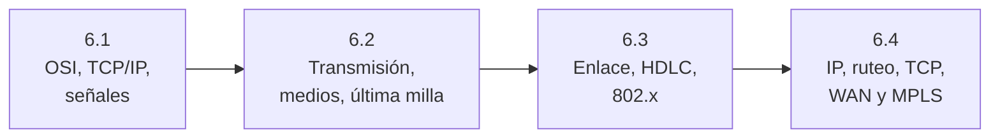

### Cómo leerlo

> [!tip] Antes de empezar
> Mismo método que los libros anteriores: tres niveles y respuesta en cinco pasos.

1. Cada capítulo abre con **lo que tenés que poder hacer**.
2. Las **fórmulas** están en el anexo A y repetidas donde se usan.
3. Los diagramas Mermaid muestran capas, tramas, topologías y redes.
4. Al final: errores típicos y ejercicios con solución plegable.
5. Las **preguntas típicas de UTN** están integradas en los capítulos y en el anexo B.

### Qué priorizar

> [!important] Orden de estudio (según la guía de la compañera)
> | Nivel | Temas |
> |---|---|
> | **A — Imprescindible** | OSI y TCP/IP · señales · medios · enlace de datos · topologías · switch/router · congestión |
> | **B — Muy importante** | Nyquist · modulación · HDLC/PPP/Ethernet · IEEE 802.x · LAN/WAN/MPLS |
> | **C — Complementario** | Teoría de la información y entropía · comunicaciones móviles · tendencias |

### Mapa del libro

#### Parte 1 — Fundamentos y modelo de referencia (6.1)
- 1. Sistemas de comunicación y normalización
- 2. Modelo de referencia OSI
- 3. Arquitectura TCP/IP y encapsulamiento
- 4. Medida de la información y señales
- Cierre de la Parte 1

#### Parte 2 — Estructura física (6.2)
- 5. Transmisión: ancho de banda, perturbaciones y capacidad
- 6. Codificación y modulación
- 7. Medios de transmisión y dispositivos de nivel físico
- 8. Modos de transmisión y última milla
- Cierre de la Parte 2

#### Parte 3 — Enlace de datos (6.3)
- 9. Nivel 2: funciones, PDU y entramado
- 10. Protocolos orientados al bit: HDLC y PPP
- 11. Subcapas LLC/MAC e IEEE 802.x
- Cierre de la Parte 3

#### Parte 4 — Redes (6.4)
- 12. Redes, conmutación y topologías
- 13. Direccionamiento IP y subnetting
- 14. Enrutamiento: enrutados vs. de enrutamiento
- 15. TCP, UDP y control de congestión
- 16. WAN, MPLS y comunicaciones móviles
- Cierre de la Parte 4

#### Anexos
- A. Formulario
- B. Banco de preguntas de oral
- C. Errores frecuentes
- D. Mapa del programa y trazabilidad

### El caso que atraviesa el libro

> [!example] Caso integrador
> El municipio necesita conectar **semáforos y cámaras** con el centro de monitoreo.
>
> - Cada dispositivo se conecta por la red de la ciudad.
> - El centro recibe alertas y consulta video.
> - Hay que dimensionar el enlace, elegir medio, direccionar subredes y definir el enrutamiento.
>
> Cada parte del libro resuelve una capa de ese caso.

### Regla de oro del módulo

> [!important] El error más caro: confundir capas
> “El switch enruta” (no: conmuta), “el router arma tramas” (no: paquetes), “TCP es de la capa de red” (no: transporte). Cada concepto pertenece a una capa y a una función.

<div style="page-break-after: always;"></div>

# 1. Sistemas de comunicación y normalización

> [!info] Al terminar este capítulo tenés que poder
> - Nombrar los elementos de un sistema de comunicación.
> - Explicar qué es un protocolo y una arquitectura de red.
> - Justificar la necesidad de normalización.
> - Distinguir transmisión de datos de otros tipos de comunicación.

> [!abstract] Qué debés saber (nivel 1)
> - **Sistema de comunicaciones:** fuente → transductor → transmisor → medio → receptor → transductor → destino.
> - **Transmisión de datos:** desplazamiento de información codificada en binario sobre un sistema de transmisión.
> - **Protocolo:** reglas acordadas para intercambiar información.
> - **Arquitectura de red:** conjunto de protocolos compatibles.
> - **Normalización:** directrices comunes para que equipos de distintos fabricantes se entiendan.
> - Organismos: ISO, IEEE, ITU-T, IETF.

## 1.1 Elementos de un sistema de comunicación

> [!quote] Definición de cátedra
> **Sistema de comunicaciones:** sistema compuesto por una fuente, un transductor de salida, un transmisor, un medio de transmisión, un receptor, un transductor de entrada y la colectora o destino de los datos.


| Elemento | Función | Ejemplo |
|---|---|---|
| **Fuente** | Genera la información | Micrófono, sensor, teclado |
| **Transductor de salida** | Convierte a señal | Micrófono → tensión |
| **Transmisor** | Acondiciona la señal | Módem, tarjeta de red |
| **Medio** | Transporta | Cable, fibra, aire |
| **Receptor** | Recupera la señal | Módem, NIC |
| **Transductor de entrada** | Vuelve a información | Parlante, pantalla |
| **Destino** | Usa la información | Persona, sistema |

### DTE y DCE

| Sigla | Nombre | Función | Ejemplo |
|---|---|---|---|
| **DTE (ETD)** | Equipo Terminal de Datos | Genera o consume los datos: es fuente o destino | PC, router, terminal |
| **DCE (ETCD)** | Equipo de Terminación del Circuito de Datos | Adapta la señal del DTE al canal y suele aportar el reloj | Módem, códec, ONT |

> [!important] Quién es quién
> El **DTE** pone los datos; el **DCE** los adapta al medio y suele dar el reloj. En RS-232 la PC es DTE y el módem, DCE.

### Funciones generales del sistema

| Función | Para qué |
|---|---|
| Uso eficiente del medio | Multiplexación y compartición de la capacidad |
| Interfaces | Características mecánicas, eléctricas, funcionales y procedimentales |
| Generación y codificación | Producir señales que se propaguen y se interpreten |
| Sincronización | Inicio, fin y duración de cada elemento transmitido |
| Detección y control de errores | Verificar integridad y decidir si se retransmite |
| Control de flujo | Evitar que un emisor rápido desborde al receptor |
| Direccionamiento y encaminamiento | Identificar extremos y elegir el camino |

> [!important] La distinción que se pregunta
> **Transmisión de datos** es el desplazamiento de información **ya codificada en binario** sobre un sistema de transmisión eléctrica. No es “hablar por teléfono”: la voz analógica se digitaliza primero.

## 1.2 Protocolos y arquitectura

| Concepto | Definición | Ejemplo |
|---|---|---|
| **Protocolo** | Conjunto de reglas acordadas entre participantes | TCP, IP, HTTP |
| **Arquitectura de red** | Conjunto de protocolos compatibles entre sí | TCP/IP |
| **Interfaz** | Punto de conexión entre capas | Socket |
| **Servicio** | Lo que una capa ofrece a la de arriba | Entrega confiable |

### Las tres características de un protocolo

| Característica | Qué define | Ejemplo |
|---|---|---|
| **Sintaxis** | Formato de datos y niveles de señal | Campos de una trama |
| **Semántica** | Información de control y errores | ACK, NAK, códigos |
| **Temporización** | Coordinación de velocidades y secuencia | Timeouts, orden |

> [!warning] “Protocolo” no es “programa”
> Es un **conjunto de reglas**. La implementación es el software o hardware que las cumple.

## 1.3 Por qué normalizar

> [!quote] Cátedra
> **Normalización:** establecimiento de directrices que ordenan procedimientos y permiten aplicar reglas para una actividad determinada.

| Sin normalización | Con normalización |
|---|---|
| Cada fabricante inventa su formato | Interoperabilidad |
| No hay competencia real | Competencia por precio y calidad |
| Cambiar un equipo rompe todo | Sustitución por partes |

### Organismos

| Organismo | Ámbito | Ejemplo |
|---|---|---|
| **ISO** | Internacional, amplio | Modelo OSI |
| **IEEE** | Redes locales | IEEE 802.3 (Ethernet) |
| **ITU-T** | Telecomunicaciones | Recomendaciones de transmisión |
| **IETF** | Internet | RFC (IP, TCP, HTTP) |
| **W3C** | Web | HTML, CSS, XML |

> [!tip] En el oral
> “La normalización permite que equipos de distintos fabricantes interoperen. ISO define OSI; IEEE define las LAN; IETF define los protocolos de Internet mediante RFC.”

## 1.4 Clasificación de las comunicaciones

| Criterio | Tipos |
|---|---|
| Sentido | Simplex, semi-dúplex, dúplex |
| Señal | Analógica, digital |
| Medio | Guiado, no guiado |
| Alcance | PAN, LAN, MAN, WAN |
| Conmutación | Circuitos, paquetes |
| Difusión | Difusión, conmutada |

### Modos de transmisión

| Modo | Definición | Ejemplo |
|---|---|---|
| **Simplex** | Una estación siempre transmite, la otra siempre recibe | Radio, TV |
| **Semi-dúplex** | Alternan: uno transmite y luego el otro | Radioaficionados |
| **Dúplex (full)** | Ambos transmiten y reciben a la vez | Teléfono, Ethernet conmutada |

> [!important] La pregunta típica de UTN
> “Tipos de comunicaciones, características.” Respondé con los tres modos y un ejemplo de cada uno. En full-dúplex digital se usan **dos pares trenzados**; en analógico inalámbrico, **dos frecuencias**.

## 1.5 Método: analizar un sistema de comunicación

| Paso | Pregunta | Resultado |
|---|---|---|
| 1 | ¿Quién genera la información? | Fuente |
| 2 | ¿Cómo se convierte en señal? | Transductor |
| 3 | ¿Qué medio se usa? | Guiado o no guiado |
| 4 | ¿Qué protocolo gobierna? | Reglas |
| 5 | ¿Qué puede perturbarla? | Ruido, atenuación |
| 6 | ¿Cómo se recupera? | Receptor + transductor |

## Errores que suelen tomar

| Error | Corrección |
|---|---|
| Confundir protocolo con arquitectura | Protocolo = reglas; arquitectura = conjunto compatible |
| Decir que simplex es “un solo sentido físico” | Es un solo sentido lógico de transmisión |
| Creer que normalizar es “estandarizar la marca” | Es acordar reglas técnicas |
| Omitir la temporización | Es una de las tres características |
| Confundir transmisión de datos con comunicación | La primera es binaria y técnica |

## Ejercicios

> [!example] 1. Elementos
> **Enunciado:** en una videollamada, identificá fuente, transductor y medio.
> **Solución:** fuente: cámara/micrófono; transductor: sensor CMOS y micrófono; medio: Internet (guiado/no guiado según el tramo).

> [!example] 2. Protocolo
> **Enunciado:** nombrá las tres características y un ejemplo de cada una.
> **Solución:** sintaxis (formato de trama), semántica (ACK/error), temporización (timeout, secuencia).

> [!example] 3. Modos
> **Enunciado:** ¿qué modo usa un “walkie-talkie”?
> **Solución:** semi-dúplex: alternan transmisión y recepción.

> [!example] 4. Normalización
> **Enunciado:** ¿para qué sirve IEEE 802.3?
> **Solución:** para normalizar Ethernet (nivel físico y de enlace) y permitir interoperabilidad.

> [!example] 5. a papel
> **Enunciado:** dibujá el sistema de comunicación con sus siete elementos.
> **Solución:** ver 1.1.


<div style="page-break-after: always;"></div>


# 2. Modelo de referencia OSI

> [!info] Al terminar este capítulo tenés que poder
> - Nombrar las siete capas y su función.
> - Asociar PDU, dispositivos y protocolos a cada capa.
> - Explicar la comunicación entre capas pares.
> - Diferenciar modelo de referencia de arquitectura.

> [!abstract] Qué debés saber (nivel 1)
> - **OSI** es un **modelo de referencia**, no una arquitectura de protocolos.
> - Siete capas: Física, Enlace, Red, Transporte, Sesión, Presentación, Aplicación.
> - PDU: bits → tramas → paquetes → segmentos → datos.
> - Dispositivos: repetidor/hub (1), switch/bridge (2), router (3), gateway (7).
> - Cada capa ofrece **servicios** a la de arriba y usa los de abajo.
> - Las capas **pares** se comunican lógicamente.

## 2.1 Por qué un modelo de referencia

> [!quote] Cátedra
> **Modelo OSI:** modelo de referencia de siete capas para permitir que dos sistemas diferentes se comuniquen con independencia de la arquitectura subyacente.

Ventajas:

| Ventaja | Detalle |
|---|---|
| Divide el problema | Cada capa resuelve una parte |
| Interoperabilidad | Interfaces normalizadas |
| Independencia | Cambiar una capa no rompe las demás |
| Didáctico | Ordena el estudio y el diagnóstico |

> [!important] Modelo ≠ arquitectura
> OSI **describe qué debería hacer cada nivel**. TCP/IP es la **arquitectura que se implementa**. Por eso “OSI no se usa” es falso: se usa como referencia y vocabulario.

## 2.2 Las siete capas

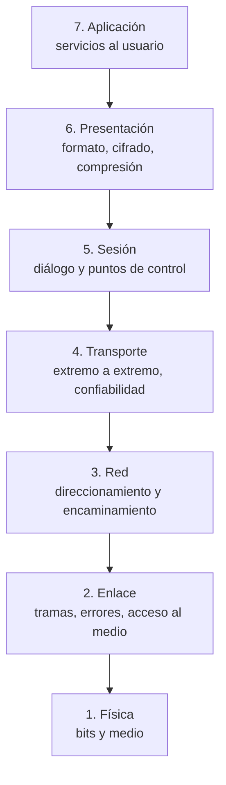

| # | Capa | Función | PDU | Ejemplos |
|---|---|---|---|---|
| 7 | **Aplicación** | Servicios al usuario | Datos | HTTP, DNS, SMTP |
| 6 | **Presentación** | Formato, cifrado, compresión | Datos | TLS, JPEG, ASCII |
| 5 | **Sesión** | Diálogo, puntos de recuperación | Datos | RPC, NetBIOS |
| 4 | **Transporte** | Extremo a extremo, fiabilidad | Segmento | TCP, UDP |
| 3 | **Red** | Dirección lógica y ruta | Paquete | IP, ICMP |
| 2 | **Enlace** | Trama, errores, MAC | Trama | Ethernet, HDLC |
| 1 | **Física** | Bits, voltaje, medio | Bit | UTP, fibra, hub |

> [!warning] El orden se confunde
> De abajo hacia arriba: **Física, Enlace, Red, Transporte, Sesión, Presentación, Aplicación**. De arriba hacia abajo, al revés. Escribilo siempre en el mismo sentido en el examen.

### Funciones que se preguntan

| Capa | Palabras clave |
|---|---|
| Física | Bits, señal, medio, modulación, sincronismo |
| Enlace | Trama, MAC, CRC, control de flujo, acceso al medio |
| Red | IP, ruta, congestión, fragmentación, direccionamiento lógico |
| Transporte | Puerto, conexión, confiabilidad, extremo a extremo |
| Sesión | Diálogo, sincronización, recuperación |
| Presentación | Traducción, cifrado, compresión |
| Aplicación | Servicios: correo, web, nombres |

## 2.3 Comunicación entre capas

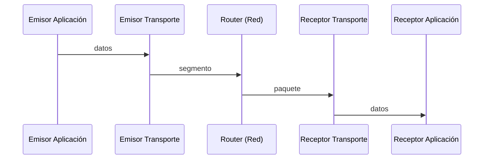

| Concepto | Significado |
|---|---|
| **Capa par** | La misma capa en emisor y receptor |
| **Encapsulamiento** | Cada capa agrega su cabecera |
| **Desencapsulamiento** | El receptor quita cabeceras |
| **Servicio** | Lo que ofrece una capa a la superior |
| **Interfaz** | Punto de acceso al servicio |

> [!important] Las capas pares “hablan” lógicamente
> La capa de transporte del emisor no habla con la de red del receptor: habla **lógicamente** con la de transporte del receptor. Físicamente, los datos bajan y suben por la pila.

## 2.4 Dispositivos por capa

| Capa | Dispositivo | Función |
|---|---|---|
| 1 | Repetidor, hub | Regeneran la señal |
| 2 | Switch, bridge | Conmutan por MAC |
| 3 | Router | Enrutan por IP |
| 4-7 | Gateway, proxy | Traducen protocolos/servicios |

> [!tip] Regla de memoria
> **Hub repite, switch conmuta, router enruta.** Si el dispositivo “mira” direcciones IP, es de capa 3.

## 2.5 Método: ubicar una función o un dispositivo

| Pregunta | Capa |
|---|---|
| ¿Es voltaje, bit o medio? | 1 |
| ¿Es trama, MAC o CRC? | 2 |
| ¿Es IP o ruta? | 3 |
| ¿Es puerto, conexión o retransmisión? | 4 |
| ¿Es diálogo o punto de control? | 5 |
| ¿Es formato, cifrado o compresión? | 6 |
| ¿Es un servicio al usuario? | 7 |

## Errores que suelen tomar

| Error | Corrección |
|---|---|
| “OSI es un protocolo” | Es un modelo de referencia |
| “El switch es capa 3” | Capa 2 (salvo switch capa 3) |
| “El router arma tramas” | Arma paquetes; la trama es capa 2 |
| “TCP es capa de red” | Es transporte |
| Poner HTTP en presentación | Es aplicación |
| Decir que OSI tiene 5 capas | Son 7 |

## Ejercicios

> [!example] 1. Capas
> **Enunciado:** ¿en qué capa está el CRC?
> **Solución:** enlace (capa 2).

> [!example] 2. Dispositivo
> **Enunciado:** ¿qué dispositivo trabaja con direcciones MAC?
> **Solución:** switch/bridge (capa 2).

> [!example] 3. PDU
> **Enunciado:** ordená las PDU de abajo hacia arriba.
> **Solución:** bit, trama, paquete, segmento, datos.

> [!example] 4. Función
> **Enunciado:** ¿qué capa se encarga del formato y el cifrado?
> **Solución:** presentación (6).

> [!example] 5. a papel
> **Enunciado:** dibujá las 7 capas y escribí al lado un protocolo y un dispositivo de cada una.
> **Solución:** ver 2.2 y 2.4.


<div style="page-break-after: always;"></div>


# 3. Arquitectura TCP/IP y encapsulamiento

> [!info] Al terminar este capítulo tenés que poder
> - Mapear TCP/IP contra OSI.
> - Explicar el encapsulamiento capa por capa.
> - Nombrar los protocolos de cada capa.
> - Diferenciar entrega extremo a extremo de salto a salto.

> [!abstract] Qué debés saber (nivel 1)
> - TCP/IP tiene **4 capas**: acceso a la red, internet, transporte, aplicación.
> - **IP** es no orientado a conexión y no confiable.
> - **TCP** es orientado a conexión y confiable; **UDP** no.
> - Cada capa agrega su **cabecera** (encapsulamiento).
> - El router trabaja hasta **capa 3**; el switch hasta **capa 2**.
> - TCP/IP es la arquitectura **implementada**; OSI, el modelo de referencia.

## 3.1 Las cuatro capas

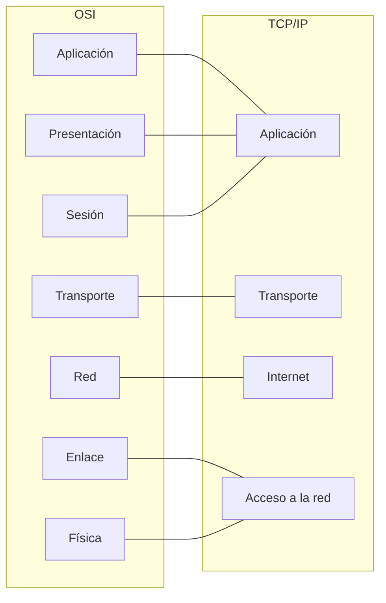

| TCP/IP | Equivale en OSI | Protocolos |
|---|---|---|
| **Aplicación** | Aplicación + presentación + sesión | HTTP, DNS, SMTP, FTP, SSH |
| **Transporte** | Transporte | TCP, UDP |
| **Internet** | Red | IP, ICMP, ARP |
| **Acceso a la red** | Enlace + física | Ethernet, Wi-Fi, PPP |

> [!important] Por qué cuatro y no siete
> TCP/IP agrupa las capas de aplicación, presentación y sesión porque en la práctica los protocolos de aplicación resuelven esas funciones. No “faltan” capas: están integradas.

## 3.2 Encapsulamiento

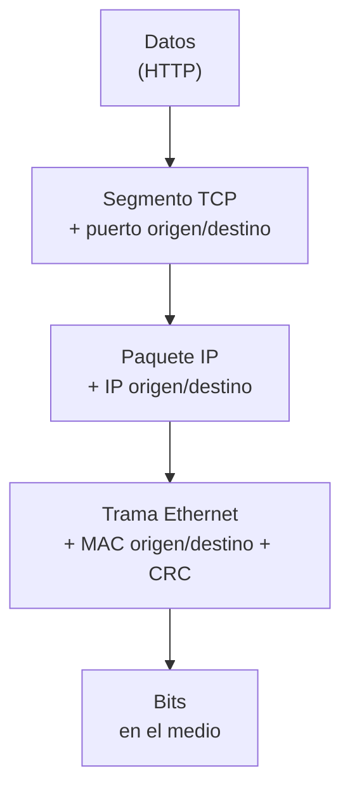

| Capa | Agrega | Se llama |
|---|---|---|
| Aplicación | Datos | Mensaje |
| Transporte | Puertos, secuencia | Segmento (TCP) / datagrama (UDP) |
| Internet | IP origen/destino, TTL | Paquete / datagrama IP |
| Acceso a la red | MAC, CRC | Trama |
| Física | — | Bits |

> [!example] Leer una trama
> Una trama Ethernet que transporta HTTP contiene: `[MAC dst | MAC src | Tipo | IP dst | IP src | Puerto dst | Puerto src | Datos HTTP | CRC]`.
> Cada capa del receptor quita **su** cabecera y entrega el resto a la de arriba.

## 3.3 Protocolos por capa

| Capa | Protocolo | Función |
|---|---|---|
| Aplicación | HTTP/HTTPS | Web |
| | DNS | Nombres → IP |
| | SMTP/IMAP | Correo |
| | FTP/SFTP | Archivos |
| | DHCP | Configuración IP |
| Transporte | TCP | Confiable, conexión |
| | UDP | No confiable, sin conexión |
| Internet | IP | Direccionamiento y ruta |
| | ICMP | Errores y diagnóstico (`ping`) |
| | ARP | IP → MAC |
| Acceso | Ethernet | LAN cableada |
| | Wi-Fi (802.11) | LAN inalámbrica |
| | PPP | Enlace punto a punto |

> [!warning] ARP no es capa 3 pura
> ARP resuelve una IP a una MAC: puentea red y enlace. Se ubica en la frontera (capa 2/3). En el oral, decilo así y no te equivocás.

## 3.4 Extremo a extremo vs. salto a salto

| Concepto | Capa | Alcance |
|---|---|---|
| **Salto a salto** | Enlace (2) | Entre dos nodos vecinos |
| **Extremo a extremo** | Transporte (4) | Entre procesos finales |
| **Ruta** | Red (3) | Entre redes, decidida por routers |

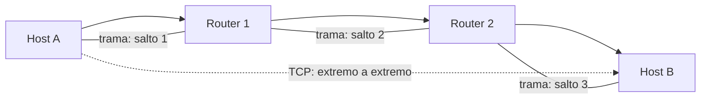

> [!important] La frase que suma
> “La trama cambia en cada salto; el paquete IP se mantiene de extremo a extremo (salvo TTL y fragmentación); el segmento TCP solo lo entienden los extremos.”

## 3.5 Direcciones en cada nivel

| Nivel | Dirección | Ejemplo |
|---|---|---|
| Aplicación | Nombre / URL | `www.municipio.gob.ar` |
| Transporte | Puerto | 80 (HTTP), 443 (HTTPS) |
| Red | IP | `192.168.1.10` |
| Enlace | MAC | `AA:BB:CC:DD:EE:FF` |

> [!tip] Cómo recordarlo
> **Nombre → puerto → IP → MAC**: de lo más “humano” a lo más “físico”.

## 3.6 Método: seguir un paquete

| Paso | Pregunta | Respuesta |
|---|---|---|
| 1 | ¿Qué aplicación lo genera? | HTTP |
| 2 | ¿Qué puerto? | 443 |
| 3 | ¿Qué IP destino? | Resuelta por DNS |
| 4 | ¿Qué ruta? | Tabla del router |
| 5 | ¿Qué MAC en el próximo salto? | ARP |
| 6 | ¿Qué medio? | Ethernet/Wi-Fi |

## Errores que suelen tomar

| Error | Corrección |
|---|---|
| “TCP/IP tiene 7 capas” | Tiene 4 |
| “IP es confiable” | No: no confirma entrega |
| “TCP es más rápido que UDP” | No: tiene más control, no necesariamente más rápido |
| “El router cambia la IP destino” | Solo NAT; el enrutamiento normal no |
| “La MAC llega de extremo a extremo” | Cambia en cada salto |
| “DNS es capa de transporte” | Es aplicación |

## Ejercicios

> [!example] 1. Mapeo
> **Enunciado:** ¿a qué capa TCP/IP corresponde la presentación de OSI?
> **Solución:** aplicación.

> [!example] 2. Encapsulamiento
> **Enunciado:** ¿qué agrega la capa de transporte?
> **Solución:** puertos de origen y destino, número de secuencia y control.

> [!example] 3. Protocolo
> **Enunciado:** `ping` usa ICMP. ¿Qué capa?
> **Solución:** internet (capa 3).

> [!example] 4. MAC
> **Enunciado:** ¿la MAC de destino es la del host final?
> **Solución:** no necesariamente: es la del **próximo salto** (router o host en la misma red).

> [!example] 5. a papel
> **Enunciado:** dibujá el encapsulamiento de un HTTP sobre Ethernet.
> **Solución:** ver 3.2.


<div style="page-break-after: always;"></div>


# 4. Medida de la información y señales

> [!info] Al terminar este capítulo tenés que poder
> - Calcular entropía y tasa de información.
> - Distinguir señal analógica de digital.
> - Explicar muestreo, cuantización y codificación.
> - Aplicar el teorema de Nyquist para muestreo.

> [!abstract] Qué debés saber (nivel 1)
> - **Información** se vincula con la **incertidumbre**, no con el significado.
> - **Entropía:** bits por símbolo; máximo cuando los símbolos son equiprobables.
> - **Tasa de información:** símbolos por segundo × entropía.
> - **Señal analógica:** varía continuamente. **Digital:** discreta.
> - **Muestreo:** tomar valores a intervalos regulares.
> - **Nyquist (muestreo):** `fs ≥ 2 · fmax`.

## 4.1 Qué es información

> [!quote] Cátedra
> **Información:** aquello que se produce en la fuente para ser transferida, procesada, computada, distribuida o almacenada; se vincula con la **incertidumbre** y no con el significado del contenido.

Un mensaje predecible aporta poca información; uno improbable, mucha.

$$I(E) = \log_2 \frac{1}{P(E)} = -\log_2 P(E) \quad [\text{bits}]$$

> [!tip] La misma fórmula, dos usos
> Aplicada a un **evento** da la información de ese evento; promediada sobre todos los símbolos de una fuente da la **entropía**. Por eso `H` es la esperanza de `I(E)`.

| Evento | Probabilidad | Información |
|---|---|---|
| “Sale cara” en moneda honesta | 0,5 | 1 bit |
| “Sale 6” en dado | 1/6 | ≈ 2,58 bits |
| “Sale cara” en moneda con dos caras | 1 | 0 bits |

> [!important] La idea que se pregunta
> Cuanto más probable es un símbolo, **menos** información aporta. Si ya sabés lo que va a pasar, no te informa nada.

## 4.2 Entropía

$$H = -\sum_{i=1}^{n} p_i \log_2 p_i \quad [\text{bits/símbolo}]$$

### Ejemplo

Fuente con `P(A)=0,5`, `P(B)=0,25`, `P(C)=0,25`:

```text
H = -(0,5·log2 0,5 + 0,25·log2 0,25 + 0,25·log2 0,25)
H = -(0,5·(-1) + 0,25·(-2) + 0,25·(-2))
H = 0,5 + 0,5 + 0,5 = 1,5 bits/símbolo
```

| Caso | Entropía |
|---|---|
| Dos símbolos equiprobables | 1 bit/símbolo (máxima) |
| Cuatro equiprobables | 2 bits/símbolo |
| Un símbolo con probabilidad 1 | 0 bits/símbolo |

> [!tip] La cota
> La entropía máxima de una fuente con `n` símbolos es `log2 n`, y se alcanza cuando todos son equiprobables.

## 4.3 Tasa de información

$$R = r_s \cdot H \quad [\text{bits/s}]$$

- `r_s`: símbolos por segundo (velocidad de símbolo).
- `H`: bits por símbolo.

**Ejemplo:** `r_s = 1000 símbolos/s` y `H = 1,5` → `R = 1500 bps`.

> [!warning] No confundir
> **Velocidad de símbolo (baudios)** ≠ **velocidad de bits (bps)**. Si cada símbolo transporta más de un bit, los bps son mayores que los baudios.

| Magnitud | Unidad | Ojo |
|---|---|---|
| Información | bit | Se calcula con `log2` |
| Tasa de información | b/s | símbolos/s × bits/símbolo |
| Tamaño de archivo | byte (B) = 8 bits | `1 GB ≈ 8 Gb` |
| Tasa de un enlace | b/s (decimal) | `1 Mb/s = 10⁶ b/s`, no 2²⁰ |

**Ejemplo:** un archivo de 1 GB (≈ 8 Gb) sobre un enlace ideal de 100 Mb/s tarda como mínimo `8000/100 = 80 s`. En la práctica tarda más por cabeceras, control y congestión.

## 4.4 Señales

| | Analógica | Digital |
|---|---|---|
| Variación | Continua | Discreta |
| Forma | Onda suave | Pulsos |
| Ejemplo | Voz, temperatura | Datos binarios |
| Ventaja | Fiel al fenómeno | Robusta y regenerable |
| Desventaja | Se degrada con el ruido | Requiere más ancho de banda en banda base |

### Parámetros

| Parámetro | Qué es | Fórmula |
|---|---|---|
| **Amplitud** | Altura de la onda | — |
| **Frecuencia** | Ciclos por segundo | `f = 1/T` |
| **Período** | Duración de un ciclo | `T = 1/f` |
| **Fase** | Desplazamiento de la onda | — |
| **Longitud de onda** | Distancia de un ciclo | `λ = v/f` |

**Ejemplo:** `f = 100 MHz`, `v = 3×10⁸ m/s` → `λ = 3 m`.

> [!important] Tres formas de modular
> Se puede variar **amplitud (AM/ASK)**, **frecuencia (FM/FSK)** o **fase (PM/PSK)**. QAM combina amplitud y fase.

## 4.5 Muestreo y digitalización

Para transmitir una señal analógica por un canal digital se digitaliza:

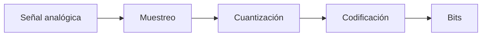

| Etapa | Qué hace |
|---|---|
| **Muestreo** | Toma valores a intervalos regulares |
| **Cuantización** | Asigna cada muestra a un nivel discreto |
| **Codificación** | Convierte el nivel en bits |

### Teorema de Nyquist (muestreo)

$$f_s \ge 2 \cdot f_{max}$$

**Ejemplo:** una señal de voz de hasta 4 kHz necesita `fs ≥ 8000 muestras/s`. Por eso la telefonía usa 8 kHz.

> [!warning] Si muestreás menos
> Se produce **aliasing**: la señal reconstruida es distinta de la original. No se arregla después con filtros.

### PCM

| Paso | Detalle |
|---|---|
| Muestreo | 8000 veces por segundo |
| Cuantización | 256 niveles (8 bits) |
| Tasa | `8000 × 8 = 64 kbps` |

> [!tip] El número que se pregunta
> Voz telefónica PCM: **64 kbps**. Sale de 8 kHz × 8 bits.

## 4.6 Método: resolver un problema de información

| Paso | Acción |
|---|---|
| 1 | Identificar símbolos y probabilidades |
| 2 | Calcular `H` con `-Σ p log2 p` |
| 3 | Verificar que `H ≤ log2 n` |
| 4 | Multiplicar por `r_s` para la tasa |
| 5 | Verificar unidades (bits/símbolo vs. bps) |

## Errores que suelen tomar

| Error | Corrección |
|---|---|
| Calcular entropía con `log10` | Es `log2` |
| Confundir entropía con tasa | `H` es por símbolo; la tasa es por segundo |
| Decir que más probabilidad = más información | Al revés |
| Muestrear con `fs = fmax` | Debe ser ≥ `2·fmax` |
| Confundir baudios con bps | Depende de bits por símbolo |
| Olvidar que la entropía máxima es `log2 n` | Usarlo como control |

## Ejercicios

> [!example] 1. Entropía
> **Enunciado:** fuente binaria con `P(0)=0,9` y `P(1)=0,1`. ¿Entropía?
> **Solución:** `H = -(0,9 log2 0,9 + 0,1 log2 0,1) ≈ 0,469 bits/símbolo`.

> [!example] 2. Tasa
> **Enunciado:** `r_s = 2400` y `H = 2` bits/símbolo.
> **Solución:** `R = 4800 bps`.

> [!example] 3. Muestreo
> **Enunciado:** señal de 10 kHz. ¿Frecuencia mínima de muestreo?
> **Solución:** 20 kHz.

> [!example] 4. PCM
> **Enunciado:** 8000 muestras/s con 8 bits. ¿Tasa?
> **Solución:** 64.000 bps = 64 kbps.

> [!example] 5. Longitud de onda
> **Enunciado:** `f = 2,4 GHz`, `v = 3×10⁸ m/s`.
> **Solución:** `λ = 0,125 m` (12,5 cm).

> [!example] 6. a papel
> **Enunciado:** explicá por qué una moneda honesta aporta 1 bit.
> **Solución:** porque hay dos resultados equiprobables y `H = log2 2 = 1` bit por símbolo.


<div style="page-break-after: always;"></div>


# Cierre de la Parte 1 — Fundamentos y modelo de referencia

> [!info] Qué hacer con este archivo
> Verificación de 6.1. Si algo falla, volvé a los capítulos 1 a 4.

## Checklist de la Parte 1

| Puedo… | Capítulo | ✔ |
|---|---|---|
| Nombrar los elementos de un sistema de comunicación | Cap. 1 | ☐ |
| Explicar protocolo, arquitectura y normalización | Cap. 1 | ☐ |
| Nombrar las siete capas de OSI y su función | Cap. 2 | ☐ |
| Asociar PDU y dispositivos a cada capa | Cap. 2 | ☐ |
| Mapear TCP/IP contra OSI | Cap. 3 | ☐ |
| Explicar el encapsulamiento | Cap. 3 | ☐ |
| Calcular entropía y tasa de información | Cap. 4 | ☐ |
| Explicar muestreo y PCM (64 kbps) | Cap. 4 | ☐ |

## Diferencias que no podés confundir

| A | B | Diferencia central |
|---|---|---|
| Modelo OSI | Arquitectura TCP/IP | Referencia vs. implementación |
| Protocolo | Arquitectura | Reglas vs. conjunto compatible |
| Capa de red | Capa de transporte | Ruta entre redes vs. extremo a extremo |
| Switch | Router | Capa 2 (MAC) vs. capa 3 (IP) |
| Entropía | Tasa de información | Bits por símbolo vs. bits por segundo |
| Analógica | Digital | Continua vs. discreta |
| Baudios | bps | Símbolos/s vs. bits/s |

## Ejercicio integrador de la Parte 1

> [!example] Enunciado (20 minutos)
> 1. Ubicá: HTTP, TCP, IP, Ethernet y un hub en las capas OSI.
> 2. Calculá la entropía de una fuente con `P(A)=0,25`, `P(B)=0,25`, `P(C)=0,5`.
> 3. Si `r_s = 2000` símbolos/s, ¿cuál es la tasa?
> 4. ¿Qué frecuencia mínima de muestreo necesita una señal de 5 kHz?

> [!success] Solución
> **1.** HTTP → aplicación (7); TCP → transporte (4); IP → red (3); Ethernet → enlace (2); hub → física (1).
> **2.** `H = -(0,25·(-2) + 0,25·(-2) + 0,5·(-1)) = 1,5 bits/símbolo`.
> **3.** `R = 2000 × 1,5 = 3000 bps`.
> **4.** `fs ≥ 2 × 5000 = 10 kHz`.

## Oral de la Parte 1 (8 preguntas)

> [!question] 1. ¿Qué es un protocolo?
> Conjunto de reglas acordadas para intercambiar información, con sintaxis, semántica y temporización.

> [!question] 2. ¿Por qué normalizar?
> Para que equipos de distintos fabricantes interoperen y se puedan sustituir por partes.

> [!question] 3. ¿OSI es un protocolo?
> No: es un modelo de referencia de siete capas.

> [!question] 4. Nombrá las capas de abajo hacia arriba.
> Física, enlace, red, transporte, sesión, presentación y aplicación.

> [!question] 5. ¿Qué hace la capa de red?
> Direccionamiento lógico, encaminamiento y control de congestión entre redes.

> [!question] 6. ¿Qué diferencia hay entre TCP e IP?
> IP entrega paquetes sin conexión ni confiabilidad; TCP establece conexión y garantiza entrega ordenada.

> [!question] 7. ¿Qué es la entropía?
> La información media por símbolo de una fuente, medida en bits/símbolo.

> [!question] 8. ¿Por qué se muestrea a 8 kHz en telefonía?
> Porque la voz llega a 4 kHz y Nyquist exige al menos el doble.


<div style="page-break-after: always;"></div>


# 5. Transmisión: ancho de banda, perturbaciones y capacidad

> [!info] Al terminar este capítulo tenés que poder
> - Distinguir frecuencia, espectro y ancho de banda.
> - Calcular dB y dBm.
> - Explicar atenuación, distorsión y ruido.
> - Aplicar Nyquist y Shannon.

> [!abstract] Qué debés saber (nivel 1)
> - **Ancho de banda (AB):** rango de frecuencias donde se concentra la energía.
> - **Atenuación:** pérdida de potencia con la distancia (se mide en dB).
> - **Distorsión de retardo:** distintas frecuencias viajan a distinta velocidad.
> - **Ruido:** térmico, de intermodulación, diafonía e impulsivo.
> - **Nyquist (canal sin ruido):** `C = 2B log2 M`.
> - **Shannon (canal con ruido):** `C = B log2(1 + S/N)`.

## 5.1 Frecuencia, espectro y ancho de banda

| Concepto | Definición | Unidad |
|---|---|---|
| **Frecuencia** | Ciclos por segundo | Hz |
| **Espectro** | Conjunto de frecuencias que componen una señal | Hz |
| **Ancho de banda** | Rango de frecuencias donde se concentra la mayor parte de la energía | Hz |
| **Tasa de bits** | Bits por segundo | bps |
| **Baudios** | Símbolos por segundo | baud |

> [!quote] Pregunta típica de UTN
> “Explicar el concepto de AB.” → **Es la longitud, medida en Hz, del rango de frecuencias en el que se concentra la mayor parte de la energía de la señal.**

> [!warning] AB no es velocidad
> El ancho de banda es una **propiedad del canal**; la tasa es cuántos bits pasan por segundo. Un canal más ancho **permite** más tasa, pero no la garantiza.

## 5.2 Decibeles

$$dB = 10 \log_{10}\left(\frac{P_2}{P_1}\right)$$

| Variación | dB |
|---|---|
| ×2 | ≈ +3 dB |
| ×10 | +10 dB |
| ÷2 | ≈ −3 dB |
| ÷10 | −10 dB |

### dBm (potencia absoluta)

$$dBm = 10 \log_{10}\left(\frac{P}{1\,\text{mW}}\right)$$

| Potencia | dBm |
|---|---|
| 1 mW | 0 dBm |
| 10 mW | 10 dBm |
| 0,1 mW | −10 dBm |
| 1 W | 30 dBm |

> [!important] Por qué hay dBm negativos
> Porque la escala es logarítmica y toma como referencia 1 mW. `−10 dBm` **no** es potencia negativa: es `0,1 mW`. Un valor negativo indica una potencia **menor** que 1 mW.

### Ejemplo

Una señal de 1 mW se atenúa a 0,1 mW:

```text
dB = 10 log10(0,1/1) = -10 dB
```

## 5.3 Perturbaciones

| Perturbación | Causa | Efecto | ¿Se elimina? |
|---|---|---|---|
| **Atenuación** | Pérdida de energía en el medio | La señal llega débil | Se compensa con amplificadores/repetidores |
| **Distorsión de retardo** | La velocidad depende de la frecuencia | Los bits se solapan | Se ecualiza o se limita la tasa |
| **Ruido térmico** | Agitación de electrones | Ruido blanco de fondo | **No** se elimina: limita el canal |
| **Diafonía (crosstalk)** | Acoplamiento entre cables | Interferencia de otro par | Se reduce con trenzado y blindaje |
| **Interferencia electromagnética (EMI)** | Campos externos: motores, radio, descargas | Perturbación de la señal | Blindaje, separación de la potencia y fibra |
| **Ruido impulsivo** | Picos externos (tormentas, fallas) | Ráfagas de errores | Se mitiga con blindaje y detección |

> [!quote] Pregunta típica de UTN
> “Ruido térmico: características y ejemplos.” → Se debe a la agitación térmica de los electrones, está presente en todos los medios electrónicos, **depende de la temperatura**, está distribuido uniformemente en el espectro (por eso “ruido blanco”) y **no se puede eliminar**: impone un límite superior a las prestaciones.

> [!tip] Distorsión de retardo en una frase
> “La velocidad de propagación varía con la frecuencia; por eso las componentes de la señal llegan en instantes distintos.”

### Las tres perturbaciones en un solo mapa

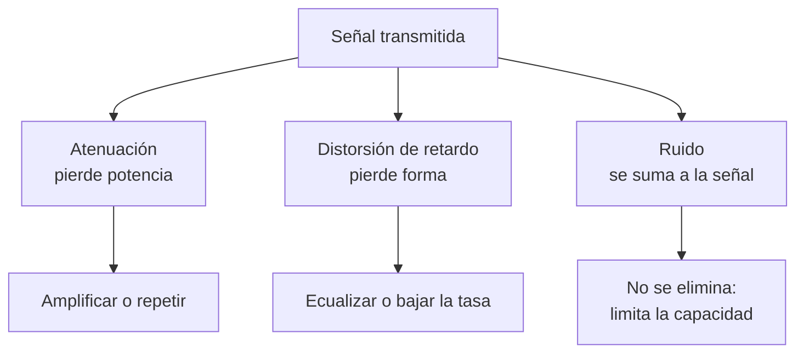

> [!important] Solo una no tiene remedio
> Atenuación y distorsión se compensan; el ruido térmico **no**. Por eso Shannon es un techo: podés mejorar el equipo, pero no eliminar el ruido de fondo.

## 5.4 Capacidad del canal

### Nyquist (canal sin ruido)

$$C = 2B \log_2 M$$

- `B`: ancho de banda en Hz.
- `M`: niveles de codificación.

**Ejemplo:** `B = 3 kHz`, `M = 4` → `C = 2 · 3000 · 2 = 12.000 bps`.

> [!important] “¿Conviene tener muchos niveles?”
> En un canal **sin ruido**, más niveles aumentan la capacidad (logarítmicamente). En un canal **con ruido**, muchos niveles se confunden entre sí y el BER sube. Por eso la respuesta correcta se justifica con **Shannon**.

### Shannon (canal con ruido)

$$C = B \log_2(1 + S/N)$$

- `S/N`: relación señal-ruido (lineal).
- Si te dan `SNR_dB`: `S/N = 10^(SNR/10)`.

**Ejemplo:** `B = 3 kHz`, `SNR = 30 dB` → `S/N = 1000` → `C = 3000 · log2(1001) ≈ 29.900 bps`.

> [!example] Justificación típica
> “Con muchos niveles aumento `M`, pero el ruido hace que los niveles se confundan. Shannon me da el techo real: no puedo superar `B log2(1+S/N)` sin subir potencia o ancho de banda.”

## 5.5 Relación entre AB y tasa

| Escenario | Qué limita |
|---|---|
| Canal ideal | El ancho de banda y los niveles |
| Canal real | El ruido (Shannon) |
| Medio físico | Atenuación y distorsión |

> [!warning] La confusión clásica
> “Más ancho de banda = más velocidad” **no siempre**. Si el ruido es alto, agregar AB ayuda solo hasta cierto punto; y si el protocolo tiene mucho overhead, la tasa útil es menor.

### Métricas que no son lo mismo

| Métrica | Qué mide | Unidad |
|---|---|---|
| **Ancho de banda** | Capacidad teórica: rango de frecuencias | Hz |
| **Tasa de bits** | Bits que el emisor inyecta por segundo | b/s |
| **Throughput** | Tasa **útil** realmente lograda | b/s |
| **Latencia / RTT** | Retardo de ida, o de ida y vuelta | ms |
| **Jitter** | Variación de la latencia entre paquetes | ms |
| **BER** | Proporción de bits recibidos con error | adimensional |

> [!important] Por qué se pregunta
> Un enlace de 100 Mb/s puede entregar 60 Mb/s de throughput: cabeceras, ACK, colisiones y colas se comen el resto. “Tengo 100 megas” es ancho de banda; lo que tarda el archivo depende del throughput.

## 5.6 Método: resolver un problema de canal

| Paso | Acción |
|---|---|
| 1 | Identificar `B`, `M` o `S/N` |
| 2 | Decidir si el canal es con o sin ruido |
| 3 | Aplicar Nyquist o Shannon |
| 4 | Convertir dB a lineal si hace falta |
| 5 | Verificar unidades (bps) y coherencia |

## Errores que suelen tomar

| Error | Corrección |
|---|---|
| Confundir AB con tasa | Hz vs. bps |
| Usar `log10` en Shannon | Es `log2` |
| Olvidar convertir dB a lineal | `S/N = 10^(dB/10)` |
| Decir que el ruido térmico se elimina | No se elimina |
| Confundir diafonía con ruido térmico | La primera viene de otro par |
| Aplicar Nyquist con ruido | Nyquist es sin ruido |

## Ejercicios

> [!example] 1. dB
> **Enunciado:** una señal pasa de 4 mW a 1 mW. ¿Atenuación en dB?
> **Solución:** `10 log10(1/4) ≈ −6 dB`.

> [!example] 2. dBm
> **Enunciado:** ¿cuánto es 100 mW en dBm?
> **Solución:** `10 log10(100) = 20 dBm`.

> [!example] 3. Nyquist
> **Enunciado:** `B = 4 kHz`, `M = 8`.
> **Solución:** `C = 2·4000·3 = 24.000 bps`.

> [!example] 4. Shannon
> **Enunciado:** `B = 1 MHz`, `S/N = 63`.
> **Solución:** `C = 10^6 · log2(64) = 6 Mbps`.

> [!example] 5. Perturbación
> **Enunciado:** ¿qué perturbación explica que un bit “se corra” y pise al siguiente?
> **Solución:** distorsión de retardo (o dispersión).

> [!example] 6. a papel
> **Enunciado:** explicá por qué `−3 dBm` es menos potencia que `0 dBm`.
> **Solución:** porque `0 dBm = 1 mW` y `−3 dBm ≈ 0,5 mW`; el signo indica que está por debajo de la referencia.


<div style="page-break-after: always;"></div>


# 6. Codificación y modulación

> [!info] Al terminar este capítulo tenés que poder
> - Dibujar NRZ-L, NRZ-I, Manchester y Manchester diferencial.
> - Explicar ventajas y desventajas de cada código.
> - Distinguir ASK, FSK, PSK y QAM.
> - Explicar PCM y la tasa de 64 kbps.

> [!abstract] Qué debés saber (nivel 1)
> - **Codificación de línea:** convierte bits en señales digitales.
> - **NRZ:** no retorna a cero; simple pero pierde sincronismo en rachas.
> - **Manchester:** transición en cada bit → autosincronizado; usa el doble de AB.
> - **Modulación digital:** ASK (amplitud), FSK (frecuencia), PSK (fase), QAM (ambas).
> - **PCM:** muestreo + cuantización + codificación.
> - Voz telefónica PCM: **64 kbps**.

## 6.1 Codificación de línea

Convierte una secuencia de bits en una forma de onda.

| Código | Regla | Ventaja | Desventaja |
|---|---|---|---|
| **NRZ** | Un nivel por bit; no vuelve a cero | Simple, buen uso del AB | Pierde sincronismo en rachas largas |
| **NRZ-L** | Nivel positivo = 0, negativo = 1 (o al revés) | Simple | Igual problema de sincronismo |
| **NRZ-I** | Un 1 produce transición; un 0 no | Más inmune a ruido y errores de cableado | Sigue teniendo rachas sin transición |
| **Manchester** | Transición en la mitad de cada bit | **Autosincronizado** | Doble AB que NRZ |
| **Manchester diferencial** | Siempre transición al medio; 0 = transición al inicio, 1 = sin transición | No importa la polaridad | Doble AB |

> [!important] La pregunta típica de UTN
> “Explicar NRZ, NRZ-L, NRZ-I, Manchester y Manchester diferencial. Graficar la secuencia `0110010`.”
> Prepará la tabla de niveles y practicá el dibujo en papel.

### Secuencia `0 1 1 0 0 1 0`

**NRZ-L** (0 = +, 1 = −):

| Bit | 0 | 1 | 1 | 0 | 0 | 1 | 0 |
|---|---|---|---|---|---|---|---|
| Nivel | + | − | − | + | + | − | + |

**NRZ-I** (transición en cada 1; empezando en +):

| Bit | 0 | 1 | 1 | 0 | 0 | 1 | 0 |
|---|---|---|---|---|---|---|---|
| Nivel | + | − | + | + | + | − | − |

**Manchester** (0 = alto→bajo, 1 = bajo→alto):

| Bit | 0 | 1 | 1 | 0 | 0 | 1 | 0 |
|---|---|---|---|---|---|---|---|
| Mitad | H→L | L→H | L→H | H→L | H→L | L→H | H→L |

**Manchester diferencial** (transición al medio siempre; 0 = transición al inicio, 1 = sin transición):

| Bit | 0 | 1 | 1 | 0 | 0 | 1 | 0 |
|---|---|---|---|---|---|---|---|
| Inicio | sí | no | no | sí | sí | no | sí |
| Medio | sí | sí | sí | sí | sí | sí | sí |

> [!tip] Cómo no equivocarte al dibujar
> 1. Marcá primero los **límites de bit** (líneas verticales).
> 2. Para Manchester, marcá la **transición del medio** en todos.
> 3. Recién después agregá las transiciones de inicio (diferencial) o el nivel (NRZ).

### AMI (bipolar)

Alterna polaridad en cada 1 y deja 0 en nivel cero. Se usa para evitar componente continua. **No** es obligatorio en el EFIP, pero se menciona en la cátedra.

## 6.2 Modulación digital

Cuando los datos digitales viajan sobre una portadora analógica.

| Técnica | Qué varía | Ejemplo |
|---|---|---|
| **ASK** | Amplitud | 0 = sin portadora, 1 = portadora |
| **FSK** | Frecuencia | Una frecuencia para 0 y otra para 1 |
| **PSK** | Fase | 0° y 180° (BPSK) |
| **QAM** | Amplitud y fase | 16-QAM, 64-QAM |

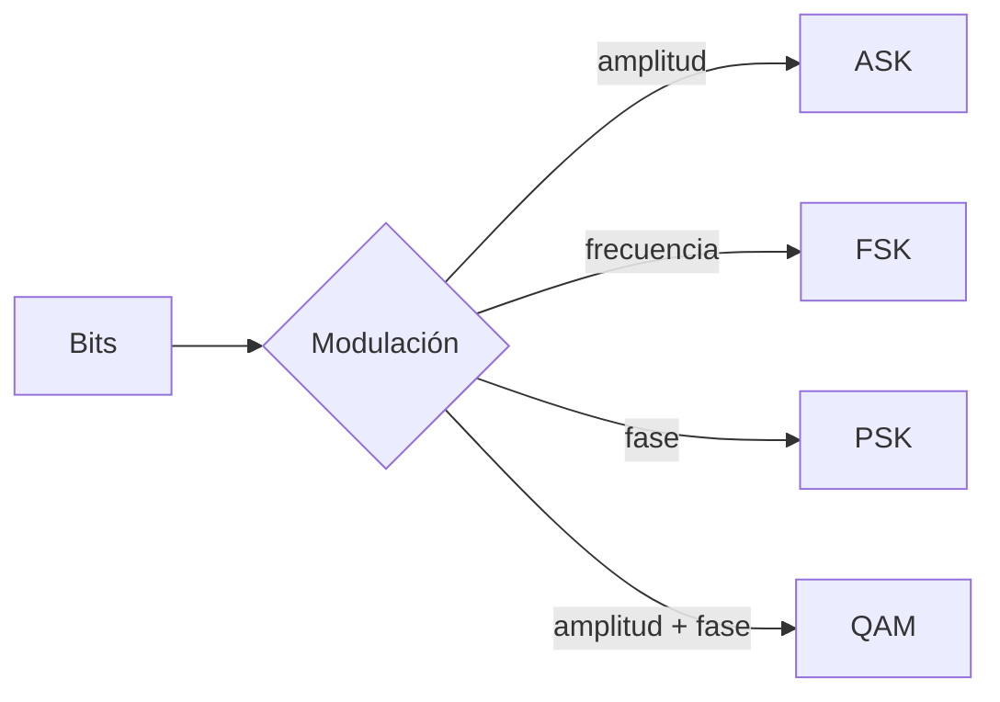

| Técnica | Bits por símbolo | AB |
|---|---|---|
| ASK/FSK/PSK binaria | 1 | Menor |
| QPSK | 2 | Medio |
| 16-QAM | 4 | Mayor |
| 64-QAM | 6 | Mayor |

> [!important] La pregunta de UTN
> “¿Qué modulación ocupa menos ancho de banda: AM, FM o PM?” → **AM** (ASK) es la más eficiente en AB; FM (FSK) ocupa más. Y “QAM permite modular en… fase y amplitud”.

> [!warning] Más niveles no siempre es mejor
> A igual BER, QAM suele ser más conveniente porque aprovecha mejor el AB, pero requiere mejor relación señal/ruido. Con ruido alto, conviene una modulación más robusta (FSK/PSK) aunque sea más lenta.

### Baudios y bits

$$bits/s = baudios \cdot \log_2 M$$

**Ejemplo:** 2400 baudios con 16-QAM (`log2 16 = 4`) → 9600 bps.

## 6.3 Modulación analógica

| Técnica | Parámetro que varía | Uso |
|---|---|---|
| **AM** | Amplitud | Radio AM |
| **FM** | Frecuencia | Radio FM |
| **PM** | Fase | Datos y sincronismo |

> [!tip] La frase
> “AM modifica la amplitud, FM la frecuencia y PM la fase de la portadora.”

## 6.4 PCM: digitalizar voz

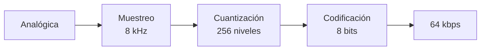

| Parámetro | Valor |
|---|---|
| Frecuencia de muestreo | 8000 Hz |
| Niveles | 256 (8 bits) |
| Tasa | 8000 × 8 = **64 kbps** |

> [!important] Por qué 8 kHz
> Por Nyquist: la voz telefónica llega hasta 4 kHz, así que `fs ≥ 2 · 4000 = 8000`.

### Modulación delta

Envía un bit por muestra indicando si la señal subió o bajó. Más simple que PCM, pero necesita más muestras para la misma calidad.

## 6.5 Códigos de canal

Además de la codificación de línea, se agregan bits para detectar/corregir errores:

| Código | Qué hace |
|---|---|
| Paridad simple | Detecta un número impar de errores |
| Paridad vertical (VRC) | Paridad por carácter |
| Paridad longitudinal (LRC) | Paridad por bloque |
| CRC | Detección robusta con polinomio |

> [!note] Alcance
> El EFIP pide “control de enlace de datos” y menciona CRC. La paridad VRC/LRC aparece en UTN; sirve para explicar detección de errores.

## 6.6 Método: elegir codificación

| Pregunta | Decisión |
|---|---|
| ¿Necesito sincronismo? | Manchester |
| ¿Importa el AB? | NRZ |
| ¿Hay inversión de polaridad posible? | Manchester diferencial |
| ¿Es un enlace óptico de larga distancia? | Codificación específica del estándar (8b/10b, etc.) |
| ¿Es sobre portadora analógica? | ASK/FSK/PSK/QAM |

## Errores que suelen tomar

| Error | Corrección |
|---|---|
| Decir que NRZ es autosincronizado | No lo es; Manchester sí |
| Confundir NRZ-L con NRZ-I | L = nivel; I = inversión en 1 |
| Decir que Manchester usa menos AB | Usa el doble |
| Confundir ASK con AM | ASK es digital sobre portadora; AM es analógica |
| Calcular PCM con 4 kHz | Se muestrea a 8 kHz |
| Confundir baudios con bps | `bps = baudios × log2 M` |

## Ejercicios

> [!example] 1. NRZ-L
> **Enunciado:** dibujá `1010` en NRZ-L (1 = −).
> **Solución:** − + − +.

> [!example] 2. NRZ-I
> **Enunciado:** `1100` empezando en +.
> **Solución:** − + + + (transición en cada 1).

> [!example] 3. Manchester
> **Enunciado:** ¿qué transición representa un 0?
> **Solución:** alto→bajo (si se usa la convención IEEE).

> [!example] 4. Modulación
> **Enunciado:** ¿qué modula QAM?
> **Solución:** amplitud y fase.

> [!example] 5. PCM
> **Enunciado:** 8 kHz y 8 bits. ¿Tasa?
> **Solución:** 64 kbps.

> [!example] 6. a papel
> **Enunciado:** dibujá `0110010` en Manchester y marcá las transiciones del medio.
> **Solución:** ver la tabla de 6.1.


<div style="page-break-after: always;"></div>


# 7. Medios de transmisión y dispositivos de nivel físico

> [!info] Al terminar este capítulo tenés que poder
> - Comparar par trenzado, coaxial y fibra.
> - Elegir el medio según distancia, ruido y costo.
> - Explicar los dispositivos de capa 1.
> - Justificar una elección con criterios técnicos.

> [!abstract] Qué debés saber (nivel 1)
> - **Guiados:** par trenzado (UTP/STP), coaxial, fibra óptica.
> - **No guiados:** radio, microondas, infrarrojo, satélite.
> - **UTP:** barato y flexible; sensible a ruido; ~100 m.
> - **Fibra:** inmune al ruido electromagnético; larga distancia; más cara.
> - **Coaxial:** mejor blindaje que UTP; en desuso en LAN.
> - Dispositivos de capa 1: repetidor, hub, módem, conversor de medio.

## 7.1 Medios guiados

### Par trenzado

Dos conductores trenzados para reducir la interferencia.

| Tipo | Blindaje | Uso |
|---|---|---|
| **UTP** | Sin blindaje | LAN, telefonía |
| **STP/FTP** | Con blindaje | Ambientes ruidosos |

| Categoría | Velocidad | Distancia típica |
|---|---|---|
| Cat 5e | 1 Gbps | 100 m |
| Cat 6 | 1–10 Gbps | 55–100 m |
| Cat 6a | 10 Gbps | 100 m |

- Conector: **RJ45**.
- Ventaja: bajo costo, fácil instalación.
- Desventaja: atenuación y sensibilidad a interferencias.

### Cable coaxial

Conductor central, dieléctrico, malla y cubierta.

| Ventaja | Desventaja |
|---|---|
| Mejor blindaje que UTP | Más rígido y caro |
| Mayor ancho de banda | Instalación más compleja |
| Usado en TV por cable | En LAN quedó obsoleto |

### Fibra óptica

Transporta luz por un núcleo de vidrio o plástico.

| Tipo | Núcleo | Distancia | Uso |
|---|---|---|---|
| **Multimodo** | Grande | Media | Edificios, datacenter |
| **Monomodo** | Muy pequeño | Larga | Enlaces metropolitanos |

| Ventaja | Desventaja |
|---|---|
| Inmune al ruido electromagnético | Costo de equipos |
| Muy alta capacidad | Instalación delicada |
| Sin diafonía | Requiere conversores |

> [!important] La comparación que se pregunta
> **UTP**: barato, 100 m, sensible a ruido. **Coaxial**: mejor blindaje, rígido, en desuso en LAN. **Fibra**: mayor distancia y capacidad, inmune al ruido, más cara.

## 7.2 Medios no guiados

| Medio | Frecuencia | Alcance | Uso |
|---|---|---|---|
| Radio | kHz–GHz | Variable | AM/FM, Wi-Fi |
| Microondas | GHz | Línea de vista | Enlaces punto a punto |
| Infrarrojo | THz | Corto | Controles, sensores |
| Satélite | GHz | Global | Cobertura remota |

> [!warning] “Inalámbrico” no es “sin medio”
> El aire (o el vacío) **es** el medio. Lo que cambia es que no está guiado.

## 7.3 Dispositivos de nivel físico

| Dispositivo | Función | Capa |
|---|---|---|
| **Repetidor** | Regenera la señal | 1 |
| **Hub** | Repite a todos los puertos | 1 |
| **Módem** | Digital ↔ analógico | 1 |
| **Conversor de medio** | UTP ↔ fibra | 1 |
| **Transceptor** | Emite y recibe | 1 |

> [!important] Repetidor vs. amplificador
> El **amplificador** amplifica también el ruido; el **repetidor** **regenera** la señal digital. Por eso se usa en enlaces largos.

## 7.4 Cómo elegir el medio

| Criterio | Pregunta | Decisión |
|---|---|---|
| Distancia | ¿Cuántos metros? | ≤100 m: UTP; más: fibra |
| Ruido | ¿Hay motores, radiofrecuencia? | Fibra o STP |
| Ancho de banda | ¿Cuántos Mbps? | Cat 6a o fibra |
| Costo | ¿Presupuesto ajustado? | UTP |
| Movilidad | ¿El usuario se mueve? | Wi-Fi |
| Exterior | ¿Enterrado o aéreo? | Fibra o coaxial |

> [!example] Pregunta típica de UTN
> “Para un ancho de datos de 50 m, ¿qué cableado conviene y por qué?”
> **Respuesta:** UTP Cat 5e/6, porque cubre hasta 100 m, es económico y suficiente para la tasa requerida. Si hubiera interferencia fuerte, STP o fibra.

### Árbol de decisión

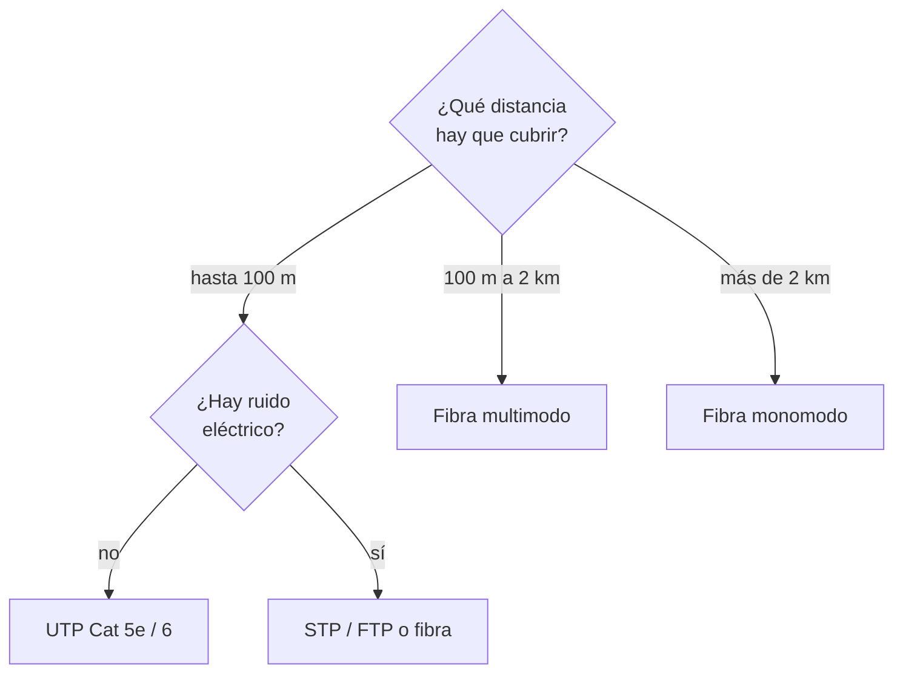

## 7.5 Método: justificar una elección de medio

| Paso | Acción |
|---|---|
| 1 | Calcular la distancia real (con recorrido de cable) |
| 2 | Estimar la tasa necesaria |
| 3 | Identificar fuentes de ruido |
| 4 | Comparar opciones en costo y mantenimiento |
| 5 | Elegir y justificar con dos criterios |

## 7.6 Tabla comparativa final

| Criterio | UTP | Coaxial | Fibra |
|---|---|---|---|
| Costo | Bajo | Medio | Alto |
| Distancia | 100 m | 500 m | km |
| Inmunidad al ruido | Baja | Media | **Alta** |
| Ancho de banda | Medio | Medio-alto | **Muy alto** |
| Instalación | Fácil | Media | Delicada |
| Conector | RJ45 | BNC/F | LC/SC |

## Errores que suelen tomar

| Error | Corrección |
|---|---|
| Decir que UTP llega a 1 km | 100 m |
| Confundir fibra multimodo con monomodo | Multimodo: distancias medias; monomodo: larga |
| “El hub es capa 2” | Es capa 1 |
| Creer que la fibra no necesita conversores | Los necesita en los extremos |
| Elegir coaxial para una LAN nueva | UTP o fibra |
| Ignorar el ruido electromagnético | Es el criterio decisivo en industria |

## Ejercicios

> [!example] 1. Distancia
> **Enunciado:** 80 m en una oficina sin ruido. ¿Qué medio?
> **Solución:** UTP Cat 5e/6.

> [!example] 2. Ruido
> **Enunciado:** planta industrial con motores, 60 m. ¿Qué medio?
> **Solución:** fibra (o STP blindado), por inmunidad electromagnética.

> [!example] 3. Larga distancia
> **Enunciado:** 2 km entre edificios. ¿Qué fibra?
> **Solución:** monomodo.

> [!example] 4. Dispositivo
> **Enunciado:** ¿qué dispositivo regenera la señal en capa 1?
> **Solución:** repetidor (el hub también repite).

> [!example] 5. a papel
> **Enunciado:** compará UTP, coaxial y fibra en tres criterios.
> **Solución:** ver 7.6.


<div style="page-break-after: always;"></div>


# 8. Modos de transmisión y última milla

> [!info] Al terminar este capítulo tenés que poder
> - Distinguir simplex, semi-dúplex y dúplex.
> - Diferenciar transmisión serie/paralela y síncrona/asíncrona.
> - Explicar xDSL, HFC y FTTH.
> - Justificar una tecnología de última milla.

> [!abstract] Qué debés saber (nivel 1)
> - **Simplex:** un solo sentido. **Semi-dúplex:** alternan. **Dúplex:** simultáneo.
> - **Serie:** un bit por vez. **Paralela:** varios a la vez, corta distancia.
> - **Síncrona:** reloj compartido. **Asíncrona:** carácter por carácter con bits de inicio/fin.
> - **Última milla:** tramo entre el usuario y el operador.
> - Tecnologías: **xDSL**, **HFC**, **FTTH**, inalámbrica, satelital.

## 8.1 Modos de transmisión

| Modo | Sentido | Ejemplo |
|---|---|---|
| **Simplex** | Siempre uno transmite | Radio, TV |
| **Semi-dúplex** | Alternan en el tiempo | Radioaficionados, walkie-talkie |
| **Dúplex (full)** | Simultáneo en ambos sentidos | Teléfono, Ethernet conmutada |

> [!important] Detalle de la cátedra
> En **full-dúplex digital** se usan **dos pares trenzados** (uno por sentido). En **analógico inalámbrico**, **dos frecuencias**. En **analógico alámbrico**, un solo camino físico con separación por frecuencia.

### Serie vs. paralela

| | Serie | Paralela |
|---|---|---|
| Bits | Uno por vez | Varios a la vez |
| Distancia | Larga | Corta |
| Costo | Bajo | Alto (más hilos) |
| Ejemplo | USB, Ethernet | Bus de datos interno |

### Síncrona vs. asíncrona

| | Síncrona | Asíncrona |
|---|---|---|
| Reloj | Compartido | No compartido |
| Unidad | Bloque/trama | Carácter |
| Delimitación | Patrón de sincronismo | Bit de inicio y fin |
| Eficiencia | Mayor | Menor (overhead) |
| Ejemplo | HDLC, Ethernet | RS-232 |

> [!warning] “Asíncrona” no significa “sin tiempo”
> Significa que **no comparte un reloj**: cada carácter se enmarca con bits de inicio y parada.

### Banda base y banda ancha

| | Banda base | Banda ancha |
|---|---|---|
| Qué transporta | Una sola señal digital, sin portadora | Varias portadoras en bandas distintas |
| Espectro | Ocupa el medio desde 0 Hz | Se divide en canales |
| Multiplexación | Por tiempo (TDM) | Por frecuencia (FDM) |
| Ejemplo | Ethernet de cobre, USB | Cablemódem (HFC), ADSL, TV por cable |

> [!important] La trampa
> “Banda ancha” en el lenguaje comercial significa “conexión rápida”; en el técnico, significa **varias bandas de frecuencia** sobre el mismo medio. Ethernet clásico es banda base aunque vaya a 1 Gbps.

### Enlaces y caminos

| Tipo | Qué es | Ejemplo |
|---|---|---|
| **Punto a punto** | Dos extremos con enlace dedicado o lógico | Serial entre dos routers |
| **Multipunto** | Varios dispositivos comparten el mismo medio | Wi-Fi, bus coaxial |
| **Camino indirecto** | La señal pasa por nodos intermedios obligatorios | Varios switches en serie |
| **Con alternativas** | Hay rutas redundantes ante falla o congestión | Malla, OSPF |

## 8.2 Qué es la última milla

> [!quote] Cátedra
> **Última milla o bucle de abonado:** fracción de una red de comunicaciones que enlaza a los usuarios finales con los operadores de telecomunicaciones.

Es el tramo más caro y difícil: llega a cada casa o empresa.

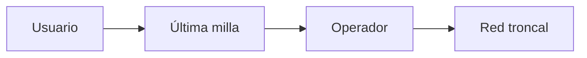

## 8.3 Tecnologías

### xDSL (sobre par telefónico)

| Variante | Velocidad típica | Distancia |
|---|---|---|
| ADSL | Hasta 8/1 Mbps | ~3 km |
| ADSL2+ | Hasta 24/1 Mbps | ~1,5 km |
| VDSL | Hasta 100 Mbps | ~500 m |

- Usa el par de cobre existente.
- La velocidad **baja** con la distancia.
- Requiere **módem DSL** y un **splitter** (voz/datos).

### HFC (híbrido fibra-coaxial)

- Fibra hasta el nodo; coaxial hasta el hogar.
- Requiere **módem de cable** (CM) y **CMTS** en la cabecera.
- Comparte el canal con los vecinos del nodo.

### FTTH (fibra hasta el hogar)

| Variante | Detalle |
|---|---|
| **GPON** | Fibra compartida con splitter óptico |
| **Punto a punto** | Fibra dedicada |

- Mayor capacidad y simetría.
- Requiere **ONT** en el hogar.
- Costo de despliegue alto.

### Inalámbrica y satelital

| Tecnología | Uso | Limitación |
|---|---|---|
| LTE/5G | Móvil y fija inalámbrica | Cobertura y espectro |
| Wi-Fi municipal | Zonas acotadas | Alcance |
| Satelital | Zonas remotas | Latencia y costo |

### Los tres caminos hasta el hogar

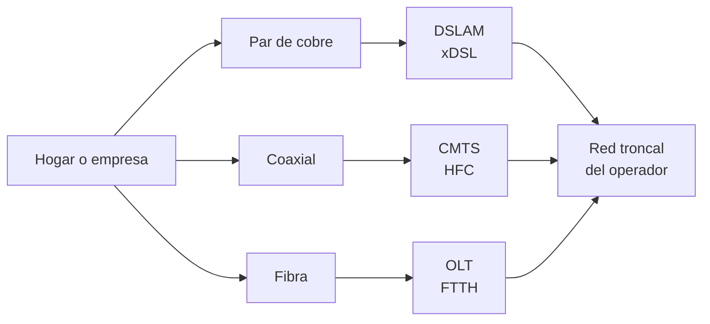

> [!important] Qué cambia en cada camino
> xDSL reutiliza el cobre telefónico; HFC comparte el coaxial del nodo; FTTH lleva fibra hasta la ONT del domicilio. A más fibra, más capacidad y simetría, y más costo de despliegue.

## 8.4 Comparación

| Tecnología | Medio | Velocidad | Latencia | Costo |
|---|---|---|---|---|
| xDSL | Cobre | Media | Baja | Bajo |
| HFC | Fibra + coaxial | Alta | Baja | Medio |
| FTTH | Fibra | Muy alta | Muy baja | Alto |
| 5G FWA | Radio | Alta | Media | Medio |
| Satélite | Radio | Media | **Alta** | Alto |

> [!important] La pregunta de oral
> “¿Por qué la última milla es un problema?” → Porque llega a cada domicilio, requiere obra civil, y las tecnologías tienen límites de distancia, compartición y costo.

## 8.5 Método: elegir tecnología de última milla

| Paso | Pregunta | Decisión |
|---|---|---|
| 1 | ¿Hay cobre desplegado? | xDSL como opción rápida |
| 2 | ¿Hay coaxial de TV? | HFC |
| 3 | ¿Se requiere simetría y alta capacidad? | FTTH |
| 4 | ¿Zona rural sin infraestructura? | Inalámbrica o satelital |
| 5 | ¿Presupuesto y plazo? | Comparar costo por abonado |

## Errores que suelen tomar

| Error | Corrección |
|---|---|
| Decir que ADSL es simétrico | Es asimétrico (más bajada que subida) |
| Confundir HFC con FTTH | HFC conserva coaxial en el último tramo |
| “La fibra no tiene límite de distancia” | Tiene límites ópticos; se usan repetidores/amplificadores |
| Confundir módem con router | El módem convierte la señal; el router enruta |
| Ignorar la compartición en HFC | El nodo se reparte entre vecinos |
| Creer que el satélite es de baja latencia | Es alta (órbita) |

## Ejercicios

> [!example] 1. Modo
> **Enunciado:** una videollamada, ¿qué modo usa?
> **Solución:** full-dúplex (audio y video en ambos sentidos).

> [!example] 2. Serie/paralela
> **Enunciado:** ¿por qué la paralela no se usa en larga distancia?
> **Solución:** por desincronización entre hilos y costo del cableado.

> [!example] 3. xDSL
> **Enunciado:** ¿por qué la velocidad baja con la distancia?
> **Solución:** por atenuación y ruido en el par de cobre.

> [!example] 4. FTTH
> **Enunciado:** ¿qué equipo se instala en el hogar?
> **Solución:** la ONT (terminación de red óptica).

> [!example] 5. a papel
> **Enunciado:** compará xDSL, HFC y FTTH en velocidad y costo.
> **Solución:** ver 8.4.


<div style="page-break-after: always;"></div>


# Cierre de la Parte 2 — Estructura física

> [!info] Qué hacer con este archivo
> Verificación de 6.2. Si algo falla, volvé a los capítulos 5 a 8.

## Checklist de la Parte 2

| Puedo… | Capítulo | ✔ |
|---|---|---|
| Distinguir frecuencia, espectro y ancho de banda | Cap. 5 | ☐ |
| Calcular dB y dBm | Cap. 5 | ☐ |
| Explicar atenuación, distorsión y ruido | Cap. 5 | ☐ |
| Aplicar Nyquist y Shannon | Cap. 5 | ☐ |
| Dibujar NRZ-L, NRZ-I y Manchester | Cap. 6 | ☐ |
| Distinguir ASK, FSK, PSK y QAM | Cap. 6 | ☐ |
| Explicar PCM y 64 kbps | Cap. 6 | ☐ |
| Comparar UTP, coaxial y fibra | Cap. 7 | ☐ |
| Elegir medio por distancia y ruido | Cap. 7 | ☐ |
| Explicar xDSL, HFC y FTTH | Cap. 8 | ☐ |

## Diferencias que no podés confundir

| A | B | Diferencia central |
|---|---|---|
| Ancho de banda | Tasa de bits | Hz vs. bps |
| Atenuación | Distorsión de retardo | Pérdida de potencia vs. dispersión temporal |
| Ruido térmico | Ruido impulsivo | Continuo y de fondo vs. picos |
| Nyquist | Shannon | Sin ruido vs. con ruido |
| NRZ | Manchester | Sin transición obligatoria vs. autosincronizado |
| AM | ASK | Analógica vs. digital sobre portadora |
| UTP | Fibra | Cobre, 100 m vs. vidrio, km |
| xDSL | FTTH | Cobre vs. fibra hasta el hogar |

## Ejercicio integrador de la Parte 2

> [!example] Enunciado (25 minutos)
> 1. Un enlace de 100 m en una oficina con PCs. ¿Qué medio y por qué?
> 2. Si `B = 2 kHz` y `M = 4`, ¿capacidad según Nyquist?
> 3. Si `B = 1 MHz` y `SNR = 20 dB`, ¿capacidad según Shannon?
> 4. Explicá por qué no conviene usar 256-QAM en un enlace con mucho ruido.

> [!success] Solución
> **1.** UTP Cat 5e/6: cubre 100 m, es económico y suficiente.
> **2.** `C = 2·2000·log2 4 = 8000 bps`.
> **3.** `S/N = 10^(20/10) = 100`; `C = 10^6·log2(101) ≈ 6,66 Mbps`.
> **4.** Porque con 256 niveles los puntos de la constelación están muy próximos y el ruido los confunde; el BER sube. Conviene una modulación más robusta (QPSK/FSK) o mejorar la SNR.

## Oral de la Parte 2 (8 preguntas)

> [!question] 1. ¿Qué es el ancho de banda?
> El rango de frecuencias donde se concentra la mayor parte de la energía de la señal.

> [!question] 2. ¿Qué es la atenuación?
> La pérdida de potencia de la señal al propagarse por el medio.

> [!question] 3. ¿Qué es el ruido térmico?
> El producido por la agitación de electrones; depende de la temperatura, es uniforme en el espectro y no se elimina.

> [!question] 4. ¿Qué es la distorsión de retardo?
> El ensanchamiento temporal porque la velocidad de propagación varía con la frecuencia.

> [!question] 5. NRZ vs. Manchester.
> NRZ no garantiza transiciones; Manchester tiene una transición por bit y es autosincronizado, a costa del doble de AB.

> [!question] 6. ¿Qué modula QAM?
> Amplitud y fase a la vez.

> [!question] 7. ¿Qué es PCM?
> Digitalización por muestreo, cuantización y codificación. Voz: 8 kHz × 8 bits = 64 kbps.

> [!question] 8. ¿Qué es la última milla?
> El tramo entre el usuario final y el operador; concentra costo y dificultad de cobertura.


<div style="page-break-after: always;"></div>


# 9. Nivel 2: funciones, PDU y entramado

> [!info] Al terminar este capítulo tenés que poder
> - Enumerar las funciones de la capa de enlace.
> - Explicar PDU, SDU y PCI.
> - Describir el entramado y el relleno de bits.
> - Diferenciar detección de corrección de errores.

> [!abstract] Qué debés saber (nivel 1)
> - Capa 2 transmite **tramas** entre nodos **adyacentes**.
> - Funciones: entramado, direccionamiento, control de errores, control de flujo, acceso al medio.
> - **PDU = SDU + PCI**.
> - Entramado por: contador, carácter, bit.
> - Detección: paridad, checksum, CRC. Corrección: FEC o retransmisión (ARQ).
> - ARQ: stop-and-wait, go-back-N, selective repeat.

## 9.1 Funciones de la capa de enlace

| Función | Qué hace |
|---|---|
| **Entramado** | Delimita el inicio y fin de cada trama |
| **Direccionamiento** | Usa direcciones físicas (MAC) |
| **Control de errores** | Detecta y, a veces, corrige |
| **Control de flujo** | Evita que el receptor se sature |
| **Control de acceso al medio** | Decide quién transmite en un medio compartido |
| **Segmentación** | Divide bloques grandes en unidades manejables |

> [!important] Alcance
> La capa 2 comunica **nodos vecinos** (salto a salto), no extremos. El extremo a extremo es capa 4.

## 9.2 PDU, SDU y PCI

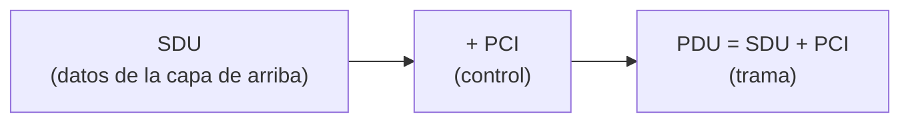

| Concepto | Definición |
|---|---|
| **SDU** | Unidad de datos del servicio; los datos del usuario |
| **PCI** | Información de control del protocolo |
| **PDU** | Unidad de datos del protocolo: SDU + PCI |

> [!quote] Cátedra
> **Encapsulado:** incorporación de información de control (direcciones, tipo de trama, control de flujo y detección de errores).

## 9.3 Entramado

| Método | Cómo | Riesgo |
|---|---|---|
| **Contador de caracteres** | Un campo indica la longitud | Un error arruina todo el sincronismo |
| **Carácter de inicio/fin** | Delimitadores (p. ej. DLE STX / DLE ETX) | El delimitador puede aparecer en los datos → *byte stuffing* |
| **Bit de inicio/fin** | Bandera `01111110` | Puede aparecer en los datos → *bit stuffing* |

### Relleno de bits (bit stuffing)

Cuando el emisor encuentra **cinco 1 consecutivos** en los datos, inserta un 0. El receptor lo quita.

```text
Datos:      0 1 1 1 1 1 1 0
Con stuffing: 0 1 1 1 1 1 0 1 0
```

> [!important] Por qué se hace
> Para que la bandera `01111110` **nunca** aparezca dentro de los datos y el receptor no confunda el fin de trama.

## 9.4 Detección de errores

| Técnica | Detecta | Fuerza |
|---|---|---|
| **Paridad simple** | Número impar de bits erróneos | Baja |
| **Paridad vertical (VRC)** | Por carácter | Baja |
| **Paridad longitudinal (LRC)** | Por bloque | Media |
| **Checksum** | Suma de campos | Media |
| **CRC** | Polinomio generador | **Alta** |

> [!quote] Pregunta típica de UTN
> “Control de paridad vertical y longitudinal.” → VRC agrega un bit por carácter; LRC agrega un carácter de paridad al final del bloque. Se usan juntos para mejorar la detección.

### CRC

El emisor divide los datos por un polinomio y agrega el resto (FCS). El receptor repite la división: si el resto no es cero, hay error.

> [!warning] Detectar no es corregir
> La mayoría de las LAN **detectan** y **descartan** la trama; la retransmisión la hace una capa superior (TCP) o un ARQ.

## 9.5 Control de flujo y ARQ

| Técnica | Idea | Eficiencia |
|---|---|---|
| **Stop-and-wait** | Envía 1 y espera ACK | Baja |
| **Go-back-N** | Envía N; si falla una, retransmite desde ella | Media |
| **Selective repeat** | Retransmite solo la fallida | Alta |

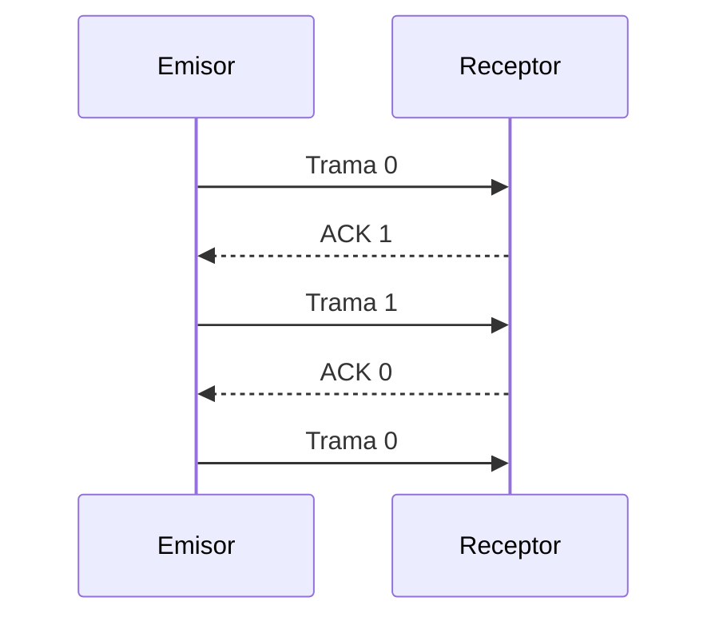

> [!important] Ventana
> La **ventana** limita cuántas tramas puede tener sin confirmar. Es control de flujo y de errores a la vez.

## 9.6 Método: analizar una trama

| Paso | Pregunta |
|---|---|
| 1 | ¿Cómo se delimita? (bandera o contador) |
| 2 | ¿Qué dirección lleva? |
| 3 | ¿Qué control de errores usa? (CRC) |
| 4 | ¿Qué control de flujo? (ventana) |
| 5 | ¿Qué acceso al medio? (CSMA/CD, CSMA/CA) |

## Errores que suelen tomar

| Error | Corrección |
|---|---|
| Confundir PDU con SDU | PDU = SDU + PCI |
| Decir que capa 2 comunica extremos | Comunica vecinos |
| “CRC corrige errores” | Detecta; para corregir se retransmite |
| Bit stuffing con bytes | Es con bits; byte stuffing con caracteres |
| Confundir control de flujo con acceso al medio | Uno regula al receptor; el otro, el canal |
| Creer que paridad detecta todo | Solo impares simples |

## Ejercicios

> [!example] 1. PDU
> **Enunciado:** ¿qué es la PCI?
> **Solución:** la información de control del protocolo que se agrega a la SDU.

> [!example] 2. Stuffing
> **Enunciado:** ¿cuándo se inserta un 0?
> **Solución:** tras cinco 1 consecutivos en los datos.

> [!example] 3. Errores
> **Enunciado:** ¿qué técnica usa Ethernet para detectar errores?
> **Solución:** CRC de 32 bits (FCS).

> [!example] 4. ARQ
> **Enunciado:** ¿qué ARQ retransmite solo la trama perdida?
> **Solución:** selective repeat.

> [!example] 5. a papel
> **Enunciado:** dibujá una trama genérica de capa 2 con sus campos.
> **Solución:** bandera | dirección | control | datos | FCS | bandera.


<div style="page-break-after: always;"></div>


# 10. Protocolos orientados al bit: HDLC y PPP

> [!info] Al terminar este capítulo tenés que poder
> - Explicar qué es un protocolo orientado al bit.
> - Dibujar la trama HDLC y explicar sus campos.
> - Diferenciar HDLC de PPP.
> - Explicar el papel de LCP y NCP.

> [!abstract] Qué debés saber (nivel 1)
> - **Orientado al bit:** no depende de códigos de carácter; usa una bandera binaria.
> - **HDLC:** bandera `01111110`, relleno de bits, CRC, control de flujo y errores.
> - Campos: bandera, dirección, control, datos, FCS, bandera.
> - **PPP:** enlace punto a punto; encapsula IP; LCP negocia, NCP configura.
> - PPP **no** corrige errores: descarta y deja la retransmisión a capas superiores.

## 10.1 Qué significa “orientado al bit”

El protocolo no interpreta caracteres: trata la trama como una secuencia de bits y usa una **bandera** para delimitar.

| Concepto | Detalle |
|---|---|
| Bandera | `01111110` |
| Transparencia | Relleno de bits (tras cinco 1) |
| Detección | FCS (CRC) |
| Control | Ventana deslizante |

> [!important] Por qué es “orientado al bit”
> Porque puede transportar **cualquier** combinación de bits, sin depender de un código de caracteres como ASCII. Eso lo hace apto para datos binarios.

## 10.2 Trama HDLC

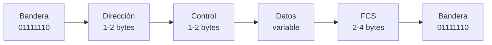

| Campo | Función |
|---|---|
| **Bandera** | Inicio y fin de trama |
| **Dirección** | Estación secundaria (en configuración normal) |
| **Control** | Tipo de trama, secuencia, ACK, ventana |
| **Datos** | Información |
| **FCS** | CRC para detección |

### Tipos de trama

| Tipo | Nombre | Uso |
|---|---|---|
| **I** | Información | Datos con numeración |
| **S** | Supervisión | ACK, NAK, control de flujo |
| **U** | No numerada | Control, conexión, desconexión |

### Modos de operación

| Modo | Significado |
|---|---|
| **NRM** | Normal: primaria y secundarias |
| **ABM** | Balanceado asíncrono: ambos pueden iniciar |
| **ARM** | Balanceado asíncrono con respuesta |

> [!tip] La pregunta de oral
> “HDLC es un protocolo de propósito general de capa 2 que ofrece recuperación de errores y comunicación confiable, orientado al bit, con bandera y relleno de bits.”

## 10.3 PPP

**PPP** (*Point-to-Point Protocol*) se usa en enlaces dedicados: acceso telefónico, DSL, túneles.


| Componente | Función |
|---|---|
| **Encapsulamiento** | Mete el paquete en una trama PPP |
| **LCP** | Negocia opciones del enlace (MTU, compresión, autenticación) |
| **NCP** | Configura el protocolo de red (por ejemplo, IPCP para IP) |
| **Autenticación** | PAP (texto) o CHAP (desafío) |

### Trama PPP

| Campo | Detalle |
|---|---|
| Bandera | `01111110` |
| Dirección | `11111111` (constante) |
| Control | `00000011` (constante) |
| Protocolo | Indica qué transporte (IP, IPv6, LCP) |
| Datos | Payload |
| FCS | CRC |

> [!warning] PPP no corrige errores
> Detecta con FCS y **descarta** la trama. La retransmisión la hace TCP o la aplicación. Es una diferencia clave con HDLC, que sí puede recuperar.

## 10.4 Comparación

| Aspecto | HDLC | PPP |
|---|---|---|
| Delimitación | Bandera + bit stuffing | Bandera + bit stuffing |
| Detección | FCS | FCS |
| Corrección | Sí (ARQ) | **No** |
| Autenticación | No estándar | PAP/CHAP |
| Negociación | Limitada | LCP/NCP |
| Uso típico | Enlaces WAN dedicados | Acceso a Internet, túneles |

> [!important] La frase que distingue
> “HDLC es confiable y orientado a la conexión; PPP es simple, autentica y encapsula, pero delega la confiabilidad a las capas superiores.”

## 10.5 Método: leer una trama HDLC/PPP

| Paso | Pregunta |
|---|---|
| 1 | ¿Dónde empieza y termina? (bandera) |
| 2 | ¿Hay bits rellenados? (quitar tras cinco 1) |
| 3 | ¿Qué tipo de trama es? (I/S/U en HDLC) |
| 4 | ¿Qué protocolo transporta? (PPP) |
| 5 | ¿El FCS es correcto? |

## Errores que suelen tomar

| Error | Corrección |
|---|---|
| Decir que HDLC es orientado al carácter | Es orientado al bit |
| Confundir bandera con delimitador de carácter | La bandera es binaria |
| “PPP corrige errores” | Solo detecta y descarta |
| Confundir LCP con NCP | LCP negocia el enlace; NCP configura la red |
| Decir que PPP es solo para dial-up | También DSL, VPN y túneles |
| Olvidar el bit stuffing | Es lo que da transparencia |

## Ejercicios

> [!example] 1. Bandera
> **Enunciado:** ¿qué secuencia delimita una trama HDLC?
> **Solución:** `01111110`.

> [!example] 2. Stuffing
> **Enunciado:** datos `01111110`. ¿Qué hace el emisor?
> **Solución:** inserta un 0 tras los cinco 1 para que no parezca bandera.

> [!example] 3. Trama
> **Enunciado:** ¿qué campo indica el tipo y la secuencia?
> **Solución:** control.

> [!example] 4. PPP
> **Enunciado:** ¿qué protocolo negocia la autenticación?
> **Solución:** LCP (y PAP/CHAP como métodos).

> [!example] 5. a papel
> **Enunciado:** dibujá la trama HDLC con sus seis campos.
> **Solución:** ver 10.2.


<div style="page-break-after: always;"></div>


# 11. Subcapas LLC/MAC e IEEE 802.x

> [!info] Al terminar este capítulo tenés que poder
> - Explicar por qué la capa 2 se divide en LLC y MAC.
> - Describir una dirección MAC.
> - Dibujar la trama Ethernet y calcular su tamaño.
> - Explicar CSMA/CD y CSMA/CA.

> [!abstract] Qué debés saber (nivel 1)
> - **LLC (802.2):** relación con la capa de red; independiente del medio.
> - **MAC:** direccionamiento físico, entramado, CRC y acceso al medio.
> - MAC: **48 bits**, única, con OUI del fabricante.
> - Ethernet: trama de **64 a 1518 bytes** (sin VLAN).
> - **CSMA/CD:** escucha, transmite, detecta colisión, retrocede.
> - **CSMA/CA:** evita colisiones (Wi-Fi).

## 11.1 Por qué dos subcapas

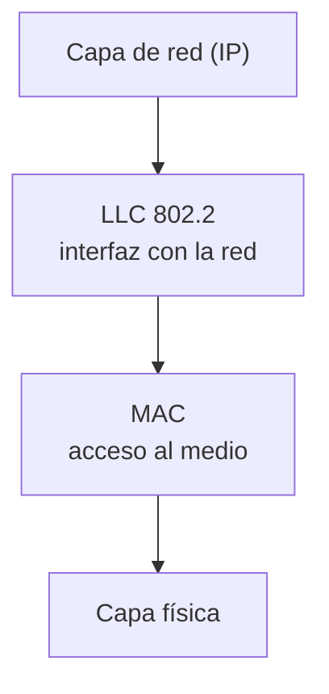

| Subcapa | Función | Ventaja |
|---|---|---|
| **LLC** | Multiplexa protocolos de red, control de errores y flujo | Independiza del medio |
| **MAC** | Dirección, entramado, CRC, acceso | Adapta a cada tecnología |

> [!important] La razón de ser
> LLC permite que IP use Ethernet, Wi-Fi o Token Ring **sin cambiar** la capa de red. MAC resuelve lo específico de cada medio.

## 11.2 Dirección MAC

| Característica | Detalle |
|---|---|
| Tamaño | 48 bits (6 bytes) |
| Formato | `AA:BB:CC:DD:EE:FF` |
| Primeros 24 bits | OUI (fabricante) |
| Últimos 24 bits | Serie del fabricante |
| Tipos | Unicast, multicast, broadcast (`FF:FF:FF:FF:FF:FF`) |

> [!warning] La MAC no es jerárquica
> No indica ubicación ni red. Por eso no se enruta: solo sirve dentro del segmento local.

## 11.3 Trama Ethernet (802.3)

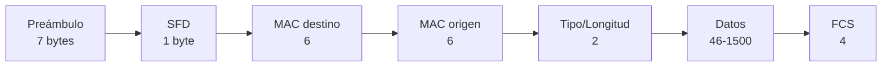

| Campo | Tamaño | Función |
|---|---|---|
| Preámbulo | 7 bytes | Sincronismo |
| SFD | 1 byte | Inicio de trama |
| MAC destino | 6 | Dirección de destino |
| MAC origen | 6 | Dirección de origen |
| Tipo/Longitud | 2 | Protocolo o longitud |
| Datos | 46–1500 | Payload |
| FCS | 4 | CRC |

### Tamaños

| Concepto | Valor |
|---|---|
| Trama mínima | **64 bytes** (sin preámbulo) |
| Trama máxima | **1518 bytes** (sin VLAN) |
| Con VLAN (802.1Q) | 1522 bytes |

> [!important] Por qué 64 bytes mínimo
> Para que la colisión se detecte antes de que el emisor termine de transmitir. Si la trama fuera más corta, podría terminar sin detectar la colisión.

### Relleno (padding)

Si los datos son menores a 46 bytes, se rellena. De ahí sale el mínimo de 64.

## 11.4 CSMA/CD

```mermaid
flowchart TD
    A["Escuchar el medio"] --> B{"¿Libre?"}
    B -- No --> A
    B -- Sí --> C["Transmitir"]
    C --> D{"¿Colisión?"}
    D -- No --> E["Fin"]
    D -- Sí --> F["Backoff exponencial"]
    F --> A
```

| Paso | Detalle |
|---|---|
| 1 | Escuchar (carrier sense) |
| 2 | Si está libre, transmitir |
| 3 | Detectar colisión mientras transmite |
| 4 | Detener, enviar jam |
| 5 | Esperar un tiempo aleatorio (backoff) |
| 6 | Reintentar |

> [!warning] CSMA/CD está en desuso
> Con switches y full-dúplex no hay colisiones. Se estudia por el examen y por la historia de Ethernet.

## 11.5 CSMA/CA (Wi-Fi)

| Diferencia | CSMA/CD | CSMA/CA |
|---|---|---|
| Detección | Detecta colisión | **Evita** colisión |
| Medio | Cable | Aire |
| Confirmación | No necesaria (full-duplex) | ACK por trama |
| Problema | — | Nodo oculto |

> [!important] Por qué no se puede detectar en Wi-Fi
> El equipo no puede escuchar mientras transmite (la señal propia es mucho más fuerte). Por eso se **evita**: espera aleatoria, ACK y, opcionalmente, RTS/CTS.

### 802.11: conceptos

| Concepto | Significado |
|---|---|
| **BSS** | Celda básica (un AP) |
| **ESS** | Varias BSS con el mismo SSID |
| **SSID** | Nombre de la red |
| **AP** | Punto de acceso |
| **Nodo oculto** | Dos hosts que no se oyen entre sí |

## 11.6 Otros estándares 802

| Estándar | Tema |
|---|---|
| 802.1 | Arquitectura, bridging, STP y administración de LAN/MAN |
| 802.1Q | VLAN: etiqueta de 4 bytes que viaja en el trunk |
| 802.2 | LLC: subcapa lógica del enlace |
| 802.3 | Ethernet (802.3u Fast, 802.3ab Gigabit, 802.3ae 10G) |
| 802.3af/at | PoE: alimentación por el mismo cable de datos |
| 802.5 | Token Ring (histórico) |
| 802.11 | Wi-Fi (a/b/g/n/ac/ax/be) |
| 802.15 | Bluetooth y otras WPAN |
| 802.16 | WiMAX (acceso metropolitano) |

> [!tip] VLAN en una frase
> “802.1Q agrega una etiqueta a la trama para separar dominios de broadcast de forma lógica, sin cambiar el cableado.”

### Bucles de capa 2: STP

> [!important] El problema que resuelve
> Dos switches unidos por dos cables forman un **bucle**: una trama de broadcast gira para siempre y satura la LAN (tormenta de broadcast). **STP (802.1D)** elige un switch raíz, bloquea los puertos redundantes y los habilita si el enlace activo falla. **RSTP (802.1w)** converge en segundos.

> [!tip] Trunk
> Un **trunk** es un enlace que transporta varias VLAN a la vez, etiquetadas con 802.1Q. Sin trunk, cada VLAN necesitaría su propio cable entre switches.

## 11.7 Método: leer una trama Ethernet

| Paso | Pregunta |
|---|---|
| 1 | ¿A quién va dirigida? (MAC destino) |
| 2 | ¿Quién la envía? (MAC origen) |
| 3 | ¿Qué protocolo transporta? (tipo) |
| 4 | ¿El tamaño es válido? (64–1518) |
| 5 | ¿El FCS es correcto? |

## Errores que suelen tomar

| Error | Corrección |
|---|---|
| “MAC es de 32 bits” | 48 bits |
| “La MAC se enruta” | Solo se conmuta en el segmento |
| Confundir LLC con MAC | LLC con la red; MAC con el medio |
| “Ethernet mínimo 46 bytes” | La trama mínima es 64 (datos 46) |
| CSMA/CA detecta colisiones | Las evita |
| Creer que el switch usa CSMA/CD | Con full-dúplex no hay colisiones |

## Ejercicios

> [!example] 1. MAC
> **Enunciado:** ¿cuántos bits tiene una MAC y qué indica el prefijo?
> **Solución:** 48 bits; el prefijo OUI identifica al fabricante.

> [!example] 2. Trama
> **Enunciado:** ¿cuál es el tamaño mínimo de una trama Ethernet sin VLAN?
> **Solución:** 64 bytes.

> [!example] 3. Subcapas
> **Enunciado:** ¿qué subcapa agrega el CRC?
> **Solución:** MAC.

> [!example] 4. Acceso
> **Enunciado:** ¿por qué Wi-Fi usa CSMA/CA?
> **Solución:** porque no puede detectar colisiones mientras transmite; las evita con espera y ACK.

> [!example] 5. a papel
> **Enunciado:** dibujá la trama Ethernet con tamaños.
> **Solución:** ver 11.3.


<div style="page-break-after: always;"></div>


# Cierre de la Parte 3 — Enlace de datos

> [!info] Qué hacer con este archivo
> Verificación de 6.3. Si algo falla, volvé a los capítulos 9 a 11.

## Checklist de la Parte 3

| Puedo… | Capítulo | ✔ |
|---|---|---|
| Enumerar las funciones de la capa 2 | Cap. 9 | ☐ |
| Explicar PDU, SDU y PCI | Cap. 9 | ☐ |
| Explicar entramado y bit stuffing | Cap. 9 | ☐ |
| Diferenciar paridad, checksum y CRC | Cap. 9 | ☐ |
| Describir ARQ y ventana | Cap. 9 | ☐ |
| Dibujar la trama HDLC | Cap. 10 | ☐ |
| Explicar LCP, NCP y PAP/CHAP | Cap. 10 | ☐ |
| Diferenciar LLC de MAC | Cap. 11 | ☐ |
| Leer la trama Ethernet y sus tamaños | Cap. 11 | ☐ |
| Explicar CSMA/CD y CSMA/CA | Cap. 11 | ☐ |

## Diferencias que no podés confundir

| A | B | Diferencia central |
|---|---|---|
| SDU | PDU | Datos del servicio vs. datos + control |
| HDLC | PPP | Confiable con ARQ vs. detecta y descarta |
| LLC | MAC | Interfaz con la red vs. acceso al medio |
| CSMA/CD | CSMA/CA | Detecta colisión vs. la evita |
| Switch | Hub | Capa 2 (MAC) vs. capa 1 (repite) |
| Trama mínima | Datos mínimos | 64 bytes vs. 46 bytes |
| Paridad | CRC | Baja detección vs. alta detección |

## Ejercicio integrador de la Parte 3

> [!example] Enunciado (20 minutos)
> 1. ¿Qué campos tiene una trama HDLC y para qué sirve cada uno?
> 2. ¿Por qué PPP no garantiza entrega?
> 3. Una trama Ethernet tiene 40 bytes de datos. ¿Qué pasa?
> 4. Explicá la diferencia entre LLC y MAC con un ejemplo.

> [!success] Solución
> **1.** Bandera (delimita), dirección (estación), control (tipo, secuencia, ACK), datos, FCS (CRC) y bandera final.
> **2.** Porque detecta errores con FCS y descarta la trama; no retransmite. La confiabilidad la aporta TCP.
> **3.** Se rellena con padding hasta 46 bytes de datos para alcanzar la trama mínima de 64.
> **4.** LLC ofrece una interfaz común a IP; MAC resuelve el acceso y el direccionamiento del medio (Ethernet o Wi-Fi).

## Oral de la Parte 3 (8 preguntas)

> [!question] 1. ¿Qué hace la capa de enlace?
> Entrama, direcciona físicamente, detecta errores, controla el flujo y el acceso al medio.

> [!question] 2. ¿Qué es una PDU?
> La unidad de datos del protocolo: SDU + PCI.

> [!question] 3. ¿Qué es el bit stuffing?
> Insertar un 0 tras cinco 1 consecutivos para que la bandera no aparezca en los datos.

> [!question] 4. ¿CRC corrige errores?
> No: detecta. La corrección se hace por retransmisión o FEC.

> [!question] 5. ¿Qué diferencia hay entre HDLC y PPP?
> HDLC es confiable y orientado a conexión; PPP encapsula, autentica y delega la confiabilidad.

> [!question] 6. ¿Qué hace LLC?
> Multiplexa protocolos de red y ofrece una interfaz independiente del medio.

> [!question] 7. ¿Por qué Ethernet tiene un mínimo de 64 bytes?
> Para detectar colisiones antes de terminar la transmisión.

> [!question] 8. ¿Por qué Wi-Fi usa CSMA/CA?
> Porque no puede escuchar mientras transmite; evita colisiones con espera y ACK.


<div style="page-break-after: always;"></div>


# 12. Redes, conmutación y topologías

> [!info] Al terminar este capítulo tenés que poder
> - Distinguir red de difusión de red conmutada.
> - Comparar conmutación de circuitos y de paquetes.
> - Describir topologías físicas y lógicas.
> - Clasificar redes por alcance.

> [!abstract] Qué debés saber (nivel 1)
> - **Red:** dispositivos vinculados por un medio para compartir recursos.
> - **Difusión:** todos comparten el medio y ven la información.
> - **Conmutada:** nodos interconectados que encaminan.
> - **Circuitos:** camino exclusivo durante la comunicación.
> - **Paquetes:** la información se divide y se encamina por separado.
> - Topologías: bus, estrella, anillo, malla, árbol.

## 12.1 Qué es una red

> [!quote] Cátedra
> **Red de comunicaciones:** grupo de dispositivos informáticos vinculados mediante cualquier medio de transmisión, guiado o no guiado, por donde circulan señales que transportan información para compartir recursos y servicios.

| Clasificación | Característica |
|---|---|
| **Red de difusión** | Todas las terminales comparten el medio; lo enviado es visto por las demás |
| **Red conmutada** | Nodos interconectados que encaminan la información entre origen y destino |

## 12.2 Conmutación

| Técnica | Cómo | Ventaja | Desventaja |
|---|---|---|---|
| **Circuitos** | Se reserva un camino físico exclusivo | Retardo constante | Desperdicia capacidad si no se usa |
| **Paquetes** | Se divide en paquetes con cabecera | Uso eficiente del enlace | Retardo variable y posible pérdida |
| **Mensajes** | Se envía el mensaje completo por nodos | Simple | Bloquea nodos |

### Datagrama vs. circuito virtual

| | Datagrama | Circuito virtual |
|---|---|---|
| Ruta | Cada paquete puede ir por distinto camino | Se establece una ruta |
| Orden | Puede llegar desordenado | Se mantiene |
| Ejemplo | IP | MPLS, Frame Relay |

```mermaid
flowchart LR
    A["Origen"] --> R1["Nodo 1"]
    R1 --> R2["Nodo 2"]
    R1 --> R3["Nodo 3"]
    R2 --> D["Destino"]
    R3 --> D
```

> [!important] La idea
> En conmutación de paquetes, los nodos **almacenan y reenvían**. Cada paquete decide su salida según la tabla de reenvío.

## 12.3 Topologías

| Topología | Ventaja | Desventaja |
|---|---|---|
| **Bus** | Barata, simple | Una falla corta todo; colisiones |
| **Estrella** | Fácil de administrar | Depende del nodo central |
| **Anillo** | Orden y turno | Una falla puede cortar el anillo |
| **Malla** | Redundancia alta | Costo de enlaces |
| **Árbol** | Escalable | Depende de la raíz |
| **Doble anillo** | Si se corta un anillo, el otro sigue | Más cableado y costo |
| **Celular** | Movilidad y cobertura geográfica | Planificación de canales y handover |

### Física vs. lógica

| | Física | Lógica |
|---|---|---|
| Qué describe | Cómo se tienden los cables | Cómo circula la información |
| Ejemplo | Estrella con switch | Lógica de bus en un hub |

> [!important] La trampa
> Una red **físicamente en estrella** con un hub es **lógicamente un bus** (todos comparten el medio). Con un switch, la lógica es conmutada.

## 12.4 Clasificación por alcance

| Tipo | Alcance | Ejemplo |
|---|---|---|
| **PAN** | Metros | Bluetooth |
| **LAN** | Edificio/campus | Ethernet, Wi-Fi |
| **MAN** | Ciudad | Metro Ethernet |
| **WAN** | País/continente | MPLS, Internet |

## 12.5 Redes de área local (LAN)

> [!quote] Cátedra
> **LAN (red de área local):** red que cubre un área geográfica limitada —un edificio o un campus—, con alta velocidad, propiedad de la organización y medios normalmente guiados, aunque puede incluir tramos inalámbricos.

### Componentes

| Componente | Función |
|---|---|
| **Terminal** | PC, cámara, semáforo, impresora: origen o destino |
| **NIC** | Interfaz de red; tiene la dirección MAC |
| **Switch** | Conecta terminales y conmuta por MAC |
| **AP** | Une el tramo inalámbrico con el cableado |
| **Router** | Conecta la LAN con otras redes |
| **Cableado** | UTP/STP o fibra; el medio físico |

### Cableado estructurado

| Tramo | Qué une | Medio típico |
|---|---|---|
| **Horizontal** | Puesto ↔ cuarto de comunicaciones | UTP Cat 5e/6 (≤ 90 m + 10 m de patch) |
| **Vertical (backbone)** | Cuartos ↔ sala principal | Fibra o UTP de categoría alta |
| **Acceso** | Sala principal ↔ router/ISP | Fibra |

> [!tip] La regla de los 100 m
> El canal horizontal completo (puesto + patch + patch) no debe superar los **100 m**. Si hace falta más, se intercala un switch o se pasa a fibra.

### Dominios y segmentación

```mermaid
flowchart LR
    subgraph LAN["LAN 192.168.1.0/24"]
        PC1["PC 1"]
        PC2["PC 2"]
        SW["Switch"]
        PC1 --- SW
        PC2 --- SW
    end
    SW --> R["Router<br/>192.168.1.1"]
    R --> WAN["Otra red"]
```

| Concepto | Lo delimita | Efecto |
|---|---|---|
| **Dominio de colisión** | Cada puerto del switch | Menos colisiones; full-dúplex las elimina |
| **Dominio de broadcast** | Router o VLAN | Acota el tráfico de difusión |
| **VLAN** | Configuración del switch (802.1Q) | Separa broadcast sin cambiar el cableado |
| **Bucle de capa 2** | STP/RSTP (802.1D/802.1w) | Bloquea el enlace redundante y evita la tormenta |

> [!important] La LAN no es solo “el cable”
> Es el conjunto de terminales, conmutación y direccionamiento de un mismo dominio. Dos equipos en la misma VLAN se ven por MAC; para salir de la VLAN necesitan un router.

### LAN inalámbrica

| Concepto | Significado |
|---|---|
| **BSS** | Celda de un punto de acceso |
| **ESS** | Varias BSS con el mismo SSID |
| **SSID** | Nombre de la red |
| **Roaming** | Paso de una BSS a otra sin cortar |

> [!warning] Wi-Fi comparte el medio
> Todos los clientes de una celda compiten por el mismo canal. Agregar AP no siempre suma capacidad: hay que planificar canales y potencia.

## 12.6 Interconexión de redes

Interconectar es unir dos redes que **no** comparten dominio. El dispositivo que lo hace en capa 3 es el router: tiene una interfaz (y una dirección) en cada red.

```mermaid
flowchart LR
    subgraph A["LAN A 192.168.1.0/24"]
        H1["Host<br/>.10"] --> S1["Switch"]
    end
    S1 --> R["Router<br/>.1 | .1"]
    subgraph B["LAN B 192.168.2.0/24"]
        S2["Switch"] --> H2["Host<br/>.10"]
    end
    R --> S2
```

| Mecanismo | Qué resuelve |
|---|---|
| **Ruteo** | Decide por qué interfaz sale un paquete |
| **ARP** | Traduce IP a MAC en cada tramo |
| **NAT/PAT** | Traduce direcciones privadas a una pública |
| **Subinterfaces** | Varias VLAN por un solo puerto físico (router-on-a-stick) |
| **MTU y fragmentación** | Ajusta el tamaño cuando cambia el medio |

> [!important] Lo que cambia y lo que no
> La **IP** se mantiene de extremo a extremo; la **MAC** cambia en cada salto. El router descarta la trama recibida, decide la ruta y arma una trama nueva con la MAC del siguiente salto.

### Redes TCP/IP

La interconexión se apoya en la arquitectura del capítulo 3: IP direcciona y enruta, TCP o UDP transportan, y las aplicaciones usan puertos. Una LAN es un tramo de esa arquitectura; una WAN es la unión de muchos tramos.

| Pieza | Dónde vive | Qué aporta |
|---|---|---|
| IP | Capa 3 | Dirección lógica y ruta |
| TCP/UDP | Capa 4 | Extremo a extremo |
| Ethernet/Wi-Fi | Capas 1-2 | Transporte en cada tramo |
| DNS/DHCP | Aplicación | Nombres y configuración |

## 12.7 Dispositivos de interconexión

| Dispositivo | Capa | Función |
|---|---|---|
| Hub | 1 | Repite a todos |
| Switch | 2 | Conmuta por MAC |
| Router | 3 | Enruta por IP |
| Firewall | 3-7 | Filtra por reglas |
| AP | 2 | Une Wi-Fi y cable |

> [!tip] Segmentar mejora el rendimiento
> Un switch crea un **dominio de colisión** por puerto; un router crea un **dominio de broadcast** por interfaz. Una VLAN separa broadcast sin router.

## 12.8 Método: describir una red

| Paso | Pregunta |
|---|---|
| 1 | ¿Qué alcance tiene? (LAN/WAN) |
| 2 | ¿Qué topología física y lógica? |
| 3 | ¿Cómo conmuta? (circuitos/paquetes) |
| 4 | ¿Qué dispositivos la componen? |
| 5 | ¿Cómo se segmenta? (switch/VLAN/router) |

## Errores que suelen tomar

| Error | Corrección |
|---|---|
| Confundir topología física con lógica | Son planos distintos |
| “El router conmuta por MAC” | Enruta por IP |
| “La conmutación de circuitos es más eficiente” | Reserva capacidad; puede desperdiciarla |
| Decir que una LAN es WAN | El alcance las distingue |
| Creer que un hub segmenta | Repite; no segmenta |
| Olvidar el dominio de broadcast | Lo separa el router o la VLAN |

## Ejercicios

> [!example] 1. Clasificar
> **Enunciado:** Internet, ¿difusión o conmutada?
> **Solución:** conmutada (paquetes).

> [!example] 2. Conmutación
> **Enunciado:** ¿qué técnica reserva un camino exclusivo?
> **Solución:** conmutación de circuitos.

> [!example] 3. Topología
> **Enunciado:** una oficina con switch central, ¿qué topología física y lógica?
> **Solución:** física en estrella; lógica conmutada.

> [!example] 4. Dominio
> **Enunciado:** ¿qué separa un dominio de broadcast?
> **Solución:** un router o una VLAN.

> [!example] 5. a papel
> **Enunciado:** dibujá una LAN en estrella con switch, router y firewall.
> **Solución:** PCs → switch → router → firewall → WAN.


<div style="page-break-after: always;"></div>


# 13. Direccionamiento IP y subnetting

> [!info] Al terminar este capítulo tenés que poder
> - Clasificar una IPv4 y decir si es pública o privada.
> - Calcular red, broadcast y rango de hosts a partir de IP + máscara.
> - Hacer subnetting clásico y VLSM paso a paso.
> - Explicar CIDR y dar una IPv6 válida.

> [!abstract] Qué debés saber (nivel 1)
> - IPv4: **32 bits**, cuatro octetos. Clases A/B/C/D/E.
> - **Privadas:** `10.0.0.0/8`, `172.16.0.0/12`, `192.168.0.0/16`. Loopback `127.0.0.0/8`. APIPA `169.254.0.0/16`.
> - **Máscara:** marca cuántos bits son red. `/n` = n bits en 1.
> - `hosts = 2^h − 2` (se restan red y broadcast).
> - **CIDR:** notación `/n` que reemplaza las clases.
> - **VLSM:** máscaras de distinto tamaño según la necesidad de cada subred.
> - IPv6: **128 bits**, hexadecimal, sin broadcast.

## 13.1 Estructura de una IPv4

```text
192 . 168 . 10 . 25
11000000 . 10101000 . 00001010 . 00011001
```

| Concepto | Detalle |
|---|---|
| Longitud | 32 bits (4 octetos) |
| Notación | Decimal punteada |
| Partes | Red + host (según la máscara) |
| Dirección de red | Todos los bits de host en 0 |
| Broadcast | Todos los bits de host en 1 |

> [!warning] La dirección de red y el broadcast no se asignan a hosts
> Por eso se restan 2: `hosts útiles = 2^h − 2`. En `/31` y `/32` hay excepciones (enlaces punto a punto y host único), pero en el examen se usa la fórmula clásica.

## 13.2 Clases (direccionamiento classful)

| Clase | Primer octeto | Bits de red | Máscara por defecto | Uso |
|---|---|---|---|---|
| **A** | 1–126 | 8 | `/8` = 255.0.0.0 | Redes enormes |
| **B** | 128–191 | 16 | `/16` = 255.255.0.0 | Redes medianas |
| **C** | 192–223 | 24 | `/24` = 255.255.255.0 | Redes chicas |
| **D** | 224–239 | — | — | Multicast |
| **E** | 240–255 | — | — | Experimental |

> [!important] El 127 no es clase A
> `127.0.0.0/8` está reservado para **loopback** (`localhost`). Por eso la clase A arranca en 1 y termina en 126.

## 13.3 Direcciones especiales

| Rango | Nombre | Para qué |
|---|---|---|
| `10.0.0.0/8` | Privada A | Redes internas grandes |
| `172.16.0.0/12` | Privada B | Redes internas medianas |
| `192.168.0.0/16` | Privada C | Hogar y pymes |
| `127.0.0.0/8` | Loopback | Pruebas locales |
| `169.254.0.0/16` | APIPA | Autoconfiguración cuando falla DHCP |
| `0.0.0.0` | Comodín | "Cualquier interfaz" / ruta por defecto |
| `255.255.255.255` | Broadcast limitado | Solo en la red local |

> [!important] Privadas y NAT
> Las privadas **no se enrutan en Internet**. Para salir se usa **NAT/PAT**: el router traduce las privadas a una IP pública. Es la razón por la que tu PC tiene `192.168.x.x` y aun así navega.

## 13.4 Máscara y cálculo de red

La máscara es una secuencia de 1 seguida de 0. Los 1 marcan la porción de red.

| Prefijo | Máscara | Bits host | Hosts útiles |
|---|---|---|---|
| `/8` | 255.0.0.0 | 24 | 16.777.214 |
| `/16` | 255.255.0.0 | 16 | 65.534 |
| `/24` | 255.255.255.0 | 8 | 254 |
| `/25` | 255.255.255.128 | 7 | 126 |
| `/26` | 255.255.255.192 | 6 | 62 |
| `/27` | 255.255.255.224 | 5 | 30 |
| `/28` | 255.255.255.240 | 4 | 14 |
| `/29` | 255.255.255.248 | 3 | 6 |
| `/30` | 255.255.255.252 | 2 | 2 |

> [!tip] Los valores que hay que memorizar
> En el último octeto: `/25`=128, `/26`=192, `/27`=224, `/28`=240, `/29`=248, `/30`=252. Y el **bloque** (tamaño de subred) es `256 − valor`: `/26` → 64, `/27` → 32, `/28` → 16, `/29` → 8, `/30` → 4.

### Cálculo con AND

```text
IP:      192.168.10.130   11000000.10101000.00001010.10000010
Máscara: 255.255.255.192  11111111.11111111.11111111.11000000
AND:     192.168.10.128   11000000.10101000.00001010.10000000
```

| Dato | Valor |
|---|---|
| Red | `192.168.10.128` |
| Broadcast | `192.168.10.191` |
| Primer host | `192.168.10.129` |
| Último host | `192.168.10.190` |
| Hosts útiles | 62 |

> [!important] El método del bloque
> Con `/26` el bloque es 64: las subredes empiezan en **0, 64, 128, 192**. `130` cae en la que arranca en `128`. Broadcast = `128 + 64 − 1 = 191`. Es más rápido que el AND y no te equivocás.

## 13.5 Subnetting paso a paso

**Enunciado:** la red `192.168.1.0/24` debe dividirse en **6 subredes**.

| Paso | Acción | Resultado |
|---|---|---|
| 1 | ¿Cuántos bits necesito? `2^n ≥ 6` | `n = 3` |
| 2 | Nuevo prefijo | `/24 + 3 = /27` |
| 3 | Nueva máscara | `255.255.255.224` |
| 4 | Bloque | `256 − 224 = 32` |
| 5 | Subredes | 0, 32, 64, 96, 128, 160, 192, 224 |
| 6 | Hosts por subred | `2^5 − 2 = 30` |

| # | Red | Rango de hosts | Broadcast |
|---|---|---|---|
| 1 | 192.168.1.0/27 | .1 – .30 | .31 |
| 2 | 192.168.1.32/27 | .33 – .62 | .63 |
| 3 | 192.168.1.64/27 | .65 – .94 | .95 |
| 4 | 192.168.1.96/27 | .97 – .126 | .127 |
| 5 | 192.168.1.128/27 | .129 – .158 | .159 |
| 6 | 192.168.1.160/27 | .161 – .190 | .191 |
| 7 | 192.168.1.192/27 | .193 – .222 | .223 |
| 8 | 192.168.1.224/27 | .225 – .254 | .255 |

> [!warning] Se generan más subredes de las pedidas
> Con 3 bits salen **8** subredes, no 6. Es correcto: se piden al menos 6 y se obtienen 8. No se puede obtener exactamente 6 con bits completos.

## 13.6 VLSM

**VLSM** (*Variable Length Subnet Mask*) usa máscaras distintas por subred. Se asignan **de mayor a menor** para no fragmentar el espacio.

**Enunciado:** `172.16.0.0/22` para cuatro áreas: 500, 200, 100 y 50 hosts.

| Área | Hosts | Bits host | Prefijo | Tamaño de bloque |
|---|---|---|---|---|
| A | 500 | 9 (`2^9−2=510`) | `/23` | 512 |
| B | 200 | 8 (`254`) | `/24` | 256 |
| C | 100 | 7 (`126`) | `/25` | 128 |
| D | 50 | 6 (`62`) | `/26` | 64 |

| Área | Red | Rango | Broadcast |
|---|---|---|---|
| A | 172.16.0.0/23 | 172.16.0.1 – 172.16.1.254 | 172.16.1.255 |
| B | 172.16.2.0/24 | 172.16.2.1 – 172.16.2.254 | 172.16.2.255 |
| C | 172.16.3.0/25 | 172.16.3.1 – 172.16.3.126 | 172.16.3.127 |
| D | 172.16.3.128/26 | 172.16.3.129 – 172.16.3.190 | 172.16.3.191 |

> [!important] La regla de oro del VLSM
> **Ordenar de mayor a menor** y asignar en bloques alineados al tamaño. Si empezás por la subred chica, después la grande no entra y hay que rehacer todo.

```mermaid
flowchart TD
    R["172.16.0.0/22<br/>1024 direcciones"] --> A["A: /23<br/>500 hosts"]
    R --> B["B: /24<br/>200 hosts"]
    R --> C["C: /25<br/>100 hosts"]
    R --> D["D: /26<br/>50 hosts"]
    R --> Libre["Resto libre"]
```

## 13.7 CIDR

**CIDR** (*Classless Inter-Domain Routing*) elimina las clases: se usan prefijos de cualquier longitud y se **agregan rutas** (sumarización).

| Red | Prefijo |
|---|---|
| 192.168.0.0 | /24 |
| 192.168.1.0 | /24 |
| 192.168.2.0 | /24 |
| 192.168.3.0 | /24 |
| **Resumen** | **192.168.0.0/22** |

> [!important] Cómo sumarizar
> Los prefijos deben ser **contiguos y alineados**. Cuatro `/24` consecutivos que empiezan en un múltiplo de 4 se resumen en un `/22`. Si no están alineados, no se pueden resumir en un solo prefijo.

## 13.8 IPv6 (breve)

| Característica | IPv4 | IPv6 |
|---|---|---|
| Bits | 32 | **128** |
| Notación | Decimal punteada | Hexadecimal con `:` |
| Broadcast | Sí | **No** (usa multicast) |
| NAT | Necesario | No necesario |
| Autoconfiguración | DHCP | SLAAC + DHCPv6 |
| Cabecera | Variable | Fija y simple |

```text
2001:0db8:0000:0000:0000:0000:0000:0001
2001:db8::1                      (forma comprimida)
```

> [!tip] Las reglas de compresión
> 1. Se quitan los ceros a la izquierda de cada grupo.
> 2. `::` reemplaza **un solo** bloque de grupos nulos consecutivos.
> No se puede usar `::` dos veces en la misma dirección.

| Tipo | Prefijo |
|---|---|
| Loopback | `::1` |
| Link-local | `fe80::/10` |
| Global unicast | `2000::/3` |
| Multicast | `ff00::/8` |
| Unique local | `fc00::/7` |

## 13.9 Método: resolver un ejercicio de subredes

| Paso | Pregunta | Acción |
|---|---|---|
| 1 | ¿Qué me dan? | IP + máscara, o red + cantidad de subredes/hosts |
| 2 | ¿Qué me piden? | Red, broadcast, rango, hosts |
| 3 | Calcular prefijo | `2^n ≥ subredes` o `2^h − 2 ≥ hosts` |
| 4 | Calcular bloque | `256 − último octeto de la máscara` |
| 5 | Ubicar la IP | Múltiplo del bloque |
| 6 | Calcular broadcast | `red + bloque − 1` |
| 7 | Verificar | Hosts = `2^h − 2` |

## Errores que suelen tomar

| Error | Corrección |
|---|---|
| Restar 2 también en `/31` | En `/31` hay 2 hosts válidos (punto a punto) |
| Confundir red con primer host | Red = `.0` del bloque; primer host = `.1` |
| Usar `172.16.0.0/8` | La privada B es `/12`: `172.16.0.0`–`172.31.255.255` |
| Sumarizar redes no contiguas | Deben ser contiguas y alineadas |
| En VLSM empezar por la subred chica | Empezar por la más grande |
| Decir que IPv6 tiene broadcast | Usa multicast |
| Usar `::` dos veces | Solo una vez por dirección |
| Olvidar que `169.254.x.x` es APIPA | No es una IP válida de red |

## Ejercicios

> [!example] 1. Clase y tipo
> **Enunciado:** `10.20.30.40`, ¿clase y tipo?
> **Solución:** clase A por el primer octeto (10); es **privada** (`10.0.0.0/8`).

> [!example] 2. Red y broadcast
> **Enunciado:** `192.168.5.100/26`. ¿Red, broadcast y hosts?
> **Solución:** bloque 64 → subredes 0, 64, 128, 192; `100` cae en `64`. Red `192.168.5.64`, broadcast `192.168.5.127`, hosts `.65`–`.126` (62 útiles).

> [!example] 3. Subnetting
> **Enunciado:** `200.1.1.0/24` en 4 subredes iguales.
> **Solución:** `n=2` → `/26`, máscara `255.255.255.192`, bloque 64. Subredes: `.0`, `.64`, `.128`, `.192`, con 62 hosts cada una.

> [!example] 4. VLSM
> **Enunciado:** `192.168.10.0/24` para 100, 50 y 20 hosts.
> **Solución:** 100 → `/25` (`192.168.10.0/25`); 50 → `/26` (`192.168.10.128/26`); 20 → `/27` (`192.168.10.192/27`). Orden: mayor a menor.

> [!example] 5. CIDR
> **Enunciado:** sumarizar `10.0.0.0/24`, `10.0.1.0/24`, `10.0.2.0/24` y `10.0.3.0/24`.
> **Solución:** `10.0.0.0/22`.

> [!example] 6. IPv6
> **Enunciado:** comprimí `2001:0db8:0000:0000:0000:0000:0000:0001`.
> **Solución:** `2001:db8::1`.

> [!example] 7. a papel
> **Enunciado:** dibujá la tabla completa de `192.168.1.0/24` dividida en `/27`.
> **Solución:** ver 13.5.


<div style="page-break-after: always;"></div>


# 14. Enrutamiento: enrutados vs. de enrutamiento

> [!info] Al terminar este capítulo tenés que poder
> - Distinguir protocolo **enrutado** de protocolo **de enrutamiento**.
> - Leer una tabla de ruteo y aplicar longest match.
> - Comparar RIP, OSPF y BGP con sus métricas y alcances.
> - Explicar distancia-vector, estado de enlace y path-vector.
> - Diferenciar ruteo estático de dinámico.

> [!abstract] Qué debés saber (nivel 1)
> - **Enrutado:** transporta datos y lleva dirección de red (IP, IPX). Es el "pasajero".
> - **De enrutamiento:** intercambia información de rutas entre routers (RIP, OSPF, BGP). Es el "cartero".
> - **RIP:** distancia-vector, métrica = saltos, máximo **15**, UDP **520**, actualiza cada **30 s**.
> - **OSPF:** estado de enlace, métrica = **costo**, usa **áreas**, sobre IP protocolo 89.
> - **BGP:** path-vector, **entre AS**, métrica basada en atributos y políticas.
> - Tabla de ruteo: red destino, máscara, next hop, interfaz, métrica.

## 14.1 La distinción que se pregunta

| | Protocolo **enrutado** | Protocolo **de enrutamiento** |
|---|---|---|
| Función | Transportar los datos del usuario | Intercambiar rutas entre routers |
| Qué lleva | Dirección de red de origen y destino | Información de topología y métricas |
| Ejemplos | IP, IPv6, IPX | RIP, OSPF, BGP, EIGRP |
| Capa | Red (3) | Red (3), sobre IP o UDP |

> [!quote] Definición de cátedra
> **Protocolo enrutado:** protocolo que transporta datos y contiene la información necesaria para enrutar (dirección de red). **Protocolo de enrutamiento:** protocolo que permite a los routers intercambiar información de rutas y construir sus tablas.

> [!important] La analogía que sirve en el oral
> "IP es el **pasajero** que lleva la dirección en el bolsillo. RIP/OSPF son el **cartero** que reparte los mapas entre los routers." Sin protocolo de enrutamiento, el router solo conoce sus redes directamente conectadas.

## 14.2 La tabla de ruteo

| Campo | Significado |
|---|---|
| **Red destino** | Prefijo alcanzable |
| **Máscara** | Longitud del prefijo |
| **Next hop** | IP del siguiente router |
| **Interfaz** | Puerto de salida |
| **Métrica** | Costo de la ruta |

Ejemplo:

```text
Destino          Máscara          Next hop        Interfaz   Métrica
0.0.0.0          0.0.0.0          200.1.1.1       Gi0/0      10
192.168.1.0      255.255.255.0    192.168.1.2     Gi0/1      0
10.0.0.0         255.0.0.0        192.168.1.6     Gi0/1      2
```

> [!important] Longest match
> Si varias rutas coinciden, gana la de **prefijo más largo** (más específica), **no** la de menor métrica. `192.168.1.0/24` gana sobre `192.168.0.0/16` para un destino `192.168.1.50`. La métrica se compara solo entre rutas del **mismo prefijo**.

### Cómo decide el router

```mermaid
flowchart TD
    P["Llega un paquete"] --> T["Buscar rutas que<br/>coincidan con el destino"]
    T --> Q{"¿Hay alguna?"}
    Q -- "No" --> D["Descartar<br/>(ICMP unreachable)"]
    Q -- "Sí" --> L{"¿Hay varias?"}
    L -- "Sí" --> M["Gana el prefijo<br/>más largo"]
    L -- "No" --> N["Usar la única"]
    M --> H["Reenviar al next hop"]
    N --> H
```

> [!important] La ruta por defecto es la última
> `0.0.0.0/0` coincide con todo, pero es el prefijo **más corto**: solo se usa si ninguna otra ruta coincide. Por eso “tener Internet” no impide que una ruta interna más específica gane.

### Ruta por defecto

`0.0.0.0/0` es la ruta por defecto: "si nada coincide, mandalo por acá". Es la que apunta a Internet.

## 14.3 Tipos de enrutamiento

| Tipo | Cómo aprende | Ventaja | Desventaja |
|---|---|---|---|
| **Estático** | Lo escribe el administrador | Predecible, sin tráfico de control | No se adapta a fallas |
| **Dinámico** | Lo aprenden los protocolos | Se adapta solo | Consume CPU, memoria y ancho de banda |
| **Por defecto** | Ruta comodín | Simple en redes stub | Puede crear bucles si está mal puesta |

> [!tip] Cuándo usar estático
> Redes chicas, enlaces punto a punto, rutas por defecto hacia el ISP y casos donde hace falta control fino. En redes grandes y cambiantes, dinámico.

### Clasificación de los dinámicos

```mermaid
flowchart TD
    D["Protocolos de enrutamiento"] --> I["Interiores (IGP)"]
    D --> E["Exteriores (EGP)"]
    I --> DV["Distancia-vector<br/>RIP"]
    I --> LS["Estado de enlace<br/>OSPF, IS-IS"]
    E --> PV["Path-vector<br/>BGP"]
```

| Categoría | Alcance | Ejemplos |
|---|---|---|
| **IGP** | Dentro de un AS | RIP, OSPF, EIGRP, IS-IS |
| **EGP** | Entre AS | BGP |

## 14.4 RIP

**RIP** (*Routing Information Protocol*) es el protocolo de enrutamiento clásico, simple y limitado.

| Característica | Valor |
|---|---|
| Tipo | Distancia-vector |
| Métrica | **Saltos** (routers atravesados) |
| Máximo | **15 saltos**; 16 = inalcanzable |
| Transporte | **UDP puerto 520** |
| Actualización | Cada **30 s** (tabla completa) |
| Convergencia | Lenta (minutos) |
| Versiones | RIPv1 (classful), RIPv2 (VLSM, autenticación) |

### Cómo funciona

```mermaid
sequenceDiagram
    participant A as Router A
    participant B as Router B
    A->>B: Tabla completa cada 30 s
    B->>A: Tabla completa cada 30 s
    Note over A,B: Cada router suma 1 salto a lo aprendido
```

| Regla | Detalle |
|---|---|
| Vecinos | Solo intercambia con routers directamente conectados |
| Aprendizaje | "Llego a X en n saltos" → el vecino aprende `n+1` |
| Mejor ruta | La de **menor cantidad de saltos** |
| Límite | 15 saltos: no sirve para redes grandes |

> [!warning] Por qué se dice que RIP "no escala"
> Porque cuenta **saltos**, no velocidad ni congestión, y porque **15 saltos** es un techo muy bajo. Un enlace de 1 Gbps y uno de 64 kbps valen lo mismo si son un salto.

### Problemas clásicos

| Problema | Qué pasa | Mitigación |
|---|---|---|
| **Cuenta a infinito** | Una ruta se propaga con métrica creciente | Split horizon, poison reverse, hold-down |
| **Convergencia lenta** | Tarda en estabilizarse | Timers más cortos, triggered updates |
| **Bucles** | Paquetes giran entre routers | Las tres técnicas anteriores |

> [!important] Split horizon en una frase
> "No anuncio una ruta por la misma interfaz por la que la aprendí." Evita devolverle a un vecino lo que él mismo me enseñó.

## 14.5 OSPF

**OSPF** (*Open Shortest Path First*) se creó para superar los límites de RIP.

| Característica | Valor |
|---|---|
| Tipo | Estado de enlace (link-state) |
| Métrica | **Costo** (normalmente inversamente proporcional al ancho de banda) |
| Algoritmo | Dijkstra (SPF) |
| Transporte | Directamente sobre **IP, protocolo 89** |
| Actualizaciones | Solo cambios (LSA), no la tabla completa |
| Jerarquía | **Áreas** (área 0 = backbone) |
| Convergencia | Rápida |

### Cómo funciona

```mermaid
flowchart TD
    A["Descubrir vecinos<br/>(Hello)"] --> B["Intercambiar LSDB<br/>(bases de estado de enlace)"]
    B --> C["Cada router arma<br/>el mapa completo"]
    C --> D["Ejecuta Dijkstra"]
    D --> E["Instala la mejor ruta<br/>en la tabla"]
```

| Concepto | Significado |
|---|---|
| **Hello** | Mensaje periódico para descubrir y mantener vecinos |
| **LSA** | Anuncio de estado de enlace |
| **LSDB** | Base de datos con todos los LSA del área |
| **Área** | Subconjunto de la red que comparte LSDB |
| **ABR** | Router de borde de área |
| **Costo** | Métrica; típicamente `10^8 / ancho de banda` |

> [!important] Por qué usa áreas
> Para que la LSDB no crezca sin límite. Todos los routers de un área conocen **toda** su área; el detalle de otras áreas se resume. El área 0 es la columna vertebral y todo debe conectarse a ella.

### Costo: ejemplo

| Enlace | Ancho de banda | Costo (`10^8/BW`) |
|---|---|---|
| Fast Ethernet | 100 Mbps | 1 |
| Ethernet | 10 Mbps | 10 |
| E1 | 2 Mbps | 50 |
| Enlace serial 64 kbps | 64 kbps | 1562 |

> [!tip] RIP vs. OSPF en una línea
> "RIP elige por **cantidad de saltos**; OSPF elige por **costo**, que refleja el ancho de banda. OSPF converge más rápido y escala con áreas."

## 14.6 BGP

**BGP** (*Border Gateway Protocol*) es el protocolo que sostiene Internet.

| Característica | Valor |
|---|---|
| Tipo | Path-vector |
| Alcance | **Entre sistemas autónomos (AS)** |
| Transporte | **TCP puerto 179** |
| Métrica | Atributos y **políticas** (no un costo simple) |
| Convergencia | Lenta, pero estable |
| Versión actual | BGP-4 |

| Concepto | Significado |
|---|---|
| **AS** | Sistema autónomo: conjunto de redes bajo una administración |
| **AS number** | Identificador del AS |
| **Path-vector** | Lista de AS por los que pasa la ruta |
| **eBGP** | BGP entre AS distintos |
| **iBGP** | BGP dentro del mismo AS |

> [!important] Por qué BGP no usa "el camino más corto"
> Porque en Internet las decisiones son **políticas y comerciales**: quién paga a quién, acuerdos de peering, preferencias. BGP permite aplicar esas políticas con atributos.

### Detección de bucles

El path-vector incluye la lista de AS. Si un router ve su propio AS en la lista, **descarta** la ruta. Eso evita bucles sin necesidad de contar saltos.

| Atributo | Función |
|---|---|
| **AS_PATH** | Lista de AS; base de la detección de bucles |
| **NEXT_HOP** | Siguiente salto |
| **LOCAL_PREF** | Preferencia local (iBGP) |
| **MED** | Métrica sugerida entre AS |

## 14.7 Comparación final

| | RIP | OSPF | BGP |
|---|---|---|---|
| Tipo | Distancia-vector | Estado de enlace | Path-vector |
| Métrica | Saltos | Costo | Atributos/políticas |
| Alcance | IGP pequeño | IGP grande | Entre AS |
| Transporte | UDP 520 | IP 89 | TCP 179 |
| Límite | 15 saltos | Áreas | Políticas |
| Convergencia | Lenta | Rápida | Lenta pero estable |
| Uso | Redes chicas, labs | Empresas | Internet |

> [!example] Pregunta típica de UTN
> "¿Qué protocolo de enrutamiento usaría en una red de 40 routers y por qué?" → **OSPF**: RIP no pasa de 15 saltos, converge lento y no considera el ancho de banda; OSPF usa costo, converge rápido y escala con áreas.

## 14.8 Método: diagnosticar un problema de ruteo

| Paso | Acción | Comando típico |
|---|---|---|
| 1 | ¿Hay conectividad local? | `ping` al gateway |
| 2 | ¿La interfaz está arriba? | `show ip interface brief` |
| 3 | ¿La red está en la tabla? | `show ip route` |
| 4 | ¿El next hop responde? | `ping` al next hop |
| 5 | ¿Hay ruta más específica? | Revisar longest match |
| 6 | ¿Hay bucles o rutas inconsistentes? | `traceroute` |
| 7 | ¿El protocolo converge? | `show ip protocols` |

## Errores que suelen tomar

| Error | Corrección |
|---|---|
| Confundir enrutado con de enrutamiento | Datos vs. rutas |
| "RIP elige la ruta más rápida" | Elige la de **menos saltos** |
| "RIP soporta 16 saltos" | Máximo 15; 16 = inalcanzable |
| "OSPF usa UDP" | Va directo sobre IP (protocolo 89) |
| "BGP elige el camino más corto" | Aplica políticas y atributos |
| Comparar métricas de distinto prefijo | Primero longest match |
| Decir que OSPF no tiene jerarquía | Usa áreas con área 0 |
| Creer que el estático se adapta | No se adapta a fallas |

## Ejercicios

> [!example] 1. Clasificar
> **Enunciado:** ¿IP es protocolo enrutado o de enrutamiento?
> **Solución:** enrutado: transporta datos y lleva direcciones de red.

> [!example] 2. RIP
> **Enunciado:** un destino está a 16 saltos. ¿Qué hace RIP?
> **Solución:** lo considera inalcanzable (16 = infinito).

> [!example] 3. OSPF
> **Enunciado:** ¿qué algoritmo usa y sobre qué se transporta?
> **Solución:** Dijkstra (SPF); sobre IP, protocolo 89.

> [!example] 4. BGP
> **Enunciado:** ¿cómo detecta bucles?
> **Solución:** con el atributo AS_PATH: si ve su propio AS, descarta la ruta.

> [!example] 5. Longest match
> **Enunciado:** hay rutas `10.0.0.0/8` y `10.1.0.0/16`. ¿Cuál se usa para `10.1.2.3`?
> **Solución:** `10.1.0.0/16`, por ser el prefijo más específico.

> [!example] 6. a papel
> **Enunciado:** dibujá una tabla de ruteo con ruta por defecto y explicá cada campo.
> **Solución:** ver 14.2.


<div style="page-break-after: always;"></div>


# 15. TCP, UDP y control de congestión

> [!info] Al terminar este capítulo tenés que poder
> - Explicar el three-way handshake y el cierre de conexión.
> - Describir secuencia, ACK y ventana.
> - Diferenciar control de flujo de control de congestión.
> - Explicar slow start, AIMD, fast retransmit y fast recovery.
> - Decidir entre TCP y UDP con criterios.

> [!abstract] Qué debés saber (nivel 1)
> - **TCP:** orientado a conexión, confiable, ordenado, con control de flujo y congestión.
> - **Handshake:** SYN → SYN-ACK → ACK.
> - Cierre: FIN → ACK → FIN → ACK (four-way).
> - **Ventana:** cuántos bytes puede haber sin confirmar.
> - **Control de flujo:** protege al **receptor**. **Control de congestión:** protege a la **red**.
> - **Slow start**, **AIMD**, **fast retransmit**.
> - **UDP:** sin conexión, sin garantías, mínimo overhead.

## 15.1 TCP: características

| Característica | Detalle |
|---|---|
| Orientado a conexión | Establece conexión antes de enviar |
| Confiable | ACK y retransmisión |
| Ordenado | Números de secuencia |
| Full-duplex | Ambos sentidos a la vez |
| Control de flujo | Ventana anunciada |
| Control de congestión | Ventana de congestión |
| Orientado a byte stream | No conserva "mensajes" |

### Cabecera TCP

| Campo | Función |
|---|---|
| Puerto origen / destino | Identifican la aplicación |
| Número de secuencia | Posición del primer byte del segmento |
| Número de ACK | Próximo byte esperado |
| Flags | SYN, ACK, FIN, RST, PSH, URG |
| Ventana | Espacio libre en el buffer del receptor |
| Checksum | Detección de errores |
| Opciones | MSS, window scaling, SACK |

> [!important] El número de ACK es acumulativo
> `ACK = 1001` significa "recibí todo hasta el byte 1000; espero el 1001". No es "recibí 1001 bytes".

## 15.2 Three-way handshake

```mermaid
sequenceDiagram
    participant C as Cliente
    participant S as Servidor
    C->>S: SYN (seq = x)
    S->>C: SYN-ACK (seq = y, ack = x+1)
    C->>S: ACK (ack = y+1)
    Note over C,S: Conexión establecida
```

| Paso | Qué hace | Qué sincroniza |
|---|---|---|
| 1 | Cliente envía SYN con su ISN | Su número inicial |
| 2 | Servidor responde SYN-ACK | Su ISN y confirma el del cliente |
| 3 | Cliente confirma | Ambos lados sincronizados |

> [!important] Por qué tres y no dos
> Porque cada lado debe **confirmar** el número inicial del otro. Con dos mensajes, uno de los dos no sabría si su ISN fue recibido.

### Los estados de la conexión

```mermaid
stateDiagram-v2
    [*] --> CLOSED
    CLOSED --> SYN_SENT: abre el cliente / SYN
    CLOSED --> LISTEN: abre el servidor
    LISTEN --> SYN_RCVD: recibe SYN / SYN-ACK
    SYN_SENT --> ESTABLISHED: recibe SYN-ACK / ACK
    SYN_RCVD --> ESTABLISHED: recibe ACK
    ESTABLISHED --> FIN_WAIT_1: cierra / FIN
    ESTABLISHED --> CLOSE_WAIT: recibe FIN / ACK
    FIN_WAIT_1 --> TIME_WAIT: recibe ACK
    CLOSE_WAIT --> LAST_ACK: cierra / FIN
    LAST_ACK --> CLOSED: recibe ACK
    TIME_WAIT --> CLOSED: espera 2·MSL
```

> [!important] `TIME_WAIT` no es un error
> Es el estado en el que el que cerró primero espera el doble del tiempo de vida del segmento para que no se confundan paquetes viejos con una conexión nueva. Verlo en `netstat` es normal.

### Cierre (four-way)

```mermaid
sequenceDiagram
    participant C as Cliente
    participant S as Servidor
    C->>S: FIN
    S->>C: ACK
    S->>C: FIN
    C->>S: ACK
    Note over C,S: TIME_WAIT en el que cierra primero
```

> [!tip] Por qué cuatro pasos
> Porque TCP es full-duplex: cada sentido se cierra por separado. El ACK del primer FIN no implica que el servidor ya no tenga datos para enviar.

## 15.3 Control de flujo

El receptor anuncia cuánto espacio libre tiene en su buffer (campo **ventana**).

| Situación | Efecto |
|---|---|
| Ventana grande | El emisor puede enviar más sin esperar ACK |
| Ventana 0 | El emisor se detiene (zero window) |
| Window scaling | Permite ventanas mayores a 64 KB |

> [!important] Control de flujo ≠ control de congestión
> **Flujo:** el receptor dice "no me mandes más, estoy lleno". **Congestión:** la red dice "hay demasiado tráfico" y el emisor baja el ritmo aunque el receptor tenga espacio.

## 15.4 Control de congestión

TCP mantiene una **ventana de congestión (cwnd)**. La ventana efectiva es:

```text
ventana efectiva = min(cwnd, ventana anunciada por el receptor)
```

### Slow start

| Etapa | Comportamiento |
|---|---|
| Inicio | `cwnd = 1 MSS` |
| Por cada ACK | `cwnd` se duplica (crecimiento exponencial) |
| Fin | Hasta el umbral `ssthresh` |

```text
cwnd: 1 → 2 → 4 → 8 → 16 → ...
```

> [!important] "Slow start" no es lento
> Arranca con 1 MSS, pero **duplica** por RTT: es crecimiento **exponencial**. El nombre es histórico: comparado con enviar toda la ventana de golpe, arranca despacio.

### Congestion avoidance (AIMD)

Después del umbral, el crecimiento pasa a ser **lineal** (+1 MSS por RTT).

| Fase | Crecimiento |
|---|---|
| Slow start | Exponencial |
| Congestion avoidance | Lineal (+1 MSS/RTT) |
| Pérdida por timeout | `ssthresh = cwnd/2`, `cwnd = 1` |
| Pérdida por 3 ACK dup | `ssthresh = cwnd/2`, `cwnd = ssthresh` |

**AIMD** = *Additive Increase, Multiplicative Decrease*: sube de a uno, baja a la mitad.

```mermaid
flowchart LR
    A["cwnd<br/>crece"] -->|"sin pérdidas"| A
    A -->|"timeout"| B["cwnd = 1<br/>ssthresh = cwnd/2"]
    A -->|"3 ACK dup"| C["Fast retransmit<br/>cwnd = ssthresh"]
    B --> A
    C --> A
```

### Fast retransmit y fast recovery

| Evento | Qué hace |
|---|---|
| 3 ACK duplicados | Retransmite sin esperar timeout |
| Fast recovery | Baja `cwnd` a la mitad y sigue en avoidance |
| Timeout | Es más grave: vuelve a slow start |

> [!important] Por qué 3 ACK duplicados
> Un ACK duplicado puede ser reordenamiento. Tres seguidos indican con alta probabilidad que **se perdió** un segmento. Es la señal para retransmitir rápido sin esperar el temporizador.

### Algoritmos modernos

| Algoritmo | Idea |
|---|---|
| Tahoe | Slow start + fast retransmit |
| Reno | Agrega fast recovery |
| Cubic | Función cúbica; usado en Linux |
| BBR | Basado en ancho de banda y RTT medidos |

### Dónde nace la congestión: colas y utilización

La congestión aparece cuando la demanda supera, durante suficiente tiempo, la capacidad de los enlaces, de los procesadores o de los buffers. Las colas crecen, sube el retardo y, cuando el buffer se llena, se descartan paquetes; las retransmisiones pueden agravar el cuadro.

$$
\rho = \frac{\lambda}{\mu} \quad [\text{sin unidades}], \qquad \text{estable si } \lambda < \mu
$$

- `λ`: paquetes por segundo que llegan (media).
- `μ`: paquetes por segundo que el enlace puede servir.
- `ρ`: utilización. Si `ρ ≥ 1`, la cola crece sin límite.

> [!important] Por qué no se planifica al 100 %
> El retardo no crece lineal. En un modelo simple de cola, el tamaño promedio es `ρ/(1−ρ)`: con `ρ = 0,5` hay 1 paquete, con `0,8` hay 4 y con `0,9` hay 9. Por eso se deja margen de capacidad.

> [!tip] Síntomas y mitigación
> Señales: descartes en las interfaces, RTT y jitter en aumento, retransmisiones TCP y buffers llenos. Se mitiga con más capacidad, QoS (colas, shaping, policing), control de congestión de TCP y eliminación de bucles.

## 15.5 UDP

| Característica | Detalle |
|---|---|
| Sin conexión | No hay handshake |
| Sin confiabilidad | No hay ACK ni retransmisión |
| Sin orden | Los datagramas pueden llegar desordenados |
| Sin control de congestión | Envía al ritmo de la aplicación |
| Cabecera | 8 bytes (puertos, longitud, checksum) |
| Ventaja | Bajo overhead y baja latencia |

> [!important] UDP no es "TCP roto"
> Es la elección correcta cuando la **latencia importa más que la pérdida**: VoIP, video en vivo, DNS, juegos, QUIC (que agrega confiabilidad selectiva sobre UDP).

### Cuándo usar cada uno

| Criterio | TCP | UDP |
|---|---|---|
| ¿Se puede tolerar pérdida? | No | Sí |
| ¿Importa el orden? | Sí | No |
| ¿Latencia crítica? | No | Sí |
| ¿Muchos destinatarios? | No | Sí (multicast) |
| Ejemplos | HTTP, SSH, correo, FTP | DNS, VoIP, streaming, juegos |

## 15.6 Puertos

| Rango | Tipo |
|---|---|
| 0–1023 | Bien conocidos (well-known) |
| 1024–49151 | Registrados |
| 49152–65535 | Efímeros / dinámicos |

| Puerto | Servicio |
|---|---|
| 20/21 | FTP |
| 22 | SSH |
| 23 | Telnet |
| 25 | SMTP |
| 53 | DNS |
| 80 | HTTP |
| 110 | POP3 |
| 143 | IMAP |
| 443 | HTTPS |
| 3306 | MySQL |
| 3389 | RDP |

> [!tip] Una conexión se identifica con la 5-tupla
> `(IP origen, puerto origen, IP destino, puerto destino, protocolo)`. Por eso un servidor puede atender miles de conexiones en el puerto 443.

## 15.7 QoS (breve)

Cuando la red no puede dar todo a todos, se prioriza.

| Mecanismo | Qué hace |
|---|---|
| **Clasificación** | Marca los paquetes por clase |
| **Colas (queuing)** | Ordena la salida por prioridad |
| **Policing** | Descarta lo que excede el límite |
| **Shaping** | Retiene y suaviza el tráfico |
| **DiffServ** | Clases de servicio con DSCP |

| Tráfico | Requisito |
|---|---|
| Voz | Baja latencia y jitter |
| Video | Ancho de banda sostenido |
| Datos | Confiabilidad |

> [!important] QoS no crea ancho de banda
> Solo **reparte** el que hay. Si el enlace está saturado, alguien pierde.

## 15.8 Método: analizar una conexión

| Paso | Pregunta |
|---|---|
| 1 | ¿TCP o UDP? ¿Por qué? |
| 2 | ¿Qué puerto? ¿Qué servicio? |
| 3 | ¿Se completó el handshake? |
| 4 | ¿Qué ventana anuncia el receptor? |
| 5 | ¿Hay retransmisiones? (posible pérdida) |
| 6 | ¿El problema es de flujo, de congestión o de aplicación? |

## Errores que suelen tomar

| Error | Corrección |
|---|---|
| Confundir control de flujo con congestión | Receptor vs. red |
| "Slow start es lineal" | Es exponencial |
| "TCP baja la ventana de golpe siempre" | Multiplicativa (a la mitad) en pérdida por ACK dup |
| Decir que UDP es siempre más rápido | Tiene menos overhead, no garantiza nada |
| Confundir ACK con número de bytes recibidos | Es el **próximo byte esperado** |
| "El three-way handshake usa 2 mensajes" | Son 3 |
| Creer que el cierre es de 2 pasos | Es de 4 (full-duplex) |
| Decir que QoS agrega ancho de banda | Solo lo administra |

## Ejercicios

> [!example] 1. Handshake
> **Enunciado:** ordená los mensajes del establecimiento.
> **Solución:** SYN → SYN-ACK → ACK.

> [!example] 2. ACK
> **Enunciado:** el receptor envía `ACK = 5001`. ¿Qué significa?
> **Solución:** recibió hasta el byte 5000 y espera el 5001.

> [!example] 3. Ventana
> **Enunciado:** `cwnd = 8 MSS` y ventana anunciada = `4 MSS`. ¿Cuánto puede enviar?
> **Solución:** 4 MSS: se toma el mínimo.

> [!example] 4. Pérdida
> **Enunciado:** tres ACK duplicados. ¿Qué hace TCP?
> **Solución:** fast retransmit: retransmite el segmento perdido sin esperar timeout y aplica fast recovery.

> [!example] 5. UDP
> **Enunciado:** ¿por qué DNS usa UDP para consultas?
> **Solución:** porque la consulta es corta y la latencia importa más que la garantía; la retransmisión la hace la aplicación.

> [!example] 6. a papel
> **Enunciado:** dibujá el gráfico de cwnd en el tiempo con slow start, avoidance y una pérdida por timeout.
> **Solución:** subida exponencial hasta `ssthresh`, luego lineal, caída a 1 en el timeout y otra vez exponencial.


<div style="page-break-after: always;"></div>


# 16. WAN, MPLS y comunicaciones móviles

> [!info] Al terminar este capítulo tenés que poder
> - Diferenciar LAN, MAN y WAN, y sus tecnologías.
> - Explicar qué es una VPN y para qué sirve.
> - Describir MPLS: etiquetas, LSR, LSP y beneficios.
> - Explicar handoff, roaming y generaciones celulares.
> - Mencionar las tendencias que cierran el programa.

> [!abstract] Qué debés saber (nivel 1)
> - **WAN:** red de gran alcance que interconecta sedes; usa enlaces del operador.
> - Tecnologías: leased line, Frame Relay, ATM, MPLS, Ethernet WAN, SD-WAN, Internet + VPN.
> - **VPN:** túnel cifrado sobre una red pública.
> - **MPLS:** conmutación por **etiquetas**, no por IP destino.
> - **LSR:** router que conmuta etiquetas. **LSP:** camino conmutado por etiquetas.
> - **Handoff:** traspaso de celda. **Roaming:** uso de otra red de operador.
> - Generaciones: 2G, 3G, 4G/LTE, 5G.

## 16.1 LAN, MAN y WAN

| | LAN | MAN | WAN |
|---|---|---|---|
| Alcance | Edificio/campus | Ciudad | País/continente |
| Propiedad | Propia | Propia o del operador | Operador |
| Velocidad | Muy alta | Alta | Variable |
| Tecnología | Ethernet, Wi-Fi | Metro Ethernet, fibra | MPLS, SD-WAN, VPN |
| Costo | Bajo por puerto | Medio | Alto por enlace |

> [!quote] Cátedra
> **WAN (red de área amplia):** red que cubre una extensa área geográfica y que generalmente utiliza enlaces provistos por operadores de telecomunicaciones para interconectar redes locales.

### Tecnologías WAN

| Tecnología | Naturaleza | Estado |
|---|---|---|
| **Línea dedicada** | Circuito punto a punto exclusivo | Cara, aún usada |
| **Frame Relay** | Conmutación de tramas, circuitos virtuales | Obsoleta |
| **ATM** | Celdas de 53 bytes, QoS | Obsoleta en acceso |
| **MPLS** | Conmutación por etiquetas con QoS | **Vigente en operadores** |
| **Ethernet WAN** | Ethernet sobre fibra del operador | En crecimiento |
| **SD-WAN** | Software que gestiona varios enlaces | **Tendencia** |
| **Internet + VPN** | Túnel cifrado sobre Internet | Común en pymes |

> [!important] La diferencia clave con una LAN
> En una WAN el usuario **alquila** infraestructura. No controla el medio ni el camino; por eso importan el SLA, la QoS y el cifrado.

## 16.2 VPN

Una **VPN** crea un túnel cifrado sobre una red que no es de confianza (habitualmente Internet).

```mermaid
flowchart LR
    S1["Sede A<br/>192.168.1.0/24"] --> R1["Router VPN"]
    R1 --> I["Internet<br/>(túnel cifrado)"]
    I --> R2["Router VPN"]
    R2 --> S2["Sede B<br/>192.168.2.0/24"]
```

| Tipo | Qué conecta | Uso |
|---|---|---|
| **Site-to-site** | Dos sedes | Empresas con sucursales |
| **Client-to-site (remote access)** | Un usuario remoto con la red | Teletrabajo |
| **IPsec** | Capa 3, túneles | Estándar en site-to-site |
| **SSL/TLS VPN** | Capa de aplicación | Acceso web, clientes livianos |

| Ventaja | Limitación |
|---|---|
| Cifrado y autenticación | Agrega overhead |
| Bajo costo (usa Internet) | Depende de la calidad de Internet |
| Acceso remoto simple | Configuración y gestión |

> [!important] VPN no es "una red privada física"
> Es un **túnel lógico** sobre infraestructura compartida. La privacidad viene del cifrado, no del aislamiento físico.

## 16.3 MPLS

**MPLS** (*Multiprotocol Label Switching*) reemplaza la búsqueda por IP destino por una **etiqueta** de longitud fija.

### Por qué aparece

El router tradicional hace *longest match* sobre la tabla de ruteo en cada salto. MPLS permite decidir **una vez** (en el borde) y luego conmutar por etiqueta, que es más rápido y permite ingeniería de tráfico y QoS.

### Componentes

| Elemento | Función |
|---|---|
| **LER** (Label Edge Router) | Router de borde: pone o quita la etiqueta |
| **LSR** (Label Switch Router) | Router del núcleo: conmuta por etiqueta |
| **LSP** (Label Switched Path) | Camino preestablecido por el que viaja el flujo |
| **LIB/LFIB** | Tablas de etiquetas de entrada/salida |
| **FEC** | Clase de equivalencia: paquetes que reciben el mismo tratamiento |

### La etiqueta

| Campo | Bits | Función |
|---|---|---|
| Label | 20 | Valor de la etiqueta |
| EXP | 3 | Clase de servicio (QoS) |
| S | 1 | Bottom of stack (fin de la pila) |
| TTL | 8 | Evita bucles |

```mermaid
flowchart LR
    A["Ingreso<br/>LER pone etiqueta 20"] --> B["LSR<br/>20 → 35"]
    B --> C["LSR<br/>35 → 47"]
    C --> D["Egreso<br/>LER quita etiqueta"]
```

### La pila de etiquetas en el paquete

```mermaid
flowchart LR
    A["Paquete IP<br/>IP + datos"] -->|"push en el LER"| B["20 · IP + datos"]
    B -->|"swap en el LSR"| C["35 · IP + datos"]
    C -->|"swap en el LSR"| D["47 · IP + datos"]
    D -->|"pop en el LER"| E["IP + datos"]
```

> [!important] La IP no se toca en el núcleo
> El router del núcleo no mira la dirección destino: mira la etiqueta, la cambia por la de salida y reenvía. Eso es lo que hace que MPLS sea más simple de conmutar y permita decidir el camino por política y no por destino.

### Cómo funciona el reenvío

| Paso | Acción |
|---|---|
| 1 | El LER clasifica el paquete en una FEC y le asigna etiqueta |
| 2 | Cada LSR mira solo la etiqueta de entrada |
| 3 | Busca en su tabla: etiqueta de salida + interfaz |
| 4 | Reemplaza la etiqueta (*swap*) y reenvía |
| 5 | El LER de egreso quita la etiqueta y entrega el paquete IP |

Operaciones posibles: **push** (agregar), **swap** (reemplazar), **pop** (quitar).

> [!important] La diferencia con IP tradicional
> En IP cada router analiza la dirección destino y hace longest match. En MPLS el camino ya está definido: los routers del núcleo **no miran la IP**, solo la etiqueta.

### Beneficios

| Beneficio | Detalle |
|---|---|
| **Velocidad** | Búsqueda exacta en tabla, sin longest match |
| **Ingeniería de tráfico** | Se puede desviar tráfico por rutas elegidas |
| **QoS** | El campo EXP permite priorizar |
| **VPN de capa 3** | Separación de clientes por etiquetas (VRF) |
| **Multiprotocolo** | Transporta IP, Ethernet, ATM |
| **Convergencia** | Protección ante fallas con LSP alternativos |

> [!example] Pregunta típica de UTN
> "¿Qué ventaja tiene MPLS frente al ruteo IP tradicional?" → Conmuta por etiqueta de longitud fija (más simple y rápido), permite ingeniería de tráfico, QoS y VPN de capa 3 sobre una sola infraestructura.

### MPLS vs. IP

| | IP tradicional | MPLS |
|---|---|---|
| Decisión | Por paquete, en cada salto | Por flujo, en el borde |
| Clave | IP destino (longest match) | Etiqueta (exacta) |
| Camino | Emergente del ruteo | Predefinido (LSP) |
| QoS | Diferenciada por campo | Por etiqueta (EXP) |
| Facilidad de ingeniería | Baja | Alta |

## 16.4 Comunicaciones móviles

### Conceptos

| Concepto | Significado |
|---|---|
| **Celda** | Área de cobertura de una estación base |
| **Estación base (BTS/eNodeB/gNB)** | Antena y equipo de radio |
| **Handoff (handover)** | Traspaso de la conexión de una celda a otra |
| **Roaming** | Uso de la red de otro operador mediante acuerdo |
| **HLR/HSS** | Base de datos de abonados |
| **Espectro** | Recurso limitado que se licita |

> [!important] Handoff ≠ roaming
> **Handoff:** el usuario se mueve **dentro** de la red de su operador y cambia de celda. **Roaming:** el usuario usa la red de **otro** operador, generalmente en otra región o país.

```mermaid
sequenceDiagram
    participant M as Móvil
    participant A as Celda A
    participant B as Celda B
    M->>A: llamada en curso
    Note over M,A: se aleja y baja la señal
    M->>B: mide la celda vecina
    B->>A: prepara el traspaso
    A->>M: orden de handoff
    M->>B: se conecta a la celda B
    Note over M,B: la llamada continúa
```

### Handoff: tipos

| Tipo | Cuándo | Riesgo |
|---|---|---|
| **Hard handoff** | Se corta antes de conectar la nueva celda ("break before make") | Microcorte |
| **Soft handoff** | Se conecta la nueva antes de soltar la anterior | Más recursos |

> [!tip] La frase
> "El handoff mantiene la llamada mientras el usuario se desplaza; el soft handoff evita el corte porque usa dos celdas a la vez."

### Generaciones

| Generación | Tecnología | Datos | Hito |
|---|---|---|---|
| **1G** | AMPS | Analógico | Voz móvil |
| **2G** | GSM, CDMA | ~kbps | Digital, SMS |
| **2.5G** | GPRS, EDGE | ~100 kbps | Datos por paquetes |
| **3G** | UMTS, HSPA | Mbps | Datos móviles reales |
| **4G** | LTE | Decenas de Mbps | Todo IP, video |
| **5G** | NR | Gbps | Baja latencia, IoT |
| **5G-Advanced** | NR evolucionado (3GPP R18-R20) | Hasta ~10 Gbps | Automatización, IA/ML, nuevos casos |
| **IMT-2030 / 6G** | Marco en desarrollo (ITU-R M.2160) | — | Próxima generación, aún no comercial |

> [!important] Qué cambia en cada salto
> 2G digitaliza la voz; 3G agrega datos con conmutación de paquetes; 4G elimina la conmutación de circuitos (todo IP); 5G agrega latencia muy baja, densidad de dispositivos y *network slicing*.

### 5G: tres escenarios

| Escenario | Para qué |
|---|---|
| **eMBB** | Banda ancha móvil mejorada |
| **URLLC** | Ultra confiable y baja latencia |
| **mMTC** | Millones de dispositivos IoT |

### La radio: MIMO, beamforming y slicing

| Elemento | Qué aporta |
|---|---|
| **MIMO** | Varias antenas de transmisión y recepción: más capacidad con el mismo espectro |
| **Beamforming** | Dirige la energía hacia el usuario: más cobertura y menos interferencia |
| **Network slicing** | Varias redes lógicas con requisitos distintos sobre la misma infraestructura |

> [!important] Cobertura no es capacidad
> Una celda puede cubrir mucha superficie y aun así saturarse: si el sector tiene muchos usuarios, la velocidad baja aunque la señal sea fuerte. Se resuelve con más celdas, más espectro o sectorización.

## 16.5 Tendencias

| Tendencia | Idea |
|---|---|
| **SD-WAN** | Gestionar varios enlaces (MPLS, Internet, LTE) por software |
| **SASE** | Seguridad y red como servicio en el borde |
| **Wi-Fi 6/6E/7** | Canales de hasta 320 MHz, multienlace (MLO) y más eficiencia en entornos densos |
| **Edge computing** | Procesar cerca del usuario: menos latencia y menos tráfico hacia la nube |
| **SDN/NFV** | Control centralizado y funciones de red virtualizadas |
| **Satélites LEO** | Órbita baja: menor latencia que GEO y cobertura amplia |
| **Network slicing** | Redes lógicas dedicadas sobre 5G |
| **IoT** | Sensores y dispositivos conectados masivamente |
| **IPv6** | Agotamiento de IPv4 y NAT |
| **Zero Trust** | No confiar por ubicación, sino por identidad |

> [!important] Cómo cerrar el oral
> "La tendencia es converger: la WAN se gestiona por software, la seguridad se integra en el borde y la red se segmenta lógicamente por servicio, no por cable."

## 16.6 Método: diseñar la conectividad de una sede

| Paso | Pregunta | Decisión |
|---|---|---|
| 1 | ¿Cuántas sedes y qué tráfico? | Dimensionar enlaces |
| 2 | ¿Se requiere QoS? | MPLS o SD-WAN con QoS |
| 3 | ¿Hay datos sensibles? | VPN/IPsec |
| 4 | ¿Presupuesto? | Internet + VPN vs. MPLS |
| 5 | ¿Movilidad? | LTE/5G como respaldo |
| 6 | ¿Redundancia? | Dos enlaces de distintos proveedores |

## Errores que suelen tomar

| Error | Corrección |
|---|---|
| "MPLS es un protocolo de enrutamiento" | Es una técnica de conmutación por etiquetas |
| "MPLS reemplaza a IP" | Transporta paquetes IP; no los reemplaza |
| Confundir LER con LSR | Borde (pone/quita) vs. núcleo (conmuta) |
| "Handoff es roaming" | Celda vs. otra red de operador |
| "Más generaciones = solo más velocidad" | Cambian arquitectura y latencia |
| "VPN es una línea privada" | Es un túnel cifrado sobre red pública |
| "5G es solo 4G más rápido" | Agrega URLLC, mMTC y slicing |
| Decir que Frame Relay sigue vigente | Está obsoleto |

## Ejercicios

> [!example] 1. Clasificar
> **Enunciado:** una empresa conecta sus 12 sucursales en el país. ¿LAN, MAN o WAN?
> **Solución:** WAN.

> [!example] 2. VPN
> **Enunciado:** ¿qué ventaja da una VPN site-to-site sobre una línea dedicada?
> **Solución:** menor costo al usar Internet, con cifrado y autenticación; la desventaja es depender de la calidad de Internet.

> [!example] 3. MPLS
> **Enunciado:** ¿qué hace un LSR al recibir un paquete?
> **Solución:** mira la etiqueta de entrada, busca en su tabla, reemplaza la etiqueta (swap) y lo envía por la interfaz indicada.

> [!example] 4. MPLS
> **Enunciado:** ¿por qué MPLS es más rápido que el ruteo IP por salto?
> **Solución:** porque usa búsqueda exacta de etiqueta en lugar de longest match sobre la IP, y el camino está predefinido.

> [!example] 5. Móviles
> **Enunciado:** ¿qué diferencia hay entre handoff y roaming?
> **Solución:** handoff es el cambio de celda dentro de la misma red; roaming es usar la red de otro operador.

> [!example] 6. a papel
> **Enunciado:** dibujá un LSP con dos LSR y mostrá el swap de etiquetas.
> **Solución:** LER(20) → LSR(20→35) → LSR(35→47) → LER(quita).


<div style="page-break-after: always;"></div>


# Cierre de la Parte 4 — Redes

> [!info] Qué hacer con este archivo
> Verificación de 6.4. Si algo falla, volvé a los capítulos 12 a 16.

## Checklist de la Parte 4

| Puedo… | Capítulo | ✔ |
|---|---|---|
| Distinguir red de difusión de conmutada | Cap. 12 | ☐ |
| Comparar conmutación de circuitos y paquetes | Cap. 12 | ☐ |
| Nombrar topologías y su diferencia física/lógica | Cap. 12 | ☐ |
| Describir una LAN, sus dominios y VLAN | Cap. 12 | ☐ |
| Explicar la interconexión de redes (router, NAT, ARP) | Cap. 12 | ☐ |
| Clasificar una IPv4 y reconocer privadas | Cap. 13 | ☐ |
| Calcular red, broadcast y rango de hosts | Cap. 13 | ☐ |
| Hacer subnetting y VLSM paso a paso | Cap. 13 | ☐ |
| Explicar CIDR y una IPv6 | Cap. 13 | ☐ |
| Diferenciar enrutado de de enrutamiento | Cap. 14 | ☐ |
| Comparar RIP, OSPF y BGP | Cap. 14 | ☐ |
| Explicar handshake, ventana y congestión | Cap. 15 | ☐ |
| Decidir TCP vs. UDP con criterios | Cap. 15 | ☐ |
| Explicar MPLS y sus beneficios | Cap. 16 | ☐ |
| Diferenciar handoff de roaming | Cap. 16 | ☐ |

## Diferencias que no podés confundir

| A | B | Diferencia central |
|---|---|---|
| Enrutado | De enrutamiento | Datos vs. rutas |
| RIP | OSPF | Saltos vs. costo; distancia-vector vs. estado de enlace |
| OSPF | BGP | Interior vs. entre AS |
| Conmutación de circuitos | De paquetes | Camino reservado vs. almacenar y reenviar |
| Control de flujo | Control de congestión | Receptor vs. red |
| TCP | UDP | Confiable vs. sin garantías |
| Subnetting | VLSM | Máscaras iguales vs. distintas |
| Handoff | Roaming | Cambio de celda vs. otra red |
| MPLS | IP | Etiqueta vs. dirección destino |

## Ejercicio integrador de la Parte 4

> [!example] Enunciado (30 minutos)
> El municipio tiene tres sedes con 300, 120 y 40 hosts, y necesita conectar los semáforos.
> 1. Partí `10.10.0.0/16` con VLSM para las tres sedes.
> 2. ¿Qué protocolo de enrutamiento usarías entre sedes y por qué?
> 3. El centro de monitoreo recibe video. ¿TCP o UDP? ¿Por qué?
> 4. ¿Qué tecnología WAN propondrías con QoS y por qué?

> [!success] Solución
> **1.** 300 → `/23` (`10.10.0.0/23`, 510 hosts); 120 → `/25` (`10.10.2.0/25`, 126); 40 → `/26` (`10.10.2.128/26`, 62). Orden: de mayor a menor.
> **2.** **OSPF**: hay más de 15 saltos potenciales, conviene métrica por costo y convergencia rápida; además permite áreas.
> **3.** **UDP** para el video en vivo (latencia sobre pérdida); **TCP** si el video se descarga o debe verse sin artefactos.
> **4.** **MPLS** (o SD-WAN con QoS): permite priorizar video y voz, garantizar SLA y separar tráfico por etiquetas.

## Oral de la Parte 4 (10 preguntas)

> [!question] 1. ¿Qué es una red conmutada?
> Una red donde nodos interconectados encaminan la información entre origen y destino, a diferencia de la difusión, donde todos comparten el medio.

> [!question] 2. ¿Qué es subnetting?
> Subdividir una red IP en varias subredes tomando bits de la porción de host.

> [!question] 3. ¿Cuántos hosts tiene un `/27`?
> 30 útiles: `2^5 − 2`.

> [!question] 4. ¿Qué es VLSM?
> Usar máscaras de distinta longitud según la necesidad de cada subred, asignando de mayor a menor.

> [!question] 5. Protocolo enrutado vs. de enrutamiento.
> El enrutado transporta datos (IP); el de enrutamiento intercambia rutas (RIP, OSPF, BGP).

> [!question] 6. RIP: métrica y límite.
> Saltos; máximo 15 (16 = inalcanzable), UDP 520, actualiza cada 30 s.

> [!question] 7. OSPF: métrica y por qué usa áreas.
> Costo (según ancho de banda); las áreas limitan el tamaño de la LSDB y mejoran la convergencia.

> [!question] 8. TCP: three-way handshake.
> SYN → SYN-ACK → ACK; sincroniza los números iniciales de secuencia.

> [!question] 9. Slow start vs. congestion avoidance.
> Slow start crece exponencialmente; avoidance crece lineal (+1 MSS por RTT) tras `ssthresh`.

> [!question] 10. MPLS: qué es un LSP.
> El camino conmutado por etiquetas que sigue un flujo desde el LER de ingreso hasta el de egreso.

## Cierre del libro

> [!success] Si podés responder todo esto
> Cubriste los cuatro sub-ejes del Módulo 4: modelo de referencia y señales (6.1), estructura física (6.2), enlace de datos (6.3) y redes (6.4).
> Seguí con el banco de preguntas y el formulario.


<div style="page-break-after: always;"></div>


# A. Formulario

> [!info] Cómo usarlo
> Todas las fórmulas del libro, con unidades y un ejemplo resuelto. Si una fórmula no está acá, no se toma en el EFIP.

## A.1 Información

| Fórmula | Expresión | Unidad |
|---|---|---|
| Entropía | `H = −Σ p_i log2 p_i` | bits/símbolo |
| Entropía máxima | `H_max = log2 n` | bits/símbolo |
| Tasa de información | `R = r_s · H` | bps |
| Información de un evento | `I = −log2 p` | bits |

**Ejemplo:** `P(A)=0,5`, `P(B)=0,25`, `P(C)=0,25` → `H = 1,5 bits/símbolo`.

## A.2 Señales

| Fórmula | Expresión |
|---|---|
| Período | `T = 1/f` |
| Frecuencia | `f = 1/T` |
| Longitud de onda | `λ = v/f` |
| Velocidad de la luz | `v ≈ 3×10⁸ m/s` |

**Ejemplo:** `f = 2,4 GHz` → `λ = 3×10⁸ / 2,4×10⁹ = 0,125 m`.

## A.3 Decibeles

| Fórmula | Expresión |
|---|---|
| Ganancia/pérdida | `dB = 10 log10(P2/P1)` |
| Potencia absoluta | `dBm = 10 log10(P/1 mW)` |
| dB a lineal | `P2/P1 = 10^(dB/10)` |
| dBm a mW | `P = 10^(dBm/10) mW` |

| Regla | Equivalencia |
|---|---|
| ×2 | +3 dB |
| ×10 | +10 dB |
| ×100 | +20 dB |
| ÷2 | −3 dB |
| ÷10 | −10 dB |

**Ejemplo:** `P = 100 mW` → `10 log10 100 = 20 dBm`.

## A.4 Capacidad

| Teorema | Fórmula | Condición |
|---|---|---|
| **Nyquist** | `C = 2B log2 M` | Canal **sin** ruido |
| **Shannon** | `C = B log2(1 + S/N)` | Canal **con** ruido |
| SNR en dB a lineal | `S/N = 10^(SNR_dB/10)` | — |
| Bits por símbolo | `bps = baudios · log2 M` | — |

**Ejemplo Nyquist:** `B = 3 kHz`, `M = 4` → `C = 2·3000·2 = 12.000 bps`.
**Ejemplo Shannon:** `B = 1 MHz`, `S/N = 63` → `C = 10⁶·log2 64 = 6 Mbps`.

## A.5 Muestreo y PCM

| Fórmula | Expresión |
|---|---|
| Nyquist (muestreo) | `fs ≥ 2 · fmax` |
| Tasa PCM | `R = fs · n_bits` |
| Voz telefónica | `8000 × 8 = 64 kbps` |

**Ejemplo:** señal de 4 kHz → `fs ≥ 8000 Hz`.

## A.6 Tramas

| Concepto | Valor |
|---|---|
| Trama Ethernet mínima | 64 bytes |
| Datos mínimos | 46 bytes |
| Trama Ethernet máxima | 1518 bytes |
| Con VLAN | 1522 bytes |
| FCS | 4 bytes |
| MAC | 6 bytes (48 bits) |
| Cabecera UDP | 8 bytes |
| Etiqueta MPLS | 4 bytes |

## A.7 Direccionamiento IP

| Fórmula | Expresión |
|---|---|
| Hosts útiles | `2^h − 2` |
| Bits de subred necesarios | `2^n ≥ subredes` |
| Tamaño de bloque | `256 − valor del octeto de máscara` |
| Broadcast | `red + bloque − 1` |
| Primer host | `red + 1` |
| Último host | `broadcast − 1` |

### Prefijos

| Prefijo | Máscara | Bloque | Hosts |
|---|---|---|---|
| /24 | 255.255.255.0 | 256 | 254 |
| /25 | 255.255.255.128 | 128 | 126 |
| /26 | 255.255.255.192 | 64 | 62 |
| /27 | 255.255.255.224 | 32 | 30 |
| /28 | 255.255.255.240 | 16 | 14 |
| /29 | 255.255.255.248 | 8 | 6 |
| /30 | 255.255.255.252 | 4 | 2 |

### VLSM: bits según hosts

| Hosts | Bits | Prefijo |
|---|---|---|
| 2 | 2 | /30 |
| 6 | 3 | /29 |
| 14 | 4 | /28 |
| 30 | 5 | /27 |
| 62 | 6 | /26 |
| 126 | 7 | /25 |
| 254 | 8 | /24 |
| 510 | 9 | /23 |
| 1022 | 10 | /22 |

## A.8 Enrutamiento

| Protocolo | Tipo | Métrica | Transporte | Límite |
|---|---|---|---|---|
| RIP | Distancia-vector | Saltos | UDP 520 | 15 saltos |
| OSPF | Estado de enlace | Costo | IP 89 | Áreas |
| BGP | Path-vector | Atributos | TCP 179 | Políticas |

**Costo OSPF:** `costo = 10^8 / ancho de banda (bps)`.

**Regla de selección:** primero *longest match*; después, métrica entre rutas del mismo prefijo.

## A.9 TCP

| Fórmula | Expresión |
|---|---|
| Ventana efectiva | `min(cwnd, ventana anunciada)` |
| Slow start | `cwnd` se duplica por RTT |
| Congestion avoidance | `+1 MSS` por RTT |
| Tras timeout | `ssthresh = cwnd/2`, `cwnd = 1` |
| Tras 3 ACK dup | `ssthresh = cwnd/2`, `cwnd = ssthresh` |

## A.10 Última milla

| Tecnología | Medio | Velocidad típica | Distancia |
|---|---|---|---|
| ADSL | Cobre | 8/1 Mbps | ~3 km |
| VDSL | Cobre | 100 Mbps | ~500 m |
| HFC | Fibra + coaxial | Cientos de Mbps | Nodo |
| FTTH | Fibra | Gbps | km |

## A.11 Tabla de unidades

| Magnitud | Unidad |
|---|---|
| Frecuencia | Hz |
| Ancho de banda | Hz |
| Tasa de bits | bps |
| Velocidad de símbolo | baudios |
| Potencia | W, mW, dBm |
| Relación | dB |
| Información | bits, bits/símbolo |

> [!warning] Los tres errores de unidades
> 1. Usar Hz donde va bps (o al revés).
> 2. Usar `log10` donde va `log2`.
> 3. Olvidar pasar de kbps a bps antes de operar.

<div style="page-break-after: always;"></div>


# B. Banco de preguntas de oral

> [!info] Cómo usarlo
> Tapá la respuesta, contestá en voz alta en menos de un minuto y recién después desplegá. Si te trabás, el capítulo está al lado.

## B.1 Modelo de referencia (6.1)

> [!question] 1. ¿Qué es un protocolo?
> Conjunto de reglas acordadas entre participantes para intercambiar información, con sintaxis, semántica y temporización. → Cap. 1

> [!question] 2. ¿Por qué es necesaria la normalización?
> Para que equipos de distintos fabricantes interoperen, se puedan sustituir por partes y exista competencia real. → Cap. 1

> [!question] 3. Diferenciá modelo de referencia y arquitectura.
> OSI es un modelo de referencia (qué debería hacer cada nivel); TCP/IP es la arquitectura implementada (protocolos concretos). → Cap. 2

> [!question] 4. Nombrá las siete capas y una función de cada una.
> Física (bits y medio), enlace (tramas y acceso), red (ruta), transporte (extremo a extremo), sesión (diálogo), presentación (formato y cifrado), aplicación (servicios). → Cap. 2

> [!question] 5. ¿Qué PDU corresponde a cada capa?
> Bit, trama, paquete, segmento, datos (de 1 a 7). → Cap. 2

> [!question] 6. ¿Qué hace el encapsulamiento?
> Cada capa agrega su cabecera de control; el receptor las quita en orden inverso. → Cap. 3

> [!question] 7. ¿Cuántas capas tiene TCP/IP y cómo se mapean?
> Cuatro: acceso a la red (física + enlace), internet (red), transporte y aplicación (aplicación + presentación + sesión). → Cap. 3

> [!question] 8. ¿Qué significa que IP no sea confiable?
> Que no confirma entrega ni orden: hace *best effort*. La confiabilidad la aporta TCP. → Cap. 3

## B.2 Información y señales (6.1)

> [!question] 9. ¿Qué es la entropía?
> La información media por símbolo de una fuente, medida en bits/símbolo. → Cap. 4

> [!question] 10. ¿Cuándo es máxima la entropía?
> Cuando todos los símbolos son equiprobables; vale `log2 n`. → Cap. 4

> [!question] 11. ¿Qué es el muestreo y qué teorema lo rige?
> Tomar valores a intervalos regulares; Nyquist exige `fs ≥ 2·fmax`. → Cap. 4

> [!question] 12. ¿Por qué la voz telefónica usa 64 kbps?
> Porque se muestrea a 8 kHz con 8 bits por muestra: `8000 × 8 = 64.000 bps`. → Cap. 4

## B.3 Transmisión (6.2)

> [!question] 13. ¿Qué es el ancho de banda?
> El rango de frecuencias donde se concentra la mayor parte de la energía de la señal, medido en Hz. → Cap. 5

> [!question] 14. ¿Qué es la atenuación y cómo se expresa?
> La pérdida de potencia al propagarse; se expresa en dB: `10 log10(P2/P1)`. → Cap. 5

> [!question] 15. Caracterizá el ruido térmico.
> Agitación de electrones; depende de la temperatura, es uniforme en el espectro y no se puede eliminar: limita la capacidad. → Cap. 5

> [!question] 16. ¿Qué es la distorsión de retardo?
> La dispersión temporal porque la velocidad de propagación varía con la frecuencia. → Cap. 5

> [!question] 17. Nyquist vs. Shannon.
> Nyquist vale sin ruido (`2B log2 M`); Shannon con ruido (`B log2(1+S/N)`). → Cap. 5

> [!question] 18. ¿Conviene usar muchos niveles de codificación?
> Sin ruido sí (aumenta la capacidad logarítmicamente); con ruido, los niveles se confunden y el BER sube. Se justifica con Shannon. → Cap. 5

## B.4 Codificación y modulación (6.2)

> [!question] 19. Explicá NRZ-L y NRZ-I.
> NRZ-L usa un nivel por bit; NRZ-I produce una transición en cada 1 y ninguna en 0. → Cap. 6

> [!question] 20. ¿Por qué Manchester usa el doble de ancho de banda?
> Porque garantiza una transición en la mitad de cada bit, lo que duplica la frecuencia de cambio. → Cap. 6

> [!question] 21. ¿Qué ventaja tiene Manchester diferencial?
> No depende de la polaridad: importa la presencia o ausencia de transición, no el nivel. → Cap. 6

> [!question] 22. ¿Qué modula QAM?
> Amplitud y fase a la vez, lo que permite más bits por símbolo. → Cap. 6

> [!question] 23. ¿Qué modulación ocupa menos ancho de banda?
> ASK (AM), porque solo varía la amplitud; FSK necesita más espectro. → Cap. 6

## B.5 Medios y última milla (6.2)

> [!question] 24. Compará UTP, coaxial y fibra.
> UTP: barato, 100 m, sensible a ruido. Coaxial: mejor blindaje, rígido, en desuso en LAN. Fibra: km, inmune al ruido, más cara. → Cap. 7

> [!question] 25. Repetidor vs. amplificador.
> El amplificador amplifica también el ruido; el repetidor regenera la señal digital. → Cap. 7

> [!question] 26. ¿Qué medio elegirías para 80 m en una oficina?
> UTP Cat 5e/6: cubre 100 m, es económico y suficiente. → Cap. 7

> [!question] 27. ¿Qué es la última milla y por qué es crítica?
> El tramo entre el usuario y el operador; concentra el costo de obra y las limitaciones de distancia y compartición. → Cap. 8

> [!question] 28. Diferenciá xDSL, HFC y FTTH.
> xDSL usa cobre telefónico; HFC usa fibra hasta el nodo y coaxial hasta el hogar; FTTH lleva fibra hasta el domicilio. → Cap. 8

## B.6 Enlace (6.3)

> [!question] 29. ¿Qué es una PDU?
> La unidad de datos del protocolo: `PDU = SDU + PCI`. → Cap. 9

> [!question] 30. ¿Qué es el bit stuffing y para qué se usa?
> Insertar un 0 tras cinco 1 consecutivos para que la bandera no aparezca en los datos. → Cap. 9

> [!question] 31. ¿CRC corrige errores?
> No: detecta. La corrección se logra por retransmisión (ARQ) o FEC. → Cap. 9

> [!question] 32. Diferenciá paridad VRC y LRC.
> VRC agrega un bit por carácter; LRC agrega un carácter de paridad al final del bloque. → Cap. 9

> [!question] 33. Describí la trama HDLC.
> Bandera, dirección, control, datos, FCS y bandera; delimitación por `01111110` con relleno de bits. → Cap. 10

> [!question] 34. ¿Qué diferencia hay entre HDLC y PPP?
> HDLC es confiable y orientado a conexión; PPP encapsula, autentica (PAP/CHAP) y no corrige errores. → Cap. 10

> [!question] 35. ¿Qué hacen LCP y NCP en PPP?
> LCP negocia las opciones del enlace; NCP configura el protocolo de red (por ejemplo IPCP). → Cap. 10

> [!question] 36. ¿Por qué la capa 2 se divide en LLC y MAC?
> LLC da independencia del medio e interfaz con la red; MAC resuelve direccionamiento y acceso al medio. → Cap. 11

> [!question] 37. ¿Cuál es la trama mínima de Ethernet y por qué?
> 64 bytes (46 de datos + 18 de cabecera y FCS), para detectar colisiones antes de terminar de transmitir. → Cap. 11

> [!question] 38. CSMA/CD vs. CSMA/CA.
> CD detecta colisiones (cable); CA las evita con espera aleatoria y ACK porque no puede escuchar mientras transmite (aire). → Cap. 11

## B.7 Redes (6.4)

> [!question] 39. ¿Qué es una red de difusión?
> Una red donde todas las terminales comparten el medio y ven lo que se transmite. → Cap. 12

> [!question] 40. Conmutación de circuitos vs. paquetes.
> Circuitos reserva un camino exclusivo (retardo constante, capacidad desperdiciada); paquetes divide y encamina cada unidad (eficiente, retardo variable). → Cap. 12

> [!question] 41. ¿Qué separa un dominio de broadcast?
> Un router o una VLAN. → Cap. 12

> [!question] 42. ¿Cuántos hosts tiene un `/26`?
> 62: `2^6 − 2`. → Cap. 13

> [!question] 43. ¿Cuáles son las rangos privados?
> `10.0.0.0/8`, `172.16.0.0/12` y `192.168.0.0/16`. → Cap. 13

> [!question] 44. ¿Qué es VLSM?
> Usar máscaras de distinta longitud por subred, asignando de mayor a menor para no fragmentar el espacio. → Cap. 13

> [!question] 45. ¿Qué es CIDR?
> El direccionamiento sin clases con prefijo `/n`, que permite sumarizar rutas contiguas y alineadas. → Cap. 13

> [!question] 46. Protocolo enrutado vs. de enrutamiento.
> El enrutado transporta datos con direcciones (IP); el de enrutamiento intercambia rutas (RIP, OSPF, BGP). → Cap. 14

> [!question] 47. RIP: métrica, límite y transporte.
> Saltos; máximo 15 (16 = inalcanzable); UDP 520; actualiza cada 30 s. → Cap. 14

> [!question] 48. OSPF: métrica y algoritmo.
> Costo (según ancho de banda) y Dijkstra/SPF; va sobre IP protocolo 89 y usa áreas. → Cap. 14

> [!question] 49. ¿Cómo detecta bucles BGP?
> Con el atributo AS_PATH: si el router ve su propio AS en la lista, descarta la ruta. → Cap. 14

> [!question] 50. ¿Qué es longest match?
> La regla por la que gana la ruta más específica (prefijo más largo) antes de comparar métricas. → Cap. 14

> [!question] 51. Describí el three-way handshake.
> SYN (ISN del cliente) → SYN-ACK (ISN del servidor + ACK) → ACK. Sincroniza ambos extremos. → Cap. 15

> [!question] 52. ¿Qué significa `ACK = 5001`?
> Que se recibió todo hasta el byte 5000 y se espera el 5001. → Cap. 15

> [!question] 53. Control de flujo vs. congestión.
> Flujo protege al receptor (ventana anunciada); congestión protege a la red (cwnd). → Cap. 15

> [!question] 54. ¿Qué es slow start?
> El crecimiento exponencial inicial de `cwnd` (se duplica por RTT) hasta `ssthresh`. → Cap. 15

> [!question] 55. ¿Qué es AIMD?
> Aumento aditivo y disminución multiplicativa: sube 1 MSS por RTT y cae a la mitad ante pérdida detectada por ACK duplicados. → Cap. 15

> [!question] 56. ¿Cuándo usarías UDP?
> Cuando la latencia importa más que la pérdida: VoIP, streaming, DNS, juegos. → Cap. 15

> [!question] 57. ¿Qué es una VPN?
> Un túnel cifrado sobre una red no confiable, que da privacidad sin infraestructura dedicada. → Cap. 16

> [!question] 58. ¿Qué es MPLS?
> Una técnica de conmutación por etiquetas de longitud fija que permite QoS, ingeniería de tráfico y VPN de capa 3. → Cap. 16

> [!question] 59. Diferenciá LER y LSR.
> LER es el borde y pone/quita la etiqueta; LSR es del núcleo y solo conmuta por etiqueta. → Cap. 16

> [!question] 60. Handoff vs. roaming.
> Handoff es el cambio de celda dentro de la misma red; roaming es usar la red de otro operador. → Cap. 16

## B.8 Preguntas de integración

> [!question] 61. Diseñá el direccionamiento para 3 sedes con 200, 60 y 20 hosts desde `192.168.0.0/23`.
> 200 → `/24` (`192.168.0.0/24`); 60 → `/26` (`192.168.1.0/26`); 20 → `/27` (`192.168.1.64/27`), todas dentro del `/23`. De mayor a menor.

> [!question] 62. ¿Por qué no se usa RIP en Internet?
> Por el límite de 15 saltos, la convergencia lenta, la métrica por saltos y la falta de políticas entre operadores.

> [!question] 63. Un video se corta y se pixela. ¿Qué está fallando?
> Congestión o pérdida en la red: UDP no retransmite, así que la aplicación debe adaptar la tasa o usar buffering.

> [!question] 64. ¿Cómo se relaciona el subnetting con el ruteo?
> Cada subred es un prefijo en la tabla de ruteo; el longest match decide cuál se aplica y la sumarización reduce el tamaño de la tabla.

<div style="page-break-after: always;"></div>


# C. Errores frecuentes

> [!info] Cómo usarlo
> Antes del examen, leé solo esta tabla. La columna derecha es lo que hay que decir.

## C.1 Modelo y capas

| Error | Corrección |
|---|---|
| "OSI es un protocolo" | Es un modelo de referencia de 7 capas |
| "OSI tiene 5 capas" | 7: física, enlace, red, transporte, sesión, presentación, aplicación |
| "TCP/IP tiene 7 capas" | 4: acceso a la red, internet, transporte, aplicación |
| "El switch es capa 3" | Capa 2 (MAC); solo el switch capa 3 enruta |
| "El router arma tramas" | Arma paquetes; la trama es capa 2 |
| "TCP es capa de red" | Es transporte |
| "HTTP es presentación" | Es aplicación |
| "La MAC llega de extremo a extremo" | Cambia en cada salto |
| "ARP es capa 3 pura" | Puentea red y enlace (2/3) |
| "IP es confiable" | Es *best effort*; TCP aporta confiabilidad |

## C.2 Información y señales

| Error | Corrección |
|---|---|
| Calcular entropía con `log10` | Es `log2` |
| "Más probabilidad = más información" | Al revés: lo improbable informa más |
| Confundir entropía con tasa | `H` es por símbolo; `R = r_s · H` es por segundo |
| Muestrear con `fs = fmax` | Debe ser `fs ≥ 2·fmax` |
| Confundir baudios con bps | `bps = baudios · log2 M` |
| Decir que PCM usa 4 kHz | Se muestrea a 8 kHz |

## C.3 Transmisión

| Error | Corrección |
|---|---|
| Confundir ancho de banda con tasa | Hz vs. bps |
| Usar `log10` en Shannon | Es `log2` |
| Olvidar convertir dB a lineal | `S/N = 10^(dB/10)` |
| "El ruido térmico se elimina" | No se elimina: limita la capacidad |
| Confundir diafonía con ruido térmico | La diafonía viene de otro par |
| "Más ancho de banda = más velocidad siempre" | Depende del ruido y del overhead |
| "dBm negativo = potencia negativa" | Es potencia menor que 1 mW |

## C.4 Codificación y medios

| Error | Corrección |
|---|---|
| "NRZ es autosincronizado" | Manchester lo es |
| Confundir NRZ-L con NRZ-I | L = nivel; I = transición en cada 1 |
| "Manchester usa menos AB" | Usa el doble |
| Confundir AM con ASK | AM es analógica; ASK es digital sobre portadora |
| "UTP llega a 1 km" | 100 m |
| Confundir fibra multimodo con monomodo | Multimodo: media distancia; monomodo: larga |
| "El hub es capa 2" | Capa 1 |
| "Inalámbrico = sin medio" | El aire es el medio |
| "ADSL es simétrico" | Es asimétrico |

## C.5 Enlace

| Error | Corrección |
|---|---|
| Confundir PDU con SDU | `PDU = SDU + PCI` |
| "La capa 2 comunica extremos" | Comunica nodos vecinos |
| "CRC corrige errores" | Detecta; se corrige por retransmisión o FEC |
| Bit stuffing con bytes | Es con bits; con caracteres es byte stuffing |
| Confundir control de flujo con acceso al medio | Receptor vs. canal |
| "La paridad detecta todo" | Solo detecta un número impar de errores simples |
| "HDLC es orientado al carácter" | Es orientado al bit |
| "PPP corrige errores" | Detecta y descarta |
| Confundir LCP con NCP | Enlace vs. protocolo de red |
| "MAC de 32 bits" | 48 bits |
| "La MAC se enruta" | Se conmuta dentro del segmento |
| "Ethernet mínimo 46 bytes" | La trama mínima es 64 (datos 46) |
| "CSMA/CA detecta colisiones" | Las evita |

## C.6 Redes

| Error | Corrección |
|---|---|
| Confundir topología física con lógica | Planos distintos |
| "La conmutación de circuitos es más eficiente" | Reserva capacidad y puede desperdiciarla |
| "Un hub segmenta" | Repite; no segmenta |
| Restar 2 en `/31` | En `/31` hay 2 hosts válidos |
| Confundir dirección de red con primer host | Red = `.0` del bloque |
| "`172.16.0.0/8` es la privada B" | Es `/12` |
| Sumarizar redes no contiguas | Deben ser contiguas y alineadas |
| En VLSM empezar por la subred chica | Empezar por la más grande |
| "IPv6 tiene broadcast" | Usa multicast |
| Usar `::` dos veces en IPv6 | Solo una vez |

## C.7 Enrutamiento

| Error | Corrección |
|---|---|
| Confundir enrutado con de enrutamiento | Datos vs. rutas |
| "RIP elige la ruta más rápida" | Elige la de menos saltos |
| "RIP soporta 16 saltos" | Máximo 15; 16 = inalcanzable |
| "OSPF usa UDP" | Va sobre IP, protocolo 89 |
| "BGP elige el camino más corto" | Aplica atributos y políticas |
| Comparar métricas de distinto prefijo | Primero longest match |
| "OSPF no tiene jerarquía" | Usa áreas con área 0 |
| "El ruteo estático se adapta" | No se adapta a fallas |

## C.8 Transporte

| Error | Corrección |
|---|---|
| Confundir control de flujo con congestión | Receptor vs. red |
| "Slow start es lineal" | Es exponencial |
| "TCP siempre reduce a 1 la ventana" | Solo ante timeout; con ACK dup baja a la mitad |
| "UDP es siempre más rápido" | Menos overhead, sin garantías |
| Confundir ACK con bytes recibidos | Es el próximo byte esperado |
| "El handshake es de 2 mensajes" | Son 3 |
| "El cierre es de 2 pasos" | Es de 4 (full-duplex) |
| "QoS agrega ancho de banda" | Solo lo administra |

## C.9 WAN y móviles

| Error | Corrección |
|---|---|
| "MPLS es un protocolo de enrutamiento" | Es una técnica de conmutación por etiquetas |
| "MPLS reemplaza a IP" | Transporta paquetes IP |
| Confundir LER con LSR | Borde vs. núcleo |
| "Handoff es roaming" | Celda vs. otra red de operador |
| "5G es solo 4G más rápido" | Agrega URLLC, mMTC y slicing |
| "VPN es una línea privada" | Es un túnel cifrado sobre red pública |
| "Frame Relay sigue vigente" | Está obsoleto |

## C.10 Los cinco errores que más cuestan puntos

> [!warning] Si tenés poco tiempo, memorizá estos cinco
> 1. **Hz ≠ bps** (ancho de banda vs. tasa).
> 2. **`log2`, no `log10`** en entropía, Nyquist y Shannon.
> 3. **PDU = SDU + PCI** y cada capa tiene su PDU.
> 4. **RIP = saltos (15 máx.)**, **OSPF = costo**, **BGP = políticas**.
> 5. **Longest match antes que métrica** en la tabla de ruteo.

<div style="page-break-after: always;"></div>


# D. Mapa del programa y trazabilidad — Comunicaciones

> [!info] Para qué sirve
> Ver qué sub-eje cubre cada capítulo, de qué documento sale y qué quedó afuera.

## D.1 Cobertura del programa

| Sub-eje oficial | Capítulos | Estado |
|---|---|---|
| **6.1** Sistemas de comunicaciones: modelo OSI, arquitectura TCP/IP, medida de la información y señales | 1 · 2 · 3 · 4 | ✅ Completo |
| **6.2** Estructura física: transmisión, perturbaciones, codificación, modulación, medios, última milla | 5 · 6 · 7 · 8 | ✅ Completo |
| **6.3** Enlace de datos: funciones, PDU, protocolos, IEEE 802.x | 9 · 10 · 11 | ✅ Completo |
| **6.4** Redes: topologías, direccionamiento, enrutamiento, congestión, WAN/MPLS, móviles | 12 · 13 · 14 · 15 · 16 | ✅ Completo |

## D.2 Fuente de cada bloque

| Bloque | Base Siglo 21 | Complemento |
|---|---|---|
| 6.1 | `EFIP_BASE_S21/6.1_OSI_TCPIP_y_senales/` — lecturas de INF395 | **UTN Comunicaciones**: resúmenes 1–3, `Preguntas Tipicas.pdf` (NRZ, dBm, AB, ruido, modulación). **UP**: módulos de introducción a redes |
| 6.2 | `EFIP_BASE_S21/6.2_Estructura_fisica/` | **UTN Comunicaciones**: `Resumen Libro Ludueña.pdf`, TP1–TP3 resueltos (PCM, capacidad, medios). **UNLP**: apuntes de nivel físico |
| 6.3 | `EFIP_BASE_S21/6.3_Enlace_de_datos/` (ficha con vocabulario de PDU/SDU/PCI) | **UTN Comunicaciones**: control de paridad VRC/LRC, HDLC, PPP. **UTN Redes**: Ethernet y 802.3 |
| 6.4 | `EFIP_BASE_S21/6.4_Redes_y_enrutamiento/` | **UTN Redes de Información**: `redes_enorden` (RIP/OSPF/BGP/subnetting), `redes_resumen` (topologías, WAN, congestión), `redes_resumen1` (1er parcial) |
| Anexos | — | Consolidación propia a partir de los cuatro sub-ejes |

> [!important] El método es de UTN
> - **Subnetting y VLSM:** método del bloque (`256 − máscara`) y asignación de mayor a menor.
> - **Enrutamiento:** RIP (UDP 520, 30 s, 15 saltos), OSPF (áreas, costo, IP 89), BGP (path-vector, TCP 179, AS_PATH).
> - **Congestión:** slow start, AIMD, fast retransmit.
> - **Preguntas de oral:** el banco del anexo B sigue el formato de `Preguntas Tipicas.pdf` de UTN.

## D.3 Qué quedó fuera y por qué

| Tema | Motivo |
|---|---|
| Cálculo detallado de CRC por división polinómica | El EFIP pide el concepto; el cálculo completo es de UTN y se resolvió en el Libro 1 (operaciones binarias) |
| Codificación 8b/10b, 4B/5B, scrambling | Fuera del programa S21; se mencionan solo como elección de estándar |
| Wi-Fi 6/7 a nivel de capa física (OFDMA, MU-MIMO) | Solo tendencia; el programa pide 802.11 a nivel de acceso al medio |
| Detalle de señalización celular (RRC, NAS) | Fuera de alcance; se cubren handoff, roaming y generaciones |
| Configuración de equipos (Cisco IOS) | El EFIP es conceptual; los comandos se citan solo como método de diagnóstico |
| Cálculo de tráfico telefónico (Erlang) | No está en el programa de Comunicaciones |

## D.4 Enlaces con los otros libros

| Tema de este libro | Se profundiza en |
|---|---|
| Operaciones binarias y AND para máscaras | Libro 1 — Programación (sistemas de numeración) |
| Almacenamiento y consultas de datos | Libro 2 — Base de Datos |
| Documentación de arquitectura de red | Libro 3 — Análisis y Diseño |
| Caso integrador del municipio | Presentación del libro |

## D.5 Plan de estudio sugerido

| Día | Qué | Archivos |
|---|---|---|
| 1 | Fundamentos y modelo | cap. 1–3 + cierre P1 |
| 2 | Información y señales | cap. 4 |
| 3 | Transmisión y capacidad | cap. 5 |
| 4 | Codificación y modulación | cap. 6 |
| 5 | Medios y última milla | cap. 7–8 + cierre P2 |
| 6 | Enlace y protocolos | cap. 9–11 + cierre P3 |
| 7 | Redes y direccionamiento | cap. 12–13 |
| 8 | Enrutamiento | cap. 14 |
| 9 | Transporte y congestión | cap. 15 |
| 10 | WAN, MPLS y móviles | cap. 16 + cierre P4 |
| 11 | Repaso | anexos A y C |
| 12 | Simulacro oral | anexo B completo |

> [!tip] Cómo rendir el oral
> 1. Ubicá la pregunta en la capa y en el sub-eje.
> 2. Definí con la frase de cátedra.
> 3. Agregá un ejemplo o una comparación.
> 4. Cerrá con la consecuencia práctica ("por eso se usa…").
