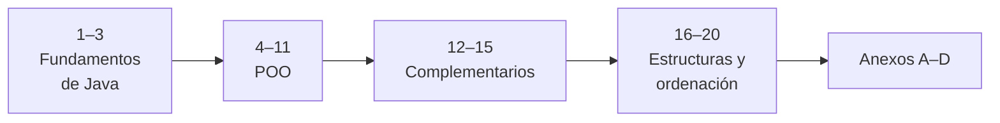

# Libro 1 — Programación y Algoritmos

> [!info] Qué es este libro
> Manual para el **Módulo 2 del EFIP I** (Licenciatura en Informática, Siglo 21). Cubre los sub-ejes **3.1 a 3.4** (Java y POO) y **4.1 a 4.3** (estructuras y ordenación), en **20 capítulos** y **4 anexos**.
> **Canon:** las 16 lecturas de POO (`poo-y-taller-alg-1`), condensadas para examen. Los temas del programa que el canon no trae como lectura propia están integrados en el capítulo donde se necesitan, sin repetir teoría.

## Biblioteca

| Libro | Contenido | Estado |
|---|---|---|
| **Libro 1** (este) | Programación y algoritmos (3.1–3.4, 4.1–4.3) | ✅ Completo |
| **Libro 2** | [[00_Inicio_BD\|Base de Datos (5.1–5.4)]] | ✅ Completo |
| **Libro 3** | [[00_Inicio_AD\|Análisis y Diseño (1.1, 1.2, 2.1)]] | ✅ Completo |
| **Libro 4** | [[00_Inicio_CM\|Comunicaciones (6.1–6.4)]] | ✅ Completo |

## Cómo leerlo

> [!tip] Antes de empezar
> Leé [[00_Metodo|el método de estudio]]: tres niveles y respuesta en cinco pasos.

1. Cada capítulo declara qué sub-eje cubre.
2. El código es Java completo y compilable, pero **sin `main` repetido**: cada snippet muestra solo lo que ilustra.
3. Los diagramas Mermaid muestran jerarquías, memoria y estructuras.
4. Al final de cada capítulo: errores típicos y ejercicios con solución.
5. El repaso final está en los **anexos**: A (código en papel), B (oral), C (errores), D (complejidades y mapa).

## Qué priorizar

> [!important] Orden de estudio (según la guía de la compañera)
> | Nivel | Temas |
> |---|---|
> | **1 — Imprescindible** | Clase, objeto, atributo y método · encapsulamiento, herencia y polimorfismo |
> | **2 — Explicar** | Sobrecarga vs. sobrescritura · arreglo vs. `ArrayList` · pila LIFO y cola FIFO · nodo y enlaces · complejidades de ordenación |
> | **3 — Reconocer y aplicar** | JVM/bytecode/JDK/JRE · constructores, `this`, `super`, `static` · abstracta vs. interfaz · `==` vs. `equals` · listas · ordenación · trazar código · elegir estructura |

## Mapa del libro

### Parte 1 — Fundamentos y Java (3.1)

- [[01_paradigmas-y-jvm|1. Paradigmas y arquitectura de Java]]
- [[02_tipos-y-operadores|2. Tipos, memoria y operadores]]
- [[03_control-y-estructura|3. Control de flujo y estructura del programa]]

### Parte 2 — Programación orientada a objetos (3.2–3.3)

- [[04_paradigma-oo-y-uml|4. Paradigma orientado a objetos y UML]]
- [[05_clase-y-objeto|5. Clase, objeto, atributo y método]]
- [[06_constructores|6. Constructores, sobrecarga, `this` y `super`]]
- [[07_encapsulamiento|7. Encapsulamiento y control de acceso]]
- [[08_herencia|8. Herencia]]
- [[09_clases-abstractas|9. Clases abstractas]]
- [[10_interfaces|10. Interfaces]]
- [[11_polimorfismo-y-static|11. Polimorfismo y miembros estáticos]]

### Parte 3 — Complementarios de Java (3.4)

- [[12_arreglos-y-arraylist|12. Arreglos y ArrayList]]
- [[13_string|13. String y comparación de objetos]]
- [[14_excepciones|14. Excepciones]]
- [[15_archivos|15. Archivos]]

### Parte 4 — Estructuras y ordenación (4.1–4.3)

- [[16_pilas-y-colas|16. Pilas y colas]]
- [[17_listas-enlazadas|17. Listas enlazadas]]
- [[18_listas-dobles-circulares|18. Listas dobles, circulares y ordenadas]]
- [[19_insercion-y-shellsort|19. Ordenación por inserción y Shellsort]]
- [[20_mergesort-y-quicksort|20. Mergesort y Quicksort]]

### Anexos

- [[A_Codigo_para_papel|A. Código listo para papel]]
- [[B_Banco_de_preguntas|B. Banco de preguntas de oral]]
- [[C_Errores_frecuentes|C. Errores frecuentes]]
- [[D_Complejidades|D. Complejidades y mapa del programa]]

## Canon y cobertura

| Lectura oficial | Capítulo(s) |
|---|---|
| M0L1 Algoritmos y pensamiento lógico | 1 · 3 |
| M0L2 Paradigmas | 1 · 4 |
| M0L3 Conceptos de POO | 4 · 5 |
| M0L4 Lenguajes y Java | 1 |
| M1L1 Lenguajes | 1 |
| M1L2 ¿Qué es Java? | 1 |
| M1L3 Sintaxis | 3 |
| M1L4 Variables y constantes | 2 |
| M2L1 Dos paradigmas | 1 · 4 |
| M2L2 Pilas | 16 |
| M2L3 Abstracción y polimorfismo | 11 |
| M2L4 Ventajas de la POO | 4 |
| M3L1 Polimorfismo en Java | 11 |
| M3L2 Encapsulamiento | 7 |
| M3L3 Clases abstractas | 9 |
| M3L4 Ejemplos de POO | 8 · 10 |
| M4L1 Arreglos | 12 |
| M4L2 Strings | 13 |
| M4L3 Excepciones | 14 |
| M4L4 Archivos | 15 |

## El caso que atraviesa el libro

> [!example] Caso integrador
> Un sistema de **señalización urbana** modela semáforos, cámaras y alertas.
>
> - Los dispositivos comparten una superclase y se tratan igual (4, 8–11).
> - Las alertas se guardan en arreglos y listas, y se ordenan por prioridad (12–20).
> - Los archivos y las excepciones sostienen la operación (14–15).

## Regla de oro del módulo

> [!important] El error más caro: escribir antes de modelar
> Si arrancás con `main` y variables sueltas, terminás con un programa estructurado disfrazado de POO. El orden es: **modelar objetos → asignar responsabilidades → escribir métodos → probar**.

#libro1 #programacion #efip
