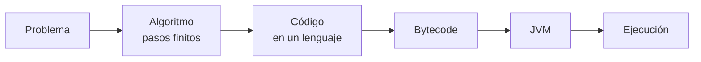
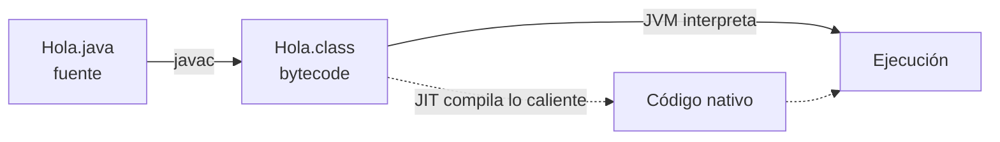

# 1. Paradigmas y arquitectura de Java

> [!info] Al terminar este capítulo tenés que poder
> - Explicar qué es programar y qué es un algoritmo.
> - Diferenciar imperativo, estructurado y orientado a objetos.
> - Describir el recorrido `.java` → `.class` → JVM.
> - Distinguir JDK, JRE y JVM.

> [!abstract] Qué debés saber (nivel 1)
> - **Programar** es resolver un problema y expresar la solución para que la máquina la ejecute.
> - **Algoritmo:** pasos finitos, definidos y eficaces, con entrada y salida.
> - **Paradigma:** forma de organizar la solución, no solo sintaxis.
> - Java **compila a bytecode** y la JVM lo ejecuta (modelo híbrido, con JIT).
> - **JDK** = JRE + herramientas; **JRE** = JVM + bibliotecas; **JVM** ejecuta bytecode.

## 1.1 Programa y algoritmo

**Programa:** expresión de un algoritmo en un lenguaje formal, con datos y control.

| Propiedad del algoritmo | Qué exige |
|---|---|
| **Finito** | Termina |
| **Definido** | Cada paso es inequívoco |
| **Entrada / salida** | Recibe datos y produce un resultado |
| **Eficaz** | Cada paso es realizable |



> [!important] La distinción que se pregunta
> El algoritmo es independiente del lenguaje; el programa es su expresión en uno concreto. El mismo algoritmo puede escribirse en Java o en pseudocódigo.

### Niveles de lenguaje

| Nivel | Qué usa | Cómo se traduce |
|---|---|---|
| **Máquina** | Binario, propio de cada CPU | Se ejecuta tal cual |
| **Ensamblador** | Mnemónicos (`MOV`, `ADD`) | Un *ensamblador* lo traduce |
| **Alto nivel** | Variables, `if`, `while`, clases | Compilador o intérprete |

> [!important] Compilar no es interpretar
> El **compilador** traduce antes de ejecutar (`javac` → bytecode); el **intérprete** traduce mientras ejecuta. Java hace las dos: compila a bytecode y la JVM lo interpreta, con JIT.

## 1.2 Paradigmas

| Paradigma | Idea central | Unidad |
|---|---|---|
| **Imperativo** | Instrucciones que cambian estado | Instrucción |
| **Estructurado** | Secuencia, selección e iteración, sin `goto` | Función |
| **Orientado a objetos** | Objetos que integran datos y comportamiento | Clase / objeto |
| **Funcional** | Funciones puras, sin estado mutable | Función |
| **Lógico** | Hechos y reglas; el motor deduce | Predicado |

> [!important] Estructurado vs. POO
> En estructurado los datos y las funciones que los usan están **separados**: `depositar(cuenta, monto)`. En POO el estado y la operación viven juntos: `cuenta.depositar(monto)`. Eso localiza los cambios.

Java es **multiparadigma** (tiene lambdas), pero el EFIP lo evalúa como **lenguaje orientado a objetos**.

## 1.3 Java: características


| Característica | Consecuencia |
|---|---|
| **Portable** | El bytecode corre en cualquier JVM |
| **Tipado estático** | Los tipos se verifican al compilar |
| **Orientado a objetos** | Todo el código vive en clases |
| **Gestionado** | Recolector de basura; no hay `delete` |
| **Multihilo** | Soporte de concurrencia en el lenguaje |

## 1.4 El recorrido de un programa



```bash
javac Hola.java     # genera Hola.class
java Hola           # la JVM ejecuta el bytecode
```

| Concepto | Qué es |
|---|---|
| **Bytecode** | Instrucciones de la JVM, no de la máquina física |
| **JVM** | Máquina virtual que ejecuta el bytecode |
| **JIT** | Compilador en tiempo de ejecución que acelera lo repetido |
| **WORA** | "Write once, run anywhere" |

> [!warning] Java no es puramente interpretado
> Compila a bytecode y la JVM lo ejecuta, con JIT. Decir "Java es interpretado" a secas es incompleto.

## 1.5 JDK, JRE y JVM

| Sigla | Contiene | Para qué |
|---|---|---|
| **JVM** | Máquina virtual | Ejecutar bytecode |
| **JRE** | JVM + bibliotecas estándar | Ejecutar aplicaciones |
| **JDK** | JRE + `javac`, `jar`, `javadoc` | Desarrollar |

> [!tip] La regla
> Para **programar** necesitás el JDK; para **ejecutar**, el JRE; la JVM es el motor.

## Errores que suelen tomar

| Error | Corrección |
|---|---|
| "Java es interpretado" | Es híbrido: bytecode + JVM + JIT |
| Confundir JDK con JVM | El JDK incluye la JVM y las herramientas |
| Decir que un algoritmo depende del lenguaje | Es independiente |
| "POO es usar clases" | Es modelar objetos que colaboran |
| Confundir paradigma con sintaxis | El paradigma es la forma de pensar |

## Ejercicios

> [!example]- 1. Propiedades
> **Enunciado:** un algoritmo que divide por cero si el número es negativo, ¿qué propiedad incumple?
> **Solución:** eficacia (y definición, si no aclara qué hacer).

> [!example]- 2. Recorrido
> **Enunciado:** ¿qué genera `javac` y quién lo ejecuta?
> **Solución:** bytecode `.class`; lo ejecuta la JVM.

> [!example]- 3. Siglas
> **Enunciado:** ¿qué necesitás para compilar y qué para ejecutar?
> **Solución:** JDK para compilar; JRE (o JDK) para ejecutar.

> [!example]- 4. Paradigma
> **Enunciado:** `depositar(cuenta, monto)` vs. `cuenta.depositar(monto)`.
> **Solución:** estructurado vs. orientado a objetos.

> [!example]- 5. a papel
> **Enunciado:** dibujá el recorrido de `Hola.java` hasta la ejecución.
> **Solución:** fuente → `javac` → bytecode → JVM (intérprete + JIT) → ejecución.


#libro1 #java #paradigmas


#libro1

## Lo que sigue

[[02_tipos-y-operadores|2. Tipos, memoria y operadores]].

#libro1
