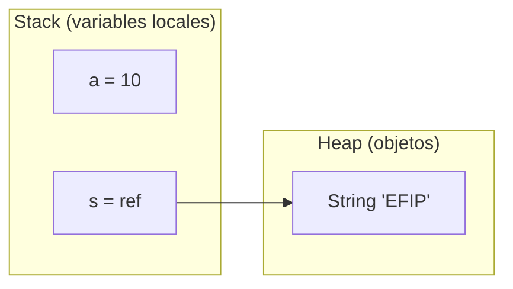

# 2. Tipos, memoria y operadores

> [!info] Al terminar este capítulo tenés que poder
> - Elegir el tipo correcto para cada dato.
> - Explicar la diferencia entre primitivo y referencia.
> - Predecir el resultado de una expresión con casting y división entera.
> - Evitar las trampas de `=`, `==` y `.equals()`.

> [!abstract] Qué debés saber (nivel 1)
> - Java es de **tipado fuerte y estático**.
> - **8 primitivos**: `byte`, `short`, `int`, `long`, `float`, `double`, `char`, `boolean`.
> - Los objetos se guardan como **referencias**; el objeto vive en el *heap*.
> - `7 / 2` da `3`; `7 / 2.0` da `3.5`.
> - `&&` y `||` **cortocircuitan**.
> - `=` asigna, `==` compara referencias, `.equals()` compara contenido.

## 2.1 Tipos primitivos

| Tipo | Tamaño | Rango / uso |
|---|---|---|
| `byte` | 1 byte | −128 a 127 |
| `short` | 2 | −32.768 a 32.767 |
| `int` | 4 | ±2.147 millones (el más usado) |
| `long` | 8 | Enteros grandes (`10L`) |
| `float` | 4 | Decimal aproximado (`1.5f`); 6–7 dígitos significativos |
| `double` | 8 | Decimal aproximado (por defecto); 15–16 dígitos |
| `char` | 2 | Un carácter Unicode (`'A'`) |
| `boolean` | 1 bit lógico | `true` / `false` |

| Categoría | Tipos | Para qué |
|---|---|---|
| **Enteros** | `byte`, `short`, `int`, `long` | Contadores, IDs |
| **Reales** | `float`, `double` | Medidas |
| **Carácter** | `char` | Una letra |
| **Lógico** | `boolean` | Condiciones |

> [!warning] Dinero no va en `double`
> `0.1 + 0.2` no da exactamente `0.3`. Para importes se usa `BigDecimal`.

## 2.2 Primitivos, referencias y memoria

```java
int a = 10;                 // valor en el stack
String s = "EFIP";          // referencia en el stack → objeto en el heap
```



| | Primitivo | Referencia |
|---|---|---|
| Guarda | El valor | La dirección del objeto |
| Dónde | Stack | Referencia en stack, objeto en heap |
| Comparar | `==` | `.equals()` para contenido |
| Nulo | No | Sí (`null`) |

> [!important] `null`
> Una referencia sin objeto no puede recibir mensajes: `NullPointerException`. Es la excepción más común.

## 2.3 Casting y división

| Expresión | Resultado | Por qué |
|---|---|---|
| `7 / 2` | `3` | División entera |
| `7 / 2.0` | `3.5` | Un operando es `double` |
| `(double) 7 / 2` | `3.5` | Casting explícito |
| `(int) 3.9` | `3` | Truncamiento |
| `7 % 2` | `1` | Resto |

```java
int a = 7, b = 2;
double r = (double) a / b;   // 3.5
```

> [!warning] El casting no redondea
> `(int) 3.9` da `3`, no `4`. Para redondear: `Math.round(3.9)`.

## 2.4 Operadores y precedencia

| Grupo | Operadores |
|---|---|
| Aritméticos | `+ - * / %` |
| Incremento | `++ --` |
| Relacionales | `> < >= <= == !=` |
| Lógicos | `&& || !` |
| Ternario | `condición ? valor1 : valor2` |
| Asignación | `= += -= *= /= %=` |

Orden práctico: **paréntesis → unarios → aritméticos → relacionales → lógicos → asignación**.

### Cortocircuito

```java
if (obj != null && obj.activo()) { ... }   // seguro: si es null, no evalúa la segunda
```

| Operador | Si el primero es… | Qué hace |
|---|---|---|
| `&&` | `false` | No evalúa el segundo |
| `\|\|` | `true` | No evalúa el segundo |

> [!important] `&` y `\|` no cortocircuitan
> Con `&` se evalúan ambos lados aunque no haga falta. En condiciones, usá `&&` y `||`.

### `i++` vs. `++i`

| Expresión | Usa el valor… | Efecto |
|---|---|---|
| `i++` | Anterior | Suma después |
| `++i` | Nuevo | Suma antes |

```java
int i = 5;
int a = i++;   // a = 5, i = 6
int b = ++i;   // i = 7, b = 7
```

## 2.5 Igualdad

| Comparación | Qué compara | Ejemplo |
|---|---|---|
| `=` | Asigna | `x = 5;` |
| `==` | Referencias (o valores primitivos) | `s1 == s2` |
| `.equals()` | Contenido | `s1.equals(s2)` |

```java
String a = new String("EFIP");
String b = new String("EFIP");
a == b          // false: objetos distintos
a.equals(b)     // true: mismo contenido
```

> [!warning] El error que más cuesta puntos
> Comparar `String` con `==` funciona a veces (por el *pool* de literales) y falla otras. **Siempre** `.equals()` para contenido.

## Errores que suelen tomar

| Error | Corrección |
|---|---|
| `7 / 2` esperando `3.5` | Es `3`; usá `7 / 2.0` |
| `(int) 3.9` esperando `4` | Trunca: `3` |
| `==` para comparar `String` | `.equals()` |
| Usar `double` para dinero | `BigDecimal` |
| Confundir `i++` con `++i` | Uno usa el valor anterior |
| `&` en una condición | `&&` para cortocircuito |
| Inicializar una local y no usarla | Java exige inicializar antes de leer |

## Ejercicios

> [!example]- 1. División
> **Enunciado:** ¿cuánto da `9 / 4` y `9 / 4.0`?
> **Solución:** `2` y `2.25`.

> [!example]- 2. Casting
> **Enunciado:** ¿cuánto da `(int) 7.9 + 1`?
> **Solución:** `8` (trunca a 7 y suma 1).

> [!example]- 3. Incremento
> **Enunciado:** `int i=3; int x=i++ + ++i;` ¿cuánto vale `x`?
> **Solución:** `3 + 5 = 8`; `i` queda en 5.

> [!example]- 4. Igualdad
> **Enunciado:** ¿por qué `"a" == new String("a")` es `false`?
> **Solución:** compara punteros; el literal está en el pool y el `new` crea otro objeto.

> [!example]- 5. Cortocircuito
> **Enunciado:** ¿por qué `obj != null && obj.activo()` no lanza excepción?
> **Solución:** si `obj` es `null`, `&&` no evalúa la segunda parte.

> [!example]- 6. a papel
> **Enunciado:** escribí una expresión que convierta `gradosC` a `double` y calcule `F = C * 9/5 + 32`.
> **Solución:** `double f = gradosC * 9.0 / 5 + 32;`.


#libro1 #tipos #memoria


#libro1

## Lo que sigue

[[03_control-y-estructura|3. Control de flujo y estructura del programa]].

#libro1
