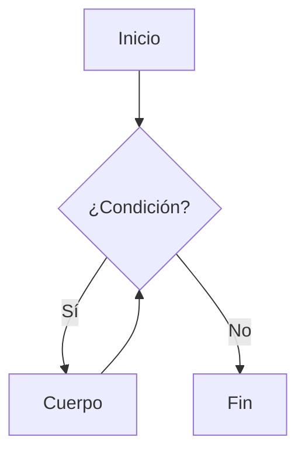

# 3. Control de flujo y estructura del programa

> [!info] Al terminar este capítulo tenés que poder
> - Elegir entre `if`, `switch`, `for`, `while` y `do-while`.
> - Explicar el *fall-through* de `switch` y el uso de `break`.
> - Leer datos con `Scanner`.
> - Escribir la anatomía mínima de un programa Java.

> [!abstract] Qué debés saber (nivel 1)
> - Tres estructuras: **secuencia, selección, iteración**.
> - `switch` sin `break` **cae** al siguiente caso.
> - `for` se usa cuando sabés cuántas veces; `while`, cuando no.
> - `do-while` ejecuta **al menos una vez**.
> - Todo programa necesita `public static void main(String[] args)`.

## 3.1 Selección

```java
if (prioridad == 1) {
    System.out.println("Crítica");
} else if (prioridad <= 3) {
    System.out.println("Media");
} else {
    System.out.println("Baja");
}
```

| Estructura | Cuándo |
|---|---|
| `if` | Una o dos alternativas |
| `if / else if` | Varias alternativas con rangos |
| `switch` | Varias alternativas sobre un valor discreto |

```java
switch (prioridad) {
    case 1:
        System.out.println("Crítica");
        break;
    case 2:
    case 3:
        System.out.println("Media");
        break;
    default:
        System.out.println("Baja");
}
```

> [!warning] El *fall-through*
> Sin `break`, la ejecución continúa en el caso siguiente. A veces se usa a propósito (casos 2 y 3 comparten código); si no, es un bug.

> [!tip] `switch` moderno
> Desde Java 14: `case 1 -> "Crítica";` no cae y no necesita `break`. El EFIP suele pedir el clásico.

## 3.2 Iteración

| Bucle | Cuándo | Garantía |
|---|---|---|
| `for` | Cantidad conocida | Puede ejecutarse 0 veces |
| `while` | Condición al inicio | Puede ejecutarse 0 veces |
| `do-while` | Condición al final | **Al menos 1 vez** |

```java
for (int i = 0; i < 5; i++) {
    System.out.println(i);
}

int j = 0;
while (j < 5) {
    System.out.println(j);
    j++;
}

int k = 0;
do {
    System.out.println(k);
    k++;
} while (k < 5);
```



| Sentencia | Efecto |
|---|---|
| `break` | Sale del bucle o `switch` |
| `continue` | Salta a la próxima iteración |
| `return` | Sale del método |

> [!warning] Bucle infinito
> `while (i < 5)` sin `i++` nunca termina. Verificá que la condición pueda volverse falsa.

## 3.3 Entrada por consola

```java
import java.util.Scanner;

Scanner sc = new Scanner(System.in);
System.out.print("Prioridad: ");
int prioridad = sc.nextInt();
sc.nextLine();                 // consume el Enter pendiente
String mensaje = sc.nextLine();
```

| Método | Lee |
|---|---|
| `nextInt()` | Un entero |
| `nextDouble()` | Un decimal |
| `next()` | Una palabra |
| `nextLine()` | Una línea completa |

> [!important] El `nextLine()` después de `nextInt()`
> `nextInt()` deja el Enter en el buffer y el `nextLine()` siguiente lo consume vacío. Por eso se agrega un `nextLine()` de limpieza.

## 3.4 Anatomía de un programa

```java
package municipio.alertas;          // 1. paquete (opcional)

import java.util.Scanner;           // 2. imports

public class RegistroAlerta {       // 3. clase pública = nombre del archivo

    public static void main(String[] args) {   // 4. punto de entrada
        System.out.println("Hola, EFIP");
    }
}
```

| Parte | Regla |
|---|---|
| `package` | Minúscula, dominio invertido |
| `import` | Solo lo que se usa |
| `class` | Una pública por archivo, mismo nombre |
| `main` | `public static void main(String[] args)` exacto |
| Archivo | `RegistroAlerta.java` |

> [!important] `main` es `static`
> La JVM lo llama sin crear un objeto. Por eso no podés usar métodos de instancia directamente dentro de `main`: necesitás un objeto.

## 3.5 Convenciones

| Elemento | Convención | Ejemplo |
|---|---|---|
| Clase | PascalCase | `ControlAlertas` |
| Método / variable | camelCase | `registrarAlerta`, `idDispositivo` |
| Constante | MAYÚSCULAS | `MAX_PRIORIDAD` |
| Paquete | minúsculas | `municipio.alertas` |

## Errores que suelen tomar

| Error | Corrección |
|---|---|
| `switch` sin `break` | Agregalo salvo que el *fall-through* sea intencional |
| `while` sin actualizar la variable | Condición de corte |
| `do-while` con `;` faltante | `} while (cond);` |
| `nextInt()` seguido de `nextLine()` | Consumir el Enter |
| Llamar un método de instancia desde `main` | Crear el objeto |
| Archivo con nombre distinto a la clase pública | No compila |

## Ejercicios

> [!example]- 1. Bucle
> **Enunciado:** imprimí los pares del 1 al 10.
> **Solución:** `for (int i = 2; i <= 10; i += 2) System.out.println(i);`.

> [!example]- 2. Switch
> **Enunciado:** ¿qué imprime `case 1` sin `break` seguido de `case 2`?
> **Solución:** ambos mensajes, por *fall-through*.

> [!example]- 3. Do-while
> **Enunciado:** ¿cuántas veces se ejecuta `do { } while (false);`?
> **Solución:** una.

> [!example]- 4. Scanner
> **Enunciado:** leé un entero y luego una línea completa.
> **Solución:** `int n = sc.nextInt(); sc.nextLine(); String s = sc.nextLine();`.

> [!example]- 5. a papel
> **Enunciado:** escribí la clase `Pares` con `main` que imprima los pares del 1 al 20.
> **Solución:** clase pública `Pares`, `main`, `for` con `i += 2`.


#libro1 #control #java


#libro1

## Lo que sigue

[[04_paradigma-oo-y-uml|4. Paradigma orientado a objetos y UML]].

#libro1
