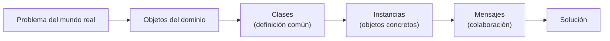
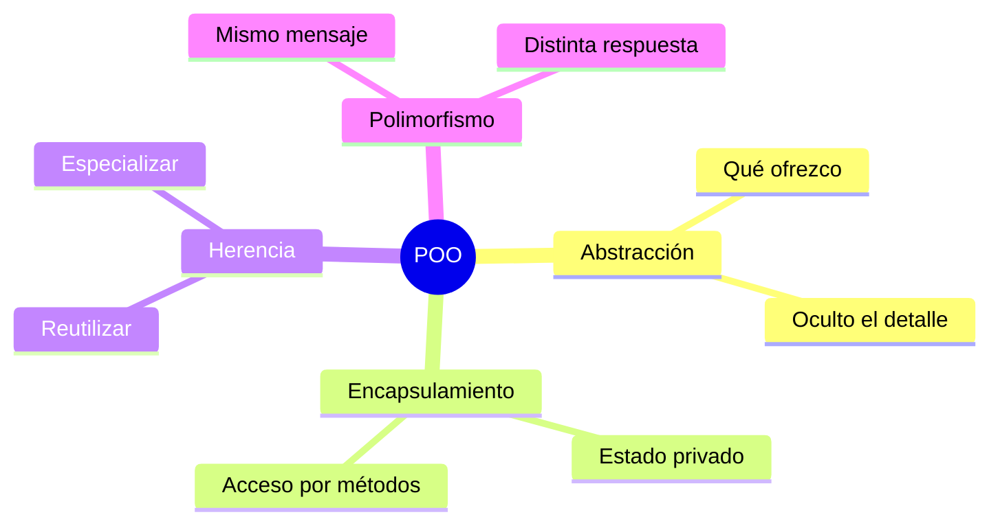
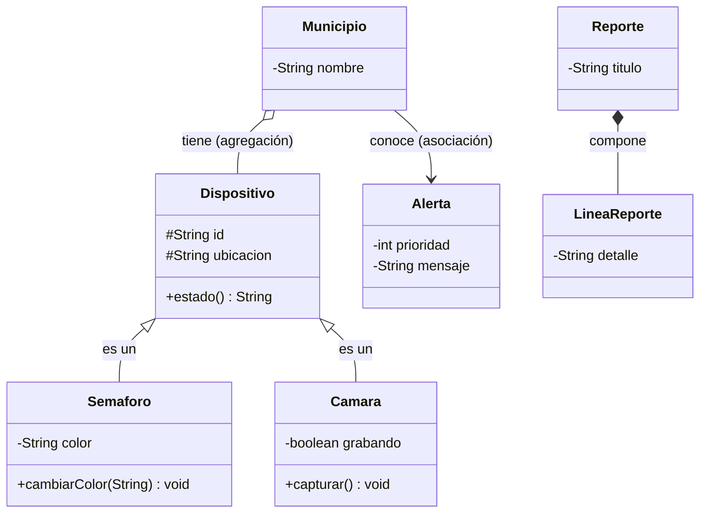
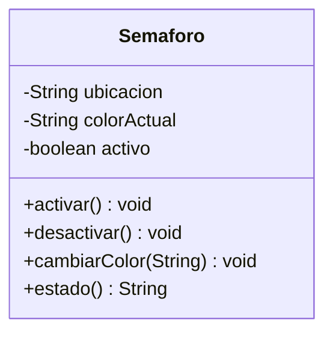

# 4. Paradigma orientado a objetos y UML

> [!info] Al terminar este capítulo tenés que poder
> - Explicar qué es un paradigma y por qué la POO organiza distinto.
> - Definir los cuatro pilares con un ejemplo propio.
> - Identificar clases, atributos y métodos desde un enunciado.
> - Distinguir asociación, agregación, composición y herencia.

> [!abstract] Qué debés saber (nivel 1)
> - La POO agrupa **datos y métodos** en objetos que se comunican por **mensajes**.
> - Cuatro pilares: **abstracción, encapsulamiento, herencia, polimorfismo**.
> - “Es un” → herencia. “Tiene un” → asociación/agregación/composición.
> - Composición: la parte **no existe** sin el todo. Agregación: la parte **sobrevive**.
> - La programación estructurada no desaparece: vive **dentro** de los métodos.

## 4.1 Qué es un paradigma

**Paradigma:** modelo de trabajo compartido que orienta la conceptualización de los problemas y la organización de las soluciones.

| Paradigma | Organiza la solución en… |
|---|---|
| Modular | Módulos |
| Procedimental | Procedimientos y funciones |
| Estructurada | Secuencia, selección, iteración |
| Orientada a eventos | Manejadores de eventos |
| **Orientada a objetos** | **Objetos que integran datos y comportamiento** |



> [!important] La diferencia central
> En el paradigma estructurado, los **datos** y las **funciones** están separados: una función recibe datos y los procesa. En POO, **datos y comportamiento viven juntos** en el objeto, y solo se accede a los datos mediante sus métodos.

## 4.2 Los cuatro pilares



### Abstracción

**Representar lo esencial y omitir los detalles irrelevantes.**

Al modelar un semáforo para el sistema del municipio, no te interesa el color de la pintura ni el fabricante del poste: te interesa su ubicación, su estado y su capacidad de cambiar de color.

> [!quote] Cátedra
> La abstracción representa las características esenciales de un objeto y oculta los detalles de implementación.

### Encapsulamiento

**Agrupar estado y comportamiento y controlar el acceso.**

```java
public class Semaforo {
    private String colorActual;          // estado protegido

    public void cambiarColor(String nuevo) {
        if (esColorValido(nuevo)) {
            colorActual = nuevo;
        }
    }

    public String getColorActual() {
        return colorActual;
    }

    private boolean esColorValido(String color) {
        return color.equals("ROJO") || color.equals("AMARILLO") || color.equals("VERDE");
    }
}
```

Nadie puede escribir `semaforo.colorActual = "VIOLETA"`: el atributo es privado y el único camino es `cambiarColor`, que valida.

> [!warning] Corrección a un apunte de cátedra
> El material de Siglo 21 menciona `restricted` como modificador de acceso. **Ese modificador no existe en Java.** Los niveles reales son `public`, `protected`, sin modificador (package-private) y `private`. Ver [[07_encapsulamiento]].

### Herencia

**Crear una subclase especializada a partir de una superclase.** Expresa “es un”.

```java
class Dispositivo {
    protected String ubicacion;

    public String getUbicacion() {
        return ubicacion;
    }
}

class Camara extends Dispositivo {      // una cámara ES UN dispositivo
    private boolean grabando;
}
```

### Polimorfismo

**Usar una referencia común para objetos distintos y ejecutar el método del objeto real.**

```java
Dispositivo d = new Camara("C-01");
d.descripcion();        // se ejecuta la versión de Camara, no la de Dispositivo
```

Se profundiza en [[11_polimorfismo-y-static]].

## 4.3 Ventajas de la POO

| Ventaja | Por qué |
|---|---|
| **Correspondencia con el dominio** | El código refleja las entidades del problema: semáforo, cámara, alerta |
| **Reutilización** | Clases existentes se extienden o se usan en otros sistemas |
| **Modularidad** | Cada clase tiene una responsabilidad acotada |
| **Mantenibilidad** | Un cambio en una clase queda localizado |
| **Ocultamiento de información** | El estado interno no se manipula desde afuera |
| **Trabajo en equipo** | Se reparten clases, no archivos gigantes |

> [!warning] No vendas humo
> “La POO es más rápida” es falso como afirmación general. Es más **mantenible** y **modelable**; el rendimiento depende del diseño y la implementación.

## 4.4 Cómo identificar clases desde un enunciado

Método del compañero, en seis pasos:

1. **Subrayá sustantivos**: candidatos a clases, objetos o atributos.
2. **Subrayá verbos**: candidatos a métodos, eventos o responsabilidades.
3. **Distinguí entidades con identidad** de simples datos descriptivos.
4. **Asigná cada responsabilidad** a la clase que tiene la información necesaria.
5. **Identificá relaciones**: contiene, usa, conoce, es una especialización.
6. **Validá el modelo** recorriendo los casos de uso principales.

> [!example] Aplicado al caso del municipio
> “El municipio administra semáforos y cámaras conectadas. Los dispositivos informan estado y generan alertas.”
>
> | Sustantivo | ¿Clase? | Motivo |
> |---|---|---|
> | Municipio | Sí | Tiene identidad y responsabilidades de coordinación |
> | Semáforo | Sí | Entidad con estado propio |
> | Cámara | Sí | Entidad con estado propio |
> | Alerta | Sí | Entidad con datos y ciclo de vida |
> | Estado | Depende | Atributo si es un texto; clase si tiene comportamiento |
> | Ubicación | Depende | Atributo si es una dirección simple |
>
> Verbos → métodos: `informarEstado()`, `activar()`, `capturar()`, `generarAlerta()`.
>
> **La decisión se justifica por identidad y responsabilidad, no porque aparezca un sustantivo.**

## 4.5 Relaciones entre clases



| Relación | Qué significa | Ejemplo | Notación UML |
|---|---|---|---|
| **Asociación** | Una clase conoce o utiliza otra | Operador atiende Alerta | línea simple |
| **Agregación** | Todo-parte **débil**; la parte puede existir sola | Municipio agrupa Dispositivos | rombo hueco |
| **Composición** | La parte **depende** del ciclo de vida del todo | Reporte contiene Líneas | rombo relleno |
| **Herencia** | Especialización (“es un”) | Cámara es un Dispositivo | flecha con triángulo hueco |
| **Dependencia** | Uso puntual (parámetro, variable local) | Servicio usa un Archivo | flecha punteada |

> [!important] La pregunta que resuelve todo
> **¿“Es un” o “tiene un”?**
> - “Cámara **es un** dispositivo” → herencia.
> - “Municipio **tiene** dispositivos” → asociación o agregación.
> - “Reporte **tiene** líneas que no existen sin él” → composición.

## 4.6 Programa completo con varios objetos colaborando

```java
public class Alerta {
    String mensaje;
    int prioridad;
    boolean atendida;

    void atender() {
        atendida = true;
    }

    String estado() {
        return "[" + prioridad + "] " + mensaje + (atendida ? " (atendida)" : " (pendiente)");
    }
}
```

```java
public class Municipio {

    String nombre;

    void reportar(Alerta a, String dispositivo) {
        System.out.println(nombre + " | " + dispositivo + " → " + a.estado());
    }

    public static void main(String[] args) {

        Municipio m = new Municipio();
        m.nombre = "Municipio de La Plata";

        Alerta a1 = new Alerta();
        a1.mensaje = "Cámara desconectada";
        a1.prioridad = 1;

        Alerta a2 = new Alerta();
        a2.mensaje = "Semáforo sin energía";
        a2.prioridad = 2;

        m.reportar(a1, "Cámara C-01");
        m.reportar(a2, "Semáforo S-04");

        a1.atender();

        m.reportar(a1, "Cámara C-01");
    }
}
```

Salida:

```text
Municipio de La Plata | Cámara C-01 → [1] Cámara desconectada (pendiente)
Municipio de La Plata | Semáforo S-04 → [2] Semáforo sin energía (pendiente)
Municipio de La Plata | Cámara C-01 → [1] Cámara desconectada (atendida)
```

Observá: `Municipio` **conoce** `Alerta` (la recibe como parámetro) y las alertas tienen **estado** propio.

## 4.7 Diagrama de clases UML



Lectura:

| Símbolo | Significado |
|---|---|
| `-` | `private` |
| `+` | `public` |
| `#` | `protected` |
| `~` | package-private |
| `nombre: Tipo` | Atributo |
| `metodo(params) Tipo` | Método |

> [!tip] En el examen escrito
> Si no te piden visibilidad, igual conviene marcarla: `-` en atributos y `+` en métodos es el mínimo profesional.

## Cómo trazar un modelo (no código)

| Paso | Pregunta | Resultado |
|---|---|---|
| 1 | ¿Qué entidades tienen identidad? | Municipio, Dispositivo, Semaforo, Camara, Alerta |
| 2 | ¿Qué datos guarda cada una? | `id`, `ubicacion`, `color`, `prioridad` |
| 3 | ¿Qué sabe hacer cada una? | `cambiarColor`, `capturar`, `atender` |
| 4 | ¿Cómo se relacionan? | Camara es Dispositivo; Municipio tiene Dispositivos |
| 5 | ¿Qué NO es clase? | `estado` como texto, `ubicacion` simple |

## Errores que suelen tomar

| Error | Corrección |
|---|---|
| Decir que encapsular es “poner `private`” | Encapsular es **ocultar estado y controlar el acceso**; `private` es el mecanismo |
| Confundir abstracción con encapsulamiento | Abstracción elige lo esencial; encapsulamiento protege el acceso |
| Usar herencia para “reutilizar código” sin relación “es un” | Si no hay “es un”, usar composición |
| Llamar composición a cualquier relación todo-parte | Composición = la parte muere con el todo |
| Crear una clase por cada sustantivo | Solo si tiene identidad y responsabilidad |
| Confundir objeto con clase en el oral | “El semáforo de la esquina” es objeto; `Semaforo` es clase |

## Ejercicios

> [!example]- 1. Pilares
> **Enunciado:** relacioná cada situación con un pilar: (a) `saldo` privado y `depositar()` público; (b) `Camara extends Dispositivo`; (c) `d.descripcion()` ejecuta la de `Camara`; (d) modelar solo ubicación y estado del semáforo.
> **Solución:** (a) encapsulamiento; (b) herencia; (c) polimorfismo; (d) abstracción.

> [!example]- 2. ¿Es un o tiene un?
> **Enunciado:** clasificá: (a) Chofer y Camión; (b) Reporte y LíneaReporte; (c) Municipio y Semáforo; (d) Camara y Dispositivo.
> **Solución:** (a) asociación (el chofer conduce el camión); (b) composición (la línea no existe sin el reporte); (c) agregación (los semáforos existen sin el municipio); (d) herencia.

> [!example]- 3. Identificar clases
> **Enunciado:** del texto “el operador registra la alerta y el sistema avisa al supervisor”, extraé clases, atributos y métodos.
> **Solución:** clases `Operador`, `Alerta`, `Supervisor`; atributos `legajo`, `prioridad`, `mensaje`; métodos `registrarAlerta()`, `notificar()`. `Sistema` no es clase si no tiene estado propio: es el conjunto de objetos colaborando.

> [!example]- 4. a papel
> **Enunciado:** modelá en 4 clases el dominio “biblioteca”: préstamo, libro, socio, bibliotecario. Indicá una relación de cada tipo (asociación, agregación, composición).
> **Solución:** `Biblioteca o-- Libro` (agregación: el libro existe sin la biblioteca); `Prestamo *-- LineaPrestamo` (composición); `Socio --> Prestamo` (asociación); `Bibliotecario --> Prestamo` (asociación).

## Lo que sigue

[[05_clase-y-objeto|5. Clase, objeto, atributo y método]].

#libro1
