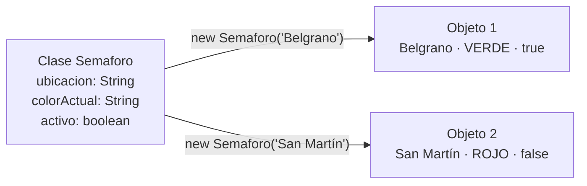
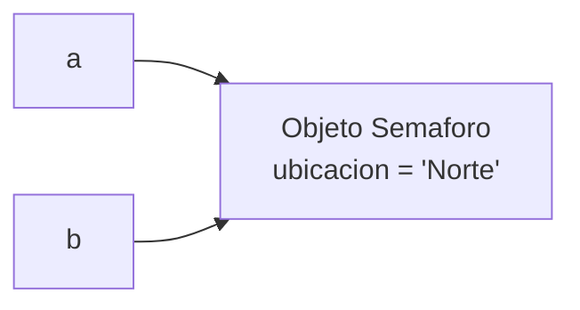
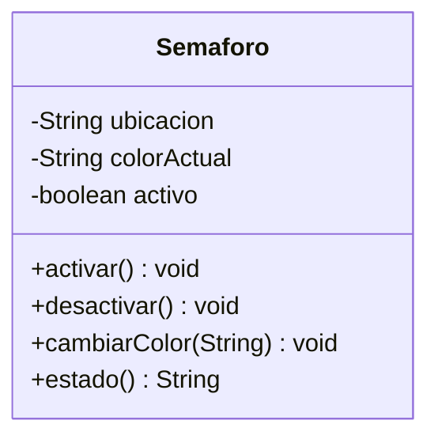

# 5. Clase, objeto, atributo y método

> [!info] Al terminar este capítulo tenés que poder
> - Distinguir clase de objeto con un ejemplo propio.
> - Identificar atributos (estado) y métodos (comportamiento).
> - Crear objetos con `new` y usar referencias.
> - Dibujar y leer un diagrama de clases UML básico.

> [!abstract] Qué debés saber (nivel 1)
> - **Clase:** molde o plantilla que define atributos y métodos.
> - **Objeto:** instancia concreta de una clase, con identidad, estado y comportamiento.
> - **Atributo:** dato que representa el estado.
> - **Método:** operación o comportamiento.
> - **Instancia:** objeto creado con `new`.
> - **Mensaje:** llamada a un método de un objeto (`objeto.metodo()`).

## 5.1 Clase y objeto

> [!quote] Definiciones de cátedra
> **Clase:** molde, plantilla o template para construir múltiples instancias de objetos similares.
> **Objeto:** entidad que agrupa datos y funcionalidad; ante un mensaje ejecuta el comportamiento asociado.

Pensalo así:

- `Semaforo` es la **clase**: define que todo semáforo tiene ubicación, color y estado.
- El semáforo de Av. Belgrano es un **objeto**: tiene ubicación `"Av. Belgrano"`, color `"VERDE"` y está activo.



| Concepto | Pregunta que responde | Ejemplo |
|---|---|---|
| Clase | ¿Qué es? ¿Qué tiene y qué sabe hacer? | `Semaforo` |
| Objeto | ¿Cuál, concretamente? | el de Av. Belgrano |
| Atributo | ¿Qué estado guarda? | `colorActual` |
| Método | ¿Qué comportamiento tiene? | `cambiarColor()` |
| Identidad | ¿Cómo lo distingo de otro? | la referencia en memoria |

## 5.2 Declarar una clase

```java
public class Semaforo {

    // Atributos: estado
    String ubicacion;
    String colorActual;
    boolean activo;

    // Métodos: comportamiento
    void activar() {
        activo = true;
    }

    void desactivar() {
        activo = false;
    }

    void cambiarColor(String nuevoColor) {
        if (activo) {
            colorActual = nuevoColor;
        }
    }

    String estado() {
        return ubicacion + " | " + colorActual + " | " + (activo ? "activo" : "apagado");
    }
}
```

> [!warning] Sin `private` todavía
> En este capítulo los atributos son accesibles para simplificar. En [[07_encapsulamiento]] se encapsulan, que es como se escribe en el examen.

## 5.3 Crear y usar objetos

```java
public class Municipalidad {

    public static void main(String[] args) {

        // 1. Declaración de la referencia
        Semaforo s1;

        // 2. Creación del objeto (reserva memoria y devuelve la referencia)
        s1 = new Semaforo();

        // 3. Estado inicial
        s1.ubicacion = "Av. Belgrano";
        s1.colorActual = "ROJO";

        // 4. Mensajes
        s1.activar();
        s1.cambiarColor("VERDE");

        System.out.println(s1.estado());

        // Segundo objeto: independiente
        Semaforo s2 = new Semaforo();
        s2.ubicacion = "Av. San Martín";
        s2.colorActual = "ROJO";

        System.out.println(s2.estado());

        System.out.println("s1 sigue siendo: " + s1.colorActual);
    }
}
```

Salida:

```text
Av. Belgrano | VERDE | activo
Av. San Martín | ROJO | apagado
s1 sigue siendo: VERDE
```

> [!important] Cada objeto tiene su propio estado
> `s1` y `s2` comparten la **definición** (la clase), no los **valores**. Cambiar `s1.colorActual` no toca `s2`.

## 5.4 Referencias: el error más frecuente

```java
Semaforo a = new Semaforo();
a.ubicacion = "Centro";

Semaforo b = a;              // NO copia el objeto: copia la referencia
b.ubicacion = "Norte";

System.out.println(a.ubicacion);   // Norte
```



| Operación | Qué hace |
|---|---|
| `Semaforo b = a;` | Dos referencias, **un** objeto |
| `Semaforo b = new Semaforo();` | Dos referencias, **dos** objetos |
| `a == b` | Compara si apuntan al mismo objeto |

> [!warning] `null`
> ```java
> Semaforo x = null;
> x.activar();      // NullPointerException
> ```
> Una referencia sin objeto no puede recibir mensajes. Es la excepción más común en Java.

## 5.5 Métodos: parámetros y retorno

```java
public class Calculadora {

    // Sin parámetros, sin retorno
    void saludar() {
        System.out.println("Hola");
    }

    // Con parámetros, sin retorno
    void imprimirSuma(int a, int b) {
        System.out.println("Suma: " + (a + b));
    }

    // Con parámetros y con retorno
    int sumar(int a, int b) {
        return a + b;
    }

    // Retorno double
    double promedio(int total, int cantidad) {
        return (double) total / cantidad;
    }
}
```

| Firma | Significado |
|---|---|
| `void saludar()` | No recibe datos, no devuelve |
| `void imprimirSuma(int a, int b)` | Recibe dos enteros, no devuelve |
| `int sumar(int a, int b)` | Recibe dos enteros, devuelve un entero |
| `double promedio(int, int)` | Devuelve decimal |

> [!important] `void` vs. `return`
> `void` significa "no devuelve valor". Un método con retorno **debe** ejecutar `return` en todos los caminos posibles; si no, no compila.

## 5.6 Diagrama de clases UML



Lectura:

| Símbolo | Significado |
|---|---|
| `-` | `private` |
| `+` | `public` |
| `#` | `protected` |
| `~` | package-private |
| `nombre: Tipo` | Atributo |
| `metodo(params) Tipo` | Método |

> [!tip] En el examen escrito
> Si no te piden visibilidad, igual conviene marcarla: `-` en atributos y `+` en métodos es el mínimo profesional.

## 5.7 Programa completo

```java
public class CuentaBancaria {

    String titular;
    double saldo;

    void depositar(double monto) {
        if (monto > 0) {
            saldo += monto;
        }
    }

    boolean extraer(double monto) {
        if (monto > 0 && monto <= saldo) {
            saldo -= monto;
            return true;
        }
        return false;
    }

    String resumen() {
        return titular + ": $" + saldo;
    }

    public static void main(String[] args) {

        CuentaBancaria c = new CuentaBancaria();
        c.titular = "Ana";
        c.saldo = 1000;

        c.depositar(500);
        System.out.println(c.resumen());        // Ana: $1500.0

        boolean ok = c.extraer(2000);
        System.out.println("¿Extrajo? " + ok);  // false
        System.out.println(c.resumen());        // Ana: $1500.0

        c.extraer(300);
        System.out.println(c.resumen());        // Ana: $1200.0
    }
}
```

Salida:

```text
Ana: $1500.0
¿Extrajo? false
Ana: $1500.0
Ana: $1200.0
```

## Cómo trazar el estado de un objeto

| Paso | Operación | `saldo` | Resultado |
|---|---|---|---|
| 0 | `saldo = 1000` | 1000.0 | — |
| 1 | `depositar(500)` | 1500.0 | — |
| 2 | `extraer(2000)` | 1500.0 | `false` (no alcanza) |
| 3 | `extraer(300)` | 1200.0 | `true` |

**Regla:** en objetos, la tabla de traza lleva **una columna por atributo** y una fila por mensaje, no por línea interna del método.

## Errores que suelen tomar

| Error | Consecuencia |
|---|---|
| `Semaforo s; s.activar();` | No compila: variable no inicializada |
| `Semaforo s = null; s.activar();` | `NullPointerException` |
| `Semaforo b = a;` creyendo que copia | Dos referencias al mismo objeto |
| Confundir clase con objeto | "El semáforo es la clase" (mal) |
| Método con retorno sin `return` | No compila |
| Llamar a un método no estático desde `main` sin objeto | No compila |

> [!warning] El último es clave
> `main` es `static`. Para llamar a `cambiarColor()` (no estático) necesitás **un objeto**: `s1.cambiarColor("VERDE")`. Se profundiza en [[11_polimorfismo-y-static]].

## Ejercicios

> [!example]- 1. Clase y objeto
> **Enunciado:** definí una clase `Sensor` con `ubicacion`, `valor` y un método `leer()` que devuelva el valor. Creá dos sensores y mostrá que son independientes.
> **Solución:**
> ```java
> public class Sensor {
>     String ubicacion;
>     double valor;
>
>     double leer() {
>         return valor;
>     }
>
>     public static void main(String[] args) {
>         Sensor a = new Sensor();
>         a.ubicacion = "Esquina 1";
>         a.valor = 21.5;
>
>         Sensor b = new Sensor();
>         b.ubicacion = "Esquina 2";
>         b.valor = 30.0;
>
>         System.out.println(a.ubicacion + ": " + a.leer());
>         System.out.println(b.ubicacion + ": " + b.leer());
>     }
> }
> ```

> [!example]- 2. Estado
> **Enunciado:** ¿qué imprime?
> ```java
> Semaforo a = new Semaforo();
> a.colorActual = "ROJO";
> Semaforo b = a;
> b.colorActual = "VERDE";
> System.out.println(a.colorActual);
> ```
> **Solución:** `VERDE`. `b` y `a` apuntan al mismo objeto.

> [!example]- 3. Método con retorno
> **Enunciado:** agregá a `CuentaBancaria` un método `double saldoConInteres(double tasa)` que devuelva el saldo con interés sin modificar el saldo.
> **Solución:**
> ```java
> double saldoConInteres(double tasa) {
>     return saldo * (1 + tasa);
> }
> ```

> [!example]- 4. a papel
> **Enunciado:** dibujá el diagrama de clases de `Semaforo` con tres atributos y cuatro métodos, usando `-` y `+`.
> **Solución:** ver el diagrama de la sección 4.7. Debe tener atributos con `-`, métodos con `+`, y tipos en cada miembro.

> [!example]- 5. Identificar miembros
> **Enunciado:** del texto "el semáforo de la esquina cambia a verde y registra la hora del cambio", ¿qué es clase, objeto, atributo y método?
> **Solución:** clase `Semaforo`; objeto el de la esquina; atributos `color`, `horaUltimoCambio`, `ubicacion`; métodos `cambiarColor()`, `registrarHora()`.

## Lo que sigue

[[06_constructores|6. Constructores, sobrecarga, this y super]].

#libro1
