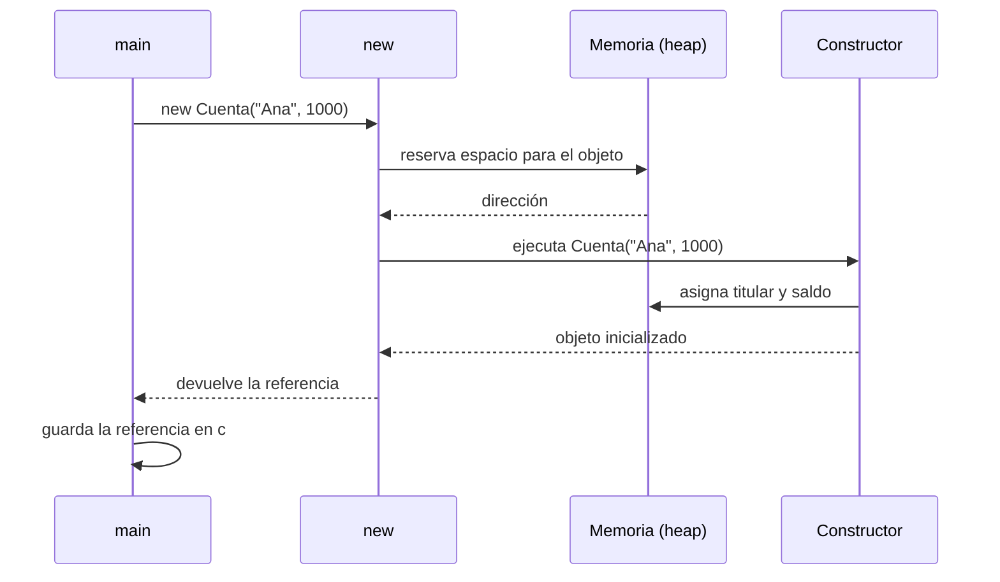
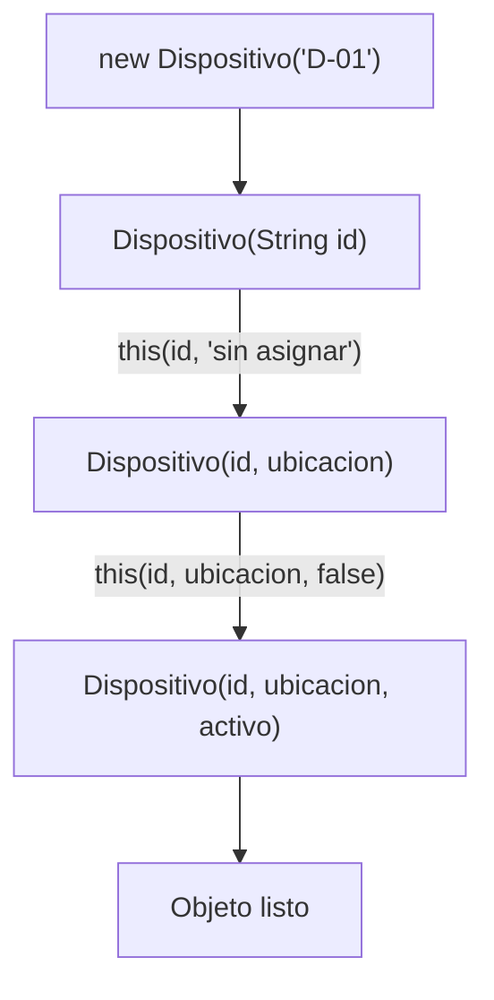

# 6. Constructores, sobrecarga, this y super

> [!info] Al terminar este capítulo tenés que poder
> - Escribir constructores por defecto y parametrizados.
> - Explicar qué hace `new` paso por paso.
> - Decidir cuándo conviene validar en el constructor.
> - Reconocer por qué un objeto puede quedar en estado inválido.
> - Usar sobrecarga, `this` y `super` sin confundirlos.

> [!abstract] Qué debés saber (nivel 1)
> - El constructor **se llama igual que la clase** y **no tiene tipo de retorno** (ni `void`).
> - Se ejecuta una sola vez, al crear el objeto con `new`.
> - Si no escribís ningún constructor, Java genera uno vacío por defecto.
> - Si escribís uno con parámetros, el vacío **desaparece**.
> - Un constructor puede validar y rechazar datos inválidos.

## 6.1 Qué es un constructor

**Constructor:** bloque que inicializa un objeto en el momento de su creación. Garantiza que el objeto nazca en un estado válido.

```java
public class Cuenta {

    private String titular;
    private double saldo;

    // Constructor
    public Cuenta(String titular, double saldoInicial) {
        this.titular = titular;
        this.saldo = saldoInicial;
    }
}
```

| Aspecto | Regla |
|---|---|
| Nombre | Idéntico al de la clase, con mayúscula inicial |
| Retorno | **Ninguno**, ni siquiera `void` |
| Invocación | Solo con `new` |
| Cantidad | Puede haber varios (sobrecarga) |

> [!warning] Error de sintaxis clásico
> ```java
> public void Cuenta(String titular) { }   // NO es constructor: tiene void
> ```
> Eso es un **método** llamado `Cuenta`, no un constructor. El compilador no lo usa al hacer `new`.

## 6.2 Qué hace `new`

```java
Cuenta c = new Cuenta("Ana", 1000);
```



Cuatro pasos:

1. **Reserva** memoria para el objeto.
2. **Inicializa** los atributos con su valor por defecto (`null`, `0`, `false`).
3. **Ejecuta** el constructor.
4. **Devuelve** la referencia, que se guarda en la variable.

> [!important] `new` devuelve una referencia
> `Cuenta c = new Cuenta(...)` no guarda el objeto en `c`: guarda **dónde está**. Por eso dos variables pueden apuntar al mismo objeto ([[05_clase-y-objeto]]).

## 6.3 Constructor por defecto

Si la clase **no declara ningún constructor**, Java agrega uno sin parámetros que no hace nada especial:

```java
public class Sensor {
    String ubicacion;
    double valor;
}
```

```java
// Uso: el constructor vacío lo genera Java
Sensor s = new Sensor();
s.ubicacion = "Esquina 1";
```

Pero si declarás **un** constructor, el vacío ya no existe:

```java
public class Sensor {
    String ubicacion;

    public Sensor(String ubicacion) {
        this.ubicacion = ubicacion;
    }
}

// Sensor s = new Sensor();          // ERROR: no existe el constructor vacío
Sensor s = new Sensor("Esquina 1");  // OK
```

> [!warning] La trampa del “dejó de compilar”
> Agregás un constructor con parámetros y de golpe fallan todos los `new Sensor()`. No es un bug: el constructor por defecto desapareció. Solución: declarar también el vacío.

```java
public Sensor() {
    this.ubicacion = "sin asignar";
}
```

## 6.4 Constructores sobrecargados

Varios constructores con la misma clase y distintos parámetros.

```java
public class Dispositivo {

    private String id;
    private String ubicacion;
    private boolean activo;

    // 1. Completo
    public Dispositivo(String id, String ubicacion, boolean activo) {
        this.id = id;
        this.ubicacion = ubicacion;
        this.activo = activo;
    }

    // 2. Sin estado: arranca apagado
    public Dispositivo(String id, String ubicacion) {
        this(id, ubicacion, false);          // delega en el constructor 1
    }

    // 3. Mínimo: ubicación por defecto
    public Dispositivo(String id) {
        this(id, "sin asignar");
    }

    public String resumen() {
        return id + " @ " + ubicacion + " [" + (activo ? "ON" : "OFF") + "]";
    }
}
```

```java
public class PruebaConstructores {
    public static void main(String[] args) {
        Dispositivo a = new Dispositivo("D-01", "Centro", true);
        Dispositivo b = new Dispositivo("D-02", "Norte");
        Dispositivo c = new Dispositivo("D-03");

        System.out.println(a.resumen());
        System.out.println(b.resumen());
        System.out.println(c.resumen());
    }
}
```

Salida:

```text
D-01 @ Centro [ON]
D-02 @ Norte [OFF]
D-03 @ sin asignar [OFF]
```

> [!tip] `this(...)` evita duplicar código
> Un constructor llama a otro de la misma clase y le pasa los valores. **Debe ser la primera sentencia.** Se detalla en [[06_constructores]].

## 6.5 Validar en el constructor

El constructor es el mejor lugar para garantizar los **invariantes**: condiciones que siempre deben cumplirse.

```java
public class CuentaBancaria {

    private final String titular;
    private double saldo;

    public CuentaBancaria(String titular, double saldoInicial) {
        if (titular == null || titular.isBlank()) {
            throw new IllegalArgumentException("Titular obligatorio");
        }
        if (saldoInicial < 0) {
            throw new IllegalArgumentException("Saldo inicial no puede ser negativo");
        }
        this.titular = titular;
        this.saldo = saldoInicial;
    }

    public void depositar(double monto) {
        if (monto <= 0) {
            throw new IllegalArgumentException("Monto inválido");
        }
        saldo += monto;
    }

    public double getSaldo() {
        return saldo;
    }

    public String getTitular() {
        return titular;
    }
}
```

```java
public class Banco {
    public static void main(String[] args) {

        CuentaBancaria c = new CuentaBancaria("Ana", 1000);
        c.depositar(500);
        System.out.println(c.getTitular() + ": $" + c.getSaldo());

        try {
            CuentaBancaria mala = new CuentaBancaria("", -10);
            System.out.println(mala.getTitular());
        } catch (IllegalArgumentException e) {
            System.out.println("Rechazado: " + e.getMessage());
        }
    }
}
```

Salida:

```text
Ana: $1500.0
Rechazado: Titular obligatorio
```

> [!important] Por qué validar acá
> Si el objeto se crea inválido, todos los métodos posteriores arrastran el error. Validar al nacer es más barato que corregir después.

## 6.6 Objeto completo: del enunciado al constructor

**Enunciado:** “De cada semáforo se conoce su identificador, su ubicación y su color actual, que al instalarse es siempre ROJO”.

```java
public class Semaforo {

    private final String id;
    private final String ubicacion;
    private String colorActual;

    public Semaforo(String id, String ubicacion) {
        this.id = id;
        this.ubicacion = ubicacion;
        this.colorActual = "ROJO";       // regla del dominio
    }

    public void cambiarColor(String nuevo) {
        if (nuevo.equals("ROJO") || nuevo.equals("AMARILLO") || nuevo.equals("VERDE")) {
            this.colorActual = nuevo;
        }
    }

    public String estado() {
        return id + " (" + ubicacion + "): " + colorActual;
    }
}
```

```java
public class Instalacion {
    public static void main(String[] args) {
        Semaforo s = new Semaforo("S-01", "Av. Belgrano");
        System.out.println(s.estado());      // S-01 (Av. Belgrano): ROJO
        s.cambiarColor("VERDE");
        System.out.println(s.estado());      // S-01 (Av. Belgrano): VERDE
        s.cambiarColor("VIOLETA");           // ignorado por la validación
        System.out.println(s.estado());      // S-01 (Av. Belgrano): VERDE
    }
}
```

Salida:

```text
S-01 (Av. Belgrano): ROJO
S-01 (Av. Belgrano): VERDE
S-01 (Av. Belgrano): VERDE
```

## 6.7 Firma y sobrecarga

**Signatura o firma:** combinación del nombre del método con la cantidad, el tipo y el orden de sus parámetros.

```java
public class Alerta {

    // Firma: registrar(String)
    public void registrar(String mensaje) {
        System.out.println("Simple: " + mensaje);
    }

    // Firma: registrar(String, int)
    public void registrar(String mensaje, int prioridad) {
        System.out.println("Con prioridad " + prioridad + ": " + mensaje);
    }

    // Firma: registrar(int, String)  → distinto ORDEN, es sobrecarga válida
    public void registrar(int prioridad, String mensaje) {
        System.out.println("[" + prioridad + "] " + mensaje);
    }

    // NO es sobrecarga: solo cambia el retorno → no compila
    // public String registrar(String mensaje) { return mensaje; }
}
```

```java
public class Prueba {
    public static void main(String[] args) {
        Alerta a = new Alerta();
        a.registrar("Cámara caída");
        a.registrar("Semáforo apagado", 1);
        a.registrar(2, "Sensor sin batería");
    }
}
```

Salida:

```text
Simple: Cámara caída
Con prioridad 1: Semáforo apagado
[2] Sensor sin batería
```

> [!important] Sobrecarga vs. sobrescritura
> | | Sobrecarga | Sobrescritura |
> |---|---|---|
> | Dónde | Misma clase | Subclase redefine un método heredado |
> | Firma | **Distinta** | **Igual** |
> | Se resuelve | Al compilar | En ejecución (despacho dinámico) |
> | Se ve en | [[06_constructores]] | [[08_herencia]] y [[11_polimorfismo-y-static]] |

> [!warning] Trampa de examen
> “El tipo de retorno alcanza para sobrecargar” → **falso**. `int f()` y `String f()` no pueden coexistir.

### Conversiones y ambigüedad

```java
void enviar(int x)    { System.out.println("int"); }
void enviar(double x) { System.out.println("double"); }

enviar(5);      // int  → coincidencia exacta
enviar(5.0);    // double
enviar('A');    // int  → char se promueve a int
```

Si dos versiones son **igualmente aplicables**, el compilador da error por ambigüedad. Evitá sobrecargas que solo difieran en tipos que se convierten entre sí.

## 6.8 `this`

Tres usos:

### 1. Desambiguar atributo y parámetro

```java
public class Semaforo {
    private String color;

    public void cambiarColor(String color) {
        this.color = color;        // izquierda: atributo; derecha: parámetro
    }
}
```

Sin `this`, `color = color` asigna el parámetro a sí mismo y el atributo queda sin cambios.

### 2. Llamar a otro constructor de la misma clase

```java
public class Dispositivo {

    private final String id;
    private String ubicacion;
    private boolean activo;

    public Dispositivo(String id, String ubicacion, boolean activo) {
        this.id = id;
        this.ubicacion = ubicacion;
        this.activo = activo;
    }

    public Dispositivo(String id, String ubicacion) {
        this(id, ubicacion, false);     // delega; debe ser la primera línea
    }

    public Dispositivo(String id) {
        this(id, "sin asignar");
    }
}
```



### 3. Devolver el objeto actual (encadenamiento)

```java
public class Consulta {

    private String tabla = "";
    private String condicion = "";

    public Consulta desde(String tabla) {
        this.tabla = tabla;
        return this;
    }

    public Consulta donde(String condicion) {
        this.condicion = condicion;
        return this;
    }

    public String sql() {
        return "SELECT * FROM " + tabla + " WHERE " + condicion;
    }

    public static void main(String[] args) {
        String q = new Consulta()
                .desde("alerta")
                .donde("prioridad = 1")
                .sql();
        System.out.println(q);
    }
}
```

Salida:

```text
SELECT * FROM alerta WHERE prioridad = 1
```

> [!warning] `this` no existe en contexto estático
> En un método `static` no hay objeto actual. `this` produce error de compilación ([[11_polimorfismo-y-static]]).

## 6.9 `super`

### 1. Llamar al constructor del padre

```java
class Persona {

    protected String nombre;
    protected String dni;

    public Persona(String nombre, String dni) {
        this.nombre = nombre;
        this.dni = dni;
    }
}

class Empleado extends Persona {

    private double sueldo;

    public Empleado(String nombre, String dni, double sueldo) {
        super(nombre, dni);        // primero el padre
        this.sueldo = sueldo;      // después lo propio
    }
}
```

> [!important] Regla de orden
> `super(...)` debe ser **la primera sentencia** del constructor. No podés asignar atributos propios antes.

### 2. Acceder a un método del padre

```java
class Empleado extends Persona {

    private double sueldo;

    public Empleado(String nombre, String dni, double sueldo) {
        super(nombre, dni);
        this.sueldo = sueldo;
    }

    public String descripcion() {
        return "Empleado: " + super.toString();   // reutiliza el del padre
    }
}
```

Si la subclase sobrescribe `descripcion()` y quiere usar la versión del padre, `super.descripcion()`.

### 3. `super` no es un objeto

No se puede hacer `super = new Persona(...)` ni guardar `super` en una variable. Es una referencia especial de acceso.

## 6.10 Orden de ejecución en una jerarquía

```java
class A {
    A() { System.out.println("Constructor A"); }
}

class B extends A {
    B() {
        // Java inserta super() aquí
        System.out.println("Constructor B");
    }
}

class C extends B {
    C() {
        super();
        System.out.println("Constructor C");
    }
}
```

```java
new C();
```

Salida:

```text
Constructor A
Constructor B
Constructor C
```

**Regla:** se construye **de arriba hacia abajo**: primero el padre, después el hijo.

> [!warning] El error de `super()` implícito
> Si el padre **no tiene** constructor sin parámetros y el hijo no llama a `super(...)`, no compila:
> ```java
> class Persona { Persona(String nombre) { } }
> class Empleado extends Persona {
>     Empleado() { }   // ERROR: no hay Persona()
> }
> ```
> Solución: `Empleado(String nombre) { super(nombre); }`.

## Cómo trazar la creación de un objeto

```java
Dispositivo d = new Dispositivo("D-02", "Norte");
```

| Paso | Qué ocurre | `id` | `ubicacion` | `activo` |
|---|---|---|---|---|
| 0 | Reserva de memoria | `null` | `null` | `false` |
| 1 | Entra al constructor `(id, ubicacion)` | `null` | `null` | `false` |
| 2 | `this(id, ubicacion, false)` | `null` | `null` | `false` |
| 3 | Constructor completo asigna | `"D-02"` | `"Norte"` | `false` |
| 4 | Vuelve y termina | `"D-02"` | `"Norte"` | `false` |

**Regla:** si hay `this(...)`, la traza sigue la cadena de constructores, no el orden visual del archivo.

## Errores que suelen tomar

| Error | Consecuencia |
|---|---|
| `public void Cuenta()` | Es un método, no un constructor |
| Constructor con `return` de valor | No compila |
| `Cuenta c = Cuenta("Ana", 100);` | Falta `new` |
| Agregar constructor con parámetros y usar `new Clase()` | El vacío ya no existe |
| No validar en el constructor | Objetos inválidos circulando |
| Asignar `this.id = id` con tipos incompatibles | No compila |
| Olvidar `this` cuando parámetro y atributo se llaman igual | El atributo queda sin asignar |

## Ejercicios

> [!example]- 1. ¿Constructor o método?
> **Enunciado:** ¿cuáles son constructores?
> ```java
> public void Persona() {}
> public Persona() {}
> public Persona(String n) {}
> public int Persona() { return 1; }
> ```
> **Solución:** solo el segundo y el tercero. El primero y el cuarto tienen tipo de retorno (`void` e `int`), así que son métodos.

> [!example]- 2. Constructor por defecto
> **Enunciado:** la clase `Libro` tiene `Libro(String titulo)`. ¿Compila `new Libro()`? ¿Cómo lo arreglás?
> **Solución:** no compila: el constructor vacío no existe. Se agrega `public Libro() { this.titulo = "sin título"; }`.

> [!example]- 3. Validación
> **Enunciado:** escribí el constructor de `Edificio` que reciba `pisos` y rechace valores menores a 1.
> **Solución:**
> ```java
> public class Edificio {
>     private int pisos;
>
>     public Edificio(int pisos) {
>         if (pisos < 1) {
>             throw new IllegalArgumentException("Debe tener al menos 1 piso");
>         }
>         this.pisos = pisos;
>     }
> }
> ```

> [!example]- 4. Cadena de constructores
> **Enunciado:** ¿qué imprime?
> ```java
> public class A {
>     public A() { this(1); System.out.println("A()"); }
>     public A(int x) { System.out.println("A(" + x + ")"); }
>     public static void main(String[] a) { new A(); }
> }
> ```
> **Solución:** `A(1)` y luego `A()`. `this(1)` va primero porque debe ser la primera sentencia.

> [!example]- 5. a papel
> **Enunciado:** escribí la clase `Turno` con `paciente`, `fecha` y `estado` (inicial `"PENDIENTE"`), un constructor que valide que `paciente` no esté vacío y un método `cancelar()` que solo cancele si está pendiente.
> **Solución:**
> ```java
> public class Turno {
>     private final String paciente;
>     private final String fecha;
>     private String estado;
>
>     public Turno(String paciente, String fecha) {
>         if (paciente == null || paciente.isBlank()) {
>             throw new IllegalArgumentException("Paciente obligatorio");
>         }
>         this.paciente = paciente;
>         this.fecha = fecha;
>         this.estado = "PENDIENTE";
>     }
>
>     public void cancelar() {
>         if (estado.equals("PENDIENTE")) {
>             estado = "CANCELADO";
>         }
>     }
>
>     public String getEstado() { return estado; }
> }
> ```

## Lo que sigue

[[07_encapsulamiento|7. Encapsulamiento y control de acceso]].

#libro1
