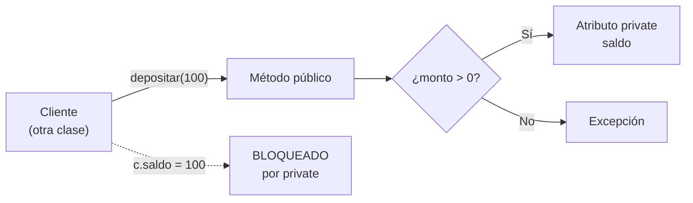
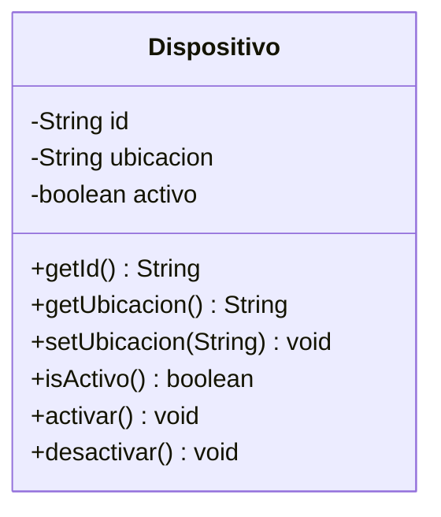

# 7. Encapsulamiento y control de acceso

> [!info] Al terminar este capítulo tenés que poder
> - Explicar qué protege el encapsulamiento y por qué.
> - Aplicar `public`, `protected`, sin modificador y `private`.
> - Escribir getters y setters que no rompan los invariantes.
> - Justificar por qué un atributo no debe ser público.

> [!abstract] Qué debés saber (nivel 1)
> - Encapsular = ocultar el estado y exponer operaciones controladas.
> - `private`: solo la propia clase. `public`: todos. `protected`: paquete + subclases. Sin modificador: solo el paquete.
> - Los getters **devuelven**; los setters **modifican** con validación.
> - No todo atributo necesita setter: si es identidad o inmutable, no se expone.
> - El alcance (scope) no es lo mismo que el control de acceso.

## 7.1 El problema que resuelve

```java
// Sin encapsulamiento
public class Cuenta {
    public double saldo;
}
```

```java
// Uso: cualquier clase puede romper el estado
Cuenta c = new Cuenta();
c.saldo = -5000;
```

Un atributo público permite cualquier valor, en cualquier momento, desde cualquier clase. El objeto no puede defender sus reglas.

```java
// Con encapsulamiento
public class Cuenta {
    private double saldo;

    public void depositar(double monto) {
        if (monto <= 0) throw new IllegalArgumentException("Monto inválido");
        saldo += monto;
    }

    public double getSaldo() {
        return saldo;
    }
}
```

Ahora el saldo **solo** cambia por un camino válido.



## 7.2 Los cuatro niveles de acceso

| Modificador | Misma clase | Mismo paquete | Subclase (otro paquete) | Cualquier clase |
|---|---|---|---|---|
| `private` | ✅ | ❌ | ❌ | ❌ |
| sin modificador | ✅ | ✅ | ❌ | ❌ |
| `protected` | ✅ | ✅ | ✅ | ❌ |
| `public` | ✅ | ✅ | ✅ | ✅ |

> [!warning] Corrección importante
> El material de Siglo 21 menciona un modificador `restricted`. **No existe en Java.** Los cuatro niveles son los de la tabla. Si te lo preguntan, corregilo con seguridad.

> [!important] `protected` no es “casi público”
> Permite acceso a subclases **y** al mismo paquete. Se usa cuando una clase está pensada para ser heredada. En el examen, si no hay herencia, no lo uses.

## 7.3 Getters y setters

```java
public class Dispositivo {

    private final String id;           // identidad: no cambia
    private String ubicacion;
    private boolean activo;

    public Dispositivo(String id, String ubicacion) {
        this.id = id;
        this.ubicacion = ubicacion;
    }

    // Getter: solo lectura
    public String getId() {
        return id;
    }

    public String getUbicacion() {
        return ubicacion;
    }

    // Setter con validación
    public void setUbicacion(String ubicacion) {
        if (ubicacion == null || ubicacion.isBlank()) {
            throw new IllegalArgumentException("Ubicación obligatoria");
        }
        this.ubicacion = ubicacion;
    }

    public boolean isActivo() {           // boolean: is + nombre
        return activo;
    }

    public void activar() {
        activo = true;
    }

    public void desactivar() {
        activo = false;
    }
}
```

| Convención | Ejemplo |
|---|---|
| Atributo `double saldo` | `getSaldo()` / `setSaldo(double)` |
| Atributo `boolean activo` | `isActivo()` / `setActivo(boolean)` |
| Sin setter | El atributo es inmutable desde afuera |

> [!tip] No generes setters por reflejo
> Un setter para todo convierte el encapsulamiento en decoración: si cualquiera puede cambiar cualquier cosa, no protegiste nada. Preguntate: *¿esta modificación es una operación válida del dominio?* Si no, no la expongas.

## 7.4 Invariantes

**Invariante:** condición que debe cumplirse siempre, antes y después de cada operación pública.

Ejemplos:

- El saldo nunca es negativo (si el dominio lo prohíbe).
- Un turno cancelado no puede volver a pendiente.
- La prioridad de una alerta está entre 1 y 5.
- El stock no puede ser menor que cero.

```java
public class Alerta {

    private final int prioridad;       // 1..5
    private String estado;             // PENDIENTE, ATENDIDA

    public Alerta(int prioridad, String mensaje) {
        if (prioridad < 1 || prioridad > 5) {
            throw new IllegalArgumentException("Prioridad fuera de rango");
        }
        this.prioridad = prioridad;
        this.estado = "PENDIENTE";
    }

    public int getPrioridad() {
        return prioridad;
    }

    public void atender() {
        if (estado.equals("ATENDIDA")) {
            throw new IllegalStateException("Ya estaba atendida");
        }
        estado = "ATENDIDA";
    }

    public String getEstado() {
        return estado;
    }
}
```

> [!important] El invariante se protege en **todos** los caminos
> No alcanza con validar en el constructor: cada método público debe dejar el objeto en un estado válido. Si `atender()` pudiera ejecutarse dos veces, el estado sería inconsistente.

## 7.5 Alcance no es acceso

| Concepto | Pregunta | Ejemplo |
|---|---|---|
| **Alcance (scope)** | ¿Dónde existe este identificador? | Un parámetro existe solo dentro del método |
| **Control de acceso** | ¿Quién puede verlo? | `private` impide verlo desde otra clase |

```java
public class Ejemplo {

    private int contador;                 // atributo de la clase

    public void procesar(int contador) {  // parámetro con el mismo nombre
        int aux = contador;               // parámetro
        this.contador = aux;              // atributo, por this
    }
}
```

- `contador` (parámetro) tiene alcance del método.
- `this.contador` es el atributo del objeto.
- **No se puede** declarar otra variable `contador` dentro del mismo método: ya está en ese alcance.

## 7.6 Diagrama UML con visibilidad



| Símbolo | Visibilidad |
|---|---|
| `-` | `private` |
| `+` | `public` |
| `#` | `protected` |
| `~` | package-private |

> [!tip] Regla de diseño para el escrito
> Atributos `-`, métodos de negocio `+`, métodos auxiliares `-`. Si todos los miembros son `+`, el diagrama está mal.

## 7.7 Programa completo

```java
public class CuentaBancaria {

    private final String cbu;
    private String titular;
    private double saldo;

    public CuentaBancaria(String cbu, String titular, double saldoInicial) {
        if (cbu == null || cbu.length() != 22) {
            throw new IllegalArgumentException("CBU inválido");
        }
        if (saldoInicial < 0) {
            throw new IllegalArgumentException("Saldo inicial inválido");
        }
        this.cbu = cbu;
        this.titular = titular;
        this.saldo = saldoInicial;
    }

    public void depositar(double monto) {
        if (monto <= 0) {
            throw new IllegalArgumentException("El depósito debe ser positivo");
        }
        saldo += monto;
    }

    public void extraer(double monto) {
        if (monto <= 0) {
            throw new IllegalArgumentException("El monto debe ser positivo");
        }
        if (monto > saldo) {
            throw new IllegalStateException("Saldo insuficiente");
        }
        saldo -= monto;
    }

    public double getSaldo() { return saldo; }
    public String getTitular() { return titular; }
    public String getCbu() { return cbu; }

    public void setTitular(String titular) {
        if (titular == null || titular.isBlank()) {
            throw new IllegalArgumentException("Titular obligatorio");
        }
        this.titular = titular;
    }
}
```

```java
public class Banco {

    public static void main(String[] args) {

        CuentaBancaria c = new CuentaBancaria(
                "0000000000000000000001", "Ana", 1000);

        c.depositar(500);
        System.out.println("Saldo: " + c.getSaldo());

        try {
            c.extraer(5000);
        } catch (IllegalStateException e) {
            System.out.println("Error: " + e.getMessage());
        }

        System.out.println("Saldo final: " + c.getSaldo());
    }
}
```

Salida:

```text
Saldo: 1500.0
Error: Saldo insuficiente
Saldo final: 1500.0
```

## Cómo trazar el estado con encapsulamiento

| Paso | Operación | `saldo` | ¿Excepción? |
|---|---|---|---|
| 0 | constructor(1000) | 1000 | no |
| 1 | `depositar(500)` | 1500 | no |
| 2 | `extraer(5000)` | 1500 | sí: saldo insuficiente |
| 3 | `extraer(200)` | 1300 | no |

**Regla:** cuando hay excepción, el estado **no cambia**. Ese es el sentido de validar antes de modificar.

## Errores que suelen tomar

| Error | Consecuencia |
|---|---|
| Atributos `public` | Cualquiera rompe el estado |
| Setter para el `id` | Se pierde la identidad del objeto |
| Getter que devuelve una colección interna | El cliente la modifica desde afuera |
| Validar solo en el setter y no en el constructor | El objeto nace inválido |
| Validar después de modificar | El estado queda corrupto si falla |
| Confundir `protected` con público | Filtra estado a todo el paquete |

> [!warning] El getter que rompe todo
> ```java
> private final List<String> historial = new ArrayList<>();
> public List<String> getHistorial() { return historial; }   // MAL
> ```
> El cliente hace `getHistorial().clear()` y vacía el estado interno. Solución: devolver una copia o una vista no modificable.

## Ejercicios

> [!example]- 1. Visibilidad
> **Enunciado:** ¿qué miembros deberían ser `private` y cuáles `public` en `Semaforo` (id, ubicación, color, cambiarColor, estado)?
> **Solución:** `private` para `id`, `ubicacion`, `color`; `public` para `cambiarColor()` y `estado()`; getters públicos para los datos de consulta. `id` sin setter.

> [!example]- 2. Setter con validación
> **Enunciado:** escribí `setPrioridad(int)` para una alerta que solo acepta 1 a 5.
> **Solución:**
> ```java
> public void setPrioridad(int prioridad) {
>     if (prioridad < 1 || prioridad > 5) {
>         throw new IllegalArgumentException("Prioridad 1..5");
>     }
>     this.prioridad = prioridad;
> }
> ```

> [!example]- 3. Invariante
> **Enunciado:** ¿qué invariante rompe este código?
> ```java
> Cuenta c = new Cuenta("Ana", 100);
> c.setSaldo(-50);
> ```
> **Solución:** rompe “saldo ≥ 0”. El problema es que existe `setSaldo` sin validación. Debe eliminarse y reemplazarse por `depositar` y `extraer`.

> [!example]- 4. Alcance vs. acceso
> **Enunciado:** en `public void m(int x) { int x = 2; }`, ¿cuál es el error?
> **Solución:** error de **alcance**: `x` ya está declarada como parámetro en ese bloque. No se puede redeclarar.

> [!example]- 5. a papel
> **Enunciado:** escribí la clase `Sensor` encapsulada: `id` inmutable, `valor` privado con getter, y `actualizar(double)` que rechace valores fuera de −50 a 100.
> **Solución:**
> ```java
> public class Sensor {
>     private final String id;
>     private double valor;
>
>     public Sensor(String id) {
>         if (id == null || id.isBlank()) throw new IllegalArgumentException("id");
>         this.id = id;
>     }
>
>     public String getId() { return id; }
>     public double getValor() { return valor; }
>
>     public void actualizar(double nuevo) {
>         if (nuevo < -50 || nuevo > 100) {
>             throw new IllegalArgumentException("Valor fuera de rango");
>         }
>         this.valor = nuevo;
>     }
> }
> ```

## Lo que sigue

[[08_herencia|8. Herencia]].

#libro1
