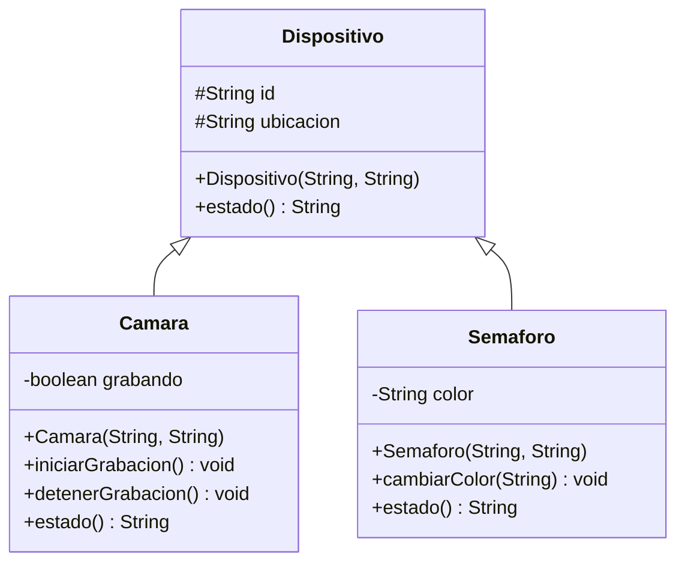

# 8. Herencia

> [!info] Al terminar este capítulo tenés que poder
> - Modelar una jerarquía “es un” con `extends`.
> - Sobrescribir métodos con `@Override`.
> - Explicar qué se hereda y qué no.
> - Decidir entre herencia y composición.

> [!abstract] Qué debés saber (nivel 1)
> - `class Hija extends Padre` expresa **“es un”**.
> - Se heredan atributos y métodos **accesibles** (`public`, `protected`, package si comparte paquete).
> - Los **constructores no se heredan**; se invocan con `super(...)`.
> - Los `private` no se heredan (existen, pero no son accesibles).
> - Sobrescribir = misma firma en la subclase. `@Override` lo verifica.
> - `final` en clase impide heredar; en método impide sobrescribir.

## 8.1 Qué es heredar

```java
class Dispositivo {

    protected final String id;
    protected String ubicacion;

    public Dispositivo(String id, String ubicacion) {
        this.id = id;
        this.ubicacion = ubicacion;
    }

    public String estado() {
        return id + " en " + ubicacion;
    }
}

class Camara extends Dispositivo {

    private boolean grabando;

    public Camara(String id, String ubicacion) {
        super(id, ubicacion);
    }

    public void iniciarGrabacion() {
        grabando = true;
    }

    public void detenerGrabacion() {
        grabando = false;
    }

    @Override
    public String estado() {
        return super.estado() + " | " + (grabando ? "grabando" : "detenida");
    }
}
```



> [!important] Lectura del diagrama
> El triángulo hueco apunta **al padre**. `Camara` y `Semaforo` heredan de `Dispositivo`: ambos **son** dispositivos.

## 8.2 Qué se hereda y qué no

| Miembro del padre | ¿Se hereda? | Detalle |
|---|---|---|
| Atributos `public` | Sí | Accesibles directamente |
| Atributos `protected` | Sí | Accesibles en la subclase |
| Atributos `private` | No accesibles | Existen, pero solo el padre los toca |
| Métodos `public` / `protected` | Sí | Se pueden usar o sobrescribir |
| Métodos `private` | No | No se ven desde la subclase |
| Constructores | **No** | Se invocan con `super(...)` |
| Miembros `static` | Se heredan, pero pertenecen a la clase | Se accede con el nombre de la clase |

```java
class Padre {
    private int secreto = 42;
    protected int visible = 7;

    public int getSecreto() { return secreto; }
}

class Hija extends Padre {
    void probar() {
        System.out.println(visible);       // OK
        // System.out.println(secreto);    // ERROR: private
        System.out.println(getSecreto());  // OK: vía método público
    }
}
```

> [!warning] “No se hereda el private” mal explicado
> El atributo **existe** en el objeto (ocupa memoria) y se inicializa con el constructor del padre. Lo que no hay es **acceso directo** desde la subclase. Se llega por getters o métodos protegidos.

## 8.3 Sobrescritura

```java
class Dispositivo {
    public String estado() {
        return "dispositivo";
    }
}

class Semaforo extends Dispositivo {

    private String color = "ROJO";

    @Override
    public String estado() {          // misma firma
        return "semáforo " + color;
    }
}
```

Reglas:

1. **Misma firma** (nombre + parámetros).
2. El retorno debe ser igual o un subtipo (retorno covariante).
3. No se puede reducir la visibilidad: `public` no puede pasar a `protected`.
4. No se puede sobrescribir un método `final`.
5. `@Override` no es obligatorio, pero **detecta errores de tipeo** en la firma.

> [!warning] El error que `@Override` evita
> ```java
> @Override
> public String Estado() { ... }   // mayúscula: NO sobrescribe
> ```
> Sin la anotación, el compilador lo acepta como método nuevo y el polimorfismo no funciona. Con `@Override`, falla y te avisa.

### `super` en la sobrescritura

```java
@Override
public String estado() {
    return super.estado() + " (actualizado)";
}
```

Sirve para **aprovechar** la implementación del padre y agregar comportamiento.

## 8.4 La raíz: `Object`

Toda clase en Java hereda (implícitamente) de `Object`. Por eso todo objeto tiene:

| Método | Para qué |
|---|---|
| `toString()` | Representación textual; se usa al concatenar |
| `equals(Object)` | Igualdad lógica (por defecto, identidad) |
| `hashCode()` | Código hash coherente con `equals` |
| `getClass()` | Clase real del objeto |

```java
class Punto {
    int x, y;

    Punto(int x, int y) { this.x = x; this.y = y; }

    @Override
    public String toString() {
        return "(" + x + ", " + y + ")";
    }
}

public class Prueba {
    public static void main(String[] args) {
        System.out.println(new Punto(2, 3));   // (2, 3)
    }
}
```

Se profundiza en [[13_string]].

## 8.5 `final`

| Dónde | Efecto |
|---|---|
| `final` en atributo | No se reasigna |
| `final` en método | No se puede sobrescribir |
| `final` en clase | No se puede heredar |

```java
final class Utilidades { }          // nadie puede extenderla

class Base {
    public final void plantilla() { }   // no se puede sobrescribir
}
```

## 8.6 Herencia vs. composición

> [!important] Regla de diseño
> Usá herencia solo si hay una relación **“es un”** real y la subclase **especializa** el comportamiento. Si solo querés reutilizar código, usá **composición** (“tiene un”).

| Criterio | Herencia | Composición |
|---|---|---|
| Relación | “es un” | “tiene un” |
| Acoplamiento | Fuerte (depende del padre) | Débil (depende de una interfaz) |
| Cambio en el padre | Impacta en los hijos | No impacta |
| Cuándo | Jerarquía real del dominio | Reutilizar sin jerarquía |

```java
// MAL: un motor no "es un" auto
class Auto extends Motor { }

// BIEN: un auto "tiene un" motor
class Auto {
    private Motor motor;
}
```

> [!warning] Herencia por conveniencia
> Es el error de diseño más común en el examen. Si no podés decir “A **es un** B” en voz alta, no uses `extends`.

## 8.7 Programa completo

```java
class Dispositivo {

    protected final String id;
    protected String ubicacion;
    protected boolean activo;

    public Dispositivo(String id, String ubicacion) {
        this.id = id;
        this.ubicacion = ubicacion;
    }

    public void activar() { activo = true; }
    public void desactivar() { activo = false; }

    public String estado() {
        return id + " @ " + ubicacion + " [" + (activo ? "ON" : "OFF") + "]";
    }
}

class Semaforo extends Dispositivo {

    private String color;

    public Semaforo(String id, String ubicacion) {
        super(id, ubicacion);
        this.color = "ROJO";
    }

    public void cambiarColor(String nuevo) {
        if (nuevo.equals("ROJO") || nuevo.equals("AMARILLO") || nuevo.equals("VERDE")) {
            this.color = nuevo;
        }
    }

    @Override
    public String estado() {
        return super.estado() + " color=" + color;
    }
}

class Camara extends Dispositivo {

    private boolean grabando;

    public Camara(String id, String ubicacion) {
        super(id, ubicacion);
    }

    public void grabar() { grabando = true; }

    @Override
    public String estado() {
        return super.estado() + " " + (grabando ? "REC" : "sin grabar");
    }
}

public class Municipio {

    public static void main(String[] args) {

        Semaforo s = new Semaforo("S-01", "Belgrano");
        Camara c = new Camara("C-01", "Plaza");

        s.activar();
        s.cambiarColor("VERDE");
        c.activar();
        c.grabar();

        System.out.println(s.estado());
        System.out.println(c.estado());

        Dispositivo d = new Camara("C-02", "Terminal");
        d.activar();
        System.out.println(d.estado());     // se ejecuta el de Camara
    }
}
```

Salida:

```text
S-01 @ Belgrano [ON] color=VERDE
C-01 @ Plaza [ON] REC
C-02 @ Terminal [ON] sin grabar
```

> [!important] Fijate en la última línea
> `d` es de tipo `Dispositivo` pero apunta a una `Camara`. Se ejecuta `estado()` de `Camara`. Eso es **polimorfismo** ([[11_polimorfismo-y-static]]).

## Cómo trazar una jerarquía

| Paso | Acción | Objeto `c` (Camara) |
|---|---|---|
| 1 | `new Camara("C-01","Plaza")` | reserva memoria |
| 2 | `super(id, ubicacion)` | `id`, `ubicacion` asignados; `activo=false` |
| 3 | vuelve al constructor de Camara | `grabando=false` |
| 4 | `c.activar()` | `activo=true` |
| 5 | `c.grabar()` | `grabando=true` |
| 6 | `c.estado()` | ejecuta la versión de `Camara` |

## Errores que suelen tomar

| Error | Consecuencia |
|---|---|
| Herencia sin “es un” | Modelo incorrecto |
| Esperar que se hereden los constructores | No ocurre: hay que llamar `super(...)` |
| Acceder a un `private` del padre | No compila |
| Sobrescribir cambiando la firma | Es sobrecarga, no sobrescritura |
| Reducir visibilidad al sobrescribir | No compila |
| Olvidar `super(...)` cuando el padre no tiene constructor vacío | No compila |
| Usar `extends` solo para reutilizar | Acoplamiento innecesario |

## Ejercicios

> [!example]- 1. Jerarquía
> **Enunciado:** modelá `Vehiculo` con `patente` y `velocidadMaxima`, y las subclases `Auto` (cantidadPuertas) y `Moto` (cilindrada). Escribí los constructores.
> **Solución:**
> ```java
> class Vehiculo {
>     protected String patente;
>     protected int velocidadMaxima;
>
>     Vehiculo(String patente, int velocidadMaxima) {
>         this.patente = patente;
>         this.velocidadMaxima = velocidadMaxima;
>     }
> }
>
> class Auto extends Vehiculo {
>     private int puertas;
>     Auto(String p, int v, int puertas) {
>         super(p, v);
>         this.puertas = puertas;
>     }
> }
>
> class Moto extends Vehiculo {
>     private int cilindrada;
>     Moto(String p, int v, int cilindrada) {
>         super(p, v);
>         this.cilindrada = cilindrada;
>     }
> }
> ```

> [!example]- 2. Sobrescritura
> **Enunciado:** ¿qué está mal?
> ```java
> class A { public void f(int x) { } }
> class B extends A {
>     @Override
>     public void f(double x) { }
> }
> ```
> **Solución:** `B.f(double)` **no sobrescribe** `A.f(int)`: es sobrecarga. `@Override` hace que no compile, que es justamente lo útil.

> [!example]- 3. `private`
> **Enunciado:** ¿qué imprime?
> ```java
> class A { private int x = 1; public int getX() { return x; } }
> class B extends A { public int getX() { return 2; } }
> new B().getX();
> ```
> **Solución:** `2`. `B` sobrescribe `getX()`; el `x` privado de `A` sigue existiendo pero no se usa.

> [!example]- 4. Composición
> **Enunciado:** reescribí `class Auto extends Motor` con composición.
> **Solución:**
> ```java
> class Auto {
>     private final Motor motor;
>     Auto(Motor motor) { this.motor = motor; }
> }
> ```

> [!example]- 5. a papel
> **Enunciado:** escribí `Empleado` con `nombre` y `sueldoBase`, y `Gerente extends Empleado` con `bono`. Sobrescribí `sueldoTotal()`.
> **Solución:**
> ```java
> class Empleado {
>     protected String nombre;
>     protected double sueldoBase;
>
>     Empleado(String nombre, double sueldoBase) {
>         this.nombre = nombre;
>         this.sueldoBase = sueldoBase;
>     }
>
>     double sueldoTotal() { return sueldoBase; }
> }
>
> class Gerente extends Empleado {
>     private double bono;
>
>     Gerente(String nombre, double sueldoBase, double bono) {
>         super(nombre, sueldoBase);
>         this.bono = bono;
>     }
>
>     @Override
>     double sueldoTotal() { return super.sueldoTotal() + bono; }
> }
> ```

## Lo que sigue

[[09_clases-abstractas|9. Clases abstractas]].

#libro1
