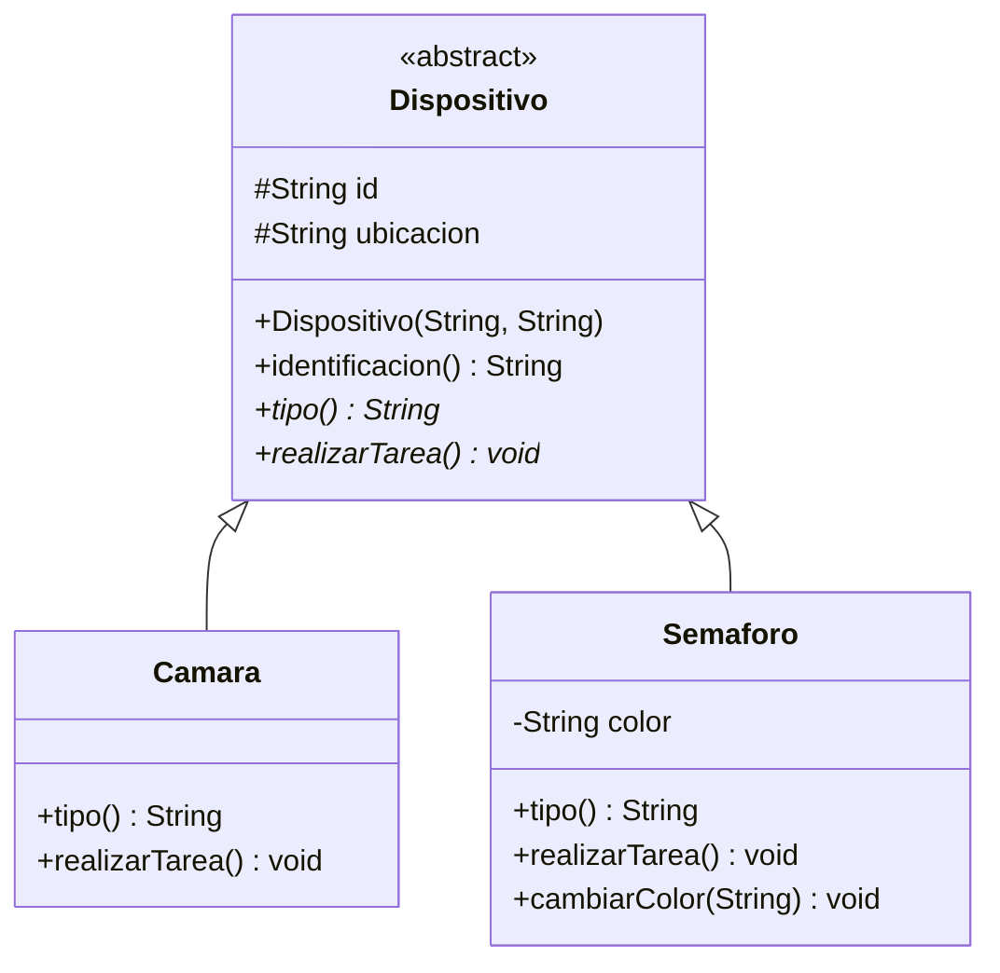

# 9. Clases abstractas

> [!info] Al terminar este capítulo tenés que poder
> - Declarar una clase abstracta y un método abstracto.
> - Explicar por qué no se puede instanciar.
> - Implementar subclases concretas completas.
> - Justificar cuándo conviene una clase abstracta.

> [!abstract] Qué debés saber (nivel 1)
> - `abstract class` declara una clase que **no se instancia**.
> - `abstract` en un método = **sin cuerpo**; la subclase concreta está obligada a implementarlo.
> - Una clase abstracta **puede** tener atributos, constructor y métodos concretos.
> - Se puede declarar una **referencia** del tipo abstracto, pero no hacer `new`.
> - Si una subclase no implementa todos los métodos abstractos, también debe ser abstracta.

## 9.1 El problema

Tenés `Semaforo` y `Camara`, ambos con `id`, `ubicacion` y `estado()`. Querés una base común, pero **no existe un “dispositivo genérico”** que tenga sentido crear.

```java
Dispositivo d = new Dispositivo("D-01", "Centro");   // ¿qué dispositivo es?
```

Ahí aparece la clase abstracta: define el contrato y el estado común, pero **prohíbe** la instancia directa.

## 9.2 Declaración

```java
public abstract class Dispositivo {

    protected final String id;
    protected String ubicacion;

    public Dispositivo(String id, String ubicacion) {
        this.id = id;
        this.ubicacion = ubicacion;
    }

    // Método concreto: se hereda tal cual
    public String identificacion() {
        return id + " @ " + ubicacion;
    }

    // Método abstracto: sin cuerpo, obligatorio para las subclases
    public abstract String tipo();

    public abstract void realizarTarea();
}
```

```java
public class Camara extends Dispositivo {

    public Camara(String id, String ubicacion) {
        super(id, ubicacion);
    }

    @Override
    public String tipo() {
        return "Camara";
    }

    @Override
    public void realizarTarea() {
        System.out.println("Capturando imagen en " + ubicacion);
    }
}
```

```java
public class Semaforo extends Dispositivo {

    private String color = "ROJO";

    public Semaforo(String id, String ubicacion) {
        super(id, ubicacion);
    }

    @Override
    public String tipo() {
        return "Semaforo";
    }

    @Override
    public void realizarTarea() {
        System.out.println("Gestionando tránsito en " + ubicacion + " (" + color + ")");
    }

    public void cambiarColor(String nuevo) {
        color = nuevo;
    }
}
```



> [!important] En UML
> La clase abstracta se marca con `<<abstract>>` y los métodos abstractos con `*` o con la letra en cursiva. En el escrito, escribí `{abstract}` si no recordás la notación.

## 9.3 Reglas

| Regla | Detalle |
|---|---|
| No se instancia | `new Dispositivo(...)` no compila |
| Sí se referencia | `Dispositivo d = new Camara(...)` es válido |
| Puede tener constructor | Se invoca desde la subclase con `super(...)` |
| Puede tener métodos concretos | Se heredan y se pueden sobrescribir |
| Puede no tener ningún método abstracto | Igual no se instancia |
| `abstract` no se aplica a constructores | Un constructor abstracto no existe |
| `abstract` no se aplica a `static` | No tiene sentido: no hay objeto |
| `final` y `abstract` son incompatibles | `final` prohíbe heredar; `abstract` exige heredar |

## 9.4 Subclase incompleta

```java
abstract class Figura {
    abstract double area();
    abstract double perimetro();
}

// Si no implementa todo, debe seguir siendo abstracta
abstract class FiguraIncompleta extends Figura {
    @Override
    double area() { return 0; }
    // falta perimetro()
}

// Concreta: implementa todo
class Cuadrado extends Figura {
    private final double lado;

    Cuadrado(double lado) { this.lado = lado; }

    @Override double area() { return lado * lado; }
    @Override double perimetro() { return 4 * lado; }
}
```

> [!warning] Error de compilación
> “`Cuadrado` is not abstract and does not override abstract method `perimetro()`”. Es el mensaje típico cuando falta implementar un método abstracto.

## 9.5 Clase abstracta con lógica común

La ventaja real no es “obligar”, es **compartir** el algoritmo y dejar huecos.

```java
public abstract class ProcesadorDispositivo {

    // Método concreto: define el esqueleto
    public final void procesar() {
        conectar();
        String dato = leer();
        guardar(dato);
        desconectar();
    }

    protected void conectar() {
        System.out.println("Conectando...");
    }

    protected abstract String leer();       // cada dispositivo lo implementa

    protected void guardar(String dato) {
        System.out.println("Guardando: " + dato);
    }

    protected void desconectar() {
        System.out.println("Desconectando...");
    }
}
```

```java
public class SensorHumedad extends ProcesadorDispositivo {
    @Override
    protected String leer() {
        return "humedad=62%";
    }
}
```

```java
public class SensorTemperatura extends ProcesadorDispositivo {
    @Override
    protected String leer() {
        return "temp=21.5C";
    }
}
```

```java
public class Planta {
    public static void main(String[] args) {
        new SensorHumedad().procesar();
        new SensorTemperatura().procesar();
    }
}
```

Salida:

```text
Conectando...
Guardando: humedad=62%
Desconectando...
Conectando...
Guardando: temp=21.5C
Desconectando...
```

> [!tip] Patrón “método plantilla”
> El método `procesar()` fija el orden; las subclases solo aportan `leer()`. Es la aplicación más útil de las clases abstractas y se pregunta en el oral.

## 9.6 Cuándo usar clase abstracta

| Situación | ¿Abstracta? |
|---|---|
| Hay estado común (atributos) | Sí |
| Hay código común que conviene reutilizar | Sí |
| Nunca se instancia directamente | Sí |
| Solo se define un contrato, sin estado | Mejor **interfaz** ([[10_interfaces]]) |
| Se necesita herencia múltiple de tipo | Interfaz |

> [!important] La diferencia que se pregunta
> Clase abstracta = **base parcial** con estado y comportamiento. Interfaz = **contrato** de capacidades. Se compara en detalle en [[10_interfaces]].

## 9.7 Programa completo

```java
public abstract class FiguraGeometrica {

    protected final String nombre;

    protected FiguraGeometrica(String nombre) {
        this.nombre = nombre;
    }

    public abstract double area();
    public abstract double perimetro();

    public String descripcion() {
        return String.format("%s: área=%.2f, perímetro=%.2f",
                nombre, area(), perimetro());
    }
}
```

```java
public class Circulo extends FiguraGeometrica {

    private final double radio;

    public Circulo(double radio) {
        super("Círculo");
        this.radio = radio;
    }

    @Override
    public double area() { return Math.PI * radio * radio; }

    @Override
    public double perimetro() { return 2 * Math.PI * radio; }
}
```

```java
public class Rectangulo extends FiguraGeometrica {

    private final double base;
    private final double altura;

    public Rectangulo(double base, double altura) {
        super("Rectángulo");
        this.base = base;
        this.altura = altura;
    }

    @Override
    public double area() { return base * altura; }

    @Override
    public double perimetro() { return 2 * (base + altura); }
}
```

```java
public class Figuras {

    public static void main(String[] args) {

        FiguraGeometrica[] figuras = {
            new Circulo(2),
            new Rectangulo(3, 4)
        };

        for (FiguraGeometrica f : figuras) {
            System.out.println(f.descripcion());
        }
    }
}
```

Salida:

```text
Círculo: área=12,57, perímetro=12,57
Rectángulo: área=12,00, perímetro=14,00
```

> [!warning] Formato con coma
> `String.format` usa la configuración regional. Si tu sistema está en español, imprime coma decimal. En el examen no importa el formato; importa el cálculo.

## Cómo trazar

```java
Figura f = new Circulo(2);
f.area();
```

| Paso | Acción | Resultado |
|---|---|---|
| 1 | `new Circulo(2)` | constructor de `Circulo` → `super("Círculo")` → `radio=2` |
| 2 | Asignar a `f` (tipo `Figura`) | referencia válida |
| 3 | `f.area()` | se ejecuta la de `Circulo` → `π·4` |
| 4 | `f.descripcion()` | método concreto de `Figura`, que llama a `area()` y `perimetro()` de `Circulo` |

## Errores que suelen tomar

| Error | Consecuencia |
|---|---|
| `new Dispositivo(...)` | No compila |
| Método abstracto con cuerpo | No compila |
| Subclase concreta sin implementar todo | No compila |
| Marcar `abstract` una clase que se quiere instanciar | No compila |
| `final abstract class` | Combinación inválida |
| Confundir abstracta con interfaz | Error conceptual |

## Ejercicios

> [!example]- 1. ¿Compila?
> **Enunciado:** ¿qué pasa con `abstract class A { void f(); }`?
> **Solución:** no compila: un método sin cuerpo debe declararse `abstract`. La clase ya es abstracta, pero falta el modificador en el método.

> [!example]- 2. Subclase
> **Enunciado:** `abstract class Animal { abstract void sonido(); }`. Escribí `Perro` y `Gato`.
> **Solución:**
> ```java
> abstract class Animal { abstract void sonido(); }
>
> class Perro extends Animal {
>     @Override void sonido() { System.out.println("Guau"); }
> }
> class Gato extends Animal {
>     @Override void sonido() { System.out.println("Miau"); }
> }
> ```

> [!example]- 3. Referencia abstracta
> **Enunciado:** ¿es válido `Animal a = new Perro(); a.sonido();`?
> **Solución:** sí. Se puede declarar la referencia con el tipo abstracto; en ejecución se llama al método del objeto real (`Perro`).

> [!example]- 4. Método plantilla
> **Enunciado:** explicá por qué `procesar()` es `final` en el ejemplo.
> **Solución:** para que ninguna subclase cambie el orden del algoritmo. Solo puede variar `leer()`, que es el punto de extensión.

> [!example]- 5. a papel
> **Enunciado:** escribí `Empleado` abstracto con `nombre` y `sueldoBase`, método abstracto `calcularSueldo()`, y dos subclases: `Fijo` (sueldo base) y `PorHora` (horas × valor).
> **Solución:**
> ```java
> abstract class Empleado {
>     protected String nombre;
>     protected double sueldoBase;
>
>     Empleado(String nombre, double sueldoBase) {
>         this.nombre = nombre;
>         this.sueldoBase = sueldoBase;
>     }
>
>     abstract double calcularSueldo();
> }
>
> class Fijo extends Empleado {
>     Fijo(String n, double s) { super(n, s); }
>     @Override double calcularSueldo() { return sueldoBase; }
> }
>
> class PorHora extends Empleado {
>     private int horas;
>     PorHora(String n, double valorHora, int horas) {
>         super(n, valorHora);
>         this.horas = horas;
>     }
>     @Override double calcularSueldo() { return sueldoBase * horas; }
> }
> ```

## Lo que sigue

[[10_interfaces|10. Interfaces]].

#libro1
