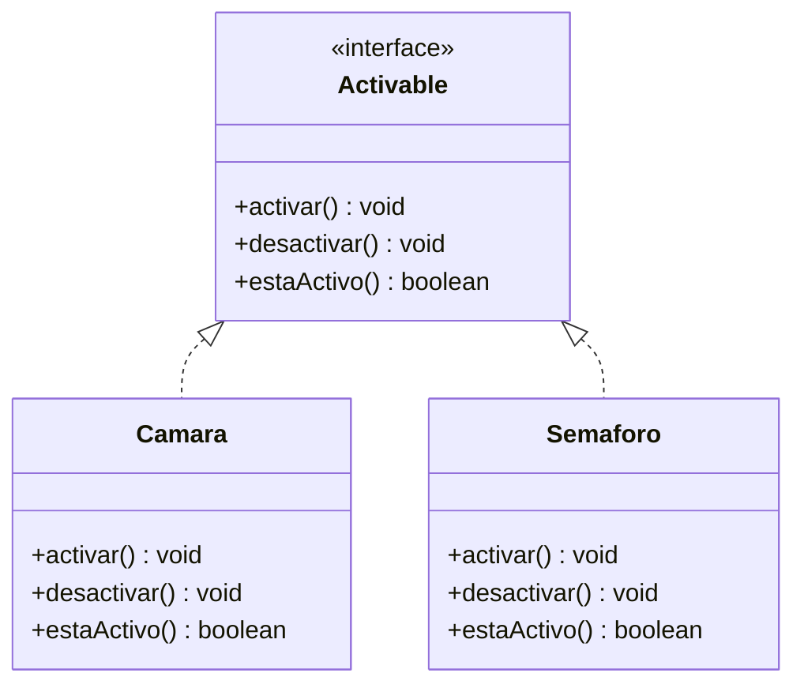

# 10. Interfaces

> [!info] Al terminar este capítulo tenés que poder
> - Definir una interfaz como contrato.
> - Implementarla, incluso varias a la vez.
> - Usarla como tipo de referencia.
> - Elegir entre clase abstracta e interfaz y justificarlo.

> [!abstract] Qué debés saber (nivel 1)
> - `interface` define un **contrato**: qué se debe hacer, no cómo.
> - Una clase **implementa** con `implements` (no `extends`).
> - Se pueden implementar **varias** interfaces.
> - Los métodos son públicos y abstractos por defecto (hasta Java 7); hoy puede haber `default` y `static`.
> - Los atributos son `public static final` implícitamente (constantes).
> - No se instancia: `new Activable()` no compila.

## 10.1 Qué es un contrato

> [!quote] Cátedra
> Una interfaz define un contrato que especifica el comportamiento que las clases implementadoras deben cumplir.

Pensá en un enchufe: no importa qué aparato conectes, todos cumplen la misma forma. La interfaz define la forma; cada clase decide qué hace al conectarse.

```java
public interface Activable {

    void activar();
    void desactivar();
    boolean estaActivo();
}
```



> [!important] Notación UML
> La interfaz se marca `<<interface>>` y la relación es **línea punteada con triángulo hueco** (`<|..`). La herencia de clase es línea continua (`<|--`).

## 10.2 Implementar

```java
public class CamaraSimple implements Activable {

    private boolean activo = false;

    @Override
    public void activar() {
        activo = true;
    }

    @Override
    public void desactivar() {
        activo = false;
    }

    @Override
    public boolean estaActivo() {
        return activo;
    }
}
```

Reglas:

1. La clase **debe** implementar todos los métodos del contrato.
2. Los métodos deben ser `public` (no se puede reducir la visibilidad).
3. `@Override` es recomendable: verifica la firma.

> [!warning] Error clásico
> ```java
> public class CamaraSimple implements Activable {
>     void activar() { }        // sin public: NO compila
> }
> ```
> El método de la interfaz es público; la implementación no puede ser más restrictiva.

## 10.3 Varias interfaces

`Activable` ya está definida arriba; acá se agregan dos contratos más.

```java
public interface Conectable {
    void conectar(String red);
    void desconectar();
}
```

```java
public interface Auditable {
    String auditoria();
}
```

```java
public class CamaraConectada implements Activable, Conectable, Auditable {

    private boolean activo;
    private String red = "sin red";
    private int cambios = 0;

    @Override public void activar()   { activo = true;  cambios++; }
    @Override public void desactivar(){ activo = false; cambios++; }
    @Override public boolean estaActivo() { return activo; }
    @Override public void conectar(String red) { this.red = red; }
    @Override public void desconectar() { this.red = "sin red"; }

    @Override
    public String auditoria() {
        return "activo=" + activo + ", red=" + red + ", cambios=" + cambios;
    }
}
```

```java
public class Prueba {
    public static void main(String[] args) {
        CamaraConectada c = new CamaraConectada();
        c.activar();
        c.conectar("LAN-01");
        System.out.println(c.auditoria());   // activo=true, red=LAN-01, cambios=1
    }
}
```

> [!important] Herencia múltiple de tipo, no de implementación
> Java no permite `extends A, B`, pero sí `implements A, B`. La clase hereda **una** implementación y adopta **varios** contratos. Eso evita el problema del diamante.

## 10.4 La interfaz como tipo

```java
public class Panel {

    public static void main(String[] args) {

        Activable a = new CamaraSimple();   // referencia de interfaz
        a.activar();                        // se ejecuta la de CamaraSimple

        Activable[] dispositivos = {
            new CamaraSimple(),
            new CamaraConectada()
        };

        for (Activable d : dispositivos) {
            d.activar();                // cada uno responde a su manera
        }
    }
}
```

El código cliente **no necesita saber** qué clase concreta es: le alcanza con que cumpla el contrato. Eso es bajo acoplamiento.

> [!warning] Solo ves el contrato
> Con una referencia `Activable`, no podés llamar a métodos propios de `CamaraConectada` (como `conectar("LAN-01")`). Para eso necesitás un cast o cambiar el tipo de la referencia.

## 10.5 Clase abstracta vs. interfaz

| Aspecto | Clase abstracta | Interfaz |
|---|---|---|
| Propósito | Base común con estado y comportamiento parcial | Contrato de capacidades |
| Instanciación | No | No |
| Atributos de instancia | Sí | No (solo constantes) |
| Constructores | Sí | No |
| Métodos | Abstractos y concretos | Abstractos, `default` y `static` |
| Herencia | Una sola clase (`extends`) | Varias interfaces (`implements`) |
| Cuándo | Las subclases comparten estado o código | Varias clases necesitan la misma capacidad |

> [!important] La respuesta de oral
> “Uso clase abstracta cuando las subclases comparten **estado o implementación**; uso interfaz cuando varias clases necesitan cumplir una **capacidad común**, aunque no pertenezcan a la misma jerarquía.”

## 10.6 Programa completo

```java
public interface Activable {
    void activar();
    void desactivar();
    boolean estaActivo();
}
```

```java
public abstract class Dispositivo implements Activable {

    protected final String id;
    protected String ubicacion;
    protected boolean activo;

    protected Dispositivo(String id, String ubicacion) {
        this.id = id;
        this.ubicacion = ubicacion;
    }

    @Override public void activar()   { activo = true; }
    @Override public void desactivar(){ activo = false; }
    @Override public boolean estaActivo() { return activo; }

    public abstract String tipo();

    public String ficha() {
        return tipo() + " " + id + " @ " + ubicacion + " [" + (activo ? "ON" : "OFF") + "]";
    }
}
```

```java
public class Camara extends Dispositivo {

    private boolean grabando;

    public Camara(String id, String ubicacion) {
        super(id, ubicacion);
    }

    @Override public String tipo() { return "Camara"; }

    public void grabar() { grabando = true; }

    @Override
    public String ficha() {
        return super.ficha() + (grabando ? " REC" : "");
    }
}
```

```java
public class Semaforo extends Dispositivo {

    private String color = "ROJO";

    public Semaforo(String id, String ubicacion) {
        super(id, ubicacion);
    }

    @Override public String tipo() { return "Semaforo"; }

    public void cambiarColor(String c) { color = c; }

    @Override
    public String ficha() {
        return super.ficha() + " color=" + color;
    }
}
```

```java
public class CentroControl {

    public static void main(String[] args) {

        Dispositivo[] red = {
            new Camara("C-01", "Plaza"),
            new Semaforo("S-01", "Belgrano")
        };

        for (Dispositivo d : red) {
            d.activar();                 // método de la interfaz, implementado en la abstracta
            System.out.println(d.ficha()); // método sobrescrito en cada subclase
        }

        Activable a = red[0];
        a.desactivar();
        System.out.println("¿Activo? " + a.estaActivo());
    }
}
```

Salida:

```text
Camara C-01 @ Plaza [ON]
Semaforo S-01 @ Belgrano [ON] color=ROJO
¿Activo? false
```

Observá las tres capas: **interfaz** (contrato), **clase abstracta** (estado y comportamiento común) y **clases concretas** (especialización).

## Cómo trazar

| Paso | Acción | `red[0]` (Camara) |
|---|---|---|
| 1 | `new Camara("C-01","Plaza")` | `super(...)` inicializa `id`, `ubicacion`, `activo=false` |
| 2 | `d.activar()` con `d` de tipo `Dispositivo` | ejecuta `Dispositivo.activar()` → `activo=true` |
| 3 | `d.ficha()` | se ejecuta la de `Camara` (sobrescrita) |
| 4 | `a.desactivar()` con `a` de tipo `Activable` | ejecuta la implementación de `Dispositivo` |

## Errores que suelen tomar

| Error | Consecuencia |
|---|---|
| `class X extends Activable` | No compila: es `implements` |
| `new Activable()` | No compila: no se instancia |
| Implementar solo algunos métodos | No compila |
| Método implementado sin `public` | No compila |
| Declarar atributos de instancia en la interfaz | Solo constantes |
| Confundir interfaz con clase abstracta | Error conceptual en el oral |
| Poner lógica de negocio en `default` | Mala práctica, acopla el contrato |

## Ejercicios

> [!example]- 1. Contrato
> **Enunciado:** definí `Notificable` con `notificar(String)` y `cantidadNotificaciones()`, e implementalo en `Alerta`.
> **Solución:**
> ```java
> interface Notificable {
>     void notificar(String mensaje);
>     int cantidadNotificaciones();
> }
>
> class Alerta implements Notificable {
>     private int cantidad;
>     @Override public void notificar(String m) { cantidad++; System.out.println(m); }
>     @Override public int cantidadNotificaciones() { return cantidad; }
> }
> ```

> [!example]- 2. Varias interfaces
> **Enunciado:** ¿puede una clase implementar `Activable` y `Auditable` a la vez? ¿Y extender `Dispositivo`?
> **Solución:** sí a ambas: `class Camara extends Dispositivo implements Activable, Auditable`.

> [!example]- 3. Referencia de interfaz
> **Enunciado:** ¿qué imprime?
> ```java
> Activable a = new Camara();
> a.activar();
> System.out.println(a.estaActivo());
> ```
> **Solución:** `true`. Se ejecuta la implementación de `Camara` (o la heredada de `Dispositivo`, según el caso).

> [!example]- 4. Elección
> **Enunciado:** para “todo dispositivo puede activarse” y “todas las figuras comparten color y nombre”, ¿interfaz o abstracta?
> **Solución:** “puede activarse” es una **capacidad** → interfaz. “Comparten estado” (color, nombre) → **clase abstracta**.

> [!example]- 5. a papel
> **Enunciado:** escribí la interfaz `ComparablePorPrioridad` con `int prioridad()` y hacé que `Alerta` la implemente. Ordená dos alertas a mano según su prioridad.
> **Solución:**
> ```java
> interface ComparablePorPrioridad {
>     int prioridad();
> }
>
> class AlertaPriorizable implements ComparablePorPrioridad {
>     private final int prioridad;
>     AlertaPriorizable(int p) { this.prioridad = p; }
>     @Override public int prioridad() { return prioridad; }
> }
>
> // A mano: menor número = mayor prioridad → la de 1 va antes que la de 3
> ```

## Lo que sigue

[[11_polimorfismo-y-static|11. Polimorfismo y miembros estáticos]].

#libro1
