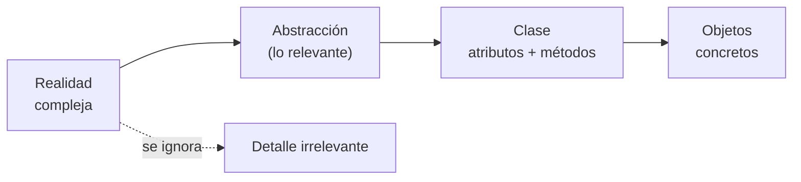
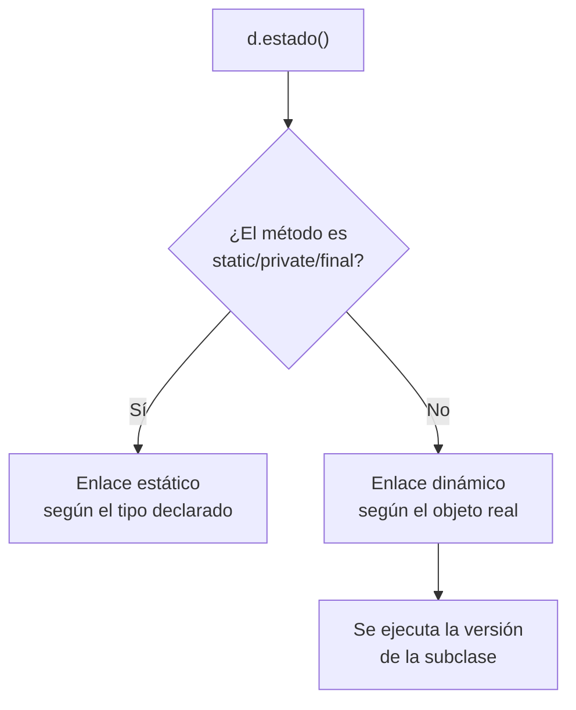
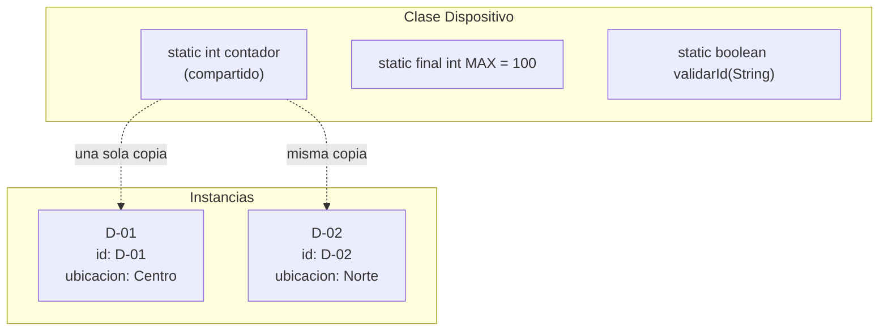
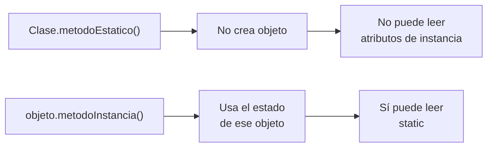

# 11. Polimorfismo y miembros estáticos

> [!info] Al terminar este capítulo tenés que poder
> - Explicar qué es abstraer y para qué sirve.
> - Definir polimorfismo y distinguir sus tipos.
> - Diferenciar enlace estático de dinámico.
> - Justificar cómo el polimorfismo permite extender sin modificar.
> - Usar `static` y distinguir instancia de clase.

> [!abstract] Qué debés saber (nivel 1)
> - **Abstracción:** quedarse con lo relevante y ocultar el detalle.
> - **Polimorfismo:** el mismo mensaje produce comportamientos distintos según el objeto.
> - Tipos: **sobrecarga** (estático), **inclusión** (dinámico), **paramétrico** (genéricos).
> - **Enlace dinámico:** el método se elige en ejecución según el objeto real.
> - Ventaja central: agregar un tipo nuevo **sin tocar** el código que lo usa.

> [!quote] Cátedra
> La **abstracción** es la acción de separar lo esencial de lo accidental. En POO se materializa en clases e interfaces: el cliente conoce **qué** hace un objeto, no **cómo** lo hace.

## 11.1 Abstraer

Abstraer es decidir qué mirar y qué ignorar. Un semáforo, para el sistema de tránsito, es un objeto con `estado` y `cambiar()`; no importa su color de pintura ni su número de serie.

| Nivel de abstracción | Qué muestra | Ejemplo |
|---|---|---|
| **Muy bajo** | Detalle de implementación | "arreglo de 3 bytes con 0/1/2" |
| **Medio** | Operaciones | "encender, apagar, estado" |
| **Alto** | Concepto del dominio | "dispositivo de señalización" |



> [!important] Abstraer no es "simplificar porque sí"
> Es elegir el nivel de detalle que el problema necesita. Si el sistema solo enciende y apaga, no modeles la resistencia del LED.

## 11.2 Qué es polimorfismo

**Polimorfismo:** capacidad de que un mismo mensaje (nombre de método) se resuelva de formas distintas según el objeto que lo recibe.

```java
abstract class Dispositivo {
    abstract String estado();
}

class Semaforo extends Dispositivo {
    String estado() { return "verde"; }
}

class Camara extends Dispositivo {
    String estado() { return "grabando"; }
}

// El cliente no cambia
for (Dispositivo d : dispositivos) {
    System.out.println(d.estado());
}
```

| Objeto real | Mensaje | Resultado |
|---|---|---|
| `Semaforo` | `estado()` | `"verde"` |
| `Camara` | `estado()` | `"grabando"` |

> [!important] La frase que se pregunta
> "El mismo mensaje, objetos distintos, comportamientos distintos." Si agregás `Sensor`, el `for` no cambia: eso es **extensibilidad por polimorfismo**.

## 11.3 Tipos de polimorfismo

| Tipo | Cuándo se resuelve | Ejemplo |
|---|---|---|
| **Sobrecarga** (ad hoc) | Compilación | `sumar(int, int)` y `sumar(double, double)` |
| **Inclusión** (subtipo) | Ejecución | `Dispositivo d = new Semaforo(); d.estado()` |
| **Paramétrico** (genéricos) | Compilación | `ArrayList<Alerta>` |
| **Coerción** | Compilación | `int` → `double` |

```java
// Sobrecarga: mismo nombre, distinta firma
int sumar(int a, int b) { return a + b; }
double sumar(double a, double b) { return a + b; }

// Inclusión: mismo mensaje, distinto objeto
Dispositivo d = new Camara();
d.estado();
```

> [!warning] Sobrecarga no es lo mismo que sobrescritura
> **Sobrecarga:** mismo nombre, **distinta firma**, en la misma clase o en una subclase. **Sobrescritura:** misma firma, en una subclase, con `@Override`. La sobrecarga se resuelve al compilar; la sobrescritura, al ejecutar.

## 11.4 Enlace estático y dinámico

| | Estático (temprano) | Dinámico (tardío) |
|---|---|---|
| Cuándo | Compilación | Ejecución |
| Se decide por | Tipo declarado | Tipo real del objeto |
| Aplica a | `static`, `private`, `final`, sobrecarga | Métodos sobrescritos |
| Ejemplo | `Math.abs(-3)` | `d.estado()` |



> [!important] La tabla de métodos virtuales
> La JVM guarda, por clase, qué implementación corresponde a cada método. Al llamar, busca en la clase del **objeto**, no en la del tipo de la variable. Por eso `Dispositivo d = new Camara()` ejecuta `Camara.estado()`.

## 11.5 Por qué el polimorfismo cambia el diseño

Sin polimorfismo, cada tipo nuevo obliga a tocar el código cliente:

```java
// Mal: crece con cada tipo
if (d instanceof Semaforo) { ... }
else if (d instanceof Camara) { ... }
else if (d instanceof Sensor) { ... }
```

Con polimorfismo, el cliente depende de una **abstracción** y no conoce los tipos concretos:

```java
// Bien: no cambia al agregar tipos
for (Dispositivo d : dispositivos) {
    d.estado();
}
```

| Principio | Efecto |
|---|---|
| Depender de la abstracción | El cliente no conoce las subclases |
| Agregar, no modificar | Se cumple abierto/cerrado |
| Cada clase resuelve lo suyo | Se elimina el `if` por tipo |

> [!important] La relación con los otros pilares
> La abstracción define **qué**; la herencia permite **compartir**; el encapsulamiento **protege** el cómo; el polimorfismo **varía** el cómo sin cambiar el qué. Se necesitan entre sí.

## 11.6 Método: detectar polimorfismo en un diseño

| Paso | Pregunta | Señal |
|---|---|---|
| 1 | ¿Hay una superclase o interfaz común? | Abstracción |
| 2 | ¿El cliente usa esa abstracción? | Buen diseño |
| 3 | ¿Hay `if` por tipo? | Falta polimorfismo |
| 4 | ¿El método se sobrescribe? | Enlace dinámico |
| 5 | ¿Agregar un tipo obliga a tocar el cliente? | Diseño rígido |

## 11.7 Jerarquía completa

```java
abstract class Dispositivo {

    protected final String id;
    protected String ubicacion;

    protected Dispositivo(String id, String ubicacion) {
        this.id = id;
        this.ubicacion = ubicacion;
    }

    public abstract void realizarTarea();

    public String ficha() {
        return id + " @ " + ubicacion;
    }
}

class Semaforo extends Dispositivo {

    private String color = "ROJO";

    Semaforo(String id, String u) { super(id, u); }

    public void cambiarColor(String c) { color = c; }

    @Override
    public void realizarTarea() {
        System.out.println("Semáforo " + id + ": gestionando tránsito (" + color + ")");
    }
}

class Camara extends Dispositivo {

    Camara(String id, String u) { super(id, u); }

    @Override
    public void realizarTarea() {
        System.out.println("Cámara " + id + ": capturando imagen");
    }
}
```

```java
public class CentroControl {

    public static void main(String[] args) {

        Dispositivo[] red = {
            new Semaforo("S-01", "Belgrano"),
            new Camara("C-01", "Plaza"),
            new Semaforo("S-02", "San Martín")
        };

        // Un solo recorrido, tres comportamientos distintos
        for (Dispositivo d : red) {
            d.realizarTarea();
        }
    }
}
```

Salida:

```text
Semáforo S-01: gestionando tránsito (ROJO)
Cámara C-01: capturando imagen
Semáforo S-02: gestionando tránsito (ROJO)
```

> [!important] La ventaja
> El `for` no sabe qué dispositivo es cada uno. Si mañana agregás `Sensor`, **no cambiás el recorrido**: agregás la clase y ya funciona. Eso es bajo acoplamiento.

## 11.8 Upcasting y downcasting

### Upcasting (automático)

De hijo a padre. Siempre es seguro.

```java
Camara c = new Camara("C-01", "Plaza");
Dispositivo d = c;              // upcast implícito
d.realizarTarea();
```

### Downcasting (explícito)

De padre a hijo. Puede fallar si el objeto no es de ese tipo.

```java
Dispositivo d = new Camara("C-01", "Plaza");
Camara c = (Camara) d;          // OK: el objeto es una Camara
c.realizarTarea();

Dispositivo s = new Semaforo("S-01", "Centro");
// Camara mala = (Camara) s;    // ClassCastException en ejecución
```

### `instanceof`

Verifica antes de convertir.

```java
for (Dispositivo d : red) {
    if (d instanceof Semaforo) {
        Semaforo s = (Semaforo) d;
        s.cambiarColor("VERDE");
    }
}
```

Java 16+ permite el patrón:

```java
if (d instanceof Semaforo s) {
    s.cambiarColor("VERDE");
}
```

> [!warning] `instanceof` no reemplaza el polimorfismo
> Si tu código está lleno de `instanceof`, probablemente el método debería estar en la clase padre. Usalo solo para casos genuinos.

## 11.9 Instancia vs. clase



| | Atributo de instancia | Atributo de clase (`static`) |
|---|---|---|
| Copias | Una por objeto | **Una** para toda la clase |
| Se accede | `objeto.atributo` | `Clase.atributo` |
| Cambia con el objeto | Sí | No: es compartido |
| Uso típico | Estado propio | Contadores, configuración, constantes |

## 11.10 Atributo estático: contador compartido

```java
public class Dispositivo {

    private static int cantidadCreados = 0;   // compartido

    private final String id;
    private String ubicacion;

    public Dispositivo(String id, String ubicacion) {
        this.id = id;
        this.ubicacion = ubicacion;
        cantidadCreados++;                     // afecta a la clase
    }

    public static int getCantidadCreados() {
        return cantidadCreados;
    }

    public String resumen() {
        return id + " @ " + ubicacion;
    }
}
```

```java
public class Prueba {

    public static void main(String[] args) {

        System.out.println("Antes: " + Dispositivo.getCantidadCreados());  // 0

        Dispositivo a = new Dispositivo("D-01", "Centro");
        Dispositivo b = new Dispositivo("D-02", "Norte");
        Dispositivo c = new Dispositivo("D-03", "Sur");

        System.out.println("Después: " + Dispositivo.getCantidadCreados()); // 3

        System.out.println(a.resumen());
        System.out.println(b.resumen());
        System.out.println(c.resumen());
    }
}
```

Salida:

```text
Antes: 0
Después: 3
D-01 @ Centro
D-02 @ Norte
D-03 @ Sur
```

> [!important] Por qué el contador funciona
> `cantidadCreados` no vive en `a`, `b` ni `c`: vive en la clase. Cada constructor la incrementa y todos ven el mismo valor.

> [!warning] Error clásico
> ```java
> a.cantidadCreados = 100;   // compila, pero es pésimo estilo
> ```
> Se puede acceder a un `static` desde una instancia, pero confunde: parece parte del objeto y no lo es. Siempre `Clase.atributo`.

## 11.11 Métodos estáticos

No dependen del estado de un objeto: reciben todo por parámetros.

```java
public class Validador {

    private Validador() { }        // evita instanciar una clase de utilidades

    public static boolean esIdValido(String id) {
        return id != null && id.matches("[A-Z]-\\d{2}");
    }

    public static boolean estaEnRango(double valor, double min, double max) {
        return valor >= min && valor <= max;
    }

    public static String normalizar(String texto) {
        return texto == null ? "" : texto.trim().toUpperCase();
    }
}
```

```java
public class UsoValidador {
    public static void main(String[] args) {
        System.out.println(Validador.esIdValido("D-01"));     // true
        System.out.println(Validador.esIdValido("d-1"));      // false
        System.out.println(Validador.estaEnRango(25, 0, 100)); // true
        System.out.println(Validador.normalizar("  centro ")); // CENTRO
    }
}
```

Salida:

```text
true
false
true
CENTRO
```

### Por qué no puede usar `this`

```java
public class Ejemplo {

    private int contador;          // de instancia

    public static void mostrar() {
        // System.out.println(contador);   // ERROR: no hay objeto
        // System.out.println(this.contador); // ERROR: no existe this
    }
}
```

Un método estático se ejecuta **sin objeto**. Si no hay objeto, no hay estado de instancia al que acceder.



| Puede llamar | Desde método estático | Desde método de instancia |
|---|---|---|
| Método estático | ✅ | ✅ |
| Método de instancia | ❌ | ✅ |
| Atributo estático | ✅ | ✅ |
| Atributo de instancia | ❌ | ✅ |
| `this` | ❌ | ✅ |

## 11.12 Constantes de clase

```java
public class Configuracion {

    public static final int MAX_DISPOSITIVOS = 500;
    public static final double TARIFA_BASE = 12.5;
    public static final String VERSION = "1.0.0";

    private Configuracion() { }
}
```

`static final` = una sola copia, inmutable, accesible por nombre de clase. Es el patrón de las constantes de dominio.

> [!important] `static final` vs. `final`
> - `final` en un atributo de instancia: cada objeto tiene su valor, fijo.
> - `static final`: un único valor para toda la clase.
> - Los nombres de constantes van en `MAYÚSCULAS_CON_GUION`.

## 11.13 `main` es estático

```java
public static void main(String[] args)
```

| Modificador | Por qué |
|---|---|
| `public` | La JVM debe poder llamarlo desde fuera |
| `static` | La JVM lo llama **sin crear un objeto** de la clase |
| `void` | No devuelve nada al sistema operativo |
| `String[] args` | Recibe los argumentos de la línea de comandos |

> [!warning] Consecuencia práctica
> En `main` no podés llamar directamente a un método de instancia:
> ```java
> public class App {
>     void ejecutar() { }
>     public static void main(String[] args) {
>         // ejecutar();          // ERROR
>         new App().ejecutar();   // BIEN
>     }
> }
> ```

## Errores que suelen tomar

| Error | Corrección |
|---|---|
| Confundir polimorfismo con herencia | La herencia es un mecanismo; el polimorfismo, un efecto |
| Decir que la sobrecarga es dinámica | Se resuelve al compilar |
| Creer que el tipo declarado decide el método | Decide el tipo **real** (salvo static/private/final) |
| Usar `instanceof` para todo | Reemplazar por sobrescritura |
| Confundir abstracción con interfaz | La interfaz es una herramienta de abstracción |
| Decir que el polimorfismo "oculta" métodos | Cambia qué implementación se ejecuta |

## Ejercicios

> [!example]- 1. Definir
> **Enunciado:** definí polimorfismo en una frase.
> **Solución:** el mismo mensaje produce comportamientos distintos según el objeto que lo recibe.

> [!example]- 2. Clasificar
> **Enunciado:** `imprimir(int)` e `imprimir(String)` en la misma clase. ¿Qué tipo?
> **Solución:** sobrecarga (polimorfismo estático).

> [!example]- 3. Enlace
> **Enunciado:** `Animal a = new Perro(); a.hablar();` ¿qué se ejecuta?
> **Solución:** `Perro.hablar()`, por enlace dinámico.

> [!example]- 4. Diseño
> **Enunciado:** ¿por qué `if (d instanceof ...)` es una señal de mal diseño?
> **Solución:** porque obliga a modificar el cliente por cada tipo nuevo; el polimorfismo lo evita.

> [!example]- 5. Abstracción
> **Enunciado:** ¿qué atributos modelarías de un vehículo para un sistema de peajes?
> **Solución:** patente, categoría, saldo; no color, marca ni motor.

> [!example]- 6. a papel
> **Enunciado:** dibujá una jerarquía `Dispositivo` con dos subclases y mostrá el enlace dinámico.
> **Solución:** `Dispositivo` abstracto con `estado()`; `Semaforo` y `Camara` lo sobrescriben; el `for` sobre `Dispositivo` ejecuta la versión real.

## Lo que sigue

[[12_arreglos-y-arraylist|12. Arreglos y ArrayList]].

#libro1
