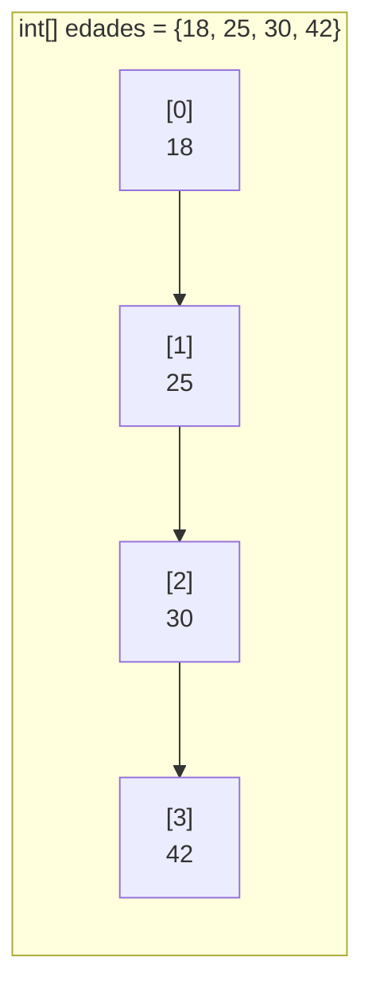
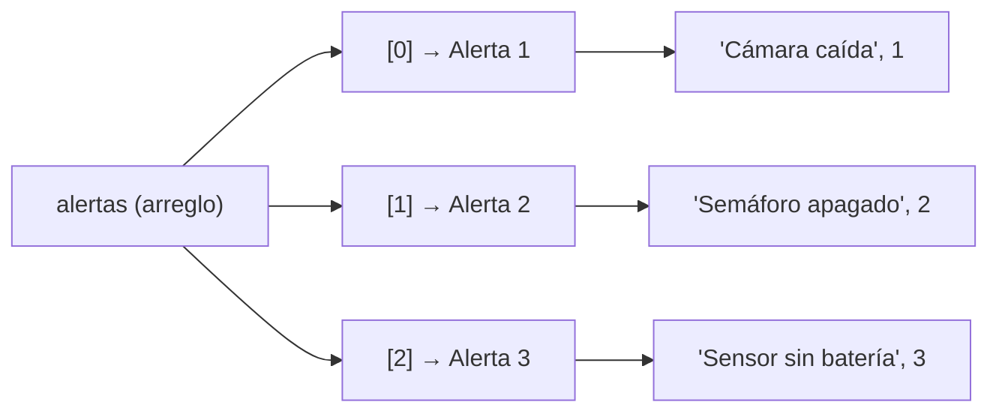
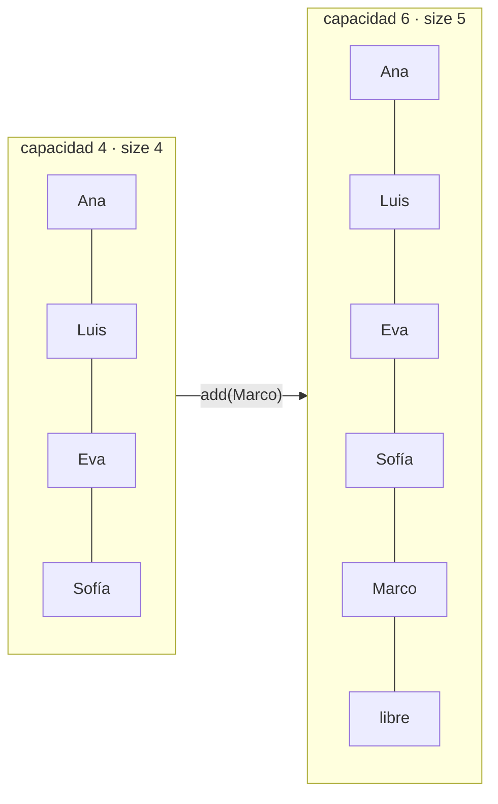

# 12. Arreglos y ArrayList

> [!info] Al terminar este capítulo tenés que poder
> - Declarar, crear e inicializar arreglos.
> - Recorrerlos con `for` y con `for-each`.
> - Explicar por qué `length` no lleva paréntesis.
> - Detectar y evitar el error de índice fuera de rango.
> - Elegir entre arreglo y `ArrayList` con criterio.

> [!abstract] Qué debés saber (nivel 1)
> - Un arreglo tiene **tamaño fijo** desde su creación.
> - Los índices van de **0 a length − 1**.
> - `length` es una **propiedad**, no un método.
> - Los elementos se inicializan solos: `0`, `false` o `null`.
> - Un arreglo es un **objeto**: se pasa por referencia.
> - Acceder fuera de rango lanza `ArrayIndexOutOfBoundsException`.

## 12.1 Declarar y crear

```java
// 1. Declaración
int[] notas;

// 2. Creación (reserva memoria, inicializa en 0)
notas = new int[5];

// 3. Declaración + creación
double[] precios = new double[10];

// 4. Con valores iniciales (el tamaño se deduce)
int[] edades = {18, 25, 30, 42};

// 5. Sintaxis alternativa (equivalente, menos usada)
int edades2[] = new int[3];
```



| Concepto | Valor |
|---|---|
| Nombre | `edades` |
| Tipo | `int[]` |
| Longitud | `edades.length` → 4 |
| Primer índice | 0 |
| Último índice | `length - 1` → 3 |

## 12.2 Acceso y recorrido

```java
public class Arreglos {

    public static void main(String[] args) {

        int[] edades = {18, 25, 30, 42};

        // Acceso directo
        System.out.println("Primero: " + edades[0]);
        System.out.println("Último: " + edades[edades.length - 1]);

        // Recorrido con índice
        for (int i = 0; i < edades.length; i++) {
            System.out.println("edades[" + i + "] = " + edades[i]);
        }

        // Recorrido con for-each (solo lectura del elemento)
        int suma = 0;
        for (int edad : edades) {
            suma += edad;
        }
        System.out.println("Suma: " + suma);
        System.out.printf("Promedio: %.2f%n", (double) suma / edades.length);
    }
}
```

Salida:

```text
Primero: 18
Último: 42
edades[0] = 18
edades[1] = 25
edades[2] = 30
edades[3] = 42
Suma: 115
Promedio: 28.75
```

> [!warning] `length` vs. `length()`
> - Arreglos: `edades.length` (propiedad).
> - `String`: `texto.length()` (método).
> - `ArrayList`: `lista.size()` (método).
> Confundirlos es un error de compilación frecuente.

### Modificar elementos

```java
int[] stock = new int[3];       // {0, 0, 0}
stock[0] = 10;
stock[1] = stock[0] * 2;
stock[2] = stock[0] + stock[1];

for (int s : stock) System.out.print(s + " ");   // 10 20 30
```

### El error de índice

```java
int[] v = new int[3];      // índices válidos: 0, 1, 2
v[3] = 10;                 // ArrayIndexOutOfBoundsException
```

> [!important] Por qué `i <= length` está mal
> ```java
> for (int i = 0; i <= v.length; i++) { ... }   // falla en la última vuelta
> ```
> Cuando `i == length`, el índice ya no existe. Siempre `i < length`.

## 12.3 Valores por defecto

```java
int[] enteros = new int[3];          // 0, 0, 0
double[] decimales = new double[3];  // 0.0, 0.0, 0.0
boolean[] banderas = new boolean[3]; // false, false, false
String[] nombres = new String[3];    // null, null, null
```

> [!warning] `null` en arreglos de objetos
> ```java
> String[] n = new String[3];
> System.out.println(n[0].length());   // NullPointerException
> ```
> El arreglo existe; los elementos todavía no. Hay que asignarlos.

## 12.4 Arreglos de objetos

```java
class Alerta {
    String mensaje;
    int prioridad;

    Alerta(String mensaje, int prioridad) {
        this.mensaje = mensaje;
        this.prioridad = prioridad;
    }

    String resumen() {
        return "[" + prioridad + "] " + mensaje;
    }
}

public class CentroMonitoreo {

    public static void main(String[] args) {

        Alerta[] alertas = new Alerta[3];       // arreglo de referencias

        alertas[0] = new Alerta("Cámara caída", 1);
        alertas[1] = new Alerta("Semáforo apagado", 2);
        alertas[2] = new Alerta("Sensor sin batería", 3);

        for (Alerta a : alertas) {
            System.out.println(a.resumen());
        }

        // Buscar la de mayor prioridad (menor número)
        Alerta urgente = alertas[0];
        for (Alerta a : alertas) {
            if (a.prioridad < urgente.prioridad) {
                urgente = a;
            }
        }
        System.out.println("Más urgente: " + urgente.resumen());
    }
}
```

Salida:

```text
[1] Cámara caída
[2] Semáforo apagado
[3] Sensor sin batería
Más urgente: [1] Cámara caída
```



> [!important] El arreglo guarda **referencias**
> `new Alerta[3]` crea tres casilleros vacíos (`null`). Recién con `new Alerta(...)` cada casillero apunta a un objeto.

## 12.5 La clase `Arrays`

```java
import java.util.Arrays;

public class Utilidades {

    public static void main(String[] args) {

        int[] v = {5, 2, 9, 1};

        System.out.println(Arrays.toString(v));   // [5, 2, 9, 1]

        Arrays.sort(v);
        System.out.println(Arrays.toString(v));   // [1, 2, 5, 9]

        int[] copia = Arrays.copyOf(v, 6);        // copia con nuevo tamaño
        System.out.println(Arrays.toString(copia)); // [1, 2, 5, 9, 0, 0]

        int[] relleno = new int[3];
        Arrays.fill(relleno, 7);
        System.out.println(Arrays.toString(relleno)); // [7, 7, 7]

        System.out.println(Arrays.binarySearch(v, 5)); // 2 (requiere ordenado)
    }
}
```

> [!warning] Imprimir un arreglo con `println`
> ```java
> System.out.println(v);            // [I@1b6d3586  (no sirve)
> System.out.println(Arrays.toString(v));  // [1, 2, 5, 9]
> ```

## 12.6 Los arreglos se pasan por referencia

```java
public class Referencia {

    static void duplicar(int[] datos) {
        for (int i = 0; i < datos.length; i++) {
            datos[i] *= 2;
        }
    }

    public static void main(String[] args) {
        int[] v = {1, 2, 3};
        duplicar(v);
        System.out.println(java.util.Arrays.toString(v));   // [2, 4, 6]
    }
}
```

El método recibe **la referencia**, así que modifica el arreglo original.

> [!important] Copiar de verdad
> ```java
> int[] copia = v;                    // NO copia: dos referencias al mismo arreglo
> int[] copiaReal = v.clone();        // copia superficial
> int[] otra = Arrays.copyOf(v, v.length);
> ```

## 12.7 El límite del arreglo

```java
int[] v = new int[3];
v[3] = 10;      // no hay lugar
```

Un arreglo no crece. Si necesitás más capacidad, tenés que crear otro y copiar. `ArrayList` resuelve eso.

```java
import java.util.ArrayList;

ArrayList<String> nombres = new ArrayList<>();
nombres.add("Ana");
nombres.add("Luis");
nombres.add("Eva");
nombres.add("Sofía");      // crece solo
```

### Cómo crece por dentro

`ArrayList` guarda un arreglo interno y dos números: `size` (cuántos elementos hay) y la **capacidad** del arreglo. Cuando `size` llega a la capacidad, crea un arreglo más grande y copia todo.



| Dato | Valor |
|---|---|
| Capacidad inicial | 10 (se reserva en el primer `add`) |
| Crecimiento | 1,5× (`oldCap + oldCap/2`) |
| Costo de crecer | `O(n)`: copia todos los elementos |
| `size()` | Cuántos elementos hay, no la capacidad |

> [!important] `size` no es capacidad
> `new ArrayList<>(100)` reserva capacidad para 100, pero `size()` devuelve **0** hasta que agregás elementos. La capacidad es una optimización; el tamaño es el contenido.

## 12.8 Declaración con genéricos

```java
import java.util.ArrayList;

// Forma recomendada (Java 7+)
ArrayList<String> alertas = new ArrayList<>();

// Forma explícita
ArrayList<String> otra = new ArrayList<String>();

// Con capacidad inicial (optimización, no límite)
ArrayList<Integer> numeros = new ArrayList<>(100);
```

| Parte | Significado |
|---|---|
| `ArrayList` | Clase de la biblioteca (`java.util`) |
| `<String>` | **Genérico**: tipo de los elementos |
| `new ArrayList<>()` | Crea la lista vacía |
| `alertas` | Referencia a la lista |

> [!warning] No se puede usar un primitivo como genérico
> ```java
> ArrayList<int> mal;          // NO compila
> ArrayList<Integer> bien;     // correcto
> ```
> Java usa **clases envoltorio**: `Integer`, `Double`, `Boolean`, `Character`, `Long`.

### Boxing y unboxing

```java
ArrayList<Integer> numeros = new ArrayList<>();
numeros.add(10);              // autoboxing: int → Integer
int x = numeros.get(0);       // unboxing: Integer → int
```

> [!important] Consecuencia
> `numeros.get(0) == 10` funciona por unboxing, pero comparar dos `Integer` con `==` compara **referencias** para valores fuera del rango −128..127. Usá `.equals()` o compará como `int`.

## 12.9 Operaciones

| Operación | Método | Costo |
|---|---|---|
| Agregar al final | `add(elemento)` | O(1) amortizado |
| Insertar en posición | `add(i, elemento)` | O(n): desplaza |
| Obtener | `get(i)` | O(1) |
| Reemplazar | `set(i, elemento)` | O(1) |
| Eliminar por índice | `remove(i)` | O(n): desplaza |
| Eliminar por objeto | `remove(elemento)` | O(n): busca |
| Tamaño | `size()` | O(1) |
| ¿Vacía? | `isEmpty()` | O(1) |
| ¿Contiene? | `contains(elemento)` | O(n) |
| Posición | `indexOf(elemento)` | O(n) |
| Limpiar | `clear()` | O(n) |

```java
import java.util.ArrayList;

public class Operaciones {

    public static void main(String[] args) {

        ArrayList<String> alertas = new ArrayList<>();

        alertas.add("Cámara caída");            // [Cámara caída]
        alertas.add("Semáforo apagado");        // [Cámara caída, Semáforo apagado]
        alertas.add(0, "URGENTE");              // inserta al inicio

        System.out.println(alertas);            // [URGENTE, Cámara caída, Semáforo apagado]
        System.out.println("Tamaño: " + alertas.size());
        System.out.println("Primera: " + alertas.get(0));

        alertas.set(0, "CRÍTICO");              // reemplaza
        System.out.println("¿Contiene 'CRÍTICO'? " + alertas.contains("CRÍTICO"));
        System.out.println("Posición: " + alertas.indexOf("Cámara caída"));

        alertas.remove(1);                      // elimina por índice
        System.out.println(alertas);            // [CRÍTICO, Semáforo apagado]

        alertas.remove("Semáforo apagado");     // elimina por objeto
        System.out.println(alertas);            // [CRÍTICO]
        System.out.println("¿Vacía? " + alertas.isEmpty());
    }
}
```

Salida:

```text
[URGENTE, Cámara caída, Semáforo apagado]
Tamaño: 3
Primera: URGENTE
¿Contiene 'CRÍTICO'? true
Posición: 1
[CRÍTICO, Semáforo apagado]
[CRÍTICO]
¿Vacía? false
```

> [!warning] `remove` tiene dos versiones
> - `remove(int indice)` elimina **por posición**.
> - `remove(Object elemento)` elimina **por valor**.
> - Con `ArrayList<Integer>`, `remove(1)` elimina el índice 1; `remove(Integer.valueOf(1))` elimina el valor 1. Es la trampa más famosa de las colecciones.

## 12.10 Recorrido

```java
ArrayList<String> alertas = new ArrayList<>();
alertas.add("A");
alertas.add("B");
alertas.add("C");

// Por índice
for (int i = 0; i < alertas.size(); i++) {
    System.out.println(alertas.get(i));
}

// for-each (recomendado para leer)
for (String a : alertas) {
    System.out.println(a);
}
```

> [!warning] No elimines dentro de un `for-each`
> ```java
> for (String a : alertas) {
>     if (a.equals("B")) alertas.remove(a);   // ConcurrentModificationException
> }
> ```
> Solución: recorrer al revés por índice o usar `removeIf`.
> ```java
> for (int i = alertas.size() - 1; i >= 0; i--) {
>     if (alertas.get(i).equals("B")) alertas.remove(i);
> }
> // o:
> alertas.removeIf(a -> a.equals("B"));
> ```

## 12.11 Arreglo vs. `ArrayList`

| Aspecto | Arreglo | `ArrayList` |
|---|---|---|
| Tamaño | Fijo | Dinámico |
| Tipos | Primitivos u objetos | Solo objetos (genéricos) |
| Longitud | `length` | `size()` |
| Acceso | `v[i]` | `get(i)` |
| Agregar | Manual o nuevo arreglo | `add()` |
| Eliminar | Manual | `remove()` |
| Costo de acceso | O(1) | O(1) |
| Costo de inserción al inicio | O(n) | O(n) |

> [!important] Cuándo cada uno
> - Arreglo: cantidad **conocida** y fija, mejor rendimiento y menos memoria.
> - `ArrayList`: cantidad **variable**, muchas altas y bajas, código más simple.

> [!tip] ¿Y `Vector`?
> `Vector` es la colección histórica y **sincronizada**. `ArrayList` es la habitual cuando no necesitás sincronización. Si el enunciado pide `ArrayList`, respondé con `ArrayList`.

### Conversión

```java
import java.util.ArrayList;
import java.util.Arrays;
import java.util.List;

int[] v = {1, 2, 3};
ArrayList<Integer> lista = new ArrayList<>();
for (int x : v) lista.add(x);

// Lista → arreglo
Integer[] arr = lista.toArray(new Integer[0]);

// Arreglo → lista (tamaño fijo, no admite add)
List<String> fija = Arrays.asList("A", "B");
```

## Cómo trazar un recorrido

```java
int[] v = {4, 1, 7};
int suma = 0;
for (int i = 0; i < v.length; i++) {
    suma += v[i];
}
```

| Iteración | `i` | `v[i]` | `suma` |
|---|---|---|---|
| 1 | 0 | 4 | 4 |
| 2 | 1 | 1 | 5 |
| 3 | 2 | 7 | 12 |
| fin | 3 | condición falsa | **12** |

## Programa completo

```java
import java.util.Arrays;

public class Temperaturas {

    public static void main(String[] args) {

        double[] temps = {21.5, 19.0, 25.3, 30.1, 18.7};

        double max = temps[0];
        double min = temps[0];
        double suma = 0;

        for (double t : temps) {
            if (t > max) max = t;
            if (t < min) min = t;
            suma += t;
        }

        double promedio = suma / temps.length;
        int sobrePromedio = 0;

        for (double t : temps) {
            if (t > promedio) sobrePromedio++;
        }

        System.out.println("Máxima: " + max);
        System.out.println("Mínima: " + min);
        System.out.printf("Promedio: %.2f%n", promedio);
        System.out.println("Sobre el promedio: " + sobrePromedio);

        double[] ordenadas = temps.clone();
        Arrays.sort(ordenadas);
        System.out.println("Ordenadas: " + Arrays.toString(ordenadas));
    }
}
```

Salida:

```text
Máxima: 30.1
Mínima: 18.7
Promedio: 22.92
Sobre el promedio: 2
Ordenadas: [18.7, 19.0, 21.5, 25.3, 30.1]
```

## Errores que suelen tomar

| Error | Consecuencia |
|---|---|
| `v.length()` | No compila: es propiedad |
| `i <= v.length` | `ArrayIndexOutOfBoundsException` |
| `int[] v = new int[-1]` | `NegativeArraySizeException` |
| `v = {1,2,3};` fuera de la declaración | No compila |
| `System.out.println(v)` | Imprime la dirección |
| `int[] b = a;` creyendo que copia | Dos referencias, un arreglo |
| Acceder a un elemento `null` | `NullPointerException` |
| Asignar `double` a `int[]` | No compila |

## Ejercicios

> [!example]- 1. Recorrido
> **Enunciado:** sumar los elementos pares de `{3, 8, 5, 10, 7}`.
> **Solución:**
> ```java
> int[] v = {3, 8, 5, 10, 7};
> int suma = 0;
> for (int x : v) {
>     if (x % 2 == 0) suma += x;
> }
> System.out.println(suma);   // 18
> ```

> [!example]- 2. Máximo y posición
> **Enunciado:** encontrar el mayor y su índice.
> **Solución:**
> ```java
> int[] v = {4, 9, 2, 9, 7};
> int max = v[0], pos = 0;
> for (int i = 1; i < v.length; i++) {
>     if (v[i] > max) { max = v[i]; pos = i; }
> }
> System.out.println(max + " en " + pos);   // 9 en 1
> ```

> [!example]- 3. Invertir
> **Enunciado:** invertir un arreglo en el mismo arreglo.
> **Solución:**
> ```java
> int[] v = {1, 2, 3, 4, 5};
> for (int i = 0; i < v.length / 2; i++) {
>     int aux = v[i];
>     v[i] = v[v.length - 1 - i];
>     v[v.length - 1 - i] = aux;
> }
> // [5, 4, 3, 2, 1]
> ```

> [!example]- 4. Contar
> **Enunciado:** contar cuántas veces aparece un valor.
> **Solución:**
> ```java
> int[] v = {1, 2, 1, 3, 1};
> int buscado = 1, contador = 0;
> for (int x : v) if (x == buscado) contador++;
> System.out.println(contador);   // 3
> ```

> [!example]- 5. Matriz
> **Enunciado:** sumar la diagonal principal de una matriz 3×3.
> **Solución:**
> ```java
> int[][] m = {{1,2,3},{4,5,6},{7,8,9}};
> int suma = 0;
> for (int i = 0; i < m.length; i++) suma += m[i][i];
> System.out.println(suma);   // 15
> ```

> [!example]- 6. a papel
> **Enunciado:** escribir un método `static int[] sinDuplicados(int[] v)` que devuelva un arreglo nuevo sin repetidos, conservando el orden.
> **Solución:**
> ```java
> static int[] sinDuplicados(int[] v) {
>     int[] temp = new int[v.length];
>     int n = 0;
>     for (int x : v) {
>         boolean existe = false;
>         for (int i = 0; i < n; i++) {
>             if (temp[i] == x) { existe = true; break; }
>         }
>         if (!existe) temp[n++] = x;
>     }
>     int[] out = new int[n];
>     for (int i = 0; i < n; i++) out[i] = temp[i];
>     return out;
> }
> ```

## Lo que sigue

[[13_string|13. String y comparación de objetos]].

#libro1
