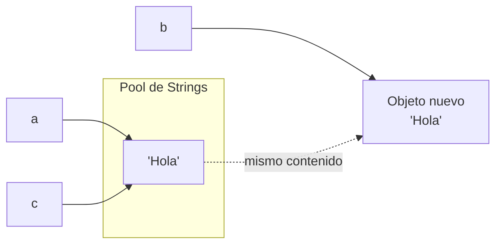
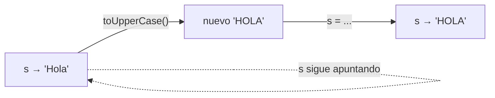

# 13. String y comparación de objetos

> [!info] Al terminar este capítulo tenés que poder
> - Usar los métodos principales de `String`.
> - Explicar por qué `String` es inmutable.
> - Comparar cadenas con `equals` y ordenar con `compareTo`.
> - Decidir cuándo usar `StringBuilder`.

> [!abstract] Qué debés saber (nivel 1)
> - `String` es una **clase**, no un primitivo.
> - Es **inmutable**: sus métodos devuelven una cadena nueva.
> - `==` compara **referencias**; `equals()` compara **contenido**.
> - `length()` lleva paréntesis (es método).
> - `substring(inicio, fin)` incluye `inicio` y **excluye** `fin`.
> - Para muchas concatenaciones, `StringBuilder`.

## 13.1 Crear cadenas

```java
String a = "Hola";              // literal (va al pool)
String b = new String("Hola");  // objeto nuevo
String c = "Hola";

System.out.println(a == c);      // true  (misma referencia del pool)
System.out.println(a == b);      // false (objeto distinto)
System.out.println(a.equals(b)); // true  (mismo contenido)
```



> [!important] Regla de oro
> **Nunca compares `String` con `==`.** Usá `equals()`. El `==` solo dice si son el mismo objeto, y eso depende de cómo se creó.

## 13.2 Métodos esenciales

| Método | Qué hace | Ejemplo | Resultado |
|---|---|---|---|
| `length()` | Cantidad de caracteres | `"Hola".length()` | `4` |
| `charAt(i)` | Carácter en posición `i` | `"Hola".charAt(1)` | `'o'` |
| `substring(i, f)` | Subcadena `[i, f)` | `"Hola".substring(1, 3)` | `"ol"` |
| `substring(i)` | Desde `i` hasta el final | `"Hola".substring(2)` | `"la"` |
| `indexOf(s)` | Primera posición | `"Hola".indexOf("l")` | `2` |
| `lastIndexOf(s)` | Última posición | `"ala".lastIndexOf("a")` | `2` |
| `toUpperCase()` | Mayúsculas | `"hola".toUpperCase()` | `"HOLA"` |
| `toLowerCase()` | Minúsculas | `"HOLA".toLowerCase()` | `"hola"` |
| `trim()` | Quita espacios de los extremos | `"  hola  ".trim()` | `"hola"` |
| `replace(a, b)` | Reemplaza | `"a-b".replace("-", "_")` | `"a_b"` |
| `contains(s)` | ¿Contiene? | `"Hola".contains("ol")` | `true` |
| `startsWith(s)` / `endsWith(s)` | Prefijo / sufijo | `"Hola".startsWith("Ho")` | `true` |
| `isEmpty()` | ¿Longitud 0? | `"".isEmpty()` | `true` |
| `isBlank()` | ¿Solo espacios? | `"   ".isBlank()` | `true` |
| `equals(s)` | Igualdad de contenido | `"a".equals("a")` | `true` |
| `equalsIgnoreCase(s)` | Igualdad sin distinguir mayúsculas | `"A".equalsIgnoreCase("a")` | `true` |
| `compareTo(s)` | Orden lexicográfico | `"a".compareTo("b")` | negativo |
| `split(regex)` | Divide | `"a,b,c".split(",")` | `["a","b","c"]` |

```java
public class Cadenas {

    public static void main(String[] args) {

        String texto = "  Municipio de La Plata  ";

        System.out.println("Original: [" + texto + "]");
        System.out.println("Largo: " + texto.length());

        String limpio = texto.trim();
        System.out.println("Limpio: [" + limpio + "]");
        System.out.println("Mayúsculas: " + limpio.toUpperCase());
        System.out.println("¿Contiene 'Plata'? " + limpio.contains("Plata"));
        System.out.println("Posición de 'de': " + limpio.indexOf("de"));
        System.out.println("Primeros 9: " + limpio.substring(0, 9));
        System.out.println("Desde 13: " + limpio.substring(13));

        String[] partes = limpio.split(" ");
        System.out.println("Palabras: " + partes.length);
        for (String p : partes) {
            System.out.println("  - " + p);
        }

        System.out.println("Reemplazo: " + limpio.replace("La Plata", "Berisso"));
    }
}
```

Salida:

```text
Original: [  Municipio de La Plata  ]
Largo: 25
Limpio: [Municipio de La Plata]
Mayúsculas: MUNICIPIO DE LA PLATA
¿Contiene 'Plata'? true
Posición de 'de': 10
Primeros 9: Municipio
Desde 13: La Plata
Palabras: 4
  - Municipio
  - de
  - La
  - Plata
Reemplazo: Municipio de Berisso
```

> [!warning] Índices de `substring`
> `"Hola".substring(1, 3)` devuelve `"ol"`: incluye el 1 y **excluye** el 3. Si pedís `substring(0, length())` obtenés la cadena completa; `substring(0, length()+1)` lanza `StringIndexOutOfBoundsException`.

## 13.3 Inmutabilidad

```java
String s = "Hola";
s.toUpperCase();              // devuelve "HOLA" pero NO cambia s
System.out.println(s);        // Hola

s = s.toUpperCase();          // ahora sí, reasignamos la referencia
System.out.println(s);        // HOLA
```

> [!important] Por qué importa
> Cada operación crea un **nuevo** `String`. En un ciclo de 10.000 concatenaciones se crean 10.000 objetos. Por eso existe `StringBuilder`.



## 13.4 Comparación

```java
String a = "Ana";
String b = "Ana";
String c = new String("Ana");

System.out.println(a == b);          // true  (pool)
System.out.println(a == c);          // false (objeto nuevo)
System.out.println(a.equals(c));     // true  (contenido)
System.out.println(a.equalsIgnoreCase("ANA")); // true
```

### `compareTo`

Devuelve:

- **negativo** si `a` va antes que `b`,
- **0** si son iguales,
- **positivo** si `a` va después.

```java
System.out.println("Ana".compareTo("Beto"));   // negativo
System.out.println("Beto".compareTo("Ana"));   // positivo
System.out.println("Ana".compareTo("Ana"));    // 0
```

Sirve para ordenar:

```java
import java.util.ArrayList;
import java.util.Collections;

ArrayList<String> nombres = new ArrayList<>();
nombres.add("Carlos");
nombres.add("Ana");
nombres.add("Beto");

Collections.sort(nombres);
System.out.println(nombres);   // [Ana, Beto, Carlos]
```

## 13.5 `StringBuilder`

Para construir cadenas en un ciclo.

```java
public class Constructor {

    public static void main(String[] args) {

        // MAL: concatena en cada vuelta (crea objetos)
        String mal = "";
        for (int i = 1; i <= 5; i++) {
            mal += i + " ";
        }
        System.out.println(mal);

        // BIEN: un solo objeto mutable
        StringBuilder sb = new StringBuilder();
        for (int i = 1; i <= 5; i++) {
            sb.append(i).append(" ");
        }
        String bien = sb.toString();
        System.out.println(bien);
    }
}
```

Salida:

```text
1 2 3 4 5
1 2 3 4 5
```

| Operación | `String` | `StringBuilder` |
|---|---|---|
| Concatenar | `+` (crea nuevo) | `append()` (muta) |
| Insertar | — | `insert(i, s)` |
| Borrar | — | `delete(i, f)` |
| Invertir | — | `reverse()` |
| Convertir | — | `toString()` |

> [!tip] Regla práctica
> Pocas concatenaciones → `+` está bien. Muchas, o dentro de un ciclo → `StringBuilder`.

## 13.6 Comparar objetos propios

`equals` y `hashCode` definen la **igualdad lógica**.

```java
import java.util.Objects;

class Dispositivo {

    private final String id;
    private final String ubicacion;

    Dispositivo(String id, String ubicacion) {
        this.id = id;
        this.ubicacion = ubicacion;
    }

    @Override
    public boolean equals(Object otro) {
        if (this == otro) return true;
        if (otro == null || getClass() != otro.getClass()) return false;
        Dispositivo d = (Dispositivo) otro;
        return id.equals(d.id);
    }

    @Override
    public int hashCode() {
        return Objects.hash(id);
    }

    @Override
    public String toString() {
        return id + " @ " + ubicacion;
    }
}
```

```java
public class Prueba {
    public static void main(String[] args) {
        Dispositivo a = new Dispositivo("D-01", "Centro");
        Dispositivo b = new Dispositivo("D-01", "Norte");

        System.out.println(a == b);         // false: objetos distintos
        System.out.println(a.equals(b));    // true: mismo id (decisión de dominio)
    }
}
```

> [!important] Contrato `equals` / `hashCode`
> Si dos objetos son iguales según `equals`, **deben** tener el mismo `hashCode`. Si lo rompés, fallan `HashSet` y `HashMap`.
> Si no redefinís `equals`, dos objetos son iguales solo si son el mismo (`==`).

### Ordenar objetos: `Comparable` y `Comparator`

`Comparable` define el **orden natural** dentro de la clase; `Comparator`, un criterio **externo** y alternativo.

```java
import java.util.ArrayList;
import java.util.Collections;
import java.util.Comparator;

class Alerta implements Comparable<Alerta> {

    private final int prioridad;

    Alerta(int prioridad) { this.prioridad = prioridad; }

    public int getPrioridad() { return prioridad; }

    @Override
    public int compareTo(Alerta otra) {
        return Integer.compare(prioridad, otra.prioridad);   // <0, 0, >0
    }
}

ArrayList<Alerta> alertas = new ArrayList<>();
Collections.sort(alertas);                                            // orden natural
alertas.sort(Comparator.comparingInt(Alerta::getPrioridad).reversed()); // otro criterio
```

| Aspecto | `Comparable` | `Comparator` |
|---|---|---|
| Dónde vive | En la clase (`implements`) | Fuera, como objeto aparte |
| Método | `compareTo(otro)` | `compare(a, b)` |
| Cuántos órdenes | Uno: el natural | Tantos como criterios necesites |

> [!warning] No restes para comparar
> `return this.prioridad - otra.prioridad` puede **desbordar** con valores extremos y devolver el signo equivocado. Usá `Integer.compare(a, b)`, que además expresa la intención.

## 13.7 Programa completo

```java
public class Normalizador {

    public static void main(String[] args) {

        String[] entradas = {
            "  Av. Belgrano  ",
            "av. san martín",
            "PLAZA  MORENO",
            ""
        };

        for (String e : entradas) {

            String limpio = e.trim();

            if (limpio.isEmpty()) {
                System.out.println("(vacío) → descartado");
                continue;
            }

            String normalizado = limpio.substring(0, 1).toUpperCase()
                    + limpio.substring(1).toLowerCase();

            String clave = normalizado.replace(" ", "_").replace(".", "");

            System.out.println("[" + limpio + "] → " + normalizado + " | clave: " + clave);
        }
    }
}
```

Salida:

```text
[Av. Belgrano] → Av. belgrano | clave: Av_Belgrano
[av. san martín] → Av. san martín | clave: Av_san_martín
[PLAZA  MORENO] → Plaza  moreno | clave: Plaza__moreno
[(vacío)] → descartado
```

> [!warning] `substring(0,1)` con cadena vacía
> Lanza excepción. Por eso se valida `isEmpty()` antes. Es el tipo de detalle que el tribunal pregunta como “caso borde”.

## Cómo trazar operaciones con `String`

```java
String s = "EFIP";
s = s.substring(1);
s = s + "2026";
```

| Paso | `s` | Objeto creado |
|---|---|---|
| 0 | `"EFIP"` | — |
| 1 | `"FIP"` | nuevo `String` |
| 2 | `"FIP2026"` | nuevo `String` |

## Errores que suelen tomar

| Error | Consecuencia |
|---|---|
| `s == "texto"` | Compara referencias; puede fallar |
| `s.length` | No compila: es método |
| `s[0]` | No compila: es `charAt(0)` |
| `substring(2, 1)` | `StringIndexOutOfBoundsException` |
| Concatenar en un ciclo enorme | Rendimiento pésimo |
| `s.equals(null)` | Devuelve `false` (seguro), pero `null.equals(s)` lanza NPE |
| Redefinir `equals` sin `hashCode` | Colecciones hash se comportan mal |

> [!important] Comparar con la constante primero
> `"VERDE".equals(color)` es seguro aunque `color` sea `null`; `color.equals("VERDE")` lanza `NullPointerException`.

## Ejercicios

> [!example]- 1. Métodos
> **Enunciado:** contar las vocales de una cadena.
> **Solución:**
> ```java
> String s = "Murcielago";
> int vocales = 0;
> String banco = "aeiouAEIOU";
> for (int i = 0; i < s.length(); i++) {
>     if (banco.indexOf(s.charAt(i)) >= 0) vocales++;
> }
> System.out.println(vocales);   // 5
> ```

> [!example]- 2. Invertir
> **Enunciado:** invertir una cadena con `StringBuilder`.
> **Solución:**
> ```java
> String invertida = new StringBuilder("EFIP").reverse().toString();
> ```

> [!example]- 3. Palíndromo
> **Enunciado:** determinar si una palabra es palíndroma (sin distinguir mayúsculas).
> **Solución:**
> ```java
> String s = "Neuquen".toLowerCase();
> String r = new StringBuilder(s).reverse().toString();
> System.out.println(s.equals(r));   // true
> ```

> [!example]- 4. Split
> **Enunciado:** de `"Juan,25,La Plata"`, extraer los tres campos.
> **Solución:**
> ```java
> String[] p = "Juan,25,La Plata".split(",");
> System.out.println(p[0] + " | " + p[1] + " | " + p[2]);
> ```

> [!example]- 5. Comparación
> **Enunciado:** ¿qué imprime?
> ```java
> String a = "x";
> String b = new String("x");
> System.out.println(a == b);
> System.out.println(a.equals(b));
> ```
> **Solución:** `false` y `true`.

> [!example]- 6. a papel
> **Enunciado:** escribir `static String iniciales(String nombreCompleto)` que devuelva las iniciales en mayúscula.
> **Solución:**
> ```java
> static String iniciales(String nombre) {
>     String[] partes = nombre.trim().split("\\s+");
>     StringBuilder sb = new StringBuilder();
>     for (String p : partes) {
>         if (!p.isEmpty()) sb.append(p.charAt(0));
>     }
>     return sb.toString().toUpperCase();
> }
> ```

## Lo que sigue

[[14_excepciones|14. Excepciones]].

#libro1
