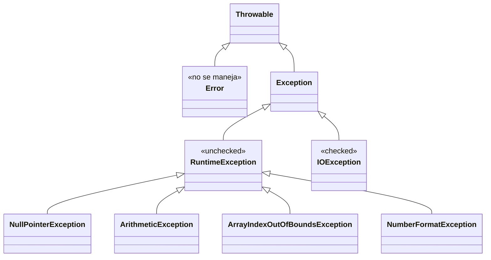
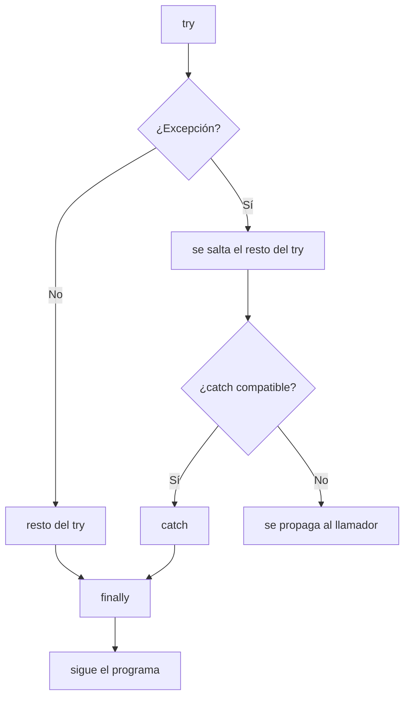
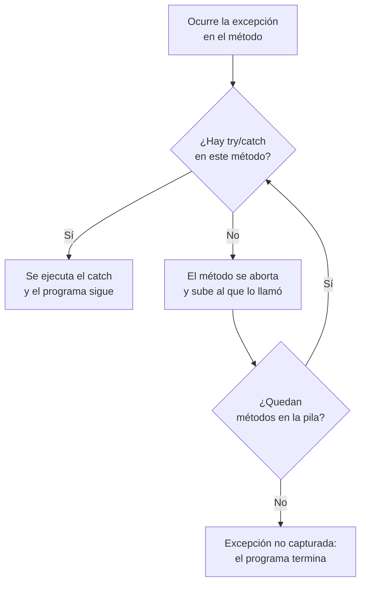

# 14. Excepciones

> [!info] Al terminar este capítulo tenés que poder
> - Explicar qué es una excepción y cómo altera el flujo.
> - Distinguir checked de unchecked.
> - Escribir `try / catch / finally` correctamente.
> - Crear y lanzar una excepción propia.
> - Decidir entre capturar, declarar con `throws` o dejar propagar.

> [!abstract] Qué debés saber (nivel 1)
> - Una excepción **interrumpe el flujo normal** y se propaga hacia arriba.
> - `try` contiene el código riesgoso; `catch` lo maneja; `finally` se ejecuta **siempre**.
> - **Checked**: el compilador obliga a capturarla o declararla (`IOException`).
> - **Unchecked**: `RuntimeException` y sus hijas; no obliga (`NullPointerException`).
> - `throw` lanza; `throws` declara.
> - `Error` no se maneja: es un fallo grave de la JVM.

## 14.1 Jerarquía



| Tipo | ¿Obliga a manejarla? | Ejemplo |
|---|---|---|
| `Error` | No (no se debe) | `OutOfMemoryError`, `StackOverflowError` |
| `Exception` (checked) | **Sí** | `IOException`, `FileNotFoundException` |
| `RuntimeException` (unchecked) | No | `NullPointerException`, `ArithmeticException`, `ArrayIndexOutOfBoundsException` |

> [!important] La diferencia que se pregunta
> **Checked**: el compilador te obliga a anticiparte. **Unchecked**: es un error de programación; podés manejarlo, pero no es obligatorio.

## 14.2 `try / catch / finally`

```java
public class Division {

    public static void main(String[] args) {

        int a = 10;
        int b = 0;

        try {
            int resultado = a / b;
            System.out.println("Resultado: " + resultado);   // no se ejecuta
        } catch (ArithmeticException e) {
            System.out.println("Error: " + e.getMessage());
        } finally {
            System.out.println("Fin del cálculo");
        }

        System.out.println("El programa continúa");
    }
}
```

Salida:

```text
Error: / by zero
Fin del cálculo
El programa continúa
```

Flujo:



> [!important] `finally` se ejecuta siempre
> Haya o no excepción, y aunque el `catch` haga `return`. Es el lugar para liberar recursos (aunque hoy se prefiere try-with-resources).

### Qué pasa cuando nadie la atrapa



> [!important] La pila se desarma
> Si `main` llama a `a()`, que llama a `b()`, y `b()` lanza una excepción sin `try`, Java aborta `b()`, después `a()` y después `main`. Los `finally` de cada método **sí se ejecutan** en ese camino de salida.

## 14.3 Varios `catch` y orden

```java
try {
    String s = null;
    System.out.println(s.length());
} catch (NullPointerException e) {
    System.out.println("Nulo");
} catch (RuntimeException e) {
    System.out.println("Otra runtime");
} catch (Exception e) {
    System.out.println("Cualquier otra");
}
```

> [!warning] El orden importa
> Se evalúa de arriba hacia abajo y se ejecuta **el primero compatible**. Si ponés `catch (Exception e)` primero, los demás son inalcanzables y **no compila**.

### Multi-catch

```java
try {
    // ...
} catch (NumberFormatException | ArithmeticException e) {
    System.out.println("Error de número: " + e.getMessage());
}
```

## 14.4 `throws`: declarar

```java
import java.io.IOException;

public class Lector {

    // Declara que puede propagar la excepción
    public static String leer(String ruta) throws IOException {
        if (ruta == null) {
            throw new IOException("Ruta nula");
        }
        return "contenido";
    }

    public static void main(String[] args) {
        try {
            System.out.println(leer("datos.txt"));
        } catch (IOException e) {
            System.out.println("No se pudo leer: " + e.getMessage());
        }
    }
}
```

| Palabra | Dónde va | Qué hace |
|---|---|---|
| `throw` | Dentro del método | Lanza una excepción ahora |
| `throws` | En la firma | Declara que puede propagarla |

> [!warning] No confundir
> `throw new IOException(...)` lanza. `public void m() throws IOException` declara. Son cosas distintas y se escriben distinto.

## 14.5 Excepción propia

```java
public class SaldoInsuficienteException extends Exception {

    private final double faltante;

    public SaldoInsuficienteException(double faltante) {
        super("Saldo insuficiente. Faltan: $" + faltante);
        this.faltante = faltante;
    }

    public double getFaltante() {
        return faltante;
    }
}
```

```java
public class Cuenta {

    private double saldo;

    public Cuenta(double saldo) { this.saldo = saldo; }

    public void extraer(double monto) throws SaldoInsuficienteException {
        if (monto > saldo) {
            throw new SaldoInsuficienteException(monto - saldo);
        }
        saldo -= monto;
    }

    public double getSaldo() { return saldo; }
}
```

```java
public class Cajero {

    public static void main(String[] args) {

        Cuenta c = new Cuenta(1000);

        try {
            c.extraer(1500);
        } catch (SaldoInsuficienteException e) {
            System.out.println(e.getMessage());
            System.out.println("Faltan: " + e.getFaltante());
        }

        System.out.println("Saldo: " + c.getSaldo());
    }
}
```

Salida:

```text
Saldo insuficiente. Faltan: $500.0
Faltan: 500.0
Saldo: 1000.0
```

> [!important] El estado no cambia
> La validación ocurre **antes** de modificar el saldo. Si la excepción se lanza, el objeto queda intacto. Es la misma idea de los invariantes ([[07_encapsulamiento]]).

## 14.6 Checked vs. unchecked en la práctica

| Situación | Qué usar |
|---|---|
| Error de programación (null, índice, división) | **Unchecked** (`RuntimeException`) |
| Falla externa recuperable (archivo, red, base) | **Checked** (`Exception`) |
| Regla de negocio violada | **Checked** propia o unchecked, según el diseño |

```java
// Unchecked: el llamador no está obligado
public class EdadInvalidaException extends RuntimeException {
    public EdadInvalidaException(String msg) { super(msg); }
}
```

```java
// Checked: obliga a manejar
public class DatosCorruptosException extends Exception {
    public DatosCorruptosException(String msg) { super(msg); }
}
```

> [!tip] Criterio para el oral
> Si el programa **puede recuperarse** y seguir, checked. Si es un **error de uso** del API, unchecked.

## 14.7 `try-with-resources`

Cierra automáticamente lo que implemente `AutoCloseable` (archivos, streams).

```java
import java.io.BufferedReader;
import java.io.FileReader;
import java.io.IOException;

public class Lectura {

    public static void main(String[] args) {

        try (BufferedReader br = new BufferedReader(new FileReader("datos.txt"))) {

            String linea;
            while ((linea = br.readLine()) != null) {
                System.out.println(linea);
            }

        } catch (IOException e) {
            System.out.println("Error de lectura: " + e.getMessage());
        }
    }
}
```

Equivale a un `try/finally` con `close()`, pero más corto y seguro.

## 14.8 Programa completo

```java
public class Promedio {

    public static double calcular(String[] valores) {
        if (valores == null || valores.length == 0) {
            throw new IllegalArgumentException("Sin datos");
        }

        int suma = 0;
        int validos = 0;

        for (String v : valores) {
            try {
                suma += Integer.parseInt(v);
                validos++;
            } catch (NumberFormatException e) {
                System.out.println("Descartado: '" + v + "' no es un número");
            }
        }

        if (validos == 0) {
            throw new ArithmeticException("Ningún valor válido");
        }

        return (double) suma / validos;
    }

    public static void main(String[] args) {

        String[] datos = {"10", "20", "x", "30", ""};

        try {
            System.out.println("Promedio: " + calcular(datos));
        } catch (IllegalArgumentException | ArithmeticException e) {
            System.out.println("Error: " + e.getMessage());
        } finally {
            System.out.println("Proceso terminado");
        }
    }
}
```

Salida:

```text
Descartado: 'x' no es un número
Descartado: '' no es un número
Promedio: 20.0
Proceso terminado
```

> [!warning] Capturar y seguir vs. capturar y callar
> Descartar un dato inválido e informarlo es aceptable. Capturar y no hacer nada (`catch (Exception e) {}`) oculta el problema: es un error grave de diseño.

## Cómo trazar el flujo

```java
try {
    System.out.println("A");
    int x = 1 / 0;
    System.out.println("B");
} catch (ArithmeticException e) {
    System.out.println("C");
} finally {
    System.out.println("D");
}
System.out.println("E");
```

| Paso | Se ejecuta | Detalle |
|---|---|---|
| 1 | `A` | dentro del try |
| 2 | excepción | se corta el try: **B no se ejecuta** |
| 3 | `C` | catch compatible |
| 4 | `D` | finally |
| 5 | `E` | continúa el programa |

## Errores que suelen tomar

| Error | Consecuencia |
|---|---|
| `catch (Exception)` primero | Los siguientes son inalcanzables: no compila |
| `catch` vacío | Oculta el error |
| Usar excepciones para el flujo normal | Código lento y confuso |
| `throw` con una clase que no hereda de `Throwable` | No compila |
| No cerrar archivos | Fuga de recursos |
| Confundir `throw` con `throws` | Error de sintaxis |
| Declarar `throws` y no manejarlo arriba | Se propaga hasta `main` y corta el programa |

## Ejercicios

> [!example]- 1. Clasificar
> **Enunciado:** ¿checked o unchecked? `IOException`, `NullPointerException`, `NumberFormatException`, `FileNotFoundException`.
> **Solución:** `IOException` checked; `NullPointerException` unchecked; `NumberFormatException` unchecked (hereda de `IllegalArgumentException`); `FileNotFoundException` checked (hereda de `IOException`).

> [!example]- 2. Predicción
> **Enunciado:** ¿qué imprime?
> ```java
> try {
>     int[] v = new int[2];
>     v[2] = 1;
> } catch (ArrayIndexOutOfBoundsException e) {
>     System.out.println("índice");
> } finally {
>     System.out.println("fin");
> }
> ```
> **Solución:** `índice` y `fin`.

> [!example]- 3. Excepción propia
> **Enunciado:** creá `PrioridadInvalidaException` unchecked para valores fuera de 1..5.
> **Solución:**
> ```java
> class PrioridadInvalidaException extends RuntimeException {
>     PrioridadInvalidaException(int p) {
>         super("Prioridad inválida: " + p);
>     }
> }
> ```

> [!example]- 4. `finally`
> **Enunciado:** ¿se ejecuta `finally` si el `try` hace `return`?
> **Solución:** sí. `finally` se ejecuta antes de salir del método, incluso con `return`.

> [!example]- 5. Parseo
> **Enunciado:** leer un entero y repetir hasta que sea válido.
> **Solución:**
> ```java
> import java.util.Scanner;
>
> Scanner sc = new Scanner(System.in);
> int n = -1;
> while (n < 0) {
>     System.out.print("Número: ");
>     String linea = sc.nextLine();
>     try {
>         n = Integer.parseInt(linea);
>     } catch (NumberFormatException e) {
>         System.out.println("No es un número");
>     }
> }
> ```

> [!example]- 6. a papel
> **Enunciado:** escribí un método que reciba dos enteros y lance `IllegalArgumentException` si el divisor es cero. Mostrá cómo se maneja.
> **Solución:**
> ```java
> static int dividir(int a, int b) {
>     if (b == 0) throw new IllegalArgumentException("Divisor cero");
>     return a / b;
> }
>
> try {
>     System.out.println(dividir(10, 0));
> } catch (IllegalArgumentException e) {
>     System.out.println(e.getMessage());
> }
> ```

## Lo que sigue

[[15_archivos|15. Archivos]].

#libro1
