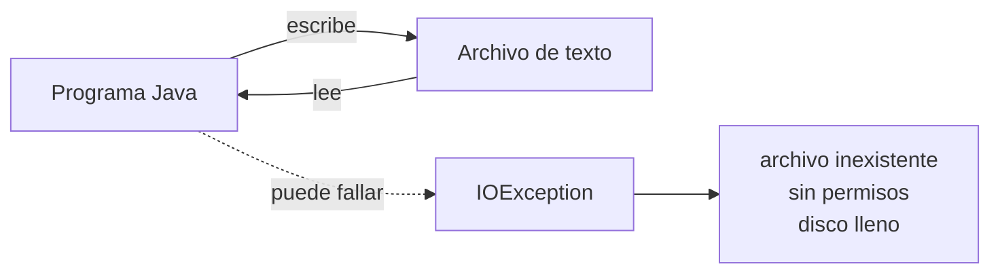

# 15. Archivos

> [!info] Al terminar este capítulo tenés que poder
> - Leer y escribir archivos de texto.
> - Usar `try-with-resources` para cerrar bien.
> - Manejar `IOException` sin romper el programa.
> - Guardar y recuperar objetos en formato CSV.

> [!abstract] Qué debés saber (nivel 1)
> - Todo acceso a disco puede fallar: se maneja con `IOException`.
> - `Files.readString` y `Files.writeString` son la forma más simple (Java 11+).
> - `BufferedReader` / `BufferedWriter` sirven para línea por línea.
> - `try-with-resources` cierra solo; es la forma correcta.
> - Las rutas pueden ser relativas (`datos.txt`) o absolutas (`/home/...`).

## 15.1 El archivo como recurso externo



Cualquier operación de entrada/salida es **checked**: el compilador obliga a manejarla o declararla.

### Bytes o caracteres

| Flujo | Clases | Para qué |
|---|---|---|
| **Bytes** | `FileInputStream` / `FileOutputStream` | Binarios: imágenes, audio, cualquier archivo |
| **Caracteres** | `FileReader` / `FileWriter`, `BufferedReader` / `BufferedWriter` | Texto, respetando la codificación |
| **NIO.2** | `Files` con `Path` | Operaciones comunes: leer/escribir texto, copiar, `readAllBytes` |

> [!important] Cuál elegir
> Texto legible → lector/escritor de caracteres o `Files`. Bytes arbitrarios (o contenido desconocido) → flujo de bytes. En el oral nombrando **apertura, operación, manejo de error y cierre** ya cubrís la respuesta.

## 15.2 Escritura simple

```java
import java.io.IOException;
import java.nio.file.Files;
import java.nio.file.Path;

public class Escritura {

    public static void main(String[] args) {

        Path ruta = Path.of("estado.txt");

        try {
            Files.writeString(ruta, "Semáforo S-01: VERDE\nCámara C-01: ACTIVA\n");
            System.out.println("Archivo escrito");
        } catch (IOException e) {
            System.out.println("No se pudo escribir: " + e.getMessage());
        }
    }
}
```

Contenido de `estado.txt`:

```text
Semáforo S-01: VERDE
Cámara C-01: ACTIVA
```

### Escribir varias líneas

```java
import java.nio.file.Files;
import java.nio.file.Path;
import java.util.List;

List<String> lineas = List.of(
        "S-01,VERDE,activo",
        "C-01,-,activo",
        "S-02,ROJO,inactivo"
);

Files.write(Path.of("dispositivos.csv"), lineas);
```

> [!warning] `writeString` **sobrescribe**
> Si el archivo existía, se reemplaza. Para agregar sin borrar:
> ```java
> Files.writeString(ruta, texto,
>         java.nio.file.StandardOpenOption.CREATE,
>         java.nio.file.StandardOpenOption.APPEND);
> ```

## 15.3 Lectura simple

```java
import java.io.IOException;
import java.nio.file.Files;
import java.nio.file.Path;
import java.util.List;

public class Lectura {

    public static void main(String[] args) {

        Path ruta = Path.of("dispositivos.csv");

        try {
            List<String> lineas = Files.readAllLines(ruta);

            for (String linea : lineas) {
                System.out.println("→ " + linea);
            }

            System.out.println("Total de líneas: " + lineas.size());

        } catch (IOException e) {
            System.out.println("No se pudo leer: " + e.getMessage());
        }
    }
}
```

Salida (si el archivo existe):

```text
→ S-01,VERDE,activo
→ C-01,-,activo
→ S-02,ROJO,inactivo
Total de líneas: 3
```

### Leer todo de una vez

```java
String contenido = Files.readString(Path.of("estado.txt"));
System.out.println(contenido);
```

## 15.4 Lectura línea por línea con `BufferedReader`

Útil para archivos grandes: no carga todo en memoria.

```java
import java.io.BufferedReader;
import java.io.IOException;
import java.nio.file.Files;
import java.nio.file.Path;

public class LectorLineas {

    public static void main(String[] args) {

        Path ruta = Path.of("log.txt");

        try (BufferedReader br = Files.newBufferedReader(ruta)) {

            String linea;
            int numero = 0;

            while ((linea = br.readLine()) != null) {
                numero++;
                System.out.printf("%3d: %s%n", numero, linea);
            }

        } catch (IOException e) {
            System.out.println("Error: " + e.getMessage());
        }
    }
}
```

> [!important] `readLine()` devuelve `null` al final
> No devuelve cadena vacía: devuelve `null`. Por eso la condición es `!= null`. Una línea vacía sí devuelve `""`.

## 15.5 `try-with-resources`

```java
try (BufferedReader br = Files.newBufferedReader(ruta)) {
    // usar br
} catch (IOException e) {
    // manejar
}
// br se cierra automáticamente, incluso si hay excepción
```

| Sin try-with-resources | Con try-with-resources |
|---|---|
| Hay que llamar `close()` en `finally` | Se cierra solo |
| Fácil olvidarse | Imposible olvidarse |
| Más código | Más claro |

## 15.6 Guardar y recuperar objetos (CSV)

```java
import java.io.IOException;
import java.nio.file.Files;
import java.nio.file.Path;
import java.util.ArrayList;
import java.util.List;

class Dispositivo {

    private final String id;
    private final String tipo;
    private boolean activo;

    Dispositivo(String id, String tipo, boolean activo) {
        this.id = id;
        this.tipo = tipo;
        this.activo = activo;
    }

    String aCsv() {
        return id + "," + tipo + "," + activo;
    }

    static Dispositivo desdeCsv(String linea) {
        String[] p = linea.split(",");
        return new Dispositivo(p[0], p[1], Boolean.parseBoolean(p[2]));
    }

    @Override
    public String toString() {
        return id + " (" + tipo + ") " + (activo ? "ON" : "OFF");
    }
}

public class Persistencia {

    static final Path ARCHIVO = Path.of("dispositivos.csv");

    static void guardar(List<Dispositivo> lista) throws IOException {
        List<String> lineas = new ArrayList<>();
        for (Dispositivo d : lista) {
            lineas.add(d.aCsv());
        }
        Files.write(ARCHIVO, lineas);
    }

    static List<Dispositivo> cargar() throws IOException {
        List<Dispositivo> lista = new ArrayList<>();
        if (!Files.exists(ARCHIVO)) {
            return lista;                 // primera ejecución
        }
        for (String linea : Files.readAllLines(ARCHIVO)) {
            if (!linea.isBlank()) {
                lista.add(Dispositivo.desdeCsv(linea));
            }
        }
        return lista;
    }

    public static void main(String[] args) {

        List<Dispositivo> red = new ArrayList<>();
        red.add(new Dispositivo("S-01", "semaforo", true));
        red.add(new Dispositivo("C-01", "camara", false));

        try {
            guardar(red);
            System.out.println("Guardados: " + red.size());

            List<Dispositivo> recuperados = cargar();
            System.out.println("Recuperados:");
            for (Dispositivo d : recuperados) {
                System.out.println("  " + d);
            }

        } catch (IOException e) {
            System.out.println("Error de archivo: " + e.getMessage());
        }
    }
}
```

Salida:

```text
Guardados: 2
Recuperados:
  S-01 (semaforo) ON
  C-01 (camara) OFF
```

> [!tip] Por qué CSV y no serialización
> CSV es texto legible, se abre en Excel y no depende de la versión de la clase. Para el EFIP alcanza y se explica en dos líneas.

## 15.7 Rutas y directorios

```java
import java.nio.file.Files;
import java.nio.file.Path;

Path dir = Path.of("datos");
Path archivo = dir.resolve("alertas.txt");

Files.createDirectories(dir);          // crea si no existe
System.out.println(Files.exists(archivo));
System.out.println(archivo.toAbsolutePath());
System.out.println(Files.size(archivo));   // tamaño en bytes
```

| Método | Para qué |
|---|---|
| `Path.of("...")` | Crear una ruta |
| `resolve("nombre")` | Componer rutas |
| `Files.exists(p)` | ¿Existe? |
| `Files.createDirectories(p)` | Crear carpetas |
| `Files.delete(p)` | Borrar |
| `Files.size(p)` | Tamaño |
| `toAbsolutePath()` | Ruta absoluta |

> [!warning] Ruta relativa
> `Path.of("datos.txt")` es relativa al **directorio de ejecución**, no al archivo `.java`. Si corrés desde otro lugar, el archivo se busca en otro lado. Para probar, usá `toAbsolutePath()` e imprimí.

## 15.8 Programa completo: bitácora

```java
import java.io.IOException;
import java.nio.file.Files;
import java.nio.file.Path;
import java.nio.file.StandardOpenOption;
import java.time.LocalDateTime;

public class Bitacora {

    static final Path LOG = Path.of("bitacora.log");

    static void registrar(String nivel, String mensaje) {
        String linea = LocalDateTime.now() + " [" + nivel + "] " + mensaje + System.lineSeparator();
        try {
            Files.writeString(LOG, linea,
                    StandardOpenOption.CREATE,
                    StandardOpenOption.APPEND);
        } catch (IOException e) {
            System.err.println("No se pudo registrar: " + e.getMessage());
        }
    }

    public static void main(String[] args) {

        registrar("INFO", "Sistema iniciado");
        registrar("WARN", "Cámara C-01 sin respuesta");
        registrar("INFO", "Semáforo S-01 en verde");

        try {
            for (String linea : Files.readAllLines(LOG)) {
                System.out.println(linea);
            }
        } catch (IOException e) {
            System.out.println("No se pudo leer la bitácora");
        }
    }
}
```

Salida (aproximada):

```text
2026-11-18T10:15:02.123 [INFO] Sistema iniciado
2026-11-18T10:15:02.130 [WARN] Cámara C-01 sin respuesta
2026-11-18T10:15:02.134 [INFO] Semáforo S-01 en verde
```

## Cómo trazar un flujo con archivo

| Paso | Operación | Resultado |
|---|---|---|
| 1 | `Files.exists(ruta)` | `false` si es la primera vez |
| 2 | `Files.write(ruta, lineas)` | crea el archivo |
| 3 | `Files.readAllLines(ruta)` | devuelve las líneas |
| 4 | `split(",")` por línea | arreglo de campos |
| 5 | `new Dispositivo(...)` | objeto reconstruido |

## Errores que suelen tomar

| Error | Consecuencia |
|---|---|
| No manejar `IOException` | No compila |
| `readLine()` comparado con `""` | Nunca termina: al final es `null` |
| Olvidar cerrar el `BufferedReader` | Fuga de recursos |
| `writeString` esperando agregar | Sobrescribe |
| Ruta relativa mal asumida | `NoSuchFileException` |
| `split(",")` con campos que contienen comas | Datos corruptos |
| Leer sin verificar existencia | Excepción en la primera ejecución |

## Ejercicios

> [!example]- 1. Escribir y leer
> **Enunciado:** guardar tres nombres y volver a leerlos.
> **Solución:**
> ```java
> Path p = Path.of("nombres.txt");
> Files.write(p, List.of("Ana", "Luis", "Eva"));
> for (String n : Files.readAllLines(p)) System.out.println(n);
> ```

> [!example]- 2. Contar líneas
> **Enunciado:** contar las líneas de un archivo sin cargarlo completo.
> **Solución:**
> ```java
> int contador = 0;
> try (BufferedReader br = Files.newBufferedReader(p)) {
>     while (br.readLine() != null) contador++;
> }
> ```

> [!example]- 3. Agregar
> **Enunciado:** agregar una línea a `bitacora.log` sin borrar lo anterior.
> **Solución:**
> ```java
> Files.writeString(Path.of("bitacora.log"), "nueva línea\n",
>         StandardOpenOption.CREATE, StandardOpenOption.APPEND);
> ```

> [!example]- 4. CSV
> **Enunciado:** de `"A,1"` crear un objeto con nombre y prioridad.
> **Solución:**
> ```java
> String[] p = "A,1".split(",");
> Alerta a = new Alerta(p[0], Integer.parseInt(p[1]));
> ```

> [!example]- 5. a papel
> **Enunciado:** escribir un método `static int contarPalabras(Path p) throws IOException` que cuente palabras separadas por espacios.
> **Solución:**
> ```java
> static int contarPalabras(Path p) throws IOException {
>     int total = 0;
>     for (String linea : Files.readAllLines(p)) {
>         String limpia = linea.trim();
>         if (!limpia.isEmpty()) {
>             total += limpia.split("\\s+").length;
>         }
>     }
>     return total;
> }
> ```

## Lo que sigue

[[16_pilas-y-colas|16. Pilas y colas]].

#libro1
