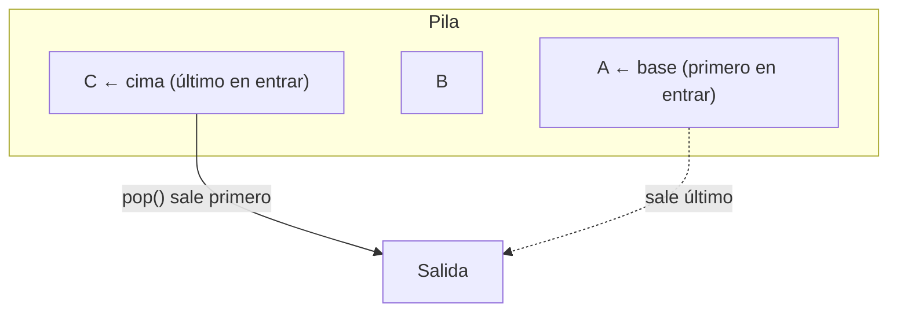
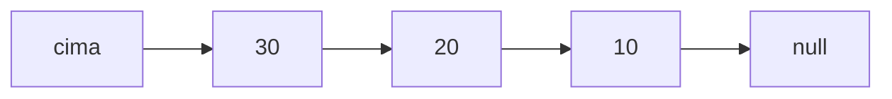
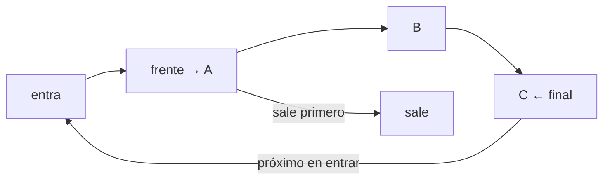
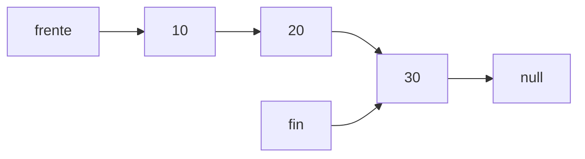

# 16. Pilas y colas

> [!info] Al terminar este capítulo tenés que poder
> - Explicar LIFO y sus operaciones.
> - Implementar una pila con vector y con lista enlazada.
> - Simular `push` y `pop` paso a paso.
> - Elegir una pila para un problema real y justificarlo.
> - Explicar FIFO, cola circular y cola con lista enlazada.

> [!abstract] Qué debés saber (nivel 1)
> - **Pila = LIFO**: el último que entra es el primero que sale.
> - Operaciones: `push` (apilar), `pop` (desapilar), `peek`/`top` (consultar), `isEmpty`, `size`.
> - Solo se accede a la **cima**; no hay acceso al medio.
> - Con vector: índice `tope`, capacidad fija, O(1).
> - Con lista: la cima es el primer nodo, sin capacidad fija, O(1).
> - Aplicaciones: deshacer, paréntesis, llamadas, navegación, recursión.

## 16.1 El principio LIFO



`push(A)`, `push(B)`, `push(C)` → `pop()` devuelve `C`, luego `B`, luego `A`.

| Operación | Efecto | Costo |
|---|---|---|
| `push(x)` | Agrega en la cima | O(1) |
| `pop()` | Quita y devuelve la cima | O(1) |
| `peek()` | Devuelve la cima sin quitarla | O(1) |
| `isEmpty()` | ¿Vacía? | O(1) |
| `size()` | Cantidad | O(1) |

> [!warning] La confusión más común
> **Pila = LIFO.** **Cola = FIFO.** Hay apuntes que lo invierten; si te toca corregir, hacelo.

## 16.2 Implementación con vector

```java
public class PilaArray {

    private int[] datos;
    private int tope;          // índice del último elemento (-1 si vacía)

    public PilaArray(int capacidad) {
        if (capacidad <= 0) {
            throw new IllegalArgumentException("Capacidad inválida");
        }
        datos = new int[capacidad];
        tope = -1;
    }

    public void push(int valor) {
        if (tope == datos.length - 1) {
            throw new IllegalStateException("Pila llena");
        }
        datos[++tope] = valor;
    }

    public int pop() {
        if (isEmpty()) {
            throw new IllegalStateException("Pila vacía");
        }
        return datos[tope--];
    }

    public int peek() {
        if (isEmpty()) {
            throw new IllegalStateException("Pila vacía");
        }
        return datos[tope];
    }

    public boolean isEmpty() {
        return tope == -1;
    }

    public int size() {
        return tope + 1;
    }
}
```

```java
public class PruebaPila {

    public static void main(String[] args) {

        PilaArray p = new PilaArray(5);

        p.push(10);
        p.push(20);
        p.push(30);

        System.out.println("Tope: " + p.peek());     // 30
        System.out.println("Tamaño: " + p.size());   // 3

        System.out.println("Sale: " + p.pop());      // 30
        System.out.println("Sale: " + p.pop());      // 20
        System.out.println("Tope: " + p.peek());     // 10
        System.out.println("Tamaño: " + p.size());   // 1
    }
}
```

Salida:

```text
Tope: 30
Tamaño: 3
Sale: 30
Sale: 20
Tope: 10
Tamaño: 1
```

### Traza del vector

Estado de `datos` (capacidad 5):

| Operación | `tope` | `datos` |
|---|---|---|
| inicio | −1 | `[_, _, _, _, _]` |
| `push(10)` | 0 | `[10, _, _, _, _]` |
| `push(20)` | 1 | `[10, 20, _, _, _]` |
| `push(30)` | 2 | `[10, 20, 30, _, _]` |
| `pop()` → 30 | 1 | `[10, 20, _, _, _]` |
| `pop()` → 20 | 0 | `[10, _, _, _, _]` |

> [!important] `tope` es un **índice**, no una cantidad
> Vacía = `-1`. Con un elemento = `0`. `size()` es `tope + 1`. Confundirlo es el error de implementación más común.

## 16.3 Implementación con lista enlazada

```java
public class PilaLista {

    private static class Nodo {
        int dato;
        Nodo siguiente;

        Nodo(int dato, Nodo siguiente) {
            this.dato = dato;
            this.siguiente = siguiente;
        }
    }

    private Nodo cima;
    private int cantidad;

    public void push(int valor) {
        cima = new Nodo(valor, cima);   // el nuevo apunta al anterior
        cantidad++;
    }

    public int pop() {
        if (isEmpty()) {
            throw new IllegalStateException("Pila vacía");
        }
        int valor = cima.dato;
        cima = cima.siguiente;
        cantidad--;
        return valor;
    }

    public int peek() {
        if (isEmpty()) {
            throw new IllegalStateException("Pila vacía");
        }
        return cima.dato;
    }

    public boolean isEmpty() {
        return cima == null;
    }

    public int size() {
        return cantidad;
    }
}
```



`push(30)`:

```java
cima = new Nodo(30, cima);
```

| Antes | Después |
|---|---|
| `cima → 20 → 10 → null` | `cima → 30 → 20 → 10 → null` |

> [!important] El orden de la asignación
> Primero se crea el nodo **apuntando al anterior**, después se mueve `cima`. Si hacés `cima = nuevo` antes de enlazar, perdés el resto de la pila.

## 16.4 Vector vs. lista

| | Con vector | Con lista |
|---|---|---|
| Capacidad | Fija (o redimensionar) | Dinámica |
| Memoria | Menos por elemento | Un objeto por nodo |
| `push`/`pop` | O(1) | O(1) |
| Acceso al medio | No permitido | No permitido (solo cima) |
| Riesgo | Desborde | `null` mal manejado |

## 16.5 Aplicación: paréntesis balanceados

```java
public class Balanceo {

    public static boolean estaBalanceado(String expresion) {

        PilaLista pila = new PilaLista();

        for (int i = 0; i < expresion.length(); i++) {
            char c = expresion.charAt(i);

            if (c == '(' || c == '[' || c == '{') {
                pila.push(c);
            } else if (c == ')' || c == ']' || c == '}') {
                if (pila.isEmpty()) {
                    return false;                 // cierre sin apertura
                }
                char abre = (char) pila.pop();
                if (!coinciden(abre, c)) {
                    return false;                 // tipo incorrecto
                }
            }
        }

        return pila.isEmpty();                    // no debe sobrar ninguna apertura
    }

    private static boolean coinciden(char abre, char cierra) {
        return (abre == '(' && cierra == ')')
            || (abre == '[' && cierra == ']')
            || (abre == '{' && cierra == '}');
    }

    public static void main(String[] args) {
        System.out.println(estaBalanceado("(a[b]{c})"));   // true
        System.out.println(estaBalanceado("(a[b)]"));     // false
        System.out.println(estaBalanceado("((("));        // false
    }
}
```

Salida:

```text
true
false
false
```

> [!tip] Por qué una pila y no una cola
> El último paréntesis abierto es el que debe cerrarse primero: LIFO. Una cola cerraría el primero abierto, que es incorrecto.

## 16.6 La pila de Java

```java
import java.util.ArrayDeque;
import java.util.Deque;

public class PilaJava {
    public static void main(String[] args) {

        Deque<Integer> pila = new ArrayDeque<>();

        pila.push(10);
        pila.push(20);
        pila.push(30);

        System.out.println(pila.peek());   // 30
        System.out.println(pila.pop());    // 30
        System.out.println(pila.size());   // 2
    }
}
```

| Clase | Cuándo |
|---|---|
| `Stack` | Legado; no se recomienda |
| `ArrayDeque` | **Recomendada** para pila y cola |
| `LinkedList` | También sirve, pero más memoria |

> [!warning] Si usás `ArrayDeque` como pila
> `push` agrega al frente y `pop` quita del frente. No mezcles `push` con `removeLast` salvo que sepas lo que hacés.

## 16.7 El principio FIFO



`enqueue(A)`, `enqueue(B)`, `enqueue(C)` → `dequeue()` devuelve `A`, luego `B`, luego `C`.

| Operación | Efecto | Costo |
|---|---|---|
| `enqueue(x)` | Agrega al final | O(1) |
| `dequeue()` | Quita y devuelve el frente | O(1) |
| `peek()` | Devuelve el frente sin quitar | O(1) |
| `isEmpty()` | ¿Vacía? | O(1) |
| `size()` | Cantidad | O(1) |

## 16.8 El problema del vector lineal

Si usás un vector y al extraer "corrés" todos los elementos:

```java
// MAL: O(n) por extracción
public int dequeue() {
    int valor = datos[0];
    for (int i = 0; i < cantidad - 1; i++) {
        datos[i] = datos[i + 1];
    }
    cantidad--;
    return valor;
}
```

Funciona, pero cada extracción mueve todo. Con 1.000 elementos y 1.000 extracciones son 1.000.000 de movimientos.

**Solución:** cola circular con dos índices y módulo.

## 16.9 Cola circular con vector

```java
public class ColaCircular {

    private final int[] datos;
    private int frente;      // índice del primero
    private int fin;         // índice donde entrará el próximo
    private int cantidad;

    public ColaCircular(int capacidad) {
        if (capacidad <= 0) throw new IllegalArgumentException("Capacidad inválida");
        datos = new int[capacidad];
        frente = 0;
        fin = 0;
        cantidad = 0;
    }

    public void enqueue(int valor) {
        if (cantidad == datos.length) {
            throw new IllegalStateException("Cola llena");
        }
        datos[fin] = valor;
        fin = (fin + 1) % datos.length;     // vuelve a 0 al llegar al final
        cantidad++;
    }

    public int dequeue() {
        if (isEmpty()) {
            throw new IllegalStateException("Cola vacía");
        }
        int valor = datos[frente];
        frente = (frente + 1) % datos.length;
        cantidad--;
        return valor;
    }

    public int peek() {
        if (isEmpty()) throw new IllegalStateException("Cola vacía");
        return datos[frente];
    }

    public boolean isEmpty() { return cantidad == 0; }
    public int size() { return cantidad; }
}
```

```java
public class PruebaCola {

    public static void main(String[] args) {

        ColaCircular c = new ColaCircular(3);

        c.enqueue(10);
        c.enqueue(20);
        c.enqueue(30);

        System.out.println("Frente: " + c.peek());    // 10
        System.out.println("Sale: " + c.dequeue());   // 10
        System.out.println("Sale: " + c.dequeue());   // 20

        c.enqueue(40);
        c.enqueue(50);

        while (!c.isEmpty()) {
            System.out.print(c.dequeue() + " ");      // 30 40 50
        }
    }
}
```

Salida:

```text
Frente: 10
Sale: 10
Sale: 20
30 40 50
```

### Traza de la cola circular (capacidad 3)

| Operación | `frente` | `fin` | `cantidad` | `datos` |
|---|---|---|---|---|
| inicio | 0 | 0 | 0 | `[_, _, _]` |
| `enqueue(10)` | 0 | 1 | 1 | `[10, _, _]` |
| `enqueue(20)` | 0 | 2 | 2 | `[10, 20, _]` |
| `enqueue(30)` | 0 | 0 | 3 | `[10, 20, 30]` |
| `dequeue()` → 10 | 1 | 0 | 2 | `[_, 20, 30]` |
| `dequeue()` → 20 | 2 | 0 | 1 | `[_, _, 30]` |
| `enqueue(40)` | 2 | 1 | 2 | `[40, _, 30]` |
| `enqueue(50)` | 2 | 2 | 3 | `[40, 50, 30]` |

> [!important] Por qué el módulo
> Cuando `fin` llega al final del arreglo, `(fin + 1) % capacidad` lo devuelve a 0 y reutiliza el espacio que dejó `dequeue`. Sin módulo, la cola se "agota" aunque haya lugar.

> [!warning] Distinguir llena de vacía
> `frente == fin` puede significar **vacía** o **llena**. Por eso se lleva `cantidad`. Sin ese contador, hay que sacrificar una posición.

## 16.10 Cola con lista enlazada

```java
public class ColaLista {

    private static class Nodo {
        int dato;
        Nodo siguiente;

        Nodo(int dato) { this.dato = dato; }
    }

    private Nodo frente;
    private Nodo fin;
    private int cantidad;

    public void enqueue(int valor) {
        Nodo nuevo = new Nodo(valor);
        if (isEmpty()) {
            frente = nuevo;
        } else {
            fin.siguiente = nuevo;
        }
        fin = nuevo;
        cantidad++;
    }

    public int dequeue() {
        if (isEmpty()) {
            throw new IllegalStateException("Cola vacía");
        }
        int valor = frente.dato;
        frente = frente.siguiente;
        if (frente == null) {
            fin = null;                 // se vació
        }
        cantidad--;
        return valor;
    }

    public int peek() {
        if (isEmpty()) throw new IllegalStateException("Cola vacía");
        return frente.dato;
    }

    public boolean isEmpty() { return frente == null; }
    public int size() { return cantidad; }
}
```



> [!important] El caso de la cola vacía
> Al extraer el último elemento, `frente` queda en `null`. Si no ponés `fin = null`, `fin` apunta a un nodo que ya no está en la cola y el próximo `enqueue` corrompe la estructura.

## 16.11 Vector vs. lista

| | Cola circular con vector | Cola con lista |
|---|---|---|
| Capacidad | Fija | Dinámica |
| Memoria | Menos por elemento | Un nodo por elemento |
| `enqueue`/`dequeue` | O(1) | O(1) |
| Complejidad de código | Índices y módulo | Enlaces |
| Riesgo | Cola llena | `null` mal manejado |

## 16.12 Aplicación: atención por orden de llegada

```java
public class Atencion {

    static class Turno {
        String paciente;
        int prioridad;      // menor = más urgente, pero FIFO dentro de igual prioridad

        Turno(String paciente, int prioridad) {
            this.paciente = paciente;
            this.prioridad = prioridad;
        }

        @Override
        public String toString() {
            return paciente + " (prioridad " + prioridad + ")";
        }
    }

    public static void main(String[] args) {

        ColaListaTurnos cola = new ColaListaTurnos();

        cola.enqueue(new Turno("Ana", 2));
        cola.enqueue(new Turno("Luis", 1));
        cola.enqueue(new Turno("Eva", 3));

        while (!cola.isEmpty()) {
            System.out.println("Atendiendo: " + cola.dequeue());
        }
    }

    static class ColaListaTurnos {
        private static class Nodo {
            Turno dato;
            Nodo siguiente;
            Nodo(Turno t) { this.dato = t; }
        }

        private Nodo frente, fin;

        void enqueue(Turno t) {
            Nodo n = new Nodo(t);
            if (frente == null) frente = n;
            else fin.siguiente = n;
            fin = n;
        }

        Turno dequeue() {
            Turno t = frente.dato;
            frente = frente.siguiente;
            if (frente == null) fin = null;
            return t;
        }

        boolean isEmpty() { return frente == null; }
    }
}
```

Salida:

```text
Atendiendo: Ana (prioridad 2)
Atendiendo: Luis (prioridad 1)
Atendiendo: Eva (prioridad 3)
```

> [!important] FIFO puro vs. prioridad
> Esta cola respeta el orden de llegada, no la prioridad. Si el problema pide prioridad, necesitás una **cola de prioridad**, que **no** está en el programa del EFIP. En el oral, aclaralo: “con una cola FIFO se atiende por llegada; si se requiere prioridad, hace falta otra estructura”.

## 16.13 La cola de Java

```java
import java.util.ArrayDeque;
import java.util.Queue;

public class ColaJava {
    public static void main(String[] args) {

        Queue<String> cola = new ArrayDeque<>();

        cola.offer("A");
        cola.offer("B");
        cola.offer("C");

        System.out.println(cola.peek());    // A
        System.out.println(cola.poll());    // A
        System.out.println(cola.size());    // 2
    }
}
```

| Método | Si está vacía |
|---|---|
| `offer` / `add` | `add` lanza excepción; `offer` devuelve `false` |
| `poll` | Devuelve `null` |
| `remove` | Lanza excepción |
| `peek` | Devuelve `null` |
| `element` | Lanza excepción |

> [!tip] Convención
> `offer/poll/peek` son las versiones seguras. `add/remove/element` lanzan excepción.

## Cómo trazar una pila

Secuencia: `push(1)`, `push(2)`, `pop()`, `push(3)`, `peek()`, `pop()`, `pop()`

| Paso | Operación | Resultado | Pila (cima → base) |
|---|---|---|---|
| 1 | `push(1)` | — | 1 |
| 2 | `push(2)` | — | 2, 1 |
| 3 | `pop()` | 2 | 1 |
| 4 | `push(3)` | — | 3, 1 |
| 5 | `peek()` | 3 | 3, 1 |
| 6 | `pop()` | 3 | 1 |
| 7 | `pop()` | 1 | vacía |

## Errores que suelen tomar

| Error | Consecuencia |
|---|---|
| Confundir LIFO con FIFO | Respuesta incorrecta en el oral |
| `tope = 0` para pila vacía | `size()` y `isEmpty()` mal |
| `pop()` sin verificar vacía | Excepción o valor basura |
| `push` en pila llena con vector | `ArrayIndexOutOfBoundsException` |
| Perder la referencia al enlazar | Se pierde el resto de la pila |
| Usar `Stack` por costumbre | Clase legada; mejor `ArrayDeque` |

## Ejercicios

> [!example]- 1. Simulación
> **Enunciado:** ¿qué devuelve `pop()` tras `push(5), push(8), push(2), pop()`?
> **Solución:** el primer `pop()` devuelve `2`; la pila queda `5, 8`. Si se hace otro `pop()`, devuelve `8`.

> [!example]- 2. Invertir
> **Enunciado:** invertir una cadena usando una pila.
> **Solución:**
> ```java
> Deque<Character> p = new ArrayDeque<>();
> for (char c : texto.toCharArray()) p.push(c);
> StringBuilder sb = new StringBuilder();
> while (!p.isEmpty()) sb.append(p.pop());
> ```

> [!example]- 3. Vector
> **Enunciado:** ¿qué valor tiene `tope` después de 3 `push` y 1 `pop`?
> **Solución:** `1`. Empieza en −1; tres push → 2; un pop → 1.

> [!example]- 4. Evaluación postfija
> **Enunciado:** evaluar `"3 4 + 2 *"` con una pila.
> **Solución:**
> ```java
> Deque<Integer> p = new ArrayDeque<>();
> for (String t : expresion.split(" ")) {
>     if (t.equals("+")) p.push(p.pop() + p.pop());
>     else if (t.equals("-")) { int b = p.pop(), a = p.pop(); p.push(a - b); }
>     else if (t.equals("*")) p.push(p.pop() * p.pop());
>     else if (t.equals("/")) { int b = p.pop(), a = p.pop(); p.push(a / b); }
>     else p.push(Integer.parseInt(t));
> }
> System.out.println(p.pop());   // 14
> ```

> [!example]- 5. a papel
> **Enunciado:** escribir la clase `PilaArray` completa e indicar el estado interno tras `push(7), push(9), pop(), push(4)`.
> **Solución:** código en 16.2. Estado: `tope = 1`, `datos = [7, 4, _, _, _]`, `pop()` devolvió `9`.

## Lo que sigue

[[17_listas-enlazadas|17. Listas enlazadas]].

#libro1
