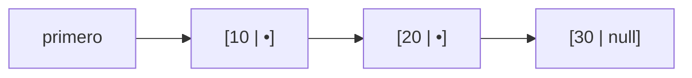

# 17. Listas enlazadas

> [!info] Al terminar este capítulo tenés que poder
> - Explicar qué es un nodo y cómo se enlazan.
> - Implementar una lista simple con sus operaciones.
> - Insertar y eliminar sin perder la referencia al resto.
> - Escribir un iterador propio.
> - Justificar el costo de cada operación.

> [!abstract] Qué debés saber (nivel 1)
> - Una lista enlazada son **nodos** con un dato y una referencia al siguiente.
> - `primero` apunta al inicio; el último apunta a `null`.
> - Insertar al inicio es O(1); buscar y acceder por índice son O(n).
> - No hay acceso directo por índice: hay que recorrer.
> - Un **iterador** permite recorrer sin exponer los nodos.
> - Ventaja: crece sin reservar capacidad fija y inserta/elimina en extremos en O(1).

## 17.1 El nodo

```java
class Nodo {
    int dato;
    Nodo siguiente;

    Nodo(int dato) {
        this.dato = dato;
        this.siguiente = null;
    }
}
```



| Parte | Qué guarda |
|---|---|
| `dato` | El valor |
| `siguiente` | Referencia al próximo nodo (o `null`) |
| `primero` | Referencia al primer nodo de la lista |

> [!important] La lista no es el arreglo de nodos
> No hay un contenedor con posiciones. Solo existe `primero`, y desde ahí se llega a todos encadenando `siguiente`.

## 17.2 Lista simple completa

```java
public class ListaSimple {

    private static class Nodo {
        int dato;
        Nodo siguiente;

        Nodo(int dato) {
            this.dato = dato;
        }
    }

    private Nodo primero;
    private int cantidad;

    // O(1)
    public void agregarAlInicio(int valor) {
        Nodo nuevo = new Nodo(valor);
        nuevo.siguiente = primero;      // 1. enlazar al resto
        primero = nuevo;                // 2. mover la cabeza
        cantidad++;
    }

    // O(n) sin referencia al último
    public void agregarAlFinal(int valor) {
        Nodo nuevo = new Nodo(valor);
        if (primero == null) {
            primero = nuevo;
        } else {
            Nodo actual = primero;
            while (actual.siguiente != null) {
                actual = actual.siguiente;
            }
            actual.siguiente = nuevo;
        }
        cantidad++;
    }

    // O(n)
    public boolean contiene(int valor) {
        Nodo actual = primero;
        while (actual != null) {
            if (actual.dato == valor) return true;
            actual = actual.siguiente;
        }
        return false;
    }

    // O(n)
    public int obtener(int indice) {
        if (indice < 0 || indice >= cantidad) {
            throw new IndexOutOfBoundsException("Índice " + indice);
        }
        Nodo actual = primero;
        for (int i = 0; i < indice; i++) {
            actual = actual.siguiente;
        }
        return actual.dato;
    }

    // O(1)
    public int eliminarPrimero() {
        if (primero == null) {
            throw new IllegalStateException("Lista vacía");
        }
        int valor = primero.dato;
        primero = primero.siguiente;
        cantidad--;
        return valor;
    }

    // O(n)
    public boolean eliminar(int valor) {
        if (primero == null) return false;

        if (primero.dato == valor) {
            primero = primero.siguiente;
            cantidad--;
            return true;
        }

        Nodo anterior = primero;
        Nodo actual = primero.siguiente;

        while (actual != null) {
            if (actual.dato == valor) {
                anterior.siguiente = actual.siguiente;   // "saltear" el nodo
                cantidad--;
                return true;
            }
            anterior = actual;
            actual = actual.siguiente;
        }
        return false;
    }

    public int size() { return cantidad; }
    public boolean isEmpty() { return primero == null; }

    public String mostrar() {
        StringBuilder sb = new StringBuilder("[");
        Nodo actual = primero;
        while (actual != null) {
            sb.append(actual.dato);
            if (actual.siguiente != null) sb.append(", ");
            actual = actual.siguiente;
        }
        return sb.append("]").toString();
    }
}
```

```java
public class PruebaLista {

    public static void main(String[] args) {

        ListaSimple l = new ListaSimple();

        l.agregarAlInicio(20);
        l.agregarAlInicio(10);
        l.agregarAlFinal(30);
        l.agregarAlFinal(40);

        System.out.println(l.mostrar());        // [10, 20, 30, 40]
        System.out.println("Tamaño: " + l.size());
        System.out.println("Índice 2: " + l.obtener(2));
        System.out.println("¿Contiene 30? " + l.contiene(30));

        l.eliminar(20);
        System.out.println(l.mostrar());        // [10, 30, 40]

        l.eliminarPrimero();
        System.out.println(l.mostrar());        // [30, 40]
    }
}
```

Salida:

```text
[10, 20, 30, 40]
Tamaño: 4
Índice 2: 30
¿Contiene 30? true
[10, 30, 40]
[30, 40]
```

> [!warning] El orden de la inserción al inicio
> ```java
> nuevo.siguiente = primero;   // primero enlazar
> primero = nuevo;             // después mover
> ```
> Si lo hacés al revés, perdés la referencia al resto de la lista y la lista "pierde" todos sus nodos.

## 17.3 Costos

| Operación | Costo | Por qué |
|---|---|---|
| Agregar al inicio | O(1) | Solo cambia `primero` |
| Agregar al final | O(n) sin `ultimo` · O(1) con `ultimo` | Hay que llegar al final |
| Buscar | O(n) | Recorrido secuencial |
| Acceder por índice | O(n) | No hay índice directo |
| Eliminar el primero | O(1) | Cambia `primero` |
| Eliminar por valor | O(n) | Hay que encontrarlo |
| Recorrer | O(n) | Una visita por nodo |

| Aspecto | Arreglo / `ArrayList` | Lista enlazada |
|---|---|---|
| Acceso por índice | O(1) | O(n): hay que recorrer |
| Inserción al inicio | O(n): desplaza | O(1) |
| Inserción al final | O(1) amortizado | O(1) con `ultimo`; O(n) sin él |
| Eliminar un nodo ya ubicado | O(n): desplaza | O(1) si tenés el anterior |
| Memoria | Compacta | Un nodo con referencia extra por elemento |
| Localidad de caché | Buena | Mala: los nodos están dispersos |

> [!important] La comparación que se pregunta
> `ArrayList` accede por índice en O(1) y desplaza al insertar en el medio (O(n)). La lista enlazada accede en O(n) pero inserta en un extremo en O(1). **Ninguna es “mejor”: depende de la operación dominante.**

## 17.4 Iterador

Un iterador recorre sin exponer los nodos.

```java
import java.util.Iterator;
import java.util.NoSuchElementException;

public class ListaConIterador implements Iterable<Integer> {

    private static class Nodo {
        int dato;
        Nodo siguiente;
        Nodo(int dato) { this.dato = dato; }
    }

    private Nodo primero;
    private int cantidad;

    public void agregar(int valor) {
        Nodo nuevo = new Nodo(valor);
        if (primero == null) {
            primero = nuevo;
        } else {
            Nodo a = primero;
            while (a.siguiente != null) a = a.siguiente;
            a.siguiente = nuevo;
        }
        cantidad++;
    }

    @Override
    public Iterator<Integer> iterator() {
        return new Iterator<Integer>() {

            private Nodo actual = primero;

            @Override
            public boolean hasNext() {
                return actual != null;
            }

            @Override
            public Integer next() {
                if (!hasNext()) {
                    throw new NoSuchElementException();
                }
                int valor = actual.dato;
                actual = actual.siguiente;
                return valor;
            }
        };
    }

    public static void main(String[] args) {

        ListaConIterador l = new ListaConIterador();
        l.agregar(10);
        l.agregar(20);
        l.agregar(30);

        for (int x : l) {              // usa el iterador
            System.out.println(x);
        }

        Iterator<Integer> it = l.iterator();
        while (it.hasNext()) {
            System.out.print(it.next() + " ");
        }
    }
}
```

Salida:

```text
10
20
30
10 20 30 
```

| Método | Contrato |
|---|---|
| `hasNext()` | `true` si queda al menos un elemento |
| `next()` | Devuelve el actual y avanza |
| `remove()` | Opcional; si no se implementa, lanza `UnsupportedOperationException` |

> [!tip] Por qué el iterador es encapsulamiento puro
> El cliente recorre valores sin tocar `primero` ni `siguiente`. Si mañana cambiás la estructura interna, el `for-each` sigue funcionando.

## 17.5 Programa completo

```java
public class Inventario {

    private static class Nodo {
        String nombre;
        int stock;
        Nodo siguiente;

        Nodo(String nombre, int stock) {
            this.nombre = nombre;
            this.stock = stock;
        }
    }

    private Nodo primero;

    public void agregar(String nombre, int stock) {
        Nodo nuevo = new Nodo(nombre, stock);
        if (primero == null) {
            primero = nuevo;
        } else {
            Nodo a = primero;
            while (a.siguiente != null) a = a.siguiente;
            a.siguiente = nuevo;
        }
    }

    public int totalStock() {
        int total = 0;
        Nodo a = primero;
        while (a != null) {
            total += a.stock;
            a = a.siguiente;
        }
        return total;
    }

    public String buscar(String nombre) {
        Nodo a = primero;
        while (a != null) {
            if (a.nombre.equals(nombre)) {
                return nombre + ": " + a.stock;
            }
            a = a.siguiente;
        }
        return nombre + ": no encontrado";
    }

    public static void main(String[] args) {

        Inventario inv = new Inventario();
        inv.agregar("Semáforo", 12);
        inv.agregar("Cámara", 8);
        inv.agregar("Sensor", 25);

        System.out.println("Total: " + inv.totalStock());
        System.out.println(inv.buscar("Cámara"));
        System.out.println(inv.buscar("Router"));
    }
}
```

Salida:

```text
Total: 45
Cámara: 8
Router: no encontrado
```

## Cómo trazar una lista

`agregarAlInicio(10)`, `agregarAlInicio(20)`, `agregarAlFinal(30)`:

| Paso | Operación | `primero` | Lista |
|---|---|---|---|
| 1 | inicio | `null` | `[]` |
| 2 | `agregarAlInicio(10)` | nodo 10 | `10` |
| 3 | `agregarAlInicio(20)` | nodo 20 | `20 → 10` |
| 4 | `agregarAlFinal(30)` | nodo 20 | `20 → 10 → 30` |

`eliminar(10)`:

| Paso | Acción | Resultado |
|---|---|---|
| 1 | `anterior = 20`, `actual = 10` | coincide |
| 2 | `anterior.siguiente = actual.siguiente` | `20 → 30` |
| 3 | Nodo 10 queda sin referencias | lo libera el GC |

## Errores que suelen tomar

| Error | Consecuencia |
|---|---|
| Mover `primero` antes de enlazar | Se pierde el resto de la lista |
| No actualizar `cantidad` | `size()` incorrecto |
| No verificar `null` al recorrer | `NullPointerException` |
| Perder el `anterior` al eliminar | No se puede "saltear" el nodo |
| Asumir acceso O(1) por índice | Error conceptual y de rendimiento |
| Modificar la lista mientras se itera | Recorrido inconsistente |

## Ejercicios

> [!example]- 1. Costos
> **Enunciado:** ¿costo de agregar al final sin referencia a `ultimo`? ¿Y con `ultimo`?
> **Solución:** O(n) sin `ultimo` (hay que recorrer); O(1) con `ultimo` (se enlaza directo).

> [!example]- 2. Eliminar el último
> **Enunciado:** escribí `eliminarUltimo()`.
> **Solución:**
> ```java
> public void eliminarUltimo() {
>     if (primero == null) return;
>     if (primero.siguiente == null) { primero = null; cantidad--; return; }
>     Nodo a = primero;
>     while (a.siguiente.siguiente != null) a = a.siguiente;
>     a.siguiente = null;
>     cantidad--;
> }
> ```

> [!example]- 3. Contar
> **Enunciado:** contar cuántos nodos tienen dato par.
> **Solución:**
> ```java
> int pares = 0;
> Nodo a = primero;
> while (a != null) { if (a.dato % 2 == 0) pares++; a = a.siguiente; }
> ```

> [!example]- 4. Invertir
> **Enunciado:** invertir la lista sin crear otra.
> **Solución:**
> ```java
> Nodo anterior = null, actual = primero, siguiente;
> while (actual != null) {
>     siguiente = actual.siguiente;
>     actual.siguiente = anterior;
>     anterior = actual;
>     actual = siguiente;
> }
> primero = anterior;
> ```

> [!example]- 5. a papel
> **Enunciado:** dibujar la lista tras `agregarAlInicio(3)`, `agregarAlInicio(2)`, `agregarAlInicio(1)` e indicar qué devuelve `obtener(1)`.
> **Solución:** `1 → 2 → 3 → null`; `obtener(1)` devuelve `2` (recorre un nodo desde `primero`).

## Lo que sigue

[[18_listas-dobles-circulares|18. Listas dobles, circulares y ordenadas]].

#libro1
