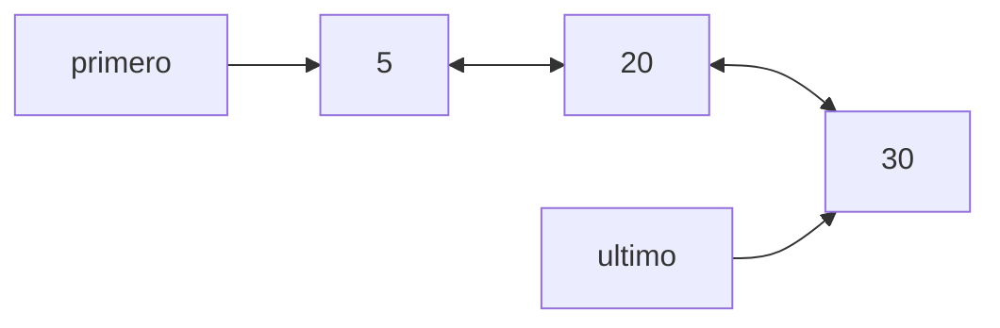
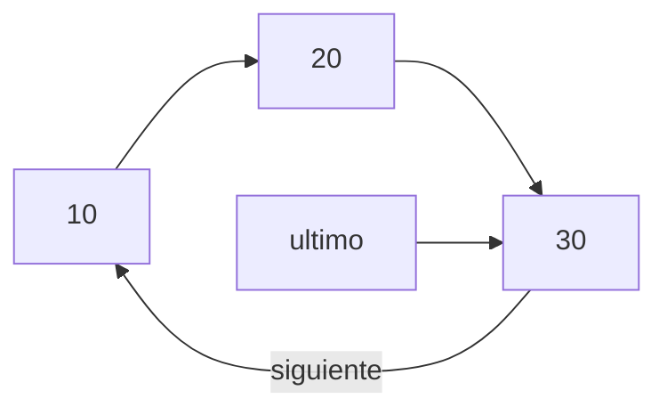
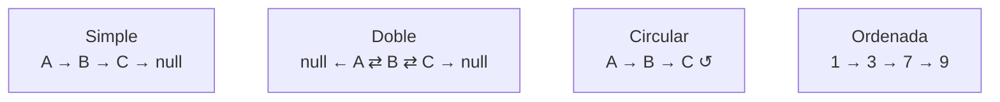

# 18. Listas dobles, circulares y ordenadas

> [!info] Al terminar este capítulo tenés que poder
> - Implementar una lista doblemente enlazada.
> - Explicar cuándo conviene y qué hay que mantener sincronizado.
> - Implementar una lista circular y su condición de parada.
> - Insertar en una lista ordenada respetando el criterio.

> [!abstract] Qué debés saber (nivel 1)
> - **Doble**: cada nodo tiene `anterior` y `siguiente`.
> - Permite recorrer en ambos sentidos y eliminar un nodo conocido en O(1).
> - **Circular**: el último apunta al primero; no hay `null`.
> - La condición de parada de la circular **no** puede ser `!= null`.
> - **Ordenada**: se inserta en la posición que mantiene el orden.
> - La búsqueda en una ordenada puede cortarse antes.

## 18.1 Lista doblemente enlazada

```java
public class ListaDoble {

    private static class Nodo {
        int dato;
        Nodo anterior;
        Nodo siguiente;

        Nodo(int dato) { this.dato = dato; }
    }

    private Nodo primero;
    private Nodo ultimo;
    private int cantidad;

    public void agregarAlInicio(int valor) {
        Nodo nuevo = new Nodo(valor);
        if (primero == null) {
            primero = ultimo = nuevo;
        } else {
            nuevo.siguiente = primero;
            primero.anterior = nuevo;
            primero = nuevo;
        }
        cantidad++;
    }

    public void agregarAlFinal(int valor) {
        Nodo nuevo = new Nodo(valor);
        if (ultimo == null) {
            primero = ultimo = nuevo;
        } else {
            nuevo.anterior = ultimo;
            ultimo.siguiente = nuevo;
            ultimo = nuevo;
        }
        cantidad++;
    }

    public boolean eliminar(int valor) {
        Nodo actual = primero;

        while (actual != null) {
            if (actual.dato == valor) {
                if (actual.anterior != null) {
                    actual.anterior.siguiente = actual.siguiente;
                } else {
                    primero = actual.siguiente;      // era el primero
                }
                if (actual.siguiente != null) {
                    actual.siguiente.anterior = actual.anterior;
                } else {
                    ultimo = actual.anterior;        // era el último
                }
                cantidad--;
                return true;
            }
            actual = actual.siguiente;
        }
        return false;
    }

    public String mostrar() {
        StringBuilder sb = new StringBuilder("[");
        Nodo a = primero;
        while (a != null) {
            sb.append(a.dato);
            if (a.siguiente != null) sb.append(" ⇄ ");
            a = a.siguiente;
        }
        return sb.append("]").toString();
    }

    public String mostrarInverso() {
        StringBuilder sb = new StringBuilder("[");
        Nodo a = ultimo;
        while (a != null) {
            sb.append(a.dato);
            if (a.anterior != null) sb.append(" ⇄ ");
            a = a.anterior;
        }
        return sb.append("]").toString();
    }

    public int size() { return cantidad; }
}
```

```java
public class PruebaDoble {
    public static void main(String[] args) {

        ListaDoble l = new ListaDoble();

        l.agregarAlFinal(10);
        l.agregarAlFinal(20);
        l.agregarAlFinal(30);
        l.agregarAlInicio(5);

        System.out.println(l.mostrar());          // [5 ⇄ 10 ⇄ 20 ⇄ 30]
        System.out.println(l.mostrarInverso());   // [30 ⇄ 20 ⇄ 10 ⇄ 5]

        l.eliminar(10);
        System.out.println(l.mostrar());          // [5 ⇄ 20 ⇄ 30]
        System.out.println("Tamaño: " + l.size());
    }
}
```

Salida:

```text
[5 ⇄ 10 ⇄ 20 ⇄ 30]
[30 ⇄ 20 ⇄ 10 ⇄ 5]
[5 ⇄ 20 ⇄ 30]
Tamaño: 3
```



> [!important] La regla de oro
> Cada vez que cambiás un enlace, actualizá **los dos sentidos**. Si te olvidás de `anterior`, la lista se rompe al recorrer hacia atrás.

### Los cuatro casos de eliminación

| Caso | Qué actualizar |
|---|---|
| Único nodo | `primero = ultimo = null` |
| Primero | `primero = siguiente`; `primero.anterior = null` |
| Último | `ultimo = anterior`; `ultimo.siguiente = null` |
| Del medio | `anterior.siguiente = siguiente`; `siguiente.anterior = anterior` |

> [!tip] La ventaja real
> Si ya tenés el nodo, eliminar cuesta **O(1)** porque no hay que buscarlo ni recorrer desde el inicio. En la simple necesitás el anterior, y eso obliga a O(n).

## 18.2 Lista circular

```java
public class ListaCircular {

    private static class Nodo {
        int dato;
        Nodo siguiente;
        Nodo(int dato) { this.dato = dato; }
    }

    private Nodo ultimo;      // guardamos el último: ultimo.siguiente es el primero
    private int cantidad;

    public void agregar(int valor) {
        Nodo nuevo = new Nodo(valor);
        if (ultimo == null) {
            ultimo = nuevo;
            nuevo.siguiente = nuevo;         // se apunta a sí mismo
        } else {
            nuevo.siguiente = ultimo.siguiente;
            ultimo.siguiente = nuevo;
            ultimo = nuevo;
        }
        cantidad++;
    }

    public String mostrar() {
        if (ultimo == null) return "[]";

        StringBuilder sb = new StringBuilder("[");
        Nodo actual = ultimo.siguiente;      // el primero
        do {
            sb.append(actual.dato);
            actual = actual.siguiente;
            if (actual != ultimo.siguiente) sb.append(", ");
        } while (actual != ultimo.siguiente);

        return sb.append("]").toString();
    }

    public int size() { return cantidad; }
}
```

```java
public class PruebaCircular {
    public static void main(String[] args) {

        ListaCircular c = new ListaCircular();
        c.agregar(10);
        c.agregar(20);
        c.agregar(30);

        System.out.println(c.mostrar());     // [10, 20, 30]
        System.out.println("Tamaño: " + c.size());
    }
}
```

Salida:

```text
[10, 20, 30]
Tamaño: 3
```



> [!warning] La condición de parada
> En una circular **no hay `null`**. Si recorrés con `while (actual != null)`, el ciclo nunca termina. Opciones:
> - `do { ... } while (actual != primero);`
> - guardar `primero` antes de empezar y comparar contra él;
> - recorrer exactamente `cantidad` veces.

> [!important] Cuándo usar circular
> Turnos rotativos, buffers circulares, recorridos que se repiten. **No** sirve para recorridos con fin natural.

## 18.3 Lista ordenada

```java
public class ListaOrdenada {

    private static class Nodo {
        int dato;
        Nodo siguiente;
        Nodo(int dato) { this.dato = dato; }
    }

    private Nodo primero;
    private int cantidad;

    public void insertar(int valor) {
        Nodo nuevo = new Nodo(valor);

        if (primero == null || valor < primero.dato) {
            nuevo.siguiente = primero;
            primero = nuevo;
        } else {
            Nodo actual = primero;
            while (actual.siguiente != null && actual.siguiente.dato < valor) {
                actual = actual.siguiente;
            }
            nuevo.siguiente = actual.siguiente;
            actual.siguiente = nuevo;
        }
        cantidad++;
    }

    public boolean contiene(int valor) {
        Nodo actual = primero;
        while (actual != null && actual.dato <= valor) {
            if (actual.dato == valor) return true;
            actual = actual.siguiente;      // corta antes si se pasó
        }
        return false;
    }

    public String mostrar() {
        StringBuilder sb = new StringBuilder("[");
        Nodo a = primero;
        while (a != null) {
            sb.append(a.dato);
            if (a.siguiente != null) sb.append(", ");
            a = a.siguiente;
        }
        return sb.append("]").toString();
    }
}
```

```java
public class PruebaOrdenada {
    public static void main(String[] args) {
        ListaOrdenada l = new ListaOrdenada();
        l.insertar(30);
        l.insertar(10);
        l.insertar(20);
        l.insertar(5);

        System.out.println(l.mostrar());          // [5, 10, 20, 30]
        System.out.println(l.contiene(20));       // true
        System.out.println(l.contiene(25));       // false
    }
}
```

Salida:

```text
[5, 10, 20, 30]
true
false
```

> [!tip] La ventaja de estar ordenada
> La búsqueda se corta cuando el dato actual supera al buscado. En el peor caso sigue siendo O(n), pero en promedio mejora y permite recorridos ordenados sin ordenar después.

## 18.4 Comparación de variantes

| Variante | Enlaces | Ventaja | Cuidado |
|---|---|---|---|
| Simple | `siguiente` | Menos memoria; simple de implementar | No retrocede |
| Doble | `anterior` + `siguiente` | Recorre en ambos sentidos; elimina nodo conocido O(1) | Mantener ambos enlaces |
| Circular | `siguiente` (último → primero) | Turnos y recorridos cíclicos | Condición de parada |
| Ordenada | `siguiente` + criterio | Búsqueda con corte; recorrido ordenado | Insertar cuesta O(n) |



## 18.5 Programa completo

```java
public class TurnosRotativos {

    private static class Nodo {
        String nombre;
        Nodo siguiente;
        Nodo(String nombre) { this.nombre = nombre; }
    }

    private Nodo ultimo;
    private int cantidad;

    public void agregar(String nombre) {
        Nodo nuevo = new Nodo(nombre);
        if (ultimo == null) {
            ultimo = nuevo;
            nuevo.siguiente = nuevo;
        } else {
            nuevo.siguiente = ultimo.siguiente;
            ultimo.siguiente = nuevo;
            ultimo = nuevo;
        }
        cantidad++;
    }

    public String siguienteTurno() {
        if (ultimo == null) return "sin turnos";
        ultimo = ultimo.siguiente;          // rota el "último"
        return ultimo.siguiente.nombre;     // devuelve el que sigue
    }

    public static void main(String[] args) {

        TurnosRotativos t = new TurnosRotativos();
        t.agregar("Ana");
        t.agregar("Luis");
        t.agregar("Eva");

        for (int i = 0; i < 5; i++) {
            System.out.println("Turno: " + t.siguienteTurno());
        }
    }
}
```

Salida:

```text
Turno: Luis
Turno: Eva
Turno: Ana
Turno: Luis
Turno: Eva
```

## Cómo trazar una inserción ordenada

Insertar `20` en `[10, 30, 40]`:

| Paso | `actual` | `actual.siguiente.dato < 20` | Acción |
|---|---|---|---|
| 1 | 10 | `30 < 20` → false | corta |
| 2 | — | — | `nuevo.siguiente = 30`; `10.siguiente = 20` |
| 3 | — | — | lista: `[10, 20, 30, 40]` |

## Errores que suelen tomar

| Error | Consecuencia |
|---|---|
| No actualizar `anterior` en la doble | Recorrido inverso roto |
| `while (actual != null)` en circular | Ciclo infinito |
| Perder `ultimo` al insertar en circular | Se rompe el ciclo |
| Insertar en ordenada sin recorrer | Lista desordenada |
| No manejar el caso de lista vacía | `NullPointerException` |
| Eliminar el último sin actualizar `ultimo` | Puntero colgante |

## Ejercicios

> [!example]- 1. Doble
> **Enunciado:** ¿qué ventaja concreta tiene la doble sobre la simple?
> **Solución:** recorrer en ambos sentidos y eliminar un nodo conocido en O(1), sin buscar su anterior.

> [!example]- 2. Circular
> **Enunciado:** ¿cómo sabés que terminaste de recorrer una circular?
> **Solución:** cuando volvés al nodo inicial. Se guarda `primero` antes del `do-while` y se compara.

> [!example]- 3. Ordenada
> **Enunciado:** insertar `15` en `[5, 10, 20]`.
> **Solución:** queda `[5, 10, 15, 20]`. Se corta en `20` porque `20 < 15` es falso.

> [!example]- 4. Eliminar
> **Enunciado:** en una doble, eliminar el último nodo. ¿Qué actualizás?
> **Solución:** `ultimo = ultimo.anterior; ultimo.siguiente = null; cantidad--;`

> [!example]- 5. a papel
> **Enunciado:** dibujar una lista doble con `[3, 6, 9]`, marcando `primero`, `ultimo`, `anterior` y `siguiente`.
> **Solución:**
> ```
> primero → [3] ⇄ [6] ⇄ [9] ← ultimo
>            anterior=null      siguiente=null
> ```

## Lo que sigue

[[19_insercion-y-shellsort|19. Ordenación por inserción y Shellsort]].

#libro1
