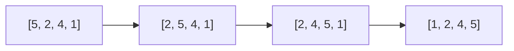
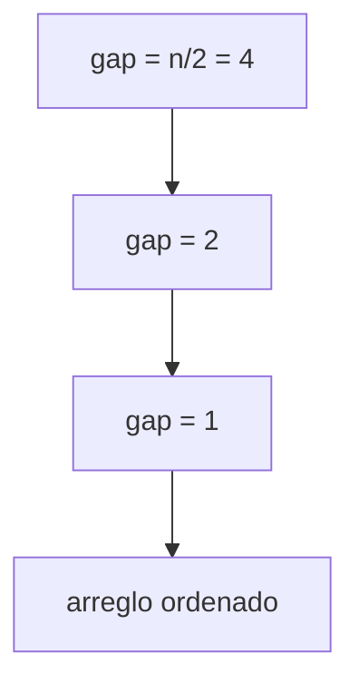

# 19. Ordenación por inserción y Shellsort

> [!info] Al terminar este capítulo tenés que poder
> - Explicar estabilidad, in-place y complejidad.
> - Trazar la ordenación por inserción paso a paso.
> - Implementar Shellsort y explicar el rol del gap.
> - Elegir entre inserción y Shellsort según el caso.

> [!abstract] Qué debés saber (nivel 1)
> - **Inserción**: toma cada elemento y lo inserta en la parte ya ordenada.
> - Es **estable**, **in-place**, O(n) si ya está casi ordenado y O(n²) en promedio y peor caso.
> - **Shellsort**: hace inserciones con saltos (`gap`) que se reducen hasta 1.
> - Es **in-place**, **no estable**, y su costo depende de la secuencia de gaps (hasta O(n²)).
> - Insertar no es intercambiar: se **desplazan** los mayores y se coloca el elemento.

## 19.1 Conceptos previos

| Concepto | Significado |
|---|---|
| **Clave** | Atributo por el que se ordena (prioridad, nombre, fecha) |
| **Estable** | Elementos con la misma clave conservan su orden relativo |
| **In-place** | Usa poca memoria adicional (no crea otra colección del tamaño de n) |
| **Complejidad** | Costo en función de n; distinguir mejor, promedio y peor |
| **Ordenado parcialmente** | Casi ordenado: pocos elementos fuera de lugar |

> [!important] La pregunta “¿cuál es mejor?”
> No existe un algoritmo mejor en todos los casos. Se elige por tamaño, orden inicial, estabilidad, memoria y garantía del peor caso.

## 19.2 Ordenación por inserción

**Idea:** como ordenar cartas en la mano. La zona izquierda ya está ordenada; tomás el siguiente elemento y lo insertás en su lugar, desplazando los mayores.



```java
public class Insercion {

    public static void ordenar(int[] v) {
        for (int i = 1; i < v.length; i++) {

            int actual = v[i];
            int j = i - 1;

            // Desplaza a la derecha los mayores que "actual"
            while (j >= 0 && v[j] > actual) {
                v[j + 1] = v[j];
                j--;
            }

            v[j + 1] = actual;     // inserta en el hueco
        }
    }

    public static void main(String[] args) {

        int[] datos = {5, 2, 4, 1};

        ordenar(datos);

        for (int x : datos) System.out.print(x + " ");   // 1 2 4 5
    }
}
```

Salida:

```text
1 2 4 5
```

### Traza

`[5, 2, 4, 1]`

| `i` | `actual` | Comparaciones | Arreglo |
|---|---|---|---|
| 1 | 2 | `5 > 2` → desplaza | `[2, 5, 4, 1]` |
| 2 | 4 | `5 > 4` → desplaza; `2 > 4` no | `[2, 4, 5, 1]` |
| 3 | 1 | `5 > 1`, `4 > 1`, `2 > 1` → desplaza todo | `[1, 2, 4, 5]` |

### Propiedades

| Aspecto | Valor |
|---|---|
| Mejor caso | O(n) — ya ordenado (solo una comparación por elemento) |
| Promedio | O(n²) |
| Peor caso | O(n²) — ordenado al revés |
| Memoria | O(1) |
| Estable | **Sí** (no salta iguales) |
| In-place | Sí |

> [!tip] Cuándo conviene
> Conjuntos chicos (n < 50) o **casi ordenados**. También es la base de Shellsort y del ordenamiento por inserción que usan algoritmos híbridos.

> [!warning] Error típico
> Usar `if` en vez de `while` para desplazar. Solo moverías un lugar y el elemento no llega a su posición.

## 19.3 Shellsort

**Idea:** inserción sobre elementos separados por una distancia `gap`. Al reducir el gap, el arreglo ya está casi ordenado y la inserción final es barata.

```java
public class Shellsort {

    public static void ordenar(int[] v) {

        int n = v.length;

        for (int gap = n / 2; gap > 0; gap /= 2) {

            for (int i = gap; i < n; i++) {

                int actual = v[i];
                int j = i;

                while (j >= gap && v[j - gap] > actual) {
                    v[j] = v[j - gap];
                    j -= gap;
                }

                v[j] = actual;
            }
        }
    }

    public static void main(String[] args) {

        int[] datos = {9, 4, 7, 2, 8, 1, 6, 3};

        ordenar(datos);

        for (int x : datos) System.out.print(x + " ");
    }
}
```

Salida:

```text
1 2 3 4 6 7 8 9
```

### La secuencia de gaps

Con `n = 8`: `gap = 4, 2, 1`.

| Gap | Comparaciones |
|---|---|
| 4 | (0,4), (1,5), (2,6), (3,7) |
| 2 | (0,2), (2,4), (4,6) y (1,3), (3,5), (5,7) |
| 1 | Inserción final sobre un arreglo casi ordenado |



> [!important] Por qué funciona
> Con gaps grandes, los elementos muy desubicados se mueven rápido a su zona. Al llegar a `gap = 1`, la inserción hace pocos desplazamientos.

### Propiedades

| Aspecto | Valor |
|---|---|
| Mejor caso | Depende de la secuencia (con gap 1 sola pasada si está ordenado) |
| Promedio | Depende de los gaps; típicamente mejor que O(n²) |
| Peor caso | Hasta O(n²) |
| Memoria | O(1) |
| Estable | **No** (los saltos rompen el orden relativo) |
| In-place | Sí |

> [!warning] No confundas
> Shellsort **no** es “inserción con pasos más grandes”. Es una secuencia de inserciones con gaps decrecientes. El último gap **siempre** es 1, si no el arreglo no queda ordenado.

## 19.4 Comparación

| Algoritmo | Mejor | Promedio | Peor | Memoria | Estable |
|---|---|---|---|---|---|
| Inserción | O(n) | O(n²) | O(n²) | O(1) | Sí |
| Shellsort | Depende | Depende | O(n²) | O(1) | No |

## 19.5 Programa completo

```java
public class Comparador {

    static int comparaciones;

    static void insercion(int[] v) {
        comparaciones = 0;
        for (int i = 1; i < v.length; i++) {
            int actual = v[i];
            int j = i - 1;
            while (j >= 0 && v[j] > actual) {
                comparaciones++;
                v[j + 1] = v[j];
                j--;
            }
            if (j >= 0) comparaciones++;
            v[j + 1] = actual;
        }
    }

    static void shell(int[] v) {
        comparaciones = 0;
        int n = v.length;
        for (int gap = n / 2; gap > 0; gap /= 2) {
            for (int i = gap; i < n; i++) {
                int actual = v[i];
                int j = i;
                while (j >= gap && v[j - gap] > actual) {
                    comparaciones++;
                    v[j] = v[j - gap];
                    j -= gap;
                }
                if (j >= gap) comparaciones++;
                v[j] = actual;
            }
        }
    }

    public static void main(String[] args) {

        int[] ordenado = {1, 2, 3, 4, 5, 6, 7, 8};
        int[] desordenado = {8, 7, 6, 5, 4, 3, 2, 1};

        int[] a = ordenado.clone();
        insercion(a);
        System.out.println("Inserción sobre ordenado: " + comparaciones + " comparaciones");

        int[] b = desordenado.clone();
        insercion(b);
        System.out.println("Inserción sobre inverso: " + comparaciones + " comparaciones");

        int[] c = desordenado.clone();
        shell(c);
        System.out.println("Shellsort sobre inverso: " + comparaciones + " comparaciones");
    }
}
```

Salida (aproximada):

```text
Inserción sobre ordenado: 7 comparaciones
Inserción sobre inverso: 28 comparaciones
Shellsort sobre inverso: 19 comparaciones
```

> [!important] Qué demuestra
> Inserción es O(n) si ya está ordenado y O(n²) al revés. Shellsort reduce las comparaciones en el caso desfavorable, a costa de perder estabilidad.

## Cómo trazar Shellsort

`[9, 4, 7, 2, 8, 1, 6, 3]`, `gap = 4`:

| Comparación | Intercambio | Arreglo |
|---|---|---|
| `9` y `8` | sí | `[8, 4, 7, 2, 9, 1, 6, 3]` |
| `4` y `1` | sí | `[8, 1, 7, 2, 9, 4, 6, 3]` |
| `7` y `6` | sí | `[8, 1, 6, 2, 9, 4, 7, 3]` |
| `2` y `3` | no | igual |

Con `gap = 2` y luego `1` se termina de ordenar.

## Errores que suelen tomar

| Error | Consecuencia |
|---|---|
| `if` en vez de `while` en inserción | Solo desplaza una posición |
| `j >= 0` mal escrito (`j > 0`) | No inserta en la posición 0 |
| Olvidar `v[j + 1] = actual` | Se pierde el elemento |
| Shellsort sin llegar a `gap = 1` | El arreglo no queda ordenado |
| Decir que Shellsort es estable | Falso |
| Confundir `gap` con el índice | El bucle interno usa `j - gap` |

## Ejercicios

> [!example]- 1. Trazar
> **Enunciado:** ordenar `[4, 1, 3, 2]` por inserción, mostrando cada paso.
> **Solución:**
> `[4, 1, 3, 2]` → `[1, 4, 3, 2]` → `[1, 3, 4, 2]` → `[1, 2, 3, 4]`.

> [!example]- 2. Mejor caso
> **Enunciado:** ¿por qué la inserción es O(n) si ya está ordenado?
> **Solución:** Porque en cada iteración hace **una sola comparación** (`v[i-1] > v[i]` es falso) y no desplaza nada.

> [!example]- 3. Gaps
> **Enunciado:** ¿qué gaps usa Shellsort con n = 10?
> **Solución:** 5, 2, 1 (división entera sucesiva por 2).

> [!example]- 4. Estabilidad
> **Enunciado:** ordenar por nota `[(Ana,7),(Luis,7),(Eva,6)]`. ¿Inserción o Shellsort conserva el orden de Ana y Luis?
> **Solución:** **Inserción** (estable): queda `Eva, Ana, Luis`. Shellsort puede alterarlo.

> [!example]- 5. a papel
> **Enunciado:** escribir el código de inserción y contar las comparaciones para `[3, 1, 2]`.
> **Solución:**
> ```java
> for (int i = 1; i < v.length; i++) {
>     int actual = v[i], j = i - 1;
>     while (j >= 0 && v[j] > actual) { v[j+1] = v[j]; j--; }
>     v[j+1] = actual;
> }
> ```
> Comparaciones: `3>1` (sí), `3>2` (sí), `1>2` (no) → 3.

## Lo que sigue

[[20_mergesort-y-quicksort|20. Mergesort y Quicksort]].

#libro1
