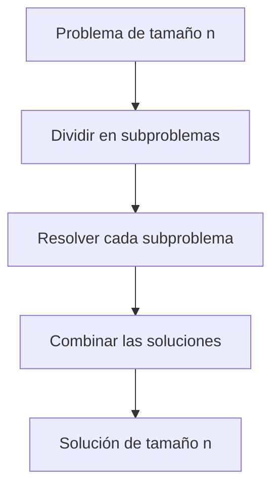
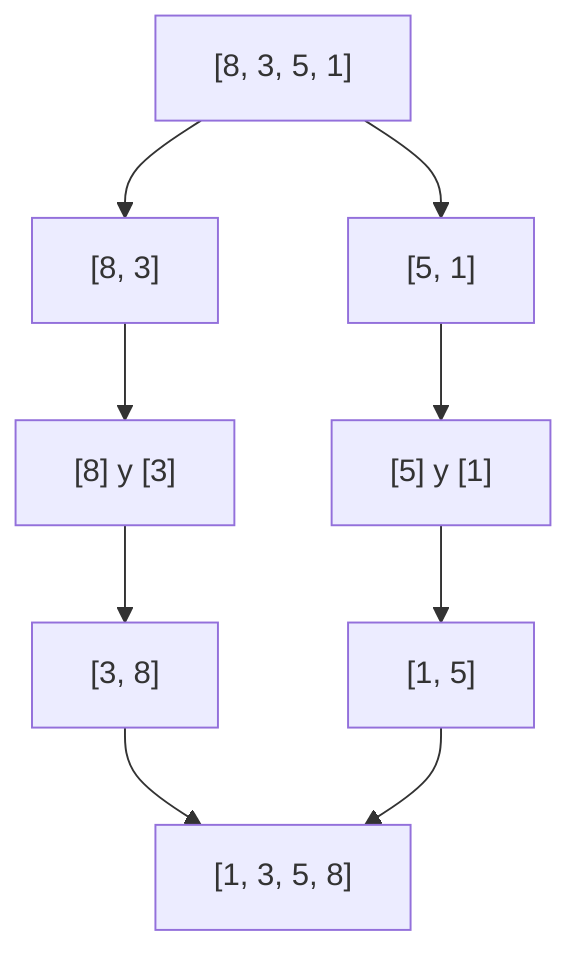
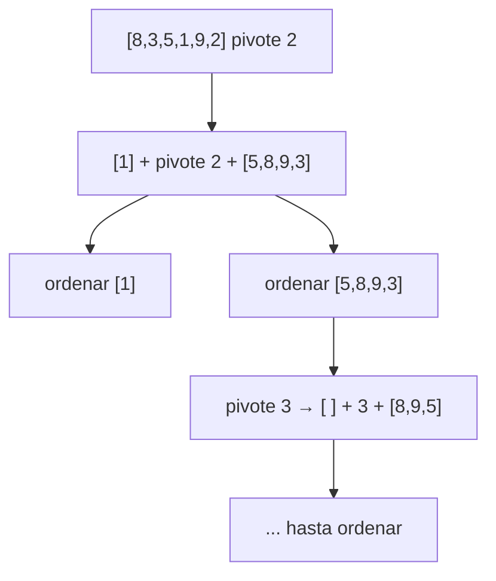

# 20. Mergesort y Quicksort

> [!info] Al terminar este capítulo tenés que poder
> - Explicar divide y vencerás en los dos algoritmos.
> - Trazar una partición de Quicksort.
> - Comparar complejidades, memoria y estabilidad.
> - Justificar cuál elegir según el caso.

> [!abstract] Qué debés saber (nivel 1)
> - **Mergesort**: divide en mitades, ordena y **mezcla**. O(n log n) siempre, O(n) de memoria, **estable**.
> - **Quicksort**: elige **pivote**, particiona, y ordena cada lado. Promedio O(n log n), peor O(n²), **in-place**, **no estable**.
> - Ambos son **divide y vencerás**.
> - Mergesort garantiza el peor caso; Quicksort suele ser más rápido en la práctica.
> - El pivote mal elegido degrada Quicksort a O(n²).

## 20.1 Divide y vencerás



| Algoritmo | Cómo divide | Cómo combina |
|---|---|---|
| Mergesort | A la mitad, por posición | **Mezcla** dos mitades ordenadas |
| Quicksort | Por valor, alrededor del pivote | No combina: ordena en el lugar |

## 20.2 Mergesort

```java
public class Mergesort {

    public static void ordenar(int[] v) {
        if (v.length < 2) return;
        mergeSort(v, 0, v.length - 1);
    }

    private static void mergeSort(int[] v, int izq, int der) {
        if (izq >= der) return;

        int medio = (izq + der) / 2;

        mergeSort(v, izq, medio);
        mergeSort(v, medio + 1, der);

        mezclar(v, izq, medio, der);
    }

    private static void mezclar(int[] v, int izq, int medio, int der) {

        int[] aux = new int[der - izq + 1];

        int i = izq;          // recorre la mitad izquierda
        int j = medio + 1;    // recorre la mitad derecha
        int k = 0;            // recorre el auxiliar

        while (i <= medio && j <= der) {
            if (v[i] <= v[j]) {       // <= conserva la estabilidad
                aux[k++] = v[i++];
            } else {
                aux[k++] = v[j++];
            }
        }

        while (i <= medio) aux[k++] = v[i++];
        while (j <= der) aux[k++] = v[j++];

        for (int x = 0; x < aux.length; x++) {
            v[izq + x] = aux[x];
        }
    }

    public static void main(String[] args) {

        int[] datos = {8, 3, 5, 1, 9, 2};

        ordenar(datos);

        for (int x : datos) System.out.print(x + " ");
    }
}
```

Salida:

```text
1 2 3 5 8 9
```

### Cómo funciona



| Etapa | Resultado |
|---|---|
| Dividir | `[8, 3, 5, 1]` → `[8, 3]` y `[5, 1]` |
| Dividir otra vez | `[8]`, `[3]`, `[5]`, `[1]` |
| Mezclas parciales | `[3, 8]` y `[1, 5]` |
| Mezcla final | `[1, 3, 5, 8]` |

### Propiedades

| Aspecto | Valor |
|---|---|
| Mejor caso | O(n log n) |
| Promedio | O(n log n) |
| Peor caso | **O(n log n)** (garantizado) |
| Memoria | **O(n)** auxiliar |
| Estable | **Sí** (si se toma primero la izquierda en igualdad) |
| In-place | No |

> [!important] La clave de la estabilidad
> `if (v[i] <= v[j])` toma primero el de la izquierda cuando son iguales. Si usás `<`, el de la derecha pasa antes y se pierde la estabilidad.

### Traza de una mezcla

Mezclar `[3, 8]` y `[1, 5]`:

| Paso | `i` | `j` | Comparación | Auxiliar |
|---|---|---|---|---|
| 1 | 3 | 1 | `3 <= 1`? no → toma 1 | `[1]` |
| 2 | 3 | 5 | `3 <= 5`? sí → toma 3 | `[1, 3]` |
| 3 | 8 | 5 | `8 <= 5`? no → toma 5 | `[1, 3, 5]` |
| 4 | 8 | — | copia el resto | `[1, 3, 5, 8]` |

## 20.3 Quicksort

```java
public class Quicksort {

    public static void ordenar(int[] v) {
        if (v.length < 2) return;
        quickSort(v, 0, v.length - 1);
    }

    private static void quickSort(int[] v, int izq, int der) {
        if (izq >= der) return;

        int pivote = particionar(v, izq, der);

        quickSort(v, izq, pivote - 1);
        quickSort(v, pivote + 1, der);
    }

    private static int particionar(int[] v, int izq, int der) {

        int pivote = v[der];       // último elemento como pivote
        int i = izq - 1;           // límite de los menores

        for (int j = izq; j < der; j++) {
            if (v[j] <= pivote) {
                i++;
                int aux = v[i];
                v[i] = v[j];
                v[j] = aux;
            }
        }

        int aux = v[i + 1];
        v[i + 1] = v[der];
        v[der] = aux;

        return i + 1;              // posición definitiva del pivote
    }

    public static void main(String[] args) {

        int[] datos = {8, 3, 5, 1, 9, 2};

        ordenar(datos);

        for (int x : datos) System.out.print(x + " ");
    }
}
```

Salida:

```text
1 2 3 5 8 9
```

### La partición, paso a paso

`[8, 3, 5, 1, 9, 2]`, pivote = `2`:

| `j` | `v[j]` | `<= 2`? | Acción | Arreglo |
|---|---|---|---|---|
| 0 | 8 | no | — | `[8, 3, 5, 1, 9, 2]` |
| 1 | 3 | no | — | `[8, 3, 5, 1, 9, 2]` |
| 2 | 5 | no | — | `[8, 3, 5, 1, 9, 2]` |
| 3 | 1 | sí | `i=0`, intercambia 8 y 1 | `[1, 3, 5, 8, 9, 2]` |
| 4 | 9 | no | — | `[1, 3, 5, 8, 9, 2]` |
| fin | — | — | pivote a `i+1=1` | `[1, 2, 5, 8, 9, 3]` |

Después se ordena `[1]` (ya está) y `[5, 8, 9, 3]` recursivamente.



### Propiedades

| Aspecto | Valor |
|---|---|
| Mejor caso | O(n log n) — pivotes que parten a la mitad |
| Promedio | O(n log n) |
| Peor caso | **O(n²)** — pivote siempre mínimo o máximo (arreglo ya ordenado con pivote en un extremo) |
| Memoria | O(log n) promedio (pila de recursión) |
| Estable | **No** |
| In-place | Sí (respecto del arreglo) |

> [!warning] El peor caso clásico
> Arreglo ya ordenado + pivote en el extremo → cada partición deja un lado vacío. Se hacen `n` niveles en lugar de `log n`. Solución: pivote aleatorio o mediana de tres.

> [!important] Por qué es rápido en la práctica
> Tiene constantes bajas y buena localidad de caché (trabaja sobre el mismo arreglo). Por eso su promedio O(n log n) suele ganarle a Mergesort, que necesita memoria auxiliar.

## 20.4 Comparación final

| Algoritmo | Mejor | Promedio | Peor | Memoria | Estable | In-place |
|---|---|---|---|---|---|---|
| Inserción | O(n) | O(n²) | O(n²) | O(1) | Sí | Sí |
| Shellsort | Depende | Depende | O(n²) | O(1) | No | Sí |
| **Mergesort** | O(n log n) | O(n log n) | **O(n log n)** | O(n) | **Sí** | No |
| **Quicksort** | O(n log n) | O(n log n) | **O(n²)** | O(log n) | No | Sí |

### Guía de elección

| Situación | Elección | Por qué |
|---|---|---|
| Pocos datos o casi ordenados | Inserción | Mejor caso O(n) y simple |
| Memoria limitada, arreglo mediano | Shellsort | In-place y mejor que inserción |
| Estabilidad y tiempo predecible | **Mergesort** | O(n log n) garantizado y estable |
| Buen rendimiento promedio en arreglos | **Quicksort** | Constantes bajas y bajo uso de memoria |
| Datos que no entran en memoria | Mergesort externo | Acceso secuencial |

> [!important] Cómo responder “¿cuál es mejor?”
> “No existe uno mejor en todos los casos. Para pocos datos o casi ordenados, inserción. Si necesito garantía de O(n log n) y estabilidad, Mergesort, a costa de O(n) de memoria. Si busco rendimiento promedio con memoria acotada, Quicksort, asumiendo el riesgo de O(n²) con pivotes malos.”

## 20.5 Programa completo comparativo

```java
import java.util.Arrays;

public class Comparacion {

    public static void main(String[] args) {

        int n = 10_000;
        int[] base = new int[n];

        java.util.Random r = new java.util.Random(42);
        for (int i = 0; i < n; i++) base[i] = r.nextInt(100_000);

        int[] a = base.clone();
        int[] b = base.clone();
        int[] c = base.clone();

        long t1 = System.nanoTime();
        Mergesort.ordenar(a);
        long t2 = System.nanoTime();

        Quicksort.ordenar(b);
        long t3 = System.nanoTime();

        insercion(c);
        long t4 = System.nanoTime();

        System.out.printf("Mergesort: %.2f ms%n", (t2 - t1) / 1e6);
        System.out.printf("Quicksort: %.2f ms%n", (t3 - t2) / 1e6);
        System.out.printf("Inserción: %.2f ms%n", (t4 - t3) / 1e6);

        System.out.println("¿Mismo resultado? "
                + (Arrays.equals(a, b) && Arrays.equals(b, c)));
    }

    static void insercion(int[] v) {
        for (int i = 1; i < v.length; i++) {
            int actual = v[i];
            int j = i - 1;
            while (j >= 0 && v[j] > actual) {
                v[j + 1] = v[j];
                j--;
            }
            v[j + 1] = actual;
        }
    }
}
```

Salida (varía por máquina):

```text
Mergesort: 3.12 ms
Quicksort: 2.05 ms
Inserción: 85.44 ms
¿Mismo resultado? true
```

> [!warning] Medir no es demostrar
> Los tiempos dependen del hardware y de los datos. La comparación conceptual es por complejidad; la medición solo ilustra.
>
> Este ejemplo usa las clases `Mergesort` y `Quicksort` de este capítulo y una copia local de `insercion`, para que compile sin depender del capítulo anterior.

## Errores que suelen tomar

| Error | Consecuencia |
|---|---|
| Mergesort con `<` en vez de `<=` | Pierde estabilidad |
| Mergesort sin arreglo auxiliar | No puede mezclar |
| Quicksort con pivote fijo en arreglo ordenado | O(n²) |
| `particionar` mal el límite `i` | Bucle infinito o resultado incorrecto |
| Olvidar el caso base (`izq >= der`) | Recursión infinita / `StackOverflowError` |
| Decir que Quicksort es estable | Falso |
| Decir que Mergesort es in-place | Falso: usa O(n) |

## Ejercicios

> [!example]- 1. Partición
> **Enunciado:** particionar `[5, 1, 4, 2]` con pivote 2 (último). Indicá el arreglo final de la partición.
> **Solución:** menores que 2: `1`. Resultado: `[1, 2, 4, 5]` con el pivote en el índice 1.

> [!example]- 2. Complejidad
> **Enunciado:** ¿por qué Mergesort es O(n log n) siempre?
> **Solución:** siempre divide en dos mitades iguales (log n niveles) y en cada nivel mezcla n elementos. No depende del orden inicial.

> [!example]- 3. Estabilidad
> **Enunciado:** ordenar por nota `[(Ana,7),(Luis,7),(Eva,6)]` con Mergesort y con Quicksort. ¿Qué pasa con Ana y Luis?
> **Solución:** Mergesort los mantiene en orden (`Eva, Ana, Luis`). Quicksort puede invertirlos, porque no es estable.

> [!example]- 4. Peor caso
> **Enunciado:** ¿qué entrada degrada Quicksort a O(n²) con pivote en el último elemento?
> **Solución:** un arreglo ya ordenado (ascendente o descendente): el pivote siempre queda en un extremo y la partición es 0 / n−1.

> [!example]- 5. Mergesort manual
> **Enunciado:** ordenar `[4, 1, 3, 2]` mostrando divisiones y mezclas.
> **Solución:**
> `[4,1] [3,2]` → `[4][1] [3][2]` → `[1,4] [2,3]` → `[1,2,3,4]`.

> [!example]- 6. a papel
> **Enunciado:** escribir el método `mezclar` de Mergesort y explicar por qué usa un arreglo auxiliar.
> **Solución:** ver 20.2. Usa auxiliar porque no se puede mezclar en el mismo arreglo sin pisar elementos aún no leídos.

## Lo que sigue

[[A_Codigo_para_papel|A. Código listo para papel]].

#libro1
