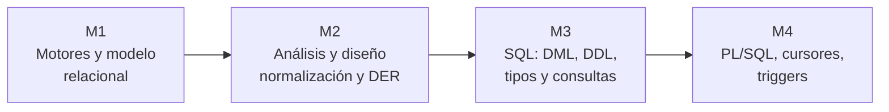

# Libro 2 — Base de Datos

> [!info] Qué es este libro
> Manual para el **Módulo 3 del EFIP I** (Licenciatura en Informática, Siglo 21). Cubre los sub-ejes **5.1** (modelo relacional y álgebra), **5.2** (diseño y normalización), **5.3** (SQL) y **5.4** (extensión procedimental).
> **Canon:** las **16 lecturas oficiales** de INF387 — Base de Datos I (Módulo 1 a Módulo 4, cuatro lecturas por módulo). El libro sigue ese orden. Los complementos de UTN, UP y UNLP están marcados como tales y nunca reemplazan la definición de cátedra.

## Cómo leerlo

> [!tip] Antes de empezar
> Leé [[00_Metodo|el método de estudio]]: tres niveles y respuesta en cinco pasos.

1. Cada capítulo declara a qué **lectura oficial** corresponde (`M1L1`, `M2L3`, etc.).
2. Cada capítulo abre con **lo que tenés que poder hacer**.
3. Los capítulos marcados **complemento** cubren temas que el programa del EFIP pide pero que la cátedra no desarrolla en una lectura propia (SELECT, JOIN, DCL, excepciones, paquetes).
4. Al final: errores típicos y ejercicios con solución plegable.
5. El **método** (pasos, reglas, plantillas) es el de la cátedra; donde aporta, se suma el de UTN.

## Qué priorizar

> [!important] Orden de estudio (según la guía de la compañera)
> | Nivel | Temas |
> |---|---|
> | **1 — Imprescindible** | Modelo relacional · claves y cardinalidades · normalización 1FN–3FN · `SELECT` |
> | **2 — Muy importante** | Álgebra relacional · `JOIN` · funciones de grupo · subconsultas · DDL · DML · transacciones |
> | **3 — Complementario** | DCL · motores relacionales · ingeniería reversa · extensión procedimental |

## Mapa del libro (orden oficial)

### Módulo 1 — Motores y modelo relacional (5.1)

| Lectura | Capítulo |
|---|---|
| **M1L1** Motores de base de datos relacionales | [[bd01_motores-de-bd\|1. Motores de base de datos relacionales]] |
| **M1L2** Componentes del motor MySQL | [[bd02_aplicacion-en-bd\|2. Componentes de una aplicación en base de datos]] |
| **M1L3** Componentes del modelo relacional en MySQL | [[bd03_componentes-modelo-relacional\|3. Componentes del modelo relacional]] · [[bd04_claves-e-integridad\|4. Claves e integridad]] |
| **M1L4** Álgebra relacional | [[bd05_algebra-relacional\|5. Álgebra relacional]] |

[[bd_Cierre_parte1|Cierre del Módulo 1]]

### Módulo 2 — Análisis y diseño (5.2)

| Lectura | Capítulo |
|---|---|
| **M2L1** Análisis y diseño de un modelo de datos | [[bd06_analisis-y-diseno\|6. Análisis y diseño de un modelo de datos]] |
| **M2L2** Normalización de tablas | [[bd07_normalizacion-1fn-3fn\|7. Normalización: de 1FN a 3FN]] |
| **M2L3** Normalización más allá de 1NF | [[bd08_normalizacion-casos\|8. Normalización: casos y formas superiores]] |
| **M2L4** Herramienta gráfica DER | [[bd09_der\|9. Diagrama entidad-relación]] · [[bd10_der-a-tablas\|10. Del DER a las tablas]] |

[[bd_Cierre_parte2|Cierre del Módulo 2]]

### Módulo 3 — SQL (5.3)

| Lectura | Capítulo |
|---|---|
| **M3L1** El lenguaje SQL | [[bd11_lenguaje-sql\|11. El lenguaje SQL]] |
| **M3L2** DML: INSERT, UPDATE y DELETE | [[bd12_dml\|12. DML: insertar, actualizar y borrar]] |
| **M3L3** DDL: CREATE, ALTER y DROP | [[bd13_ddl\|13. DDL: definir estructuras]] |
| **M3L4** Convenciones y tipos de datos | [[bd14_convenciones-y-tipos\|14. Convenciones de nombres y tipos de datos]] |
| Complemento (programa 5.3) | [[bd15_select\|15. SELECT: proyección, filtro y orden]] · [[bd16_joins-subconsultas\|16. JOIN y subconsultas]] · [[bd17_metodo-consultas\|17. Método para resolver consultas]] · [[bd18_agrupamiento\|18. Agrupamiento]] |
| Complemento (programa 5.3) | [[bd19_dcl\|19. DCL: permisos y roles]] |

[[bd_Cierre_parte3|Cierre del Módulo 3]]

### Módulo 4 — Extensión procedimental (5.4)

| Lectura | Capítulo |
|---|---|
| **M4L1** Extensiones procedimentales de SQL | [[bd20_extensiones-procedimentales\|20. Extensiones procedimentales de SQL]] |
| **M4L2** Programas almacenados en MySQL | [[bd21_programas-almacenados\|21. Programas almacenados: procedimientos y funciones]] |
| **M4L3** El uso de SQL en SQL/PSM | [[bd22_cursores\|22. Cursores]] |
| Complemento | [[bd23_excepciones\|23. Excepciones]] |
| **M4L4** Triggers | [[bd24_triggers\|24. Triggers]] |
| Complemento | [[bd25_paquetes\|25. Paquetes]] |

[[bd_Cierre_parte4|Cierre del Módulo 4]]

### Anexos

- [[bd_A_SQL_para_papel|A. SQL listo para papel]]
- [[bd_B_Banco_preguntas|B. Banco de preguntas de oral]]
- [[bd_C_Errores|C. Errores frecuentes]]
- [[bd_D_Mapa|D. Mapa del programa y trazabilidad]]
- [[bd_E_Transacciones|E. Transacciones (opcional, fuera del programa S21)]]

## Qué cambió respecto de la versión anterior

> [!note] Reordenamiento por módulos
> La versión anterior seguía un orden pedagógico propio (motores → modelo → álgebra → diseño → SQL → PL/SQL). Esta versión sigue el **orden oficial de las 16 lecturas** y conserva el contenido, reubicado:
> - **M1L2** era un hueco: ahora es el capítulo 2 (aplicación en base de datos, roles, esquema, diccionario).
> - **M3L4** era un hueco: ahora es el capítulo 14 (convenciones y tipos).
> - La normalización se dividió en **7** (1FN–3FN) y **8** (casos y formas superiores), como las lecturas M2L2 y M2L3.
> - **Triggers** (M4L4) y **paquetes** (complemento) se separaron en dos capítulos.

## El caso que atraviesa el libro

> [!example] Caso integrador
> El municipio necesita registrar **dispositivos**, sus **alertas** y las **reparaciones**.
>
> - Un dispositivo genera muchas alertas (1:N).
> - Una alerta puede derivar en una reparación (1:1).
> - Un técnico atiende muchas reparaciones (1:N).
>
> Cada módulo resuelve una etapa: modelo (M1), diseño y normalización (M2), consultas (M3) y automatización con rutinas y triggers (M4).

## Regla de oro del módulo

> [!important] El error más caro: saltar el modelo
> Si empezás por el `CREATE TABLE`, vas a normalizar tarde y mal. El orden es: **entidades y relaciones → claves → normalización → DDL → DML → consultas → rutinas**.

#libro2 #basededatos #efip
