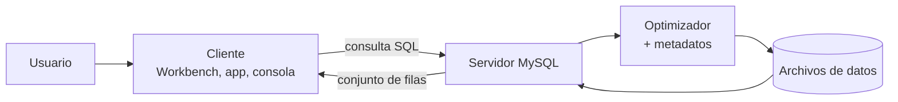
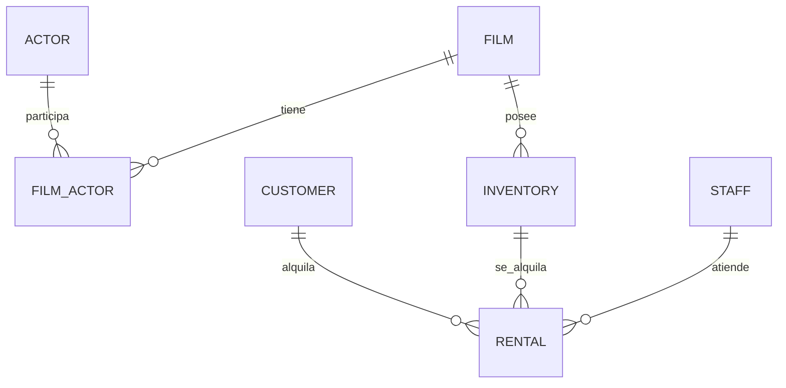

# 1. Motores de base de datos relacionales

> [!info] Al terminar este capítulo tenés que poder
> - Definir base de datos, SGBD y motor relacional sin confundirlos.
> - Explicar el modelo cliente-servidor.
> - Ubicar Oracle, MySQL y SQLite según su ámbito de uso.
> - Reconocer MySQL Workbench y el esquema `sakila`.

> [!abstract] Qué debés saber (nivel 1)
> - **Base de datos:** conjunto de datos estructurados, definidos por un proceso, que evita redundancia y se guarda en almacenamiento masivo.
> - **SGBD:** software que administra la base (definir, almacenar, consultar, controlar).
> - **Motor relacional:** SGBD que organiza los datos en **relaciones** (tablas).
> - **Cliente-servidor:** el cliente pide, el servidor procesa y responde.
> - MySQL es el motor de la cátedra; `sakila` es la base de ejemplo.

## 1.1 Qué es una base de datos

> [!quote] Definición de cátedra
> **Base de datos:** conjunto de datos estructurados y definidos a través de un proceso específico, que busca evitar la redundancia y que se almacena en algún medio de almacenamiento masivo.

Tres ideas que la definición exige:

1. **Estructurados:** no es un montón de archivos sueltos; hay un esquema.
2. **Sin redundancia innecesaria:** el dato se guarda una vez y se referencia.
3. **Persistente:** sobrevive al apagado del sistema.

| Concepto | Qué es | Ejemplo |
|---|---|---|
| Dato | Valor mínimo almacenado | `30` |
| Campo / columna | Atributo con un dominio | `edad` |
| Registro / fila | Conjunto de valores de una entidad | `(1, Ana, 30)` |
| Tabla / relación | Conjunto de filas del mismo tipo | `cliente` |
| Base de datos | Conjunto de tablas relacionadas | `municipio` |
| SGBD | Software que administra todo | MySQL, Oracle |

> [!warning] Confusión clásica
> “MySQL es la base de datos”. **MySQL es el motor (SGBD)**; la base de datos es `municipio`, `sakila`, etc. El examen pregunta la diferencia.

## 1.2 Arquitectura cliente-servidor



| Componente | Función |
|---|---|
| Cliente | Envía sentencias SQL y muestra resultados |
| Servidor | Interpreta, optimiza, ejecuta y controla el acceso |
| Optimizador | Decide el plan de acceso más eficiente |
| Diccionario de datos | Metadatos: tablas, columnas, tipos, restricciones, permisos |
| Almacenamiento | Archivos donde viven los datos |

> [!important] Por qué importa el optimizador
> SQL es **declarativo**: vos decís *qué* querés, no *cómo* obtenerlo. El optimizador elige índices y orden de join usando los metadatos. Por eso dos consultas equivalentes pueden tener planes distintos.

## 1.3 Motores: Oracle, MySQL y SQLite

| Motor | Ámbito | Características | Uso en la cátedra |
|---|---|---|---|
| **Oracle Database** | Empresarial, gran porte | Instancias, servicios, *tablespaces* (`SYSTEM`, `USERS`), SQL Developer | 5.4 (PL/SQL) |
| **MySQL** | Web y aplicaciones | Licencia dual (Community / Enterprise), Workbench, InnoDB | **5.1 a 5.3** |
| **SQLite** | Pequeñas apps y móviles | Archivo único, sin servidor, sin usuarios | Mención conceptual |

### Oracle (lo mínimo)

- `SYSTEM`: diccionario de datos.
- `USERS`: donde se crean tablas e índices del usuario.
- Se administra con SQL Developer; se crean usuarios y se otorgan permisos.

### MySQL (lo que se usa)

- **Community** (gratuita) y **Enterprise** (paga).
- **MySQL Workbench**: modelado, desarrollo SQL, administración.
- Usuario de práctica: `BD1`, con permisos sobre el esquema `sakila`.

```sql
-- Conectado como BD1
SHOW DATABASES;
USE sakila;
SHOW TABLES;
SELECT COUNT(*) FROM actor;
```

Salida esperada (fragmento):

```text
+--------------------+
| Database           |
+--------------------+
| information_schema |
| mysql              |
| performance_schema |
| sakila             |
| sys                |
+--------------------+
```

```text
+----------------------------+
| Tables_in_sakila           |
+----------------------------+
| actor                      |
| address                    |
| category                   |
| city                       |
| customer                   |
| film                       |
| film_actor                 |
| rental                     |
| ...                        |
+----------------------------+
```

## 1.4 El esquema `sakila`

Es una base de ejemplo de alquiler de películas. Sirve para practicar porque tiene **relaciones 1:N y N:M reales**.



| Tabla | Rol |
|---|---|
| `actor` | Actores |
| `film` | Películas |
| `film_actor` | Tabla puente N:M entre actor y film |
| `customer` | Clientes |
| `inventory` | Copias físicas de cada película |
| `rental` | Alquileres |

> [!tip] Para qué sirve `sakila` en el examen
> Es el ejemplo concreto que la cátedra usa para hablar de claves, relaciones y consultas. Si te preguntan “¿dónde está la tabla puente?”, la respuesta es `film_actor`.

## 1.5 Programa completo: primera conexión

```sql
-- 1. Crear una base propia
CREATE DATABASE IF NOT EXISTS municipio
    CHARACTER SET utf8mb4
    COLLATE utf8mb4_0900_ai_ci;

-- 2. Usarla
USE municipio;

-- 3. Crear una tabla mínima
CREATE TABLE dispositivo (
    id          INT AUTO_INCREMENT PRIMARY KEY,
    codigo      VARCHAR(10) NOT NULL UNIQUE,
    tipo        VARCHAR(20) NOT NULL,
    ubicacion   VARCHAR(100) NOT NULL,
    activo      BOOLEAN NOT NULL DEFAULT TRUE
);

-- 4. Insertar y consultar
INSERT INTO dispositivo (codigo, tipo, ubicacion)
VALUES ('S-01', 'semaforo', 'Av. Belgrano'),
       ('C-01', 'camara', 'Plaza Moreno');

SELECT * FROM dispositivo;
```

Salida:

```text
+----+--------+----------+---------------+--------+
| id | codigo | tipo     | ubicacion     | activo |
+----+--------+----------+---------------+--------+
|  1 | S-01   | semaforo | Av. Belgrano  |      1 |
|  2 | C-01   | camara   | Plaza Moreno  |      1 |
+----+--------+----------+---------------+--------+
```

> [!warning] `BOOLEAN` en MySQL
> Es un alias de `TINYINT(1)`: se muestra `1`/`0`, no `TRUE`/`FALSE`. No es un error; es la implementación.

## Errores que suelen tomar

| Error | Corrección |
|---|---|
| “MySQL es una base de datos” | MySQL es el **motor**; la base es el esquema |
| Confundir SGBD con base | El SGBD es el software; la base, los datos |
| Creer que SQL dice *cómo* | SQL es declarativo: dice *qué* |
| Usar `sakila` como si fuera propia | Es una base de ejemplo, de solo lectura en la cátedra |
| Olvidar `USE` | `ERROR 1046: No database selected` |

## Ejercicios

> [!example]- 1. Definiciones
> **Enunciado:** ¿cuál es la diferencia entre base de datos y SGBD?
> **Solución:** la base son los datos estructurados y persistentes; el SGBD es el software que los define, almacena, consulta y controla.

> [!example]- 2. Ámbitos
> **Enunciado:** asigná cada motor a su ámbito: Oracle, MySQL, SQLite.
> **Solución:** Oracle → empresarial de gran porte; MySQL → web y aplicaciones; SQLite → apps pequeñas y móviles.

> [!example]- 3. Tabla puente
> **Enunciado:** en `sakila`, ¿qué tabla resuelve la relación N:M entre `actor` y `film`?
> **Solución:** `film_actor`, con las claves foráneas `actor_id` y `film_id`.

> [!example]- 4. a papel
> **Enunciado:** escribí el DDL mínimo de una tabla `alerta` con id, mensaje, prioridad y fecha.
> **Solución:**
> ```sql
> CREATE TABLE alerta (
>     id        INT AUTO_INCREMENT PRIMARY KEY,
>     mensaje   VARCHAR(200) NOT NULL,
>     prioridad TINYINT NOT NULL,
>     atendida  BOOLEAN NOT NULL DEFAULT FALSE,
>     fecha     DATETIME NOT NULL DEFAULT CURRENT_TIMESTAMP
> );
> ```

## Lo que sigue

[[bd02_aplicacion-en-bd|2. Componentes de una aplicación en base de datos]].

#libro2 #basededatos #sgbd
