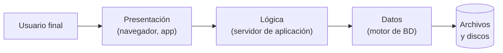

# 2. Componentes de una aplicación en base de datos

> [!info] Al terminar este capítulo tenés que poder
> - Describir los componentes de una aplicación que usa una base de datos.
> - Explicar la arquitectura cliente-servidor y las capas.
> - Diferenciar los roles de DBA, desarrollador y usuario final.
> - Distinguir servidor, instancia, esquema y catálogo.
> - Usar el diccionario de datos para inspeccionar un esquema.

> [!abstract] Qué debés saber (nivel 1)
> - Una aplicación en BD tiene **presentación**, **lógica** y **datos**.
> - El **servidor** guarda y procesa; el **cliente** pide.
> - **Instancia:** el proceso en ejecución. **Esquema:** el conjunto de objetos de un usuario/base.
> - **Catálogo:** el conjunto de esquemas; en MySQL `information_schema` expone los metadatos.
> - Tres roles: **DBA** (administra), **desarrollador** (crea objetos y consulta), **usuario final** (usa la aplicación).
> - MySQL escucha en el puerto **3306** por defecto.

> [!quote] Cátedra
> La lectura presenta los componentes del motor MySQL y los elementos de una aplicación en base de datos: al instalar el software y ponerlo a disposición somos **administradores**; al conectarnos con el cliente y crear tablas somos **desarrolladores**; al usar una aplicación somos **usuarios finales**.

## 2.1 Las tres capas de una aplicación



| Capa | Qué hace | Ejemplo |
|---|---|---|
| **Presentación** | Muestra y captura datos | Navegador, app móvil, escritorio |
| **Lógica** | Reglas del negocio, validaciones | Java, PHP, Node |
| **Datos** | Almacena, indexa, garantiza integridad | MySQL, Oracle, SQLite |

> [!important] Dos capas o tres
> En **dos capas** el cliente habla directo con el motor (típico de una herramienta como Workbench). En **tres capas** hay un servidor de aplicación en el medio (típico de un sistema web). El EFIP pide reconocer ambas.

## 2.2 Cliente y servidor

| Concepto | Qué es |
|---|---|
| **Servidor** | Proceso que escucha conexiones, valida usuarios y ejecuta sentencias |
| **Instancia** | El servidor en ejecución, con su memoria y sus procesos |
| **Cliente** | Programa que se conecta, envía SQL y recibe resultados |
| **Conexión** | Sesión autenticada entre cliente y servidor |
| **Puerto** | 3306 en MySQL; 1521 en Oracle; 5432 en PostgreSQL |

```text
Cliente  ---(TCP 3306, usuario/contraseña)--->  Servidor MySQL
   |                                               |
   +--- SQL -------------------------------------->|
   |<-- filas / error -----------------------------+
```

> [!warning] El cliente no "tiene" los datos
> La herramienta gráfica es solo una ventana. Si cerrás el cliente, la base sigue en el servidor. Confundir "mi conexión" con "mi base" es el error que lleva a borrar el esquema equivocado.

## 2.3 Servidor, esquema y catálogo

| Nivel | Qué agrupa | Ejemplo |
|---|---|---|
| **Servidor** | Todas las bases y usuarios | `localhost:3306` |
| **Catálogo** | Conjunto de esquemas | `information_schema` |
| **Esquema** | Tablas, vistas, rutinas de un dominio | `sakila`, `bd1_tp2` |
| **Tabla** | Filas y columnas | `sakila.actor` |

En MySQL, `CREATE DATABASE` y `CREATE SCHEMA` son sinónimos: cada base es un esquema.

> [!tip] La regla de nombres
> Se puede escribir `esquema.tabla` para no depender de la base por defecto: `SELECT * FROM sakila.actor;`. Es la forma de trabajar cuando una consulta toca dos esquemas.

## 2.4 Los tres roles

| Rol | Qué hace | Qué usa |
|---|---|---|
| **DBA** | Instala, crea usuarios, asigna permisos, respalda, ajusta rendimiento | `CREATE USER`, `GRANT`, `BACKUP` |
| **Desarrollador** | Crea tablas, vistas, rutinas; escribe consultas | `CREATE TABLE`, `SELECT`, `INSERT` |
| **Usuario final** | Usa la aplicación; no escribe SQL | Formularios, reportes |

> [!important] El principio de menor privilegio
> Cada rol recibe solo los permisos que necesita. El usuario de la aplicación no debe poder borrar tablas; el DBA no debería usarse para navegar datos.

```sql
-- El DBA crea el usuario de la aplicación
CREATE USER 'app_alertas'@'localhost' IDENTIFIED BY 'clave_segura';
GRANT SELECT, INSERT, UPDATE ON municipio.* TO 'app_alertas'@'localhost';
-- Sin DROP, sin ALTER, sin acceso a otros esquemas
```

## 2.5 Herramientas

| Herramienta | Tipo | Para qué |
|---|---|---|
| **MySQL Workbench** | Gráfica oficial | Modelado, consultas, administración |
| **Cliente `mysql`** | Línea de comandos | Scripts, automatización |
| **phpMyAdmin** | Web | Administración rápida |
| **Navicat / DBeaver** | Gráfica de terceros | Multi-motor |
| **JDBC / drivers** | Biblioteca | Conectar desde Java |

> [!example] Primer contacto con el esquema
> ```sql
> SHOW DATABASES;                     -- qué esquemas hay
> USE sakila;                         -- cuál es el actual
> SHOW TABLES;                        -- qué tablas tiene
> DESCRIBE actor;                     -- columnas, tipos y claves
> SELECT COUNT(*) FROM actor;         -- cuántas filas
> ```
> Ese recorrido —base → tabla → columnas → filas— es el que se hace al llegar a un sistema desconocido.

## 2.6 El diccionario de datos

El motor guarda **metadatos**: datos sobre los datos. En MySQL se consultan en `information_schema`.

```sql
-- Columnas de una tabla
SELECT column_name, data_type, is_nullable, column_key
FROM information_schema.columns
WHERE table_schema = 'sakila' AND table_name = 'actor';

-- Claves foráneas
SELECT constraint_name, table_name, referenced_table_name
FROM information_schema.key_column_usage
WHERE referenced_table_name IS NOT NULL
  AND table_schema = 'sakila';
```

| Vista | Qué muestra |
|---|---|
| `information_schema.tables` | Tablas y vistas |
| `information_schema.columns` | Columnas y tipos |
| `information_schema.key_column_usage` | Claves |
| `information_schema.routines` | Procedimientos y funciones |

> [!important] Para qué sirve en el examen
> Si te dan una base desconocida, el diccionario te dice **qué hay** sin abrir cada tabla. Es la forma técnica de hacer ingeniería reversa.

## 2.7 El esquema `sakila`

La base de ejemplo de MySQL trae un videoclub con 16 tablas: `actor`, `film`, `film_actor`, `customer`, `rental`, `payment`, `store`, `staff`, `inventory`, `category`, `language`, `address`, `city`, `country`, `film_category` y `film_text`.

| Tabla | Rol |
|---|---|
| `film` | Catálogo de películas |
| `actor` | Actores |
| `film_actor` | Relación M:N entre películas y actores |
| `customer` | Clientes |
| `rental` | Alquileres |
| `payment` | Pagos |
| `inventory` | Copias disponibles por tienda |

> [!tip] Por qué se usa Sakila
> Porque tiene relaciones 1:N y M:N reales, claves foráneas y datos suficientes para practicar consultas sin inventar un esquema. Todo el libro usa Sakila cuando necesita un ejemplo con datos.

## 2.8 Método: leer una aplicación en base de datos

| Paso | Pregunta | Dónde se responde |
|---|---|---|
| 1 | ¿Dónde está el motor? | Host, puerto, instancia |
| 2 | ¿Con qué usuario me conecto? | `CREATE USER`, `GRANT` |
| 3 | ¿Qué esquema uso? | `SHOW DATABASES`, `USE` |
| 4 | ¿Qué objetos tiene? | `SHOW TABLES`, diccionario |
| 5 | ¿Cómo se relacionan? | Claves foráneas |
| 6 | ¿Quién hace cada rol? | DBA, desarrollador, aplicación |

## Errores que suelen tomar

| Error | Corrección |
|---|---|
| Confundir base con servidor | El servidor aloja varias bases |
| Confundir esquema con tabla | El esquema agrupa tablas |
| Usar el usuario `root` para la aplicación | Se crea un usuario con permisos mínimos |
| Creer que Workbench "contiene" los datos | Los datos están en el servidor |
| Ignorar el puerto al conectar | 3306 por defecto en MySQL |
| No fijar la base con `USE` | La sentencia falla o usa la base equivocada |

## Ejercicios

> [!example]- 1. Capas
> **Enunciado:** una app web con Java y MySQL, ¿cuántas capas tiene?
> **Solución:** tres: navegador (presentación), servidor Java (lógica), MySQL (datos).

> [!example]- 2. Roles
> **Enunciado:** ¿quién crea el usuario de la aplicación?
> **Solución:** el DBA, con `CREATE USER` y `GRANT`.

> [!example]- 3. Objetos
> **Enunciado:** ¿qué sentencia lista las tablas del esquema actual?
> **Solución:** `SHOW TABLES;`.

> [!example]- 4. Metadatos
> **Enunciado:** ¿dónde consultás los tipos de las columnas?
> **Solución:** en `information_schema.columns`.

> [!example]- 5. a papel
> **Enunciado:** dibujá una arquitectura de tres capas con sus componentes.
> **Solución:** ver 2.1.

## Lo que sigue

[[bd03_componentes-modelo-relacional|3. Componentes del modelo relacional]].

#libro2 #mysql #arquitectura
