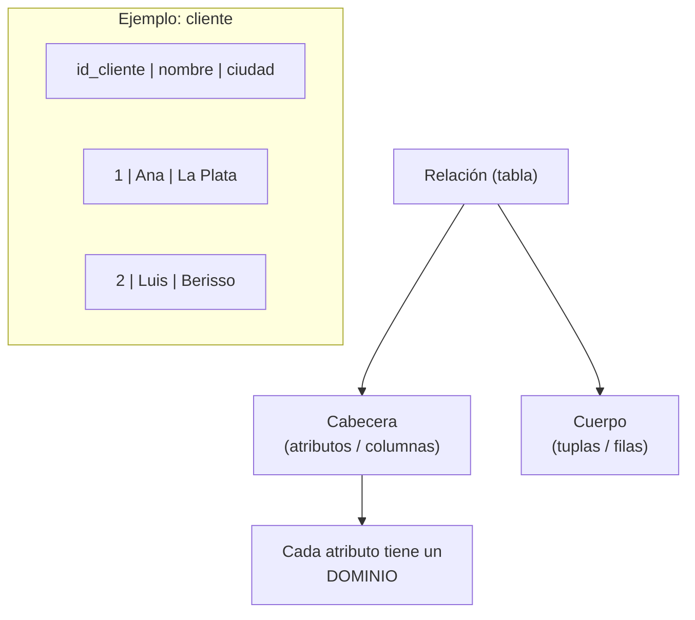

# 3. Componentes del modelo relacional

> [!info] Al terminar este capítulo tenés que poder
> - Nombrar y ubicar cada componente de una relación.
> - Calcular grado y cardinalidad.
> - Aplicar el **método de selección de clave primaria** de la cátedra.
> - Enumerar las propiedades de una relación y las reglas de Codd.
> - Distinguir los tres tipos de integridad.

> [!abstract] Qué debés saber (nivel 1)
> - **Relación** = tabla; **tupla** = fila; **atributo** = columna.
> - **Grado** = columnas; **cardinalidad** = filas; **dominio** = valores permitidos.
> - Una relación no tiene tuplas duplicadas ni orden.
> - Clave: **unicidad + minimalidad** (irreducibilidad).
> - Atributo **primo**: pertenece a alguna clave candidata.
> - Tres integridades: **de entidad**, **referencial** y **de dominio/negocio**.

## 3.1 Componentes



| Concepto | Definición de cátedra | En la práctica |
|---|---|---|
| Relación | Representación bidimensional de filas y columnas | Tabla |
| Tupla | Hecho contenido en una relación; combinación única | Fila |
| Atributo | Propiedad ligada a un dominio | Columna |
| Cabecera | Conjunto de atributos | Nombres de columnas |
| Cuerpo | Conjunto de tuplas | Filas |
| Dato | Intersección de fila y columna | Celda |
| Grado | Número de columnas | 3 en `cliente` |
| Cardinalidad | Número de tuplas | 2 en `cliente` |
| Dominio | Valores posibles del atributo | Texto de 50, entero 1..5 |

> [!important] Grado y cardinalidad
> 📌 **Grado = columnas** (estático, cambia si cambia el esquema). **Cardinalidad = filas** (dinámica, cambia con cada alta o baja).

## 3.2 Propiedades de una relación

| # | Propiedad | Consecuencia |
|---|---|---|
| 1 | **Cada entrada es atómica** | No hay listas ni grupos repetitivos en una celda |
| 2 | **El orden de los atributos no importa** | `(a, b)` y `(b, a)` son la misma relación |
| 3 | **El orden de las tuplas no importa** | No existe “la primera fila” conceptualmente |
| 4 | **No hay tuplas duplicadas** | Una relación es un conjunto |
| 5 | **Cada atributo tiene un dominio** | El DBMS controla los valores |

> [!warning] La tabla no siempre es una relación
> Sin clave primaria ni `UNIQUE`, MySQL **permite** filas duplicadas. En ese momento la tabla deja de cumplir la propiedad 4. La clave no es un adorno: es lo que la hace relación.

## 3.3 Las reglas de Codd

En 1985 Codd publicó 13 reglas (0 a 12) para definir qué es un SGBD verdaderamente relacional. No se memorizan todas; estas son las que se preguntan:

| Regla | Contenido | Idea para el oral |
|---|---|---|
| **0 — Fundación** | Un SGBD relacional debe gestionar datos solo con capacidades relacionales | No vale un sistema “con algo de SQL” |
| **1 — Información** | Toda la información se representa como valores en relaciones | No hay punteros ni estructuras ocultas para el usuario |
| **2 — Acceso garantizado** | Todo dato atómico es accesible por tabla + clave + columna | No hace falta conocer el almacenamiento |
| **3 — Nulos** | Los `NULL` se tratan de forma sistemática | Distintos de 0 y de `''` |
| **4 — Catálogo dinámico** | Los metadatos se guardan como relaciones y se consultan igual | `information_schema` |
| **7 — Operaciones de alto nivel** | Se puede insertar, actualizar y borrar conjuntos completos | `INSERT ... SELECT`, `UPDATE` masivo |
| **8 — Independencia física** | Cambiar el almacenamiento no cambia las aplicaciones | Índices, tablespaces |
| **9 — Independencia lógica** | Cambiar el esquema sin romper lo que preserva información | Vistas |
| **10 — Independencia de integridad** | Las reglas se definen en el catálogo, no en el programa | `CHECK`, `FK` |
| **11 — Independencia de distribución** | La ubicación de los datos no afecta al usuario | Replicación, sharding |
| **12 — No subversión** | No se puede violar una regla relacional con una herramienta de bajo nivel | Sin accesos que salteen las restricciones |

> [!tip] Cómo responder
> “Codd definió trece reglas para certificar que un SGBD es relacional. Las más citadas son la de información (todo se representa en relaciones), la de acceso garantizado, la de nulos sistemáticos, la de catálogo dinámico y las de independencia física y lógica.”

## 3.4 Claves: el método de selección

### Definiciones

| Tipo | Definición | Ejemplo |
|---|---|---|
| **Superclave** | Cualquier conjunto de atributos que identifica de forma única una fila; puede tener atributos de más | `(legajo)`, `(legajo, nombre)`, `(dni, email)` |
| **Candidata** | Atributo o conjunto que cumple **unicidad** y **minimalidad** | `dni`, `legajo`, `email` |
| **Primaria (PK)** | La candidata elegida como identificador principal | `legajo` |
| **Alternativa** | Candidata no elegida | `dni` con `UNIQUE` |
| **Foránea (FK)** | Atributo que es PK en otra tabla | `id_depto` en `empleado` |
| **Compuesta** | Clave de dos o más atributos | `(id_pelicula, id_actor)` |

> [!tip] La cadena: superclave ⊃ candidata ⊃ primaria
> Toda clave candidata **es** una superclave, pero no al revés: `(legajo, nombre)` identifica la fila y sin embargo no es candidata, porque `legajo` solo ya alcanza. La candidata es la superclave **mínima**; la primaria es la candidata que el diseñador elige.

> [!important] Unicidad **y** minimalidad
> `(dni, nombre)` identifica de forma única, pero **no es minimal**: `dni` solo ya alcanza. Una clave candidata no puede tener atributos de más.

### Método de la cátedra (UTN)

Si la entidad tiene **un solo identificador**, ese es la PK. Si tiene **varios**:

1. **Entre un identificador simple y uno compuesto → elegir el simple.**
2. **Entre dos simples → elegir el de menor tamaño físico** (menos bytes).
3. El resto queda como **clave candidata / alternativa** (`UNIQUE`).
4. Se puede usar **autoincremental** como PK subrogada; el usuario solo consulta, no la genera ni modifica.

> [!example] Aplicación
> `Empleado(legajo INT, dni VARCHAR(10), email VARCHAR(100), nombre, apellido)`
>
> - Candidatas: `legajo`, `dni`, `email`.
> - `legajo` es `INT` (4 bytes): la más chica → **PK**.
> - `dni` y `email` quedan `UNIQUE`.

### Criterios complementarios (UNLP/UP)

| Criterio | Por qué |
|---|---|
| Única siempre | No puede repetirse |
| No nula | La PK no admite `NULL` |
| **Estable** | Si cambia, hay que actualizar todas las referencias |
| Simple antes que compuesta | Menos joins y menos errores |
| Sin significado | Un código arbitrario no cambia aunque cambie el negocio |

> [!warning] El error de usar la dirección
> La dirección cambia cuando la persona se muda. Si es PK, hay que actualizar todas las FK que la referencian. Mal candidato. Lo mismo con teléfono o email corporativo.

## 3.5 Reglas de integridad

| Integridad | Regla | Se implementa con |
|---|---|---|
| **De entidad** | La PK no se repite y no es nula | `PRIMARY KEY` |
| **Referencial** | Toda FK existe en la PK referenciada, o es nula si la relación es opcional | `FOREIGN KEY` |
| **De dominio** | El valor pertenece al conjunto permitido | Tipo, `CHECK`, `ENUM`, `NOT NULL` |
| **De negocio** | Reglas propias de la organización | `CHECK`, triggers, aplicación |

```sql
CREATE TABLE alerta (
    id        INT AUTO_INCREMENT PRIMARY KEY,        -- entidad
    prioridad TINYINT NOT NULL,
    atendida  BOOLEAN NOT NULL DEFAULT FALSE,
    id_disp   INT NOT NULL,
    CONSTRAINT ck_prio CHECK (prioridad BETWEEN 1 AND 5),   -- dominio
    CONSTRAINT fk_disp FOREIGN KEY (id_disp)
        REFERENCES dispositivo(id)                          -- referencial
);
```

## 3.6 Diccionario de datos

Es una base de datos que el DBMS mantiene con los **metadatos**: tablas, columnas, tipos, claves, restricciones, índices, usuarios y permisos.

| En MySQL | Qué muestra |
|---|---|
| `SHOW TABLES` | Tablas del esquema |
| `DESCRIBE tabla` | Columnas, tipos, claves |
| `SHOW CREATE TABLE` | DDL completo con restricciones |
| `information_schema.COLUMNS` | Metadatos consultables con SQL |

```sql
SELECT table_name, column_name, data_type, is_nullable
FROM information_schema.columns
WHERE table_schema = 'municipio'
ORDER BY table_name, ordinal_position;
```

> [!important] Para qué sirve en el examen
> Es la prueba de la regla 4 de Codd: **el catálogo se consulta con el mismo lenguaje relacional** que los datos.

## 3.7 Ejemplo completo

```sql
CREATE TABLE departamento (
    id_depto     INT PRIMARY KEY,
    nombre_depto VARCHAR(50) NOT NULL,
    ciudad       VARCHAR(50) NOT NULL
);

CREATE TABLE empleado (
    legajo   INT PRIMARY KEY,
    dni      VARCHAR(10) NOT NULL UNIQUE,
    nombre   VARCHAR(50) NOT NULL,
    apellido VARCHAR(50) NOT NULL,
    sueldo   DECIMAL(10,2) NOT NULL,
    id_depto INT NOT NULL,
    CONSTRAINT ck_sueldo CHECK (sueldo > 0),
    CONSTRAINT fk_depto FOREIGN KEY (id_depto)
        REFERENCES departamento(id_depto)
);
```

| Tabla | Grado | Cardinalidad (ejemplo) |
|---|---|---|
| `departamento` | 3 | 2 |
| `empleado` | 6 | 3 |

## Cómo analizar una tabla en 6 pasos

| Paso | Pregunta | Ejemplo |
|---|---|---|
| 1 | ¿Cuántas columnas? | Grado 6 |
| 2 | ¿Cuántas filas? | Cardinalidad 3 |
| 3 | ¿Cada celda es atómica? | Sí → 1FN |
| 4 | ¿Hay claves candidatas? | `legajo`, `dni` |
| 5 | ¿Cuál es la PK y por qué? | `legajo`: simple y más chica |
| 6 | ¿Qué integridades aplican? | PK, FK, `CHECK` |

## Errores que suelen tomar

| Error | Corrección |
|---|---|
| Invertir grado y cardinalidad | Grado = columnas; cardinalidad = filas |
| Creer que toda tabla es relación | Sin clave puede haber duplicados |
| Elegir una clave compuesta habiendo una simple | La simple |
| Elegir un atributo mutable | Elegir uno estable |
| Confundir candidata con primaria | Todas las primarias son candidatas; no al revés |
| Olvidar `NOT NULL` en la FK obligatoria | La relación queda opcional sin querer |
| Decir que `NULL` es 0 | Es “desconocido” |

## Ejercicios

> [!example]- 1. Grado y cardinalidad
> **Enunciado:** `curso(id, nombre, horas, docente)` con 40 filas.
> **Solución:** grado 4; cardinalidad 40.

> [!example]- 2. Candidatas
> **Enunciado:** `persona(dni, cuil, email, nombre)`. ¿Qué claves candidatas ves?
> **Solución:** `dni`, `cuil` y `email` si son únicos. Se elige una como PK; las otras quedan `UNIQUE`.

> [!example]- 3. Método UTN
> **Enunciado:** `Socio(id_socio INT, nro_socio VARCHAR(20), dni VARCHAR(10))`, los tres únicos. ¿Cuál es la PK?
> **Solución:** `id_socio`, por ser simple y el de menor tamaño físico. `nro_socio` y `dni` quedan alternativas.

> [!example]- 4. Propiedades
> **Enunciado:** ¿por qué el modelo formal prohíbe tuplas duplicadas?
> **Solución:** porque una relación es un conjunto y un conjunto no repite elementos. Sin clave, MySQL permite duplicados y la tabla deja de ser relación.

> [!example]- 5. Integridad
> **Enunciado:** clasificá: (a) `dni UNIQUE`, (b) `id_depto REFERENCES departamento`, (c) `prioridad BETWEEN 1 AND 5`.
> **Solución:** (a) entidad/unicidad; (b) referencial; (c) dominio.

> [!example]- 6. a papel
> **Enunciado:** escribí el DDL de `alerta` con PK, FK y un `CHECK`, e indicá grado y cardinalidad si tiene 5 filas.
> **Solución:** ver 4.2. Grado 4 (`id`, `prioridad`, `id_disp`, `fecha`), cardinalidad 5.

## Lo que sigue

[[bd04_claves-e-integridad|4. Claves e integridad]].

#libro2 #basededatos #modelo
