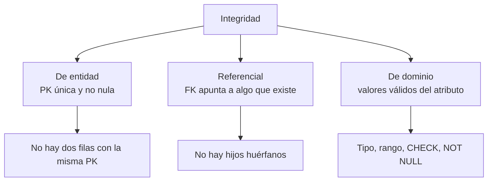

# 4. Claves e integridad

> [!info] Al terminar este capítulo tenés que poder
> - Definir PK, FK y restricciones en DDL.
> - Explicar integridad de entidad, referencial y de dominio.
> - Elegir la acción referencial correcta (`CASCADE`, `SET NULL`, etc.).
> - Provocar y reconocer los errores de violación.

> [!abstract] Qué debés saber (nivel 1)
> - **PK**: identifica la fila; única y no nula.
> - **FK**: referencia la PK de otra tabla; puede ser nula si la relación es opcional.
> - **UNIQUE**: único pero admite varios `NULL` (en MySQL).
> - **NOT NULL**, **CHECK**, **DEFAULT**: restricciones de columna.
> - **Integridad referencial**: no puede existir una FK que apunte a una fila inexistente.
> - Acciones: `NO ACTION`, `CASCADE`, `SET NULL`, `SET DEFAULT`.

## 4.1 Los tres tipos de integridad



| Integridad | Regla | Se implementa con |
|---|---|---|
| **De entidad** | La PK no se repite ni es nula | `PRIMARY KEY` |
| **Referencial** | Toda FK referencia una fila existente (o es `NULL`) | `FOREIGN KEY` |
| **De dominio** | El valor pertenece al conjunto permitido | Tipo, `CHECK`, `NOT NULL`, `ENUM` |

## 4.2 DDL de las restricciones

```sql
CREATE TABLE dispositivo (
    id        INT AUTO_INCREMENT,
    codigo    VARCHAR(10) NOT NULL,
    tipo      VARCHAR(20) NOT NULL,
    activo    BOOLEAN NOT NULL DEFAULT TRUE,
    prioridad TINYINT NOT NULL DEFAULT 3,

    CONSTRAINT pk_dispositivo PRIMARY KEY (id),
    CONSTRAINT uq_dispositivo_codigo UNIQUE (codigo),
    CONSTRAINT ck_dispositivo_tipo
        CHECK (tipo IN ('semaforo', 'camara', 'sensor')),
    CONSTRAINT ck_dispositivo_prioridad
        CHECK (prioridad BETWEEN 1 AND 5)
);
```

```sql
CREATE TABLE alerta (
    id             INT AUTO_INCREMENT,
    mensaje        VARCHAR(200) NOT NULL,
    prioridad      TINYINT NOT NULL,
    atendida       BOOLEAN NOT NULL DEFAULT FALSE,
    fecha          DATETIME NOT NULL DEFAULT CURRENT_TIMESTAMP,
    id_dispositivo INT NOT NULL,

    CONSTRAINT pk_alerta PRIMARY KEY (id),
    CONSTRAINT fk_alerta_dispositivo
        FOREIGN KEY (id_dispositivo) REFERENCES dispositivo(id)
        ON DELETE CASCADE
        ON UPDATE CASCADE,
    CONSTRAINT ck_alerta_prioridad CHECK (prioridad BETWEEN 1 AND 5)
);
```

> [!warning] El orden de creación importa
> No podés crear `alerta` antes que `dispositivo`: la FK necesita que la tabla referenciada **exista**. Si te equivocás, MySQL da `ERROR 1824: Failed to open the referenced table`.

## 4.3 Clave primaria compuesta

```sql
CREATE TABLE film_actor (
    actor_id SMALLINT UNSIGNED NOT NULL,
    film_id  SMALLINT UNSIGNED NOT NULL,
    CONSTRAINT pk_film_actor PRIMARY KEY (actor_id, film_id),
    CONSTRAINT fk_fa_actor FOREIGN KEY (actor_id)
        REFERENCES actor(actor_id) ON DELETE CASCADE,
    CONSTRAINT fk_fa_film FOREIGN KEY (film_id)
        REFERENCES film(film_id) ON DELETE CASCADE
);
```

| Concepto | Detalle |
|---|---|
| PK compuesta | `(actor_id, film_id)` |
| Cada columna sola | No es única: un actor participa en muchas películas |
| La combinación | Sí es única |
| Uso | Tabla puente de una relación N:M |

> [!important] La PK compuesta y la 2FN
> Cuando la PK es compuesta, aparece el riesgo de **dependencia parcial**: un atributo que depende solo de una parte de la clave. Eso viola 2FN ([[bd07_normalizacion-1fn-3fn]]).

## 4.4 Acciones referenciales

| Acción | Qué hace al borrar/actualizar el padre | Cuándo usarla |
|---|---|---|
| `RESTRICT` / `NO ACTION` | **Impide** la operación si hay hijos | Lo más seguro por defecto |
| `CASCADE` | Borra/actualiza los hijos | Dependencia fuerte (detalle de factura) |
| `SET NULL` | Pone la FK en `NULL` | Relación opcional (equipo sin técnico asignado) |
| `SET DEFAULT` | Pone el valor por defecto | Poco frecuente; requiere columna con `DEFAULT` |

```sql
-- Ejemplo: si se borra un dispositivo, sus alertas se borran
ON DELETE CASCADE

-- Ejemplo: si se borra un técnico, la reparación queda sin técnico
ON DELETE SET NULL
```

> [!warning] `CASCADE` no es la opción por defecto
> Si no especificás nada, MySQL usa `RESTRICT`. Un `CASCADE` mal puesto puede borrar media base en cascada. En el examen, justificá la elección.

## 4.5 Violaciones: qué error esperar

```sql
-- 1. PK duplicada
INSERT INTO dispositivo (id, codigo, tipo)
VALUES (1, 'S-01', 'semaforo');
INSERT INTO dispositivo (id, codigo, tipo)
VALUES (1, 'S-02', 'semaforo');
-- ERROR 1062: Duplicate entry '1' for key 'PRIMARY'
```

```sql
-- 2. FK inexistente
INSERT INTO alerta (mensaje, prioridad, id_dispositivo)
VALUES ('Falla', 1, 999);
-- ERROR 1452: Cannot add or update a child row:
-- a foreign key constraint fails
```

```sql
-- 3. CHECK violado
INSERT INTO dispositivo (codigo, tipo)
VALUES ('X-01', 'router');
-- ERROR 3819: Check constraint 'ck_dispositivo_tipo' is violated
```

```sql
-- 4. NOT NULL
INSERT INTO alerta (mensaje, prioridad, id_dispositivo)
VALUES (NULL, 1, 1);
-- ERROR 1048: Column 'mensaje' cannot be null
```

| Error | Restricción violada | Solución |
|---|---|---|
| 1062 | PK o `UNIQUE` | Cambiar el valor duplicado |
| 1452 | FK | Crear el padre o corregir la FK |
| 1451 | FK al borrar el padre | Borrar hijos primero o usar `CASCADE` |
| 3819 | `CHECK` | Corregir el valor |
| 1048 | `NOT NULL` | Enviar un valor |

## 4.6 Programa completo

```sql
CREATE TABLE tecnico (
    id     INT AUTO_INCREMENT PRIMARY KEY,
    nombre VARCHAR(60) NOT NULL
);

CREATE TABLE reparacion (
    id          INT AUTO_INCREMENT PRIMARY KEY,
    fecha       DATE NOT NULL,
    costo       DECIMAL(10,2) NOT NULL DEFAULT 0,
    id_alerta   INT NOT NULL,
    id_tecnico  INT NULL,
    CONSTRAINT fk_rep_alerta FOREIGN KEY (id_alerta)
        REFERENCES alerta(id) ON DELETE CASCADE,
    CONSTRAINT fk_rep_tecnico FOREIGN KEY (id_tecnico)
        REFERENCES tecnico(id) ON DELETE SET NULL,
    CONSTRAINT ck_rep_costo CHECK (costo >= 0)
);
```

```sql
INSERT INTO tecnico (nombre) VALUES ('Luis'), ('Eva');

INSERT INTO reparacion (fecha, costo, id_alerta, id_tecnico)
VALUES ('2026-11-18', 15000, 1, 1),
       ('2026-11-19', 0, 2, NULL);      -- todavía sin técnico

SELECT r.id, r.fecha, r.costo, t.nombre AS tecnico
FROM reparacion r
LEFT JOIN tecnico t ON r.id_tecnico = t.id;
```

Salida:

```text
+----+------------+----------+---------+
| id | fecha      | costo    | tecnico |
+----+------------+----------+---------+
|  1 | 2026-11-18 | 15000.00 | Luis    |
|  2 | 2026-11-19 |     0.00 | NULL    |
+----+------------+----------+---------+
```

> [!tip] `LEFT JOIN` para no perder los huérfanos
> Con `INNER JOIN`, la reparación sin técnico **desaparece**. Con `LEFT JOIN`, se conserva y muestra `NULL`. Es la consulta que se pregunta cuando hay FK opcional.

## Cómo trazar la integridad

| Paso | Pregunta | En el ejemplo |
|---|---|---|
| 1 | ¿Qué tabla es el padre? | `dispositivo`, `alerta`, `tecnico` |
| 2 | ¿Qué tabla es el hijo? | `alerta`, `reparacion` |
| 3 | ¿La relación es obligatoria? | `alerta.id_dispositivo`: sí (`NOT NULL`) |
| 4 | ¿Puede quedar huérfana? | `reparacion.id_tecnico`: sí (`NULL`) |
| 5 | ¿Qué acción elegir? | `CASCADE` para alertas; `SET NULL` para técnico |

## Errores que suelen tomar

| Error | Corrección |
|---|---|
| Crear el hijo antes que el padre | Crear primero el padre |
| FK con tipo distinto al de la PK referenciada | Mismo tipo y signo (`INT UNSIGNED`) |
| Poner `CASCADE` en todo | Elegir según la dependencia real |
| Creer que `UNIQUE` admite un solo `NULL` | MySQL admite varios `NULL` en `UNIQUE` |
| Confundir PK con `UNIQUE` | PK = única + no nula + una por tabla |
| Olvidar `NOT NULL` en la FK obligatoria | La relación quedaría opcional sin querer |

## Ejercicios

> [!example]- 1. Restricciones
> **Enunciado:** escribí el DDL de `sensor(id, codigo, rango_min, rango_max)` con PK, código único y `CHECK` de rango.
> **Solución:**
> ```sql
> CREATE TABLE sensor (
>     id        INT AUTO_INCREMENT PRIMARY KEY,
>     codigo    VARCHAR(10) NOT NULL UNIQUE,
>     rango_min DECIMAL(6,2) NOT NULL,
>     rango_max DECIMAL(6,2) NOT NULL,
>     CONSTRAINT ck_rango CHECK (rango_max > rango_min)
> );
> ```

> [!example]- 2. FK opcional
> **Enunciado:** ¿qué acción referencial usás si al borrar un técnico la reparación debe conservarse?
> **Solución:** `ON DELETE SET NULL`, y la columna `id_tecnico` debe admitir `NULL`.

> [!example]- 3. Error
> **Enunciado:** `ERROR 1452` al insertar una alerta. ¿Qué pasó?
> **Solución:** el `id_dispositivo` no existe en `dispositivo`. Se violó la integridad referencial.

> [!example]- 4. PK compuesta
> **Enunciado:** ¿por qué `film_actor` necesita PK compuesta?
> **Solución:** porque ni `actor_id` ni `film_id` son únicos por separado; la combinación sí identifica cada participación.

> [!example]- 5. a papel
> **Enunciado:** escribí el DDL de `dispositivo` y `alerta` con `ON DELETE CASCADE`, y explicá qué pasa al borrar el dispositivo 1.
> **Solución:** ver 4.2. Al borrar `dispositivo` 1, se borran **todas** sus alertas y, si hubiera `reparacion` con `CASCADE` sobre `alerta`, también esas reparaciones.

## Lo que sigue

[[bd05_algebra-relacional|5. Álgebra relacional]].

#libro2 #basededatos #integridad
