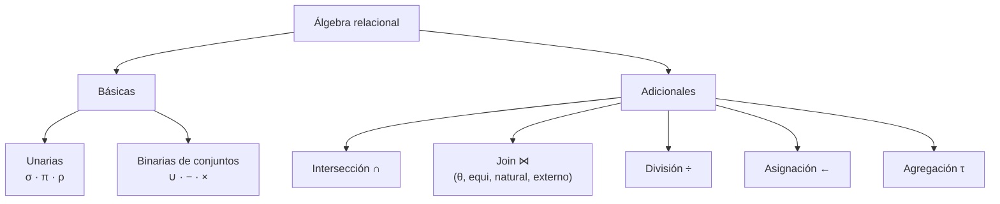
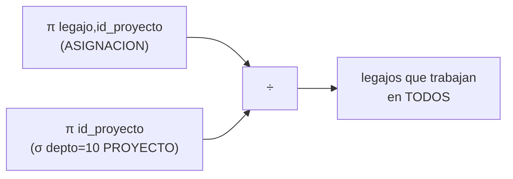

# 5. Álgebra relacional

> [!info] Al terminar este capítulo tenés que poder
> - Aplicar las operaciones básicas **y** las adicionales (join natural, división, asignación, agregación).
> - Resolver una consulta con el **método de 7 pasos**.
> - Expresar “todos los que…” con división o doble negación.
> - Traducir cualquier expresión a SQL.

> [!abstract] Qué debés saber (nivel 1)
> - Toda operación devuelve **otra relación** (propiedad de cierre).
> - **σ** filtra filas; **π** elige columnas y **elimina duplicados**; **ρ** renombra.
> - **∪**, **−**, **∩** exigen relaciones **compatibles** (mismo grado y dominios).
> - **×** combina todo con todo: columnas se suman, filas se multiplican.
> - **⋈** es selección sobre producto por igualdad de claves.
> - **÷** responde “todos los que…”.
> - **←** guarda un resultado intermedio.

## 5.1 Qué es y por qué importa

> [!quote] Definición de cátedra
> **Álgebra relacional:** conjunto de operaciones básicas del modelo relacional que permite especificar peticiones fundamentales de recuperación.

Tres razones de su importancia (las enumera la cátedra):

1. Es el **fundamento formal** del modelo relacional.
2. Es la base de la **implementación y optimización** de consultas.
3. Sus conceptos se **incorporaron a SQL**.

> [!important] Nunca devuelve “un dato suelto”
> Toda operación devuelve una **relación**. Si el resultado es un solo valor, la relación es de 1×1. Esa es la diferencia con una función.

## 5.2 Clasificación de operaciones



| Grupo | Operaciones |
|---|---|
| **Básicas unarias** | Selección `σ`, proyección `π`, renombre `ρ` |
| **Básicas binarias** | Unión `∪`, diferencia `−`, producto cartesiano `×` |
| **Adicionales** | Intersección `∩`, join `⋈`, división `÷`, asignación `←`, agregación `τ` |

## 5.3 Base de ejemplo

**EMPLEADO**

| legajo | nombre | apellido | id_depto | sueldo |
|---:|---|---|---:|---:|
| 1001 | Ana | Pérez | 10 | 950000 |
| 1002 | Luis | Gómez | 10 | 870000 |
| 1003 | Eva | Díaz | 20 | 720000 |
| 1004 | Juan | Sosa | 30 | 610000 |

**DEPARTAMENTO**

| id_depto | nombre_depto | ciudad |
|---:|---|---|
| 10 | Sistemas | La Plata |
| 20 | Compras | Berisso |
| 30 | Ventas | Ensenada |
| 40 | Legales | La Plata |

**PROYECTO**

| id_proyecto | nombre | id_depto | presupuesto |
|---:|---|---:|---:|
| 1 | Portal | 10 | 5000000 |
| 2 | Stock | 20 | 2000000 |
| 3 | App | 10 | 3500000 |

**ASIGNACION**

| legajo | id_proyecto | horas |
|---:|---:|---:|
| 1001 | 1 | 120 |
| 1001 | 3 | 80 |
| 1002 | 1 | 60 |
| 1003 | 2 | 200 |

## 5.4 Selección `σ`

$$\sigma_{predicado}(R)$$

Filtra **tuplas**. El predicado compara un atributo con un valor u otro atributo; **no compara tablas**.

```text
σ sueldo > 800000 (EMPLEADO)
```

| legajo | nombre | apellido | id_depto | sueldo |
|---:|---|---|---:|---:|
| 1001 | Ana | Pérez | 10 | 950000 |
| 1002 | Luis | Gómez | 10 | 870000 |

```text
σ (id_depto = 4) OR (sueldo > 60000) (EMPLEADO)
```

| Operador | Significado |
|---|---|
| `=`, `≠`, `<`, `≤`, `>`, `≥` | Comparación |
| `∧` / `AND` | Y |
| `∨` / `OR` | O |
| `¬` / `NOT` | Negación |

> [!tip] Regla de optimización
> Aplicá la selección **lo antes posible**: reduce filas antes de los joins y del producto.

## 5.5 Proyección `π`

$$\pi_{atributos}(R)$$

Elige **columnas** y **elimina duplicados**.

```text
π nombre, apellido (EMPLEADO)
```

```text
π id_depto (EMPLEADO)
```

Resultado: `10`, `20`, `30`. **Tres** filas, no cuatro: el `10` aparece una sola vez.

> [!warning] La diferencia con SQL
> `SELECT id_depto FROM empleado` devuelve **4** filas (con repetidos). El equivalente exacto es `SELECT DISTINCT`. La proyección del álgebra siempre es `DISTINCT`.

## 5.6 Renombre `ρ`

Tres formas válidas:

```text
ρ NuevoNombre (R)
ρ NuevoNombre(A1, A2, …, An) (R)
ρ (A1, A2, …, An) (R)
```

| Uso | Ejemplo |
|---|---|
| Cambiar el nombre de la relación | `ρ Jefes (EMPLEADO)` |
| Cambiar atributos | `ρ (legajo, nom, ap, depto, sueldo) (EMPLEADO)` |
| Evitar ambigüedad en autojuntura | `EMPLEADO e ⋈_{e.id_jefe = j.legajo} ρ j (EMPLEADO)` |

## 5.7 Operaciones de conjuntos

### Unión `∪`

```text
π ciudad (DEPARTAMENTO) ∪ π ciudad (PROVEEDOR)
```

- Exige **compatibilidad**: mismo grado y dominios correspondientes.
- **Elimina duplicados**.

### Diferencia `−`

```text
π ciudad (DEPARTAMENTO) − π ciudad (PROVEEDOR)
```

Devuelve las tuplas de la primera que **no** están en la segunda.

### Intersección `∩`

```text
π ciudad (DEPARTAMENTO) ∩ π ciudad (PROVEEDOR)
```

Se puede expresar solo con diferencia:

$$R \cap S = R - (R - S)$$

> [!important] Compatibilidad de unión
> Mismo **número** de columnas y dominios **correspondientes** en el mismo orden. `(nombre, sueldo)` no es compatible con `(sueldo, nombre)`.

## 5.8 Producto cartesiano `×`

```text
EMPLEADO × DEPARTAMENTO
```

| Regla | Fórmula |
|---|---|
| Columnas del resultado | columnas de R + columnas de S |
| Filas del resultado | filas de R × filas de S |
| Ambigüedad | usar `tabla.columna` |

Con 4 empleados y 4 departamentos → **16 filas**.

> [!warning] El producto solo no sirve
> Combina a Ana con Compras, que no tiene sentido. Para que sirva hay que **filtrar por la igualdad de claves**: eso es el join.

## 5.9 Join `⋈`

### Join theta y equijoin

$$R \bowtie_{\theta} S = \sigma_{\theta}(R \times S)$$

```text
EMPLEADO ⋈ EMPLEADO.id_depto = DEPARTAMENTO.id_depto DEPARTAMENTO
```

Cuando el operador es `=`, es **equijoin**. El atributo común aparece **dos veces** salvo que se proyecte.

### Join natural `⋈`

Iguala **todos los atributos comunes** y los deja **una sola vez** en la cabecera.

```text
EMPLEADO ⋈ DEPARTAMENTO
```

| legajo | nombre | apellido | sueldo | id_depto | nombre_depto | ciudad |
|---:|---|---|---:|---:|---|---|
| 1001 | Ana | Pérez | 950000 | 10 | Sistemas | La Plata |
| 1002 | Luis | Gómez | 870000 | 10 | Sistemas | La Plata |
| 1003 | Eva | Díaz | 720000 | 20 | Compras | Berisso |
| 1004 | Juan | Sosa | 610000 | 30 | Ventas | Ensenada |

> [!important] Natural join vs. producto cartesiano
> Mismas **columnas** (salvo la común que se fusiona), muchas **menos filas**. El producto devuelve 16; el natural, 4.

### Join externo (outer join)

Conserva las tuplas que **no** tienen par, rellenando con `NULL`.

| Tipo | Conserva |
|---|---|
| `⟕` izquierdo | Todas las de la izquierda |
| `⟖` derecho | Todas las de la derecha |
| `⟗` completo | Todas las de ambas |

```text
EMPLEADO ⟕ DEPARTAMENTO
```

Sirve para “empleados **sin** departamento”.

## 5.10 División `÷`

Responde preguntas con **“todos”**.

$$R \div S$$

Devuelve los valores de `R` que se relacionan con **todos** los de `S`. La cabecera de `S` debe estar incluida en la de `R`.

**Consulta:** “legajos que trabajan en **todos** los proyectos del departamento 10”.

```text
DIVIDENDO = π legajo, id_proyecto (ASIGNACION)
DIVISOR   = π id_proyecto ( σ id_depto = 10 (PROYECTO) )
RESULTADO = DIVIDENDO ÷ DIVISOR
```

| legajo |
|---:|
| 1001 |

Porque 1001 trabaja en 1 y 3, que son los dos proyectos del depto 10. 1002 solo en 1; 1003 en 2.



> [!important] Cómo reconocerlo
> Palabras clave: **“todos”**, **“cada uno de”**, **“no existe ninguno que no”**. Si el enunciado se puede reescribir como “no hay un proyecto del depto 10 en el que no trabaje”, es división.

## 5.11 Asignación `←`

Guarda un resultado intermedio y mejora la legibilidad.

```text
SISTEMAS ← σ nombre_depto = 'Sistemas' (DEPARTAMENTO)
EMP_SISTEMAS ← π legajo, nombre (EMPLEADO ⋈ SISTEMAS)
```

| Ventaja | Detalle |
|---|---|
| Legibilidad | Evita expresiones anidadas gigantes |
| Reutilización | Usás el temporal en varias consultas |
| Equivalencia SQL | `WITH nombre AS (...)` |

> [!tip] En el examen
> Si la expresión se vuelve ilegible, usá asignaciones. El tribunal valora el orden.

## 5.12 Agregación y funciones `τ`

Aplica funciones de grupo a conjuntos de tuplas.

```text
τ ciudad; COUNT(legajo), AVG(sueldo) (EMPLEADO ⋈ DEPARTAMENTO)
```

| Función | Resultado |
|---|---|
| `COUNT` | Cantidad |
| `SUM` | Suma |
| `AVG` | Promedio |
| `MIN` / `MAX` | Mínimo / máximo |

| ciudad | COUNT(legajo) | AVG(sueldo) |
|---|---:|---:|
| La Plata | 2 | 910000 |
| Berisso | 1 | 720000 |
| Ensenada | 1 | 610000 |

> [!warning] Sin `GROUP BY` no hay grupos
> Si no indicás atributos de agrupación, la función se aplica a **toda** la relación y devuelve una fila.

## 5.13 Actualizaciones en álgebra

| Operación | Cómo se expresa |
|---|---|
| **Alta** | `R ← R ∪ {tupla}` |
| **Baja** | `R ← R − {tupla}` o `R ← R − σ_cond (R)` |
| **Modificación** | `δ atributo = "nuevo valor" (R)` |

```text
-- Alta de un empleado
EMPLEADO ← EMPLEADO ∪ {(1005, 'Ana', 'Ruiz', 10, 800000)}

-- Baja de los empleados con sueldo menor a 700000
EMPLEADO ← EMPLEADO − σ sueldo < 700000 (EMPLEADO)

-- Modificación de sueldo
δ sueldo = 1000000 ( σ legajo = 1001 (EMPLEADO) )
```

> [!important] Por qué se pregunta
> Demuestra que el álgebra no es solo de consulta: también permite expresar actualizaciones de conjunto.

## 5.14 Método de resolución en 7 pasos

| Paso | Pregunta | Acción |
|---|---|---|
| 1 | ¿Qué columnas quiero **ver**? | Es la proyección final |
| 2 | ¿Qué tablas contienen esos datos? | Listarlas |
| 3 | ¿Cómo se conectan? | Camino de joins por PK-FK |
| 4 | Escribir el **join** (o producto) | Base de la expresión |
| 5 | Aplicar **selecciones** lo antes posible | Filtros |
| 6 | **Proyectar** las columnas finales | `π` |
| 7 | Verificar **cardinalidad** y duplicados | ¿Tiene sentido? |

> [!example] Aplicación
> “Nombre y apellido de los empleados de La Plata.”
>
> 1. Salida: `nombre`, `apellido`.
> 2. Tablas: `EMPLEADO`, `DEPARTAMENTO`.
> 3. Camino: `id_depto`.
> 4. Join: `EMPLEADO ⋈ DEPARTAMENTO`.
> 5. Filtro: `σ ciudad = 'La Plata'`.
> 6. Proyección: `π nombre, apellido`.
> 7. Resultado: 3 filas (Ana, Luis, Juan).
>
> ```text
> π nombre, apellido ( σ ciudad = 'La Plata' ( EMPLEADO ⋈ DEPARTAMENTO ) )
> ```

## 5.15 Traducción a SQL

| Álgebra | SQL |
|---|---|
| `σ cond (R)` | `SELECT * FROM R WHERE cond` |
| `π a, b (R)` | `SELECT DISTINCT a, b FROM R` |
| `R ∪ S` | `UNION` |
| `R − S` | `EXCEPT` / `NOT IN` |
| `R ∩ S` | `INTERSECT` / `IN` |
| `R × S` | `FROM R, S` sin condición |
| `R ⋈ S` | `FROM R JOIN S ON ...` |
| `R ⟕ S` | `LEFT JOIN` |
| `R ÷ S` | Doble `NOT EXISTS` |
| `τ grupo; f(x) (R)` | `GROUP BY` + `HAVING` |
| `WITH x AS (...)` | Asignación `←` |

## Errores que suelen tomar

| Error | Corrección |
|---|---|
| Decir que `π` conserva duplicados | Los elimina |
| Confundir `σ` con `π` | σ = filas; π = columnas |
| Unir relaciones con distinto grado | No compatibles |
| Calcular mal la cardinalidad de `×` | Es el producto |
| Creer que el join es primitivo | Es `σ` sobre `×` |
| Olvidar `ON` y llamarlo join | Es producto cartesiano |
| Usar `÷` con cabecera no incluida | El divisor debe estar contenido |
| Sumar sin agrupar | Devuelve una sola fila |

## Ejercicios

> [!example]- 1. Selección
> **Enunciado:** empleados con sueldo mayor a 800.000.
> **Solución:** `σ sueldo > 800000 (EMPLEADO)` → Ana y Luis.

> [!example]- 2. Proyección
> **Enunciado:** ¿cuántas filas devuelve `π id_depto (EMPLEADO)`?
> **Solución:** 3 (`10`, `20`, `30`).

> [!example]- 3. Producto
> **Enunciado:** 4 empleados y 4 departamentos. ¿Filas y columnas del producto?
> **Solución:** 16 filas y suma de columnas (5 + 3 = 8).

> [!example]- 4. Natural join
> **Enunciado:** `EMPLEADO ⋈ DEPARTAMENTO`. ¿Cuántas filas y qué pasa con `id_depto`?
> **Solución:** 4 filas (un empleado por departamento existente) y `id_depto` aparece una sola vez.

> [!example]- 5. División
> **Enunciado:** legajos que trabajan en todos los proyectos.
> **Solución:** `π legajo, id_proyecto (ASIGNACION) ÷ π id_proyecto (PROYECTO)` → 1001 (trabaja en 1 y 3; los otros no en todos).

> [!example]- 6. Agregación
> **Enunciado:** cantidad de empleados por ciudad.
> **Solución:** `τ ciudad; COUNT(legajo) (EMPLEADO ⋈ DEPARTAMENTO)`.

> [!example]- 7. a papel
> **Enunciado:** nombre de los proyectos del departamento de Ana.
> **Solución:**
> ```text
> π PROYECTO.nombre (
>   σ EMPLEADO.nombre = 'Ana' (
>     σ PROYECTO.id_depto = EMPLEADO.id_depto (EMPLEADO × PROYECTO)
>   )
> )
> ```
> O mejor, con asignaciones:
> ```text
> ANA ← σ nombre = 'Ana' (EMPLEADO)
> PROY_ANA ← PROYECTO ⋈ ANA
> π nombre (PROY_ANA)
> ```

## Lo que sigue

[[bd_Cierre_parte1|Cierre de la Parte 1]].

#libro2 #basededatos #algebra
