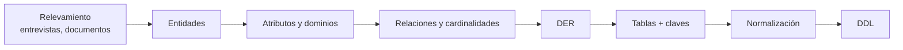
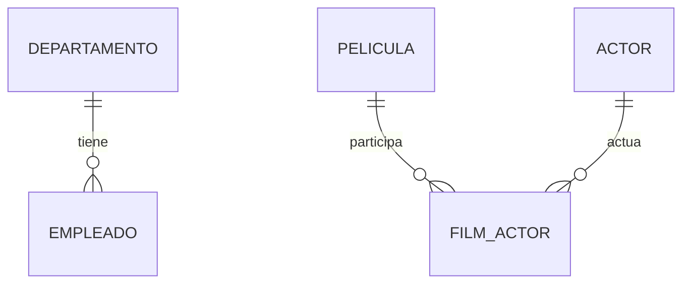

# 6. Análisis y diseño de un modelo de datos

> [!info] Al terminar este capítulo tenés que poder
> - Pasar de un enunciado a entidades, atributos y relaciones.
> - Decidir si algo es atributo, entidad o relación.
> - Determinar cardinalidad y participación.
> - Justificar los valores nulos.

> [!abstract] Qué debés saber (nivel 1)
> - **Entidad:** clase de objetos distinguibles; se convierte en tabla.
> - **Atributo:** propiedad de la entidad; se convierte en columna.
> - Tipos: simple, compuesto, monovalorado, multivalorado, derivado.
> - **Cardinalidad:** 1:1, 1:M, M:N.
> - **Participación:** total (obligatoria) o parcial (opcional).
> - Un **nulo** puede ser “no aplica”, “desconocido” o “perdido”.

## 6.1 El proceso de diseño



| Paso | Pregunta clave | Producto |
|---|---|---|
| 1 | ¿Qué cosas tienen identidad propia? | Entidades |
| 2 | ¿Qué datos las describen? | Atributos y dominios |
| 3 | ¿Cómo se vinculan? | Relaciones y cardinalidades |
| 4 | ¿Qué es obligatorio? | Participación |
| 5 | ¿Cómo se transforma? | Tablas, PK y FK |
| 6 | ¿Hay redundancia? | Formas normales |

## 6.2 Entidades y atributos

### Cómo reconocer una entidad

Un sustantivo es entidad si:

1. Tiene **identidad propia** (se puede distinguir uno de otro).
2. Tiene **atributos** que le pertenecen.
3. **Participa en relaciones**.
4. **Sobrevive** aunque no exista otra cosa.

> [!example] En el caso del municipio
> “El municipio registra semáforos y cámaras instalados en la vía pública, y las alertas que generan.”
>
> | Sustantivo | ¿Entidad? | Motivo |
> |---|---|---|
> | Municipio | No (en este alcance) | Es el contexto, no un dato a registrar |
> | Semáforo | **Sí** | Tiene código, ubicación, estado |
> | Cámara | **Sí** | Ídem |
> | Alerta | **Sí** | Tiene fecha, prioridad y ciclo de vida |
> | Ubicación | Depende | Atributo si es una dirección simple; entidad si tiene barrio, zona, coordenadas y responsable |
> | Estado | Atributo | Texto acotado (`ACTIVO`, `FUERA_DE_SERVICIO`) |

> [!important] La regla que resuelve todo
> **¿Necesito guardar datos de esto?** Si sí, es entidad. **¿Solo lo nombro?** Es atributo.

### Tipos de atributo

| Tipo | Definición | Ejemplo | Cómo se implementa |
|---|---|---|---|
| Simple | Un solo valor atómico | `edad` | Columna |
| Compuesto | Se descompone en partes | `direccion` (calle, número, piso) | Varias columnas o tabla |
| Monovalorado | Un valor por instancia | `fecha_nacimiento` | Columna |
| **Multivalorado** | Varios valores | `telefonos` | **Tabla aparte** |
| Derivado | Se calcula | `edad` a partir de la fecha | No se guarda (o se materializa) |

> [!warning] El error de “teléfono1, teléfono2, teléfono3”
> Es la violación de 1FN más común. Si ponés columnas numeradas, estás escondiendo un grupo repetitivo. Solución: tabla `telefono(id_persona, numero, tipo)`.

### Valores nulos

| Situación | Significado | Ejemplo |
|---|---|---|
| No aplica | El atributo no corresponde a esa instancia | `fecha_baja` en un dispositivo activo |
| Desconocido | Existe pero no se conoce | `dni` de un visitante |
| Perdido | Existía y no se conservó | `fecha_instalacion` de un equipo viejo |

> [!important] Nulo ≠ cero ≠ cadena vacía
> `NULL` significa “no hay valor”. `0` es un valor. `''` es una cadena vacía. Confundirlos produce promedios y conteos incorrectos.

## 6.3 Relaciones y cardinalidad

| Cardinalidad | Significado | Ejemplo | Implementación |
|---|---|---|---|
| **1:1** | Uno con uno | Persona–Pasaporte | FK con `UNIQUE` en uno de los lados |
| **1:N** | Uno con muchos | Departamento–Empleado | FK en el lado **N** |
| **M:N** | Muchos con muchos | Película–Actor | **Tabla puente** |



### Participación

| Participación | Significado | Notación | Ejemplo |
|---|---|---|---|
| **Total** | Obligatoria | `1..*` o línea doble | Toda alerta pertenece a un dispositivo |
| **Parcial** | Opcional | `0..*` o `0..1` | Un técnico puede no tener reparaciones |

> [!important] Leer `mín..máx`
> `0..1` = opcional, como máximo uno.
> `1..1` = obligatorio y exactamente uno.
> `0..*` = opcional, muchos.
> `1..*` = obligatorio, al menos uno.

## 6.4 Aplicar el método al caso

**Enunciado:** “El municipio registra dispositivos (semáforos y cámaras) con código único, ubicación y estado. Cada dispositivo genera alertas con fecha, mensaje y prioridad. Una alerta puede derivar en una reparación, que tiene fecha, técnico y costo. Un técnico puede hacer muchas reparaciones.”

| Paso | Resultado |
|---|---|
| Entidades | `DISPOSITIVO`, `ALERTA`, `REPARACION`, `TECNICO` |
| Atributos | `codigo`, `ubicacion`, `estado`; `fecha`, `mensaje`, `prioridad`; `fecha`, `costo`; `nombre`, `matricula` |
| Relaciones | Dispositivo 1:N Alerta · Alerta 1:1 Reparación · Técnico 1:N Reparación |
| Participación | Alerta→Dispositivo total; Reparación→Técnico parcial |
| Claves | `id` en cada tabla; `codigo` único en dispositivo |

> [!tip] Reparación 1:1 con Alerta
> Si cada alerta puede tener **como máximo una** reparación, la FK va en `reparacion` con `UNIQUE`. Si pudiera tener varias, sería 1:N y la FK va sin `UNIQUE`.

## 6.5 Programa completo

```sql
CREATE TABLE tecnico (
    id        INT AUTO_INCREMENT PRIMARY KEY,
    nombre    VARCHAR(60) NOT NULL,
    matricula VARCHAR(20) NOT NULL UNIQUE
);

CREATE TABLE dispositivo (
    id        INT AUTO_INCREMENT PRIMARY KEY,
    codigo    VARCHAR(10) NOT NULL UNIQUE,
    tipo      VARCHAR(20) NOT NULL,
    ubicacion VARCHAR(100) NOT NULL,
    estado    VARCHAR(20) NOT NULL DEFAULT 'ACTIVO',
    CONSTRAINT ck_disp_tipo CHECK (tipo IN ('semaforo','camara')),
    CONSTRAINT ck_disp_estado CHECK (estado IN ('ACTIVO','FUERA_DE_SERVICIO'))
);

CREATE TABLE alerta (
    id             INT AUTO_INCREMENT PRIMARY KEY,
    fecha          DATETIME NOT NULL DEFAULT CURRENT_TIMESTAMP,
    mensaje        VARCHAR(200) NOT NULL,
    prioridad      TINYINT NOT NULL,
    atendida       BOOLEAN NOT NULL DEFAULT FALSE,
    id_dispositivo INT NOT NULL,
    CONSTRAINT fk_alerta_disp FOREIGN KEY (id_dispositivo)
        REFERENCES dispositivo(id) ON DELETE CASCADE,
    CONSTRAINT ck_alerta_prio CHECK (prioridad BETWEEN 1 AND 5)
);

CREATE TABLE reparacion (
    id         INT AUTO_INCREMENT PRIMARY KEY,
    fecha      DATE NOT NULL,
    costo      DECIMAL(10,2) NOT NULL DEFAULT 0,
    id_alerta  INT NOT NULL UNIQUE,       -- 1:1
    id_tecnico INT NULL,                  -- participación parcial
    CONSTRAINT fk_rep_alerta FOREIGN KEY (id_alerta)
        REFERENCES alerta(id) ON DELETE CASCADE,
    CONSTRAINT fk_rep_tecnico FOREIGN KEY (id_tecnico)
        REFERENCES tecnico(id) ON DELETE SET NULL,
    CONSTRAINT ck_rep_costo CHECK (costo >= 0)
);
```

> [!warning] El `UNIQUE` en `id_alerta`
> Es lo que convierte la relación en 1:1. Sin ese `UNIQUE`, una alerta podría tener varias reparaciones (1:N).

## Cómo trazar un diseño

| Paso | Pregunta | Resultado |
|---|---|---|
| 1 | ¿Qué sustantivos tienen identidad? | Dispositivo, Alerta, Reparación, Técnico |
| 2 | ¿Qué datos guardo de cada uno? | Atributos de la tabla |
| 3 | ¿Qué relación hay? | 1:N y 1:1 |
| 4 | ¿Dónde va la FK? | En el lado N o en el 1:1 opcional |
| 5 | ¿Qué es obligatorio? | `NOT NULL` y participación total |

## Errores que suelen tomar

| Error | Corrección |
|---|---|
| Guardar varios valores en una columna | Tabla aparte (1FN) |
| Poner la FK en el lado 1 de una 1:N | Va en el lado N |
| Olvidar `UNIQUE` en una 1:1 | Se convierte en 1:N |
| Guardar un atributo derivado | Calcularlo o documentar que se materializa |
| Usar `NULL` como si fuera 0 | Son cosas distintas |
| Crear una entidad para cada sustantivo | Solo si tiene identidad y datos propios |

## Ejercicios

> [!example]- 1. Entidad o atributo
> **Enunciado:** en un sistema de biblioteca, clasificá: libro, título, autor, editorial, socio, préstamo.
> **Solución:** entidades: libro, autor, editorial, socio, préstamo. Atributos: título (de libro), nombre (de autor/editorial/socio).

> [!example]- 2. Cardinalidad
> **Enunciado:** “un socio puede tener muchos préstamos, cada préstamo es de un socio”. ¿Cardinalidad y dónde va la FK?
> **Solución:** 1:N; la FK `id_socio` va en `prestamo`.

> [!example]- 3. 1:1
> **Enunciado:** “cada persona tiene un solo pasaporte y cada pasaporte pertenece a una persona”. ¿Cómo lo implementás?
> **Solución:** FK `id_persona` en `pasaporte` con `UNIQUE` (o al revés, con `UNIQUE`).

> [!example]- 4. Multivaluado
> **Enunciado:** un cliente tiene varios teléfonos. ¿Cómo lo modelás?
> **Solución:** tabla `telefono(id_cliente, numero, tipo)` con FK a `cliente` y PK compuesta `(id_cliente, numero)`.

> [!example]- 5. a papel
> **Enunciado:** modelá “un proyecto tiene muchos empleados y un empleado participa en varios proyectos, con horas asignadas”.
> **Solución:** entidades `empleado` y `proyecto`; tabla puente `participacion(id_empleado, id_proyecto, horas)` con PK compuesta.

## Lo que sigue

[[bd07_normalizacion-1fn-3fn|7. Normalización: de 1FN a 3FN]].

#libro2 #basededatos #diseno
