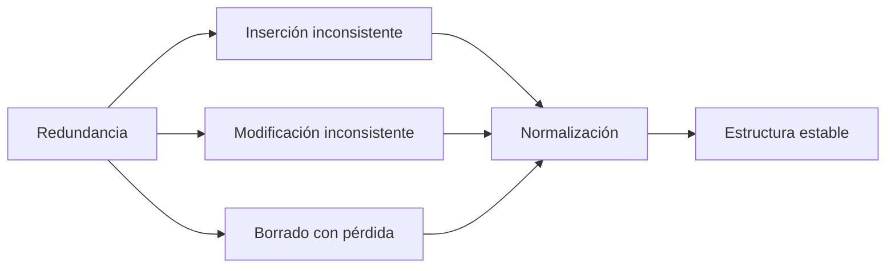
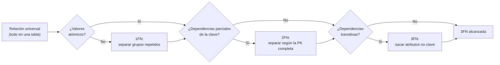

# 7. Normalización: de 1FN a 3FN

> [!info] Al terminar este capítulo tenés que poder
> - Listar las dependencias funcionales de un enunciado.
> - Identificar claves candidatas y atributos primos.
> - Clasificar cada DF en completa, parcial o transitiva.
> - Llevar una tabla a 3FN con el **método de 7 pasos**.
> - Verificar que no se perdió información.

> [!abstract] Qué debés saber (nivel 1)
> - **DF:** `X → Y` (X determina Y). X es **determinante**; Y, **consecuente**.
> - **Parcial:** parte de la clave determina un atributo no primo.
> - **Transitiva:** un atributo no primo determina otro no primo.
> - **Primo:** pertenece a alguna clave candidata. **No primo:** no pertenece a ninguna.
> - **1FN:** valores atómicos. **2FN:** sin parciales. **3FN:** sin transitivas.
> - Se normaliza **descomponiendo** y vinculando con FK.

> [!important] La diferencia con el libro de conceptos
> Acá no alcanza con definir las formas normales: hay que **aplicar un procedimiento**. La cátedra UTN evalúa el procedimiento completo: listar DF, clasificarlas, descomponer y justificar.

> [!quote] Fuentes del método
> **UTN** aporta el procedimiento (DF, atributos primos, 7 pasos, tips de cátedra). **UNLP** aporta la verificación de que la descomposición no pierde información ni dependencias. **Siglo 21** aporta las definiciones y el vocabulario.

## 7.1 Para qué normalizar

> [!quote] Definición de cátedra
> **Normalización:** técnica de diseño de bases de datos que comienza examinando las relaciones entre los atributos (dependencias funcionales) para identificar el agrupamiento óptimo y evitar redundancia, anomalías y pérdida de integridad.

| Anomalía | Qué pasa | Ejemplo |
|---|---|---|
| **Inserción** | No puedo agregar un dato sin repetir otro | Cargar un empleado obliga a repetir el nombre del departamento |
| **Borrado** | Borrar una fila pierde información no relacionada | Borrar al único empleado de Ventas elimina el departamento |
| **Modificación** | Cambiar un dato obliga a tocar muchas filas | Renombrar un departamento en 40 filas |



## 7.2 Dependencias funcionales

**DF:** `X → Y` significa que dos tuplas con el mismo valor de X tienen el mismo valor de Y.

- **Determinante:** X.
- **Consecuente:** Y.
- Es una propiedad de la **semántica**, no de los datos que hay hoy: la define el diseñador a partir del enunciado.

| Tipo | Definición | Fórmula |
|---|---|---|
| **Completa** | Y depende de X y de **ningún subconjunto** de X | `(A,B) → C` y ni `A → C` ni `B → C` |
| **Parcial** | Existe un atributo que se puede quitar de X y la DF sigue valiendo | `(A,B) → C` y `A → C` |
| **Transitiva** | `A → B` y `B → C`, con B **no primo** | `A → B → C` |

> [!important] El resumen que hay que memorizar
> - **Parcial:** `parte_de_la_clave → no_primo`.
> - **Transitiva:** `no_primo → no_primo`.
> - Si la PK es de **un solo atributo**, no puede haber dependencia parcial. La 2FN se cumple automáticamente.

## 7.3 El método de 7 pasos

| Paso | Qué hacés | Resultado |
|---|---|---|
| **0** | Escribir la **relación universal** con todos los atributos | Punto de partida |
| **1** | Listar **todas** las DF del enunciado (y anotar los supuestos) | Lista de DF |
| **2** | Identificar **claves candidatas** | PK y alternativas |
| **3** | Marcar **atributos primos / no primos** | Base para clasificar |
| **4** | Verificar **1FN** (atomicidad) | Tablas sin grupos repetitivos |
| **5** | Verificar **2FN** (parciales) | Tablas sin dependencias parciales |
| **6** | Verificar **3FN** (transitivas) | Tablas sin dependencias transitivas |
| **7** | Verificar **pérdida de información** | Join inverso posible |

### Paso 0 — relación universal

Todos los atributos del enunciado en una sola tabla, con la PK provisoria.

### Paso 1 — listar las DF

> [!tip] Cómo escribirlas
> Una por línea, con flecha. Anotá los supuestos en una línea aparte, con la palabra **“Contexto:”**, como hace la cátedra. Ejemplo: “Contexto: asumo que un departamento tiene un solo administrador.”

### Paso 2 — claves candidatas

Regla práctica: el **determinante que no aparece a la derecha de ninguna otra DF** es candidato a clave. Si hay dos, hay dos claves candidatas.

### Paso 3 — atributos primos

Un atributo es **primo** si pertenece a **alguna** clave candidata. No alcanza con la PK elegida.

> [!example]
> `EmpleadoEnProyecto(DNI, nroProy, horas, nombreEmp, nombreProy, localizacionProy)`
> Claves candidatas: `(DNI, nroProy)`.
> Primos: `DNI`, `nroProy`. No primos: `horas`, `nombreEmp`, `nombreProy`, `localizacionProy`.

### El mapa de la normalización



> [!tip] Se avanza en orden
> No se puede saltar a 3FN sin pasar por 1FN y 2FN: cada forma normal supone que se cumplen las anteriores. Si al separar por 2FN aparece un grupo repetido, hay que volver a 1FN.

## 7.4 Ejemplo completo: `itemsFactura`

**Enunciado (cátedra UTN):**

```text
itemsFactura (númeroFactura, idProducto, descripciónProducto, fecha,
              idCliente, domicilioCliente, telCliente, nomCliente,
              cantidad, precioUnitario)
```

**DF del enunciado:**

```text
DF1: (númeroFactura, idProducto) → descripciónProducto, fecha, idCliente,
      domicilioCliente, telCliente, nomCliente, cantidad, precioUnitario
DF2: idProducto → descripciónProducto, precioUnitario
DF3: númeroFactura → fecha, idCliente
DF4: idCliente → domicilioCliente, telCliente, nomCliente
```

### Paso 2 — claves candidatas

`(númeroFactura, idProducto)` determina todo. Ni `númeroFactura` solo ni `idProducto` solo determinan toda la fila. → **PK compuesta**.

### Paso 3 — primos

`númeroFactura`, `idProducto`. El resto son **no primos**.

### Paso 4 — 1FN

¿Hay valores repetidos en una celda? **No** (`telCliente` es uno solo). → Cumple 1FN.

### Paso 5 — 2FN: buscar parciales

| DF | ¿Parcial? | Por qué |
|---|---|---|
| DF2 `idProducto → descripción, precio` | **Sí** | `idProducto` es **parte** de la clave |
| DF3 `númeroFactura → fecha, idCliente` | **Sí** | `númeroFactura` es **parte** de la clave |
| DF1 | No | Depende de la clave completa |

**Descomposición:**

```text
Producto(idProducto, descripciónProducto, precioUnitario)
Factura(númeroFactura, fecha, idCliente, domicilioCliente, telCliente, nomCliente)
ItemsFactura(númeroFactura, idProducto, cantidad)
```

### Paso 6 — 3FN: buscar transitivas

En `Factura`, `idCliente` es **no primo** y determina `domicilioCliente`, `telCliente`, `nomCliente`, también no primos.

**DF4 es transitiva.** Se separa:

```text
Cliente(idCliente, domicilioCliente, telCliente, nomCliente)
Factura(númeroFactura, fecha, idCliente)
```

### Resultado final

```text
Cliente(idCliente, domicilioCliente, telCliente, nomCliente)
Factura(númeroFactura, fecha, idCliente)
Producto(idProducto, descripciónProducto, precioUnitario)
ItemsFactura(númeroFactura, idProducto, cantidad)
```

| Tabla | PK | FK |
|---|---|---|
| `Cliente` | `idCliente` | — |
| `Factura` | `númeroFactura` | `idCliente` → `Cliente` |
| `Producto` | `idProducto` | — |
| `ItemsFactura` | `(númeroFactura, idProducto)` | ambas |

### Paso 7 — verificar

- ¿Se puede reconstruir? `ItemsFactura ⋈ Factura ⋈ Cliente` y `ItemsFactura ⋈ Producto`. **Sí**.
- ¿Se perdió alguna DF? Todas quedaron en alguna tabla. **No**.
- ¿Cada tabla tiene PK? Sí.

> [!warning] El precio histórico
> La DF dice que `precioUnitario` depende de `idProducto`, así que va en `Producto`. Pero si necesitás **el precio al que se vendió**, agregá `precioUnitario` también en `ItemsFactura` como **decisión consciente**. En el examen, aclaralo: “lo dejo en Producto por la DF; si el negocio requiere precio histórico, lo replico en la línea”.

## Cómo trazar una normalización

| Paso | Pregunta | Acción |
|---|---|---|
| 1 | ¿Hay listas en una celda? | 1FN |
| 2 | ¿La PK es compuesta? | Revisar parciales |
| 3 | ¿Hay no primo que dependa de otro no primo? | 3FN |
| 4 | ¿Cada tabla tiene PK? | Definirlas |
| 5 | ¿Puedo reconstruir con joins? | Verificar |

## Errores que suelen tomar

| Error | Corrección |
|---|---|
| Creer que 1FN es "tener PK" | Es **atomicidad** |
| Aplicar 2FN con PK simple | No aporta |
| Confundir parcial con transitiva | Parcial = parte de la clave; transitiva = no primo → no primo |
| Olvidar marcar los primos | Sin eso no podés clasificar |
| Empezar por 3FN | Primero 1FN y 2FN |

## Ejercicios

> [!example]- 1. 1FN
> **Enunciado:** `alumno(legajo, nombre, materias)` con `'AED, BD, Redes'`.
> **Solución:** viola 1FN. `alumno(legajo, nombre)` + `inscripcion(legajo, materia)`.

> [!example]- 2. 2FN
> **Enunciado:** `inscripcion(legajo, id_materia, nombre_materia, nota)`.
> **Solución:** `nombre_materia` depende solo de `id_materia` (parcial): `materia(id_materia, nombre_materia)` + `inscripcion(legajo, id_materia, nota)`.

> [!example]- 3. 3FN
> **Enunciado:** `empleado(leg, nombre, id_depto, nombre_depto)`.
> **Solución:** `nombre_depto` depende de `id_depto`, no de `leg` (transitiva): `depto(id_depto, nombre_depto)` + `empleado(leg, nombre, id_depto)`.

> [!example]- 4. a papel
> **Enunciado:** explicá la diferencia entre dependencia parcial y transitiva.
> **Solución:** parcial = un atributo depende de **parte** de la PK compuesta; transitiva = un no primo depende de otro no primo.

## Lo que sigue

[[bd08_normalizacion-casos|8. Normalización: casos y formas superiores]].

#libro2 #normalizacion
