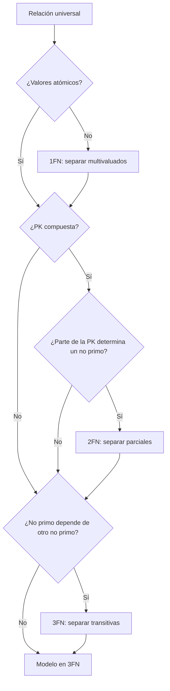

# 8. Normalización: casos y formas superiores

> [!info] Al terminar este capítulo tenés que poder
> - Resolver casos reales de 2FN y 3FN con anomalías de actualización.
> - Explicar por qué cada forma normal elimina un tipo de anomalía.
> - Reconocer cuándo hace falta BCNF.
> - Decidir con criterio si conviene desnormalizar.

> [!abstract] Qué debés saber (nivel 1)
> - Cada forma normal supone la anterior.
> - 2FN elimina dependencias **parciales**; 3FN, **transitivas**.
> - La anomalía se ve como un dato que hay que repetir en varias filas y puede quedar contradictorio.
> - **BCNF** es más estricta que 3FN: todo determinante es clave candidata.
> - Desnormalizar es una **decisión de rendimiento**, no un atajo de diseño.

> [!quote] Cátedra
> "El modelo relacional solo requiere un conjunto de relaciones en primera forma normal. Las restantes formas normales son opcionales. Sin embargo, es recomendable llegar, al menos, a la tercera forma normal. A un modelo de tablas que cumple con la tercera forma normal se lo denomina normalizado."

## 8.1 Tres casos de la cátedra

### Caso 1 — `MailSubscriptores` (1FN sin 2FN)

| ID suscriptor | Dirección de correo | Teléfono | Nombre |
|---|---|---|---|
| 252 | carol@ejemplo.com | 555-1234 | Carol Robertson |
| 252 | carol@ejemplo.com | 555-9876 | Carol Robertson |

La PK es `{ID suscriptor, Dirección de correo}`. `Nombre` depende **solo** de `ID suscriptor`: es una dependencia parcial.

> [!warning] La anomalía
> Si Carol se cambia el apellido, hay que actualizar **dos** filas. Si se actualiza una sola, la pregunta "¿cuál es el nombre del cliente 252?" tiene dos respuestas contradictorias.

**Solución (2FN):** `suscriptor(id, nombre)` + `suscriptor_correo(id, correo)` + `suscriptor_telefono(id, telefono)`.

### Caso 2 — `HabilidadesXEmpleados`

| Empleado | Habilidad | Lugar actual de trabajo |
|---|---|---|
| Ana | Java | Sede Centro |
| Ana | SQL | Sede Centro |
| Luis | Java | Sede Norte |

PK `{Empleado, Habilidad}`. `Lugar actual de trabajo` depende solo de `Empleado`.

**Solución (2FN):** `empleado(empleado, lugar)` + `habilidad_empleado(empleado, habilidad)`.

### Caso 3 — `GanadoresdeTorneos` (2FN sin 3FN)

| Torneo | Año | Ganador | Fecha de nacimiento del ganador |
|---|---|---|---|
| Abierto | 2024 | Ana | 1996-04-12 |
| Abierto | 2025 | Ana | 1996-04-12 |
| Nacional | 2025 | Luis | 1998-09-30 |

PK `{Torneo, Año}`. `Ganador` y `Fecha de nacimiento` dependen de la clave completa, pero `Fecha de nacimiento` depende de `Ganador`, que **no es clave**: dependencia transitiva.

**Solución (3FN):** `torneo(torneo, anio, ganador)` + `jugador(ganador, fecha_nacimiento)`.

> [!important] Cómo se reconoce en el examen
> 1. Marcá la PK.
> 2. Preguntá: "¿este atributo depende de **toda** la clave o de una parte?" → parcial (2FN).
> 3. Preguntá: "¿depende de otro atributo que **no** es clave?" → transitiva (3FN).
> 4. Si el dato se repite en varias filas y puede quedar contradictorio, hay anomalía.

## 8.2 Segundo ejemplo: `CURSADAS`

**Enunciado:**

```text
CURSADAS (MateriaCódigo, MateriaNombre, DeptoCódigo, DeptoNombre,
          AlumLegajo, AlumApellido, AlumNombre, AlumDomicilio, AlumNroDoc,
          Teléfonos, Cuatrimestre, AñoAcadémico, CursadaResultado)
```

**DF:**

```text
MateriaCódigo → MateriaNombre, DeptoCódigo, DeptoNombre
DeptoCódigo  → DeptoNombre
AlumLegajo   → AlumApellido, AlumNombre, AlumDomicilio, AlumNroDoc, Teléfonos
(MateriaCódigo, AlumLegajo, Cuatrimestre, AñoAcadémico) → CursadaResultado
```

### Análisis

| Paso | Resultado |
|---|---|
| 1FN | **No**: `Teléfonos` es multivaluado |
| PK | `(MateriaCódigo, AlumLegajo, Cuatrimestre, AñoAcadémico)` |
| 2FN | Parciales: `MateriaCódigo → ...` y `AlumLegajo → ...` |
| 3FN | Transitiva: `MateriaCódigo → DeptoCódigo → DeptoNombre` |

### Descomposición

```text
Materia(MateriaCódigo, MateriaNombre, DeptoCódigo)
Departamento(DeptoCódigo, DeptoNombre)
Alumno(AlumLegajo, AlumApellido, AlumNombre, AlumDomicilio, AlumNroDoc)
Telefono(AlumLegajo, Teléfono)          -- por 1FN
Cursada(MateriaCódigo, AlumLegajo, Cuatrimestre, AñoAcadémico, CursadaResultado)
```

> [!important] El orden importa
> Primero 1FN (teléfonos), después 2FN (parciales) y por último 3FN (transitivas). Si empezás por 3FN, arrastrás el multivaluado.

## 8.3 Los tips de la cátedra

| Tip | Aplicación |
|---|---|
| “Si la PK tiene un solo atributo, la relación no puede ser incompleta” | No hay 2FN que revisar |
| “Las dependencias parciales son las incompletas” | Parcial = parte de la clave |
| “Cuando una tabla tiene un tipo (tipoLibro), se hace una tabla aparte” | Evita repetir la descripción del tipo |
| “Se hace tabla aparte cuando varios datos dependen de dos ids” | Relación N:M con atributos |
| “En una N:M, las PK de las originales son PK y FK en la tabla intermedia” | Tabla puente |



## 8.4 BCFN (mención)

> [!quote] Regla
> Una relación está en **BCFN** si **todo determinante es una clave candidata**.

Es más fuerte que 3FN. Se viola cuando hay un determinante que no es clave.

**Ejemplo:** `ATENCIONES(codHospital, nombreHospital, dniPaciente, legajoPaciente, dniMedico)`

```text
codHospital → nombreHospital
(legajoPaciente, codHospital) → dniPaciente
(dniPaciente, codHospital) → legajoPaciente
```

`codHospital` es determinante y **no** es clave candidata → viola BCFN. Se separa `Hospital(codHospital, nombreHospital)`.

> [!warning] Alcance del programa
> El EFIP pide **1FN, 2FN y 3FN**. BCFN se menciona para saber que existe y que es más estricta. No la apliques como obligatoria.

## 8.5 ¿Cuándo desnormalizar?

| Situación | Decisión |
|---|---|
| Reporte crítico que se ejecuta miles de veces | Materializar una tabla resumen |
| Columna calculada muy usada | Guardarla, documentando el riesgo |
| Tabla de 3 filas que nunca cambia | No vale la pena separar |
| **Examen** | Normalizar a 3FN y justificar |

> [!important] Regla de oro
> Primero normalizá. Si después necesitás rendimiento, desnormalizá **con una razón medida** y dejá documentado cómo mantenés la consistencia.

## 8.6 Resumen de las formas

| Forma | Elimina | Regla práctica |
|---|---|---|
| 1FN | Grupos repetidos | Un valor atómico por celda |
| 2FN | Dependencias parciales | Todo no primo depende de **toda** la PK |
| 3FN | Dependencias transitivas | Ningún no primo depende de otro no primo |
| BCNF | Determinantes que no son clave | Todo determinante es clave candidata |
| 4FN | Dependencias multivaluadas | Un hecho por tabla |

## Errores que suelen tomar

| Error | Corrección |
|---|---|
| Decir que 2FN "elimina la redundancia" | Elimina **parciales**; la redundancia total se va en 3FN |
| Aplicar 2FN con PK de un solo atributo | No hay parciales posibles |
| Confundir ganador con clave | En `GanadoresdeTorneos`, la clave es `{Torneo, Año}` |
| Separar sin verificar el join | Podés perder información |
| Pasar a BCNF sin necesidad | 3FN suele alcanzar para el EFIP |
| Desnormalizar sin medir | Se justifica con una consulta crítica concreta |

## Ejercicios

> [!example]- 1. Diagnóstico
> **Enunciado:** `pedido(id_pedido, id_cliente, nombre_cliente, fecha)` con PK `id_pedido`. ¿Forma normal?
> **Solución:** 2FN (PK simple), pero no 3FN: `nombre_cliente` depende de `id_cliente` (transitiva).

> [!example]- 2. Corrección
> **Enunciado:** pasá el caso anterior a 3FN.
> **Solución:** `cliente(id_cliente, nombre_cliente)` + `pedido(id_pedido, id_cliente, fecha)`.

> [!example]- 3. Parcial
> **Enunciado:** `detalle(id_pedido, id_producto, nombre_producto, cantidad)`. ¿Qué DF es parcial?
> **Solución:** `id_producto → nombre_producto` depende de parte de la PK.

> [!example]- 4. Anomalía
> **Enunciado:** explicá qué anomalía produce el caso 1.
> **Solución:** de actualización: el nombre se repite y puede quedar contradictorio.

> [!example]- 5. BCNF
> **Enunciado:** ¿cuándo una tabla en 3FN no está en BCNF?
> **Solución:** cuando hay un determinante que no es clave candidata (por ejemplo, dos atributos que se determinan mutuamente).

> [!example]- 6. a papel
> **Enunciado:** normalizá `GanadoresdeTorneos` y justificá cada paso.
> **Solución:** ver 8.1, caso 3.

## Lo que sigue

[[bd09_der|9. Diagrama entidad-relación]].

#libro2 #normalizacion
