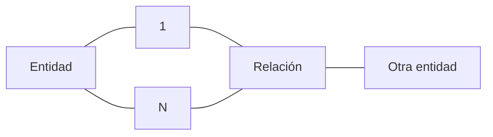
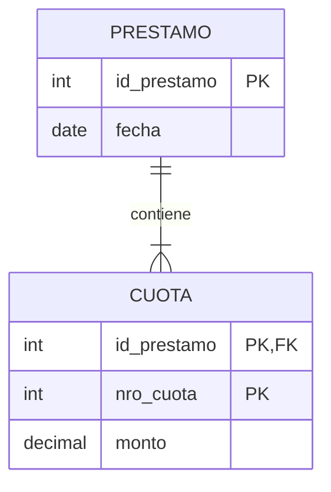
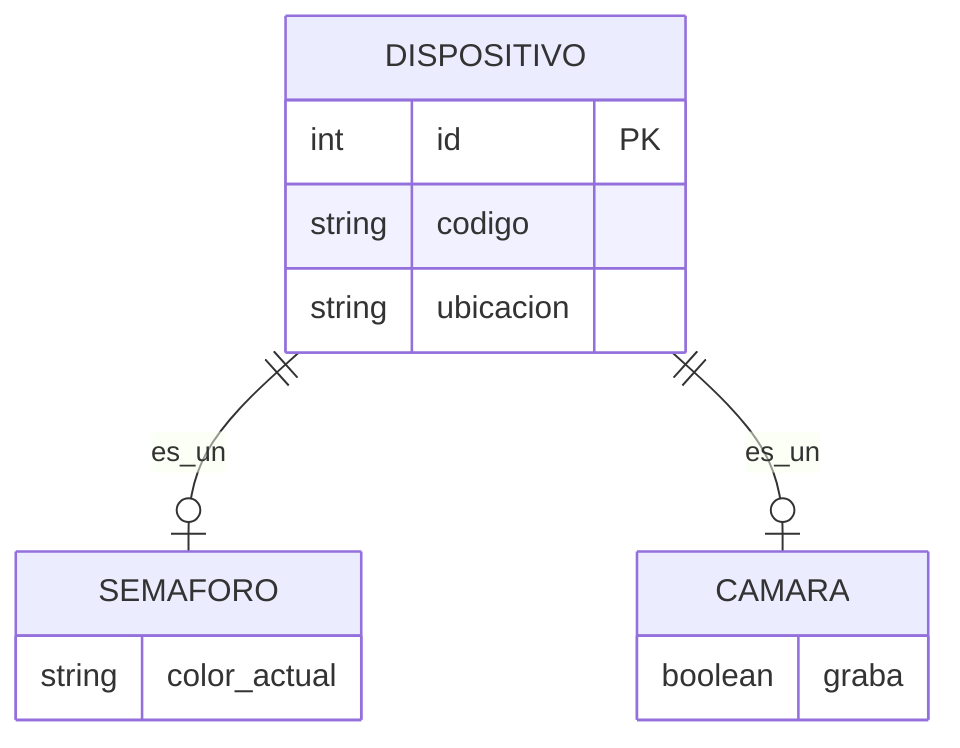
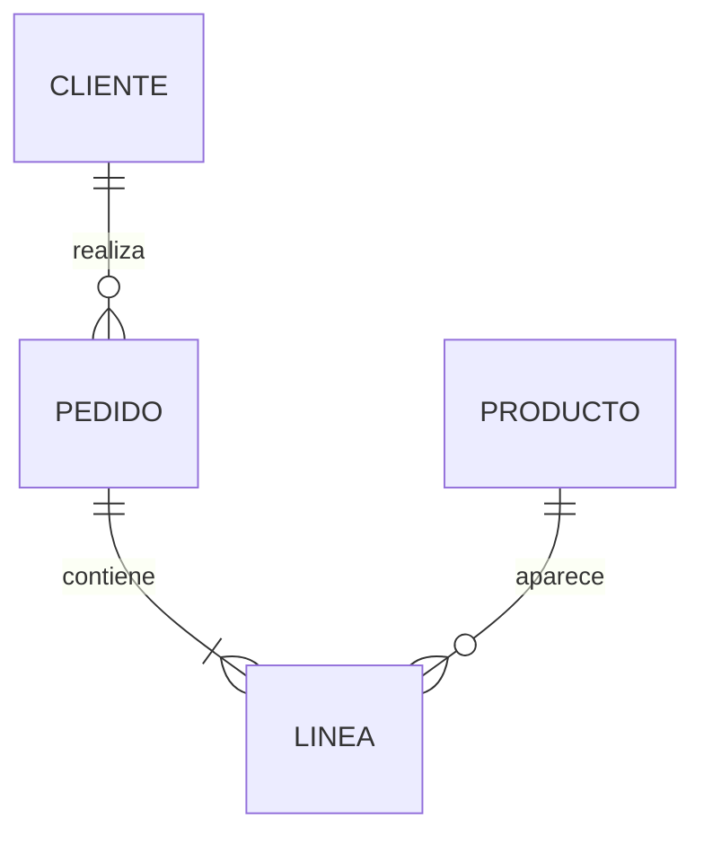
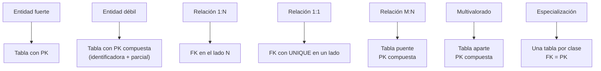
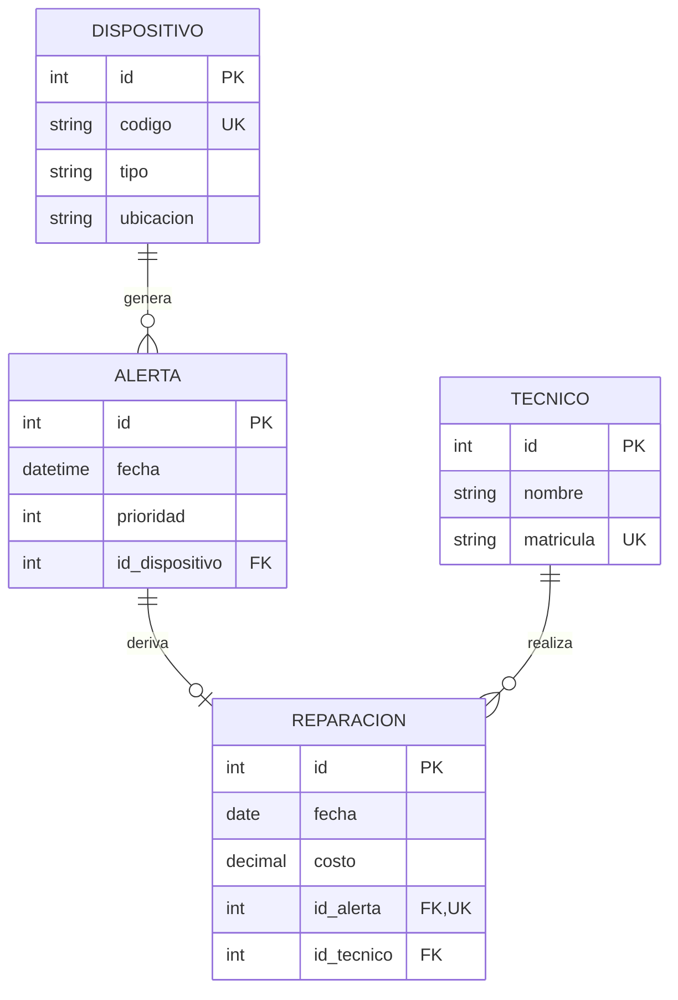

# 9. Diagrama entidad-relación

> [!info] Al terminar este capítulo tenés que poder
> - Dibujar un DER con la notación correcta.
> - Distinguir entidad fuerte, débil y clave parcial.
> - Modelar especialización.
> - Convertir cualquier DER a tablas con PK y FK.

> [!abstract] Qué debés saber (nivel 1)
> - Rectángulo = entidad; elipse = atributo; rombo = relación.
> - Elipse doble = multivalorado; elipse discontinua = derivado.
> - Atributo de la clave se **subraya**.
> - Entidad débil = rectángulo doble; su clave es parcial (subrayado discontinuo).
> - Relación identificadora = rombo doble.
> - Especialización: el hijo **es un** padre.

## 9.1 Notación

| Símbolo | Significado |
|---|---|
| Rectángulo | Entidad |
| Rectángulo doble | Entidad débil |
| Elipse | Atributo |
| Elipse doble | Atributo multivalorado |
| Elipse discontinua | Atributo derivado |
| Subrayado | Atributo que forma la clave |
| Subrayado discontinuo | Clave parcial |
| Rombo | Relación |
| Rombo doble | Relación identificadora |
| Línea doble | Participación total |
| `1`, `N`, `M` | Cardinalidad |



> [!tip] En el examen escrito
> Si no tenés la notación completa, **rotulá**. Un rectángulo con el nombre y las cardinalidades `1..N` se entiende y se corrige bien.

## 9.2 Entidades débiles

**Entidad débil:** no tiene clave propia. Se identifica por la clave de otra entidad (**identificadora**) más una **clave parcial**.

> [!example] Ejemplo clásico
> `CUOTA` no existe sin `PRESTAMO`. Su número de cuota (`1`, `2`, `3`) solo es único dentro de un préstamo.
>
> - Entidad fuerte: `PRESTAMO(id_prestamo)`.
> - Entidad débil: `CUOTA(nro_cuota)`.
> - Clave primaria final: `(id_prestamo, nro_cuota)`.
> - Relación identificadora: `PRESTAMO —tiene— CUOTA` (rombo doble, participación total de CUOTA).



> [!important] Cómo reconocerla
> Preguntate: *¿este objeto tiene sentido solo, sin el otro?* Si la respuesta es no, es débil. La cuota, el detalle de factura, el ítem de pedido.

## 9.3 Especialización

Cuando varias entidades comparten atributos y se diferencian por algunos propios.



| Concepto | Regla |
|---|---|
| Superclase | Tiene los atributos comunes |
| Subclase | Agrega atributos propios |
| Participación | Puede ser total (todo dispositivo es de algún tipo) o parcial |
| Exclusividad | Puede ser disjunta (un dispositivo es semáforo **o** cámara) o solapada |

### Cómo se pasa a tablas

| Estrategia | Cuándo | Ventaja | Costo |
|---|---|---|---|
| **Una tabla por clase** | Especialización con atributos propios | Simple, sin `NULL` | Requiere `JOIN` |
| Tabla única con discriminador | Pocas subclases y atributos | Sin `JOIN` | Muchos `NULL` |
| Tabla por subclase con todos los atributos | Consultas por subclase | Rápido | Duplica estructura |

> [!important] Para el EFIP
> La estrategia recomendada es **una tabla por entidad**. `dispositivo` + `semaforo(id_dispositivo PK/FK, color)` + `camara(id_dispositivo PK/FK, graba)`.

## 9.4 Cardinalidad y participación

| Notación | Lectura |
|---|---|
| `1..1` | Exactamente uno |
| `0..1` | Cero o uno |
| `1..*` | Al menos uno |
| `0..*` | Cero o más |



| Relación | Cardinalidad | Participación |
|---|---|---|
| Cliente–Pedido | 1:N | Pedido total (todo pedido es de un cliente); cliente parcial (puede no tener pedidos) |
| Pedido–Línea | 1:N (o 1:1 débil) | Línea total |
| Producto–Línea | 1:N | Línea total; producto parcial |

## 9.5 Del DER a las tablas: reglas



### Ejemplo completo



```sql
CREATE TABLE dispositivo (
    id        INT AUTO_INCREMENT PRIMARY KEY,
    codigo    VARCHAR(10) NOT NULL UNIQUE,
    tipo      VARCHAR(20) NOT NULL,
    ubicacion VARCHAR(100) NOT NULL
);

CREATE TABLE alerta (
    id             INT AUTO_INCREMENT PRIMARY KEY,
    fecha          DATETIME NOT NULL DEFAULT CURRENT_TIMESTAMP,
    prioridad      TINYINT NOT NULL,
    atendida       BOOLEAN NOT NULL DEFAULT FALSE,
    id_dispositivo INT NOT NULL,
    FOREIGN KEY (id_dispositivo) REFERENCES dispositivo(id)
);

CREATE TABLE tecnico (
    id        INT AUTO_INCREMENT PRIMARY KEY,
    nombre    VARCHAR(60) NOT NULL,
    matricula VARCHAR(20) NOT NULL UNIQUE
);

CREATE TABLE reparacion (
    id         INT AUTO_INCREMENT PRIMARY KEY,
    fecha      DATE NOT NULL,
    costo      DECIMAL(10,2) NOT NULL DEFAULT 0,
    id_alerta  INT NOT NULL UNIQUE,
    id_tecnico INT NULL,
    FOREIGN KEY (id_alerta) REFERENCES alerta(id),
    FOREIGN KEY (id_tecnico) REFERENCES tecnico(id)
);
```

> [!warning] El `UNIQUE` de `id_alerta`
> Convierte la relación en 1:1. Sin él, sería 1:N (varias reparaciones por alerta).

## Cómo trazar un DER

| Paso | Pregunta | Resultado |
|---|---|---|
| 1 | ¿Entidades fuertes? | Dispositivo, Técnico |
| 2 | ¿Débiles? | Reparación depende de Alerta; ¿Alerta de Dispositivo? No: tiene id propio |
| 3 | ¿Relaciones y cardinalidad? | 1:N, 1:1 |
| 4 | ¿Participación? | Alerta total; reparación con técnico parcial |
| 5 | ¿Tablas y FK? | Según las reglas de 10.1 |

## Errores que suelen tomar

| Error | Corrección |
|---|---|
| Usar rectángulo para una relación | Rombo |
| Subrayar todos los atributos | Solo la clave |
| Poner M:N sin tabla puente | Toda M:N se resuelve con tabla intermedia |
| FK en el lado 1 | Va en el lado N |
| Entidad débil con PK propia | Su PK es compuesta (identificadora + parcial) |
| Especializar por un atributo de tipo | Solo si hay comportamiento/atributos propios |

## Ejercicios

> [!example]- 1. Notación
> **Enunciado:** ¿cómo se representa un atributo multivalorado y uno derivado?
> **Solución:** multivalorado con elipse doble; derivado con elipse discontinua.

> [!example]- 2. Entidad débil
> **Enunciado:** ¿es débil `detalle_factura`? Justificá.
> **Solución:** sí: no existe sin la factura y su número de línea solo es único dentro de ella. PK `(id_factura, nro_linea)`.

> [!example]- 3. 1:1
> **Enunciado:** modelá persona–pasaporte y explicá el `UNIQUE`.
> **Solución:** `pasaporte(id, numero, id_persona UNIQUE)`; el `UNIQUE` impide que una persona tenga dos pasaportes.

> [!example]- 4. M:N
> **Enunciado:** películas y actores, con personaje interpretado. ¿Cómo queda?
> **Solución:** `film_actor(id_pelicula, id_actor, personaje)` con PK compuesta `(id_pelicula, id_actor)`.

> [!example]- 5. a papel
> **Enunciado:** dibujá el DER del municipio con las cuatro entidades y todas las cardinalidades.
> **Solución:** ver el capítulo 10. Debe incluir `1:N` dispositivo–alerta, `1:1` alerta–reparación y `1:N` técnico–reparación, con la participación parcial de técnico.

## Lo que sigue

[[bd10_der-a-tablas|10. Del DER a las tablas]] — el paso que falta entre el dibujo y el DDL.

#libro2 #basededatos #der
