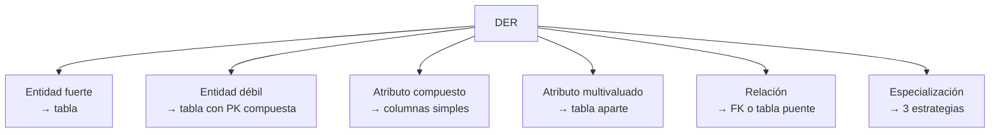
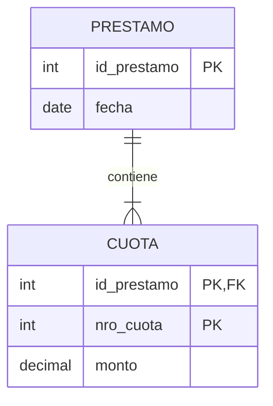
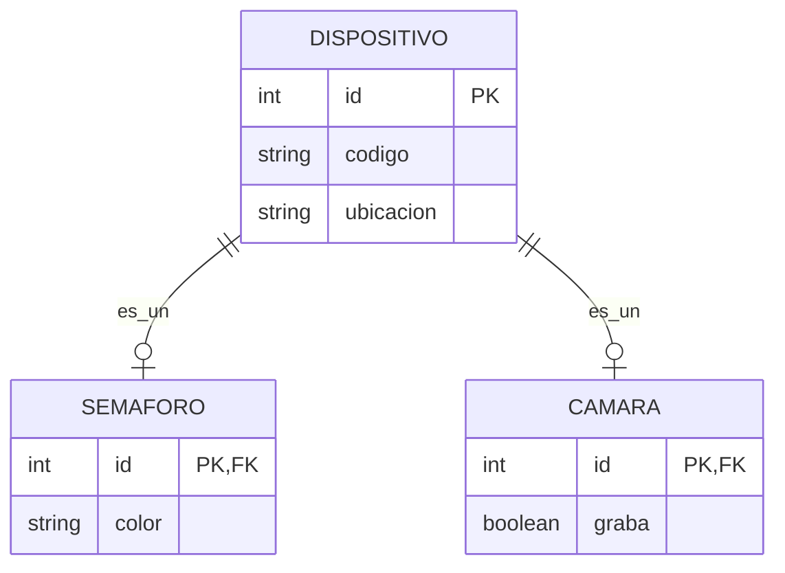
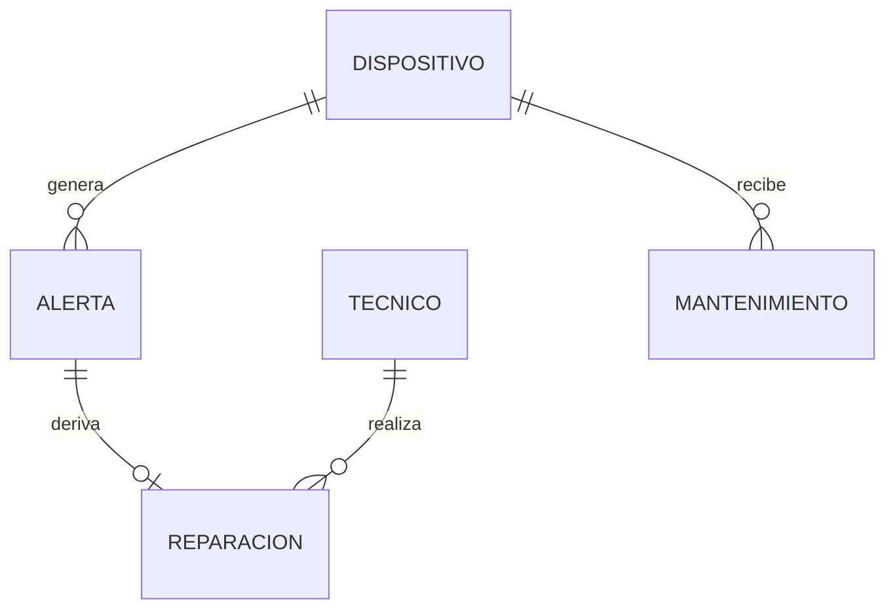

# 10. Del DER a las tablas

> [!info] Al terminar este capítulo tenés que poder
> - Convertir cualquier DER a tablas sin perder información.
> - Decidir **dónde va la FK** según la participación.
> - Resolver entidades débiles, multivaluados, recursivas y ternarias.
> - Elegir entre las tres estrategias de especialización.

> [!abstract] Qué debés saber (nivel 1)
> - Cada **entidad** se convierte en **tabla**.
> - Cada **atributo simple** se convierte en **columna**.
> - Un **multivaluado** genera **tabla aparte**.
> - Una **relación 1:N** pone la FK en el lado **N**.
> - Una **relación N:M** genera **tabla puente**.
> - Una **entidad débil** hereda la PK de su identificadora.
> - La **cobertura** de una especialización decide qué estrategia usar.

> [!important] Este capítulo es el puente
> El DER ([[bd09_der]]) es conceptual; el modelo relacional ([[bd03_componentes-modelo-relacional]]) es físico. Acá se hace la traducción con reglas. La cátedra UTN lo evalúa como “pasar el DER a tablas”.

> [!quote] Fuentes del método
> **UTN** aporta la clasificación por participación, las tres opciones de 1:1, la entidad débil, la ternaria y la decisión por cobertura. **UP** aporta el criterio de recursivas (frecuencia de nulos) y la conversión de supertipo/subtipo. **Siglo 21** aporta el vocabulario y los ejemplos del caso.

## 10.1 Regla general



| Elemento del DER | Se convierte en |
|---|---|
| Entidad fuerte | Tabla con todos sus atributos simples |
| Entidad débil | Tabla con PK = PK identificadora + clave parcial |
| Atributo simple | Columna |
| Atributo compuesto | Varias columnas (una por componente) |
| Atributo multivalorado | Tabla nueva con FK + valor |
| Atributo derivado | No se guarda (se calcula) |
| Relación 1:N | FK en el lado N |
| Relación 1:1 | FK en uno de los lados (con `UNIQUE`) |
| Relación N:M | Tabla puente con PK compuesta |
| Generalización | Una de tres estrategias según cobertura |

## 10.2 Entidades y atributos

### Entidad fuerte

```text
CLIENTE(id_cliente, nombre, apellido, dni)
```

- PK: el identificador de la entidad.
- Atributos simples: columnas.
- `dni` único → `UNIQUE`.

### Atributo compuesto

```text
CLIENTE(id_cliente, nombre, calle, numero, localidad)
```

El atributo `domicilio` desaparece como tal; quedan sus componentes.

> [!warning] No dejes el compuesto y sus partes
> Tener `domicilio` **y** `calle`, `numero`, `localidad` duplica la información. Elegí una: columnas separadas (recomendado) o una sola columna de texto.

### Atributo multivalorado

```text
EMPLEADO(legajo, nombre, apellido)
TELEFONO(legajo, numero, tipo)
```

- PK de `TELEFONO`: `(legajo, numero)`.
- `legajo` es FK a `EMPLEADO`.

> [!important] La regla de la cátedra
> “Por cada atributo multivalorado se crea una tabla; se agrega el atributo multivalorado y la PK de la entidad a la que pertenece, que será FK. La PK se forma con **todos** sus atributos.”

### Entidad débil

```text
PRESTAMO(id_prestamo, fecha, ...)
CUOTA(id_prestamo, nro_cuota, monto, vencimiento)
```

- PK de `CUOTA`: `(id_prestamo, nro_cuota)`.
- `nro_cuota` es la **clave parcial** (discriminante).
- `id_prestamo` es FK y parte de la PK.



## 10.3 Relaciones según la participación

La participación se escribe `mín..máx` en cada extremo. La **máxima** define la cardinalidad; la **mínima** indica obligatoriedad.

### Caso A — 1..1 con 0..1

**Ejemplo:** `Usuario 1..1 — Tiene — Canal_YouTube 0..1`.

**Regla:** la FK va en el lado **0..1** (el que puede no participar).

```text
Usuario(idUsuario, nombre, apellido, email, password)
Canal_YouTube(id, fecha_creacion, descripcion, idUsuario)
idUsuario: FK de Usuario
```

> [!important] Por qué en el lado 0..1
> Si la pusieras en `Usuario`, todos los usuarios que no tienen canal quedarían con `idCanal` nulo. Poniéndola en `Canal`, solo hay nulos donde no hay canal, que es lo natural.

### Caso B — 1..1 con 1..1

**Ejemplo:** `País 1..1 — Gobierna — Presidente 1..1`.

Hay **tres soluciones válidas**:

| Opción | Cómo queda | Cuándo conviene |
|---|---|---|
| **1** | FK en `País` | Si consultás más “el presidente de un país” |
| **2** | FK en `Presidente` | Si consultás más “el país de un presidente” |
| **3** | FK en **ambas** (con `UNIQUE`) | Si las dos consultas son frecuentes; acepta redundancia |

```text
-- Opción 1
Pais(idPais, nombre, habitantes, DNI)
Presidente(DNI, nombre, apellido)
DNI en Pais: FK de Presidente

-- Opción 2
Pais(idPais, nombre, habitantes)
Presidente(DNI, nombre, apellido, idPais)
idPais en Presidente: FK de Pais
```

> [!warning] El `UNIQUE` no es opcional
> Sin `UNIQUE` en la FK, la relación 1:1 se convierte en 1:N. Es el error más caro de este caso.

### Caso C — 0..1 con 0..1

**Ejemplo:** `Alquiler 0..1 — Renueva — Alquiler 0..1` (recursiva).

**Regla:** se crea una **tabla nueva** con las dos claves; la PK es una de ellas.

```text
Alquiler(idAlquiler, fecha_inicio, fecha_fin, importe, fianza)
Renovacion(idAlquiler, id_alquiler_anterior)
PK: idAlquiler
idAlquiler: FK de Alquiler
id_alquiler_anterior: FK de Alquiler
```

### Caso D — 1..1 con 0..N (1:N)

**Ejemplo:** `Usuario 1..1 — Publica — Video 0..N`.

**Regla:** la FK va en el lado **N**, apuntando al lado 1.

```text
Usuario(idUsuario, nombre, apellido, email, password)
Video(idVideo, nombre, descripcion, duracion, idUsuario)
idUsuario en Video: FK de Usuario
```

> [!important] La regla que no falla
> En 1:N, la FK siempre va en el lado **“muchos”**. Si la ponés en el lado 1, necesitarías varios valores en una columna.

### Caso E — 0..N con 0..N (M:N)

**Regla:** tabla nueva con las dos PK como FK y **PK compuesta**. Los atributos de la relación se agregan ahí.

```text
Alumno(nroAlumno, nombre, apellido, DNI)
Examen(idExamen, fecha)
Alumno_rinde_Examen(nroAlumno, idExamen, nota)
PK: (nroAlumno, idExamen)
```

> [!important] Cuándo la PK incluye un atributo de la relación
> Si la relación tiene **fecha** y querés guardar el histórico (por ejemplo, un proveedor suministra la misma pieza en fechas distintas), la fecha entra en la PK: `(idProveedor, idPieza, fecha)`. Alternativa: agregar un `id` autoincremental como PK subrogada.

### Caso F — relación recursiva

| Situación | Solución |
|---|---|
| 1:N y **la mayoría** tiene jefe | FK en la misma tabla: `Empleado(legajo, ..., legajoJefe)` |
| 1:N y **la mayoría no** tiene jefe | Tabla aparte: `Subordinado(legajoSub, legajoJefe)` |
| N:M (por ejemplo, correlativas) | Tabla nueva con dos FK: `Correlativa(codAnterior, codPosterior)` |

> [!tip] Criterio de UP
> La frecuencia de nulos decide: si la columna va a estar vacía casi siempre, conviene tabla aparte.

### Caso G — relación ternaria

**Regla:** tabla nueva con las **tres** PK como FK; la PK es la combinación de las tres.

```text
Proveedor(idProveedor, ...)
Pieza(idPieza, ...)
Proyecto(idProyecto, ...)
Suministra(idProveedor, idPieza, idProyecto, cantidad)
PK: (idProveedor, idPieza, idProyecto)
```

## 10.4 Especialización

Tres estrategias:

| Estrategia | Cómo | Ventaja | Riesgo |
|---|---|---|---|
| **1. Solo el padre** | Una tabla con todos los atributos de los hijos, **nullable** | Sin joins | Muchos `NULL` |
| **2. Solo los hijos** | Se elimina el padre y sus atributos se copian en cada hijo | Sin tabla padre | **No sirve si la cobertura es parcial**: se pierden entidades que no son de ningún hijo |
| **3. Padre + hijos** | Tabla padre + una tabla por hijo con **PK = FK al padre** | Capta la herencia; sin `NULL` | Más joins |

> [!important] La cobertura decide
> - **Total** (todo padre es de algún hijo) → la opción 2 es viable.
> - **Parcial** (hay padres que no son de ningún hijo) → la opción 2 **pierde información**; no se puede.
> - **Superpuesta** (un padre puede ser de varios hijos) → la opción 2 duplica datos; conviene la 3.
>
> La cátedra concluye que la **opción 3** es la que mejor capta la herencia, a costa de más tablas y joins.



```sql
CREATE TABLE dispositivo (
    id        INT AUTO_INCREMENT PRIMARY KEY,
    codigo    VARCHAR(10) NOT NULL UNIQUE,
    ubicacion VARCHAR(100) NOT NULL
);

CREATE TABLE semaforo (
    id    INT PRIMARY KEY,
    color VARCHAR(10) NOT NULL DEFAULT 'ROJO',
    FOREIGN KEY (id) REFERENCES dispositivo(id) ON DELETE CASCADE
);

CREATE TABLE camara (
    id    INT PRIMARY KEY,
    graba BOOLEAN NOT NULL DEFAULT FALSE,
    FOREIGN KEY (id) REFERENCES dispositivo(id) ON DELETE CASCADE
);
```

## 10.5 Claves e integridad en la conversión

1. **Elegir la PK** con el método de [[bd03_componentes-modelo-relacional]]: simple antes que compuesta, menor tamaño, estable.
2. **Marcar `UNIQUE`** en las claves alternativas.
3. **Definir la FK** con la acción referencial:
   - `RESTRICT` si la relación es obligatoria y no querés borrados en cascada.
   - `CASCADE` si el hijo no existe sin el padre (detalle, cuota).
   - `SET NULL` si la relación es opcional (técnico de una reparación).

| Situación | Acción |
|---|---|
| Alerta → Dispositivo (obligatoria) | `ON DELETE CASCADE` |
| Reparación → Técnico (opcional) | `ON DELETE SET NULL` |
| Empleado → Departamento (obligatoria, histórica) | `RESTRICT` |

## 10.6 Ejemplo integrado

**DER del municipio:**



**Enunciado:** un dispositivo tiene código único, tipo y ubicación. Genera muchas alertas (fecha, mensaje, prioridad). Una alerta puede derivar en **una** reparación (fecha, costo). Un técnico realiza muchas reparaciones. Un dispositivo recibe muchos mantenimientos (fecha, descripción).

| Paso | Elemento | Decisión |
|---|---|---|
| 1 | `DISPOSITIVO` | Tabla; PK `id`; `codigo` `UNIQUE` |
| 2 | `ALERTA` | Tabla; PK `id`; FK `id_dispositivo` (1:N, lado N) |
| 3 | `REPARACION` | Tabla; PK `id`; FK `id_alerta` **`UNIQUE`** (1:1); FK `id_tecnico` (1:N, opcional) |
| 4 | `TECNICO` | Tabla; PK `id`; `matricula` `UNIQUE` |
| 5 | `MANTENIMIENTO` | Tabla; PK `id`; FK `id_dispositivo` (1:N) |

```sql
CREATE TABLE dispositivo (
    id        INT AUTO_INCREMENT PRIMARY KEY,
    codigo    VARCHAR(10) NOT NULL UNIQUE,
    tipo      VARCHAR(20) NOT NULL,
    ubicacion VARCHAR(100) NOT NULL
);

CREATE TABLE alerta (
    id             INT AUTO_INCREMENT PRIMARY KEY,
    fecha          DATETIME NOT NULL DEFAULT CURRENT_TIMESTAMP,
    mensaje        VARCHAR(200) NOT NULL,
    prioridad      TINYINT NOT NULL,
    atendida       BOOLEAN NOT NULL DEFAULT FALSE,
    id_dispositivo INT NOT NULL,
    CONSTRAINT fk_alerta_disp FOREIGN KEY (id_dispositivo)
        REFERENCES dispositivo(id) ON DELETE CASCADE,
    CONSTRAINT ck_prio CHECK (prioridad BETWEEN 1 AND 5)
);

CREATE TABLE tecnico (
    id        INT AUTO_INCREMENT PRIMARY KEY,
    nombre    VARCHAR(60) NOT NULL,
    matricula VARCHAR(20) NOT NULL UNIQUE
);

CREATE TABLE reparacion (
    id         INT AUTO_INCREMENT PRIMARY KEY,
    fecha      DATE NOT NULL,
    costo      DECIMAL(10,2) NOT NULL DEFAULT 0,
    id_alerta  INT NOT NULL UNIQUE,
    id_tecnico INT NULL,
    CONSTRAINT fk_rep_alerta FOREIGN KEY (id_alerta)
        REFERENCES alerta(id) ON DELETE CASCADE,
    CONSTRAINT fk_rep_tecnico FOREIGN KEY (id_tecnico)
        REFERENCES tecnico(id) ON DELETE SET NULL
);

CREATE TABLE mantenimiento (
    id             INT AUTO_INCREMENT PRIMARY KEY,
    fecha          DATE NOT NULL,
    descripcion    VARCHAR(200) NOT NULL,
    id_dispositivo INT NOT NULL,
    FOREIGN KEY (id_dispositivo) REFERENCES dispositivo(id) ON DELETE CASCADE
);
```

> [!tip] El `UNIQUE` que define la relación
> `id_alerta UNIQUE` es lo que hace que una alerta tenga **como máximo una** reparación. Sin él, sería 1:N.

## 10.7 Checklist de conversión

- [ ] ¿Cada entidad tiene su tabla?
- [ ] ¿Cada atributo simple es una columna?
- [ ] ¿Los compuestos se descompusieron?
- [ ] ¿Los multivaluados tienen tabla propia?
- [ ] ¿Las entidades débiles tienen PK compuesta?
- [ ] ¿La FK está en el lado N?
- [ ] ¿Las 1:1 tienen `UNIQUE`?
- [ ] ¿Las N:M tienen tabla puente?
- [ ] ¿Las ternarias tienen las tres FK?
- [ ] ¿La especialización respeta la cobertura?
- [ ] ¿Cada FK tiene acción referencial definida?
- [ ] ¿Se puede reconstruir el DER con joins?

## Errores que suelen tomar

| Error | Consecuencia |
|---|---|
| FK en el lado 1 de una 1:N | Modelo inválido |
| 1:1 sin `UNIQUE` | Se transforma en 1:N |
| Multivaluado en una columna | Viola 1FN |
| Entidad débil con PK simple | No se puede distinguir la cuota 1 del préstamo A de la del B |
| N:M sin tabla puente | No se puede representar |
| Aplicar “solo hijos” con cobertura parcial | Se pierden entidades |
| No definir acción referencial | Comportamiento inesperado al borrar |
| Usar el nombre del atributo compuesto y sus partes | Redundancia |

## Ejercicios

> [!example]- 1. 1:N
> **Enunciado:** `Departamento 1 — Empleado N`. ¿Dónde va la FK?
> **Solución:** `id_depto` en `empleado`, FK a `departamento`.

> [!example]- 2. 1:1
> **Enunciado:** `Persona 1..1 — Pasaporte 0..1`. ¿Dónde va la FK y qué restricción lleva?
> **Solución:** `id_persona` en `pasaporte`, con `UNIQUE`.

> [!example]- 3. N:M con atributos
> **Enunciado:** `Pelicula N — Actor M`, con personaje interpretado.
> **Solución:** `film_actor(id_pelicula, id_actor, personaje)`, PK `(id_pelicula, id_actor)`.

> [!example]- 4. Entidad débil
> **Enunciado:** `Factura 1 — Linea N`. ¿PK de `linea`?
> **Solución:** `(id_factura, nro_linea)`.

> [!example]- 5. Especialización
> **Enunciado:** `Cuenta` con subclases `Ahorro`, `Corriente`, `Inversion`, cobertura parcial. ¿Qué estrategia usás?
> **Solución:** opción 3 (padre + hijos), porque la cobertura parcial descarta “solo hijos” y la superposición posible descarta la tabla única.

> [!example]- 6. a papel
> **Enunciado:** convertí este DER: `Alumno 0..N — Cursa — Materia 0..N` con `nota` y `fecha`.
> **Solución:** `cursada(id_alumno, id_materia, fecha, nota)`, PK `(id_alumno, id_materia, fecha)` si se quiere histórico, o `(id_alumno, id_materia)` si hay una sola cursada por materia.

## Lo que sigue

[[bd_Cierre_parte2|Cierre de la Parte 2]].

#libro2 #basededatos #conversion
