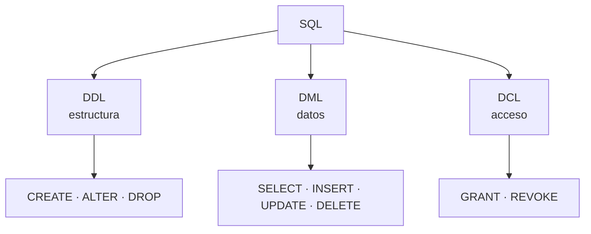

# 11. El lenguaje SQL

> [!info] Al terminar este capítulo tenés que poder
> - Explicar por qué SQL es declarativo.
> - Clasificar cualquier sentencia en DDL, DML o DCL.
> - Enunciar el orden lógico de evaluación de una consulta.
> - Elegir el tipo de dato adecuado.

> [!abstract] Qué debés saber (nivel 1)
> - SQL comunica al usuario con la base: consulta, modifica y controla.
> - Es **declarativo**: describís el resultado; el motor decide cómo.
> - **DDL** define estructura (`CREATE`, `ALTER`, `DROP`).
> - **DML** manipula datos (`SELECT`, `INSERT`, `UPDATE`, `DELETE`).
> - **DCL** controla acceso (`GRANT`, `REVOKE`).
> - El orden lógico es `FROM → WHERE → GROUP BY → HAVING → SELECT → ORDER BY → LIMIT`.

## 11.1 Qué es SQL

> [!quote] Definición de cátedra
> **SQL:** lenguaje diseñado para la comunicación entre usuarios y bases de datos, que permite consultar, modificar y controlar datos y estructuras.

### Declarativo, no procedimental

```sql
SELECT nombre, sueldo
FROM empleado
WHERE sueldo > 800000;
```

Vos decís **qué** querés. El **optimizador** decide si conviene usar un índice, en qué orden hacer los joins, etc.

> [!important] La consecuencia
> Dos consultas equivalentes pueden tener planes distintos. Y una misma consulta puede cambiar de plan si cambian los datos o las estadísticas. Eso es normal.

| Característica | Significado |
|---|---|
| Declarativo | Se describe el resultado, no el procedimiento |
| Orientado a conjuntos | Opera sobre filas, no sobre registros de a uno |
| Estándar | ANSI/ISO, con dialectos por motor |
| No procedimental original | Sin `if`/`while`; eso llega con las extensiones (5.4) |

## 11.2 Sublenguajes



| Sublenguaje | Para qué | Sentencias |
|---|---|---|
| **DDL** | Definir, modificar y eliminar estructuras | `CREATE`, `ALTER`, `DROP`, `TRUNCATE` |
| **DML** | Administrar los datos | `SELECT`, `INSERT`, `UPDATE`, `DELETE` |
| **DCL** | Controlar acceso | `GRANT`, `REVOKE` |
| TCL | Transacciones (no lo pide el programa) | `COMMIT`, `ROLLBACK` |

> [!warning] Clasificación que se pregunta
> `TRUNCATE` vacía una tabla: se considera **DDL** (opera sobre la estructura), no DML. `DELETE` es DML porque borra filas con condición y se puede revertir.

## 11.3 Orden lógico de una consulta

Se escribe en un orden y se evalúa en otro.

| Orden | Cláusula | Qué hace |
|---:|---|---|
| 1 | `FROM` | Identifica las tablas y arma el conjunto de filas |
| 2 | `WHERE` | Filtra filas **antes** de agrupar |
| 3 | `GROUP BY` | Forma grupos |
| 4 | `HAVING` | Filtra **grupos** |
| 5 | `SELECT` | Elige columnas y calcula expresiones |
| 6 | `ORDER BY` | Ordena el resultado |
| 7 | `LIMIT` | Recorta filas |


> [!important] Por qué importa
> `WHERE` no puede usar alias definidos en `SELECT` (todavía no se evaluó). `ORDER BY` sí puede. Y `WHERE` filtra filas; `HAVING`, grupos.

## 11.4 Tipos de datos

| Categoría | Tipos MySQL | Cuándo |
|---|---|---|
| Enteros exactos | `TINYINT`, `SMALLINT`, `INT`, `BIGINT` | IDs, cantidades |
| Decimales exactos | `DECIMAL(p, s)`, `NUMERIC` | **Dinero** |
| Decimales aproximados | `FLOAT`, `DOUBLE` | Medidas científicas |
| Fecha y hora | `DATE`, `TIME`, `DATETIME`, `TIMESTAMP` | Fechas |
| Cadenas | `CHAR(n)`, `VARCHAR(n)`, `TEXT` | Textos |
| Booleanos | `BOOLEAN` (alias de `TINYINT(1)`) | Estados |
| Binarios | `BLOB` | Archivos |
| Enumeración | `ENUM('A','B')` | Conjuntos cerrados |

### `CHAR` vs. `VARCHAR`

| | `CHAR(n)` | `VARCHAR(n)` |
|---|---|---|
| Longitud | Fija | Variable |
| Espacio | Rellena con espacios | Usa lo necesario |
| Uso | Códigos de longitud fija (`'AR'`) | Nombres, direcciones |

> [!warning] Dinero con `DOUBLE`
> `DOUBLE` es aproximado: `0.1 + 0.2` no da exactamente `0.3`. Para importes se usa `DECIMAL(10,2)`. Es una pregunta de oral.

## 11.5 Primeras consultas

```sql
-- Proyección
SELECT nombre, apellido FROM empleado;

-- Filtro
SELECT nombre, sueldo
FROM empleado
WHERE sueldo > 800000;

-- Orden
SELECT nombre, sueldo
FROM empleado
ORDER BY sueldo DESC;

-- Límite
SELECT nombre, sueldo
FROM empleado
ORDER BY sueldo DESC
LIMIT 2;

-- Alias
SELECT nombre AS empleado, sueldo * 12 AS sueldo_anual
FROM empleado;
```

Salida de la última:

```text
+----------+--------------+
| empleado | sueldo_anual |
+----------+--------------+
| Ana      |  11400000.00 |
| Luis     |  10440000.00 |
| Eva      |   8640000.00 |
| Juan     |   7320000.00 |
+----------+--------------+
```

> [!tip] `AS` es opcional
> `SELECT nombre empleado` funciona, pero `AS` mejora la lectura y evita ambigüedad.

## 11.6 Comentarios y buenas formas

```sql
-- Comentario de una línea

/* Comentario
   de bloque */

SELECT 1;   -- toda sentencia termina en ;
```

| Buena práctica | Motivo |
|---|---|
| Palabras clave en MAYÚSCULA | Distinguir del identificador |
| Un ítem por línea en listas largas | Legibilidad |
| Alias en tablas | Evitar ambigüedad en joins |
| Nunca `SELECT *` en producción | Trae columnas de más y rompe si cambia el esquema |

## Cómo leer una consulta

| Paso | Pregunta | Ejemplo |
|---|---|---|
| 1 | ¿De qué tablas? | `FROM empleado` |
| 2 | ¿Qué filas? | `WHERE sueldo > 800000` |
| 3 | ¿Agrupado? | `GROUP BY id_depto` |
| 4 | ¿Qué grupos? | `HAVING COUNT(*) > 2` |
| 5 | ¿Qué columnas? | `SELECT id_depto, AVG(sueldo)` |
| 6 | ¿Orden? | `ORDER BY 2 DESC` |

## Errores que suelen tomar

| Error | Corrección |
|---|---|
| Decir que SQL es procedimental | Es declarativo |
| Confundir DDL con DML | DDL = estructura; DML = datos |
| Usar alias de `SELECT` en `WHERE` | No está permitido |
| Guardar dinero en `DOUBLE` | `DECIMAL` |
| Usar `CHAR` para nombres | `VARCHAR` |
| Creer que `TRUNCATE` es DML | Es DDL |

## Ejercicios

> [!example]- 1. Clasificar
> **Enunciado:** clasificá: `CREATE TABLE`, `UPDATE`, `GRANT`, `SELECT`, `DROP`, `DELETE`.
> **Solución:** DDL: `CREATE TABLE`, `DROP`. DML: `UPDATE`, `SELECT`, `DELETE`. DCL: `GRANT`.

> [!example]- 2. Orden lógico
> **Enunciado:** ¿por qué `SELECT nombre AS n FROM e WHERE n = 'Ana'` falla?
> **Solución:** porque `WHERE` se evalúa antes que `SELECT`; el alias `n` todavía no existe.

> [!example]- 3. Tipos
> **Enunciado:** elegí tipos para precio, fecha de alta, código de provincia y descripción.
> **Solución:** `DECIMAL(10,2)`, `DATE`, `CHAR(2)`, `VARCHAR(200)` o `TEXT`.

> [!example]- 4. a papel
> **Enunciado:** escribí una consulta que devuelva nombre y sueldo anual de los empleados con sueldo mayor a 700.000, ordenado de mayor a menor.
> **Solución:**
> ```sql
> SELECT nombre, sueldo * 12 AS sueldo_anual
> FROM empleado
> WHERE sueldo > 700000
> ORDER BY sueldo_anual DESC;
> ```

## Lo que sigue

[[bd12_dml|12. DML: insertar, actualizar y borrar]].

#libro2 #basededatos #sql
