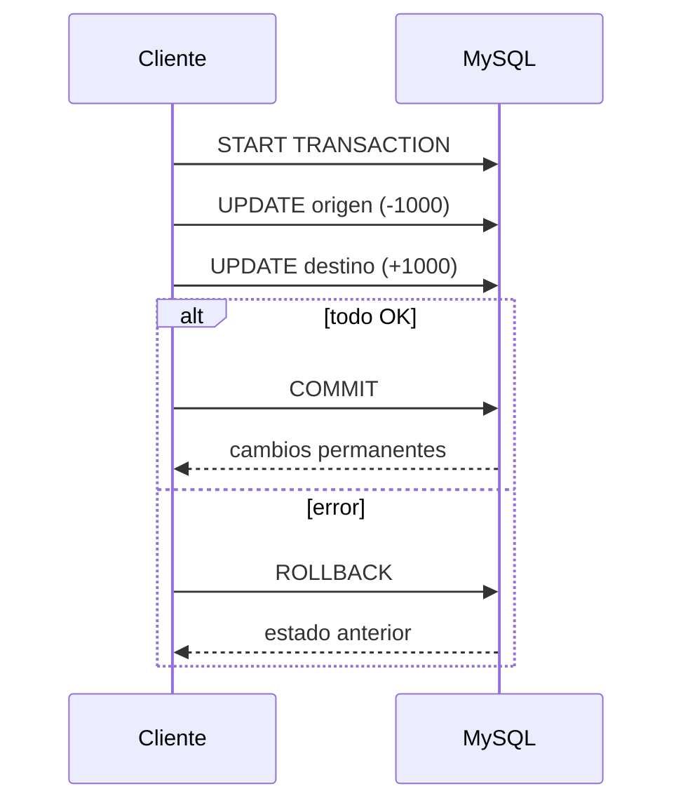

# 12. DML: insertar, actualizar y borrar

> [!info] Al terminar este capítulo tenés que poder
> - Insertar una o varias filas, y desde otra consulta.
> - Actualizar con condición y verificar antes.
> - Borrar sin destruir la tabla.
> - Explicar `COMMIT` y `ROLLBACK`.

> [!abstract] Qué debés saber (nivel 1)
> - `INSERT INTO ... VALUES (...)` agrega filas.
> - `UPDATE ... SET ... WHERE ...` modifica; **sin `WHERE` modifica todas**.
> - `DELETE FROM ... WHERE ...` borra filas.
> - `DELETE` sin `WHERE` vacía la tabla, pero se puede revertir.
> - `COMMIT` confirma; `ROLLBACK` deshace.
> - Antes de `UPDATE`/`DELETE`, corré el mismo `WHERE` con `SELECT`.

## 12.1 Insertar

```sql
-- Una fila, todas las columnas en orden
INSERT INTO departamento (id_depto, nombre, ciudad, presupuesto)
VALUES (10, 'Sistemas', 'La Plata', 5000000);

-- Varias filas
INSERT INTO departamento (id_depto, nombre, ciudad, presupuesto)
VALUES (20, 'Compras', 'Berisso', 2000000),
       (30, 'Ventas',  'Ensenada', 1500000);

-- Columnas omitidas: toman su DEFAULT
INSERT INTO departamento (nombre, ciudad)
VALUES ('Legales', 'La Plata');

-- Desde una consulta
INSERT INTO departamento_audit (id_depto, nombre)
SELECT id_depto, nombre FROM departamento WHERE presupuesto > 1000000;
```

| Variante | Uso |
|---|---|
| `VALUES` | Datos literales |
| `INSERT ... SELECT` | Copiar o transformar datos |
| `DEFAULT` | Usar el valor por defecto |
| `NULL` | Dejar el campo vacío (si lo admite) |

> [!warning] Orden de las columnas
> Si no nombrás las columnas, los valores deben ir **en el orden exacto** del `CREATE TABLE`. Es frágil: si mañana agregan una columna, se rompe. **Siempre nombrá las columnas.**

### `AUTO_INCREMENT`

```sql
INSERT INTO dispositivo (codigo, tipo, ubicacion)
VALUES ('S-01', 'semaforo', 'Av. Belgrano');

SELECT LAST_INSERT_ID();      -- id generado
```

## 12.2 Actualizar

```sql
-- Una columna
UPDATE empleado
SET sueldo = sueldo * 1.10
WHERE id_depto = 10;

-- Varias columnas
UPDATE empleado
SET sueldo = sueldo * 1.05,
    id_depto = 20
WHERE legajo = 1003;

-- Con subconsulta
UPDATE empleado
SET sueldo = sueldo * 1.20
WHERE id_depto IN (
    SELECT id_depto FROM departamento WHERE ciudad = 'La Plata'
);
```

> [!warning] El `UPDATE` sin `WHERE`
> ```sql
> UPDATE empleado SET sueldo = 0;   -- ¡todos los empleados!
> ```
> Antes de ejecutarlo, corré:
> ```sql
> SELECT * FROM empleado WHERE id_depto = 10;
> ```
> Si el `SELECT` trae lo que esperás, cambiá `SELECT *` por `UPDATE ... SET`.

### Modo seguro

```sql
SET SQL_SAFE_UPDATES = 1;   -- impide UPDATE/DELETE sin clave en WHERE
```

> [!tip] Hábito profesional
> Trabajá siempre dentro de una transacción:
> ```sql
> START TRANSACTION;
> UPDATE ...;
> SELECT ...;        -- verificás
> -- si está bien: COMMIT;   si no: ROLLBACK;
> ```

## 12.3 Borrar

```sql
-- Borrar filas que cumplen una condición
DELETE FROM alerta WHERE prioridad = 5;

-- Borrar con límite
DELETE FROM alerta ORDER BY fecha ASC LIMIT 10;

-- Borrar todo (se puede revertir con ROLLBACK)
DELETE FROM alerta;
```

| Sentencia | Efecto | ¿Reversible? |
|---|---|---|
| `DELETE ... WHERE ...` | Borra filas | Sí, con transacción |
| `DELETE FROM t` | Borra todas las filas | Sí, con transacción |
| `TRUNCATE TABLE t` | Vacía y reinicia el contador | No |
| `DROP TABLE t` | Elimina la tabla | No |

## 12.4 Transacciones (lo mínimo)

```sql
START TRANSACTION;

UPDATE cuenta SET saldo = saldo - 1000 WHERE id = 1;
UPDATE cuenta SET saldo = saldo + 1000 WHERE id = 2;

-- Si ambas están bien:
COMMIT;

-- Si algo falló:
-- ROLLBACK;
```



> [!important] Por qué importa
> Una transferencia son **dos** operaciones. Si falla la segunda sin transacción, el dinero desaparece. `COMMIT`/`ROLLBACK` garantizan que se apliquen todas o ninguna.

## 12.5 Programa completo

```sql
-- Datos de prueba
INSERT INTO dispositivo (codigo, tipo, ubicacion) VALUES
    ('S-01', 'semaforo', 'Av. Belgrano'),
    ('S-02', 'semaforo', 'Av. San Martín'),
    ('C-01', 'camara',   'Plaza Moreno');

INSERT INTO alerta (mensaje, prioridad, id_dispositivo) VALUES
    ('Lámpara quemada', 2, 1),
    ('Sin energía',     1, 2),
    ('Cámara offline',  1, 3),
    ('Lente sucio',     4, 3);

-- Actualizar: subir prioridad de las alertas de la cámara C-01
UPDATE alerta
SET prioridad = prioridad - 1
WHERE id_dispositivo = (
    SELECT id FROM dispositivo WHERE codigo = 'C-01'
)
AND prioridad > 1;

-- Verificar
SELECT d.codigo, a.mensaje, a.prioridad
FROM alerta a
JOIN dispositivo d ON d.id = a.id_dispositivo
ORDER BY a.prioridad, d.codigo;

-- Borrar las alertas ya resueltas de prioridad 4
DELETE FROM alerta WHERE prioridad = 4;
```

Salida del `SELECT`:

```text
+--------+-----------------+-----------+
| codigo | mensaje         | prioridad |
+--------+-----------------+-----------+
| C-01   | Cámara offline  |         1 |
| S-02   | Sin energía     |         1 |
| S-01   | Lámpara quemada |         2 |
| C-01   | Lente sucio     |         4 |
+--------+-----------------+-----------+
```

> [!warning] `UPDATE` con subconsulta sobre la misma tabla
> MySQL no permite, en algunos casos, subconsultar la tabla que estás actualizando. Solución: usar un `JOIN` en el `UPDATE` o una tabla temporal.
> ```sql
> UPDATE alerta a
> JOIN dispositivo d ON d.id = a.id_dispositivo
> SET a.prioridad = a.prioridad - 1
> WHERE d.codigo = 'C-01' AND a.prioridad > 1;
> ```

## Cómo trazar un DML

| Paso | Acción | Verificación |
|---|---|---|
| 1 | Escribir el `SELECT` con el `WHERE` | ¿Trae las filas correctas? |
| 2 | Convertirlo en `UPDATE`/`DELETE` | Mismo `WHERE` |
| 3 | Ejecutar dentro de transacción | `START TRANSACTION` |
| 4 | Revisar `ROW_COUNT()` | Filas afectadas |
| 5 | `COMMIT` o `ROLLBACK` | Según el resultado |

```sql
START TRANSACTION;
UPDATE empleado SET sueldo = sueldo * 1.1 WHERE id_depto = 10;
SELECT ROW_COUNT() AS afectadas;
-- si es el número esperado:
COMMIT;
```

## Errores que suelen tomar

| Error | Consecuencia |
|---|---|
| `UPDATE` sin `WHERE` | Modifica toda la tabla |
| `DELETE` sin `WHERE` | Vacía la tabla |
| `INSERT` sin nombrar columnas | Se rompe al cambiar el esquema |
| No usar transacción | No hay vuelta atrás |
| `DELETE` con FK sin `CASCADE` | `ERROR 1451` |
| Confundir `TRUNCATE` con `DELETE` | `TRUNCATE` no se revierte |

## Ejercicios

> [!example]- 1. Insertar
> **Enunciado:** insertá dos técnicos en una sola sentencia.
> **Solución:**
> ```sql
> INSERT INTO tecnico (nombre, matricula) VALUES
>     ('Luis', 'MAT-001'),
>     ('Eva',  'MAT-002');
> ```

> [!example]- 2. Actualizar
> **Enunciado:** subí un 15 % el sueldo de los empleados de Sistemas.
> **Solución:**
> ```sql
> UPDATE empleado
> SET sueldo = sueldo * 1.15
> WHERE id_depto = (SELECT id_depto FROM departamento WHERE nombre = 'Sistemas');
> ```

> [!example]- 3. Borrar
> **Enunciado:** borrá las alertas de prioridad 5 anteriores a 2026.
> **Solución:**
> ```sql
> DELETE FROM alerta
> WHERE prioridad = 5 AND fecha < '2026-01-01';
> ```

> [!example]- 4. Transacción
> **Enunciado:** escribí una transferencia entre dos cuentas.
> **Solución:**
> ```sql
> START TRANSACTION;
> UPDATE cuenta SET saldo = saldo - 1000 WHERE id = 1;
> UPDATE cuenta SET saldo = saldo + 1000 WHERE id = 2;
> COMMIT;
> ```

> [!example]- 5. a papel
> **Enunciado:** escribí el `SELECT` de verificación y el `DELETE` para borrar las reparaciones con costo 0.
> **Solución:**
> ```sql
> SELECT * FROM reparacion WHERE costo = 0;
> DELETE FROM reparacion WHERE costo = 0;
> ```

## Lo que sigue

[[bd13_ddl|13. DDL: definir estructuras]].

#libro2 #basededatos #dml
