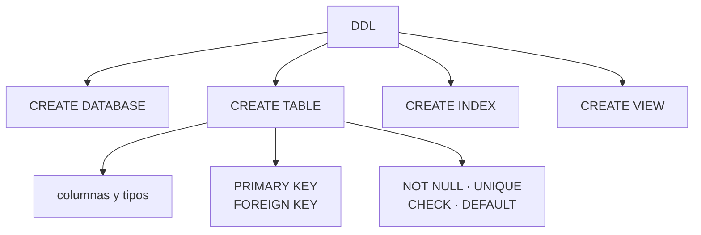

# 13. DDL: definir estructuras

> [!info] Al terminar este capítulo tenés que poder
> - Crear una base y una tabla con todos sus tipos y restricciones.
> - Modificar una tabla existente con `ALTER TABLE`.
> - Diferenciar `DROP`, `TRUNCATE` y `DELETE`.
> - Decidir cuándo crear un índice.

> [!abstract] Qué debés saber (nivel 1)
> - `CREATE DATABASE`, `CREATE TABLE`, `ALTER TABLE`, `DROP TABLE`.
> - `ALTER` permite `ADD`, `MODIFY`, `DROP`, `RENAME`.
> - `DROP` borra la estructura **y** los datos.
> - `TRUNCATE` vacía los datos, deja la estructura.
> - Los índices aceleran búsquedas a costa de espacio y escritura.

## 13.1 Crear la base

```sql
CREATE DATABASE IF NOT EXISTS municipio
    CHARACTER SET utf8mb4
    COLLATE utf8mb4_0900_ai_ci;

USE municipio;
```

| Cláusula | Para qué |
|---|---|
| `IF NOT EXISTS` | Evita el error si ya existe |
| `CHARACTER SET utf8mb4` | Soporta emojis y caracteres completos |
| `COLLATE` | Reglas de comparación y orden |

> [!warning] `utf8` vs. `utf8mb4`
> En MySQL, `utf8` es un alias incompleto (3 bytes) y **no** guarda emojis. Usá `utf8mb4`.

### Qué objetos crea el DDL



> [!important] El orden importa
> Primero la base, después las tablas **sin** claves foráneas (o al menos las referenciadas), y al final las `FOREIGN KEY`. Si creás la tabla hija antes que la padre, la referencia falla.

## 13.2 Crear tablas

```sql
CREATE TABLE departamento (
    id_depto     INT AUTO_INCREMENT,
    nombre       VARCHAR(60) NOT NULL,
    ciudad       VARCHAR(60) NOT NULL,
    presupuesto  DECIMAL(12,2) NOT NULL DEFAULT 0,

    CONSTRAINT pk_departamento PRIMARY KEY (id_depto),
    CONSTRAINT uq_departamento_nombre UNIQUE (nombre),
    CONSTRAINT ck_departamento_presu CHECK (presupuesto >= 0)
) ENGINE=InnoDB;
```

```sql
CREATE TABLE empleado (
    legajo    INT,
    dni       VARCHAR(10) NOT NULL,
    nombre    VARCHAR(60) NOT NULL,
    apellido  VARCHAR(60) NOT NULL,
    sueldo    DECIMAL(10,2) NOT NULL,
    fecha_alta DATE NOT NULL DEFAULT (CURRENT_DATE),
    id_depto  INT NOT NULL,

    CONSTRAINT pk_empleado PRIMARY KEY (legajo),
    CONSTRAINT uq_empleado_dni UNIQUE (dni),
    CONSTRAINT fk_empleado_depto FOREIGN KEY (id_depto)
        REFERENCES departamento(id_depto)
        ON DELETE RESTRICT
        ON UPDATE CASCADE,
    CONSTRAINT ck_empleado_sueldo CHECK (sueldo > 0)
) ENGINE=InnoDB;
```

| Elemento | Función |
|---|---|
| `AUTO_INCREMENT` | Genera el próximo valor |
| `NOT NULL` | Obliga a tener valor |
| `DEFAULT` | Valor si no se especifica |
| `PRIMARY KEY` | Identifica la fila |
| `UNIQUE` | Prohíbe duplicados |
| `FOREIGN KEY` | Integridad referencial |
| `CHECK` | Regla de dominio (MySQL 8.0.16+) |
| `ENGINE=InnoDB` | Motor con transacciones y FK |

> [!important] `CHECK` en MySQL
> Antes de 8.0.16 se **ignoraba** silenciosamente. Si tu versión es vieja, la restricción no se aplica. En el examen, igual se escribe.

## 13.3 Modificar tablas

```sql
-- Agregar columna
ALTER TABLE empleado
    ADD COLUMN email VARCHAR(100) NULL;

-- Modificar tipo
ALTER TABLE empleado
    MODIFY COLUMN email VARCHAR(150) NOT NULL;

-- Renombrar columna
ALTER TABLE empleado
    RENAME COLUMN email TO correo;

-- Eliminar columna
ALTER TABLE empleado
    DROP COLUMN correo;

-- Agregar restricción
ALTER TABLE empleado
    ADD CONSTRAINT uq_empleado_email UNIQUE (correo);

-- Eliminar restricción
ALTER TABLE empleado
    DROP FOREIGN KEY fk_empleado_depto;

-- Renombrar tabla
ALTER TABLE empleado RENAME TO empleados;
```

| Operación | Sintaxis |
|---|---|
| Agregar columna | `ADD COLUMN nombre tipo` |
| Cambiar tipo | `MODIFY COLUMN nombre tipo` |
| Renombrar | `RENAME COLUMN viejo TO nuevo` |
| Borrar columna | `DROP COLUMN nombre` |
| Agregar FK | `ADD CONSTRAINT ... FOREIGN KEY ...` |

> [!warning] `MODIFY` puede truncar datos
> Si pasás de `VARCHAR(150)` a `VARCHAR(50)`, los textos más largos se cortan o la operación falla según el modo SQL. Verificá antes con un `SELECT MAX(LENGTH(columna))`.

## 13.4 `DROP`, `TRUNCATE` y `DELETE`

| Sentencia | Qué borra | ¿Se puede deshacer? | Tipo |
|---|---|---|---|
| `DELETE FROM t WHERE ...` | Filas que cumplen la condición | Sí (con transacción) | DML |
| `TRUNCATE TABLE t` | **Todas** las filas | No (implícito commit) | DDL |
| `DROP TABLE t` | Estructura **y** datos | No | DDL |

```sql
DELETE FROM alerta WHERE prioridad = 5;   -- borra algunas
TRUNCATE TABLE alerta;                    -- vacía la tabla
DROP TABLE alerta;                        -- elimina la tabla
```

> [!warning] El DDL hace `COMMIT` implícito: no se revierte
> `CREATE`, `ALTER`, `DROP` y `TRUNCATE` **confirman la transacción en curso** y no se pueden deshacer con `ROLLBACK`. Por eso un `DROP TABLE` es irreversible aunque lo escribas “dentro de una transacción”: el motor confirma antes (y en Oracle también después) de ejecutarlo. Es la razón por la que el DDL se prueba primero en un entorno de desarrollo.

> [!important] `DELETE` sin `WHERE`
> ```sql
> DELETE FROM alerta;   -- borra TODAS las filas, pero la tabla queda
> ```
> Es el equivalente a `TRUNCATE`, pero registra fila por fila y se puede revertir dentro de una transacción.

## 13.5 Índices

Un índice acelera la búsqueda por una columna, como el índice de un libro.

```sql
CREATE INDEX idx_alerta_fecha ON alerta(fecha);
CREATE INDEX idx_alerta_disp_prio ON alerta(id_dispositivo, prioridad);

DROP INDEX idx_alerta_fecha ON alerta;
```

| Ventaja | Costo |
|---|---|
| `SELECT` con `WHERE`/`JOIN` más rápido | Ocupa espacio |
| `ORDER BY` puede aprovecharse | `INSERT`/`UPDATE` más lentos |

> [!tip] Cuándo indexar
> Columnas usadas en `WHERE`, `JOIN` y `ORDER BY`, con alta selectividad. **No** indexes una columna booleana con dos valores: no discrimina.

## 13.6 Programa completo

```sql
DROP DATABASE IF EXISTS municipio;
CREATE DATABASE municipio CHARACTER SET utf8mb4;
USE municipio;

CREATE TABLE dispositivo (
    id        INT AUTO_INCREMENT PRIMARY KEY,
    codigo    VARCHAR(10) NOT NULL UNIQUE,
    tipo      VARCHAR(20) NOT NULL,
    ubicacion VARCHAR(100) NOT NULL,
    CONSTRAINT ck_tipo CHECK (tipo IN ('semaforo','camara'))
);

CREATE TABLE alerta (
    id             INT AUTO_INCREMENT PRIMARY KEY,
    fecha          DATETIME NOT NULL DEFAULT CURRENT_TIMESTAMP,
    mensaje        VARCHAR(200) NOT NULL,
    prioridad      TINYINT NOT NULL,
    atendida       BOOLEAN NOT NULL DEFAULT FALSE,
    id_dispositivo INT NOT NULL,
    CONSTRAINT ck_prio CHECK (prioridad BETWEEN 1 AND 5),
    CONSTRAINT fk_alerta_disp FOREIGN KEY (id_dispositivo)
        REFERENCES dispositivo(id) ON DELETE CASCADE
);

CREATE INDEX idx_alerta_prio ON alerta(prioridad);

SHOW TABLES;
DESCRIBE alerta;
```

Salida de `DESCRIBE alerta`:

```text
+----------------+--------------+------+-----+-------------------+
| Field          | Type         | Null | Key | Default           |
+----------------+--------------+------+-----+-------------------+
| id             | int          | NO   | PRI | NULL              |
| fecha          | datetime     | NO   |     | CURRENT_TIMESTAMP |
| mensaje        | varchar(200) | NO   |     | NULL              |
| prioridad      | tinyint      | NO   | MUL | NULL              |
| atendida       | tinyint(1)   | NO   |     | 0                 |
| id_dispositivo | int          | NO   | MUL | NULL              |
+----------------+--------------+------+-----+-------------------+
```

> [!tip] Leer `DESCRIBE`
> `PRI` = clave primaria. `MUL` = índice no único (por la FK o el índice). `UNI` = único. Es la forma rápida de auditar una tabla.

## Cómo trazar un DDL

| Paso | Pregunta | Acción |
|---|---|---|
| 1 | ¿Qué entidades? | Una tabla por entidad |
| 2 | ¿Qué tipos? | Elegir por dominio |
| 3 | ¿Qué es obligatorio? | `NOT NULL` |
| 4 | ¿Qué identifica? | `PRIMARY KEY` |
| 5 | ¿Qué referencia? | `FOREIGN KEY` |
| 6 | ¿Qué reglas? | `CHECK`, `UNIQUE` |
| 7 | ¿Qué se consulta? | Índices |

## Errores que suelen tomar

| Error | Corrección |
|---|---|
| Crear la FK antes que la tabla padre | Orden correcto |
| `DROP TABLE` creyendo que solo borra datos | Borra todo |
| `TRUNCATE` esperando poder revertir | No se revierte |
| `VARCHAR` sin longitud | Error de sintaxis |
| `CHECK` en MySQL < 8.0.16 | Se ignora |
| Indexar todo | Escrituras lentas |
| `DELETE` sin `WHERE` | Borra toda la tabla |

## Ejercicios

> [!example]- 1. Crear
> **Enunciado:** creá `tecnico(id, nombre, matricula única)`.
> **Solución:**
> ```sql
> CREATE TABLE tecnico (
>     id        INT AUTO_INCREMENT PRIMARY KEY,
>     nombre    VARCHAR(60) NOT NULL,
>     matricula VARCHAR(20) NOT NULL UNIQUE
> );
> ```

> [!example]- 2. Alterar
> **Enunciado:** agregá `telefono` a `tecnico` y luego hacelo obligatorio.
> **Solución:**
> ```sql
> ALTER TABLE tecnico ADD COLUMN telefono VARCHAR(20) NULL;
> UPDATE tecnico SET telefono = '000-000' WHERE telefono IS NULL;
> ALTER TABLE tecnico MODIFY COLUMN telefono VARCHAR(20) NOT NULL;
> ```

> [!example]- 3. Diferencias
> **Enunciado:** ¿qué usás para borrar solo las alertas de prioridad 5?
> **Solución:** `DELETE FROM alerta WHERE prioridad = 5;`

> [!example]- 4. Índice
> **Enunciado:** ¿qué índice crearías para `WHERE id_dispositivo = ? AND prioridad = 1`?
> **Solución:** compuesto `(id_dispositivo, prioridad)`, en ese orden (primero la columna más selectiva o la de igualdad).

> [!example]- 5. a papel
> **Enunciado:** escribí el DDL de `reparacion` con FK a `alerta` y a `tecnico`, costo no negativo y `ON DELETE SET NULL` para técnico.
> **Solución:**
> ```sql
> CREATE TABLE reparacion (
>     id         INT AUTO_INCREMENT PRIMARY KEY,
>     fecha      DATE NOT NULL,
>     costo      DECIMAL(10,2) NOT NULL DEFAULT 0,
>     id_alerta  INT NOT NULL,
>     id_tecnico INT NULL,
>     CONSTRAINT ck_costo CHECK (costo >= 0),
>     FOREIGN KEY (id_alerta) REFERENCES alerta(id) ON DELETE CASCADE,
>     FOREIGN KEY (id_tecnico) REFERENCES tecnico(id) ON DELETE SET NULL
> );
> ```

## Lo que sigue

[[bd14_convenciones-y-tipos|14. Convenciones de nombres y tipos de datos]].

#libro2 #basededatos #ddl
