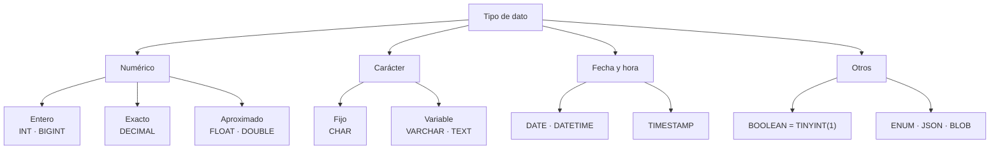

# 14. Convenciones de nombres y tipos de datos

> [!info] Al terminar este capítulo tenés que poder
> - Escribir SQL legible con un criterio uniforme.
> - Nombrar tablas, columnas y constraints sin ambigüedad.
> - Elegir el tipo de dato correcto para cada columna.
> - Justificar `DECIMAL` vs. `FLOAT` y `CHAR` vs. `VARCHAR`.
> - Traducir tipos entre Oracle y MySQL.

> [!abstract] Qué debés saber (nivel 1)
> - Palabras reservadas en **mayúscula**; nombres de objetos en **minúscula**.
> - Una cláusula por línea; indentar las continuaciones.
> - Sin espacios en los nombres: se usa `_`. Empiezan con letra.
> - Longitud máxima: **30** caracteres en Oracle, **64** en MySQL.
> - Constraints: prefijo `pk_`, `fk_`, `uq_`, `ck_`, `ix_`.
> - Dinero: **`DECIMAL`**, nunca `FLOAT`/`DOUBLE`.
> - Texto de longitud variable: **`VARCHAR`**; código fijo: `CHAR`.

> [!quote] Cátedra
> "Se puede adoptar el criterio de escribir en mayúscula las palabras reservadas de la sentencia y en minúscula los nombres de tablas, columnas y variables. […] escribir una cláusula por línea."

## 14.1 Convenciones léxicas

| Regla | Ejemplo correcto | Ejemplo a evitar |
|---|---|---|
| Reservadas en mayúscula | `SELECT`, `FROM`, `WHERE` | `select * from` |
| Objetos en minúscula | `alerta`, `id_dispositivo` | `Alerta`, `IDDispositivo` |
| Una cláusula por línea | `FROM alerta` / `WHERE ...` | Todo en una línea |
| Indentar continuaciones | columnas alineadas | sin sangría |
| Punto y coma final | `;` | omitirlo |
| Comentarios con `--` | `-- alertas activas` | comentarios sin marca |

```sql
-- Mal
select a.idDispositivo,a.Mensaje from Alerta a where a.Prioridad>2 order by 1;

-- Bien
SELECT a.id_dispositivo,
       a.mensaje
FROM alerta AS a
WHERE a.prioridad > 2
ORDER BY a.id_dispositivo;
```

> [!important] Por qué importa
> SQL no distingue mayúsculas de minúsculas en las palabras clave, pero un criterio uniforme hace visible un error de sintaxis: si una palabra reservada está en minúscula y el resto no, probablemente falte algo.

## 14.2 Nombres de objetos

| Regla | Detalle |
|---|---|
| Caracteres permitidos | Letras, dígitos, `_`, `$`, `#` |
| Primer carácter | Letra (no número ni signo) |
| Espacios | **No**; se reemplazan por `_` |
| Longitud | Oracle: 30; MySQL: 64 |
| Mayúsculas | Depende del motor y del sistema de archivos |
| Calificación | `esquema.tabla` |
| Sinónimos | Alias público de un objeto (Oracle) |

> [!warning] Nombres con mayúsculas
> En MySQL sobre Linux, el nombre de una tabla **distingue mayúsculas** si el sistema de archivos lo hace. `Alerta` y `alerta` pueden ser dos tablas distintas. Usá siempre minúscula.

### Nombres de constraints

| Prefijo | Tipo | Ejemplo |
|---|---|---|
| `pk_` | Primary key | `pk_alerta` |
| `fk_` | Foreign key | `fk_alerta_dispositivo` |
| `uq_` | Unique | `uq_usuario_email` |
| `ck_` | Check | `ck_alerta_prioridad` |
| `ix_` | Índice | `ix_alerta_fecha` |

> [!tip] La regla de la cátedra
> El nombre del constraint debe decir **qué restringe y sobre qué tabla**: `fk_alerta_dispositivo` se lee solo. Evitá `constraint1`, `fk_temp`, `prueba`.

```sql
CREATE TABLE alerta (
    id_alerta      INT AUTO_INCREMENT,
    id_dispositivo INT NOT NULL,
    mensaje        VARCHAR(200) NOT NULL,
    prioridad      TINYINT NOT NULL,
    atendida       BOOLEAN NOT NULL DEFAULT FALSE,
    fecha          DATETIME NOT NULL DEFAULT CURRENT_TIMESTAMP,
    CONSTRAINT pk_alerta PRIMARY KEY (id_alerta),
    CONSTRAINT fk_alerta_dispositivo FOREIGN KEY (id_dispositivo)
        REFERENCES dispositivo (id_dispositivo),
    CONSTRAINT ck_alerta_prioridad CHECK (prioridad BETWEEN 1 AND 5)
);
```

### El mapa de los tipos



> [!tip] La primera decisión
> Preguntá "¿es dinero?" y "¿es un código de longitud fija?". Con esas dos respuestas ya elegiste la mitad de las columnas.

## 14.3 Tipos numéricos

| Tipo MySQL | Bytes | Rango | Uso |
|---|---|---|---|
| `TINYINT` | 1 | −128 a 127 | Estados, prioridades |
| `SMALLINT` | 2 | −32.768 a 32.767 | Contadores chicos |
| `MEDIUMINT` | 3 | ±8,3 millones | — |
| `INT` | 4 | ±2.147 mil millones | IDs, cantidades |
| `BIGINT` | 8 | ±9,2×10¹⁸ | IDs globales |
| `DECIMAL(p,s)` | variable | Exacto | **Dinero** |
| `FLOAT` | 4 | Aproximado | Medidas |
| `DOUBLE` | 8 | Aproximado | Ciencia |

| Oracle | MySQL | Nota |
|---|---|---|
| `NUMBER(p,s)` | `DECIMAL(p,s)` | Exacto |
| `NUMBER` | `INT` / `BIGINT` | Según rango |
| `BINARY_FLOAT` | `FLOAT` | Aproximado |

> [!important] Dinero es exacto
> `FLOAT` y `DOUBLE` guardan aproximaciones binarias: `0.1 + 0.2` no da exactamente `0.3`. Para importes se usa `DECIMAL(12,2)`. Es una de las preguntas de oral más frecuentes.

### Entero sin signo

`INT UNSIGNED` duplica el rango positivo y evita negativos. Se usa para IDs y cantidades que nunca son negativas.

## 14.4 Tipos de carácter

| Tipo | Longitud | Espacio | Uso |
|---|---|---|---|
| `CHAR(n)` | Fija | Rellena con espacios | Códigos (`'AR'`, `'M'`) |
| `VARCHAR(n)` | Variable | Usa lo necesario | Nombres, direcciones |
| `TEXT` | Hasta 64 KB | Variable | Descripciones largas |
| `ENUM('A','B')` | Lista cerrada | 1–2 bytes | Estados controlados |

| Oracle | MySQL |
|---|---|
| `CHAR(n)` | `CHAR(n)` |
| `VARCHAR2(n)` | `VARCHAR(n)` |
| `CLOB` | `TEXT` |

> [!warning] `CHAR` rellena con espacios
> `CHAR(10)` con `'AR'` guarda `'AR        '`. Al comparar puede sorprender. Para longitud variable, `VARCHAR`.

> [!tip] `VARCHAR(n)`: ¿cuánto poner?
> El máximo real de la columna, no 255 por costumbre. Un `VARCHAR(200)` para un código de 3 letras desperdicia en índices y confunde.

## 14.5 Fechas y horas

| Tipo | Guarda | Nota |
|---|---|---|
| `DATE` | Año-mes-día | Sin hora |
| `TIME` | Hora | Sin fecha |
| `DATETIME` | Fecha y hora | No depende de zona |
| `TIMESTAMP` | Fecha y hora | Se actualiza y depende de zona |
| `YEAR` | Año | MySQL |

| Oracle | MySQL |
|---|---|
| `DATE` (con hora) | `DATETIME` |
| `TIMESTAMP` | `TIMESTAMP` |

> [!important] `DATETIME` vs. `TIMESTAMP`
> `TIMESTAMP` se convierte a UTC y puede actualizarse solo (`ON UPDATE CURRENT_TIMESTAMP`); `DATETIME` guarda tal cual. Para "cuándo ocurrió" en una auditoría, `DATETIME` es más predecible.

## 14.6 Booleanos y otros

| Necesidad | MySQL | Oracle |
|---|---|---|
| Verdadero/falso | `BOOLEAN` = `TINYINT(1)` | `NUMBER(1)` con `CHECK` |
| Conjunto cerrado | `ENUM` | `VARCHAR` + `CHECK` |
| Documento | `JSON` | `JSON` (21c+) |
| Binario | `BLOB` | `BLOB` |

> [!warning] No hay `BOOLEAN` real en MySQL
> `BOOLEAN` es un alias de `TINYINT(1)`: acepta 0, 1 y también 2. Si necesitás restringirlo, agregá `CHECK (activo IN (0,1))`.

## 14.7 Método: elegir el tipo

| Paso | Pregunta | Decisión |
|---|---|---|
| 1 | ¿Es un importe? | `DECIMAL(p,2)` |
| 2 | ¿Es un identificador? | `INT`/`BIGINT` (o `CHAR` si es código) |
| 3 | ¿Longitud fija? | `CHAR(n)` |
| 4 | ¿Texto libre? | `VARCHAR(n)` o `TEXT` |
| 5 | ¿Fecha con hora? | `DATETIME` |
| 6 | ¿Conjunto cerrado? | `ENUM` o tabla de dominio |
| 7 | ¿Puede ser nulo? | `NOT NULL` salvo que el negocio lo permita |

## Errores que suelen tomar

| Error | Corrección |
|---|---|
| Usar `FLOAT` para dinero | `DECIMAL` |
| Poner `VARCHAR(255)` a todo | Ajustar al dominio real |
| Usar `CHAR` para nombres | `VARCHAR` |
| Confundir `DATETIME` con `TIMESTAMP` | Zona horaria y autoactualización |
| Nombres con espacios o tildes | `_` y sin acentos |
| Constraints sin nombre | Prefijo `pk_`, `fk_`, `ck_` |
| `BOOLEAN` creyendo que es un tipo propio | Es `TINYINT(1)` |
| Nombrar `Alerta` y consultar `alerta` | Un solo criterio: minúscula |

## Ejercicios

> [!example]- 1. Tipo
> **Enunciado:** columna `precio` de un producto. ¿Qué tipo?
> **Solución:** `DECIMAL(10,2)`: exacto y con dos decimales.

> [!example]- 2. Tipo
> **Enunciado:** código de país de 2 letras. ¿Qué tipo?
> **Solución:** `CHAR(2)`: longitud fija.

> [!example]- 3. Nombre
> **Enunciado:** nombrá la FK de `alerta` hacia `dispositivo`.
> **Solución:** `fk_alerta_dispositivo`.

> [!example]- 4. Fecha
> **Enunciado:** `creado_en` que se actualiza sola al modificar. ¿Qué tipo?
> **Solución:** `TIMESTAMP DEFAULT CURRENT_TIMESTAMP ON UPDATE CURRENT_TIMESTAMP`.

> [!example]- 5. Legibilidad
> **Enunciado:** reescribí en tres líneas: `select id,nombre from cliente where activo=1`.
> **Solución:** `SELECT id, nombre` / `FROM cliente` / `WHERE activo = 1;`.

> [!example]- 6. a papel
> **Enunciado:** escribí el `CREATE TABLE` de `dispositivo` con convenciones y tipos justificados.
> **Solución:** `id_dispositivo INT AUTO_INCREMENT`, `nombre VARCHAR(80) NOT NULL`, `tipo ENUM('semaforo','camara') NOT NULL`, `activo TINYINT(1) DEFAULT 1`, `CONSTRAINT pk_dispositivo PRIMARY KEY (id_dispositivo)`.

## Lo que sigue

[[bd15_select|15. SELECT: proyección, filtro y orden]].

#libro2 #sql #tipos
