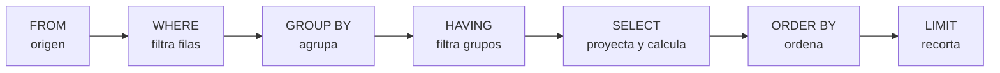

# 15. SELECT: proyección, filtro y orden

> [!info] Al terminar este capítulo tenés que poder
> - Elegir columnas, filtrar filas y ordenar.
> - Usar `BETWEEN`, `IN`, `LIKE` y `IS NULL`.
> - Explicar la lógica de tres valores.
> - Escribir consultas con expresiones y funciones.

> [!abstract] Qué debés saber (nivel 1)
> - `SELECT columnas FROM tabla WHERE condición ORDER BY criterio LIMIT n`.
> - `DISTINCT` elimina duplicados.
> - `LIKE` usa `%` (cualquier cantidad) y `_` (un carácter).
> - `NULL` no se compara con `=`; se usa `IS NULL` / `IS NOT NULL`.
> - `ORDER BY` va al final (después de `SELECT`).
> - Las funciones de fila transforman **una fila**.

## 15.1 Proyección

```sql
-- Todas las columnas (solo para explorar)
SELECT * FROM empleado;

-- Columnas elegidas
SELECT nombre, apellido, sueldo FROM empleado;

-- Alias de columna
SELECT nombre AS empleado, sueldo * 12 AS anual FROM empleado;

-- Sin duplicados
SELECT DISTINCT id_depto FROM empleado;
```

> [!warning] `SELECT *` en producción
> Trae columnas que no necesitás, rompe si cambia el esquema y impide usar índices de cobertura. En el examen se acepta para explorar; en código real, no.

## 15.2 Filtro: `WHERE`

| Operador | Significado | Ejemplo |
|---|---|---|
| `=` `<>` `!=` | Igualdad / desigualdad | `id_depto = 10` |
| `<` `<=` `>` `>=` | Comparación | `sueldo >= 800000` |
| `BETWEEN a AND b` | Rango inclusivo | `sueldo BETWEEN 700000 AND 900000` |
| `IN (...)` | Pertenece a una lista | `id_depto IN (10, 20)` |
| `LIKE` | Patrón de texto | `nombre LIKE 'A%'` |
| `IS NULL` | Es nulo | `id_tecnico IS NULL` |
| `AND` `OR` `NOT` | Lógica | `prioridad = 1 AND activo = 1` |

```sql
SELECT nombre, sueldo
FROM empleado
WHERE sueldo BETWEEN 700000 AND 900000
  AND id_depto IN (10, 20)
  AND nombre LIKE 'A%';
```

### `LIKE`

| Patrón | Significado |
|---|---|
| `'A%'` | Empieza con A |
| `'%a'` | Termina con a |
| `'%an%'` | Contiene “an” |
| `'_na'` | Un carácter + “na” (`Ana`) |

```sql
SELECT nombre FROM empleado WHERE nombre LIKE '%a%';
```

> [!tip] `LIKE` y los índices
> `LIKE 'A%'` puede usar índice; `LIKE '%a'` normalmente **no**, porque no sabe por dónde empezar.

## 15.3 `NULL`: la trampa

```sql
-- MAL: no devuelve nada
SELECT * FROM reparacion WHERE id_tecnico = NULL;

-- BIEN
SELECT * FROM reparacion WHERE id_tecnico IS NULL;
```

> [!important] Lógica de tres valores
> `NULL` significa “desconocido”. Cualquier comparación con `NULL` da **desconocido**, no verdadero.
> | Expresión | Resultado |
> |---|---|
> | `NULL = NULL` | Desconocido |
> | `NULL <> 5` | Desconocido |
> | `NULL IS NULL` | Verdadero |
> | `COALESCE(NULL, 0)` | 0 |

```sql
-- Reemplazar nulos en la salida
SELECT id, COALESCE(id_tecnico, 0) AS tecnico FROM reparacion;
```

## 15.4 Orden

```sql
SELECT nombre, sueldo
FROM empleado
ORDER BY sueldo DESC;

-- Varios criterios
SELECT id_depto, nombre, sueldo
FROM empleado
ORDER BY id_depto ASC, sueldo DESC;

-- Por alias o por posición
SELECT nombre, sueldo * 12 AS anual
FROM empleado
ORDER BY anual DESC;
```

| Cláusula | Efecto |
|---|---|
| `ASC` | Ascendente (por defecto) |
| `DESC` | Descendente |
| `ORDER BY 2` | Ordena por la segunda columna del `SELECT` |
| `NULLS FIRST/LAST` | MySQL no lo soporta directo; se emula con `IS NULL` |

> [!warning] Ordenar con `NULL`
> En MySQL, `NULL` se considera menor que cualquier valor: aparece primero en `ASC` y último en `DESC`.

## 15.5 Límite y paginación

```sql
-- Los 3 mejores sueldos
SELECT nombre, sueldo
FROM empleado
ORDER BY sueldo DESC
LIMIT 3;

-- Página 2 (de 5 en 5)
SELECT nombre, sueldo
FROM empleado
ORDER BY legajo
LIMIT 5 OFFSET 5;
```

> [!important] `LIMIT` sin `ORDER BY` no tiene sentido
> El motor puede devolver cualquier fila. Siempre ordená antes de limitar.

## 15.6 Funciones de fila

| Función | Qué hace | Ejemplo |
|---|---|---|
| `CONCAT(a, b)` | Une textos | `CONCAT(nombre, ' ', apellido)` |
| `UPPER` / `LOWER` | Mayúsculas / minúsculas | `UPPER(nombre)` |
| `LENGTH` | Largo en bytes | `LENGTH(nombre)` |
| `CHAR_LENGTH` | Largo en caracteres | `CHAR_LENGTH(nombre)` |
| `TRIM` | Quita espacios | `TRIM(nombre)` |
| `ROUND(x, d)` | Redondea | `ROUND(sueldo/12, 2)` |
| `CEIL` / `FLOOR` | Techo / piso | `CEIL(3.2)` |
| `ABS` | Valor absoluto | `ABS(-5)` |
| `COALESCE` | Primer valor no nulo | `COALESCE(telefono, 'sin dato')` |
| `IFNULL` | Idem, dos argumentos | `IFNULL(telefono, 'sin dato')` |
| `NOW` / `CURDATE` | Fecha y hora actual | `NOW()` |
| `YEAR` / `MONTH` / `DAY` | Parte de una fecha | `YEAR(fecha)` |
| `DATEDIFF` | Días entre fechas | `DATEDIFF(NOW(), fecha)` |

```sql
SELECT
    CONCAT(nombre, ' ', apellido) AS completo,
    ROUND(sueldo / 12, 2) AS mensual,
    UPPER(ciudad) AS ciudad,
    YEAR(fecha_alta) AS anio
FROM empleado
WHERE fecha_alta >= '2024-01-01'
ORDER BY anio DESC, completo;
```

### El orden en que lo resuelve el motor



> [!important] Por qué `WHERE` no ve los alias
> `WHERE` se evalúa **antes** de `SELECT`, así que no puede usar los alias definidos ahí. `ORDER BY` se evalúa después y sí puede. Es la causa de la mitad de los errores de consulta.

## 15.7 Programa completo

```sql
SELECT
    d.codigo,
    d.tipo,
    d.ubicacion,
    COUNT(a.id) AS alertas,
    MAX(a.prioridad) AS prioridad_maxima
FROM dispositivo d
LEFT JOIN alerta a ON a.id_dispositivo = d.id
WHERE d.activo = TRUE
GROUP BY d.codigo, d.tipo, d.ubicacion
HAVING alertas > 0
ORDER BY prioridad_maxima DESC, alertas DESC;
```

> [!note] Este ejemplo adelanta `JOIN` y `GROUP BY`
> Se desarrollan en [[bd16_joins-subconsultas]] y [[bd18_agrupamiento]]. Sirve para ver cómo se combinan las cláusulas en una consulta real.

## Cómo trazar una consulta

Tabla `empleado`:

| legajo | nombre | id_depto | sueldo |
|---:|---|---:|---:|
| 1 | Ana | 10 | 950000 |
| 2 | Luis | 10 | 870000 |
| 3 | Eva | 20 | 720000 |
| 4 | Juan | NULL | 610000 |

```sql
SELECT nombre, sueldo
FROM empleado
WHERE sueldo > 700000
ORDER BY sueldo DESC
LIMIT 2;
```

| Paso | Resultado |
|---|---|
| `FROM` | 4 filas |
| `WHERE` | Ana (950k), Luis (870k), Eva (720k) |
| `ORDER BY` | Ana, Luis, Eva |
| `LIMIT 2` | Ana, Luis |

> [!warning] Lo que **no** entra
> Juan queda afuera por el `WHERE`, aunque su `id_depto` sea `NULL`. El filtro es por sueldo, no por departamento.

## Errores que suelen tomar

| Error | Corrección |
|---|---|
| `WHERE col = NULL` | `WHERE col IS NULL` |
| `LIKE '%x'` esperando índice | No lo usa |
| `LIMIT` sin `ORDER BY` | Resultado impredecible |
| Alias de `SELECT` en `WHERE` | No permitido |
| `DISTINCT` con `SELECT *` | Elimina filas enteras, no columnas |
| `AND`/`OR` sin paréntesis | Precedencia inesperada |

> [!important] Paréntesis en `OR`
> ```sql
> WHERE id_depto = 10 OR id_depto = 20 AND sueldo > 800000
> ```
> `AND` tiene prioridad: se lee `10 OR (20 AND sueldo>800k)`. Casi seguro querías `(10 OR 20) AND ...`.

## Ejercicios

> [!example]- 1. Filtro simple
> **Enunciado:** empleados con sueldo entre 700.000 y 900.000.
> **Solución:**
> ```sql
> SELECT * FROM empleado WHERE sueldo BETWEEN 700000 AND 900000;
> ```

> [!example]- 2. `LIKE`
> **Enunciado:** nombres que terminen en “a”.
> **Solución:**
> ```sql
> SELECT nombre FROM empleado WHERE nombre LIKE '%a';
> ```

> [!example]- 3. `NULL`
> **Enunciado:** reparaciones sin técnico asignado.
> **Solución:**
> ```sql
> SELECT * FROM reparacion WHERE id_tecnico IS NULL;
> ```

> [!example]- 4. Orden y límite
> **Enunciado:** los 5 dispositivos con más alertas (adelanta `GROUP BY`).
> **Solución:**
> ```sql
> SELECT id_dispositivo, COUNT(*) AS total
> FROM alerta
> GROUP BY id_dispositivo
> ORDER BY total DESC
> LIMIT 5;
> ```

> [!example]- 5. a papel
> **Enunciado:** listar código y ubicación de las cámaras activas, ordenadas por ubicación.
> **Solución:**
> ```sql
> SELECT codigo, ubicacion
> FROM dispositivo
> WHERE tipo = 'camara' AND activo = TRUE
> ORDER BY ubicacion;
> ```

## Lo que sigue

[[bd16_joins-subconsultas|16. JOIN y subconsultas]].

#libro2 #basededatos #select
