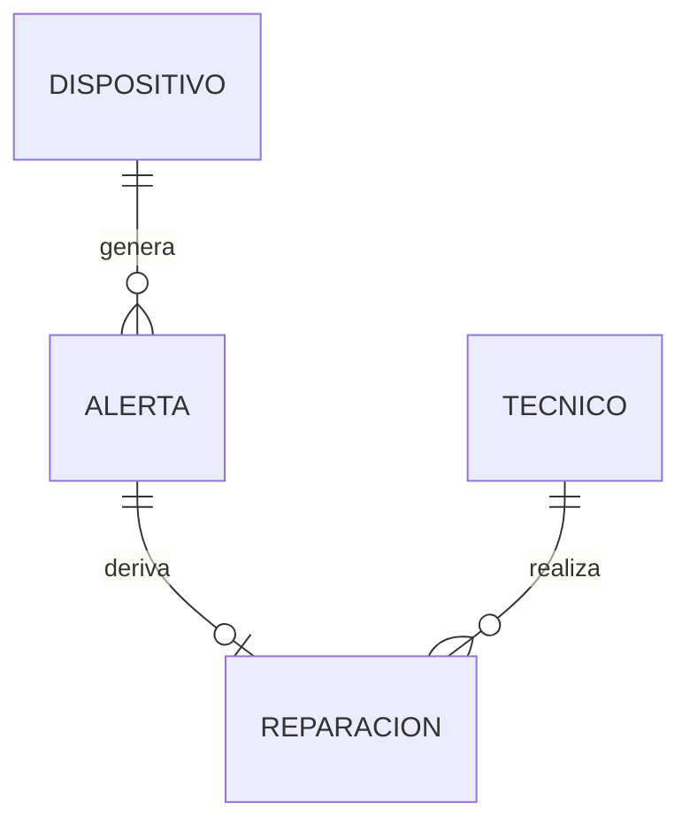
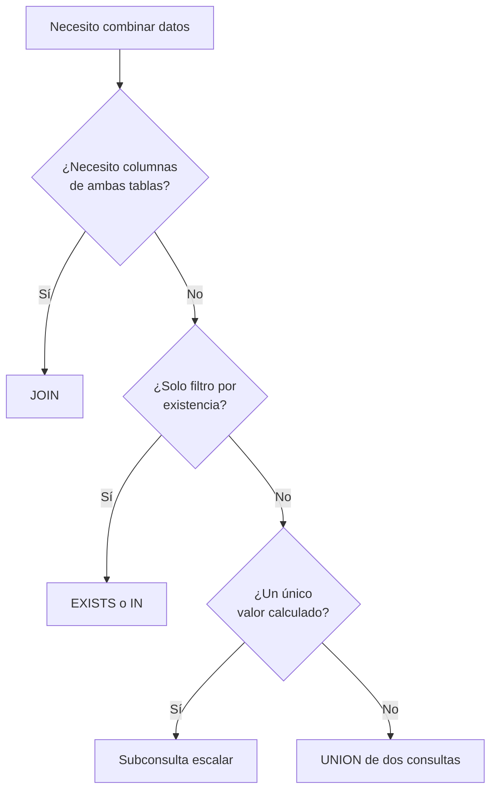

# 16. JOIN y subconsultas

> [!info] Al terminar este capítulo tenés que poder
> - Unir dos o más tablas por su clave.
> - Elegir entre `INNER`, `LEFT`, `RIGHT` y `CROSS`.
> - Escribir un autojuntura.
> - Resolver una consulta con subconsulta o `EXISTS`.

> [!abstract] Qué debés saber (nivel 1)
> - `JOIN ... ON` une filas que cumplen la condición.
> - `INNER JOIN`: solo las que coinciden en ambas tablas.
> - `LEFT JOIN`: todas las de la izquierda, aunque no tengan par.
> - Sin `ON` (o con `WHERE` mal puesto) se produce un **producto cartesiano**.
> - Subconsulta escalar: devuelve un valor. `IN`: una lista. `EXISTS`: verdadero/falso.
> - `UNION` combina resultados; `UNION ALL` no elimina duplicados.

## 16.1 Por qué unir

Los datos están separados por normalización. Para responder “¿qué dispositivo generó esta alerta?” hay que **reunir** las tablas por la clave.



## 16.2 `INNER JOIN`

```sql
SELECT a.id, a.mensaje, d.codigo, d.ubicacion
FROM alerta a
INNER JOIN dispositivo d ON d.id = a.id_dispositivo
ORDER BY a.id;
```

| id | mensaje | codigo | ubicacion |
|---:|---|---|---|
| 1 | Lámpara quemada | S-01 | Av. Belgrano |
| 2 | Sin energía | S-02 | Av. San Martín |
| 3 | Cámara offline | C-01 | Plaza Moreno |
| 4 | Lente sucio | C-01 | Plaza Moreno |

> [!important] Alias de tabla
> `alerta a` permite escribir `a.id`. Sin alias, con columnas homónimas, MySQL da `Column 'id' in field list is ambiguous`.

### Unir tres tablas

```sql
SELECT a.id, d.codigo, t.nombre AS tecnico, r.costo
FROM alerta a
JOIN dispositivo d ON d.id = a.id_dispositivo
LEFT JOIN reparacion r ON r.id_alerta = a.id
LEFT JOIN tecnico t ON t.id = r.id_tecnico
ORDER BY a.id;
```

| Tabla | Tipo de join | Por qué |
|---|---|---|
| `dispositivo` | `INNER` | Toda alerta tiene dispositivo (`NOT NULL`) |
| `reparacion` | `LEFT` | Puede no tener reparación |
| `tecnico` | `LEFT` | La reparación puede no tener técnico |

> [!tip] Regla práctica
> Si la FK es `NOT NULL`, `INNER` está bien. Si es `NULL` o la relación es opcional, usá `LEFT`.

## 16.3 `LEFT` y `RIGHT JOIN`

```sql
-- Todos los dispositivos, tengan o no alertas
SELECT d.codigo, COUNT(a.id) AS alertas
FROM dispositivo d
LEFT JOIN alerta a ON a.id_dispositivo = d.id
GROUP BY d.codigo;

-- Equivalente con RIGHT (menos legible)
SELECT d.codigo, COUNT(a.id) AS alertas
FROM alerta a
RIGHT JOIN dispositivo d ON d.id = a.id_dispositivo
GROUP BY d.codigo;
```

| Join | Conserva | Descarta |
|---|---|---|
| `INNER` | Coincidencias | Filas sin par |
| `LEFT` | Todas las de la izquierda | Nada de la izquierda |
| `RIGHT` | Todas las de la derecha | Nada de la derecha |
| `FULL OUTER` | Todas las de **ambas** tablas | Nada |
| `CROSS` | Todas las combinaciones | Nada |

> [!warning] `FULL OUTER JOIN` no existe en MySQL
> El estándar lo define, pero MySQL solo trae `LEFT` y `RIGHT`. Se emula con la unión de las dos mitades:
> ```sql
> SELECT d.codigo, a.id
> FROM dispositivo d LEFT JOIN alerta a ON a.id_dispositivo = d.id
> UNION
> SELECT d.codigo, a.id
> FROM dispositivo d RIGHT JOIN alerta a ON a.id_dispositivo = d.id;
> ```

### Encontrar huérfanos

```sql
SELECT d.codigo
FROM dispositivo d
LEFT JOIN alerta a ON a.id_dispositivo = d.id
WHERE a.id IS NULL;
```

> [!important] El patrón `LEFT JOIN ... IS NULL`
> Es la forma estándar de responder “dispositivos **sin** alertas”. Se pregunta mucho.

## 16.4 `CROSS JOIN`

```sql
SELECT d.codigo, t.nombre
FROM dispositivo d
CROSS JOIN tecnico t;
```

Genera `filas(dispositivo) × filas(tecnico)`. Sirve para generar combinaciones (por ejemplo, una grilla de asignaciones posibles), no para consultar relaciones.

> [!warning] El error más caro
> Olvidar el `ON`:
> ```sql
> SELECT * FROM alerta, dispositivo;   -- producto cartesiano
> ```
> Si hay 1.000 alertas y 50 dispositivos, devuelve 50.000 filas.

## 16.5 Autojuntura

Para comparar filas de la misma tabla: empleado con su supervisor.

```sql
SELECT e.nombre AS empleado,
       j.nombre AS jefe
FROM empleado e
LEFT JOIN empleado j ON j.legajo = e.id_jefe;
```

| Alias | Rol |
|---|---|
| `e` | El empleado |
| `j` | El jefe (misma tabla, otro alias) |

> [!tip] Sin alias no se puede
> `FROM empleado JOIN empleado` es ambiguo. Los alias son obligatorios en la autojuntura.

### ¿Join, subconsulta o `UNION`?



## 16.6 Subconsultas

### Escalar (devuelve un valor)

```sql
SELECT nombre, sueldo
FROM empleado
WHERE sueldo > (SELECT AVG(sueldo) FROM empleado);
```

### Con `IN` (devuelve una lista)

```sql
SELECT nombre
FROM empleado
WHERE id_depto IN (
    SELECT id_depto FROM departamento WHERE ciudad = 'La Plata'
);
```

### Con `EXISTS`

```sql
SELECT d.codigo
FROM dispositivo d
WHERE EXISTS (
    SELECT 1 FROM alerta a
    WHERE a.id_dispositivo = d.id AND a.prioridad = 1
);
```

| Tipo | Devuelve | Se usa con |
|---|---|---|
| Escalar | Un valor | `=`, `>`, `<` |
| Lista | Una columna, varias filas | `IN`, `NOT IN` |
| Correlacionada | Depende de la fila externa | `EXISTS`, `NOT EXISTS` |

> [!warning] `NOT IN` con `NULL`
> Si la subconsulta devuelve un `NULL`, `NOT IN` no devuelve **ninguna** fila. Es un error silencioso. Preferí `NOT EXISTS`.

### Subconsulta en `SELECT`

```sql
SELECT d.codigo,
       (SELECT COUNT(*) FROM alerta a WHERE a.id_dispositivo = d.id) AS alertas
FROM dispositivo d;
```

> [!important] Rendimiento
> Una subconsulta correlacionada se ejecuta por cada fila externa. Con muchos datos conviene un `JOIN` con `GROUP BY`. En el examen, primero que sea correcta; después, eficiente.

## 16.7 `UNION`

```sql
SELECT codigo AS identificador, 'dispositivo' AS origen FROM dispositivo
UNION
SELECT CAST(id AS CHAR), 'alerta' FROM alerta;
```

| | `UNION` | `UNION ALL` |
|---|---|---|
| Duplicados | Elimina | Conserva |
| Velocidad | Más lento | Más rápido |
| Requisito | Mismo número y tipo de columnas | Ídem |

## 16.8 Programa completo

```sql
-- 1. Alertas con su dispositivo
SELECT a.id, a.mensaje, a.prioridad, d.codigo, d.ubicacion
FROM alerta a
JOIN dispositivo d ON d.id = a.id_dispositivo
ORDER BY a.prioridad, a.id;

-- 2. Dispositivos sin alertas
SELECT d.codigo
FROM dispositivo d
LEFT JOIN alerta a ON a.id_dispositivo = d.id
WHERE a.id IS NULL;

-- 3. Reparaciones con técnico y alerta
SELECT r.id, r.fecha, r.costo,
       a.mensaje, t.nombre AS tecnico
FROM reparacion r
JOIN alerta a ON a.id = r.id_alerta
LEFT JOIN tecnico t ON t.id = r.id_tecnico
WHERE r.costo > 0;

-- 4. Dispositivos con al menos una alerta crítica
SELECT d.codigo
FROM dispositivo d
WHERE EXISTS (
    SELECT 1 FROM alerta a
    WHERE a.id_dispositivo = d.id AND a.prioridad = 1
);

-- 5. Promedio de costo por técnico (adelanta GROUP BY)
SELECT t.nombre, AVG(r.costo) AS costo_promedio
FROM tecnico t
JOIN reparacion r ON r.id_tecnico = t.id
GROUP BY t.nombre;
```

## Cómo trazar un join

| Paso | Pregunta | Ejemplo |
|---|---|---|
| 1 | ¿Qué tablas? | `alerta`, `dispositivo` |
| 2 | ¿Cuál es la clave? | `a.id_dispositivo = d.id` |
| 3 | ¿Inner o left? | `INNER`: la FK es `NOT NULL` |
| 4 | ¿Qué filas espero? | Una por alerta |
| 5 | ¿Se duplican? | No, porque `id` es único en `dispositivo` |

> [!warning] Joins que multiplican filas
> Si unís `dispositivo` con `alerta`, obtenés **una fila por alerta**, no una por dispositivo. Para eso se agrupa ([[bd18_agrupamiento]]).

## Errores que suelen tomar

| Error | Consecuencia |
|---|---|
| Olvidar `ON` | Producto cartesiano |
| `INNER` donde hacía falta `LEFT` | Se pierden filas sin par |
| Columna ambigua | `Column 'id' is ambiguous` |
| `NOT IN` con nulos | Resultado vacío |
| Unir por una columna que no es clave | Duplicados |
| Filtrar la tabla derecha en el `WHERE` de un `LEFT JOIN` | Lo convierte en `INNER` |

> [!important] El último es sutil
> ```sql
> FROM dispositivo d LEFT JOIN alerta a ON ...
> WHERE a.prioridad = 1      -- elimina las filas con a NULL → se vuelve INNER
> ```
> Solución: poner la condición en el `ON`:
> ```sql
> LEFT JOIN alerta a ON a.id_dispositivo = d.id AND a.prioridad = 1
> ```

## Ejercicios

> [!example]- 1. Inner
> **Enunciado:** listar alertas con código de dispositivo.
> **Solución:**
> ```sql
> SELECT a.mensaje, d.codigo
> FROM alerta a JOIN dispositivo d ON d.id = a.id_dispositivo;
> ```

> [!example]- 2. Left
> **Enunciado:** todos los dispositivos y su cantidad de alertas, incluidos los que tienen cero.
> **Solución:**
> ```sql
> SELECT d.codigo, COUNT(a.id) AS alertas
> FROM dispositivo d
> LEFT JOIN alerta a ON a.id_dispositivo = d.id
> GROUP BY d.codigo;
> ```

> [!example]- 3. Huérfanos
> **Enunciado:** alertas sin reparación.
> **Solución:**
> ```sql
> SELECT a.id
> FROM alerta a
> LEFT JOIN reparacion r ON r.id_alerta = a.id
> WHERE r.id IS NULL;
> ```

> [!example]- 4. Subconsulta
> **Enunciado:** dispositivos cuya cantidad de alertas supera el promedio.
> **Solución:**
> ```sql
> SELECT id_dispositivo, COUNT(*) AS total
> FROM alerta
> GROUP BY id_dispositivo
> HAVING total > (SELECT AVG(total) FROM (
>     SELECT COUNT(*) AS total FROM alerta GROUP BY id_dispositivo
> ) x);
> ```

> [!example]- 5. a papel
> **Enunciado:** escribí una consulta que devuelva código de dispositivo, mensaje de alerta y nombre del técnico que la reparó (si lo hubo).
> **Solución:**
> ```sql
> SELECT d.codigo, a.mensaje, t.nombre
> FROM dispositivo d
> JOIN alerta a ON a.id_dispositivo = d.id
> LEFT JOIN reparacion r ON r.id_alerta = a.id
> LEFT JOIN tecnico t ON t.id = r.id_tecnico;
> ```

## Lo que sigue

[[bd17_metodo-consultas|17. Método para resolver consultas]] — el catálogo de patrones y el procedimiento de 7 pasos.

#libro2 #basededatos #joins
