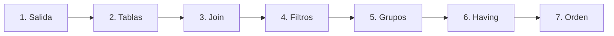
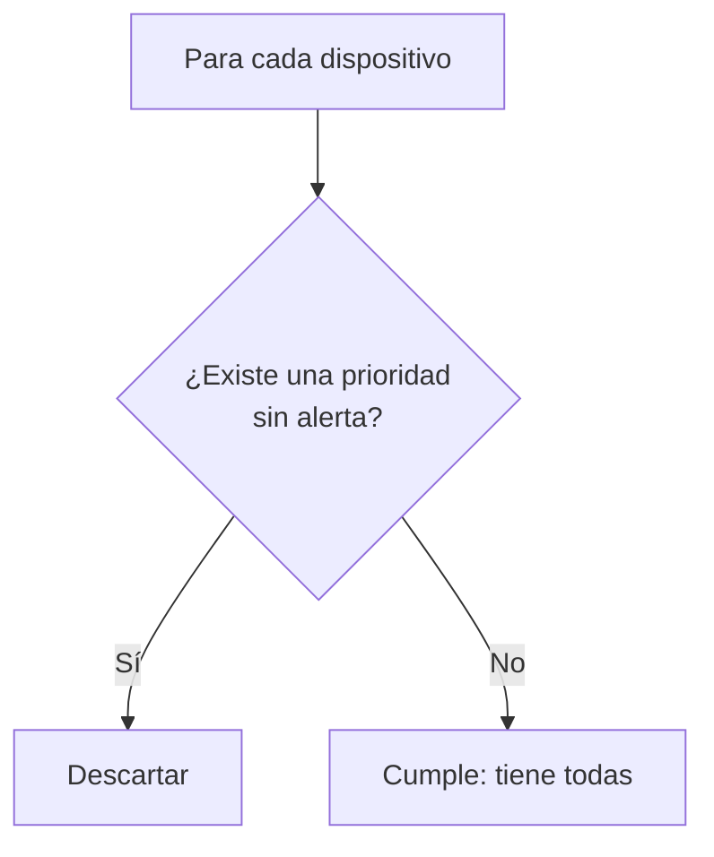

# 17. Método para resolver consultas

> [!info] Al terminar este capítulo tenés que poder
> - Convertir un enunciado en una consulta en 7 pasos.
> - Reconocer el patrón detrás de cada pregunta.
> - Evitar los tres errores que más se repiten: `WHERE` vs `HAVING`, `NULL` y duplicados por join.

> [!abstract] Qué debés saber (nivel 1)
> - Primero se identifica **qué columnas** se piden; después **qué tablas**.
> - El join se arma por **PK-FK**, no por “parecido”.
> - `WHERE` filtra filas; `HAVING`, grupos.
> - Un join puede **multiplicar filas**: si contás, contá la columna correcta.
> - “No tiene” se resuelve con `LEFT JOIN ... IS NULL` o `NOT EXISTS`.
> - “Todos” se resuelve con **doble `NOT EXISTS`**.

> [!important] Por qué un método
> Bajo presión, la consulta se escribe de memoria y falla en un detalle. El método obliga a decidir en orden: salida → tablas → join → filtros → grupos → orden.

> [!quote] Fuentes del método
> **UTN** aporta el orden de resolución y las prácticas con resoluciones (`4) SQL`). **UP** aporta los módulos de SQL y el criterio de `LEFT JOIN` para opcionales. **Siglo 21** aporta las cláusulas y el vocabulario.

## 17.1 Los 7 pasos

| Paso | Pregunta | Se traduce en |
|---|---|---|
| **1** | ¿Qué columnas deben aparecer? | `SELECT` |
| **2** | ¿En qué tablas están esos datos? | `FROM` |
| **3** | ¿Cómo se conectan? | `JOIN ... ON` (PK-FK) |
| **4** | ¿Qué filas se descartan? | `WHERE` |
| **5** | ¿Hay que agrupar o contar? | `GROUP BY` + función |
| **6** | ¿Se filtra por un agregado? | `HAVING` |
| **7** | ¿Orden y cantidad? | `ORDER BY` + `LIMIT` |



> [!tip] Regla de verificación
> Antes de ejecutar, simulá con **3 filas**. Si el resultado mental no coincide con lo que esperás, el error está en el join o en el filtro.

## 17.2 Catálogo de patrones

### Patrón 1 — Listado simple con filtro

> “Código y ubicación de las cámaras activas.”

```sql
SELECT codigo, ubicacion
FROM dispositivo
WHERE tipo = 'camara' AND activo = TRUE;
```

Pasos: salida (2 columnas) → tabla (`dispositivo`) → sin join → filtro → sin grupo → sin orden.

### Patrón 2 — “No tiene” / huérfanos

> “Dispositivos que no tienen ninguna alerta.”

```sql
SELECT d.codigo
FROM dispositivo d
LEFT JOIN alerta a ON a.id_dispositivo = d.id
WHERE a.id IS NULL;
```

```sql
-- Alternativa
SELECT d.codigo
FROM dispositivo d
WHERE NOT EXISTS (
    SELECT 1 FROM alerta a WHERE a.id_dispositivo = d.id
);
```

> [!important] Por qué no `NOT IN`
> Si la subconsulta devuelve un `NULL`, `NOT IN` no devuelve nada. `NOT EXISTS` es seguro.

### Patrón 3 — “Todos” (división)

> “Dispositivos que tienen alertas de **todas** las prioridades 1, 2 y 3.”

```sql
SELECT d.id, d.codigo
FROM dispositivo d
WHERE NOT EXISTS (
    SELECT 1 FROM prioridad p
    WHERE p.id IN (1,2,3)
      AND NOT EXISTS (
          SELECT 1 FROM alerta a
          WHERE a.id_dispositivo = d.id
            AND a.prioridad = p.id
      )
);
```

Lectura: “no existe una prioridad exigida para la que **no** exista una alerta de ese dispositivo”.



> [!tip] Reconocerlo
> “Todos”, “cada uno”, “ninguno queda afuera”. Si podés decirlo como “no hay X que no tenga Y”, es doble negación.

### Patrón 4 — Top N por grupo

> “Las 2 alertas más prioritarias de cada dispositivo.”

```sql
SELECT *
FROM (
    SELECT a.*, d.codigo,
           ROW_NUMBER() OVER (PARTITION BY a.id_dispositivo
                              ORDER BY a.prioridad) AS rn
    FROM alerta a
    JOIN dispositivo d ON d.id = a.id_dispositivo
) t
WHERE rn <= 2;
```

> [!warning] Función de ventana
> `ROW_NUMBER()` es MySQL 8 y **no está en el programa S21**. Si la usás, aclaralo. Alternativa clásica: subconsulta correlacionada que cuenta cuántas alertas tienen prioridad menor.

### Patrón 5 — Comparar con el promedio

> “Dispositivos con más alertas que el promedio.”

```sql
SELECT id_dispositivo, COUNT(*) AS total
FROM alerta
GROUP BY id_dispositivo
HAVING COUNT(*) > (
    SELECT AVG(total) FROM (
        SELECT COUNT(*) AS total FROM alerta GROUP BY id_dispositivo
    ) x
);
```

| Parte | Rol |
|---|---|
| Subconsulta interna | Cuenta por dispositivo |
| `AVG(total)` | Promedio de esos conteos |
| `HAVING` | Compara el grupo con el promedio |

> [!warning] No se puede usar `WHERE` con `AVG`
> El promedio es un agregado: se compara en `HAVING` o con una subconsulta escalar.

### Patrón 6 — Contar por grupo **incluyendo ceros**

> “Cantidad de alertas por dispositivo, incluso los que no tienen.”

```sql
SELECT d.codigo, COUNT(a.id) AS alertas
FROM dispositivo d
LEFT JOIN alerta a ON a.id_dispositivo = d.id
GROUP BY d.codigo;
```

> [!important] `COUNT(a.id)`, no `COUNT(*)`
> Con `LEFT JOIN` y sin alertas, hay una fila con `a.id = NULL`. `COUNT(*)` la cuenta (daría 1); `COUNT(a.id)` la ignora (da 0).

### Patrón 7 — Cadena de joins con relación opcional

> “Alerta, dispositivo y técnico que la reparó (si lo hubo).”

```sql
SELECT a.id, d.codigo, a.mensaje, t.nombre
FROM alerta a
JOIN dispositivo d ON d.id = a.id_dispositivo
LEFT JOIN reparacion r ON r.id_alerta = a.id
LEFT JOIN tecnico t ON t.id = r.id_tecnico;
```

| Join | Tipo | Por qué |
|---|---|---|
| `alerta → dispositivo` | `INNER` | FK obligatoria |
| `alerta → reparacion` | `LEFT` | Puede no estar reparada |
| `reparacion → tecnico` | `LEFT` | Puede no tener técnico |

### Patrón 8 — Agregación condicional (tabla cruzada)

> “Cantidad de alertas por dispositivo y prioridad, en columnas.”

```sql
SELECT d.codigo,
       SUM(CASE WHEN a.prioridad = 1 THEN 1 ELSE 0 END) AS p1,
       SUM(CASE WHEN a.prioridad = 2 THEN 1 ELSE 0 END) AS p2,
       SUM(CASE WHEN a.prioridad >= 3 THEN 1 ELSE 0 END) AS p3
FROM dispositivo d
LEFT JOIN alerta a ON a.id_dispositivo = d.id
GROUP BY d.codigo;
```

### Patrón 9 — Fechas

```sql
-- Por año y mes
SELECT YEAR(fecha) AS anio, MONTH(fecha) AS mes, COUNT(*) AS total
FROM alerta
GROUP BY YEAR(fecha), MONTH(fecha)
ORDER BY anio, mes;

-- Rango
SELECT * FROM alerta
WHERE fecha BETWEEN '2026-01-01' AND '2026-06-30';

-- Últimos 30 días
SELECT * FROM alerta
WHERE fecha >= DATE_SUB(CURDATE(), INTERVAL 30 DAY);
```

> [!warning] `YEAR(columna)` en el `WHERE`
> `WHERE YEAR(fecha) = 2026` **no usa el índice** de `fecha`. Para rangos, usá `BETWEEN`.

### Patrón 10 — Texto

```sql
SELECT nombre FROM tecnico WHERE nombre LIKE 'L%';      -- usa índice
SELECT nombre FROM tecnico WHERE nombre LIKE '%uis%';   -- no lo usa
```

## 17.3 Ejemplo completo con razonamiento

> “Código de cada dispositivo y cantidad de alertas críticas, solo para los que tienen al menos dos, ordenado de mayor a menor.”

**Paso 1 — salida:** `codigo`, `COUNT(*)`.
**Paso 2 — tablas:** `dispositivo`, `alerta`.
**Paso 3 — join:** `d.id = a.id_dispositivo`. ¿Inner o left? Como pido “al menos dos”, los que tienen cero no interesan → `INNER`.
**Paso 4 — filtro:** `a.prioridad = 1` (críticas).
**Paso 5 — grupo:** por `d.codigo`.
**Paso 6 — having:** `COUNT(*) >= 2`.
**Paso 7 — orden:** `COUNT(*) DESC`.

```sql
SELECT d.codigo, COUNT(*) AS criticas
FROM dispositivo d
JOIN alerta a ON a.id_dispositivo = d.id
WHERE a.prioridad = 1
GROUP BY d.codigo
HAVING COUNT(*) >= 2
ORDER BY criticas DESC;
```

> [!example] Variante
> Si pidiera “incluyendo los que no tienen”, cambiaría a `LEFT JOIN` y `COUNT(a.id)`, y el `HAVING` a `HAVING COUNT(a.id) >= 2` (o se quitaría).

## 17.4 Los tres errores que más cuestan

| Error | Por qué pasa | Cómo evitarlo |
|---|---|---|
| `WHERE` con un agregado | Se confunde filtro de filas con filtro de grupos | Usar `HAVING` |
| `COUNT(*)` con `LEFT JOIN` | Cuenta la fila nula | `COUNT(columna)` |
| Filas duplicadas por join | Se une una tabla que multiplica (1:N) | `DISTINCT` si el enunciado pide listado; `GROUP BY` si pide totales |

> [!important] “Me salen filas de más”
> Casi siempre es un join 1:N sin `DISTINCT` o sin `GROUP BY`. Preguntate: *¿una fila por qué?* Si la respuesta es “una por alerta”, está bien. Si es “una por dispositivo”, agrupá.

## Cómo revisar una consulta

- [ ] ¿La salida tiene exactamente las columnas pedidas?
- [ ] ¿Cada tabla del `FROM` se usa en el `SELECT` o en el `ON`?
- [ ] ¿El join es por PK-FK?
- [ ] ¿`INNER` o `LEFT` según la obligatoriedad?
- [ ] ¿El filtro de filas está en `WHERE`?
- [ ] ¿El filtro de grupos está en `HAVING`?
- [ ] ¿`COUNT(col)` donde puede haber `NULL`?
- [ ] ¿Hay `ORDER BY` si se pide “mayor/menor/primero”?
- [ ] ¿Hay `DISTINCT` si se pide “listado de” y el join duplica?

## Ejercicios

> [!example]- 1. Huérfanos
> **Enunciado:** técnicos sin reparaciones.
> **Solución:**
> ```sql
> SELECT t.nombre
> FROM tecnico t
> LEFT JOIN reparacion r ON r.id_tecnico = t.id
> WHERE r.id IS NULL;
> ```

> [!example]- 2. Promedio
> **Enunciado:** dispositivos con más alertas que el promedio.
> **Solución:** ver patrón 5.

> [!example]- 3. Top N
> **Enunciado:** la alerta más prioritaria de cada dispositivo.
> **Solución:**
> ```sql
> SELECT a.*
> FROM alerta a
> WHERE a.prioridad = (
>     SELECT MIN(a2.prioridad)
>     FROM alerta a2
>     WHERE a2.id_dispositivo = a.id_dispositivo
> );
> ```

> [!example]- 4. Ceros
> **Enunciado:** cantidad de reparaciones por técnico, incluidos los que tienen cero.
> **Solución:**
> ```sql
> SELECT t.nombre, COUNT(r.id) AS reparaciones
> FROM tecnico t
> LEFT JOIN reparacion r ON r.id_tecnico = t.id
> GROUP BY t.nombre;
> ```

> [!example]- 5. Todos
> **Enunciado:** dispositivos que tienen alertas de todas las prioridades 1, 2 y 3.
> **Solución:** ver patrón 3.

> [!example]- 6. a papel
> **Enunciado:** código y ubicación de los dispositivos con al menos una alerta prioridad 1, sin repetir.
> **Solución:**
> ```sql
> SELECT DISTINCT d.codigo, d.ubicacion
> FROM dispositivo d
> JOIN alerta a ON a.id_dispositivo = d.id
> WHERE a.prioridad = 1;
> ```

## Lo que sigue

[[bd18_agrupamiento|18. Agrupamiento y funciones de grupo]].

#libro2 #basededatos #sql #metodo
