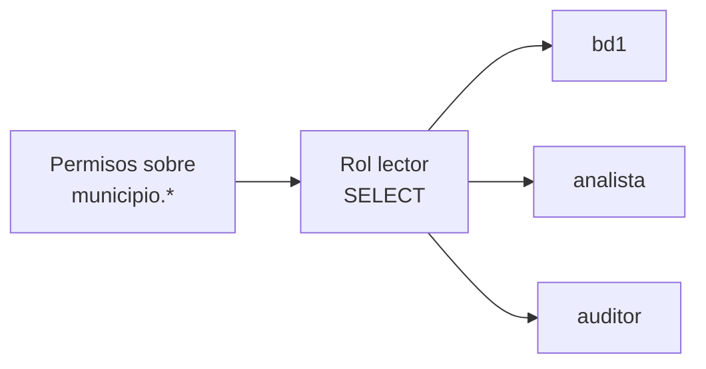

# 19. DCL: permisos y roles

> [!info] Al terminar este capítulo tenés que poder
> - Crear un usuario y asignarle permisos.
> - Diferenciar los niveles de privilegio.
> - Revocar permisos.
> - Explicar el principio de menor privilegio.

> [!abstract] Qué debés saber (nivel 1)
> - **DCL** controla el acceso: `GRANT` y `REVOKE`.
> - Se otorgan permisos sobre objetos: base, tabla, columna.
> - `ALL PRIVILEGES` da todo; mejor otorgar lo mínimo.
> - `WITH GRANT OPTION` permite que el usuario otorgue a otros.
> - Los roles agrupan permisos (MySQL 8).
> - Después de crear un usuario hay que darle permisos: **no tiene ninguno**.

> [!warning] Vacío en el material de cátedra
> La ficha de Siglo 21 marca DCL como **hueco**: el programa lo exige, pero el material no desarrolla las sentencias. Este capítulo se completa con la sintaxis estándar de MySQL, que es lo que se espera en el oral.

## 19.1 Usuarios

```sql
-- Crear
CREATE USER 'bd1'@'localhost' IDENTIFIED BY 'ClaveSegura123!';

-- Ver usuarios
SELECT user, host FROM mysql.user;

-- Eliminar
DROP USER 'bd1'@'localhost';
```

| Parte | Significado |
|---|---|
| `'bd1'` | Nombre de usuario |
| `'localhost'` | Desde dónde puede conectarse (`%` = cualquier host) |
| `IDENTIFIED BY` | Contraseña |

> [!important] `'usuario'@'host'` es la identidad completa
> `'bd1'@'localhost'` y `'bd1'@'%'` son **usuarios distintos**. Es una fuente clásica de “no me conecta”.

## 19.2 Privilegios

| Nivel | Otorga sobre | Ejemplo |
|---|---|---|
| Global | Todo el servidor | `GRANT SELECT ON *.* TO ...` |
| Base de datos | Todas las tablas de una base | `GRANT SELECT ON sakila.* TO ...` |
| Tabla | Una tabla | `GRANT SELECT ON sakila.actor TO ...` |
| Columna | Una columna | `GRANT SELECT (nombre) ON ...` |
| Rutina | Procedimientos/funciones | `GRANT EXECUTE ON PROCEDURE ...` |

### Privilegios frecuentes

| Privilegio | Permite |
|---|---|
| `SELECT` | Leer |
| `INSERT` | Insertar |
| `UPDATE` | Modificar |
| `DELETE` | Borrar |
| `CREATE` / `DROP` | Crear/eliminar objetos |
| `ALTER` | Modificar estructura |
| `EXECUTE` | Ejecutar procedimientos |
| `ALL PRIVILEGES` | Todo lo anterior |

```sql
-- Solo lectura sobre sakila
GRANT SELECT ON sakila.* TO 'bd1'@'localhost';

-- Lectura y escritura sobre una base propia
GRANT SELECT, INSERT, UPDATE, DELETE ON municipio.* TO 'bd1'@'localhost';

-- Todo sobre una base (usar con cuidado)
GRANT ALL PRIVILEGES ON municipio.* TO 'bd1'@'localhost';
```

## 19.3 Revocar

```sql
REVOKE DELETE ON municipio.* FROM 'bd1'@'localhost';

-- Quitar todo
REVOKE ALL PRIVILEGES, GRANT OPTION FROM 'bd1'@'localhost';
```

> [!warning] `REVOKE` no borra al usuario
> Solo quita permisos. Para eliminarlo: `DROP USER`.

### Ver permisos

```sql
SHOW GRANTS FOR 'bd1'@'localhost';
```

Salida:

```text
+---------------------------------------------------------------+
| Grants for bd1@localhost                                      |
+---------------------------------------------------------------+
| GRANT USAGE ON *.* TO `bd1`@`localhost`                       |
| GRANT SELECT ON `sakila`.* TO `bd1`@`localhost`               |
| GRANT SELECT, INSERT, UPDATE, DELETE ON `municipio`.* TO ...  |
+---------------------------------------------------------------+
```

> [!important] `USAGE`
> Significa “puede conectarse, pero sin privilegios”. Es el estado inicial de todo usuario nuevo.

## 19.4 Roles

Un rol agrupa permisos y se asigna a varios usuarios.

```sql
CREATE ROLE 'lector';

GRANT SELECT ON municipio.* TO 'lector';

GRANT 'lector' TO 'bd1'@'localhost';
GRANT 'lector' TO 'analista'@'localhost';

-- Activarlo en la sesión
SET DEFAULT ROLE 'lector' TO 'bd1'@'localhost';
```



| Ventaja | Detalle |
|---|---|
| Menos errores | Se define una vez |
| Cambio centralizado | Se modifica el rol, no cada usuario |
| Auditoría | “Quién tiene el rol X” |

## 19.5 `WITH GRANT OPTION`

```sql
GRANT SELECT ON municipio.* TO 'supervisor'@'localhost'
WITH GRANT OPTION;
```

Permite que `supervisor` otorgue ese permiso a otros. **Riesgo:** se pierde el control de quién tiene qué.

> [!warning] No lo uses por comodidad
> Es una de las causas más comunes de permisos descontrolados. En el oral, mencioná que existe y por qué se evita.

## 19.6 `FLUSH PRIVILEGES`

```sql
FLUSH PRIVILEGES;
```

Se usa solo si modificaste las tablas de permisos **manualmente** (`mysql.user`, `mysql.db`). Si usás `GRANT`/`REVOKE`, MySQL recarga solo.

> [!important] Error frecuente
> “Puse `FLUSH PRIVILEGES` y no pasa nada”. Si el `GRANT` está bien, no hace falta. Si modificaste tablas del sistema, sí.

## 19.7 Programa completo

```sql
-- 1. Usuario de solo lectura para reportes
CREATE USER 'reportes'@'localhost' IDENTIFIED BY 'Reportes2026!';
GRANT SELECT ON municipio.* TO 'reportes'@'localhost';

-- 2. Usuario de carga
CREATE USER 'operador'@'localhost' IDENTIFIED BY 'Operador2026!';
GRANT SELECT, INSERT, UPDATE ON municipio.alerta TO 'operador'@'localhost';

-- 3. Rol de auditoría
CREATE ROLE 'auditor';
GRANT SELECT ON municipio.* TO 'auditor';
GRANT 'auditor' TO 'reportes'@'localhost';
SET DEFAULT ROLE 'auditor' TO 'reportes'@'localhost';

-- 4. Verificación
SHOW GRANTS FOR 'operador'@'localhost';

-- 5. Revocar escritura al operador
REVOKE INSERT, UPDATE ON municipio.alerta FROM 'operador'@'localhost';
```

## Cómo trazar un permiso

| Paso | Pregunta | Ejemplo |
|---|---|---|
| 1 | ¿Quién es el usuario? | `'operador'@'localhost'` |
| 2 | ¿Sobre qué objeto? | `municipio.alerta` |
| 3 | ¿Qué acción? | `INSERT`, `UPDATE` |
| 4 | ¿Necesita otorgar? | No → sin `WITH GRANT OPTION` |
| 5 | ¿Cómo verifico? | `SHOW GRANTS` |

## Errores que suelen tomar

| Error | Corrección |
|---|---|
| Crear usuario y creer que ya puede leer | Otorgar `SELECT` |
| `GRANT ... ON tabla` sin base | `base.tabla` |
| Confundir `REVOKE` con `DROP USER` | Revoke quita permisos |
| `'user'@'%'` sin necesidad | Restringir a `localhost` o IP |
| Dar `ALL PRIVILEGES` a todos | Menor privilegio |
| Usar `WITH GRANT OPTION` sin control | Evitarlo |

## Ejercicios

> [!example]- 1. Crear y otorgar
> **Enunciado:** creá el usuario `consulta` con permiso de lectura sobre `municipio`.
> **Solución:**
> ```sql
> CREATE USER 'consulta'@'localhost' IDENTIFIED BY 'Clave123!';
> GRANT SELECT ON municipio.* TO 'consulta'@'localhost';
> ```

> [!example]- 2. Revocar
> **Enunciado:** quitale el permiso de borrar sobre `alerta`.
> **Solución:**
> ```sql
> REVOKE DELETE ON municipio.alerta FROM 'consulta'@'localhost';
> ```

> [!example]- 3. Rol
> **Enunciado:** creá un rol `solo_lectura` y asignalo a dos usuarios.
> **Solución:**
> ```sql
> CREATE ROLE 'solo_lectura';
> GRANT SELECT ON municipio.* TO 'solo_lectura';
> GRANT 'solo_lectura' TO 'u1'@'localhost', 'u2'@'localhost';
> ```

> [!example]- 4. Interpretar
> **Enunciado:** `SHOW GRANTS` devuelve solo `GRANT USAGE ON *.*`. ¿Qué significa?
> **Solución:** el usuario puede conectarse pero no tiene ningún privilegio sobre datos.

> [!example]- 5. a papel
> **Enunciado:** escribí los permisos mínimos para un operador que solo registra alertas.
> **Solución:**
> ```sql
> GRANT SELECT, INSERT ON municipio.alerta TO 'operador'@'localhost';
> ```
> No necesita `UPDATE`, `DELETE` ni `DROP`.

## Lo que sigue

[[bd_Cierre_parte3|Cierre de la Parte 3]].

#libro2 #basededatos #dcl
