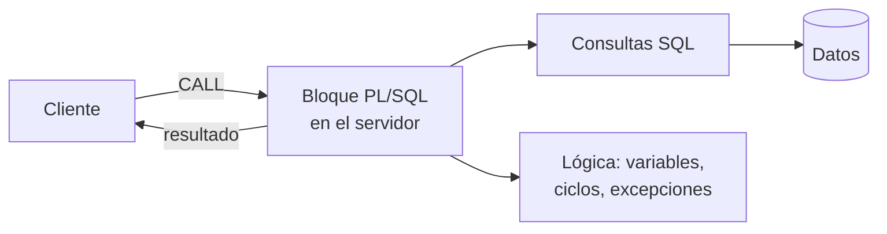

# 20. Extensiones procedimentales de SQL

> [!info] Al terminar este capítulo tenés que poder
> - Explicar la diferencia entre SQL declarativo y PL/SQL procedural.
> - Escribir un bloque anónimo con sus tres secciones.
> - Declarar variables con `%TYPE` y `%ROWTYPE`.
> - Usar `IF`, `CASE`, `LOOP`, `FOR` y `WHILE`.
> - Traducir el bloque a MySQL.

> [!abstract] Qué debés saber (nivel 1)
> - **PL/SQL** es la extensión procedural de SQL creada por Oracle.
> - Un bloque tiene `DECLARE` (opcional), `BEGIN...END` (obligatorio) y `EXCEPTION` (opcional).
> - `DECLARE` declara variables, constantes, cursores y excepciones.
> - `:=` asigna; `=` compara.
> - El bloque anónimo **no** queda guardado en la base.
> - `DBMS_OUTPUT.PUT_LINE` muestra resultados; requiere `SET SERVEROUTPUT ON`.

## 20.1 Declarativo vs. procedural

| | SQL | PL/SQL |
|---|---|---|
| Enfoque | Declarativo | Procedural, por bloques |
| Dice | Qué resultado | Cómo ejecutar una secuencia |
| Tiene variables | No | Sí |
| Tiene control de flujo | No | `IF`, `CASE`, `LOOP` |
| Se guarda | Consultas sueltas | Programas (procedimientos, funciones, paquetes) |

> [!important] Por qué existe
> SQL no puede hacer un `for`, ni capturar un error fila por fila, ni calcular un valor y usarlo después. PL/SQL agrega eso **dentro** de la base, sin sacar los datos al cliente.



## 20.2 Estructura de un bloque

```sql
DECLARE
    v_variable NUMBER := 0;
BEGIN
    v_variable := v_variable + 1;
    DBMS_OUTPUT.PUT_LINE('Valor: ' || v_variable);
END;
/
```

| Sección | Obligatoria | Contiene |
|---|---|---|
| `DECLARE` | No | Variables, constantes, cursores, excepciones propias |
| `BEGIN ... END` | **Sí** | Instrucciones ejecutables |
| `EXCEPTION` | No | Manejo de errores |

> [!warning] La barra `/`
> En SQL*Plus y SQL Developer, `/` ejecuta el bloque. Sin ella, el bloque queda abierto esperando más líneas.

### `NULL` como instrucción

```sql
BEGIN
    NULL;   -- bloque válido que no hace nada
END;
/
```

Es útil cuando querés un bloque vacío para probar sintaxis.

## 20.3 Variables y constantes

```sql
DECLARE
    v_nombre    VARCHAR2(50) := 'Ana';
    v_sueldo    NUMBER(10,2);
    v_fecha     DATE DEFAULT SYSDATE;
    c_iva       CONSTANT NUMBER := 0.21;
    v_total     NUMBER(10,2);
BEGIN
    v_sueldo := 950000;
    v_total  := v_sueldo * (1 + c_iva);

    DBMS_OUTPUT.PUT_LINE('Nombre: ' || v_nombre);
    DBMS_OUTPUT.PUT_LINE('Total: '  || v_total);
    DBMS_OUTPUT.PUT_LINE('Fecha: '  || v_fecha);
END;
/
```

| Elemento | Regla |
|---|---|
| Nombre | Letra inicial, hasta 30 caracteres |
| Asignación | `:=` o `DEFAULT` |
| Constante | `CONSTANT`; no se reasigna |
| `NOT NULL` | Exige valor inicial |
| Comentarios | `--` o `/* */` |

> [!warning] `||` es concatenación
> En PL/SQL se usa `||`, no `+`. `'Total: ' + 5` da error.

### `%TYPE` y `%ROWTYPE`

```sql
DECLARE
    v_nombre empleado.nombre%TYPE;          -- mismo tipo que la columna
    v_fila   empleado%ROWTYPE;              -- toda la fila
BEGIN
    SELECT nombre INTO v_nombre
    FROM empleado
    WHERE legajo = 1001;

    SELECT * INTO v_fila
    FROM empleado
    WHERE legajo = 1001;

    DBMS_OUTPUT.PUT_LINE(v_nombre);
    DBMS_OUTPUT.PUT_LINE(v_fila.apellido || ' - ' || v_fila.sueldo);
END;
/
```

| Ancla | Qué hace | Ventaja |
|---|---|---|
| `%TYPE` | Toma el tipo de una columna o variable | Si cambia el tipo en la tabla, el bloque sigue compilando |
| `%ROWTYPE` | Toma la estructura completa de una fila | Evita declarar cada variable |

> [!important] Por qué se usa
> Evita desincronización: si `nombre` pasa de `VARCHAR2(50)` a `(100)`, no hay que tocar el bloque.

## 20.4 Control de flujo

### `IF / ELSIF / ELSE`

```sql
DECLARE
    v_prioridad NUMBER := 2;
BEGIN
    IF v_prioridad = 1 THEN
        DBMS_OUTPUT.PUT_LINE('Crítica');
    ELSIF v_prioridad = 2 THEN
        DBMS_OUTPUT.PUT_LINE('Alta');
    ELSE
        DBMS_OUTPUT.PUT_LINE('Normal');
    END IF;
END;
/
```

### `CASE`

```sql
DECLARE
    v_prioridad NUMBER := 3;
    v_texto     VARCHAR2(20);
BEGIN
    v_texto := CASE v_prioridad
                   WHEN 1 THEN 'Crítica'
                   WHEN 2 THEN 'Alta'
                   WHEN 3 THEN 'Media'
                   ELSE 'Baja'
               END;
    DBMS_OUTPUT.PUT_LINE(v_texto);
END;
/
```

### `LOOP` simple

```sql
DECLARE
    i NUMBER := 1;
BEGIN
    LOOP
        EXIT WHEN i > 3;
        DBMS_OUTPUT.PUT_LINE('Vuelta ' || i);
        i := i + 1;
    END LOOP;
END;
/
```

### `FOR`

```sql
BEGIN
    FOR i IN 1..3 LOOP
        DBMS_OUTPUT.PUT_LINE('Vuelta ' || i);
    END LOOP;
END;
/
```

### `WHILE`

```sql
DECLARE
    i NUMBER := 1;
BEGIN
    WHILE i <= 3 LOOP
        DBMS_OUTPUT.PUT_LINE('Vuelta ' || i);
        i := i + 1;
    END LOOP;
END;
/
```

| Estructura | Cuándo |
|---|---|
| `LOOP ... EXIT WHEN` | No sabés cuántas vueltas |
| `FOR i IN a..b` | Cantidad conocida |
| `WHILE cond` | Mientras se cumpla algo |

> [!warning] `EXIT WHEN` vs. `IF ... EXIT`
> `EXIT WHEN` es la forma idiomática. `IF cond THEN EXIT; END IF;` también funciona, pero es más verboso.

## 20.5 `SELECT INTO`

Asigna el resultado de una consulta a variables. **Debe devolver exactamente una fila.**

```sql
DECLARE
    v_cantidad NUMBER;
BEGIN
    SELECT COUNT(*) INTO v_cantidad
    FROM alerta
    WHERE prioridad = 1;

    DBMS_OUTPUT.PUT_LINE('Críticas: ' || v_cantidad);
END;
/
```

| Situación | Excepción |
|---|---|
| 0 filas | `NO_DATA_FOUND` |
| 2 o más filas | `TOO_MANY_ROWS` |
| 1 fila | OK |

> [!important] `COUNT(*)` siempre devuelve una fila
> `SELECT COUNT(*) INTO v` nunca lanza `NO_DATA_FOUND`, porque el agregado devuelve `0`, no “sin filas”.

## 20.6 `DBMS_OUTPUT`

```sql
SET SERVEROUTPUT ON;

BEGIN
    DBMS_OUTPUT.PUT_LINE('Hola');
END;
/
```

| Procedimiento | Uso |
|---|---|
| `PUT_LINE(texto)` | Imprime y baja línea |
| `PUT(texto)` | Imprime sin bajar línea |
| `NEW_LINE` | Baja línea |

> [!warning] “No veo nada”
> Casi siempre falta `SET SERVEROUTPUT ON;`. Es la primera cosa que hay que verificar.

## 20.7 El equivalente en MySQL

MySQL **no tiene bloques anónimos** fuera de un programa almacenado. Lo que en Oracle es un bloque, en MySQL es el cuerpo de un procedimiento:

```sql
DELIMITER //

CREATE PROCEDURE demo_bloque()
BEGIN
    DECLARE v_prioridad INT DEFAULT 2;
    DECLARE v_texto VARCHAR(20);

    IF v_prioridad = 1 THEN
        SET v_texto = 'Crítica';
    ELSEIF v_prioridad = 2 THEN
        SET v_texto = 'Alta';
    ELSE
        SET v_texto = 'Normal';
    END IF;

    SELECT v_texto AS resultado;
END //

DELIMITER ;

CALL demo_bloque();
```

| Oracle | MySQL |
|---|---|
| `DECLARE` al inicio del bloque | `DECLARE` al inicio del `BEGIN` |
| `:=` | `SET variable = valor` |
| `DBMS_OUTPUT.PUT_LINE` | `SELECT ...` |
| `%TYPE` / `%ROWTYPE` | `%TYPE` no existe; se declara el tipo |
| Bloque anónimo | Solo dentro de procedimiento/función |

> [!important] Lo que evalúa el EFIP
> El programa pide **PL/SQL**. Enseñá el bloque Oracle y mostrá el equivalente MySQL como traducción. No mezcles sintaxis en un mismo ejemplo.

## 20.8 Las extensiones en otros motores

El concepto es el mismo en todos los motores; lo que cambia es la sintaxis. Conviene poder nombrarlos:

| Aspecto | PL/SQL (Oracle) | T-SQL (SQL Server) | PL/pgSQL (PostgreSQL) | MySQL |
|---|---|---|---|---|
| Extensión | PL/SQL | Transact-SQL | PL/pgSQL (y otros lenguajes) | Rutinas basadas en SQL/PSM |
| Bloque | `DECLARE`–`BEGIN`–`EXCEPTION`–`END` | `BEGIN ... END` (sin `DECLARE`) | `DECLARE`–`BEGIN`–`EXCEPTION`–`END` | `BEGIN ... END` dentro de una rutina |
| Errores | `EXCEPTION` + `SQLERRM` | `TRY ... CATCH` + `THROW` | `EXCEPTION` + `SQLSTATE` | `HANDLER` + `SIGNAL` |
| Paquetes | Sí, nativo | Sin equivalente exacto | No | No |
| Parámetros | `IN`, `OUT`, `IN OUT` | Entrada + `OUTPUT` | `IN`, `OUT`, `INOUT` | `IN`, `OUT`, `INOUT` |
| Fin de bloque | `/` | `GO` | `$$ ... $$` | `DELIMITER //` |

> [!important] Cómo responder en el oral
> Primero el **concepto común** —una extensión procedimental agrega variables, control de flujo, cursores, manejo de errores y encapsulamiento dentro del motor— y después la aclaración: la sintaxis cambia según el motor y solo Oracle tiene paquetes. Nunca mezcles dos sintaxis en un mismo ejemplo.

## Cómo trazar un bloque

```sql
DECLARE
    v_suma NUMBER := 0;
BEGIN
    FOR i IN 1..4 LOOP
        v_suma := v_suma + i;
    END LOOP;
    DBMS_OUTPUT.PUT_LINE(v_suma);
END;
/
```

| Iteración | `i` | `v_suma` |
|---|---|---|
| 1 | 1 | 1 |
| 2 | 2 | 3 |
| 3 | 3 | 6 |
| 4 | 4 | 10 |

Salida: `10`.

## Errores que suelen tomar

| Error | Corrección |
|---|---|
| Usar `=` para asignar | `:=` |
| Olvidar `SET SERVEROUTPUT ON` | Agregarlo antes del bloque |
| `SELECT` sin `INTO` dentro de PL/SQL | No compila |
| `SELECT INTO` que devuelve varias filas | `TOO_MANY_ROWS` |
| Olvidar `/` al final | El bloque no se ejecuta |
| Concatenar con `+` | Usar `||` |
| Declarar variables después de `BEGIN` | Van en `DECLARE` |

## Ejercicios

> [!example]- 1. Bloque mínimo
> **Enunciado:** escribí un bloque que declare una variable, le asigne 5 y la muestre.
> **Solución:**
> ```sql
> SET SERVEROUTPUT ON;
> DECLARE
>     v NUMBER := 5;
> BEGIN
>     DBMS_OUTPUT.PUT_LINE('Valor: ' || v);
> END;
> /
> ```

> [!example]- 2. `%TYPE`
> **Enunciado:** declarar una variable con el tipo de `empleado.sueldo`.
> **Solución:**
> ```sql
> DECLARE
>     v_sueldo empleado.sueldo%TYPE;
> BEGIN
>     NULL;
> END;
> /
> ```

> [!example]- 3. `IF`
> **Enunciado:** mostrar “crítica”, “alta” o “normal” según prioridad 1, 2 o el resto.
> **Solución:** ver 20.4 (primer ejemplo).

> [!example]- 4. `SELECT INTO`
> **Enunciado:** contar alertas de prioridad 1 y mostrarlo.
> **Solución:** ver 20.5.

> [!example]- 5. a papel
> **Enunciado:** escribir un bloque que sume los números del 1 al 10 e imprima el total.
> **Solución:**
> ```sql
> DECLARE
>     v_suma NUMBER := 0;
> BEGIN
>     FOR i IN 1..10 LOOP
>         v_suma := v_suma + i;
>     END LOOP;
>     DBMS_OUTPUT.PUT_LINE('Total: ' || v_suma);   -- 55
> END;
> /
> ```

## Lo que sigue

[[bd21_programas-almacenados|21. Programas almacenados: procedimientos y funciones]].

#libro2 #basededatos #plsql
