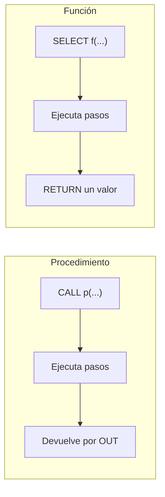

# 21. Programas almacenados: procedimientos y funciones

> [!info] Al terminar este capítulo tenés que poder
> - Diferenciar procedimiento de función.
> - Crear rutinas con parámetros `IN`, `OUT` e `IN OUT`.
> - Invocarlas y verificar el resultado.
> - Escribir su equivalente en MySQL.

> [!abstract] Qué debés saber (nivel 1)
> - **Procedimiento:** realiza una tarea; **no** necesita devolver valor.
> - **Función:** **siempre** devuelve un valor.
> - Parámetros: `IN` (entrada), `OUT` (salida), `IN OUT` (ambas).
> - `CREATE OR REPLACE` reemplaza sin borrar.
> - Un procedimiento se llama con `EXEC`/`CALL`; una función, dentro de una expresión.
> - Ambos quedan **almacenados** en la base.

## 21.1 Procedimiento vs. función

| Aspecto | Procedimiento | Función |
|---|---|---|
| Devuelve valor | No (puede por `OUT`) | **Sí, siempre** |
| Se llama | `EXEC procedimiento(...)` | En un `SELECT` o asignación |
| `RETURN` | Opcional (corta la ejecución) | **Obligatorio** |
| Uso típico | Tarea: registrar, actualizar | Cálculo: total, impuesto |
| Puede modificar datos | Sí | Sí, pero no se recomienda en un `SELECT` |

> [!important] Regla para el oral
> Si necesitás **un valor** para usar en otra consulta, función. Si necesitás **ejecutar una acción**, procedimiento.



> [!important] La diferencia práctica
> Una función se usa **dentro** de una consulta (`SELECT`), un procedimiento se invoca con `CALL`. Si necesitás devolver varias filas o varios valores, usá procedimiento con cursor o parámetros `OUT`.

## 21.2 Procedimiento

```sql
CREATE OR REPLACE PROCEDURE atender_alerta (
    p_id_alerta IN NUMBER,
    p_id_tecnico IN NUMBER
) AS
BEGIN
    UPDATE alerta
       SET atendida = 1
     WHERE id = p_id_alerta;

    IF SQL%ROWCOUNT = 0 THEN
        RAISE_APPLICATION_ERROR(-20001, 'La alerta no existe');
    END IF;

    INSERT INTO reparacion (fecha, costo, id_alerta, id_tecnico)
    VALUES (SYSDATE, 0, p_id_alerta, p_id_tecnico);
END;
/
```

```sql
EXEC atender_alerta(1, 10);
-- o bien:
BEGIN
    atender_alerta(1, 10);
END;
/
```

| Elemento | Detalle |
|---|---|
| `CREATE OR REPLACE` | Reemplaza la versión anterior |
| `p_` | Convención de nombre para parámetros |
| `IN` | Solo entrada (por defecto) |
| `SQL%ROWCOUNT` | Filas afectadas por la última sentencia |
| `RAISE_APPLICATION_ERROR` | Lanza un error con código y mensaje |

> [!warning] El `AS` / `IS`
> Después de la lista de parámetros va `AS` (o `IS`) y luego el cuerpo, **sin** `DECLARE`. Las declaraciones van entre `AS` y `BEGIN`.

## 21.3 Parámetros `OUT` e `IN OUT`

```sql
CREATE OR REPLACE PROCEDURE contar_alertas (
    p_id_dispositivo IN  NUMBER,
    p_cantidad       OUT NUMBER
) AS
BEGIN
    SELECT COUNT(*)
      INTO p_cantidad
      FROM alerta
     WHERE id_dispositivo = p_id_dispositivo;
END;
/
```

```sql
DECLARE
    v_cantidad NUMBER;
BEGIN
    contar_alertas(1, v_cantidad);
    DBMS_OUTPUT.PUT_LINE('Alertas: ' || v_cantidad);
END;
/
```

| Modo | Dirección | Se modifica en la rutina |
|---|---|---|
| `IN` | Entrada | No (solo lectura) |
| `OUT` | Salida | Sí; arranca en `NULL` |
| `IN OUT` | Entrada y salida | Sí; conserva el valor inicial |

> [!important] `OUT` no es “valor de retorno”
> El procedimiento puede tener varios `OUT`: por eso sirve para devolver más de un dato. La función solo puede devolver uno.

## 21.4 Función

```sql
CREATE OR REPLACE FUNCTION costo_total_dispositivo (
    p_id_dispositivo IN NUMBER
) RETURN NUMBER
IS
    v_total NUMBER := 0;
BEGIN
    SELECT NVL(SUM(r.costo), 0)
      INTO v_total
      FROM alerta a
      JOIN reparacion r ON r.id_alerta = a.id
     WHERE a.id_dispositivo = p_id_dispositivo;

    RETURN v_total;
END;
/
```

```sql
-- Se usa como una columna calculada
SELECT d.codigo,
       costo_total_dispositivo(d.id) AS costo_total
FROM dispositivo d;

-- O en una asignación
DECLARE
    v NUMBER;
BEGIN
    v := costo_total_dispositivo(1);
    DBMS_OUTPUT.PUT_LINE(v);
END;
/
```

| Regla | Detalle |
|---|---|
| `RETURN tipo` | Obligatorio en la firma |
| `RETURN valor;` | Obligatorio en el cuerpo |
| `NVL(x, 0)` | Reemplaza `NULL` por 0 |
| Uso en `SELECT` | Debe ser determinística y no modificar datos |

> [!warning] Función que modifica datos
> Es técnicamente posible, pero rompe la lectura y puede fallar en un `SELECT` con muchas filas. Si la función inserta o actualiza, probablemente deba ser un procedimiento.

## 21.5 Ver, recompilar y borrar

```sql
-- Ver el código fuente
SELECT text FROM user_source
WHERE name = 'ATENDER_ALERTA' AND type = 'PROCEDURE'
ORDER BY line;

-- Recompilar
ALTER PROCEDURE atender_alerta COMPILE;

-- Borrar
DROP PROCEDURE atender_alerta;
DROP FUNCTION costo_total_dispositivo;

-- Ver errores de compilación
SHOW ERRORS;
```

> [!important] `SHOW ERRORS` es tu mejor amigo
> Si el procedimiento “se creó con errores”, el cuerpo no se ejecuta. Siempre revisá `SHOW ERRORS` después de un `CREATE`.

## 21.6 Equivalente en MySQL

```sql
DELIMITER //

CREATE PROCEDURE atender_alerta(
    IN p_id_alerta INT,
    IN p_id_tecnico INT
)
BEGIN
    DECLARE v_filas INT DEFAULT 0;

    UPDATE alerta SET atendida = 1 WHERE id = p_id_alerta;
    SET v_filas = ROW_COUNT();

    IF v_filas = 0 THEN
        SIGNAL SQLSTATE '45000'
            SET MESSAGE_TEXT = 'La alerta no existe';
    END IF;

    INSERT INTO reparacion (fecha, costo, id_alerta, id_tecnico)
    VALUES (CURDATE(), 0, p_id_alerta, p_id_tecnico);
END //

DELIMITER ;

CALL atender_alerta(1, 10);
```

```sql
DELIMITER //

CREATE FUNCTION costo_total_dispositivo(p_id INT)
RETURNS DECIMAL(12,2)
DETERMINISTIC
READS SQL DATA
BEGIN
    DECLARE v_total DECIMAL(12,2);

    SELECT IFNULL(SUM(r.costo), 0) INTO v_total
    FROM alerta a
    JOIN reparacion r ON r.id_alerta = a.id
    WHERE a.id_dispositivo = p_id;

    RETURN v_total;
END //

DELIMITER ;

SELECT d.codigo, costo_total_dispositivo(d.id) FROM dispositivo d;
```

| Oracle | MySQL |
|---|---|
| `CREATE OR REPLACE PROCEDURE` | `CREATE PROCEDURE` |
| `AS ... BEGIN` | `BEGIN ... END` |
| `NVL` | `IFNULL` |
| `SYSDATE` | `CURDATE()` / `NOW()` |
| `RAISE_APPLICATION_ERROR` | `SIGNAL SQLSTATE` |
| `SQL%ROWCOUNT` | `ROW_COUNT()` |
| `DELIMITER` | Necesario para el cuerpo |

> [!warning] `DELIMITER`
> Sin cambiar el delimitador, MySQL corta el `CREATE` en el primer `;` del cuerpo. Por eso se usa `//` y después se restaura.

## 21.7 La PK en Oracle: secuencias

Los procedimientos de arriba insertan sin `id` porque el esquema del libro usa `AUTO_INCREMENT`, que es de MySQL. **Oracle no tiene `AUTO_INCREMENT`**: el identificador se genera con una **secuencia**.

```sql
CREATE SEQUENCE alerta_seq START WITH 1 INCREMENT BY 1;

INSERT INTO alerta (id, mensaje, prioridad, atendida, id_dispositivo)
VALUES (alerta_seq.NEXTVAL, 'Lámpara quemada', 2, 0, 1);
```

| Elemento | Detalle |
|---|---|
| `seq.NEXTVAL` | Entrega el próximo número y avanza la secuencia |
| `seq.CURRVAL` | Último número entregado **en tu sesión** (falla si no hubo `NEXTVAL`) |
| `GENERATED ... AS IDENTITY` | Alternativa desde Oracle 12c; es el equivalente a `AUTO_INCREMENT` |

> [!important] Qué contestar
> “En Oracle la PK se genera con secuencia (`seq.NEXTVAL`) o con una columna `IDENTITY` desde 12c. El número que entrega `NEXTVAL` **no se repite** ni vuelve atrás con `ROLLBACK`: puede quedar un hueco, y eso no es un error.”

## Cómo trazar una llamada

```sql
EXEC atender_alerta(1, 10);
```

| Paso | Acción | Efecto |
|---|---|---|
| 1 | Recibe `p_id_alerta = 1`, `p_id_tecnico = 10` | — |
| 2 | `UPDATE alerta ... WHERE id = 1` | `atendida = 1` |
| 3 | `SQL%ROWCOUNT` | 1 |
| 4 | `INSERT INTO reparacion` | nueva fila |
| 5 | Fin | `COMMIT` pendiente (según el cliente) |

> [!important] ¿Quién hace el `COMMIT`?
> El procedimiento **no** confirma por sí solo. En Oracle, el `COMMIT` lo hace el cliente o el bloque que llama. En MySQL, depende de `AUTOCOMMIT` o de un `START TRANSACTION` explícito.

## Errores que suelen tomar

| Error | Corrección |
|---|---|
| Función sin `RETURN` | No compila |
| `OUT` leído antes de asignarlo | Vale `NULL` |
| Olvidar `;` después de `END` | Error de compilación |
| `CREATE` sin `OR REPLACE` | Falla si ya existe |
| No revisar `SHOW ERRORS` | El cuerpo queda inválido |
| `DELIMITER` sin restaurar en MySQL | El cliente queda raro |

## Ejercicios

> [!example]- 1. Procedimiento
> **Enunciado:** creá `registrar_alerta(p_dispositivo, p_mensaje, p_prioridad)` que inserte una alerta.
> **Solución:**
> ```sql
> CREATE OR REPLACE PROCEDURE registrar_alerta (
>     p_dispositivo IN NUMBER,
>     p_mensaje     IN VARCHAR2,
>     p_prioridad   IN NUMBER
> ) AS
> BEGIN
>     INSERT INTO alerta (mensaje, prioridad, id_dispositivo)
>     VALUES (p_mensaje, p_prioridad, p_dispositivo);
> END;
> /
> ```

> [!example]- 2. Función
> **Enunciado:** función `cantidad_alertas(p_dispositivo)` que devuelva el total.
> **Solución:**
> ```sql
> CREATE OR REPLACE FUNCTION cantidad_alertas (
>     p_dispositivo IN NUMBER
> ) RETURN NUMBER IS
>     v NUMBER;
> BEGIN
>     SELECT COUNT(*) INTO v FROM alerta WHERE id_dispositivo = p_dispositivo;
>     RETURN v;
> END;
> /
> ```

> [!example]- 3. `OUT`
> **Enunciado:** procedimiento que devuelva cantidad y prioridad máxima de un dispositivo.
> **Solución:**
> ```sql
> CREATE OR REPLACE PROCEDURE resumen_dispositivo (
>     p_id IN NUMBER,
>     p_cantidad OUT NUMBER,
>     p_max_prioridad OUT NUMBER
> ) AS
> BEGIN
>     SELECT COUNT(*), NVL(MAX(prioridad), 0)
>       INTO p_cantidad, p_max_prioridad
>       FROM alerta WHERE id_dispositivo = p_id;
> END;
> /
> ```

> [!example]- 4. Diferencia
> **Enunciado:** ¿por qué `costo_total_dispositivo` es función y `atender_alerta` es procedimiento?
> **Solución:** la primera **calcula y devuelve un valor** que se usa en una consulta; la segunda **ejecuta una acción** (actualizar e insertar) y no necesita retorno.

> [!example]- 5. a papel
> **Enunciado:** escribí el `CREATE` de una función `promedio_costo()` que devuelva el promedio de costo de reparaciones.
> **Solución:**
> ```sql
> CREATE OR REPLACE FUNCTION promedio_costo
> RETURN NUMBER IS
>     v NUMBER;
> BEGIN
>     SELECT NVL(AVG(costo), 0) INTO v FROM reparacion;
>     RETURN v;
> END;
> /
> ```

## Lo que sigue

[[bd22_cursores|22. Cursores]].

#libro2 #basededatos #procedimientos
