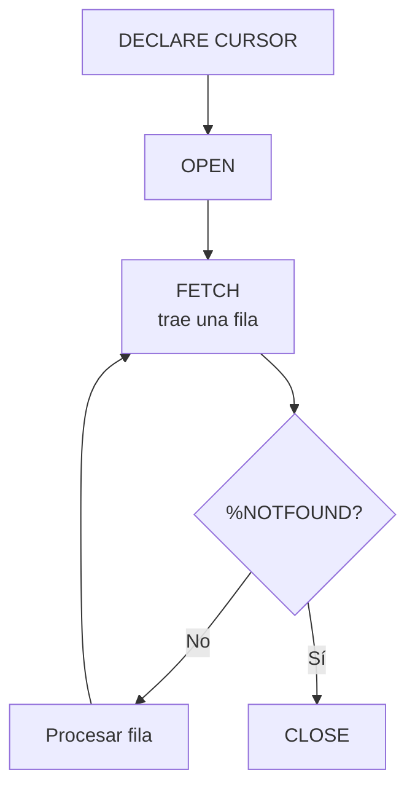

# 22. Cursores

> [!info] Al terminar este capítulo tenés que poder
> - Distinguir cursor implícito de explícito.
> - Recorrer un resultado fila por fila con `OPEN/FETCH/CLOSE`.
> - Usar el `FOR` de cursor (la forma recomendada).
> - Escribir el equivalente en MySQL.

> [!abstract] Qué debés saber (nivel 1)
> - **Cursor implícito:** lo abre Oracle para cada `INSERT`, `UPDATE`, `DELETE` o `SELECT INTO`.
> - Atributos: `SQL%ROWCOUNT`, `SQL%FOUND`, `SQL%NOTFOUND`, `SQL%ISOPEN`.
> - **Cursor explícito:** se declara con nombre para recorrer varias filas.
> - Ciclo: `OPEN` → `FETCH` → `CLOSE`.
> - El `FOR` de cursor hace el ciclo por vos: es la forma preferida.
> - Se usa cuando necesitás **procesar fila por fila**, no para un simple `UPDATE` masivo.

## 22.1 Cursor implícito

Cada sentencia DML abre un cursor interno.

```sql
BEGIN
    UPDATE alerta SET prioridad = 2 WHERE prioridad = 3;

    DBMS_OUTPUT.PUT_LINE('Filas afectadas: ' || SQL%ROWCOUNT);

    IF SQL%NOTFOUND THEN
        DBMS_OUTPUT.PUT_LINE('No se actualizó ninguna');
    END IF;
END;
/
```

| Atributo | Significado |
|---|---|
| `SQL%ROWCOUNT` | Filas afectadas por la última DML |
| `SQL%FOUND` | ¿Afectó al menos una? |
| `SQL%NOTFOUND` | ¿No afectó ninguna? |
| `SQL%ISOPEN` | Siempre `FALSE` para el implícito |

> [!important] `SQL%ROWCOUNT` después de un `SELECT INTO`
> Devuelve 1 si encontró la fila. Si no encontró, lanza `NO_DATA_FOUND` y no llegás a evaluarlo.

## 22.2 Cursor explícito

```sql
DECLARE
    CURSOR c_alertas IS
        SELECT id, mensaje, prioridad
          FROM alerta
         WHERE id_dispositivo = 1
         ORDER BY prioridad;

    v_id        alerta.id%TYPE;
    v_mensaje   alerta.mensaje%TYPE;
    v_prioridad alerta.prioridad%TYPE;
BEGIN
    OPEN c_alertas;

    LOOP
        FETCH c_alertas INTO v_id, v_mensaje, v_prioridad;
        EXIT WHEN c_alertas%NOTFOUND;

        DBMS_OUTPUT.PUT_LINE(v_id || ' [' || v_prioridad || '] ' || v_mensaje);
    END LOOP;

    CLOSE c_alertas;
END;
/
```



| Paso | Qué hace |
|---|---|
| `DECLARE` | Define la consulta (no la ejecuta) |
| `OPEN` | Ejecuta la consulta y posiciona antes de la primera fila |
| `FETCH` | Trae la fila actual a variables y avanza |
| `CLOSE` | Libera el cursor |

> [!warning] El orden del `EXIT`
> `FETCH` primero, `EXIT WHEN ...%NOTFOUND` después. Si evaluás antes del `FETCH`, procesás una fila inexistente.

## 22.3 `FOR` de cursor (recomendado)

```sql
BEGIN
    FOR r IN (
        SELECT id, mensaje, prioridad
          FROM alerta
         WHERE prioridad <= 2
         ORDER BY prioridad
    ) LOOP
        DBMS_OUTPUT.PUT_LINE(r.id || ' - ' || r.mensaje);
    END LOOP;
END;
/
```

Ventajas:

1. **No** hay que declarar variables ni abrir/cerrar.
2. El registro `r` toma la estructura de la consulta.
3. Se cierra solo, incluso si hay excepción.

> [!tip] Regla práctica
> Usá `FOR` de cursor **siempre** que puedas. `OPEN/FETCH/CLOSE` se enseña para entender el mecanismo y para el oral.

## 22.4 Cursor con parámetros

```sql
DECLARE
    CURSOR c_alertas (p_dispositivo NUMBER, p_prioridad NUMBER) IS
        SELECT id, mensaje
          FROM alerta
         WHERE id_dispositivo = p_dispositivo
           AND prioridad <= p_prioridad;

    v_id      alerta.id%TYPE;
    v_mensaje alerta.mensaje%TYPE;
BEGIN
    OPEN c_alertas(1, 2);
    LOOP
        FETCH c_alertas INTO v_id, v_mensaje;
        EXIT WHEN c_alertas%NOTFOUND;
        DBMS_OUTPUT.PUT_LINE(v_id || ': ' || v_mensaje);
    END LOOP;
    CLOSE c_alertas;
END;
/
```

Los parámetros se pasan en el `OPEN`.

## 22.5 Actualizar con cursor

```sql
DECLARE
    CURSOR c_pendientes IS
        SELECT id FROM alerta WHERE atendida = 0
        FOR UPDATE;

BEGIN
    FOR r IN c_pendientes LOOP
        UPDATE alerta
           SET atendida = 1
         WHERE CURRENT OF c_pendientes;
    END LOOP;
END;
/
```

| Cláusula | Efecto |
|---|---|
| `FOR UPDATE` | Bloquea las filas seleccionadas |
| `WHERE CURRENT OF cursor` | Actualiza la fila actual del cursor |

> [!warning] `FOR UPDATE` y concurrencia
> Bloquea filas hasta el `COMMIT`. Si otro usuario intenta modificarlas, espera. No lo uses en procesos largos sin necesidad.

## 22.6 Equivalente en MySQL

```sql
DELIMITER //

CREATE PROCEDURE listar_alertas(IN p_dispositivo INT)
BEGIN
    DECLARE v_id INT;
    DECLARE v_mensaje VARCHAR(200);
    DECLARE v_prioridad TINYINT;
    DECLARE v_fin INT DEFAULT 0;

    DECLARE c_alertas CURSOR FOR
        SELECT id, mensaje, prioridad
        FROM alerta
        WHERE id_dispositivo = p_dispositivo
        ORDER BY prioridad;

    DECLARE CONTINUE HANDLER FOR NOT FOUND SET v_fin = 1;

    OPEN c_alertas;

    bucle: LOOP
        FETCH c_alertas INTO v_id, v_mensaje, v_prioridad;
        IF v_fin = 1 THEN
            LEAVE bucle;
        END IF;

        SELECT CONCAT(v_id, ' - ', v_mensaje) AS linea;
    END LOOP;

    CLOSE c_alertas;
END //

DELIMITER ;

CALL listar_alertas(1);
```

| Oracle | MySQL |
|---|---|
| `%NOTFOUND` | `HANDLER FOR NOT FOUND` + bandera |
| `LOOP ... EXIT WHEN` | `LOOP ... LEAVE etiqueta` |
| `DBMS_OUTPUT` | `SELECT` |
| `CURSOR c IS` | `CURSOR c FOR` |

> [!important] La bandera y el `HANDLER`
> En MySQL, cuando el `FETCH` no encuentra más filas, se dispara el handler `NOT FOUND` y se pone `v_fin = 1`. Es el equivalente al `%NOTFOUND` de Oracle.

## 22.7 Cursor vs. SQL de conjunto

```sql
-- MAL: recorrer para contar
DECLARE
    v_total NUMBER := 0;
BEGIN
    FOR r IN (SELECT id FROM alerta) LOOP
        v_total := v_total + 1;
    END LOOP;
    DBMS_OUTPUT.PUT_LINE(v_total);
END;
/

-- BIEN: una sola consulta
SELECT COUNT(*) FROM alerta;
```

> [!important] Regla de oro
> Si podés resolverlo con **una sentencia SQL**, no uses cursor. El cursor es para lógica que **depende fila a fila** (llamar a un procedimiento, calcular algo con estado, actualizar con condiciones complejas).

## Cómo trazar un cursor

`alerta`: `(1, A, 2)`, `(2, B, 1)`, `(3, C, 4)`. Cursor ordenado por prioridad, filtro `<= 2`.

| `FETCH` | Fila | `%NOTFOUND` | Procesa |
|---|---|---|---|
| 1 | `(2, B, 1)` | false | sí |
| 2 | `(1, A, 2)` | false | sí |
| 3 | — | true | sale del loop |

## Errores que suelen tomar

| Error | Corrección |
|---|---|
| `EXIT WHEN` antes del `FETCH` | Evaluar después |
| No cerrar el cursor | Fuga de recursos |
| `SELECT` sin `ORDER BY` y esperar un orden | El orden no está garantizado |
| Usar cursor para un `UPDATE` masivo | Una sola sentencia SQL |
| Variables con tipo distinto al de la columna | Usar `%TYPE` |
| `FOR UPDATE` sin `COMMIT` | Bloqueos retenidos |

## Ejercicios

> [!example]- 1. Implícito
> **Enunciado:** luego de `DELETE FROM alerta WHERE prioridad = 5`, ¿cómo sabés cuántas se borraron?
> **Solución:** `DBMS_OUTPUT.PUT_LINE(SQL%ROWCOUNT);`

> [!example]- 2. Explícito
> **Enunciado:** recorrer e imprimir los mensajes de las alertas de prioridad 1.
> **Solución:**
> ```sql
> BEGIN
>     FOR r IN (SELECT mensaje FROM alerta WHERE prioridad = 1) LOOP
>         DBMS_OUTPUT.PUT_LINE(r.mensaje);
>     END LOOP;
> END;
> /
> ```

> [!example]- 3. Parámetros
> **Enunciado:** cursor que reciba la prioridad máxima.
> **Solución:** ver 22.4, adaptando el `OPEN`.

> [!example]- 4. Actualización
> **Enunciado:** marcar como atendidas todas las alertas de un dispositivo.
> **Solución:** no hace falta cursor:
> ```sql
> UPDATE alerta SET atendida = 1 WHERE id_dispositivo = 1;
> ```

> [!example]- 5. a papel
> **Enunciado:** escribir el ciclo `OPEN/FETCH/CLOSE` para recorrer `SELECT id FROM alerta`.
> **Solución:**
> ```sql
> DECLARE
>     CURSOR c IS SELECT id FROM alerta;
>     v_id alerta.id%TYPE;
> BEGIN
>     OPEN c;
>     LOOP
>         FETCH c INTO v_id;
>         EXIT WHEN c%NOTFOUND;
>         DBMS_OUTPUT.PUT_LINE(v_id);
>     END LOOP;
>     CLOSE c;
> END;
> /
> ```

## Lo que sigue

[[bd23_excepciones|23. Excepciones]].

#libro2 #basededatos #cursores
