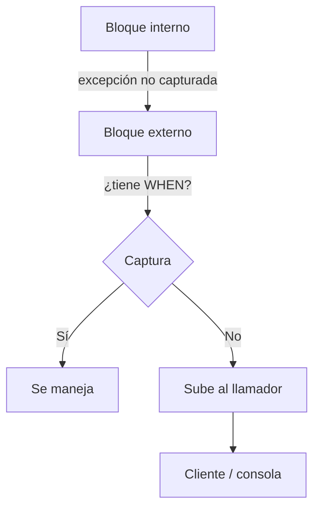

# 23. Excepciones

> [!info] Al terminar este capítulo tenés que poder
> - Explicar qué es una excepción en PL/SQL.
> - Usar las predefinidas más comunes.
> - Definir y lanzar una excepción propia.
> - Escribir `WHEN OTHERS` correctamente.
> - Traducirlo a MySQL con `HANDLER`.

> [!abstract] Qué debés saber (nivel 1)
> - Una excepción **interrumpe** el flujo normal y salta a la sección `EXCEPTION`.
> - Predefinidas: `NO_DATA_FOUND`, `TOO_MANY_ROWS`, `ZERO_DIVIDE`, `DUP_VAL_ON_INDEX`.
> - Se capturan con `WHEN nombre THEN`.
> - `WHEN OTHERS` va **al final** y captura lo no tratado.
> - `RAISE` lanza; `RAISE_APPLICATION_ERROR` lanza con código y mensaje.
> - Si nadie la captura, se propaga al llamador.

## 23.1 Estructura

```sql
DECLARE
    v_numero NUMBER;
BEGIN
    v_numero := 10 / 0;          -- error
    DBMS_OUTPUT.PUT_LINE('No llega acá');
EXCEPTION
    WHEN ZERO_DIVIDE THEN
        DBMS_OUTPUT.PUT_LINE('No se puede dividir por cero');
    WHEN OTHERS THEN
        DBMS_OUTPUT.PUT_LINE('Error: ' || SQLERRM);
END;
/
```

| Sección | Qué hace |
|---|---|
| `BEGIN` | Código normal |
| `EXCEPTION` | Qué hacer si algo falla |
| `WHEN OTHERS` | Último recurso |

> [!important] Si no hay `EXCEPTION`
> El error se propaga al llamador. En un bloque anónimo, se muestra en consola y termina. En un procedimiento, llega a quien lo invocó.

## 23.2 Excepciones predefinidas

| Excepción | Cuándo se dispara |
|---|---|
| `NO_DATA_FOUND` | `SELECT INTO` no devolvió filas |
| `TOO_MANY_ROWS` | `SELECT INTO` devolvió más de una |
| `ZERO_DIVIDE` | División por cero |
| `DUP_VAL_ON_INDEX` | Se violó una `UNIQUE` o `PK` |
| `INVALID_NUMBER` | Conversión de texto a número fallida |
| `VALUE_ERROR` | Error de conversión o tamaño |
| `CURSOR_ALREADY_OPEN` | Se abrió un cursor ya abierto |

```sql
DECLARE
    v_nombre empleado.nombre%TYPE;
BEGIN
    SELECT nombre INTO v_nombre
    FROM empleado
    WHERE legajo = 999;          -- no existe

    DBMS_OUTPUT.PUT_LINE(v_nombre);
EXCEPTION
    WHEN NO_DATA_FOUND THEN
        DBMS_OUTPUT.PUT_LINE('No existe el legajo 999');
END;
/
```

> [!warning] `NO_DATA_FOUND` y los agregados
> `SELECT COUNT(*) INTO v` **nunca** lanza `NO_DATA_FOUND`: devuelve `0`. Solo se dispara cuando la consulta no devuelve **ninguna fila**.

## 23.3 Excepción definida por el usuario

```sql
DECLARE
    e_prioridad_invalida EXCEPTION;

    v_prioridad NUMBER := 9;
BEGIN
    IF v_prioridad < 1 OR v_prioridad > 5 THEN
        RAISE e_prioridad_invalida;
    END IF;

    DBMS_OUTPUT.PUT_LINE('Prioridad válida');
EXCEPTION
    WHEN e_prioridad_invalida THEN
        DBMS_OUTPUT.PUT_LINE('La prioridad debe estar entre 1 y 5');
END;
/
```

| Paso | Acción |
|---|---|
| 1 | Declarar `e_nombre EXCEPTION;` |
| 2 | `RAISE e_nombre;` cuando se cumple la condición |
| 3 | Capturar con `WHEN e_nombre THEN` |

> [!important] Por qué se usa
> Para tratar como error una **regla de negocio**, no un fallo técnico. “La prioridad debe estar entre 1 y 5” es una regla del dominio.

## 23.4 `RAISE_APPLICATION_ERROR`

Lanza un error con código y mensaje, visible para el cliente.

```sql
CREATE OR REPLACE PROCEDURE validar_prioridad (p_prioridad IN NUMBER) AS
BEGIN
    IF p_prioridad < 1 OR p_prioridad > 5 THEN
        RAISE_APPLICATION_ERROR(-20001, 'Prioridad fuera de rango (1..5)');
    END IF;
END;
/
```

| Parámetro | Regla |
|---|---|
| Código | Entre `-20000` y `-20999` |
| Mensaje | Hasta 2048 caracteres |

> [!warning] El código no es arbitrario
> Fuera del rango `-20000..-20999`, Oracle lo rechaza. Es un dato que se pregunta.

## 23.5 `WHEN OTHERS`

```sql
BEGIN
    -- operaciones riesgosas
EXCEPTION
    WHEN ZERO_DIVIDE THEN
        DBMS_OUTPUT.PUT_LINE('División por cero');
    WHEN OTHERS THEN
        DBMS_OUTPUT.PUT_LINE('Error inesperado: ' || SQLERRM);
        DBMS_OUTPUT.PUT_LINE('Código: ' || SQLCODE);
END;
/
```

| Función | Devuelve |
|---|---|
| `SQLCODE` | Código numérico del error |
| `SQLERRM` | Mensaje |

> [!warning] `WHEN OTHERS` no es un cajón de basura
> Si lo usás para “que no falle nada”, ocultás errores reales. Lo correcto es registrar (`SQLERRM`) y, si no podés resolverlo, **relanzar** con `RAISE;`.

```sql
EXCEPTION
    WHEN OTHERS THEN
        INSERT INTO log_error (fecha, mensaje) VALUES (SYSDATE, SQLERRM);
        RAISE;      -- vuelve a lanzar para que el llamador se entere
END;
/
```

## 23.6 Propagación



```sql
BEGIN
    BEGIN
        RAISE_APPLICATION_ERROR(-20002, 'Error interno');
    EXCEPTION
        WHEN OTHERS THEN
            DBMS_OUTPUT.PUT_LINE('Interno: ' || SQLERRM);
            RAISE;      -- se propaga
    END;
EXCEPTION
    WHEN OTHERS THEN
        DBMS_OUTPUT.PUT_LINE('Externo: ' || SQLERRM);
END;
/
```

## 23.7 Equivalente en MySQL

```sql
DELIMITER //

CREATE PROCEDURE dividir(IN a INT, IN b INT)
BEGIN
    DECLARE EXIT HANDLER FOR SQLEXCEPTION
    BEGIN
        SELECT 'Ocurrió un error' AS mensaje;
    END;

    IF b = 0 THEN
        SIGNAL SQLSTATE '45000'
            SET MESSAGE_TEXT = 'No se puede dividir por cero';
    END IF;

    SELECT a / b AS resultado;
END //

DELIMITER ;
```

| Oracle | MySQL |
|---|---|
| `EXCEPTION WHEN ...` | `DECLARE ... HANDLER FOR ...` |
| `ZERO_DIVIDE` | SQLSTATE `22012` |
| `NO_DATA_FOUND` | `HANDLER FOR NOT FOUND` |
| `RAISE_APPLICATION_ERROR` | `SIGNAL SQLSTATE '45000'` |
| `SQLERRM` | `MESSAGE_TEXT` |

> [!important] `EXIT` vs. `CONTINUE` en MySQL
> `EXIT HANDLER` sale del bloque; `CONTINUE HANDLER` sigue con la instrucción siguiente. Para “fin del cursor” se usa `CONTINUE`; para un error fatal, `EXIT`.

## Cómo trazar una excepción

```sql
BEGIN
    DBMS_OUTPUT.PUT_LINE('A');
    RAISE_APPLICATION_ERROR(-20001, 'Falla');
    DBMS_OUTPUT.PUT_LINE('B');
EXCEPTION
    WHEN OTHERS THEN
        DBMS_OUTPUT.PUT_LINE('C');
END;
/
```

| Paso | Salida | Detalle |
|---|---|---|
| 1 | `A` | antes del error |
| 2 | — | se lanza la excepción; **B no se ejecuta** |
| 3 | `C` | se captura en `OTHERS` |

## Errores que suelen tomar

| Error | Corrección |
|---|---|
| `WHEN OTHERS` primero | Va **último** |
| Capturar y no hacer nada | Registrar o relanzar |
| Código fuera de `-20000..-20999` | Rango inválido |
| Esperar `NO_DATA_FOUND` de un `COUNT(*)` | Nunca ocurre |
| No capturar `TOO_MANY_ROWS` | Fallará el bloque |
| Usar excepciones para el flujo normal | Solo para condiciones excepcionales |

## Ejercicios

> [!example]- 1. Predefinida
> **Enunciado:** capturar el caso de un `SELECT INTO` sin filas.
> **Solución:**
> ```sql
> EXCEPTION
>     WHEN NO_DATA_FOUND THEN
>         DBMS_OUTPUT.PUT_LINE('Sin resultados');
> ```

> [!example]- 2. Propia
> **Enunciado:** lanzar una excepción si el costo es negativo.
> **Solución:**
> ```sql
> DECLARE
>     e_costo EXCEPTION;
> BEGIN
>     IF costo < 0 THEN RAISE e_costo; END IF;
> EXCEPTION
>     WHEN e_costo THEN DBMS_OUTPUT.PUT_LINE('Costo inválido');
> END;
> /
> ```

> [!example]- 3. `RAISE_APPLICATION_ERROR`
> **Enunciado:** validar que una prioridad esté entre 1 y 5.
> **Solución:** ver 23.4.

> [!example]- 4. `OTHERS`
> **Enunciado:** ¿por qué no conviene un `WHEN OTHERS` vacío?
> **Solución:** porque oculta errores: el programa sigue como si nada y deja datos inconsistentes. Hay que registrar y relanzar.

> [!example]- 5. a papel
> **Enunciado:** escribir un bloque que intente dividir por cero y muestre un mensaje.
> **Solución:**
> ```sql
> BEGIN
>     DBMS_OUTPUT.PUT_LINE(10 / 0);
> EXCEPTION
>     WHEN ZERO_DIVIDE THEN
>         DBMS_OUTPUT.PUT_LINE('División por cero');
> END;
> /
> ```

## Lo que sigue

[[bd24_triggers|24. Triggers]].

#libro2 #basededatos #excepciones
